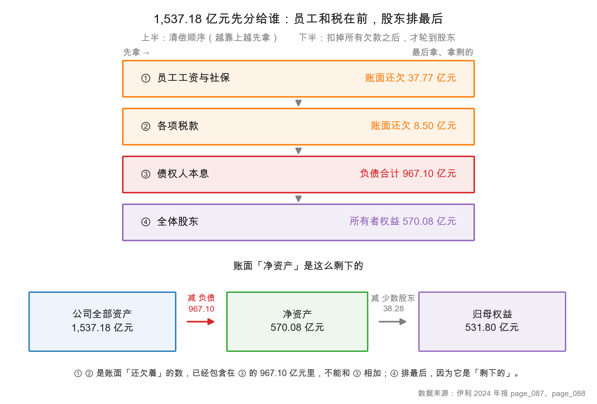
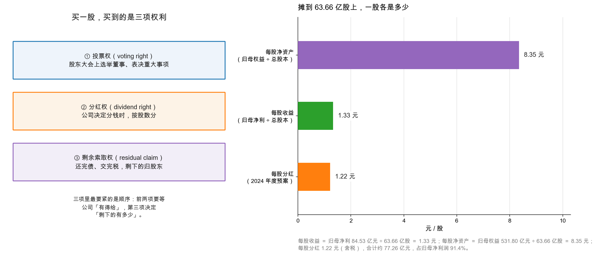

# 第 1 章：股票是什么——你买的是公司的一小片

> 本章你将：
> - 用一家奶茶店讲清楚"买股票 = 买公司所有权的一小片"；
> - 搞明白为什么股东排在债权人、员工、税务局**后面**拿钱，以及这意味着什么；
> - 学会从年报里读出三个"每股"数字：1.33 元、8.35 元、1.22 元；
> - 知道 63.66 亿股这个数意味着什么，以及 A 股和港股的基本差别；
> - 第一次看到"第四季度亏 24.16 亿"这个悬念。

---

## 1.1 从一张奶茶店的"股份"说起

先不碰股票。想象你和两个朋友合伙开一家奶茶店，总投资 30 万元，三人各出 10 万。为了说清楚"谁占多少"，你们在纸上写：这家店一共分成 30 份，每份 1 万元，你持 10 份。

这张纸，就是最原始的股票。**它本身不是钱，它是一张"这家店的 30 分之 10 归你"的凭证。** 你可以把它卖给第四个人，那人就成了新的合伙人；你可以拿它去银行质押；你可以在三人开会时用它投一票。

现在把"奶茶店"换成"内蒙古伊利实业集团股份有限公司"，把"30 份"换成"63.66 亿股"，把"1 万元一份"换成"1 股面值 1 元"——你就得到了 A 股股票的本质。伊利 2024 年报第 88 页"股本"那一行写着 6,365,900,705.00 元，因为每股面值 1 元，所以股数正好是 6,365,900,705 股，也就是 **63.66 亿股**。

> 📌 **划重点：** 买一股股票，买的不是一张会涨会跌的纸，买的是这家公司**所有权的一小片**。这一小片带来三样东西：投票权、分红权、剩余索取权。三样里最要紧的是第三样，因为它决定了前两样到底值多少钱。

<!-- src: 伊利股份2024年报/page_088.md -->

## 1.2 三项权利，和它们的先后顺序

上一节说的三项权利，值得一个一个拆开看。

**第一，投票权（voting right）。** 你持有股票，就有资格参加股东大会，选举董事、表决重大事项（比如修改章程、重大并购）。但要说实话：一个持有 100 股的散户，投票权接近于零——伊利的股东总数是 406,010 户，你的一票扔进去听不见响。投票权的真实意义不在"你能决定什么"，而在"**有人能決定什么**"：它保证了这家公司最终要向一群股东负责，而不是向某个领导负责。这是上市公司和非上市公司最本质的差别之一。

**第二，分红权（dividend right）。** 公司赚了钱，可以决定分一部分给股东，这叫分红（dividend）。伊利 2024 年度预案是每股派现 1.22 元（含税），按总股本扣掉回购专户后的股数计算，合计约 77.26 亿元，占归母净利润的 91.40%（年报第 2 页）。这个比例相当高，说明公司愿意把赚到的钱大部分还给股东。

**第三，剩余索取权（residual claim）。** 这一条最难，也最重要。它的意思是：公司如果清算，先把该付的都付完，**剩下的**才归股东。"剩下的"三个字是关键词——它既可能是很多，也可能是零。

<!-- src: 伊利股份2024年报/page_002.md 伊利股份2024年报/page_073.md -->

## 1.3 清偿顺序：股东为什么排在最后

现在讲这一章最该记住的一张图。

这张图分上下两半。上半是**顺序**，下半是**结果**。

顺序是这样的：

1. **员工工资与社保。** 公司欠员工的工资、欠缴的社保，是第一顺位。伊利 2024 年末"应付职工薪酬"账面 37.77 亿元。
2. **各项税款。** 欠税务局的钱排在员工之后、债权人之前。伊利年末"应交税费"8.50 亿元。
3. **债权人本息。** 银行贷款、债券、应付账款，都要按合同还。伊利负债合计 967.10 亿元。
4. **股东。** 前面全付完，剩下的归股东。伊利所有者权益 570.08 亿元。

下半是结果：1,537.18 亿元的总资产，减去 967.10 亿元的负债，剩下 570.08 亿元的净资产；再减掉 38.28 亿元属于少数股东的权益，剩下 **531.80 亿元**归母权益——这才是你作为伊利股东真正"拥有"的那一份。

> 💡 **你可能会问：** 图里第 1、2 项加起来才 46 亿，第 3 项却有 967 亿，这个"顺序"在实际中有什么用？
>
> 顺序的意义不在金额大小，而在**极端情况下的归属**。公司正常经营时，四拨人都能拿到钱，顺序看不出来。可一旦公司撑不住要清算，资产往往只够还前几项——这时候"排第几"就从纸面变成了真金白银。你买股票，等于自愿站到队尾。所以买股票之前，你必须先看清前面排了多少人、他们手里拿着多少欠条，这就是"看负债"这件事的由来（第 5 周会专门讲）。

> ⚠️ **易踩坑：** 把"净资产 570.08 亿"当成"公司值 570.08 亿"。
>
> 不是。570.08 亿是**账面**净资产，是按会计规则记出来的数。公司真正值多少钱，要看市场愿意为它未来能赚的钱付多少——这两个数经常差很远。第 46 章会专门讲"账面价值"和"市场价值"的裂缝。本周你只要记住：净资产是"账上剩下的"，不是"卖掉的价钱"。

<!-- src: 伊利股份2024年报/page_087.md 伊利股份2024年报/page_088.md -->

前面反复说"股东排在债权人后面"。这句话值得单独用一节讲透，因为它是整本书的世界观底座。

假设伊利要建一个新工厂，需要 10 亿元。有两个办法筹钱：

**办法一，借钱。** 找银行借 10 亿，年利率 3%。银行成了**债权人**（creditor）。合同写得很清楚：每年付 3,000 万利息，5 年后还本。不管这个工厂赚不赚钱，这 3,000 万都得付；付不出来就是违约，银行可以起诉、可以申请查封资产。

**办法二，发股票。** 增发 10 亿元的新股，卖给新的投资者。这些人成了**股东**。公司不需要"还"这 10 亿，也不需要"付利息"；但如果工厂赚了钱，新股东要按持股比例分走一部分；如果工厂亏了，新股东的钱就跟着缩水。

两种身份的核心差别，可以列成一张表：

| 维度 | 债权人 | 股东 |
|---|---|---|
| 拿的是固定还是浮动 | **固定**（利息 + 本金） | **浮动**（分红 + 剩余） |
| 公司赚钱时 | 还是只拿利息 | 拿全部剩余，上不封顶 |
| 公司亏钱时 | 照样要利息，还不上就违约 | 直接承担亏损 |
| 在公司里的发言权 | 一般没有投票权 | 有投票权 |
| 清偿顺序 | 在股东**之前** | 在最后 |
| 会计上记在哪 | 负债 | 所有者权益 |

这张表解释了一个很多人想不通的现象：**为什么"负债率高"有时不是坏事。** 如果一家公司能借到年利率 3% 的钱，而它自己做生意能赚 15% 的回报，那借钱就是在给股东加杠杆——借来的钱赚的差价，全归股东。反过来，如果生意只能赚 2%，借 3% 的钱就是自杀。

伊利 2024 年的有息负债是 605.58 亿元，账上的货币资金加各类存款是 652.07 亿元——**类现金比有息负债还多 46.50 亿元**。也就是说，它其实不缺钱，甚至可以说是"净现金"状态。这个结构在第 5 周（第 23 章）会详细拆，本周你只需要建立一个直觉：**看一家公司的负债，先分清"欠银行的钱"和"欠供应商的钱"，两者的性质完全不同。**

> 📌 **划重点：** 债权人和股东是两种完全不同的身份：一个拿固定、排前面、不承担经营风险；一个拿浮动、排最后、承担全部经营风险。买股票之前，先问一句"我在这家公司的队里排第几"。

## 1.4 三个"每股"数字，和 63.66 亿股这个分母

知道了自己拥有"一小片"，接下来就该问：这一小片到底有多大？年报给了三个直接答案。

**第一，每股净资产 8.35 元。** 算法是归母权益 ÷ 总股本：

$$531.80 \text{ 亿元} \div 63.66 \text{ 亿股} \approx 8.35 \text{ 元/股}$$

年报第 7 页"主要财务指标"里没有直接列这一项，但你可以自己算；用精确数字算出来是 8.3539 元。它的意思是：如果把公司按账面价值清算，你手里每一股对应 8.35 元的家底。

**第二，每股收益 1.33 元。** 算法是归母净利润 ÷ 总股本：

$$84.53 \text{ 亿元} \div 63.66 \text{ 亿股} \approx 1.33 \text{ 元/股}$$

这个数字年报第 7 页和第 92 页都直接给了：基本每股收益 1.33 元，2023 年是 1.64 元。它的意思是：这一年公司每 1 股赚了 1.33 元。

**第三，每股分红 1.22 元。** 这个数在第 2 页的利润分配预案里。1.22 $\div$ 1.33 $\approx$ 91.7%，和年报披露的"占归母净利润 91.40%"基本吻合（差异来自分母用了扣除回购专户后的股数）。

三个数字放在一起，能读出一点味道：**公司一年每股赚 1.33 元，分给你 1.22 元，自己留下 0.11 元。** 这是一家成熟公司的典型样子——不怎么需要再投入大钱扩张，赚的钱大部分还给你。

> 🔍 **翻到年报：** 打开 `page_007.md`，找到"(二)主要财务指标"那张表，第一行就是"基本每股收益（元/股）1.33"。再翻到 `page_092.md` 最后几行，也有"（一）基本每股收益（元/股）1.33"。两个地方给的数一样，这是交叉验证的好习惯。

> ⚠️ **易踩坑：** 算 EPS 时用"净利润"而不是"归母净利润"。
>
> 伊利 2024 年净利润是 84.64 亿元，归母净利润是 84.53 亿元，差 0.11 亿元是少数股东损益。用 84.64 去除股数，得到 1.3297，四舍五入还是 1.33——**这一次碰巧没差**。但在少数股东占比大的公司，用错分母能差出好几个百分点。记住：**EPS 的分子永远是归母净利润。**

<!-- src: 伊利股份2024年报/page_007.md 伊利股份2024年报/page_092.md -->

### 分母：63.66 亿股，意味着什么

股数本身不说明好坏，但它决定了三件事。

**第一，它决定了"每股"的分母。** 同样是赚 84.53 亿元，如果股本是 30 亿股，EPS 就是 2.82 元；如果是 100 亿股，EPS 就是 0.85 元。所以看 EPS 的绝对高低没有意义，必须同时看股数。两家公司 EPS 都是 1 元，一家股本 10 亿、一家股本 100 亿，体量差十倍。

**第二，它会变。** 伊利的总股本不是一直 63.66 亿股。年报第 105 页记录了它的变化史：2023 年因为回购注销限制性股票，从 63.99 亿股一路减到 63.66 亿股；2024 年又注销了 136,400 股和 61,600 股。**回购注销会让股数变少，增发新股会让股数变多。** 股数变了，EPS 就跟着变，即使利润一分没变。

**第三，它是"市值"的乘数。** 市值 = 股价 $\times$ 总股本。假设股价 28 元（示意，非真实报价），伊利的市值就是 $28 \times 63.66 \approx 1{,}782$ 亿元。请注意这个 28 是**假设数字**，不是真实报价——真实股价每天在变，你要自己去行情软件上查最新价，然后自己乘。用同一个假设价，市盈率（PE）就是 $1{,}782 \div 84.53 \approx 21$ 倍。这个"21 倍贵不贵"的问题，第 47 章专门讨论；本周你只要会算。

股数会变，变化有三种来源，含义完全不同：

| 变化方式 | 股数方向 | 对每股指标的影响 | 通常意味着 |
|---|---|---|---|
| 回购并注销 | 减少 | EPS、每股净资产**上升** | 管理层认为股价便宜，或想回报股东 |
| 增发新股 / 可转债转股 | 增加 | EPS、每股净资产**被摊薄** | 公司在融资，或在做并购 |
| 股权激励行权 | 小幅增加 | 轻微摊薄 | 用股份换员工留任 |

伊利 2024 年走的是第一条路：年报第 105 页记录，2024 年 8 月回购注销限制性股票 136,400 股，12 月又注销 61,600 股，总股本从年初的 63.66 亿股微降到 63.659 亿股。同时第 2 页提到，公司回购专户里还躺着 32,859,361 股——这部分不算在"利润分配基数"里，所以分红总额按扣除后的股数计算。

**这三件事要连起来看：** 回购注销（股数减少）会推高 EPS；但伊利 2024 年 EPS 仍然从 1.64 元跌到 1.33 元，说明利润下滑的幅度（-18.94%）远大于股数减少的幅度（约 -0.006%）。**当有人跟你说"我们每股收益增长了，因为回购"，你要立刻去看利润是不是也增长了。**

> 💡 **你可能会问：** 为什么年报里说"总股本 6,365,900,705 股"，但你让我记 63.66 亿股？
>
> 因为 6,365,900,705 这个数太长，读起来累，算起来容易错。63.66 亿是它的近似值（精确值是 63.659 亿）。做粗算时用 63.66 亿足够；做精确核对时再用原值。这是本教程的通用习惯：**正文用亿元/亿股，表格里给原值。**

<!-- src: 伊利股份2024年报/page_007.md 伊利股份2024年报/page_088.md 伊利股份2024年报/page_105.md -->

## 1.5 A 股和港股，差别在哪

伊利是 A 股，在上海证券交易所上市，代码 600887。你可能还听过"港股"（在香港交易所上市，比如蒙牛乳业 2319.HK）。两者最基础的差别有四条：

| 维度 | A 股（伊利 600887） | 港股（蒙牛 2319.HK） |
|---|---|---|
| 交易货币 | 人民币 | 港币 |
| 每手股数 | 100 股 | 每手不同，蒙牛是 1,000 股 |
| 涨跌幅限制 | 有（主板 ±10%） | 无涨跌幅限制 |
| 年报语言 | 中文 | 中英双语，中文多用繁体 |
| 报表单位 | 元 | 千元（RMB'000） |
| 年报章节名 | 资产负债表 / 利润表 | 财务状况表 / 损益表 |
| 非经常性损益专表 | **有**（监管强制） | **没有** |

最后两条对读年报影响最大。港股年报的报表叫"綜合財務狀況表""綜合損益表"，数字单位是"千元"——你抄数时若忘了乘 1000，所有数字会小一千倍。

举个具体的：蒙牛乳业 2024 年报第 142 页，表头第二行写着"at 31 December 2024 (Expressed in RMB) 於二零二四年十二月三十一日(以人民幣列示)"，第四行写着"RMB'000"。同一份年报第 3 页的目录里，三张表的名字是"綜合損益表""綜合財務狀況表""綜合現金流量表"，而伊利第 4 页的目录写的是"利润表""资产负债表""现金流量表"。**同一个东西，两套叫法**——如果你只认识 A 股的叫法，翻港股年报时会找不到表。

还有一处更隐蔽的差别：港股年报的目录会直接给你页码（蒙牛第 3 页目录里写着"綜合財務狀況表 …… 140"），而 A 股年报的目录只列章节名、不给页码。所以读港股年报要"先看目录页码，再定位文件"；读 A 股年报只能"从头翻"或者"用搜索"。

至于"非经常性损益"那张专表，A 股的格式是监管定死的：一张表列出每一项、金额、附注、上年金额，最后算出"扣非归母净利润"。伊利第 8–9 页就是这张表，非经常性损益合计 24.42 亿元，扣非归母净利润 60.11 亿元。港股没有这张表，你得自己从"其他收益""其他费用""一次性项目"里一项一项挑出来——工作量大得多，也更容易漏。

> 📌 **划重点：** 伊利的"扣非归母净利润 60.11 亿元"和"归母净利润 84.53 亿元"差了 24.42 亿元。这 24.42 亿就是非经常性损益——主要是处置子公司股权的一次性收益（第 33 章会细讲）。港股公司不会给你算好这个数，这是 A 股投资者的一个便利。

<!-- src: 伊利股份2024年报/page_007.md 伊利股份2024年报/page_008.md -->

## 1.6 一个悬念：全年赚 84.53 亿，第四季度亏 24.16 亿

本章最后，留一个钩子。

伊利 2024 年报第 8 页"分季度主要财务数据"里，四行数字是这样的：

| 项目 | 第一季度 | 第二季度 | 第三季度 | 第四季度 |
|---|---|---|---|---|
| 营业收入（亿元） | 324.63 | 272.33 | 290.37 | 266.60 |
| 归母净利润（亿元） | 59.23 | 16.08 | 33.37 | **-24.16** |
| 扣非归母净利润（亿元） | 37.28 | 15.97 | 31.84 | **-24.98** |

前三季度赚了 108.68 亿元，第四季度一把亏掉 24.16 亿元，全年剩下 84.53 亿元。

这个数字不是笔误，也不是"打字打错了"。它是年报白纸黑字披露的。**它说明：第四季度发生了某件很花钱的事。**

如果你现在就去翻第 91 页的利润表，会看到"资产减值损失 -46.76 亿元"。如果你再翻到第 211 页的附注七(73)，会看到这 46.76 亿里，商誉减值占 30.75 亿。**一个 30.75 亿的一次性减值，足以把一整个季度的利润打成负数。**

但本周我不打算把它讲完。原因很简单：你现在还不知道"减值"是什么、为什么可以不花现金却吃掉利润、为什么公司要在这个时候计提。这些是第 4 周（第 19、20 章）的内容。本周你只需要带着这个疑问往下读——**带着问题读年报，比漫无目的地翻有效十倍。**

> 🔍 **翻到年报：** 打开 `page_008.md`，找到"九、2024 年分季度主要财务数据"那张表，看"归属于上市公司股东的净利润"那一行的第四列。数字是 `-2,415,620,352.16`，换算成亿元是 -24.16 亿元。

> ⚠️ **易踩坑：** 把"第四季度亏损"直接理解成"公司经营出问题了"。
>
> 不一定。四季度的亏损可能来自：年末集中计提减值、年末集中确认费用、一次性处置损失、行业季节性（乳业四季度本来就是淡季）。**这四类原因的含义完全不同**：前两类是"会计动作"，后两类是"真实经营"。分不清就先别下结论——这正是后面九周要练的能力。

<!-- src: 伊利股份2024年报/page_008.md 伊利股份2024年报/page_091.md 伊利股份2024年报/page_211.md -->

## ✍️ 想一想

### 问 1：股东到底"拥有"多少

伊利 2024 年末总资产 1,537.18 亿元，总负债 967.10 亿元，所有者权益 570.08 亿元，其中少数股东权益 38.28 亿元。请问：作为伊利的一名普通股东，你"拥有"的是 1,537.18 亿、570.08 亿，还是 531.80 亿？为什么？

**解题思路：** 这道题考的是"剩余索取权"这三个字。你要一层一层往下剥：总资产里有一部分是借来的（负债），必须先还；剩下的才是全体股东（包括少数股东）的；再扣掉不属于你的那一小部分（少数股东权益），才是归母股东的。剥的时候问自己：每一层"减掉"的理由是什么？

**参考答案：** 你拥有的是 **531.80 亿元**，也就是归母权益。剥的过程是：

| 步骤 | 金额（亿元） | 减掉的理由 |
|---|---|---|
| 总资产 | 1,537.18 | 公司账上全部东西 |
| 减：总负债 | -967.10 | 借来的、欠供应商的、欠税务的，必须先还 |
| ＝ 所有者权益 | 570.08 | 全体股东（含少数股东）的 |
| 减：少数股东权益 | -38.28 | 子公司里不属于伊利的那部分股权 |
| ＝ 归母权益 | **531.80** | 属于伊利股东的那一份 |

注意 531.80 + 38.28 = 570.08，570.08 + 967.10 = 1,537.18，两处都严丝合缝。这不是巧合，是会计恒等式在起作用（第 7 章会专门讲）。

**易错点：** ① 答"1,537.18 亿"，把借来的钱也算成自己的——这是最常见的错误，等于忘了债权人也在这家公司里有份；② 答"570.08 亿"，漏掉了少数股东权益——少数股东是子公司的其他股东，不是伊利的股东，那 38.28 亿不归你；③ 只报数字不解释层级，说明还没真正理解"剩余"两个字的含义。

### 问 2：为什么股东排在最后，还有人愿意买股票

既然清偿顺序里股东排第四（最后），风险最大，为什么还有人买股票？请用本章的三个"每股"数字来说明。

**解题思路：** 这道题的关键是：**风险和收益是一枚硬币的两面**。排在最后意味着"公司好的时候你拿得最多"——因为前面的人拿的都是固定金额（工资、税、利息），公司多赚的钱全归股东。你要用伊利的具体数字把这个"上不封顶"讲出来。

**参考答案：** 因为"排最后"同时也意味着"**上不封顶**"。

债权人拿的是固定利息：借给伊利 100 万，一年拿 3 万利息，公司赚 200 亿也还是 3 万。员工拿的是固定工资，税务局拿的是固定税率。**只有股东，在公司付完所有固定金额之后，拿走全部剩余。**

用伊利的数字看：2024 年每股收益 1.33 元，每股分红 1.22 元——也就是说，你花一笔钱买一股，这一年公司分给你 1.22 元现金，同时每股的家底（净资产）还增加了 0.11 元。如果公司明年利润翻倍，理论上你的分红和每股家底都会跟着涨；而债权人的利息一分不会多。

反过来说，如果公司亏损，债权人照样要收利息，员工照样要拿工资，只有股东颗粒无收——2024 年第四季度单季亏 24.16 亿元，那三个月里，法律意义上"受损"的只有股东。

这就是股票的本质：**你用"排在最后"换"上不封顶"。** 这个交换划不划算，取决于你买的价格——那是第 10 周的内容。

**易错点：** ① 答"因为股票会涨"——这是把股票当成筹码，不是当成所有权。本章讲的是后者；② 只讲收益不讲风险，或只讲风险不讲收益，都只答了一半；③ 忘记用具体数字，通篇讲道理——本教程要求每个结论都落在数字上。

### 问 3：63.66 亿股被注销了一部分，EPS 会怎么变

假设伊利 2025 年归母净利润和 2024 年完全一样，还是 84.53 亿元，但公司回购注销了 1 亿股，总股本从 63.66 亿股降到 62.66 亿股。新的 EPS 是多少？这个变化说明什么？

**解题思路：** 直接套公式 EPS = 归母净利润 ÷ 总股本。算完之后问自己：利润没变，为什么 EPS 变大了？这个"变大"是真实的经营改善吗？

**参考答案：**

$$84.53 \div 62.66 \approx 1.349 \text{ 元/股}$$

比原来的 1.33 元高了约 0.02 元，涨幅约 1.4%。

这个变化说明：**EPS 的增长可以来自两个完全不同的源头**——分子（利润）变大，或者分母（股数）变小。前者是"公司更赚钱了"，后者只是"同一块蛋糕切成了更少的份"。回购注销属于后者。

这不是说回购不好。回购注销确实能提升每股价值，而且通常发生在管理层认为股价被低估的时候。但作为读者，你必须能分清"EPS 涨了 1.4%"到底是哪一种——**看年报时，先看利润增速，再看股数变化，两个都看了才知道 EPS 的增长是真本事还是算术。**

伊利 2024 年的实际情况正好相反：总股本从 63.66 亿股微降到 63.659 亿股（注销了 198,000 股限制性股票），几乎没变；而 EPS 从 1.64 元降到 1.33 元，跌了 18.90%——这完全是因为利润下滑（归母净利润从 104.29 亿降到 84.53 亿，降 18.94%）。**分母几乎没动，分子掉了，这才是真问题。**

**易错点：** ① 忘记"利润不变"这个前提，把 2024 年的利润下滑也混进来算；② 算出 1.349 后直接说"公司变好了"——恰恰相反，这只是算术效应；③ 忽略年报里"基本每股收益"是按**加权平均股数**算的，不是期末股数。注销发生在年中时，加权平均股数介于新旧之间，实际 EPS 会落在 1.33 和 1.349 之间。这个细节第 47 章讲 PE 时会再提一次。

## 📎 数据出处

- 伊利股份 2024 年报：`page_002.md`（重要提示、利润分配预案）、`page_007.md`（主要会计数据与财务指标）、`page_008.md`（分季度数据、非经常性损益）、`page_073.md`（股东总数）、`page_088.md`（股本、所有者权益）、`page_091.md`（利润表）、`page_092.md`（归母净利润、每股收益）、`page_105.md`（股本变动历史）、`page_211.md`（资产减值明细）
- 数据汇总：`data/yili2024.json` 的 `balance`、`income`、`notes` 段

<!-- src: 伊利股份2024年报/page_002.md 伊利股份2024年报/page_007.md 伊利股份2024年报/page_008.md 伊利股份2024年报/page_073.md 伊利股份2024年报/page_088.md 伊利股份2024年报/page_091.md 伊利股份2024年报/page_092.md 伊利股份2024年报/page_105.md 伊利股份2024年报/page_211.md -->

下一章：[第 2 章：公司为什么必须披露年报](02-公司为什么必须披露年报.md)——你已经知道自己买的是什么了，下一个问题是：公司凭什么要把账本摊开给你看，你又凭什么相信它没骗你？