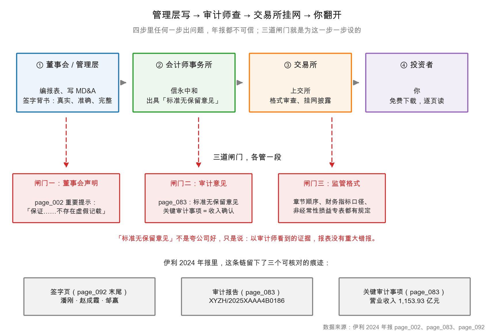

# 第 2 章：公司为什么必须披露年报

> 本章你将：
> - 搞懂"委托代理问题"：为什么管理层和股东天然不是一条心；
> - 明白"强制披露"这三个字的分量——年报不是公司好心写给你看的；
> - 知道审计是干什么的，以及"标准无保留意见"到底保证了什么、没保证什么；
> - 看懂审计报告里"关键审计事项"这一节为什么值得读；
> - 分清 A 股和港股在披露制度上的三个实质差别。

---

## 2.1 一个 30 秒就能想明白的利益冲突

上一章说，你买一股伊利，就拥有这家公司的一小片。现在问题来了：这一小片由谁来经营？

不是你。是董事会聘请的管理层——总裁、财务负责人、各事业部负责人。伊利 2024 年报第 2 页的签字行写得很清楚：公司负责人潘刚、主管会计工作负责人赵成霞、会计机构负责人邹赢。

于是就出现了一个结构性的错位：

- **你（股东）**想要的是：公司长期赚钱、股价上涨、分红。
- **管理层**想要的可能是：更大的规模（管的人更多、头衔更响）、更高的薪酬（常常和收入或利润挂钩）、更稳的位置（不犯错比冒险更重要）、更多的在职消费（更好的办公室、更多的出差）。

这两组目标**有重叠，但不完全一致**。经济学家给这种关系起了个名字：**委托代理问题（principal-agent problem）**。股东是委托人（principal），管理层是代理人（agent）。委托人不在现场，代理人天天在现场；委托人只能看到结果，代理人掌握全部过程信息。

> 📌 **划重点：** 委托代理问题的本质是**信息不对称 + 利益不完全一致**。代理人比你更懂这门生意，而你只能靠他交上来的报告做判断。整个证券监管制度，本质上就是在给这个裂缝打补丁。

这个裂缝有多大？可以用一个数字感受一下：伊利的股东总数是 406,010 户（年报第 73 页），而这 40 多万名股东里，绝大多数人一辈子不会走进伊利的总部一次，不会认识任何一个高管，不会看到任何一张原始凭证。他们能依赖的，只有一份 PDF。

<!-- src: 伊利股份2024年报/page_002.md 伊利股份2024年报/page_073.md -->

## 2.2 强制披露：把"自愿"改成"必须"

如果披露是自愿的，会发生什么？

想一个最简单的例子：一家公司今年业绩很差。如果披露自愿，管理层的最优策略是**不披露**，或者只披露好消息。等到瞒不住了再说——那时候股价已经跌完了，跑得早的人占了便宜，跑得慢的人承担全部损失。

这不是道德问题，是激励问题。**只要"隐瞒"的收益大于"坦白"的成本，就一定会有人隐瞒。** 所以现代资本市场没有选择"相信人性"，而是选择"设计制度"：把披露从"自愿"改成"强制"，并且规定好披露什么、什么时候披露、披露成什么格式。

具体到 A 股，这套制度至少包括四层：

**第一层，定期报告的刚性节奏。** 上市公司必须披露年报（每个会计年度结束后 4 个月内）、半年报（8 月底前）、季报（4 月底、10 月底前）。不是"想发就发"，是"到期必须发"。不发，交易所会问询、会停牌、会处罚。

**第二层，格式与内容的统一规定。** 年报不能想怎么写就怎么写。中国证监会和交易所规定了年报的章节顺序：释义、公司简介和主要财务指标、管理层讨论与分析、公司治理、环境与社会责任、重要事项、股份变动及股东情况、优先股、债券、财务报告。伊利第 4 页的目录，就是照这个模板排的十节。**统一格式的好处是可比**：你读懂了伊利的年报结构，就能读懂任何一家 A 股公司的年报结构。

**第三层，关键指标的强制披露。** 比如"扣非净利润"——监管要求必须把非经常性损益逐项列出、算出扣非后的净利润。伊利第 8–9 页那张表就是。这不是公司自愿的，是规定的。同理还有"加权平均净资产收益率""基本每股收益""分季度数据"。

**第四层，责任落到人头上。** 年报开头必须有一段"重要提示"，由董事会、监事会、全体董事、监事、高管签字背书。伊利第 2 页的原文是：

> 本公司董事会、监事会及董事、监事、高级管理人员保证年度报告内容的真实性、准确性、完整性，不存在虚假记载、误导性陈述或重大遗漏，并承担个别和连带的法律责任。

"承担个别和连带的法律责任"这句话不是客套。它意味着：如果年报造假，签字的人要个人担责，而且不是"公司罚钱了事"，是可能被追究刑事责任。**这是整套制度里最贵的一道锁——用个人的自由去担保一份文件。**

> 💡 **你可能会问：** 既然签了字要担责，为什么还有公司造假？
>
> 因为收益和成本不对称。造假带来的可能是几十亿的市值、几亿的套现；被发现的概率不是 100%，就算被发现，处罚相对于收益也常常偏轻。制度能做的不是"消灭造假"，而是"提高造假的期望成本"。作为读者，你要做的不是相信"签字了就没事"，而是**知道哪些地方最容易出问题，然后重点看那些地方**（第 44 章会给你 20 条红旗）。

<!-- src: 伊利股份2024年报/page_002.md 伊利股份2024年报/page_004.md 伊利股份2024年报/page_008.md -->

## 2.3 审计：请一个不拿你工资的人来查账

强制披露解决了"必须说"，但没解决"说的是不是真的"。第二道锁是审计。

审计（audit）的逻辑很朴素：**找一个和管理层没有利益关系的人，来检查管理层写的账。** 这个人就是会计师事务所。伊利聘请的是信永中和会计师事务所（特殊普通合伙），签字会计师是薛永东、邵小军（年报第 7 页）。

请注意"签字会计师"这个细节。审计报告不是"事务所"出的，是**具体两个人在报告上签名**。签名的意思是：这份意见是我出的，我为它负责。这跟第 2 页管理层签字是同一个逻辑——把责任落到自然人头上。

这张图画的是完整的链条，请注意三个细节：

**第一，审计师是公司请的，但钱不是从管理层口袋里出的。** 审计费由公司支付（本质上是股东的钱），但审计师对**股东**负责，不对管理层负责。这个安排有个天然弱点：管理层有权提议更换事务所。所以监管要求"换所"必须披露、必须说明原因，而且签字会计师有轮换制度。这是用一个"披露义务"去对冲"聘请关系"的偏差。

**第二，交易所不审数字，只审格式。** 上交所会检查年报是否按规定章节披露、关键指标是否填全、前后是否矛盾，但它不会去核实"这笔收入是不是真的"。**格式合规不等于数字真实**，这一点必须分清。

**第三，链条的终点是你。** 你是这条链上唯一没有专业团队、没有原始凭证、没有现场访问权的人。所以你必须自己长出一套判断力——这正是这十周要干的事。

> 🔍 **翻到年报：** 打开 `page_083.md`，这是审计报告的第一页。最上面一行是审计报告编号 `XYZH/2025XAAA4B0186`，下面一行是收件人"内蒙古伊利实业集团股份有限公司全体股东"。**注意收件人是谁**——是全体股东，不是你手里的管理层。这个细节说明了审计的委托关系。

<!-- src: 伊利股份2024年报/page_007.md 伊利股份2024年报/page_083.md -->

## 2.4 "标准无保留意见"到底保证了什么

审计报告最核心的一句话是"审计意见"。伊利的意见类型是**标准无保留意见**（unqualified opinion），这是五种意见里最好的一种。年报第 83 页的原文是：

> 我们认为，后附的财务报表在所有重大方面按照企业会计准则的规定编制，公允反映了伊利集团 2024 年 12 月 31 日的合并及母公司财务状况以及 2024 年度的合并及母公司经营成果和现金流量。

这句话里有三个关键词，每一个都在限定范围：

- **"在所有重大方面"**——不是"完全正确"。会计里有大量的估计和判断（折旧年限、坏账比例、存货跌价），审计师保证的是"没有重大错报"，不是"一分不差"。
- **"按照企业会计准则的规定编制"**——合规性，不是"合理性"。一笔账按准则记是对的，不代表这个商业决策是明智的。
- **"公允反映"**——不偏向任何一方。既没有故意高估，也没有故意低估。

所以，"标准无保留意见"的正确读法是：**以审计师执行的程序和获取的证据为限，报表没有发现重大错报。** 它不是"这家公司很好"，不是"这家公司值得买"，更不是"这家公司不会暴雷"。

> ⚠️ **易踩坑：** 把"标准无保留意见"当成"体检合格、可以放心买"。
>
> 审计意见只覆盖**报表的公允性**，不覆盖：公司的商业模式好不好、行业景气度、管理层能力、股价贵不贵、明年会不会亏。全 A 股绝大多数公司拿的都是标准无保留意见——它只是"入场券"，不是"优秀证书"。真正区分公司好坏的，是后面九周要学的东西。

审计报告里还有一节特别值得读：**关键审计事项（key audit matter）**。这是审计师主动告诉你："本期最需要专业判断、最可能出错的地方在这里。"

伊利的关键审计事项只有一条：**收入确认**。原文说得很直白：2024 年度营业收入 1,153.93 亿元，由于营业收入是伊利集团的关键指标之一，且为合并利润表重要组成项目，对总体财务报表影响重大，因此将收入确认识别为关键审计事项。

这句话背后有信息量。审计师为了这 1,153.93 亿元做了什么？报告列了五条应对程序：了解和评价与收入确认相关的内部控制并实施控制测试；复核收入确认的会计政策是否符合准则和行业特点；执行分析性复核（各期收入、成本、毛利率波动，各业务板块比较，与同业对比）；实施细节性测试（核对业财系统一致性、检查合同、查看大额凭证发票出入库单据）；抽取部分经销商实地走访、向主要客户发函。

**这五条就是"收入可能怎么造假"的清单。** 虚增收入的手法无非几种：提前确认、虚构客户、渠道压货、关联方走账。审计师的应对程序，正好一一对应。你读这一节，等于免费得到一份"这家公司在收入上最可能出问题的地方"的提示。

> 📌 **划重点：** 读审计报告，先看意见类型（是不是标准无保留），再看关键审计事项（审计师认为哪里最危险）。前者告诉你"有没有红灯"，后者告诉你"哪里需要你自己再盯一眼"。

<!-- src: 伊利股份2024年报/page_083.md -->

## 2.5 A 股和港股：披露制度的三个实质差别

第 1 章从"交易规则"角度对比过 A 股和港股。这一节从"披露制度"角度再看一遍，因为差别比想象中大。

**差别一：非经常性损益专表。** A 股强制要求单独披露"非经常性损益项目和金额"，并算出"扣非净利润"。伊利 2024 年归母净利润 84.53 亿元、扣非归母净利润 60.11 亿元（p7），两者相差的 24.42 亿元就是非经常性损益，明细在 p8–9，合计一栏写得清清楚楚，两处能对上。港股没有这张表，一家港股公司的一次性收益藏在"其他收益""其他净额"里，你得自己一项一项挑。

**差别二：报表名称与列报顺序。** A 股叫"资产负债表""利润表""现金流量表"；港股叫"綜合財務狀況表""綜合損益表""綜合現金流量表"。名称不同只是表层，深层差别在列报习惯：港股报表常常把"按性质列报"的费用（折旧、员工成本）单独列一行，而 A 股按"功能"分（销售费用、管理费用、研发费用）。同一个成本，两种切法。

**差别三：年报的"厚度分布"不同。** A 股年报的绝大部分是财务报告和附注（伊利 270 页里，第 83 页之后全是财务报告，占 69%）。港股年报的很大一部分是"董事会报告""企业管治报告"——文字叙述多、监管要求细，但财务数字的密度反而低。蒙牛 2024 年报的目录（第 3 页）里，"董事會報告"从第 98 页开始，"獨立核數師報告"到第 129 页才开始——**前面 128 页几乎全是文字**。

| 维度 | A 股（伊利） | 港股（蒙牛） |
|---|---|---|
| 非经常性损益专表 | 有，监管强制 | 无，需自己识别 |
| 三张表名称 | 资产负债表 / 利润表 / 现金流量表 | 財務狀況表 / 損益表 / 現金流量表 |
| 报表单位 | 元 | 千元（RMB'000） |
| 年报主体构成 | 财务报告 + 附注占大头 | 董事会报告、管治报告占大头 |
| 目录是否给页码 | 不给 | 给（如"綜合財務狀況表 …… 140"） |
| 审计机构叫法 | 会计师事务所 | 核數師 |

最后一行值得单独说：港股的"核數師"就是内地的"会计师事务所"，"核數師報告"就是"审计报告"。**读港股年报，第一件事是把术语表换掉**，否则你会以为"核数师"是某个新角色。

<!-- src: 伊利股份2024年报/page_007.md 伊利股份2024年报/page_008.md 蒙牛乳业2024年报/page_003.md -->

## 2.6 年报不是宣传册：三处最容易上当的地方

年报的前半部分（尤其是"管理层讨论与分析"）有大量文字，读起来像公司宣传材料。这不奇怪——它本来就是管理层写的。但你得知道哪几处最容易"被话术带走"。

**第一处，"营业收入"的口径。** 伊利第 91 页利润表第一行是"营业总收入 1,157.80 亿元"，第二行才是"其中：营业收入 1,153.93 亿元"，差额 3.86 亿元是"利息收入"。管理层在 MD&A 里说"收入"时，可能指 1,157.80，也可能指 1,153.93。**差 3.86 亿不影响结论，但你要知道自己在看哪个数。**

**第二处，"净利润"的层级。** 利润表上有四个利润：营业利润 101.82 亿元、利润总额 101.27 亿元、净利润 84.64 亿元、归母净利润 84.53 亿元。管理层说"我们赚了 84.6 亿"时用的是净利润，说"归母 84.5 亿"时才是你那份。**差 0.11 亿元是少数股东损益**——伊利这个数很小，但在子公司少数股东占比高的公司，能差出十几个点。

**第三处，"母公司报表"和"合并报表"。** 年报第 2 页的利润分配预案里提到"公司母公司 2024 年度实现净利润 13,325,341,479.69 元"——**133.25 亿元**，比合并报表的归母净利润 84.53 亿元还高。这不是矛盾，是两个口径：母公司报表只算伊利本体（主要是对各子公司的投资和分红），合并报表才算整个集团。**读年报一律用合并报表**，母公司报表只在两个地方有用：判断母公司自身有没有钱分红、判断子公司分红是否顺畅。

> ⚠️ **易踩坑：** 看到"母公司净利润 133.25 亿"就以为公司赚得比 84.53 亿多。
>
> 完全不是。母公司净利润里很大一部分是"从子公司收到的分红"，这笔钱在合并层面会被抵销掉——子公司赚的钱已经在合并利润表里算过一次了，不能算两次。**合并报表才是"整个集团对外的成绩单"，母公司报表是"总部这个法人的账"。** 两者不能相加，也不能互相替代。

<!-- src: 伊利股份2024年报/page_002.md 伊利股份2024年报/page_091.md 伊利股份2024年报/page_092.md -->

## ✍️ 想一想

### 问 1：如果没有强制披露，会发生什么

假设监管取消强制年报，改成"公司自愿披露"。请推演：一家业绩正在恶化的公司会怎么做？这对股价、对投资者、对市场整体意味着什么？

**解题思路：** 不要从"公司应该诚实"这个道德判断出发，从"如果你是这家公司的管理层，面对这个规则，怎么做对自己最有利"出发。想清楚三件事：披露的收益是什么、成本是什么、延迟披露的收益是什么。

**参考答案：**

业绩恶化的公司，理性选择是**延迟 + 选择性披露**：先不披露，或者只披露"收入增长"不披露"利润下滑"；等大股东或机构先减持完，再"因故"公布。因为：

| 选项 | 管理层的收益 | 管理层的成本 |
|---|---|---|
| 立刻如实披露 | 无（股价马上跌） | 股价跌、自己期权贬值、可能被换掉 |
| 延迟披露 | 争取时间（找钱、找买家、做重组） | 被发现的概率 $\times$ 处罚 |
| 选择性披露 | 维持股价，方便套现 | 被查处的概率 $\times$ 处罚 |

只要"被发现的概率 $\times$ 处罚"小于"延迟的收益"，延迟就占优。这不是某家公司的问题，是激励结构的问题。

后果有三层：**对股价**，坏消息一次性砸下来，跌幅比"逐步释放"更大；**对投资者**，信息不对称加剧，散户永远最后知道；**对市场整体**，定价效率下降，资金不敢进，融资成本上升——最后所有公司一起承担。

所以强制披露的本质，不是"让公司变善良"，而是**把"隐瞒"从"占优策略"改成"高风险策略"**。这也是为什么披露违规的处罚，重点不在罚款金额，而在"公开谴责""市场禁入"这类会摧毁个人职业生涯的措施。

**易错点：** ① 答"公司会自觉披露，因为要讲诚信"——这是把制度问题当成道德问题；② 只讲"股价会跌"，没讲清"为什么会跌得更狠"（信息一次性释放 vs 逐步释放）；③ 忘记"选择性披露"这条中间路线，只想到"披露/不披露"两个极端。

### 问 2：审计意见能保证什么，不能保证什么

伊利 2024 年拿到"标准无保留意见"。请列出至少三件"这个意见**不能**保证的事"，并说明为什么不能保证。

**解题思路：** 回到审计意见原文的三个限定词："在所有重大方面""按照企业会计准则""公允反映"。每一个限定词都在划边界。再从"审计师能做什么、不能做什么"的角度想：他能查凭证，但他能判断行业景气吗？能预测明年吗？

**参考答案：**

| 不能保证的事 | 为什么不能保证 |
|---|---|
| 公司明年还会赚钱 | 审计针对的是**已发生**的年度，不预测未来 |
| 公司是好生意、值得买 | 审计只判断"报表是否公允"，不判断"商业模式优劣" |
| 股价合理 | 审计完全不涉及估值，股价是市场定的 |
| 一分钱都没错 | 意见原文是"在所有**重大方面**"，会计估计（折旧年限、坏账比例）本身就有判断空间 |
| 管理层没干蠢事 | 一笔投资按准则记账是对的，但这项投资可能非常失败 |
| 内部控制完美 | 审计会评价内控并做控制测试，但样本抽样，不能覆盖每一笔 |

伊利的例子很典型：审计师把"收入确认"列为关键审计事项，说明他认为这是最需要专业判断的地方，也做了五条应对程序。但即便如此，他保证的仍然是"收入的确认符合准则、有证据支撑"，而不是"这 1,153.93 亿元每一笔都卖得划算"。

**易错点：** ① 答"审计意见保证报表真实"——"真实"太强了，准确说法是"公允反映、无重大错报"；② 把"关键审计事项"理解成"这里有问题"——它是"这里最重要、最需要判断"，不等于"这里错了"；③ 忘了"重大性"这个概念，以为审计是逐笔核对。

### 问 3：为什么 A 股要单独列"非经常性损益"

A 股强制要求披露非经常性损益专表，港股没有。请解释：这张表解决的是什么问题？如果没有它，投资者容易犯什么错？

**解题思路：** 先想"非经常性损益"是什么（一次性、不常发生的损益），再想"一次性"对判断公司价值有什么影响。关键在：估值时用的是"可持续的利润"，一次性的钱不能年年有。

**参考答案：**

这张表解决的是"**利润的可持续性**"问题。

伊利 2024 年归母净利润 84.53 亿元，非经常性损益 24.42 亿元，扣非归母净利润 60.11 亿元。也就是说，84.53 亿里有 24.42 亿是"今年有、明年不一定有"的钱——主要是处置子公司昌吉盛新实业股权产生的一次性收益（第 210 页附注七(69)：处置长期股权投资产生的投资收益 25.80 亿元）。

如果没有这张表，投资者会犯三个错：

1. **用 84.53 亿去算 PE。** 假设股价 28 元（示意，非真实报价），市值约 1,782 亿元，用 84.53 亿算 PE 约 21 倍；用 60.11 亿算是约 30 倍。**差 40%。** 哪个更能代表"这家公司正常年份的赚钱能力"？后者。
2. **误以为利润下滑是经营问题。** 2023 年扣非归母净利润 100.26 亿元，2024 年 60.11 亿元，跌了 40.04%；而归母净利润只跌了 18.94%。**扣非口径的跌幅大得多**——说明经营层面恶化比表面看到的严重。
3. **忽略"非经常性收益"也会在某年变成"非经常性损失"。** 今年处置资产赚 25.80 亿，明年如果减值 30.75 亿，性质是一样的：都是不常发生的。只看归母净利润，会把这两年的数字都误读。

港股没有这张表，所以读港股公司时，你必须自己去附注里找"其他收益""处置收益""一次性费用"。工作量更大，也更容易漏——这是 A 股投资者的一个制度红利。

**易错点：** ① 把非经常性损益理解成"假的利润"——它是真的钱，只是不可持续；② 忘记"扣非"也可能失真——有些公司会把"经常性的政府补助"也算进非经常性损益，需要看附注明细；③ 只算 PE 不做对比，没意识到 21 倍和 30 倍的差别足以改变投资决策。

## 📎 数据出处

- 伊利股份 2024 年报：`page_002.md`（重要提示、董事会声明、利润分配预案）、`page_004.md`（目录十节）、`page_007.md`（会计师事务所与签字会计师、主要指标）、`page_008.md`（非经常性损益表）、`page_073.md`（股东总数）、`page_083.md`（审计报告、关键审计事项）、`page_091.md`（营业总收入与营业收入）、`page_092.md`（四个利润层级）、`page_210.md`（投资收益明细）
- 蒙牛乳业 2024 年报：`page_003.md`（目录、报表名称、页码）
- 数据汇总：`data/yili2024.json` 的 `income`、`nonrecurring`、`notes` 段

<!-- src: 伊利股份2024年报/page_002.md 伊利股份2024年报/page_004.md 伊利股份2024年报/page_007.md 伊利股份2024年报/page_008.md 伊利股份2024年报/page_073.md 伊利股份2024年报/page_083.md 伊利股份2024年报/page_091.md 伊利股份2024年报/page_092.md 伊利股份2024年报/page_210.md 蒙牛乳业2024年报/page_003.md -->

下一章：[第 3 章：一份 270 页年报的骨架](03-一份270页年报的骨架.md)——知道了"为什么必须披露"，下一个问题是：这 270 页到底怎么排的，从哪一页开始看？
