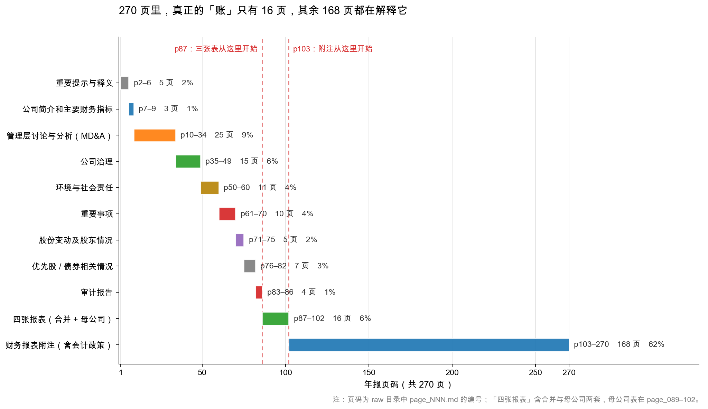
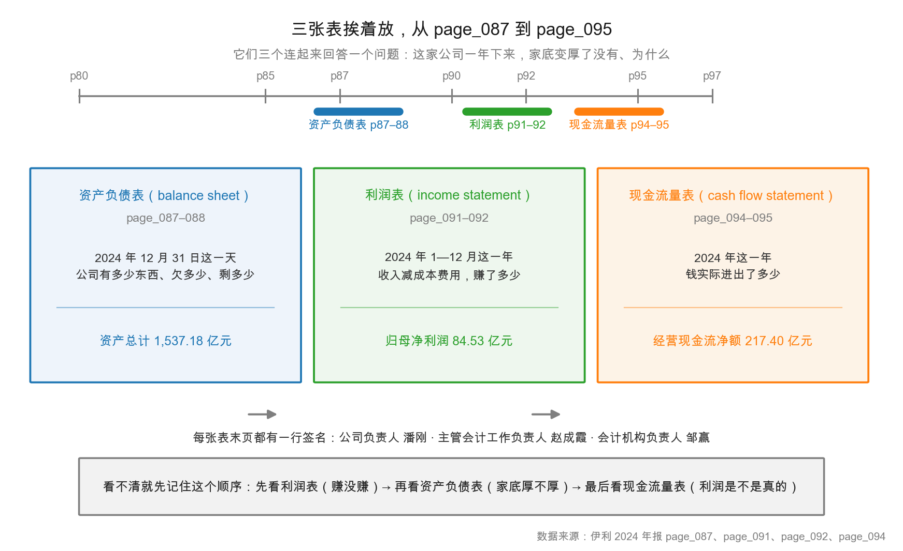

# 第 3 章：一份 270 页年报的骨架

> 本章你将：
> - 把 270 页拆成 6 大块，每一块都给出伊利的真实起止页码；
> - 学会"三跳读法"：先翻目录，再跳到第 7 页，再跳到第 87 页；
> - 知道三张表、四张表、附注分别在哪儿，以及为什么是这个顺序；
> - 拿到一张可以套用到任何 A 股公司的"页码地图"；
> - 明白为什么"从头读"是最低效的读法。

---

## 3.1 先看一张地图，再决定从哪进门

270 页。如果一页一页读，按每页 2 分钟算，需要 9 个小时——这还是一句都没读懂的情况。

所以第一件事不是读，是**认路**。就像你进一座陌生的图书馆，不会从第一排书架开始一本一本翻，而是先看楼层索引。

伊利 2024 年报的"楼层索引"，就是第 4 页那张目录。它列了十节：

| 节 | 名称 | 起始页 |
|---|---|---|
| — | 重要提示、目录 | p2–4 |
| 第一节 | 释义 | p5 |
| 第二节 | 公司简介和主要财务指标 | p6 |
| 第三节 | 管理层讨论与分析 | p10 |
| 第四节 | 公司治理 | p35 |
| 第五节 | 环境与社会责任 | p50 |
| 第六节 | 重要事项 | p61 |
| 第七节 | 股份变动及股东情况 | p71 |
| 第八节 | 优先股相关情况 | p76 |
| 第九节 | 债券相关情况 | p77 |
| 第十节 | 财务报告 | p83 |

这张表看起来平平无奇，但它是全章的地基。**A 股年报的章节顺序是监管统一规定的**，所以你只要记住这张表，就记住了所有 A 股公司年报的结构——换一家公司，节名一样、顺序一样，只有页码不同。

从这张图能一眼看出三件事：

**第一，附注是最大的一块。** 从第 103 页到第 270 页，168 页，占 62%。这是全书最反直觉的地方：**你以为年报的主体是报表，其实主体是"对报表的解释"。**

**第二，真正的"账"只有 16 页。** 第 87–102 页，包含合并和母公司两套四张表：资产负债表、利润表、现金流量表、所有者权益变动表。每套 4 张，两套 8 张，16 页。

**第三，前 82 页全是"铺垫"。** 重要提示、公司简介、MD&A、治理、社会责任、重要事项、股东情况、债券——这些加起来 82 页，占 30%。它们不是"账"，但里面有大量不能错过的信息。

> 📌 **划重点：** 270 页 = 82 页铺垫 + 4 页审计报告 + 16 页报表 + 168 页附注。读年报的正确顺序不是"从第 1 页到第 270 页"，而是"从第 4 页目录跳到第 7 页，再跳到第 87 页，最后回到附注"。

<!-- src: 伊利股份2024年报/page_004.md -->

## 3.2 六大块，逐块说清

把上面那张表重新切一次，按"读的时候会一起读"的逻辑，切成 6 块。

**块一：封面 + 重要提示 + 目录（p1–6）。**

第 1 页是封面，只有公司代码、简称、全称、"2024 年年度报告"几个字。第 2 页是**重要提示**——这一页值得逐字读，因为它是全篇的"责任状"：

> 一、本公司董事会、监事会及董事、监事、高级管理人员保证年度报告内容的真实性、准确性、完整性，不存在虚假记载、误导性陈述或重大遗漏，并承担个别和连带的法律责任。
>
> 二、公司全体董事出席董事会会议。
>
> 三、信永中和会计师事务所（特殊普通合伙）为本公司出具了标准无保留意见的审计报告。
>
> 四、公司负责人潘刚、主管会计工作负责人赵成霞及会计机构负责人（会计主管人员）邹赢声明：保证年度报告中财务报告的真实、准确、完整。

这四句话，每一句都是一个"检查点"：全体董事是否出席（有人缺席要说明原因）、审计意见是什么类型（不是标准无保留就要警惕）、谁签的字（出事了找谁）。第 3 页接着是"重大风险提示"，指向第三节的"可能面对的风险"部分。

**块二：公司简介和主要财务指标（p6–9）。**

第 6 页是公司基本信息：中文名称、外文名称、法定代表人潘刚、注册地址、办公地址、公司网址、电子信箱，以及"信息披露媒体"——《中国证券报》《上海证券报》。这个细节有用：**年报法定披露渠道是交易所网站和指定报纸**，你在别处看到的"年报摘要"可能被剪过。

第 7 页是全篇信息密度最高的一页。它有三块内容：

| 内容 | 关键数字 |
|---|---|
| 会计师事务所信息 | 信永中和，签字会计师薛永东、邵小军 |
| 主要会计数据 | 营业收入 1,153.93 亿、归母净利润 84.53 亿、扣非归母 60.11 亿、经营现金流 217.40 亿、归母净资产 531.80 亿、总资产 1,537.18 亿 |
| 主要财务指标 | 基本每股收益 1.33 元、加权平均 ROE 15.81%（2023 年 20.20%） |

**如果你只有 3 分钟，读这一页就够了。** 六个数字加两个比率，就能判断"这家公司今年大概什么状态"：收入 1,153.93 亿、净利 84.53 亿（净利率 7.3%）、经营现金流 217.40 亿（是净利的 2.6 倍）、ROE 15.81%（从 20.20% 掉下来）。

第 8 页是分季度数据和"非经常性损益"表的开头，第 9 页是这张表的结尾。第 8 页那个季度表，就是第 1 章埋下的悬念：第四季度单季归母净利润 -24.16 亿元。

**块三：管理层讨论与分析（p10–34）。**

这一节常被简称为 **MD&A**（Management Discussion and Analysis）。它是管理层用文字解释"这一年发生了什么、为什么"。

伊利这一节从第 10 页开始，第一段就是宏观环境：消费信心指数低位徘徊、乳品消费规模缩减、阶段性供给过剩、原料奶价格先降后稳。接着是行业情况、公司业务、核心竞争力、经营情况讨论、财务报表分析、未来展望、可能面对的风险。

这一节的价值不在"公司说自己多好"（那部分可以跳过），而在**它必须解释数字的异常变动**。伊利第 22–26 页有一串"变动原因说明"，格式是"某某科目变动 X%，主要原因是……"。比如第 26 页：

> (12) 合同负债增加原因：本期预收经销商的货款增加所致。
> (13) 一年内到期的非流动负债增加主要原因：将于一年内到期的应付债券和长期借款增加所致。

**这些句子是管理层自己的解释，不一定是真相，但一定是你提问的起点。** 看到"合同负债增加"，你要问：预收货款增加，是渠道真的愿意提前打款，还是压货？这个问题第 5 周（第 22 章）会回答。

**块四：公司治理 + 社会责任 + 重要事项 + 股东情况 + 优先股 + 债券（p35–82）。**

这 48 页信息密度低，但不是没用。三处值得看：

- **第 35–49 页公司治理**：董事会构成、独立董事、高管薪酬、关联交易审议程序。看"高管薪酬"那一节，能知道管理层拿多少、和什么指标挂钩。
- **第 61–70 页重要事项**：关联交易、担保、诉讼、承诺履行。**如果有大额关联交易或对外担保，一定在这里。**
- **第 71–75 页股份变动及股东情况**：股东总数 406,010 户、前十名股东持股、股份质押情况。看"前十名股东"能知道谁是大股东、有没有质押。

第 76 页的末尾是第八节"优先股相关情况"——注意，**只有标题，一个字正文都没有**。这是"留白"的一种：伊利没有优先股，这一节就没有内容可写，连"不适用"都省了。你以后看到某个大节只有标题、没有正文，基本可以断定这家公司"这一项业务不存在"。

第 77–82 页是第九节债券相关情况。伊利有债券，所以这一节有实打实的内容，包括"EBITDA 利息保障倍数 8.87"这类指标——**这个数是评级机构和债券投资者最关心的**，第 9 周讲偿债能力时还会用到。没有债券的公司，这一节会明确写"不适用"。

**块五：审计报告 + 四张报表（p83–102）。**

第 83 页是第十节财务报告的开头，也是审计报告的首页。审计报告本身占 4 页（p83–86），然后是两套报表：

| 报表 | 合并报表页码 | 母公司报表页码 |
|---|---|---|
| 资产负债表 | p87–88 | p89–90 |
| 利润表 | p91–92 | p93 |
| 现金流量表 | p94–95 | p96 |
| 所有者权益变动表 | p97–100 | p101–102 |

注意顺序：**合并在前，母公司在后**。这是规定动作，因为合并报表才是"整个集团"的成绩单（第 2 章 2.6 节讲过为什么）。你在 p87 看到的是合并资产负债表，翻两页到 p89 就是母公司资产负债表——**别抄错。**

**块六：财务报表附注（p103–270）。**

这是最大的一块，也是第 4 章的主角。这里只先记住它的内部结构：

| 附注编号 | 内容 | 起始页 |
|---|---|---|
| 一、二 | 公司基本情况、报表编制基础 | p103–104 |
| 三 | 公司基本情况（历史、业务、合并范围） | p103–105 |
| 四 | 财务报表的编制基础 | p105 |
| 五 | 重要会计政策及会计估计 | p105–148 |
| 六 | 税项 | p149 |
| **七** | **合并财务报表项目注释（1–82 项）** | **p150–222** |
| 八 | 研发支出 | p223 |
| 九 | 合并范围的变更 | p224 |
| 十 | 在其他主体中的权益 | p228 |
| 十一 | 政府补助 | p234 |
| 十二 | 与金融工具相关的风险 | p235 |
| 十三 | 公允价值的披露 | p239 |
| 十四 | 关联方及关联交易 | p242 |
| 十五 | 股份支付 | p246 |
| 十六 | 承诺及或有事项 | p249 |
| 十七 | 资产负债表日后事项 | p249 |
| 十八 | 其他重要事项 | p250 |
| 十九 | 母公司财务报表主要项目注释 | p252–270 |

**"七"是核心**，1 到 82 项，从"1、货币资金"一路编到"82、外币货币性项目"。第 4 章会专门讲怎么用这套编号。

> 🔍 **翻到年报：** 打开 `page_004.md` 看目录，再打开 `page_083.md` 看审计报告开头，再打开 `page_103.md` 看附注的第一页。三页连起来看，你会对"整份年报怎么排"有一个立体的感觉。

<!-- src: 伊利股份2024年报/page_001.md 伊利股份2024年报/page_002.md 伊利股份2024年报/page_004.md 伊利股份2024年报/page_007.md 伊利股份2024年报/page_008.md 伊利股份2024年报/page_010.md 伊利股份2024年报/page_026.md 伊利股份2024年报/page_035.md 伊利股份2024年报/page_061.md 伊利股份2024年报/page_071.md 伊利股份2024年报/page_083.md 伊利股份2024年报/page_087.md 伊利股份2024年报/page_089.md 伊利股份2024年报/page_091.md 伊利股份2024年报/page_093.md 伊利股份2024年报/page_094.md 伊利股份2024年报/page_096.md 伊利股份2024年报/page_097.md 伊利股份2024年报/page_101.md 伊利股份2024年报/page_103.md 伊利股份2024年报/page_150.md -->

## 3.3 三跳读法：三次翻页，20 分钟看完全局

上面六大块，第一次读不需要全看。给你一条"三跳"路线。

**第一跳：翻到第 4 页，看目录。**

目的只有一个：确认"这份年报是不是标准结构"。A 股公司都该有这十节，如果少了哪节、或者顺序乱了，说明有问题（极少见，但要知道）。

**第二跳：翻到第 7 页，看主要会计数据。**

目的：用一页拿到全局。这一页有六个数字和两个比率，看完你就知道：

- 规模多大（收入 1,153.93 亿、总资产 1,537.18 亿）；
- 赚不赚钱（归母净利 84.53 亿、ROE 15.81%）;
- 赚的是不是真钱（经营现金流 217.40 亿 vs 净利 84.53 亿）；
- 和去年比是变好还是变差（收入 -8.24%、净利 -18.94%、ROE 从 20.20% 降到 15.81%）。

**第三跳：翻到第 87 页、91 页、94 页，看三张表。**

三张表各回答一个问题：

| 表 | 问题 | 伊利 2024 关键数字 | 页码 |
|---|---|---|---|
| 资产负债表 | 这一天，公司有多少东西、欠多少、剩多少 | 资产 1,537.18 亿 = 负债 967.10 亿 + 权益 570.08 亿 | p87–88 |
| 利润表 | 这一年，赚了多少 | 归母净利润 84.53 亿 | p91–92 |
| 现金流量表 | 这一年，钱实际进出了多少 | 经营现金流净额 217.40 亿 | p94–95 |

这一跳的诀窍是**只看大数，不看明细**。资产负债表只看"流动资产合计""非流动资产合计""资产总计""负债合计""所有者权益合计"这五行；利润表只看"营业总收入""营业成本""营业利润""净利润""归母净利润"；现金流量表只看"经营活动""投资活动""筹资活动"三个净额。

明细行以后再看。第 2 周之后，你会逐行拆。

> 💡 **你可能会问：** 为什么先看利润表再看资产负债表，而不是按年报的顺序（资产负债表在前）？
>
> 因为人的注意力有限。第一次读，先看"赚没赚"最容易建立成就感；再看"家底厚不厚"，能理解"赚的钱变成了什么"；最后看现金流量表，回答"利润是不是真的"。这个顺序是**理解顺序**，不是页码顺序。等你熟了，顺序随便。

<!-- src: 伊利股份2024年报/page_007.md 伊利股份2024年报/page_087.md 伊利股份2024年报/page_088.md 伊利股份2024年报/page_091.md 伊利股份2024年报/page_092.md 伊利股份2024年报/page_094.md -->

## 3.4 三张表为什么长这样

三张表不是随手排的，每一张都有自己的"阅读方向"。

**资产负债表是"照片"。** 它记录的是**某一天**的状态——伊利这张是 2024 年 12 月 31 日。左边是资产（钱变成了什么），右边是负债和所有者权益（钱从哪来）。两边永远相等，因为记的是同一堆钱的两个侧面。第 7 章会专门讲这个恒等式。

**利润表是"录像"。** 它记录的是**一段时间**的过程——2024 年 1 月 1 日到 12 月 31 日。从收入开始，一层一层减成本、减费用、加减值，最后剩净利润。它的逻辑是"这一年发生了什么"。

**现金流量表也是"录像"，但只记现金。** 同样是一年，但它不管"应该收到多少"，只管"实际收到多少"。所以它和利润表经常不一致——伊利 2024 年净利 84.53 亿，经营现金流 217.40 亿，差了 132.87 亿。这个差额从哪来，是第 8 周的主题。

三张表的关系，一句话：**利润表解释"这一年赚了多少"，资产负债表记录"年底剩下什么"，现金流量表验证"赚的是不是真钱"。**

还有一个容易被忽略的细节：每张表的末页都有一行签名。伊利第 92 页利润表末尾写着"公司负责人：潘刚　主管会计工作负责人：赵成霞　会计机构负责人：邹赢"。这行字不是装饰——它是"这张表由这三个人负责"的法律声明。**看报表先看这行字在不在**，不在就说明你看到的是不完整的版本（比如某些网站转载时截掉了）。

> ⚠️ **易踩坑：** 把"合并资产负债表"和"母公司资产负债表"抄混。
>
> 伊利 p87 是合并资产负债表，p89 是母公司资产负债表，两张表长得几乎一样，科目名也几乎一样。区别在数字：合并报表的资产总计 1,537.18 亿元，母公司报表要小得多（因为母公司本体主要是"长期股权投资"）。**记住一条：教程里说的所有数字，默认都是合并报表。** 母公司报表只在第 2 章 2.6 节那个场景下才用。

<!-- src: 伊利股份2024年报/page_087.md 伊利股份2024年报/page_089.md 伊利股份2024年报/page_092.md -->

## 3.5 那 168 页附注，到底在解释什么

很多人读到第 103 页就放弃了，因为附注看起来像天书：全是表格、全是专业名词、全是"详见……"。

其实附注只干四件事，按重要性排：

**第一件，把报表上的一行拆成几块。** 报表上"资产减值损失 -46.76 亿元"是一行，附注七(73) 告诉你这 46.76 亿里，商誉减值 30.75 亿、存货跌价 12.27 亿、固定资产减值 3.67 亿、工程物资减值 0.07 亿。**没有附注，你只知道"减了 46.76 亿"，不知道"为什么减、明年还会不会减"。** 这是第 4 章的主题。

**第二件，说清会计政策。** 附注五（p105–148）列了所有会计政策：收入怎么确认、存货怎么计价、固定资产折旧几年、商誉怎么减值测试。这些"政策选择"直接决定利润——折旧年限从 10 年改成 15 年，一年就少提几亿折旧，利润就多几亿。**政策本身没有对错，但"今年有没有变"必须看。**

**第三件，披露关联交易和或有事项。** 附注十四（p242）是关联方及关联交易，附注十六（p249）是承诺及或有事项。这两节是"表外信息"的主要来源：公司给谁做了担保、和关联方做了什么买卖、有没有未决诉讼。**这些东西不体现在报表数字里，但可能一夜之间改变公司的命运。**

**第四件，给出报表项目的明细表。** 比如附注七(1) 货币资金（p150）会列出库存现金、银行存款、其他货币资金各多少；附注七(27) 商誉（p184）会列出每个被收购公司的商誉原值、减值准备、账面价值。

四件事里，第一件和第三件最该看。第一件决定"你懂不懂这个数字"，第三件决定"你有没有漏掉大风险"。

> 📌 **划重点：** 附注不是"附录"，是"正文"。270 页里 168 页是附注，占了 62%——如果附注不重要，监管不会要求写这么多。**报表给你结论，附注给你证据。**

<!-- src: 伊利股份2024年报/page_105.md 伊利股份2024年报/page_150.md 伊利股份2024年报/page_184.md 伊利股份2024年报/page_211.md 伊利股份2024年报/page_242.md 伊利股份2024年报/page_249.md -->

## 3.6 一张可以套用到任何公司的检查表

把本章的内容压缩成一张表。以后拿到任何一份 A 股年报，按这张表走一遍，20 分钟能建立全局印象。

| 步骤 | 翻到 | 看什么 | 花多久 |
|---|---|---|---|
| 1 | p2 | 重要提示：审计意见类型、谁签的字 | 2 分钟 |
| 2 | p4 | 目录：十节是否齐全 | 1 分钟 |
| 3 | p7 | 六个数字 + 两个比率 | 5 分钟 |
| 4 | p8 | 分季度数据：有没有单季异常 | 2 分钟 |
| 5 | p87–88 | 资产负债表：资产 = 负债 + 权益 | 3 分钟 |
| 6 | p91–92 | 利润表：收入到净利 | 3 分钟 |
| 7 | p94–95 | 现金流量表：三个净额 | 2 分钟 |
| 8 | p83 | 审计报告：关键审计事项 | 2 分钟 |
| 合计 | — | — | 约 20 分钟 |

第 5 章会把这张表升级成"20 个关键数字 + 10 分钟流程"，那时你会有更细的目标。

> ⚠️ **易踩坑：** 把"页码"当成"PDF 阅读器的页数"。
>
> 年报 PDF 常有封面、插页、空白页，PDF 第 87 页不一定等于年报正文第 87 页。本教程说的页码，是**年报正文自己标的页码**（raw 文件 `page_087.md` 里的 087）。你自己翻 PDF 时，以页面底部印的页码为准，或者直接搜章节标题。

<!-- src: 伊利股份2024年报/page_002.md 伊利股份2024年报/page_004.md 伊利股份2024年报/page_007.md 伊利股份2024年报/page_008.md 伊利股份2024年报/page_083.md 伊利股份2024年报/page_087.md 伊利股份2024年报/page_091.md 伊利股份2024年报/page_094.md -->

## ✍️ 想一想

### 问 1：只有 10 分钟，你先翻哪三页

假设你现在只有 10 分钟，要判断"伊利 2024 年是不是出了问题"。请从本章的六个块里挑三页，说明为什么是这三页，以及每页你要看什么。

**解题思路：** 10 分钟大约能读 3 页。挑选标准不是"哪页最重要"，而是"哪三页组合起来能回答'有没有问题'"。想一想：判断"有没有问题"需要几个维度？至少要有"赚了多少""是不是真钱""有没有大坑"。

**参考答案：**

推荐这三页：

| 页 | 看什么 | 能回答什么 |
|---|---|---|
| p7 | 收入、归母净利、扣非净利、经营现金流、ROE 及同比 | 整体是变好还是变差 |
| p8 | 分季度归母净利润 | 有没有单季异常（-24.16 亿） |
| p211 | 附注七(73) 资产减值损失明细 | 异常是不是来自一次性减值 |

理由：

**p7 给"结论"。** 收入 -8.24%、归母净利 -18.94%、扣非净利 -40.04%、ROE 从 20.20% 降到 15.81%——四个数一起看，结论很清楚：**不只是收入下滑，盈利能力下滑得更快**（扣非跌幅远大于归母跌幅，说明 2023 年的基数里非经常性收益少、2024 年反而多）。

**p8 给"异常点"。** 全年赚 84.53 亿，四季度亏 24.16 亿。这个落差必须解释。

**p211 给"解释"。** 资产减值 46.76 亿，其中商誉减值 30.75 亿——一次性、不耗现金，但吃掉利润。

三页连起来，10 分钟内你能得出一个有依据的判断：**"经营在恶化（扣非跌 40%），同时有一次 30.75 亿的商誉减值把四季度打成亏损。前者是慢变量，后者是一次性。"** 这个判断不算深，但已经比 90% 的人强——因为他们一页都没翻。

**易错点：** ① 选 p83 审计报告——它重要，但"标准无保留意见"这个结论在 p2 就有一句话，10 分钟内不值得花 2 分钟读全文；② 选 MD&A——34 页，10 分钟读不完，而且文字多、信息密度低；③ 只选一页（比如只选 p7），得出"利润下滑"就收工，漏掉"为什么下滑"。

### 问 2：为什么附注占了 62%

一份年报 270 页，附注 168 页，占 62%；四张报表只有 16 页，占 6%。请解释：为什么监管要求写这么多附注？如果只保留报表、砍掉附注，会发生什么？

**解题思路：** 从"报表能表达什么、不能表达什么"入手。报表是一行一行的数字，每一行都是"汇总"。汇总就必然丢失信息。丢了什么？丢了构成、丢了判断、丢了表外事项。

**参考答案：**

因为**报表只能给"结果"，不能给"依据"**。具体丢了三类信息：

**第一类，构成。** 报表上"资产减值损失 -46.76 亿"是一行，但这一行背后可能是商誉减值（一次性、非现金），也可能是存货跌价（跟真实经营有关）。两种构成的含义完全相反，但报表上长得一模一样。附注七(73) 就是把这个数拆开。

**第二类，判断。** 会计里到处都是估计：应收账款提多少坏账、存货跌多少价、固定资产折旧几年、商誉要不要减值。这些估计直接决定利润，但报表上只显示"估计后的结果"，不显示"估计本身"。附注五（会计政策）和各项明细，就是把这些判断摊开给你看。

**第三类，表外事项。** 公司给别人做了担保、有未决诉讼、有大额关联交易、有承诺资本开支——这些都不进报表（或只在特定条件下进），但可能改变公司的命运。附注十四（关联交易）和十六（承诺及或有事项）就是干这个的。

如果砍掉附注，会发生三件事：**数字无法验证**（你看到 46.76 亿，不知道是什么）、**风险无法识别**（担保和诉讼全看不见）、**同行无法比较**（两家公司都提了 10% 坏账，但一家是正常计提，一家是被迫补提）。

所以 62% 这个比例不是浪费，是**必要成本**。而且它还有个副作用：附注越长，越考验读者的耐心——这恰恰是专业投资者和业余投资者的分水岭。

**易错点：** ① 答"因为监管要求"就完事——这是循环论证，要说出"监管为什么这么要求"；② 只讲"附注解释数字"，漏掉"表外事项"这一类，而这一类恰恰是最容易藏雷的地方；③ 把"附注长"理解成"公司复杂"——伊利 168 页附注在 A 股属于正常偏多，但很多更简单的公司附注也有 100 多页，因为格式要求固定。

### 问 3：合并报表和母公司报表，差在哪

伊利合并资产负债表（p87）的资产总计是 1,537.18 亿元，母公司资产负债表（p89）的资产总计要小得多。请解释：为什么两张表差这么多？什么情况下应该看母公司报表？

**解题思路：** 先想"母公司"是什么——它是伊利集团这个"法人"，它的资产主要是"对子公司的长期股权投资"。再想"合并"是什么——把母公司和所有子公司当成一家来看，内部往来全部抵销。

**参考答案：**

差别来自**合并范围**。

母公司报表只记"伊利股份这个法人"自己的资产负债。它的资产里，最大的一块是"长期股权投资"——即对各地子公司的投资，按成本或权益法记账。子公司赚的钱，在母公司报表上体现为"投资收益"或"应收股利"，而不是"营业收入"。

合并报表把母公司和所有纳入合并范围的子公司（伊利 2024 年纳入合并范围的一级子公司有 84 家，见 p105）当成一个整体，**内部交易全部抵销**：母公司卖给子公司的货不算收入，母公司对子公司的投资和子公司的实收资本互相抵销。

所以两张表的差别，本质是"**看一个法人**"和"**看一个集团**"的差别。合并报表的数字一定更大（因为加了 84 家子公司），但两者不是"大和小"的关系，是"两种口径"。

什么情况下看母公司报表？三个场景：

1. **判断母公司有没有钱分红。** 分红是从母公司账上出的，母公司报表的"未分配利润"才是可分配的基础。伊利 p2 提到母公司 2024 年净利润 133.25 亿元、期末未分配利润 275.53 亿元——这两个数决定了"能不能派出 77.26 亿"。
2. **判断子公司的钱能不能上来。** 如果母公司报表的"货币资金"很少，而合并报表很多，说明钱都压在子公司里，母公司要靠子公司分红才能拿到现金。
3. **识别"母公司空壳化"。** 有些公司母公司几乎没业务，全靠子公司，这种情况下母公司报表会非常"干净"，需要警惕。

平时读年报，**一律用合并报表**。母公司报表是"需要时才翻"的工具，不是主线。

**易错点：** ① 把两张表的数字相加——绝对不行，会重复计算；② 认为"母公司报表数字小，说明母公司不重要"——恰恰相反，母公司是分红和融资的主体；③ 忘记"内部交易抵销"这个机制，误以为合并报表就是"简单相加"。

## 📎 数据出处

- 伊利股份 2024 年报：`page_001.md`（封面）、`page_002.md`（重要提示）、`page_003.md`（重大风险提示）、`page_004.md`（目录）、`page_005.md`（释义）、`page_006.md`（公司简介、披露媒体）、`page_007.md`（主要会计数据与指标）、`page_008.md`（分季度、非经常性损益）、`page_009.md`（非经常性损益合计）、`page_010.md`（MD&A 开头）、`page_026.md`（变动原因说明）、`page_035.md`（公司治理）、`page_050.md`（环境与社会责任）、`page_061.md`（重要事项）、`page_071.md`（股份变动）、`page_073.md`（股东总数）、`page_077.md`（债券）、`page_083.md`（审计报告）、`page_085.md`（审计师责任）、`page_087.md`–`page_088.md`（合并资产负债表）、`page_089.md`（母公司资产负债表）、`page_091.md`–`page_092.md`（合并利润表）、`page_093.md`（母公司利润表）、`page_094.md`–`page_095.md`（合并现金流量表）、`page_096.md`（母公司现金流量表）、`page_097.md`（合并所有者权益变动表）、`page_101.md`（母公司所有者权益变动表）、`page_103.md`（附注开头）、`page_105.md`（公司基本情况、重要会计政策）、`page_150.md`（附注七开头）、`page_184.md`（商誉）、`page_211.md`（资产减值）、`page_242.md`（关联交易）、`page_249.md`（承诺及或有事项）、`page_252.md`（母公司报表附注）
- 数据汇总：`data/yili2024.json` 的 `_meta.statement_pages` 段

<!-- src: 伊利股份2024年报/page_001.md 伊利股份2024年报/page_002.md 伊利股份2024年报/page_003.md 伊利股份2024年报/page_004.md 伊利股份2024年报/page_005.md 伊利股份2024年报/page_006.md 伊利股份2024年报/page_007.md 伊利股份2024年报/page_008.md 伊利股份2024年报/page_009.md 伊利股份2024年报/page_010.md 伊利股份2024年报/page_026.md 伊利股份2024年报/page_035.md 伊利股份2024年报/page_050.md 伊利股份2024年报/page_061.md 伊利股份2024年报/page_071.md 伊利股份2024年报/page_073.md 伊利股份2024年报/page_077.md 伊利股份2024年报/page_083.md 伊利股份2024年报/page_085.md 伊利股份2024年报/page_087.md 伊利股份2024年报/page_088.md 伊利股份2024年报/page_089.md 伊利股份2024年报/page_091.md 伊利股份2024年报/page_092.md 伊利股份2024年报/page_093.md 伊利股份2024年报/page_094.md 伊利股份2024年报/page_095.md 伊利股份2024年报/page_096.md 伊利股份2024年报/page_097.md 伊利股份2024年报/page_101.md 伊利股份2024年报/page_103.md 伊利股份2024年报/page_105.md 伊利股份2024年报/page_150.md 伊利股份2024年报/page_184.md 伊利股份2024年报/page_211.md 伊利股份2024年报/page_242.md 伊利股份2024年报/page_249.md 伊利股份2024年报/page_252.md -->

下一章：[第 4 章：附注才是正文——数字背后的解释](04-附注才是正文.md)——你已经知道附注占了 62%，下一个问题是：这 168 页怎么读，`七(73)` 这种编号到底是什么意思？
