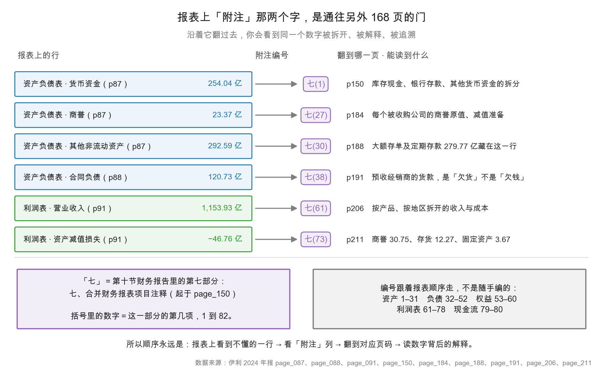
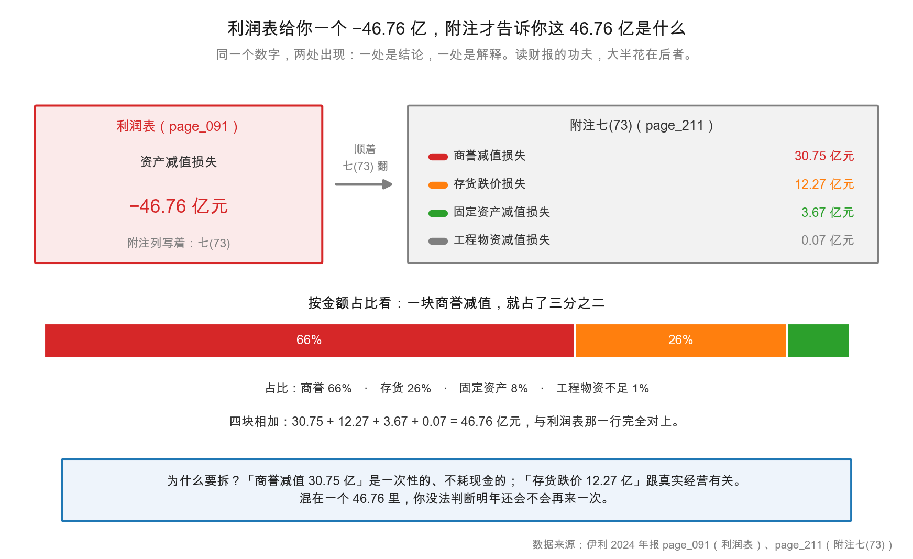

# 第 4 章：附注才是正文——数字背后的解释

> 本章你将：
> - 学会读 `七(73)` 这种编号，知道它指年报的哪一部分、第几项；
> - 明白"会计政策"和"会计估计"的区别，以及为什么它们能让利润变脸；
> - 用伊利资产减值 46.76 亿元做完整拆解，看清"一个总数"到"四块明细"的过程；
> - 知道关联交易和或有事项该在附注哪一节找，为什么这两节最容易藏雷；
> - 建立"表看结论，注看真假"的阅读习惯。

---

## 4.1 从报表上那三个字说起

打开伊利第 87 页的合并资产负债表，随便找一行：

| 项目 | 附注 | 2024 年 12 月 31 日 | 2023 年 12 月 31 日 |
|---|---|---|---|
| 货币资金 | 七(1) | 25,404,255,558.60 | 43,371,541,992.39 |
| 商誉 | 七(27) | 2,336,555,144.44 | 5,160,099,488.23 |
| 合同负债 | 七(38) | 12,072,785,359.81 | 8,696,013,482.42 |

第二列写着"附注"，值是 `七(1)`、`七(27)`、`七(38)`。

这三个字符是全篇最有用的路标，但很多人直接跳过了它。它的意思是：

- **"七"** = 第十节财务报告里的第七部分，也就是"七、合并财务报表项目注释"（从第 150 页开始）。
- **"(1)"** = 这一部分的第 1 项，也就是"1、货币资金"（第 150 页）。
- 合起来：**去第 150 页，看"1、货币资金"那张表。**

同理，`七(27)` 指第 184 页的"27、商誉"，`七(38)` 指第 191 页的"38、合同负债"。

> 📌 **划重点：** 报表上的"附注"列不是装饰，是**索引**。它告诉你"这一行数字的解释在附注第几项"。看到不懂的行，先看这一列，再翻过去。

<!-- src: 伊利股份2024年报/page_087.md 伊利股份2024年报/page_088.md 伊利股份2024年报/page_150.md 伊利股份2024年报/page_184.md 伊利股份2024年报/page_191.md -->

## 4.2 编号体系：为什么是"七"，为什么从 1 编到 82

附注的编号不是随手编的，它跟报表的顺序严格对应。

伊利附注第七部分（合并财务报表项目注释）一共 82 项，从 p150 排到 p222。分段是这样的：

| 项号 | 对应报表区域 | 伊利例子 |
|---|---|---|
| 1–31 | 资产负债表·资产 | 1 货币资金、10 存货、21 固定资产、27 商誉、30 其他非流动资产 |
| 32–52 | 资产负债表·负债 | 32 短期借款、38 合同负债、43 一年内到期的非流动负债 |
| 53–60 | 资产负债表·所有者权益 | 53 股本、56 库存股、60 未分配利润 |
| 61–78 | 利润表 | 61 营业收入和营业成本、69 投资收益、73 资产减值损失、77 所得税费用 |
| 79–80 | 现金流量表 | 79 现金流量表项目、80 现金流量表补充资料 |
| 81–82 | 其他 | 81 所有者权益变动表项目注释、82 外币货币性项目 |

记住这个顺序有个实际好处：**你能从编号反推科目性质。** 看到 `七(45)`，不用翻也知道是负债类（长期借款）；看到 `七(66)`，知道是利润表里的研发费用。

这张图把"报表行 → 附注编号 → 附注页码"的映射画了出来。请注意最后一行：资产减值损失在报表上是 `-46.76 亿`，编号 `七(73)`，翻到 p211 才能看到它由四块组成。这就是下一节的内容。

> 🔍 **翻到年报：** 打开 `page_150.md`，这是"七、合并财务报表项目注释"的第一页，第一项就是"1、货币资金"。再打开 `page_211.md`，找到"73、资产减值损失"。两页对照着看，你就理解编号系统了。

<!-- src: 伊利股份2024年报/page_150.md 伊利股份2024年报/page_211.md -->

## 4.3 一个总数，四块明细：46.76 亿的拆解

现在讲本章的主案例。

伊利第 91 页合并利润表里有一行：

> 资产减值损失（损失以"-"号填列）　七(73)　-4,675,845,573.44

换算成亿元是 **-46.76 亿元**。2023 年这一行是 -15.26 亿元，2024 年是它的 3.06 倍。

如果只看这一行，你知道的信息只有三条：今年减了 46.76 亿、比去年多减了 31.50 亿、这是个负数（减少利润）。**你不知道减的是什么、为什么减、明年还会不会减。**

翻到第 211 页，附注七(73) 给了一张表：

| 项目 | 本期发生额（元） | 上期发生额（元） |
|---|---|---|
| 一、合同资产减值损失 | — | — |
| 二、存货跌价损失及合同履约成本减值损失 | -1,227,261,714.62 | -1,221,994,180.78 |
| 三、长期股权投资减值损失 | — | — |
| 四、投资性房地产减值损失 | — | — |
| 五、固定资产减值损失 | -366,586,206.73 | -69,410,205.35 |
| 六、工程物资减值损失 | -6,618,814.46 | — |
| 七、在建工程减值损失 | — | — |
| 八、生产性生物资产减值损失 | — | -234,295,091.74 |
| 九、油气资产减值损失 | — | — |
| 十、无形资产减值损失 | — | — |
| 十一、商誉减值损失 | -3,075,378,837.63 | — |
| 十二、其他 | — | — |
| **合计** | **-4,675,845,573.44** | **-1,525,699,477.87** |

换算成亿元，四块非零的明细是：

| 明细 | 金额（亿元） | 占比 | 性质 |
|---|---|---|---|
| 商誉减值损失 | 30.75 | 66% | 一次性、非现金 |
| 存货跌价损失 | 12.27 | 26% | 与经营相关、非现金 |
| 固定资产减值损失 | 3.67 | 8% | 一次性、非现金 |
| 工程物资减值损失 | 0.07 | 不足 1% | 一次性、非现金 |
| **合计** | **46.76** | 100% | — |

四块相加：$30.75 + 12.27 + 3.67 + 0.07 = 46.76$ 亿元，与利润表那一行完全对上。

这张图把"一个总数"变成了"四块明细 + 一个占比条"。看出什么了？

**第一，商誉减值是主因。** 30.75 亿元，占三分之二。2023 年这一项是零——也就是说，**2024 年新计提了 30.75 亿的商誉减值**。这是理解"第四季度为什么亏 24.16 亿"的关键。

**第二，存货跌价是"常态"，不是"突发"。** 12.27 亿元，2023 年是 12.22 亿元，几乎持平。这说明存货跌价是这家公司**每年都在发生**的正常损耗（乳制品有保质期，跌价是生意的一部分），不是今年的意外。

**第三，固定资产减值从 0.69 亿涨到 3.67 亿，涨了 5 倍。** 这个变化值得追问：是关厂了？是生产线淘汰了？还是会计估计变严了？附注没直接说，但这一项从"小"变"大"，是明年的观察点。

> 💡 **你可能会问：** 减值 46.76 亿，是不是意味着公司真的亏了 46.76 亿现金？
>
> 不是。**减值是非现金损失。** 它的意思是"账上这项资产的账面价值，高于它未来能赚回来的钱，所以把差额一次性减掉"。钱早就花出去了（比如当年收购子公司付的溢价），减值只是"承认这笔钱收不回来了"。
>
> 证据在现金流量表：伊利 2024 年经营活动现金流净额是**正的 217.40 亿元**，一分没少。第 8 周会讲"间接法"——你会看到减值被"加回"到经营现金流里，正是因为它不耗现金。

### 再往下钻一层：30.75 亿是谁减的

如果你只停在第 211 页，你只知道"商誉减值 30.75 亿"。想知道"是哪家子公司减的"，还得再翻一次：附注七(27) 商誉，第 184 页。

那一页有两张表。第一张是"商誉账面原值"，列了 7 个被投资单位：

| 被投资单位 | 期末商誉原值（亿元） |
|---|---|
| 澳优乳业股份有限公司 | 51.92 |
| THE CHOMTHANA COMPANY LIMITED | 3.12 |
| Westland Dairy Company Limited | 1.66 |
| 阿尔山伊利天然矿泉饮品有限责任公司 | 0.55 |
| Canary Enterprises Limited | 0.39 |
| 内蒙古康益佳生物技术有限公司 | 0.38 |
| Oceania Dairy Limited | 0.11 |
| **合计** | **58.13** |

第二张是"商誉减值准备"，告诉你今年计提了多少：

| 被投资单位 | 本期计提（亿元） | 期末减值准备（亿元） |
|---|---|---|
| 澳优乳业股份有限公司 | **30.37** | 30.37 |
| 内蒙古康益佳生物技术有限公司 | 0.38 | 0.38 |
| 其余五家 | 0 | 4.01 |
| **合计** | **30.75** | **34.76** |

两张表一减：$58.13 - 34.76 = 23.37$ 亿元，正好是资产负债表上"商誉"那一行的账面价值。

**于是你得到了一个完整的故事链：** 资产负债表商誉 23.37 亿 → 附注七(27) 原值 58.13 亿、减值 34.76 亿 → 今年计提 30.75 亿，其中澳优乳业 30.37 亿 → 附注七(73) 汇总成 46.76 亿资产减值中的一块 → 利润表上体现为 -46.76 亿。

**这就是"附注才是正文"的意思：同一笔损失，在年报里出现了四次，每次的颗粒度更细一层。** 只读利润表，你看到的是一个 -46.76；读完三层附注，你知道是"澳优这笔收购的溢价，今年认了 30.37 亿"。

顺带说一句，第 184 页还有一行小字值得注意："澳优乳业股份有限公司本期企业合并形成的商誉 185,699,100.17 元为收购 Amalthea Group B.V. 而产生。"——意思是，**在计提 30.37 亿减值的同时，公司还在通过澳优收购新公司、新增了 1.86 亿商誉。** 一边减、一边加，这正是第 4 周（第 19、20 章）要拆的故事。

<!-- src: 伊利股份2024年报/page_091.md 伊利股份2024年报/page_211.md 伊利股份2024年报/page_184.md 伊利股份2024年报/page_094.md -->

## 4.4 会计政策与会计估计：利润的"调节旋钮"

附注里有一大段看起来最枯燥的内容：**五、重要会计政策及会计估计**（p105–148，44 页）。

这 44 页为什么值得看？因为**利润不是算出来的，是"按规则算"出来的，而规则里有选择空间。**

先分清两个概念：

**会计政策（accounting policy）**是"用哪种方法记账"。比如存货计价，可以用先进先出法，也可以用加权平均法；比如投资性房地产，可以用成本模式，也可以用公允价值模式。**换方法要追溯调整，影响很大，所以监管管得严。**

**会计估计（accounting estimate）**是"用一个什么数"。比如应收账款按多少比例提坏账、固定资产折旧几年、商誉减值测试用什么增长率。**估计变了只影响当期和未来，不用追溯，所以更常见、更隐蔽。**

伊利附注五里，有几处估计值得记下来：

| 估计项 | 伊利的选择 | 为什么重要 |
|---|---|---|
| 应收账款坏账准备 | 按账龄组合计提 | 账龄划分和计提比例直接决定信用减值 |
| 存货跌价准备 | 按可变现净值低于成本的差额 | 乳制品保质期短，这项每年都有 |
| 固定资产折旧 | 房屋建筑物、机器设备、运输工具分别定年限 | 年限拉长一年，年折旧就少一截，利润就多一截 |
| 商誉减值测试 | 每年至少一次，按资产组可收回金额 | 折现率、增长率假设轻微变动，结果可能差几十亿 |

**最值得盯的是最后一个。** 商誉减值测试用的是"未来现金流折现"模型，核心假设是增长率、利润率、折现率。这三个数只要动一点，减值金额就能差很多。伊利 2024 年计提 30.75 亿商誉减值，说明测试结果认为"某些资产组的可收回金额已经低于账面价值"。

> ⚠️ **易踩坑：** 把"会计估计变更"当成"会计差错更正"。
>
> 两者性质完全不同。**会计估计变更**是"情况变了，估计跟着变"（比如客户付款变慢，坏账比例上调），合规、常见，只需披露变更影响。**会计差错更正**是"以前算错了"，要追溯调整、要说明原因，是负面信号。看附注"重要会计政策和会计估计的变更"（伊利在 p148 第 40 项）时，先分清是哪一种。

<!-- src: 伊利股份2024年报/page_105.md 伊利股份2024年报/page_148.md -->

## 4.5 关联交易：最该警惕的一节

附注十四（p242–246）是"关联方及关联交易"。

为什么这一节重要？因为**关联交易是"自己和自己做生意"**——价格可以高可以低，可以真实可以虚构。如果一家公司把货高价卖给关联方，收入就上去了；如果低价从关联方买原料，成本就下来了。这两种操作都能"做"出利润，而且表面上完全合规。

伊利这一节的内容值得看一眼。p242 列了关联方清单，包括"China Youran Dairy Group Limited（联营企业）""中利（兴安盟）牧业有限公司（联营企业）"等。往下翻会看到关联交易的类型：采购商品、销售商品、提供劳务、租赁等，每一项都有金额和占比。

读这一节的方法，三个问题：

**第一，关联交易占同类交易的比例是多少？** 如果"向关联方采购原料"占总采购额的 30%，那这家公司的成本就高度依赖关联方定价，利润的可信度要打折。如果只占 1%，影响不大。

**第二，定价是不是公允？** 附注通常会写"按市场价格定价"。这句话是标准表述，但你要看有没有例外项（比如"按成本加成""按协议价"）。

**第三，有没有"非经营性"的往来？** 比如关联方借款、代垫费用、资金占用。这类往来越少越好。伊利第 2 页"重要提示"里有一句"是否存在被控股股东及其他关联方非经营性占用资金情况：否"——这是一个正面信号，但也要和附注对得上。

关联交易之外，还有一节同样重要：**附注十六、承诺及或有事项**（p249）。

伊利这一节的内容很短，两个小标题（"1、重要承诺事项""2、或有事项"）下面的选项框，勾的都是"不适用"：

- 重要承诺事项：不适用
- 或有事项（资产负债表日存在的重要或有事项）：不适用

"不适用"三个字是好事——说明没有重大未决诉讼、没有对外担保、没有需要披露的重大承诺。**但你要知道去这里看**：很多公司暴雷，雷就埋在这一节（比如突然冒出一笔 20 亿的连带担保）。

> 📌 **划重点：** 附注里有两节是"风险探测区"：十四（关联交易）看"利润是不是自己人造的"，十六（承诺及或有事项）看"有没有表外的大坑"。这两节内容通常很短，但一定要翻。

<!-- src: 伊利股份2024年报/page_002.md 伊利股份2024年报/page_242.md 伊利股份2024年报/page_249.md -->

## 4.6 三处最该追附注的科目

附注 168 页不可能全看。给你三个"必追"的优先级。

**第一优先：资产减值损失、信用减值损失。** 因为这两个科目最"主观"——计提多少全靠估计，而且一次性金额大。伊利 2024 年资产减值 46.76 亿 + 信用减值 5.55 亿 = 52.31 亿，相当于归母净利润的 62%。这个比例说明：**减值已经是理解伊利利润的关键变量**，不看附注根本读不懂。

**第二优先：商誉、无形资产、存货。** 这三项是"最容易高估的资产"。商誉 23.37 亿（2023 年 51.60 亿，今年减了 30.75 亿）、无形资产 47.80 亿、存货 107.45 亿。商誉已经从 51.60 亿降到 23.37 亿，说明"历史并购的溢价"已经减掉一大半；剩下的 23.37 亿还会不会再减，是明年的观察点。

**第三优先：其他流动资产、其他非流动资产。** 这两个科目是"杂物间"，什么都能往里装。伊利第 87 页"其他非流动资产"是 292.59 亿元——比固定资产（346.19 亿）小不了多少，比存货（107.45 亿）大得多。翻到附注七(30)（p188）才知道，这里面 279.77 亿元是"大额存单及定期存款"。

这个发现很重要：**伊利的"货币资金"从 433.72 亿降到 254.04 亿，看起来现金少了很多；但同期"其他流动资产"里的定期存款从 64.38 亿涨到 171.25 亿，"其他非流动资产"里的存单从 176.30 亿涨到 279.77 亿。** 钱没有消失，只是从"货币资金"搬到了"其他流动资产/其他非流动资产"——因为定期存款和大额存单按准则不能计入货币资金。

如果只看货币资金，你会以为公司现金紧张；看了附注，才知道**类现金合计 652.07 亿元**。这个案例第 12 章会完整讲，但它完美说明了本章的主题：**报表给你一个数，附注给你真相。**

> 🔍 **翻到年报：** 打开 `page_188.md`，找到"30、其他非流动资产"，看"大额存单及定期存款"那一行的期末余额 27,976,779,910.00 元。再打开 `page_166.md` 看"13、其他流动资产"里的大额存单 11,826,346,397.86 元。两个数相加，再加上货币资金 254.04 亿，就是 652.07 亿。

<!-- src: 伊利股份2024年报/page_087.md 伊利股份2024年报/page_166.md 伊利股份2024年报/page_188.md 伊利股份2024年报/page_211.md -->

## ✍️ 想一想

### 问 1：为什么报表不能直接把四块列出来

既然资产减值损失最终要拆成四块（商誉、存货、固定资产、工程物资），为什么利润表不直接列四行，而要用一行"资产减值损失"加一个附注？

**解题思路：** 从"报表的功能"出发。报表是给人**快速比较**用的——同一家公司比不同年份、不同公司比同一科目。如果每个科目都拆成十几行，报表会有多长？还能比较吗？再从"准则的统一性"想：不同行业的减值构成完全不同，怎么统一？

**参考答案：**

三个原因：

**第一，报表要"可比"。** 利润表的结构是全市场统一的：营业总收入、营业成本、税金及附加、销售费用、管理费用、研发费用、财务费用、其他收益、投资收益、公允价值变动、信用减值、资产减值、资产处置、营业利润……每一行都对应一个准则定义的科目。如果允许公司自己拆，A 公司拆成 4 行、B 公司拆成 12 行，就没法横向比了。

**第二，报表要"简洁"。** 伊利利润表 2 页、资产负债表 2 页、现金流量表 2 页——16 页装下整个集团一年的财务。如果每个科目都展开明细，16 页会变成 160 页，报表就失去了"一眼看全"的功能。

**第三，明细的"形状"因行业而异。** 制造业的减值主要是固定资产和存货，互联网公司的减值主要是商誉和无形资产，银行的减值主要是贷款。准则没法为每个行业定一套明细格式，所以统一在"资产减值损失"一行，明细放附注，由公司按自己的情况披露。

所以正确的分工是：**报表负责"结构统一、可以横向比"，附注负责"明细完整、可以纵向查"。** 你读报表时看"结构和趋势"，读附注时看"构成和原因"。两者缺一不可。

**易错点：** ① 答"因为附注更详细"——这是同义反复，要说出"为什么详细的东西不能放报表"；② 忽略"可比性"这个核心，只讲"篇幅"；③ 以为"附注是想写就写"，其实附注的披露项也是准则规定的，只是明细程度由公司判断。

### 问 2：商誉减值 30.75 亿，说明了什么

伊利 2024 年计提商誉减值 30.75 亿元，商誉账面价值从 51.60 亿元降到 23.37 亿元。请回答：这笔减值说明了什么？它对利润、现金流、净资产分别有什么影响？

**解题思路：** 分三步。第一，商誉是什么（收购时付的溢价）；第二，减值意味着什么（当年买的公司不值那么多钱了）；第三，减值的会计影响（利润减少、资产减少、但不影响现金）。

**参考答案：**

**说明什么：** 商誉是收购时"付的钱超过被收购公司净资产公允价值"的部分。它代表"品牌、渠道、客户关系、协同效应"这些算不出来的东西。**减值意味着：公司自己评估后认为，当年为这些"算不出来的东西"多付的钱，现在收不回来了。**

伊利商誉从 51.60 亿降到 23.37 亿，降幅 54.7%，说明历史并购（主要是澳优乳业等）的溢价被大幅下修。这不是"今年经营不好"的问题，是"当年买贵了"的问题——**减值是"承认过去的判断失误"，不是"今年的生意亏了"。**

**三个影响：**

| 维度 | 影响 | 说明 |
|---|---|---|
| 利润 | 减少 30.75 亿（税前） | 计入"资产减值损失"，直接冲减营业利润 |
| 现金流 | **零影响** | 没有一分钱流出，只是账面价值调整 |
| 净资产 | 减少 30.75 亿（税后影响略小） | 资产减少，权益等额减少 |

**为什么现金流是零：** 钱在收购那年就已经付掉了。今年的减值只是"承认这笔钱收不回来"，不产生任何现金流动。证据是伊利 2024 年经营活动现金流净额 217.40 亿元，是正的，而且比 2023 年的 182.90 亿元还增长了 18.86%。

**这意味着什么：** 看伊利 2024 年，要区分两件事——**经营层面**（收入 -8.24%、扣非净利 -40.04%，这是真实的恶化）和**会计层面**（30.75 亿商誉减值，这是一次性的"认账"）。两者都重要，但不能混为一谈。如果用"归母净利润 -18.94%"来判断经营，会低估恶化的程度（扣非跌了 40%）；如果用"扣非 -40%"来判断全部，又会忽略"减值已经认了、明年基数变低"这个事实。

**易错点：** ① 说"减值说明公司亏了 30.75 亿现金"——减值不耗现金；② 说"减值是新发生的损失"——损失在收购时就埋下了，今年只是"确认"；③ 忽略"减值后商誉变少，未来再减的空间也变小"这个正面因素；④ 把"商誉减值"和"商誉摊销"混淆——中国准则下商誉不摊销，只做减值测试。

### 问 3：如果附注里"或有事项"写着"不适用"

伊利附注十六"承诺及或有事项"里，重要承诺事项和或有事项都写"不适用"。请回答：这是不是意味着这家公司完全没有风险？如果不是，你还应该去哪儿找风险？

**解题思路：** 先明确"或有事项"的定义（过去的事项形成的、结果取决于未来不确定事件的潜在义务）。再想：不适用只说明"没有达到披露标准的或有事项"，不等于"没有风险"。然后列出其他可能藏风险的地方。

**参考答案：**

**不是。** "不适用"只说明一件事：**没有需要按准则披露的重大或有事项**（比如重大未决诉讼、对外担保、已贴现票据的追索义务）。它不等于"没有风险"，只等于"没有达到披露门槛的或有负债"。

风险还藏在至少五个地方：

| 位置 | 找什么 |
|---|---|
| 附注十二（p235）与金融工具相关的风险 | 信用风险、流动性风险、利率风险、汇率风险的定量披露 |
| 附注十四（p242）关联交易 | 关联方资金占用、异常定价、担保 |
| 附注七(31)（p188 后）所有权受限资产 | 有没有资产被抵押、质押（伊利这一项有内容） |
| 第三节 MD&A"可能面对的风险"（p10 起） | 管理层自己承认的行业风险、竞争风险、原料价格风险 |
| 第六节 重要事项（p61） | 重大诉讼、仲裁、担保、承诺 |

还有一个容易漏的：**资产负债表日后事项**（附注十七，p249）。这一节披露"12 月 31 日之后、年报发布之前"发生的重大事项——比如大额并购、重大诉讼、分红方案。它不属于"或有事项"，但同样会改变你对公司的判断。

**所以正确的读法是：** 把"或有事项：不适用"当成一个**好消息**（没有已知的大坑），但不能当成"体检通过"。真正的风险识别，要把附注十二、十四、十六、十七，加上 MD&A 的风险部分，五处一起看。

**易错点：** ① 把"不适用"理解成"没有风险"——这是把"披露门槛"当成"风险为零"；② 只看附注，不看 MD&A 的风险提示——管理层自己写的风险往往最直接；③ 忽略"所有权受限资产"这一项——伊利这一项有内容，说明部分资产被抵押，这是正常的经营行为，但必须知道。

## 📎 数据出处

- 伊利股份 2024 年报：`page_087.md`（资产负债表·附注列）、`page_088.md`（负债与权益·附注列）、`page_091.md`（利润表·资产减值损失一行）、`page_094.md`（经营活动现金流净额）、`page_105.md`（重要会计政策及会计估计开头）、`page_148.md`（会计政策与估计变更）、`page_150.md`（附注七(1) 货币资金）、`page_166.md`（附注七(13) 其他流动资产）、`page_184.md`（附注七(27) 商誉）、`page_188.md`（附注七(30) 其他非流动资产、七(31) 受限资产）、`page_191.md`（附注七(38) 合同负债）、`page_210.md`（附注七(69) 投资收益）、`page_211.md`（附注七(72) 信用减值、七(73) 资产减值）、`page_235.md`（附注十二 金融工具风险）、`page_242.md`（附注十四 关联交易）、`page_249.md`（附注十六 承诺及或有事项、十七 日后事项）
- 商誉明细（原值 58.13 亿、减值 34.76 亿、澳优计提 30.37 亿）：`page_184.md`
- 数据汇总：`data/yili2024.json` 的 `notes`、`ratios` 段

<!-- src: 伊利股份2024年报/page_087.md 伊利股份2024年报/page_088.md 伊利股份2024年报/page_091.md 伊利股份2024年报/page_094.md 伊利股份2024年报/page_105.md 伊利股份2024年报/page_148.md 伊利股份2024年报/page_150.md 伊利股份2024年报/page_166.md 伊利股份2024年报/page_184.md 伊利股份2024年报/page_188.md 伊利股份2024年报/page_191.md 伊利股份2024年报/page_210.md 伊利股份2024年报/page_211.md 伊利股份2024年报/page_235.md 伊利股份2024年报/page_242.md 伊利股份2024年报/page_249.md -->

下一章：[第 5 章：实战——10 分钟定位 20 个关键数字](05-实战-十分钟定位20个关键数字.md)——你已经知道附注怎么读了，最后一个问题是：如果时间有限，先抓哪 20 个数字？
