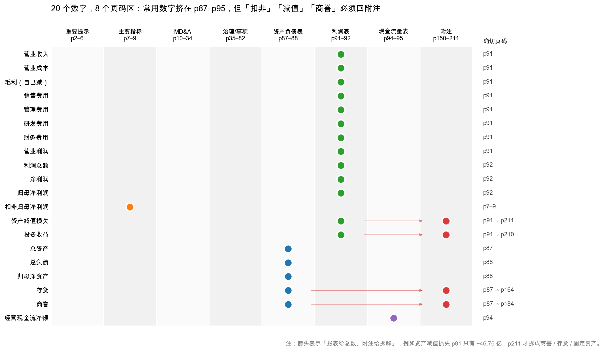

# 第 5 章：实战——10 分钟定位 20 个关键数字

> 本章你将：
> - 拿到一张 20 个关键数字的清单表，每个数字都写清含义、伊利 2024 年真实值、去哪一页找；
> - 学会一套可以重复使用的"10 分钟流程"：目录 → 主要指标页 → 三张表 → 附注三处；
> - 知道哪几个数字必须自己去算，而不能指望年报直接给；
> - 第一次把 20 个数字连起来读，得出一个"这家公司今年怎么样"的整体判断；
> - 拿到一张可以套用到任何 A 股公司的作业单。

---

## 5.1 20 个数字，先看全景

前面四章讲的都是"地图"，这一章开始"取数"。

为什么恰好是 20 个？因为再少就不足以判断一家公司（至少要看规模、盈利、现金、负债、资产质量五个维度），再多就记不住、也不适合 10 分钟的场景。

这张图是"页码热力表"。看两件事：

**第一，蓝绿紫三种点集中在 p87–p95。** 也就是说，20 个数字里有 17 个，你在三张表那 9 页里就能全部拿到。这是好消息——**读年报的效率，取决于你知不知道该看哪几页**，而不是读得多快。

**第二，红色点单独待在"附注"那一列。** 资产减值、投资收益、存货、商誉这四项，报表上只有汇总数，必须翻附注（p211、p210、p164、p184）。这就是第 4 章讲的"表看结论，注看真假"。

> 📌 **划重点：** 20 个数字 = 利润表 11 个 + 资产负债表 6 个 + 现金流量表 2 个 + 主要指标页 1 个。**其中 4 个必须回附注。** 记住这个比例，你就知道读年报的时间该怎么分配。

<!-- src: 伊利股份2024年报/page_007.md 伊利股份2024年报/page_087.md 伊利股份2024年报/page_091.md 伊利股份2024年报/page_094.md 伊利股份2024年报/page_211.md -->

## 5.2 20 个数字清单表

下面这张表是本章的核心。**每一行都写清了：数字是什么、什么意思、伊利 2024 年的真实值、去哪一页找。**

| # | 数字 | 含义 | 伊利 2024 年 | 去哪找 |
|---|---|---|---|---|
| 1 | 营业收入 | 卖东西收到的钱（不含税） | 1,153.93 亿元 | p91 利润表第 2 行 |
| 2 | 营业成本 | 卖出去的东西本身花了多少钱 | 762.99 亿元 | p91 利润表 |
| 3 | 毛利 | 营业收入 - 营业成本 | 390.94 亿元（自己算） | p91 两行相减 |
| 4 | 毛利率 | 毛利 ÷ 营业收入 | 33.88%（自己算） | p91 两行相除 |
| 5 | 销售费用 | 广告、渠道、销售人员花的钱 | 219.82 亿元 | p91 利润表 |
| 6 | 管理费用 | 总部、行政、管理人员花的钱 | 44.65 亿元 | p91 利润表 |
| 7 | 研发费用 | 研发投入（费用化部分） | 8.70 亿元 | p91 利润表 |
| 8 | 财务费用 | 利息支出 - 利息收入 | -5.92 亿元 | p91 利润表 |
| 9 | 营业利润 | 主业赚的钱（含杂项） | 101.82 亿元 | p91 利润表 |
| 10 | 归母净利润 | 属于母公司股东的那份利润 | 84.53 亿元 | p92 利润表 |
| 11 | 扣非归母净利润 | 剔掉一次性损益后的归母净利 | 60.11 亿元 | p7 主要指标页 / p8–9 |
| 12 | 总资产 | 公司一共有多少东西 | 1,537.18 亿元 | p87 资产负债表 |
| 13 | 总负债 | 一共欠多少 | 967.10 亿元 | p88 资产负债表 |
| 14 | 归母净资产 | 归属于母公司股东的家底 | 531.80 亿元 | p88 资产负债表 |
| 15 | 货币资金 | 账上的现金和银行存款 | 254.04 亿元 | p87 资产负债表 |
| 16 | 应收账款 | 卖了货但还没收到的钱 | 28.78 亿元 | p87 资产负债表 |
| 17 | 存货 | 仓库里的原料和成品 | 107.45 亿元 | p87 资产负债表 |
| 18 | 商誉 | 并购时多付的溢价 | 23.37 亿元 | p87 资产负债表 |
| 19 | 经营现金流净额 | 经营活动实际净流入的现金 | 217.40 亿元 | p94 现金流量表 |
| 20 | 资本开支 | 买设备、建厂花的钱 | 39.78 亿元 | p95 现金流量表 |

<!-- src: 伊利股份2024年报/page_007.md 伊利股份2024年报/page_008.md 伊利股份2024年报/page_087.md 伊利股份2024年报/page_088.md 伊利股份2024年报/page_091.md 伊利股份2024年报/page_092.md 伊利股份2024年报/page_094.md 伊利股份2024年报/page_095.md -->

这张表有四个地方需要解释。

**第一，第 3、4 项要自己算。** 年报不直接给"毛利"和"毛利率"这两行，但给得比谁都清楚：营业收入 1,153.93 亿、营业成本 762.99 亿，相减是 390.94 亿，相除是 33.88%。**这两个数是全篇性价比最高的计算**，30 秒就能得出"这门生意的底色"。

**第二，第 11 项要去主要指标页，不在利润表。** 扣非净利润是 A 股特有的披露，位置在第 7 页"主要会计数据"和第 8–9 页的"非经常性损益项目和金额"表。利润表上没有这一行。

**第三，第 15–18 项在同一页。** 货币资金、应收账款、存货、商誉都在 p87 合并资产负债表的前半部分，一眼扫完。**这一页是"资产质量"的入口**，第 3、4 周会逐项拆。

**第四，第 20 项要往下翻一页。** 资本开支（购建固定资产、无形资产和其他长期资产支付的现金）在 p95 现金流量表的投资活动部分，不在 p94。

> 🔍 **翻到年报：** 打开 `page_091.md`，从上往下数到第 6 行（"其中：营业收入"），把 115,393,310,976.69 记下来；再往下数到"其中：营业成本"，记下 76,298,833,033.93。两个数相减，除以第一个，就是毛利率。**这是本章唯一要求你动笔算的地方。**

## 5.3 10 分钟流程：四步走完

有了清单，还需要一条路线。下面这套流程，熟练之后 10 分钟能走完；第一次做可能需要 25 分钟。

**第 1 分钟：翻目录（p4），确认结构。**

不看内容，只看十节是否齐全。这一步的目的是"确认这是一份标准年报"，顺便记住页码分布：财务报告从 p83 开始，附注从 p103 开始。

**第 2–4 分钟：翻主要指标页（p7），拿六个数和两个比率。**

| 拿什么 | 伊利 2024 |
|---|---|
| 营业收入 + 同比 | 1,153.93 亿，-8.24% |
| 归母净利润 + 同比 | 84.53 亿，-18.94% |
| 扣非归母净利润 + 同比 | 60.11 亿，-40.04% |
| 经营现金流净额 + 同比 | 217.40 亿，+18.86% |
| 总资产 + 同比 | 1,537.18 亿，+1.38% |
| 归母净资产 + 同比 | 531.80 亿，-0.67% |
| 基本每股收益 | 1.33 元（2023 年 1.64 元） |
| 加权平均 ROE | 15.81%（2023 年 20.20%） |

这一页给的是"趋势"。四个同比里，三个负数、一个正数（经营现金流 +18.86%）——这个组合本身就有信息量：**利润在跌，现金在涨。** 为什么？第 8 周会回答。

**第 5–7 分钟：翻三张表（p87/p91/p94），拿剩下的十二个数。**

顺序建议：先利润表（5 个费用项 + 营业利润），再资产负债表（总资产、总负债、归母净资产、货币资金、应收账款、存货、商誉），最后现金流量表（经营现金流、资本开支）。

看的时候守一条规矩：**只看大数，不看明细。** 资产负债表只读"合计"行和几个大科目，利润表只读费用行，现金流量表只读三个净额。

**第 8–10 分钟：翻附注三处，把可疑的数字钉死。**

三处固定动作：

1. **附注七(73)（p211）**：资产减值损失 46.76 亿的构成。伊利这里是商誉 30.75 + 存货 12.27 + 固定 3.67 + 工程物资 0.07。
2. **附注七(27)（p184）**：商誉明细。原值 58.13 亿、减值准备 34.76 亿、账面 23.37 亿；今年计提 30.75 亿，其中澳优乳业 30.37 亿。
3. **附注七(1)（p150）+ 七(30)（p188）**：货币资金的构成，以及其他非流动资产里的大额存单 279.77 亿。**这一处最容易被忽略，但它是"钱到底在不在"的关键。**

10 分钟结束，你应该能说出一段话：

> 伊利 2024 年收入 1,153.93 亿元，同比降 8.24%；归母净利润 84.53 亿元，降 18.94%；但扣非净利润只有 60.11 亿元，降 40.04%——说明经营层面的恶化比表面严重，因为 2024 年有 24.42 亿非经常性收益垫着。经营现金流 217.40 亿元反而增长 18.86%，是净利的 2.6 倍，说明利润的"含金量"没问题。资产端最大的一次性事件是 46.76 亿资产减值，其中商誉减值 30.75 亿（主要是澳优），这把第四季度打成了 -24.16 亿的亏损。货币资金从 433.72 亿降到 254.04 亿，但同期大额存单和定期存款增加了约 220 亿，钱没有消失，只是换了科目。

这段话不算深度分析，但它**每一个数字都有出处**，而且指出了三个该继续追的问题：扣非为什么跌这么狠、商誉还会不会再减、钱搬到哪儿去了。**这就是"独立分析"的起点。**

<!-- src: 伊利股份2024年报/page_004.md 伊利股份2024年报/page_007.md 伊利股份2024年报/page_087.md 伊利股份2024年报/page_088.md 伊利股份2024年报/page_091.md 伊利股份2024年报/page_094.md 伊利股份2024年报/page_095.md 伊利股份2024年报/page_150.md 伊利股份2024年报/page_184.md 伊利股份2024年报/page_188.md 伊利股份2024年报/page_211.md -->

## 5.4 三个必须自己算的比率

20 个数字是"原料"，比率是"半成品"。有三个比率必须自己算，因为年报不直接给。

**第一个，毛利率。**

$$\text{毛利率} = \frac{\text{营业收入} - \text{营业成本}}{\text{营业收入}} = \frac{1{,}153.93 - 762.99}{1{,}153.93} \approx 33.88\%$$

这个数说明什么？每卖 100 元的牛奶，生产成本占 66.12 元，剩下 33.88 元要拿去付销售费用（19.05 元）、管理费用（3.87 元）、研发（0.75 元）、税金（0.63 元），再扣掉减值，最后剩 7.33 元净利。

**第二个，净利率。**

$$\text{净利率} = \frac{\text{归母净利润}}{\text{营业收入}} = \frac{84.53}{1{,}153.93} \approx 7.33\%$$

注意：如果用扣非净利算，只有 5.21%。**两个净利率差 2.12 个百分点，就是那 24.42 亿非经常性收益的贡献。**

**第三个，经营现金流对净利润的倍数（净现比）。**

$$\frac{\text{经营现金流净额}}{\text{归母净利润}} = \frac{217.40}{84.53} \approx 2.57$$

这个数大于 1，通常是好信号：说明公司赚的利润有现金支撑，不是"纸面富贵"。伊利这个 2.57 特别高，原因是乳业的商业模式——**先收钱、后付奶款**，经销商打款在前，给牧场的钱在后，中间形成一大笔"占用的钱"（第 8 周会细讲）。

> 💡 **你可能会问：** 净现比 2.57 是不是越高越好？
>
> 不是。这个比率长期过高，可能意味着公司在"吃"上下游的钱（应付账款、合同负债持续增长），短期很好看，但不可持续；也可能意味着折旧摊销很大（重资产行业），利润被折旧压低而现金流不受影响。**2.57 对伊利是正常的，因为乳业本来就是"预收 + 应付"的生意；但如果一家轻资产公司常年 3 倍以上，就要警惕是不是在压榨供应商。** 第 40 章会给判断标准。

<!-- src: 伊利股份2024年报/page_091.md 伊利股份2024年报/page_092.md 伊利股份2024年报/page_094.md 伊利股份2024年报/page_007.md -->

## 5.5 五个数字，先看哪个

如果连 20 个数字都来不及拿，只看五个。顺序是有讲究的。

**第一看归母净利润 vs 扣非归母净利润的差距。** 伊利 84.53 亿 vs 60.11 亿，差 24.42 亿，占 28.88%。**差距越大，说明"今年的利润"越不可持续。** 一个健康的公司，这个差距通常在 10% 以内。

**第二看经营现金流 vs 归母净利润。** 伊利 217.40 亿 vs 84.53 亿，2.57 倍。**如果这个比值长期小于 1，说明利润收不回来现金，是最危险的信号之一。**

**第三看 ROE 的变化方向。** 伊利从 20.20% 降到 15.81%，降了 4.39 个百分点。**ROE 是"股东每投入 100 元，一年赚回多少"，它的趋势比绝对值重要。** 连续三年下滑，比一年低更值得警惕。

**第四看资产减值占利润的比例。** 伊利 46.76 亿 ÷ 84.53 亿 = 55.32%（如果加上信用减值 5.55 亿，是 61.88%）。**这个比例超过 30%，就说明"减值"已经是理解这家公司利润的关键变量**，必须去附注看构成。

**第五看货币资金 + 类现金 vs 有息负债。** 伊利类现金 652.07 亿 vs 有息负债 605.58 亿，净现金 46.50 亿。**这个比值决定"公司会不会因为缺钱而死"** ——只要类现金能覆盖有息负债，短期的偿债风险就很低。

五个数字连起来，其实是在回答五个问题：**利润真不真、现金实不实、回报高不高、有没有大坑、会不会猝死。** 这五个问题，就是后面九周的全部内容。

> ⚠️ **易踩坑：** 只看归母净利润一个数就下结论。
>
> 伊利 2024 年归母净利润 84.53 亿，看着只是"降了 18.94%"，不算崩。但扣非只有 60.11 亿（降 40.04%），资产减值 46.76 亿，四季度单季亏 24.16 亿——**四个数放在一起，结论完全不同。** 单一数字永远会骗人，这是本周最该带走的习惯。

<!-- src: 伊利股份2024年报/page_007.md 伊利股份2024年报/page_008.md 伊利股份2024年报/page_091.md 伊利股份2024年报/page_211.md -->

## 5.6 换一家公司也这么读：一页纸作业单

这张 20 个数字的清单，不是为伊利定制的。换任何一家 A 股公司，都能直接用，只需要改三处。

**第一处，页码。** 20 个数字的**相对位置**是一样的：利润表里找收入成本费用、资产负债表里找资产负债权益、现金流量表里找三个净额、主要指标页里找扣非。换公司只需要重新定位页码——用目录（第二节找主要指标、第十节找财务报告）或者直接搜章节名。

**第二处，行业特性。** 乳业的"存货"很重要（保质期），银行的"存货"是零；乳业的"商誉"来自并购，软件公司的"商誉"可能很小但"无形资产"很大。**清单的 20 个位置不变，但每个位置的"正常值"因行业而异。** 伊利毛利率 33.88%，白酒公司可能 80% 以上，超市可能 20% ——不能横向比绝对值，要比趋势和同业。

**第三处，特殊科目。** 有些公司有清单里没有的科目，比如"合同资产"（工程类）、"开发支出"（医药、软件）、"生产性生物资产"（牧业，伊利有 17.46 亿）、"递延所得税资产"。**看到陌生科目，第一反应是翻附注，而不是跳过。**

> 📌 **划重点：** 这张清单的价值不在"20 个数字"，而在"20 个位置"。位置是通用的，数字是个案的。学会"按位置取数"，你就能读任何一家公司的年报；只会背伊利的数字，你只能读伊利。

下面把本章压缩成一页可以打印的作业单。以后读任何一家新公司，照着填。

把本章压缩成一页可以打印的作业单。以后读任何一家新公司，照着填。

**第一栏：定位（2 分钟）**

| 项目 | 填什么 | 怎么找 |
|---|---|---|
| 财务报告起始页 | ＿ | 目录"第十节 财务报告" |
| 合并资产负债表 | ＿ | 财务报告第二页起 |
| 合并利润表 | ＿ | 资产负债表之后 |
| 合并现金流量表 | ＿ | 利润表之后 |
| 附注"七"起始页 | ＿ | 搜"合并财务报表项目注释" |

**第二栏：20 个数（6 分钟）**

按第 5.2 节的表，逐行填。**填不出来的行标红**——标红的行就是下一轮要重点学的科目。

**第三栏：三个自算比率（1 分钟）**

| 比率 | 公式 | 我的结果 | 判断 |
|---|---|---|---|
| 毛利率 | （收入 - 成本）÷ 收入 | ＿ | 比去年高还是低 |
| 净利率 | 归母净利 ÷ 收入 | ＿ | 比去年高还是低 |
| 净现比 | 经营现金流 ÷ 归母净利 | ＿ | 大于 1 还是小于 1 |

**第四栏：三个追问（1 分钟）**

1. 归母净利和扣非净利的差距有多大？差距来自哪一项非经常性损益？
2. 资产减值占归母净利的比例是多少？最大的一块是什么？
3. 货币资金比去年增还是减？同期"其他流动资产/其他非流动资产"里的存款是增还是减？

**三个问题里，只要有一个答不上来，就说明这一轮还没读完。**

这套作业单第一次做要 25 分钟，做过五家公司之后能压到 10 分钟。**速度不是目标，"每一栏都有出处"才是。**

> ⚠️ **易踩坑：** 抄数时把"2023 年"那一列抄成"2024 年"。
>
> A 股年报的报表是两列并排：左边本期、右边上期。**两列数字长得很像，抄错一列，后面所有分析全废。** 三个防错办法：① 先看表头写的是"2024 年 12 月 31 日"还是"2023 年 12 月 31 日"；② 抄完之后用"同比"验算一遍（营收 1,153.93 vs 1,257.58，差 -8.24%，和 p7 披露的一致）；③ 主要指标页（p7）给了同比，用它反过来验证你抄的两列对不对。

<!-- src: 伊利股份2024年报/page_007.md 伊利股份2024年报/page_087.md 伊利股份2024年报/page_088.md 伊利股份2024年报/page_091.md 伊利股份2024年报/page_094.md 伊利股份2024年报/page_103.md 伊利股份2024年报/page_150.md -->

<!-- src: 伊利股份2024年报/page_087.md 伊利股份2024年报/page_091.md 伊利股份2024年报/page_094.md -->

## ✍️ 想一想

### 问 1：毛利率 33.88%，这个数好不好

伊利 2024 年毛利率 33.88%。请回答：这个数算高还是算低？判断"好不好"需要哪几个参照系？只看毛利率能不能判断一家公司是不是好生意？

**解题思路：** "高低"是相对的，先想清楚跟谁比。至少三个参照：跟自己过去比（趋势）、跟同行比（竞争地位）、跟自己的费用结构比（能不能覆盖）。然后再想：毛利率高但费用率更高，是好生意吗？

**参考答案：**

**先说结论：33.88% 对乳业是正常水平，但"正常"不等于"好"。**

三个参照系：

| 参照系 | 怎么比 | 伊利的情况 |
|---|---|---|
| 跟自己比 | 看三年趋势 | 2024 年 33.88%，需要看 2023、2022 年是否稳定（第 6 周会算） |
| 跟同行比 | 蒙牛 2024 年毛利率 39.57% | 伊利**低于**蒙牛约 5.7 个百分点 |
| 跟费用结构比 | 毛利率能否覆盖费用率 | 销售 19.05% + 管理 3.87% + 研发 0.75% + 税金 0.63% = 24.30%，毛利 33.88% 覆盖得住，剩 9.58 个百分点 |

**为什么毛利率低于蒙牛却仍然是好生意？** 因为毛利率只是"第一层"，后面还有费用率。蒙牛毛利率高，但它的销售费用率也高（品牌投入大），最后净利率未必比伊利高。**这正是第 6 周（第 28 章）要讲的核心：毛利率是生意的底色，但净利率才是结果。**

**只看毛利率能不能判断好生意？不能。** 反例：一家公司毛利率 80%，但销售费用率 75%，净利率只有 5%——它是"高毛利、高费用"的生意，赚的是辛苦钱。另一个反例：一家公司毛利率 15%，但周转极快（比如超市），ROE 可能很高。**判断好生意至少要三把尺子：毛利率（赚不赚得到）、费用率（留不留得住）、周转率（转得快不快）。** 这就是第 9 周杜邦分解的内容。

**易错点：** ① 直接说"33.88% 很高"或"很低"，没有参照系；② 只跟同行比绝对值，忽略业务结构差异（伊利液态奶占比高、蒙牛奶粉占比高，毛利率天然不同）；③ 把毛利率当成净利率，忘了后面还有 24.30 个百分点的费用。

### 问 2：净现比 2.57，是好事还是坏事

伊利 2024 年经营现金流 217.40 亿元，归母净利润 84.53 亿元，净现比 2.57。请回答：这个数说明什么？它在什么情况下是好事，什么情况下是坏事？

**解题思路：** 先想"经营现金流为什么会大于净利润"。主要有三个原因：折旧摊销（不耗现金但减利润）、减值（同样不耗现金）、营运资本变化（预收增加、应付增加）。然后想：这三种原因，哪些是可持续的，哪些不是。

**参考答案：**

**说明什么：** 公司每赚 1 元账面利润，实际收回了 2.57 元现金。这说明利润的"含金量"高，不是靠赊销堆出来的。

**三个原因，三种性质：**

| 原因 | 伊利 2024 年 | 性质 |
|---|---|---|
| 折旧摊销 | 折旧 40.56 亿 + 无形摊销 2.69 亿 + 使用权摊销 1.47 亿 | **可持续**（重资产行业的常态） |
| 资产减值 | 46.76 亿 | **一次性**（今年有、明年未必） |
| 营运资本变化 | 合同负债从 86.96 亿增到 120.73 亿（+33.77 亿） | **半可持续**（取决于渠道政策） |

伊利 2024 年这三项加起来约 125 亿，再加上净利 84.53 亿，和 217.40 亿的差距基本能对上（还有信用减值、投资收益等调整项）。

**什么时候是好事：** 主要靠折旧摊销和稳定的营运资本，说明商业模式本身"先收钱后付钱"，现金流天然好于利润。伊利的乳业模式就是这一类——经销商先打款，牧场后收款。

**什么时候是坏事：** ① 靠"应付账款猛增"撑起来的——那是拖欠供应商，会反噬；② 靠"一次性减值"撑起来的——今年加回 46.76 亿，明年没有这笔加回，现金流就会掉；③ 净现比长期低于 1，说明利润收不回现金，是最危险的信号。

**所以 2.57 对伊利是"偏好但不是极好"：** 好的一面是模式健康，隐忧的一面是——**今年的高比值里，有 46.76 亿是减值加回，这部分明年不会重复。** 把减值剔除，净现比大约是 $(217.40 - 46.76) \div 84.53 \approx 2.02$，仍然健康，但没有 2.57 那么漂亮。

**易错点：** ① 直接说"越高越好"，没想过高比值的来源；② 忘记减值会被"加回"到经营现金流（间接法的机制）；③ 把"经营现金流"和"自由现金流"混为一谈——伊利自由现金流是 177.61 亿（经营 217.40 - capex 39.78），比经营现金流少 39.78 亿。

### 问 3：用这 20 个数字，给伊利 2024 年写三句话

假设你要向一个完全不懂财务的朋友介绍伊利 2024 年，只能用三句话，且每句话必须包含至少一个本章清单里的数字。你会怎么写？

**解题思路：** 三句话要有分工：第一句说"规模与趋势"，第二句说"利润的质量"，第三句说"最大的风险点"。不要试图面面俱到，要让听的人记住三个数。

**参考答案：**

参考写法（不是唯一答案）：

> **第一句（规模与趋势）：** 伊利 2024 年卖了 1,153.93 亿元的货，比去年少 8.24%；归母净利润 84.53 亿元，比去年少 18.94%。
>
> **第二句（利润质量）：** 但这 84.53 亿里有 24.42 亿是一次性的（卖子公司股权赚的），剔掉之后只剩 60.11 亿，同比降 40.04%——**经营层面的下滑比表面严重得多**；好在这一年经营现金流有 217.40 亿，是净利的 2.6 倍，赚的是真钱。
>
> **第三句（最大风险点）：** 今年计提了 46.76 亿资产减值，其中 30.75 亿是商誉减值（主要是 2019 年收购的澳优），一把把第四季度打成了 -24.16 亿的亏损；商誉还剩 23.37 亿，明年还会不会再减，是最大的未知数。

**为什么这样写：**

- 第一句给"体量感"，让人知道这家公司多大、在往哪个方向走；
- 第二句给"质量感"，用"归母 vs 扣非"的差距揭示真相，再用现金流证明"不是假账"；
- 第三句给"风险感"，用一个具体的一次性事件解释"为什么四季度亏"，并留下一个可跟踪的问题。

**三个数的选择逻辑：** 1,153.93（规模）、60.11（真实盈利）、30.75（最大的一次性损失）。这三个数覆盖了"多大、多真、多险"三个维度。

**易错点：** ① 三句话都在讲利润，没有一句讲现金或资产——那就成了"只看利润表"；② 用"公司经营稳健、发展良好"这类空话代替数字——本章的全部意义就是"用数字说话"；③ 把 84.53 亿说成"赚了 84.53 亿现金"——利润和现金是两件事，这正是第 8 周的主题。

## 📎 数据出处

- 伊利股份 2024 年报：`page_004.md`（目录）、`page_007.md`（主要会计数据与财务指标、扣非净利）、`page_008.md`（分季度、非经常性损益）、`page_009.md`（非经常性损益合计）、`page_087.md`（货币资金、应收账款、存货、商誉、总资产）、`page_088.md`（总负债、归母净资产、合同负债）、`page_091.md`（营业收入、营业成本、各项费用、营业利润、资产减值）、`page_092.md`（归母净利润、每股收益）、`page_094.md`（经营活动现金流净额）、`page_095.md`（资本开支）、`page_150.md`（附注七(1) 货币资金）、`page_184.md`（附注七(27) 商誉明细）、`page_188.md`（附注七(30) 其他非流动资产）、`page_211.md`（附注七(73) 资产减值明细）、`page_217.md`（现金流量表补充资料·折旧与减值）
- 数据汇总：`data/yili2024.json` 的 `income`、`balance`、`cashflow`、`notes`、`ratios` 段

<!-- src: 伊利股份2024年报/page_004.md 伊利股份2024年报/page_007.md 伊利股份2024年报/page_008.md 伊利股份2024年报/page_009.md 伊利股份2024年报/page_087.md 伊利股份2024年报/page_088.md 伊利股份2024年报/page_091.md 伊利股份2024年报/page_092.md 伊利股份2024年报/page_094.md 伊利股份2024年报/page_095.md 伊利股份2024年报/page_150.md 伊利股份2024年报/page_184.md 伊利股份2024年报/page_188.md 伊利股份2024年报/page_211.md 伊利股份2024年报/page_217.md -->

下一章：[第 6 章：公司为什么要有账本——从一家奶茶店说起](../week02/06-公司为什么要有账本.md)——本周到此结束。你已经会"取数"了，下一周开始学"这些数是怎么记出来的"。
