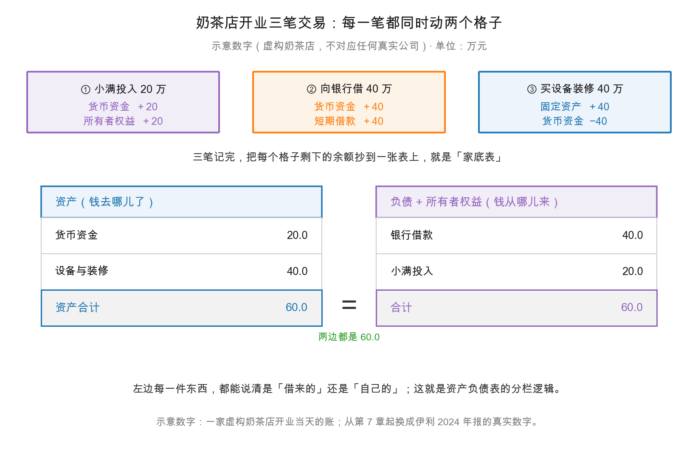

# 第 6 章：公司为什么要有账本——从一家奶茶店说起

> 本章你将：
> - 用一家奶茶店的三笔交易，亲手记出人生第一张"家底表"；
> - 分清 **资产（assets）**、**负债（liabilities）**、**所有者权益（owners' equity）** 三个词在生活里到底对应什么；
> - 弄明白为什么家底一定要分成左右两栏，而不是列成一张清单；
> - 看懂伊利 **1,537.18 亿元**的家底，和你家楼下奶茶店记的是同一套账；
> - 知道账本的三类读者，各自在账本里找什么。

上周你把一份 270 页的年报从头翻到了尾，知道了三张表各在第几页、附注藏在哪儿。
可是你大概一直有个疑问没好意思问：**一家公司，为什么非得记这么一套账？**

这周我们就从零把这个疑问解决掉。方法是：先别看伊利，先去看一家奶茶店。

---

## 6.1 一个没有账本的公司，会先在哪一步乱掉

先做个思想实验。

小满开了家奶茶店。开业第一个月生意不错，每天收现金，月底一算：抽屉里有钱、微信里有余额、支付宝里有余额，还有几张赊账单（隔壁公司订了 200 杯，说月底结）。
小满很开心，觉得自己赚了。

第二个月，供货商来结账：上个月的奶粉、茶叶、杯子，一共 6 万，该付了。
小满愣住了——钱呢？明明每天收了不少。

问题出在哪？出在他**没有区分"收到的钱"和"赚到的钱"，也没有区分"手里的钱"和"欠别人的钱"**。
抽屉里的现金是"收到的"，但其中有一部分早就被"欠供应商的 6 万"预支掉了；
账面上看着挺宽裕，实际上一半不属于自己。

这就是账本要解决的第一个问题：**把"我的"和"欠别人的"分开。**

还有第二个问题。第三个月小满想扩张，去银行借钱。银行客户经理问：
"你这店现在值多少钱？有多少资产？欠了谁多少？一年能赚多少？拿什么还我？"
小满如果只能回答"生意挺好的"，这钱就借不到。

第三个问题更有意思。小满想拉朋友入股，朋友问："我投 10 万，占多少？"
小满说"算你 20% 吧"。朋友追问："那现在这店值 50 万？凭什么？"
没有账本，这个"凭什么"就无法回答。

所以账本不是为了应付税务局。它要回答三个问题：

| 问题 | 谁在问 | 账本里的答案在哪里 |
|---|---|---|
| 我到底有多少东西，其中多少是欠别人的？ | 老板自己 | 资产负债表 |
| 这一年我到底赚没赚、赚了多少？ | 老板、股东、税务局 | 利润表 |
| 钱到底进了多少、出了多少，还剩多少？ | 老板、银行 | 现金流量表 |

还有一个更根本的原因，第 2 章已经埋过伏笔：**公司的老板和公司的经营者，往往不是同一个人。**

伊利的董事长是潘刚，但伊利不属于潘刚——它属于几十万名股东。
这些股东里，绝大多数人从没进过伊利的工厂，也不可能每天盯着采购部有没有乱花钱。
这就是"委托代理问题"：**出钱的人不管事，管事的人不出钱。**

要让这套安排成立，只有一个办法：**管事的人必须定期、按统一规则、把账交出来，并且让第三方查一遍。**
这套"统一规则"就是会计准则，"定期交出来"就是年报，"第三方查一遍"就是审计。

所以你翻开伊利 2024 年报 page_083，会看到信永中和会计师事务所出具的审计报告。
它的存在，不是因为伊利想给你看，而是因为**不给你看，这个市场就没法运转**。

<!-- src: 伊利股份2024年报/page_083.md -->

从这个角度看，账本其实是一份**契约的执行记录**：
股东把钱交给公司，公司承诺按规则记账、按规则披露；债权人把钱借给公司，公司承诺按规则还本付息。
没有这套记录，所有"承诺"都只是口头上的。

本周我们只做第一张表——**资产负债表（balance sheet）**，也叫"家底表""财务状况表"。
中文名叫资产负债表，字面意思是"资产"和"负债"的一张表；港股年报里它还有个更朴素的名字，叫**财务状况表**。
它回答的问题只有一句：**在某一天，这家公司有什么、欠什么、真正属于股东的是什么。**

> 📌 **划重点：** 账本的第一功能不是"记账给税务局看"，而是**把"我的"和"欠别人的"分开**。没有这条分界线，赚钱和有钱会混成一团，公司就永远不知道自己能不能活下去。

---

## 6.2 奶茶店开业：三笔交易，六个格子

现在开始记真账。以下**全部是示意数字**，来自一家虚构的奶茶店，不对应任何真实公司；从 6.5 节起换成伊利 2024 年报的真实数字。

**1 月 1 日，开业当天，小满做了三件事：**

1. 自己掏出 **20 万**积蓄，投进店里；
2. 向银行借了 **40 万**（三年期）；
3. 当天花 **40 万**买设备、做装修（制茶机、封口机、冰箱、门头）。

我们不写分录、不谈借贷，只做一件事：**给每一个"格子"记账**。
格子的意思是：账本上每一个科目名后面，都有一个可以加减的数字。

| 格子（科目） | 开业前 | 交易① 投入 20 万 | 交易② 借 40 万 | 交易③ 买设备 40 万 | 开业后余额 |
|---|---|---|---|---|---|
| 货币资金 | 0 | +20 | +40 | -40 | **20** |
| 固定资产（设备与装修） | 0 | 0 | 0 | +40 | **40** |
| 银行借款 | 0 | 0 | +40 | 0 | **40** |
| 所有者权益（小满投入） | 0 | +20 | 0 | 0 | **20** |

把余额抄成一张表，左边放"店里的东西"，右边放"东西的来源"：

| 左边：资产（钱去哪儿了） | 万元 | 右边：负债 + 所有者权益（钱从哪儿来） | 万元 |
|---|---|---|---|
| 货币资金 | 20 | 银行借款（负债） | 40 |
| 设备与装修（固定资产） | 40 | 小满投入（所有者权益） | 20 |
| **资产合计** | **60** | **负债 + 所有者权益合计** | **60** |

**60 = 40 + 20。**

请盯着这个式子看十秒。它不是凑巧相等，它是**必然相等**。

上图上半部分是那三笔交易，下半部分是抄出来的家底表。
注意上半部分每张卡片里都写着**两行**——这就是下一章要讲的"复式记账"的雏形：
**每一笔交易至少动两个格子。** 现在你只要先接受这个事实，不用问为什么。

顺便把三笔交易的性质分个类，这是理解整张表的钥匙：

| 交易 | 动的两个格子 | 对恒等式的影响 | 一句话 |
|---|---|---|---|
| ① 投入 20 万 | 货币资金 +20 / 权益 +20 | 左 +20，右 +20 | **两边同时变厚** |
| ② 借 40 万 | 货币资金 +40 / 负债 +40 | 左 +40，右 +40 | **两边同时变厚** |
| ③ 买设备 40 万 | 固定资产 +40 / 货币资金 -40 | 左 40 不变 | **只在左边内部搬家** |

注意交易③：资产总额**一分钱都没变**。现金少了 40 万，设备多了 40 万，
左边的合计还是 60 万。这就是"资产内部一增一减"——它让家底的**构成**变了，但**总量**没变。

看出规律了吗？一笔交易如果只动左栏（或只动右栏），总额就不变；
如果同时动左栏和右栏，总额就一起变。这个规律下一章（第 8 章）会展开成一张完整的六类交易表。

现在看下半部分的两栏。左边的"货币资金 20 万 + 设备 40 万"，是**店里的东西**；
右边的"银行借款 40 万 + 小满投入 20 万"，是**这些东西的钱是从哪来的**。
两边说的是同一堆钱的两个侧面：**一边是用途，一边是来源。**

> 💡 **你可能会问：那"小满投入 20 万"为什么不干脆叫"欠小满 20 万"？**
>
> 因为欠和不欠有本质区别。欠银行的钱有到期日、有利息，到期不还银行可以起诉、可以查封设备；
> 而小满投的 20 万**没有到期日，也没有利息**，公司不用"还"它。
> 小满换来的是另一种东西：**在所有欠款都还清之后，剩下的全归他。**
> 所以"所有者权益"的另一个名字叫**剩余权益（residual equity）**——它排在最末位，拿的是"剩下的"。
> 你买的每一股股票，买的就是这种"剩下的权利"的一小片。

---

## 6.3 三个词：资产、负债、所有者权益

现在把三个词严格定义一遍。定义之后，我们再回到奶茶店，你会发现每一个字都能对上。

**资产（assets）**：公司**拥有或控制**的、**过去交易形成**的、**预期能带来经济利益**的资源。
拆开看三个条件，缺一不可：
- "拥有或控制"——租来的店面不算资产（控制权不在你），但"使用权资产"这个科目会把租约的一部分记进来；
- "过去交易形成"——明天可能中彩票，那不是资产；
- "预期带来经济利益"——卖不出去的过期原料，严格说已经不是资产了，所以要做"存货跌价准备"。

**负债（liabilities）**：公司**过去交易形成**的、**预期会导致经济利益流出**的**现时义务**。
翻译成人话：**已经欠下的、将来要用钱或货去还的东西。**
注意"现时义务"四个字——意向性的、还没签合同的承诺，不算负债。

**所有者权益（owners' equity）**：**资产减去负债之后的剩余部分。**
它不是"另一堆东西"，它是**算出来的差额**。这也是它为什么永远和"资产 - 负债"相等——
因为它就是那么定义的。

三个词的关系，用一句生活话总结：

> 你家的房子值 500 万，还欠银行 300 万。你的"资产"是 500 万，"负债"是 300 万，
> 你的"净资产"是 200 万。这 200 万不是另一样东西，它是"500 减 300"这个减法算出来的。

现在对照奶茶店：

| 会计术语 | 奶茶店里是什么 | 判断标准 |
|---|---|---|
| 资产 | 抽屉里的 20 万现金、40 万的设备装修 | 店里的、能带来收入的东西 |
| 负债 | 欠银行的 40 万 | 将来必须还的钱 |
| 所有者权益 | 小满的 20 万 | 还完债之后剩下的 |

> ⚠️ **易踩坑：** 很多人第一次学，会把"所有者权益"理解成"公司账上另外存了一笔钱留给股东"。
> 完全不是。**权益不是一笔钱，是一个差额。** 你可以把公司所有资产卖掉、所有负债还清，
> 剩下来的才是权益；但在正常经营中，这笔"剩下的"永远以各种资产的形式存在着（现金、设备、存货……），
> 并不会单独放在某个账户里。伊利 2024 年报上"所有者权益合计 570.08 亿元"，
> 指的绝不是"伊利有 570.08 亿元现金留给股东"。

---

## 6.4 为什么一定要分左右两栏

到这里，一个自然的问题冒出来了：既然资产、负债、权益都是钱，为什么不列成一张清单，
比如"现金 20 万、设备 40 万、欠银行 40 万、自己的 20 万"，一行一行写下来？

因为**一张清单只能回答"有什么"，回答不了"这些东西是谁的钱买的"。**

分左右两栏的妙处在于，它逼着你为**每一件资产**找到**一个资金来源**。
这是会计最厉害的一个设计：它不接受"来路不明"。

举个真实场景。假设三年后，小满的店账上多了一台 8 万的咖啡机，但银行借款没增加、小满也没再投钱。
这台机器哪来的？只有三种可能：
1. 这三年赚的钱买的（→ 权益里的"未分配利润"会增加）；
2. 欠供应商的钱买的（→ 负债里的"应付账款"会增加）；
3. 卖掉了别的东西换的（→ 另一项资产减少）。

**没有第四种可能。** 这就是左右两栏的威力：它把"钱从哪来"这个问题，变成了一道必须填满的填空题。

用一张图说清楚这个逻辑：

| 左边的每一次增加 | 右边必须有的对应 |
|---|---|
| 现金变多 | 要么借了钱（负债 +），要么股东投了钱（权益 +），要么赚了钱（权益 +），要么卖了别的资产（另一项资产 -） |
| 设备变多 | 同上四种之一 |
| 存货变多 | 同上四种之一 |

反过来也成立：右边的每一次增加，左边也必有对应。
借钱进来，现金一定变多；股东投钱进来，现金或别的资产一定变多；
赚了钱（权益增加），资产也一定以某种形式增加了（哪怕只是"应收账款"增加）。

> 📌 **划重点：** 资产负债表的左右两栏，本质是把"**资金的用途**"和"**资金的来源**"强行摆在一起对照。
> 左边回答"钱变成了什么"，右边回答"钱是谁给的"。因为说的是同一批钱，所以两边永远相等。

---

## 6.5 从奶茶店到伊利：同一套规矩，放大了七万倍

现在把镜头从奶茶店拉到伊利。

伊利 2024 年 12 月 31 日的家底是这样的：

| 左边：资产 | 亿元 | 右边：负债 + 所有者权益 | 亿元 |
|---|---|---|---|
| 流动资产合计 | 666.19 | 流动负债合计 | 899.25 |
| 非流动资产合计 | 870.99 | 非流动负债合计 | 67.86 |
| | | 负债合计 | 967.10 |
| | | 归母所有者权益 | 531.80 |
| | | 少数股东权益 | 38.28 |
| | | 所有者权益合计 | 570.08 |
| **资产总计** | **1,537.18** | **负债和所有者权益总计** | **1,537.18** |

1,537.18 = 967.10 + 570.08。一个子儿都不差。

<!-- src: 伊利股份2024年报/page_087.md 伊利股份2024年报/page_088.md -->

这张表和你刚才给奶茶店抄的那张，结构完全一样：

| 奶茶店（示意） | 伊利 2024（真实） | 差别在哪 |
|---|---|---|
| 货币资金 20 万 | 货币资金 254.04 亿元 | 量级差七万倍 |
| 设备与装修 40 万 | 固定资产 346.19 亿元 | 伊利的设备是生产线、灌装机、冷库 |
| 银行借款 40 万 | 短期借款 363.55 亿元 + 长期借款 46.87 亿元 | 伊利还多了债券、租赁负债 |
| 小满投入 20 万 | 股本 63.66 亿元 + 资本公积 132.11 亿元 | 伊利的"小满"是几十万股民 |
| —（奶茶店没有） | 少数股东权益 38.28 亿元 | 伊利有子公司，子公司还有别的股东 |

最后一行值得停一下。**"少数股东权益"是奶茶店那张表里没有的东西。**
它是什么？伊利并不是一家单体店，它下面有一堆子公司（比如澳优乳业）。如果某个子公司伊利只持股 60%，
剩下 40% 是别人持有的，那么这家子公司的净资产里，有 40% 不属于伊利的股东，属于"少数股东"。
这 38.28 亿元就是这么来的。

所以伊利这张表要读成两层：

- **第一层**：资产 1,537.18 = 负债 967.10 + 全部权益 570.08；
- **第二层**：全部权益 570.08 = 归母 531.80 + 少数股东 38.28。

"归母"是"归属于母公司股东"的简称。**你买伊利股票，你拥有的是 531.80 亿元里的对应一小片，
不是 570.08 亿元里的。** 这个区别在第 24 章（所有者权益）会彻底展开，本周只要记住有这个分层。

> 🔍 **翻到年报：** 打开 `page_087.md`，找到最下面一行"**资产总计**"，数字是 153,718,003,927.97 元。
> 再打开 `page_088.md`，最下面一行"**负债和所有者权益（或股东权益）总计**"，是同一个数。
> 这两个数必须一模一样——如果不一样，不是公司出问题，是你抄错行了。

再看一个能让你直观感受"量级"的对比：

伊利 2024 年一年干了这些事：卖出 **1,153.93 亿元**的货（营业收入），
赚了 **84.64 亿元**净利润，账上还趴着 **254.04 亿元**货币资金。
而它为了做这些生意，压在手头的家底是 **1,537.18 亿元**。

<!-- src: 伊利股份2024年报/page_087.md 伊利股份2024年报/page_091.md 伊利股份2024年报/page_092.md -->

换句话说：**伊利每做 1 元钱的生意，背后站着约 1.33 元的家底。**
（1,537.18 ÷ 1,153.93 $\approx$ 1.33。）这个比值叫资产周转率的倒数，我们第 42 章讲杜邦分解时还会用到它。
现在你只要有一个感觉：**乳业是个重资产的生意**，它得先有厂、有设备、有牧场，才能卖出那 1,153.93 亿元。

再补一句：这张表**每年都在变**，而且变化本身就是信息。把 2023 年和 2024 年并排看：

| 科目 | 2023 年末 | 2024 年末 | 变化 | 变化说明 |
|---|---|---|---|---|
| 货币资金 | 433.72 亿元 | 254.04 亿元 | **-179.68** | 钱去买大额存单、还债、分红了 |
| 商誉 | 51.60 亿元 | 23.37 亿元 | **-28.23** | 计提减值 30.75 亿元（其中澳优 30.37 亿元） |
| 合同负债 | 86.96 亿元 | 120.73 亿元 | **+33.77** | 经销商提前打款增加 |
| 短期借款 | 397.55 亿元 | 363.55 亿元 | **-34.00** | 还款多于新借 |

这张表里的四个变化，每一个都是一个可以讲很久的故事：
货币资金为什么少了 179.68 亿元？商誉为什么砍掉一半？合同负债为什么暴增 33.77 亿元——
是经销商信心足了，还是公司在向渠道压货？
这些正是后面第 12、19、22 章要逐个拆的东西。**本周你只需要知道：账本不是一张静态的照片，它是可以对比的。**

<!-- src: 伊利股份2024年报/page_087.md 伊利股份2024年报/page_088.md -->

---

## 6.6 账本的三类读者

账本记完了，最后一个问题是：**记给谁看？**

这个问题看似务虚，实际上决定了整份年报的写法。因为不同的人，在账本里找的是完全不同的东西。

**第一类读者：管理者。**
他要看的是"哪里在漏水"。比如销售费用涨得比收入快，说明渠道费用失控；
存货周转变慢，说明货压在仓库里；短期借款 363.55 亿元而货币资金只有 254.04 亿元，说明短期要靠"借新还旧"周转。
这些判断，都要靠账本逐项对比才做得出来。

**第二类读者：债权人（银行、债券持有人）。**
他只关心一件事：**我的钱能不能拿回来。**
所以他会看：资产负债率 62.91%（负债 967.10 ÷ 资产 1,537.18）、
流动比率 0.74（流动资产 666.19 ÷ 流动负债 899.25）、
以及"一年内要还多少、手里有多少"。
流动比率小于 1，意味着**手上的流动资产不够覆盖一年内到期的负债**——
对奶茶店来说这是要命的，对伊利来说却未必（后面第 25 章会解释为什么）。

**第三类读者：股东（也就是你）。**
你关心的是"这家公司赚的钱，能不能持续地变成我的钱"。
所以你会看：净利润 84.64 亿元、经营性现金流 217.40 亿元（是净利润的 2.57 倍）、
ROE 15.81%、每股分红多少。

<!-- src: 伊利股份2024年报/page_007.md 伊利股份2024年报/page_088.md 伊利股份2024年报/page_092.md 伊利股份2024年报/page_094.md -->

| 读者 | 最关心的一句话 | 主要看哪张表 | 伊利的对应数字 |
|---|---|---|---|
| 管理者 | 哪里在漏水 | 三张表都要，逐项比 | 销售费用 219.82 亿元，占收入 19.05% |
| 债权人 | 我的钱能不能拿回来 | 资产负债表 | 资产负债率 62.91%，流动比率 0.74 |
| 股东 | 赚的钱能不能持续变成我的钱 | 利润表 + 现金流量表 | 净利 84.64 亿，经营现金流 217.40 亿 |

同一套账本，三类人读出三种结论。这不是账本"不客观"，
而是**账本记录的是事实，判断是读者自己做的**。我们这门课的目标，就是让你成为第三类读者里
那个看得懂事实的人。

本周剩下的四章，就是把这张家底表彻底拆开：
第 7 章讲它为什么永远平（会计恒等式）；
第 8 章讲每一笔交易怎么同时动两个格子（复式记账）；
第 9 章讲利润和现金为什么会分叉（权责发生制）；
第 10 章讲三张表怎么咬成一台机器。

---

## ✍️ 想一想

### 问 1：三笔交易之后又借了 10 万，表怎么变

沿用 6.2 节奶茶店的示意数字。开业当天结束后（资产 60 万 = 负债 40 万 + 权益 20 万），
1 月 2 日小满又向银行借了 **10 万元**存进店里，什么都没买。请写出新的家底表，并回答：
小满的"净资产"变了吗？

**解题思路：**
把这笔交易翻译成"动哪两个格子"：一边是"货币资金 +10"，另一边是"银行借款 +10"。
两个格子分处左右两栏，所以两栏同时变大。然后再套 6.3 节的定义：
"净资产"就是所有者权益，看它有没有被碰到。

**参考答案：**

| 左边：资产 | 万元 | 右边：负债 + 所有者权益 | 万元 |
|---|---|---|---|
| 货币资金 | 20 + 10 = **30** | 银行借款 | 40 + 10 = **50** |
| 设备与装修 | 40 | 小满投入（权益） | **20** |
| **资产合计** | **70** | **负债 + 权益合计** | **70** |

70 = 50 + 20，等式依旧成立。

**净资产没有变，还是 20 万元。** 家底确实变厚了（资产从 60 到 70），
但"变厚"的部分全是借来的，一分都不属于小满。
这也解释了为什么"资产多"不等于"有钱"——伊利的资产有 1,537.18 亿元，
但其中 967.10 亿元是别人的钱。

**易错点：**
① 把 10 万记进"所有者权益"。借款有到期日、要付利息，它是负债，不是股东投入——这是最典型的一处混淆；
② 只把货币资金加 10 万，忘了负债也要加，结果等式立刻破掉；
③ 答"资产从 60 变 70，所以小满更有钱了"。**资产和净资产是两回事**，
多 10 万现金的同时也多 10 万债务，权益纹丝不动。

### 问 2：伊利的 570.08 亿元权益，是不是一笔钱

伊利 2024 年报 page_088 显示"所有者权益（或股东权益）合计 57,007,650,676.91 元"，
也就是 570.08 亿元。请问：这 570.08 亿元是不是伊利账户里单独存着的一笔钱？
如果不是，它到底"在"哪里？

**解题思路：**
回到 6.3 节的定义：权益 = 资产 - 负债，它是一个**差额**，不是一个**余额**。
然后再想一层：既然是差额，那它对应的实体是什么？
把 6.5 节那张表的两栏对照着看，你就明白了。

**参考答案：**
**不是。** 570.08 亿元不是一笔单独存放的钱，它是"资产 1,537.18 亿元 - 负债 967.10 亿元"这个减法算出来的差额。

它"在"哪里？它**分散在左边的每一项资产里，但被右边的负债"抵掉"了一部分**。
可以这样理解：假设伊利明天把全部资产按账面价值卖掉、拿到 1,537.18 亿元现金，
再把 967.10 亿元负债全部还清，股东手里剩下的就是 570.08 亿元。
所以在正常经营状态下，这 570.08 亿元以厂房、设备、存货、应收账款、现金等各种形式同时存在着，
并不会集中躺在某一个账户里。

一个直接的证据：伊利账上的货币资金只有 **254.04 亿元**（page_087），
远小于 570.08 亿元。如果权益是"一笔钱"，那这笔钱在哪儿？
答案是：它压根不是一笔钱。

**易错点：**
① 把"权益 570.08 亿"和"货币资金 254.04 亿"混为一谈，得出"公司现金充裕"的错误结论；
② 认为权益是"历史投入的累计"，忽略了它同时受历年盈亏、分红、回购、其他综合收益的影响——
伊利 2024 年归母权益其实比 2023 年**少了** 3.59 亿元（531.80 对 535.39），
虽然当年赚了 84.53 亿元，但分红分掉了 76.39 亿元，还回购了库存股；
③ 忘记权益分"归母"和"少数股东"两层，把 570.08 亿元全算成股东的。

### 问 3：为什么"欠别人的"要排在"自己的"前面

在资产负债表的右栏，负债排在所有者权益**上面**。奶茶店那张表里，
"银行借款 40"在"小满投入 20"上面；伊利那张表里，"负债合计 967.10"在"所有者权益 570.08"上面。
这个顺序是随意的吗？如果不是，它说明了什么？

**解题思路：**
想一个极端的场景：公司明天清算，资产只卖出了原价的一半。
谁先拿到钱？拿到多少？然后再想：这个"先后顺序"和"权益叫剩余权益"是不是同一件事？

**参考答案：**
**不是随意的，它对应真实的清偿顺序。**

假设伊利明天清算，1,537.18 亿元资产只卖出 800 亿元。清偿是这样走的：
1. 先还负债 967.10 亿元——但只卖出 800 亿元，**不够**；
2. 于是债权人按比例分掉这 800 亿元，**股东一分钱拿不到**。

再假设卖出了 1,200 亿元：
1. 还清负债 967.10 亿元，剩 232.90 亿元；
2. 这 232.90 亿元才轮到股东，而账面权益是 570.08 亿元——**股东亏了 337.18 亿元**。

所以"负债在上、权益在下"这个排列，是在说一件很硬的事实：
**债权人的求偿权优先于股东，股东拿的是"扣掉所有人之后剩下的"。**
这也是为什么"权益"又叫"剩余权益"，为什么买股票比买债券风险高——
债券持有人排在队伍前面，股东排在最后。

**易错点：**
① 认为"权益排下面是因为金额小"或者"按重要程度排"。金额大小和排序无关，
奶茶店的负债 40 万就比权益 20 万大，照样排在前面；
② 认为"清算时股东总能拿回账面权益"。账面价值是记账的结果，清算价是市场的结果，两者可以差很远——
这正是"账面价值 $\neq$ 市场价值"的根源，第 46 章讲估值时会正面处理；
③ 把"清偿顺序"和"利润分配顺序"混为一谈。前者是破产清算，后者是正常经营中的分红，两件事。

---

## 📎 数据出处

- 伊利股份 2024 年报：`page_087.md`（合并资产负债表·资产）、`page_088.md`（负债与所有者权益）
- 伊利股份 2024 年报：`page_091.md`（合并利润表）、`page_092.md`（净利润与归母净利润）
- 伊利股份 2024 年报：`page_094.md`（经营活动现金流量净额）、`page_007.md`（主要会计数据、ROE）
- 伊利股份 2024 年报：`page_083.md`（审计报告）、`page_184.md`（商誉原值与减值准备明细）
- 数据汇总：`data/yili2024.json` 的 `balance`、`income`、`cashflow`、`ratios` 段
- 本章 6.2 节奶茶店数字全部为**示意数字**（虚构），不对应任何真实公司

下一章：[第 7 章：会计恒等式——资产 = 负债 + 所有者权益](07-会计恒等式.md)
