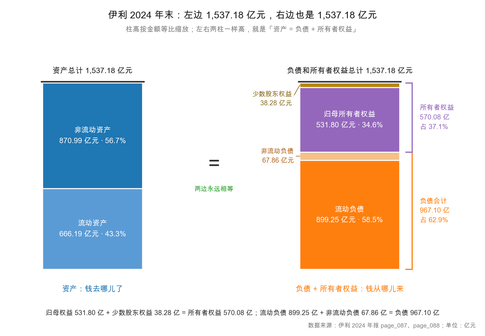

# 第 7 章：会计恒等式——资产 = 负债 + 所有者权益

> 本章你将：
> - 用"一张被撕成两半的纸"看懂恒等式的直觉，而不只是背下公式；
> - 学会把恒等式读成"**资金的来源 = 资金的用途**"，从此任何一张资产负债表都能两栏对照着读；
> - 亲手用伊利的真实数字验算 **1,537.18 = 967.10 + 570.08**，并理解为什么必须"差一个子儿都不行"；
> - 知道恒等式被破坏时有哪三种常见原因（几乎都是抄错数）；
> - 会做恒等式的三种变形：求资产、求负债、求权益。

上一章我们用一家奶茶店记出了第一张家底表，末尾得出一个结论：**左边永远等于右边。**
这一章我们要把这句话从"现象"变成"定理"——搞清楚它**为什么**必然成立，
再用伊利 2024 年报把它验算一遍。

---

## 7.1 一张被撕成两半的纸

想象你手上有这样一张纸（**示意数字**，虚构奶茶店），上面竖着写了四行：

| 序 | 项目 | 金额（元） |
|---|---|---|
| 1 | 货币资金 | 200,000 |
| 2 | 设备与装修 | 400,000 |
| 3 | 银行借款 | 400,000 |
| 4 | 小满投入 | 200,000 |

现在拿剪刀，从**第 2 行和第 3 行之间横着剪一刀**，把前两行留在上半张，
把后两行留在下半张。然后把两张纸**叠在一起掂一掂**——

你会发现它们一样重：上面 200,000 + 400,000 = 600,000，下面 400,000 + 200,000 = 600,000。

差的不是巧合。因为这张清单上的四个数字，本来就不是四个独立的事实，
而是**两对**互相咬合的事实：左边两行是"店里的东西"，右边两行是"这些东西的钱从哪来"。
你把同一批钱数了两遍，一遍数"变成了什么"，一遍数"谁给的"。既然是同一批钱，当然一样重。

这就是会计恒等式（accounting equation）的全部直觉。写成公式：

$$\text{资产} = \text{负债} + \text{所有者权益}$$

或者用英文缩写：$A = L + E$。

现在把公式换个读法，这才是它真正有用的地方：

$$\underbrace{\text{资产}}_{\text{资金用途}} = \underbrace{\text{负债} + \text{所有者权益}}_{\text{资金来源}}$$

**左边：钱变成了什么。右边：钱是谁给的。**
一句话：**资金的用途 = 资金的来源。**

这个读法比"资产等于负债加权益"有用得多，因为它可以直接用在任何一张真实的资产负债表上。
你看到左边一项"固定资产 346.19 亿元"，立刻可以问：这 346.19 亿元是谁的钱买的？
答案在右边——一部分是债权人的（负债），一部分是股东的（权益）。
左边每一项资产，右边都能找到它的出资人。这就是为什么这张表要分两栏，而不是列成一张清单。

> 📌 **划重点：** 会计恒等式不是一条"需要被遵守的规定"，而是一条**逻辑上的必然**。
> 它之所以永远成立，是因为"权益"本身就被定义成"资产减负债"。
> 换句话说，这个等式不是被证明出来的，它是被**定义**出来的。

这里有个容易被忽略的细节：**恒等式里的"资产"，是"按会计规则记出来的资产"，不是"值多少钱"。**

伊利账上"固定资产 346.19 亿元"，记的是**原值减累计折旧减减值准备**之后的净值，
不是"把厂房设备今天卖掉能拿回多少"。一块 2010 年花 5,000 万元建的厂房，
账上可能只剩 1,200 万元净值，但今天市场价可能是 8,000 万元；
反过来，一条专用灌装线账面还有 3,000 万元，一旦停产，二手市场可能只值废铁价。

所以恒等式的准确读法是：**"账面资产 = 账面负债 + 账面权益"。**
三个词前面都有"账面"两个字，一个都不能丢。丢掉这两个字，
你就会把"报表上的数字"当成"真实的家底"——这是初学者最容易犯、代价也最大的一个错。

这个区分在第 46 章（价格与价值）会成为主角：**账面价值是估值的起点，不是终点。**

---

## 7.2 恒等式到底是什么：三个变形和一个算例

先把公式当成一道代数题来用它。三个未知数，已知两个就能求第三个：

| 已知 | 求 | 变形 | 什么时候用 |
|---|---|---|---|
| 负债、权益 | 资产 | $A = L + E$ | 想知道公司总规模 |
| 资产、权益 | 负债 | $L = A - E$ | 想知道真实欠款（有些负债不列在表上，见 7.4 节） |
| 资产、负债 | 权益 | $E = A - L$ | 想算净资产，最常用 |

第三个变形最常用，因为**净资产（net assets）就是所有者权益的另一个名字**。
你去查任何一家公司的"每股净资产"，算的就是"归母权益 ÷ 总股本"。

伊利 2024 年的每股净资产是 **8.35 元**（page_007）：
归母权益 531.80 亿元 ÷ 总股本 63.66 亿股 $\approx$ 8.35 元。

<!-- src: 伊利股份2024年报/page_007.md 伊利股份2024年报/page_088.md -->

现在用奶茶店做一道完整算例，把三个变形都走一遍（**示意数字**）：

| 步骤 | 操作 | 资产 | 负债 | 权益 | 验算 |
|---|---|---|---|---|---|
| 起点 | 开业三笔交易后 | 60 | 40 | 20 | 60 = 40 + 20 ✓ |
| ① | 又借 10 万存着 | 70 | 50 | 20 | 70 = 50 + 20 ✓ |
| ② | 用现金还债 15 万 | 55 | 35 | 20 | 55 = 35 + 20 ✓ |
| ③ | 本月赚了 8 万（全收现金） | 63 | 35 | 28 | 63 = 35 + 28 ✓ |
| ④ | 分红 5 万（现金付出） | 58 | 35 | 23 | 58 = 35 + 23 ✓ |

盯着这张表看四行，你会发现一个规律：**每一步，等式都成立，但成立的方式不同。**

- 第 ① 步：左边 +10，右边 +10——**两边同时变厚**；
- 第 ② 步：左边 -15，右边 -15——**两边同时变薄**；
- 第 ③ 步：左边 +8，右边 +8（进权益）——**赚的钱同时出现在两边**；
- 第 ④ 步：左边 -5，右边 -5（权益减）——**分红同时从两边拿走**。

还有第五种、第六种情况这张表里没出现：

- 用现金买设备 20 万：左边 +20 -20，总额不变——**左边内部搬家**；
- 借新债还旧债 30 万：右边 +30 -30，总额不变——**右边内部搬家**。

这六种情况，就是下一章（第 8 章）要展开的"六类交易"。现在你只要记住：
**无论哪一种，等式都不会破。** 因为任何一种交易，动的都是"至少两个格子"——
要么两边同增同减，要么同一边一增一减。这两种动法，都保等式不变。

这就是"恒等"两个字的真正含义：**它不是某一天的巧合，而是每一笔交易之后的必然状态。**

> 💡 **你可能会问：那如果公司亏了 100 万，权益变成负数怎么办？**
>
> 会发生的。这时候恒等式依然成立，只是权益是负的：$A = L + (-|E|)$，
> 也就是 $L > A$——**负债比资产还多**。这种状态叫"资不抵债"，是破产的会计定义。
> A 股里这类公司不少（尤其是一些净资产为负的 ST 股）。
> 反过来，如果一家公司权益是负数但还在正常经营，说明债权人暂时没有要求清偿，
> 但它的每一分资产都已经"抵押"给了债权人，股东的那一份是负的。

---

## 7.3 在伊利报表上验证一遍

现在动真格。掏出伊利 2024 年报，翻到 page_087 和 page_088。

上图就是把真实的资产负债表"竖起来"画的样子。左柱是资产，右柱是负债 + 所有者权益。
柱子的高度按金额等比缩放，所以你能直观看到：**两根柱子一样高。**

先把三个大数抄下来（单位：亿元）：

| 项目 | 金额（亿元） | 原始数字（元） | 出处 |
|---|---|---|---|
| 资产总计 | **1,537.18** | 153,718,003,927.97 | page_087 |
| 负债合计 | **967.10** | 96,710,353,251.06 | page_088 |
| 所有者权益合计 | **570.08** | 57,007,650,676.91 | page_088 |

<!-- src: 伊利股份2024年报/page_087.md 伊利股份2024年报/page_088.md -->

验算：

$$1{,}537.18 \overset{?}{=} 967.10 + 570.08$$

$$967.10 + 570.08 = 1{,}537.18$$

**两边相等。** 分毫不差。用原始数字再算一遍，误差是 0.00 元：

$$153{,}718{,}003{,}927.97 - 96{,}710{,}353{,}251.06 - 57{,}007{,}650{,}676.91 = 0.00$$

再往下拆一层，把两栏的"子项"也验一遍：

| 左边拆开 | 亿元 | 右边拆开 | 亿元 |
|---|---|---|---|
| 流动资产合计 | 666.19 | 流动负债合计 | 899.25 |
| 非流动资产合计 | 870.99 | 非流动负债合计 | 67.86 |
| **资产总计** | **1,537.18** | **负债合计** | **967.10** |
| | | 归属于母公司所有者权益 | 531.80 |
| | | 少数股东权益 | 38.28 |
| | | **所有者权益合计** | **570.08** |
| | | **负债和所有者权益总计** | **1,537.18** |

<!-- src: 伊利股份2024年报/page_087.md 伊利股份2024年报/page_088.md -->

三条验算，全部通过：

1. $666.19 + 870.99 = 1{,}537.18$ ✓（资产内部）
2. $899.25 + 67.86 = 967.11$（负债内部）——**这里差 0.01！**
3. $531.80 + 38.28 = 570.08$ ✓（权益内部）
4. $967.10 + 570.08 = 1{,}537.18$ ✓（恒等式）

第 2 条那 0.01 的差，是四舍五入造成的。原始数字算：

$$89{,}924{,}532{,}161.51 + 6{,}785{,}821{,}089.55 = 96{,}710{,}353{,}251.06$$

一毫不差。但如果只看两位小数：899.25 + 67.86 = 967.11，负债合计那行写的是 967.10。
**这就是"用四舍五入后的数字做验算，可能差 0.01"的典型例子。**
所以真正的验算要用原始数字，或者接受 0.02 元以内的容差。

> ⚠️ **易踩坑：** 很多新手拿年报上"亿元"口径的数字算，一算差 0.01 或 0.02，
> 就以为报表不平、公司造假。**绝大多数情况是四舍五入。**
> 正确做法：① 用"元"的原始数字验算；② 或者允许 0.02 元以内的小误差；
> ③ 只有差额到了"千万元"级别，才值得怀疑。
> 伊利这三个大数的原始值是完全平的，一分不差。

> 🔍 **翻到年报：** 打开 `page_087.md`，一直往下拉，最后一行是
> "**资产总计** | | 153,718,003,927.97 | 151,620,252,657.98"。
> 注意这是两列：**左边是 2024 年，右边是 2023 年**。A 股年报两列并排，
> 这是最容易抄错的地方——第 1 周就提醒过，这里再提醒一次。
> 再打开 `page_088.md`，最后一行"**负债和所有者权益（或股东权益）总计**"，
> 2024 年那一列必须是同一个数 153,718,003,927.97。不是同一个数，就是你抄错了。

---

## 7.4 恒等式被破坏时

理论说完，说一件更实际的事：**如果有一天你算出来对不上，怎么办？**

先说结论：**在公开披露的年报里，恒等式破坏的概率极低。**
因为它不是"某一年的结果"，而是记账系统每一笔交易的强制约束。
一套复式记账系统，从第一笔交易起就不可能让等式破掉——每一笔都要求两边同时变，
任何一边单独动都记不进去。

所以当你算不平，先怀疑自己，按这个顺序排查：

**第一种：抄错列。**
A 股年报三张表都是两列并排（2024 年 / 2023 年），附注里还经常有三列（期末 / 期初 / 变动）。
最容易犯的错是"资产负债表的 2024 列"配"负债表的 2023 列"。
伊利 2023 年的资产总计是 1,516.20 亿元，2024 年是 1,537.18 亿元，差 20.98 亿元。
如果你拿 1,537.18 去配 2023 年的负债和权益（942.99 + 573.20 = 1,516.19），就差 20.99 亿元——
这个差额不是"公司出问题"，是你跨年混抄了。

**第二种：漏了"少数股东权益"。**
很多人算到"归母所有者权益 531.80"就停了，直接验算 967.10 + 531.80 = 1,498.90 $\neq$ 1,537.18，
然后惊呼"差了 38.28 亿元！"。
差的这 38.28 亿元，正是**少数股东权益**。
资产负债表的右栏是"负债 + **全部**所有者权益"，不是"负债 + 归母权益"。
这是入门阶段最高频的一个错。

**第三种：用了不同口径的表。**
年报里有**合并报表**和**母公司报表**两套。合并报表在后面几页（伊利的资产负债表 page_087~088），
母公司报表在更后面。两套表的资产总计完全不同。
教程一律用**合并报表**——因为合并报表才反映整个集团的经营全貌。

**第四种（罕见但真实）：报表本身就是错的。**
这种情况在 A 股历史上发生过，但基本不会出现在"资产负债表不平"这个层面——
因为编表软件会自动校验。真正的不平，通常出现在**附注与主表之间**，
或者**跨表勾稽**（第 10 章会讲）。那种不平才是需要警惕的信号。

| 症状 | 最可能的原因 | 怎么查 |
|---|---|---|
| 差 20.98 亿元左右 | 抄错年度列 | 检查每一列的表头年份 |
| 差 38.28 亿元 | 漏了少数股东权益 | 右栏要用"所有者权益合计"，不是"归母权益" |
| 差几十亿元且无规律 | 混用合并表与母公司表 | 看表头有没有"合并"二字 |
| 差 0.01~0.02 亿元 | 四舍五入 | 用"元"的原始值重算 |
| 差得离谱（几倍） | 单位错（千元当元） | 看表头"单位:元"还是"单位:千元" |

---

## 7.5 恒等式的三次实战变形

理论验完了，最后讲三个"明天就能用"的变形。这三个变形，是后面几周反复要用的工具。

### 变形一：算真实负债——表外还有多少

$L = A - E$ 这个变形最大的用处，是**倒推真实负债**。
因为资产负债表上的负债，只是"已经确认"的负债。有些义务没进表：

- **经营性租赁承诺**（老准则下不进表，新准则已并入"租赁负债"，伊利 2024 年是 2.63 亿元）；
- **对外担保**（在附注"或有事项"里，不进表）；
- **未决诉讼**（同上）；
- **对子公司的出资承诺**（在"承诺事项"里）。

这些不进表的义务，加回去才是"真实负债"。
伊利 2024 年租赁负债 2.63 亿元已经进表了，但担保、诉讼要看附注。
第 44 章讲"财务造假的 20 条红旗"时，"表外负债"是其中很重要的一条。

### 变形二：算净资产——归母还是全部

$E = A - L$ 算出来的是**全部**所有者权益（570.08 亿元）。
但你作为股东，关心的是**归母**（531.80 亿元）。

两者的差，就是少数股东权益（38.28 亿元）。
什么时候这个差会很大？**子公司多、且子公司不是全资持股的公司。**
伊利收购澳优乳业后，澳优还有一部分股权在别人手里，那部分就形成少数股东权益。

所以看一家公司的"家底厚不厚"，标准动作是：

1. 先看**归母权益**（531.80 亿元）——这才是你的；
2. 再看归母权益**占总资产的比例**（531.80 ÷ 1,537.18 = 34.6%）——这个比例越高，股东的家底越厚；
3. 最后看归母权益**同比变化**（2024 年 531.80 对 2023 年 535.39，**减少了 3.59 亿元**）——
   明明赚了 84.53 亿元，权益怎么还少了？因为分红 76.39 亿元、回购库存股等。
   这一条是很多人忽略的：**赚钱不等于权益增加，还要看分掉多少、回购多少。**

<!-- src: 伊利股份2024年报/page_088.md 伊利股份2024年报/page_002.md -->

### 变形三：算杠杆——权益乘数

把恒等式两边同除以权益：

$$\frac{A}{E} = \frac{L}{E} + 1$$

左边的 $\frac{A}{E}$ 叫**权益乘数（equity multiplier）**，它衡量"用 1 元自己的钱，撬动了多少总资产"。
伊利 2024 年：$1{,}537.18 \div 570.08 \approx 2.70$。

意思是：伊利每 1 元净资产，对应 2.70 元总资产。
反过来说，资产的 63% 是借来的（负债率 62.91%）。

这个数字是高是低？单看没意义，要跟同行比、跟自己的历史比。
但它有一个非常有用的性质：**权益乘数是 ROE 杜邦分解的三个因子之一。**

$$\text{ROE} = \underbrace{\frac{\text{净利润}}{\text{收入}}}_{\text{净利率}} \times \underbrace{\frac{\text{收入}}{\text{总资产}}}_{\text{周转率}} \times \underbrace{\frac{\text{总资产}}{\text{权益}}}_{\text{权益乘数}}$$

伊利 2024 年：净利率 7.33% $\times$ 周转率 0.75 $\times$ 权益乘数 2.70 $\approx$ 14.8%
（官方披露的加权 ROE 是 15.81%，差异来自口径——加权平均净资产 vs 期末净资产）。
这个分解第 42 章会详细讲，现在你只需要看到：**恒等式的一个简单变形，就长出了分析公司赚钱能力的核心工具。**

<!-- src: 伊利股份2024年报/page_007.md 伊利股份2024年报/page_092.md -->

> 📌 **划重点：** 恒等式 $A = L + E$ 有三个变形，每个都有实战用途：
> $A = L + E$ 看规模；$L = A - E$ 找真实负债；$E = A - L$ 算净资产。
> 再加一个除法变形 $\frac{A}{E} = \frac{L}{E} + 1$，就得到了权益乘数，也就是杜邦分解的第三个因子。

---

## 7.6 恒等式的边界：它保证"平"，不保证"真"

最后必须讲清一件事，否则你会对这张表产生过度的信任。

**恒等式保证的是"账平"，不是"账真"。**

举两个例子。

**例子一：虚增收入。**
一家公司虚构了一笔 1 亿元的销售，货没发、钱没收到。它会怎么记账？
记两个格子：应收账款 +1 亿元，营业收入 +1 亿元。
营业收入进利润表，最终进权益（+1 亿元）；应收账款进资产（+1 亿元）。
**两边同时 +1 亿，恒等式照样平。**
所以，**恒等式平，完全不能证明收入是真的。**

**例子二：隐瞒负债。**
一家公司有一笔 5 亿元的借款，但没记进表（比如通过关联方代持）。
那这 5 亿元对应的资产在哪？也在表外。
**两边同时少记 5 亿，恒等式照样平。**
所以，**恒等式平，也完全不能证明负债是完整的。**

那恒等式有什么用？

它的作用是：**它是一个必要条件，不是充分条件。**
- 不平 → 一定有问题（或者你抄错了）；
- 平了 → **不代表**没问题，只代表"这笔账在算术上自洽"。

真正判断真假，要靠后面的手段：
- 应收账款的增速 vs 收入增速（第 13 章）；
- 经营现金流 vs 净利润（第 9 章）；
- 存货周转与跌价准备（第 14 章）；
- 关联交易与表外担保（第 44 章）。

**这一章教你的，是"读懂机器的构造"，不是"判断机器的好坏"。** 两者不能混。

> ⚠️ **易踩坑：** 有人学了恒等式之后，得出一个危险的结论：
> "既然资产 = 负债 + 权益，那我只要看权益就知道公司值多少钱了。"
> 错在两点：① 权益是**账面**价值，不是市场价值；② 权益里可能装着虚增的资产。
> 伊利账面归母权益 531.80 亿元，但它的市值是多少，得看市场报价——
> 而市场报价年报里没有，你要自己去查（本教程不提供股价，也不猜股价）。

---

## ✍️ 想一想

### 问 1：三个数缺一个，怎么补

伊利 2024 年报的几个数字被咖啡洒了，只剩下这些（单位：亿元）：

- 资产总计 1,537.18
- 所有者权益合计 570.08
- 归母所有者权益 531.80
- 流动资产 666.19
- 非流动资产 870.99

请回答：① 负债合计是多少？② 少数股东权益是多少？③ 流动负债 + 非流动负债 应该是多少？
④ 如果你只知道"负债合计 967.10"和"归母权益 531.80"，能不能算出资产总计？为什么？

**解题思路：**
第 ①② 问是恒等式的直接变形。第 ③ 问要先知道负债的内部拆分。
第 ④ 问是本章最重要的一道思考题——它考的不是算术，而是**"归母权益"和"所有者权益"的区别**。

**参考答案：**

① 负债合计 = 资产 - 所有者权益 = $1{,}537.18 - 570.08 = 967.10$ 亿元。

② 少数股东权益 = 所有者权益 - 归母权益 = $570.08 - 531.80 = 38.28$ 亿元。

③ 流动负债 + 非流动负债 = 负债合计 = 967.10 亿元。具体拆分是 899.25 + 67.86 = 967.11，
差 0.01 是四舍五入（原始值 89,924,532,161.51 + 6,785,821,089.55 = 96,710,353,251.06，分毫不差）。

④ **不能。** 因为 967.10 + 531.80 = 1,498.90，比真实的 1,537.18 少了 38.28 亿元。
这 38.28 亿元是少数股东权益，它**也是**所有者权益的一部分，必须加进右栏。
恒等式的正确写法是"资产 = 负债 + **全部**所有者权益"，不是"资产 = 负债 + 归母权益"。

**易错点：**
① 第 ④ 问答"能，1,498.90 亿元"，这是本章最高频的错误——把归母权益当成了全部权益；
② 第 ② 问用"资产 - 负债 - 归母权益"去算少数股东权益，算式绕了一圈但结果一样，
   不过这种做法掩盖了"权益分两层"这个结构，不建议；
③ 第 ③ 问硬凑成 967.10（比如写 899.24 + 67.86），为了凑数改数字。
   **正确的做法是承认四舍五入，而不是篡改数字。**

### 问 2：一笔交易，五种可能

伊利的资产总计从 2023 年的 1,516.20 亿元变成 2024 年的 1,537.18 亿元，增加了 20.98 亿元。
请回答：这 20.98 亿元的增加，**可能**来自哪几种情况？请至少列出三种，并说明每一种对应的右栏变化。

**解题思路：**
资产增加，右边必须同步增加同样的金额。右边的两个口袋是"负债"和"权益"。
所以只有三种可能：负债增加、权益增加、或者两者都增加（合计 20.98 亿元）。
但还要考虑一件事：**资产的增加也可能伴随着另一项资产的减少**（净增加额才是 20.98）。
把这两种维度交叉一下，就能列出完整清单。

**参考答案：**

| 情况 | 左栏变化 | 右栏变化 | 现实中的对应 |
|---|---|---|---|
| ① 纯借钱 | 货币资金 +20.98 | 负债 +20.98 | 新借了一笔款 |
| ② 纯赚钱 | 各类资产 +20.98 | 权益 +20.98 | 净利润留存（但伊利当年分红 76.39 亿，净留存没这么多） |
| ③ 混合 | +20.98 | 负债 +a，权益 +(20.98-a) | 最常见 |
| ④ 资产内部置换 | 一项 +x，另一项 -(x-20.98) | 不变 | 例如用现金买设备，同时借了钱 |
| ⑤ 股东增资 | 货币资金 +20.98 | 权益 +20.98（股本/资本公积） | 增发股票 |

伊利 2024 年的实际情况是 ③ 和 ④ 的混合：负债从 942.99 亿元增到 967.10 亿元（+24.11），
权益从 573.20 亿元减到 570.08 亿元（**-3.12**），合计 +20.99，与 +20.98 相差 0.01（四舍五入）。

<!-- src: 伊利股份2024年报/page_087.md 伊利股份2024年报/page_088.md -->

注意这里有个反直觉的事实：**伊利 2024 年赚了 84.64 亿元，权益反而减少了 3.12 亿元。**
原因是分红 76.39 亿元、回购库存股、其他综合收益变动等。
所以"资产增加"绝不等于"公司变好"——**这一年伊利资产增加的主要推动力是负债增加，不是赚钱。**

**易错点：**
① 只答"借了钱"一种，漏掉权益路径；
② 认为"资产增加 = 赚钱了"。伊利就是反例：赚了 84.64 亿元，权益还少了 3.12 亿元；
③ 忽略"资产内部置换"这种可能，导致左栏加减对不上；
④ 用 2023 年的负债（942.99）去配 2024 年的资产（1,537.18），得出"负债增加 594 亿元"的荒谬结论。

### 问 3：为什么"权益是负数"的公司还能交易

A 股市场上偶尔能看到"净资产为负"的公司，股票却还在交易。请用恒等式解释：
净资产为负意味着什么？这样的公司为什么还没倒闭？这对你判断风险有什么启示？

**解题思路：**
先写出净资产为负时的恒等式形态：$E < 0$，代入 $A = L + E$，得到 $L > A$。
然后想：净资产为负是"会计状态"，倒闭是"法律/现金流状态"，两者不是一回事。
最后想：作为股东，你在这种公司里的"剩余索取权"还剩多少？

**参考答案：**

净资产为负，即 $E < 0$，代入恒等式得 $A = L + E < L$，也就是 **$L > A$：负债比资产还多**。
这叫"资不抵债"。

这样的公司还能活着，有三个原因：

1. **会计上的"资不抵债"不等于"立刻要还钱"。** 大部分负债是长期的、或者可以滚动续借的。
   只要现金流能覆盖利息和到期本金，公司就能继续经营。
2. **资产是按账面价值记的**，可能被低估（比如早年买的地皮），也可能被高估（比如收不回来的应收账款）。
   真实的清偿能力要看变现价值，不是账面价值。
3. **股东和债权人的博弈。** 债权人有时宁愿让公司继续经营（还能收利息），
   也不愿意立刻清算（清算可能收不回三成）。这就是"债务重组"存在的原因。

对判断风险的启示，最硬的一条是：**净资产为负时，股东的剩余索取权是负的。**
按清偿顺序，债权人先拿，股东拿剩下的——剩下的是负的，股东就是"零"。
所以买这类公司的股票，本质上是买一个"期权"：赌它能翻身。
赔率可能很高，但胜率极低。**这不是投资，是赌博的一种包装。**

**易错点：**
① 认为"净资产为负 = 明天就破产"。会计状态和法律状态是两回事，中间可能拖好几年；
② 认为"净资产为负 = 股票一文不值"。市场价格可以高于零，因为有人赌重组、赌借壳；
③ 忽略"负权益"里可能藏着大额商誉减值、资产减值等一次性因素——
   有些公司一年巨亏把权益打成负数，第二年就恢复正常，这种和"常年资不抵债"是两码事。

---

## 📎 数据出处

- 伊利股份 2024 年报：`page_087.md`（合并资产负债表·资产总计 153,718,003,927.97 元）
- 伊利股份 2024 年报：`page_088.md`（负债合计 96,710,353,251.06 元、所有者权益合计 57,007,650,676.91 元、归母权益 53,179,935,140.80 元、少数股东权益 3,827,715,536.11 元、未分配利润 32,229,030,347.49 元）
- 伊利股份 2024 年报：`page_007.md`（每股净资产 8.35 元、加权平均 ROE 15.81%）
- 伊利股份 2024 年报：`page_092.md`（净利润 8,463,710,355.65 元）
- 伊利股份 2024 年报：`page_002.md`（2023 年度现金红利 7,639,318,446.00 元）
- 数据汇总：`data/yili2024.json` 的 `balance`、`income`、`ratios`、`compare_2023` 段
- 本章奶茶店数字全部为**示意数字**（虚构），不对应任何真实公司

下一章：[第 8 章：复式记账——每一笔交易都动两个格子](08-复式记账-每笔交易都动两个格子.md)
