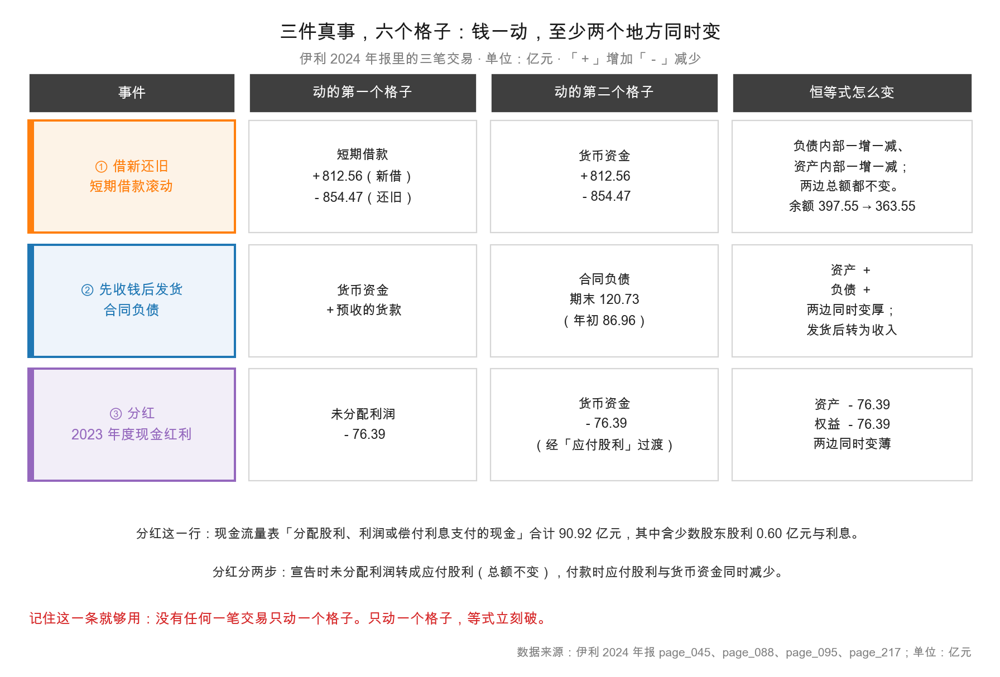

# 第 8 章：复式记账——每一笔交易都动两个格子

> 本章你将：
> - 弄懂"复式记账"不是一套神秘的借贷咒语，而是**一条记账纪律：每笔交易至少动两个格子**；
> - 掌握"六类交易"这套判断工具，任何一笔业务都能立刻说出恒等式会怎么变；
> - 用伊利 2024 年的三件真事跑一遍方法：借新还旧 **854.47 亿元**、合同负债 **120.73 亿元**、分红 **90.92 亿元**；
> - 知道"试算平衡"能证明什么、不能证明什么——它防抄错，不防造假；
> - 明白为什么这门课**不教你写分录**，却仍然要你懂复式记账。

上一章我们把恒等式验算了一遍，结论是伊利 2024 年"1,537.18 = 967.10 + 570.08"一分不差。
但有一个问题被我们跳过了：**凭什么保证它一定平？**

答案是复式记账（double-entry bookkeeping）。这一章讲清楚它是怎么做到这一点的。

> 先说一句让你放心的话：这一章**不教借贷方向**，不要求你会写"借：银行存款 贷：短期借款"。
> 你要学的只有一句：**一笔交易至少动两个格子，而且动完两边的等式依然成立。**
> 会写分录是会计的工作；**看懂分录背后的两个格子，是投资者的工作。**

---

## 8.1 单式记账的死穴：为什么必须动两个格子

先看一种更自然的记账方式，叫单式记账（single-entry bookkeeping）。
它的做法是：**只记"钱的进出"。**

小满用单式记账记他的一天：

| 日期 | 摘要 | 收入 | 支出 |
|---|---|---|---|
| 1 日 | 卖奶茶 | 3,200 | |
| 2 日 | 付奶粉钱 | | 1,800 |
| 3 日 | 买封口机 | | 2,400 |
| 4 日 | 隔壁公司赊账 200 杯 | | |

问题出在最后一行：**赊账的那 200 杯，该不该记？**
按单式记账，钱没进，就不记。可是货已经出去了，成本已经发生了，将来还有一笔钱要收。
如果这类业务多了，账本就会慢慢"失真"——**它记的是现金的流动，不是生意的发生。**

再看第 3 行"买封口机 2,400"。单式记账只记"支出 2,400"——钱少了，但店里多了一台设备，
这件事没被记录。三年后回头看，账本上"钱花掉了，什么都没留下"，可设备还在那儿干活。

**单式记账的死穴就在这儿：它只能记录"发生了什么钱"，记录不了"变成了什么"。**

复式记账的解法非常朴素：**每记一笔"钱少了"，必须同时记一笔"什么多了"。**

| 业务 | 第一个格子 | 第二个格子 |
|---|---|---|
| 卖奶茶收现金 3,200 | 货币资金 +3,200 | 营业收入（最终进权益）+3,200 |
| 付奶粉钱 1,800 | 货币资金 -1,800 | 营业成本（最终减权益）-1,800 |
| 买封口机 2,400 | 货币资金 -2,400 | 固定资产 +2,400 |
| 赊账卖出 200 杯 | 应收账款 +x | 营业收入（最终进权益）+x |

注意最后一行：**没有一分钱进出，但依然记了两个格子。**
这正是复式记账比单式记账强的地方——它记的是"**交易**"，不是"**现金流**"。
这也是下一章（权责发生制）的引子：**利润和现金之所以会分叉，根子就在这里。**

> 📌 **划重点：** 复式记账的核心纪律只有一条：**每一笔交易，至少动两个格子。**
> 记一笔"钱少了"，必须同时记一笔"什么多了"；记一笔"欠得多了"，必须同时记一笔"什么多了"。
> 这条纪律保证了：无论发生什么，等式都不会破。

---

## 8.2 六类交易：一笔业务只能这样改变恒等式

既然每笔交易都动两个格子，那两个格子落在哪一栏，就只有有限几种组合。
把所有组合列出来，正好六类。**这六类，就是全部可能。**

先把资产负债表的两栏各分成两半：左栏（资产）和右栏（负债、权益）。
一笔交易的"两个格子"可能落在：左左、右右、左右、右左。展开就是：

| 类别 | 第一个格子 | 第二个格子 | 资产 | 负债+权益 | 总额 | 举例 |
|---|---|---|---|---|---|---|
| ① | 资产 + | 资产 - | 不变 | 不变 | **不变** | 用现金买设备 |
| ② | 资产 + | 负债 + | + | + | **变厚** | 向银行借钱 |
| ③ | 资产 + | 权益 + | + | + | **变厚** | 股东增资、赚钱 |
| ④ | 负债 - | 资产 - | - | - | **变薄** | 用现金还债 |
| ⑤ | 权益 - | 资产 - | - | - | **变薄** | 分红、回购 |
| ⑥ | 负债 + | 权益 -（或反向） | 不变 | 不变 | **不变** | 债转股 |

还有一个特殊类别是"右栏内部搬家"：负债 + 而负债 -（借新还旧），或权益内部一增一减
（提取盈余公积）。它是第 ① 类在右栏的镜像，总额同样不变。

**所以只有三种结局：变厚、变薄、不变。** 而"变厚""变薄"一定是两边同步——
这就是恒等式永远成立的机制。

现在用伊利 2024 年的真实数字，把六类里的三类跑一遍。

---

## 8.3 真事一：短期借款 363.55 亿元——借新还旧如何只改两个格子

伊利 2024 年末的短期借款是 **363.55 亿元**，2023 年末是 **397.55 亿元**。
看起来只是少了 34 亿元，风平浪静。

但翻开附注（page_217）你会发现，这一年的动静大得惊人：

| 项目 | 金额（元） | 折合亿元 |
|---|---|---|
| 期初余额 | 39,754,855,129.21 | 397.55 |
| 本期增加·现金变动（新借入） | 81,255,984,329.65 | **812.56** |
| 本期增加·非现金变动（利息计提等） | 874,102,316.00 | 8.74 |
| 本期减少·现金变动（偿还） | 85,446,869,984.31 | **854.47** |
| 本期减少·非现金变动 | 83,441,242.53 | 0.83 |
| 期末余额 | 36,354,630,548.02 | 363.55 |

<!-- src: 伊利股份2024年报/page_217.md -->

一年借了 **812.56 亿元**，还了 **854.47 亿元**，净减少 **41.91 亿元**。
**这不是"一笔小变动"，这是一台高速运转的滚动机器。**

现在看这 812.56 亿元的借入，动了哪两个格子：

| 格子 | 方向 | 金额 |
|---|---|---|
| 货币资金（左栏） | + | 812.56 亿元 |
| 短期借款（右栏·负债） | + | 812.56 亿元 |

这是**第 ② 类**：两边同时变厚。恒等式两边各 +812.56 亿元。

再看 854.47 亿元的偿还：

| 格子 | 方向 | 金额 |
|---|---|---|
| 短期借款（右栏·负债） | - | 854.47 亿元 |
| 货币资金（左栏） | - | 854.47 亿元 |

这是**第 ④ 类**：两边同时变薄。恒等式两边各 -854.47 亿元。

把两笔合起来看：右栏"短期借款"净 -41.91 亿元，左栏"货币资金"净 -41.91 亿元。
**两边同步减少同样的金额，等式依然成立。**

这就是"借新还旧"的全部会计内容：**它不创造任何价值，只是在右栏里换了一个债权人，
同时在左栏里过了一遍现金。**

上图的第一行就是这件事。注意最右一列写的："负债内部一增一减、资产内部一增一减；两边总额都不变。"
严格说，这一年是"净减少 41.91 亿元"，所以是两边同时变薄；
但从**单笔交易**的角度看，每一笔借入和偿还，都是"两边同时同向变动"。

> 💡 **你可能会问：一年借 812.56 亿元、还 854.47 亿元，这么大进大出，正常吗？**
>
> 对大公司来说，**非常正常**。原因有三个：
>
> 一是**短期借款的期限短**。一年期贷款到期必须还，但公司还需要这笔钱周转，
> 于是"还旧借新"。银行也乐意——旧贷款安全收回，新贷款重新定价。
>
> 二是**利率环境在变**。如果新贷款利率更低，公司会主动置换。
>
> 三是**报表时点效应**。年末的余额是"12 月 31 日那一天"的快照，
> 这一天的余额可能远低于全年平均值。所以看短期借款，**光看余额会严重低估真实的周转强度**。
>
> 这也是为什么"看附注"很重要：主表只给你一个时点数，附注才给你全年的流量。

> ⚠️ **易踩坑：** 看到"短期借款从 397.55 亿元降到 363.55 亿元"，
> 就得出"公司在降杠杆、财务更稳健"的结论。
> **这个结论可能完全错。** 真相是：它一年借了 812.56 亿元、还了 854.47 亿元，
> 依赖短期融资的程度极高。如果某一天银行集体抽贷，这台滚动机器会立刻卡死。
> 判断短期偿债压力，还要看"货币资金 254.04 亿元 vs 短期借款 363.55 亿元"这个对比——
> **手上的钱不够还短期借款**，这是伊利 2024 年一个真实的压力点（第 23 章会详细算）。

---

## 8.4 真事二：合同负债 120.73 亿元——先收钱后发货怎么记账

伊利 2024 年末的合同负债是 **120.73 亿元**，2023 年末是 **86.96 亿元**，一年增加了 **33.77 亿元**。

合同负债（contract liabilities）指的是：**公司已经收到钱，但还没把货交给客户。**

这个科目是 2020 年 A 股执行新收入准则之后才普遍出现的。在此之前，这类钱记在
**预收款项（advance from customers）**里。新准则把原来的"预收款项"拆成了两块：
卖货收的钱进"合同负债"，非货物类的预收款（比如股权转让款）仍留在"预收款项"。
伊利 2024 年"预收款项"是 0（2023 年是 26.47 亿元的股权转让款），就是这次拆分的结果。

先说清楚这笔钱的性质。经销商在年底给伊利打款 100 万元，订明年的货。
对伊利来说，钱到账了，但货还没发。这 100 万元能不能算"收入"？

**不能。** 因为伊利还欠着经销商一批货——这是一项义务。

所以记账是这样的（**示意数字**，只演示结构）：

| 格子 | 方向 | 金额 |
|---|---|---|
| 货币资金（左栏·资产） | + | 100 万 |
| 合同负债（右栏·负债） | + | 100 万 |

这是**第 ② 类**：两边同时变厚。**注意：钱进来了，但一分钱利润都没产生。**

等到第二年发货，账要改成这样：

| 格子 | 方向 | 金额 |
|---|---|---|
| 合同负债（右栏·负债） | - | 100 万 |
| 营业收入（利润表，最终进权益） | + | 100 万 |

同时还要记一笔"存货减少、营业成本增加"。所以完整的链条是：

**收钱 → 欠货（合同负债）→ 发货 → 确认收入 → 结转成本 → 产生利润**

这就是为什么合同负债被叫做"**蓄水池**"：
它把未来的收入提前锁进了今年的资产负债表，明年发货时再放出来。

| 时点 | 货币资金 | 合同负债 | 营业收入 | 净利润 |
|---|---|---|---|---|
| 收到预付款 | +100 万 | +100 万 | 0 | 0 |
| 发货并确认收入 | 不变 | -100 万 | +100 万 | +（毛利-费用） |
| 收到尾款 | +余款 | 不变 | 不变 | 不变 |

**读懂这张表，你就读懂了一个非常重要的信号：合同负债增加，可能是好事，也可能是坏事。**

**好事的版本：** 经销商看好明年销售，提前打款锁货，说明产品有竞争力、渠道有信心。
伊利 2024 年合同负债增加 33.77 亿元，很大程度上可以这么解释。

**坏事的版本：** 公司在年末用返利、账期优惠换"提前打款"，把明年的压力推给明年。
这时候合同负债会暴增，但下一年的收入会很难看。

**怎么区分？** 看三个东西：
1. 合同负债的增速 vs 收入的增速（如果合同负债暴涨而收入下滑，要警惕）；
2. 下一年的收入有没有兑现（如果合同负债变成了收入，是好事；如果又退回去了，是压货失败）；
3. 应收账款有没有同步暴增（如果一边压货一边放宽账期，风险在累积）。

伊利 2024 年的情况是：合同负债 +33.77 亿元，但营业收入 -8.24%（1,153.93 对 1,257.58 亿元）。
**这个组合值得留意**——渠道在提前打款，但终端销售在收缩。第 22 章会专门拆这一对矛盾。

<!-- src: 伊利股份2024年报/page_088.md 伊利股份2024年报/page_191.md 伊利股份2024年报/page_007.md -->

> 🔍 **翻到年报：** 打开 `page_088.md`，在"流动负债"那一段找"**合同负债**"这一行：
> 2024 年 12,072,785,359.81 元，2023 年 8,695,772,664.08 元。
> 再往上一行是"**预收款项**"：2024 年是空的，2023 年是 2,647,400,000.00 元。
> 这个 26.47 亿元是"股权转让款"（page_191 附注），不是卖货收的钱，**不能和合同负债混为一谈**。
> 这是年报里一个很典型的陷阱：科目名字像，性质完全不同。

---

## 8.5 真事三：分红 90.92 亿元——资产和权益同时减少

第三件事最贴近股东，也最能体现"两边同时动"。

伊利 2024 年现金流量表上有一行："**分配股利、利润或偿付利息支付的现金**"，
金额是 **9,092,304,004.54 元**，也就是 **90.92 亿元**。

<!-- src: 伊利股份2024年报/page_095.md -->

这 90.92 亿元里包含三样东西：
- 2023 年度现金红利：**76.39 亿元**（每股 1.20 元，总股本 63.66 亿股，page_045）；
- 子公司支付给少数股东的股利：**0.60 亿元**（60,172,342.82 元）；
- 偿付的利息：剩下的部分。

<!-- src: 伊利股份2024年报/page_045.md 伊利股份2024年报/page_095.md -->

现在看分红这件事，动的是哪两个格子。**注意，分红分两步走，不是一步。**

**第一步：股东大会通过分红方案（宣告分红）。**
这时候钱还没付，但公司已经欠股东了。

| 格子 | 方向 | 金额 |
|---|---|---|
| 未分配利润（右栏·权益） | - | 76.39 亿元 |
| 应付股利（右栏·负债） | + | 76.39 亿元 |

这是"右栏内部搬家"：权益减少，负债增加，**总额不变**。
所以宣告分红这一步，**资产总额一分钱没变**，只是右栏内部换了个位置。

（尚未支付的分红会挂在"应付股利"上：伊利 2024 年末 2.67 亿元、2023 年末 2.27 亿元，
page_088；明细见 page_194。）

**第二步：实际付款。**

| 格子 | 方向 | 金额 |
|---|---|---|
| 应付股利（右栏·负债） | - | 76.39 亿元 |
| 货币资金（左栏·资产） | - | 76.39 亿元 |

这是第 ④ 类：两边同时变薄。**到这一步，资产才真正减少。**

把两步合起来看，从"宣告"到"付完"，净效果是：

$$\text{未分配利润} \downarrow 76.39, \quad \text{货币资金} \downarrow 76.39$$

**权益减少 76.39 亿元，资产减少 76.39 亿元，两边同步，等式依然成立。**

这就是分红的会计本质：**不是"公司送钱给你"，而是"公司把属于你的钱从公司账户搬到你的账户"。**
总财富没有增加（还要交税），只是形态变了——从"股票对应的净资产"变成"现金"。

> 💡 **你可能会问：那为什么股价在除权日会跌？**
>
> 因为公司账上少了一笔钱，每股对应的净资产少了。
> 伊利 2024 年每股派 1.22 元（2024 年度方案，page_002），除权日股价理论上要向下调整约 1.22 元。
> 这不是"亏了"，而是"钱从公司账户进了你的账户"。
> **分红不创造价值，它只是价值的位置变了。** 这一点在第 46 章讲"价格与价值"时会再出现。

到这里，三件事讲完。回头看那个共同点：

| 事件 | 第一个格子 | 第二个格子 | 类别 | 对总额的影响 |
|---|---|---|---|---|
| 借新还旧 | 短期借款 一增一减 | 货币资金 一增一减 | ②④ | 单笔两边同向；全年净 -41.91 |
| 预收货款 | 货币资金 + | 合同负债 + | ② | 两边同时变厚 |
| 宣告分红 | 未分配利润 - | 应付股利 + | 右栏内部 | 总额不变 |
| 支付分红 | 应付股利 - | 货币资金 - | ④ | 两边同时变薄 |

**四笔业务，八次"动两个格子"，没有一次只动一个。** 这就是复式记账。

---

## 8.6 试算平衡：它能证明什么，不能证明什么

复式记账有一个副产品，叫**试算平衡（trial balance）**。

原理很简单：既然每笔交易动的两个格子金额相等（一加一减，或两边同加同减），
那么把所有格子的"借方合计"和"贷方合计"分别加起来，两者必然相等。
如果不等，账里一定有错。

对投资者来说，这个机制的实际意义是：**年报的三张表在算术上是自洽的，抄错一个数会立刻暴露。**

但它能证明的东西，比你想的少得多。回到第 7 章末尾那个结论，这里展开讲：

**它能证明：** 没有"只记一边"的漏记；数字没打错（比如把 1,537 打成 1,573）；报表内部加减关系正确。

**它不能证明：** 交易真实（虚构收入借贷同时做，照样平）；金额合理（1 亿记成 10 亿，同时放大，照样平）；
科目恰当（把费用记成资产，同时做，照样平——这叫"资本化"操纵）；负债完整（表外负债两边都不记，照样平）。

**换句话说：试算平衡防的是"手滑"，防不了"手黑"。**

这也解释了一个很多人的困惑：为什么财务造假的公司，报表看起来也是平的？
因为复式记账只保证"账内自洽"，不保证"账与事实相符"。
**要判断"账与事实是否相符"，只能靠外部证据：现金流、关联方、行业对比、审计意见。**

| 层面 | 谁在保证 | 手段 | 伊利 2024 的对应 |
|---|---|---|---|
| 账内自洽（平） | 复式记账系统 | 试算平衡 | 三个等式全部差 0（第 10 章验算） |
| 账与凭证相符 | 公司内控 | 凭证、审批、盘点 | 内控审计报告 |
| 账与事实相符 | 外部审计师 | 函证、监盘、抽凭 | 信永中和出具标准无保留意见（page_083） |
| 账与商业逻辑相符 | **你** | 现金流、同业对比、异常信号 | 第 9 章起，一路讲到第 44 章 |

最后一行才是这门课的重点。前三行是别人的工作，**第四行是你的工作**。

> ⚠️ **易踩坑：** "年报是审计过的，所以数字肯定是真的。"
> 这句话只在"没有重大错报"这个意义上成立，而且有前提：
> 审计师能拿到充分适当的证据、保持独立性、并且按准则执行了程序。
> 历史上被审计过的年报后来暴雷的案例不少。**审计意见是"必要参考"，不是"免检证书"。**
> 更准确的说法是：审计把"出错"的概率降低了很多，但没有降到零。

---

## ✍️ 想一想

### 问 1：四笔业务，各动哪两个格子

下面四笔业务都发生在伊利 2024 年（部分为**示意金额**，只演示结构）。请分别指出它们动了哪两个格子、属于六类中的哪一类、对资产总额的影响。

a) 向银行新借 10 亿元短期借款，存入账户；
b) 用银行存款 5 亿元偿还短期借款；
c) 收到经销商预付货款 8 亿元，货未发；
d) 股东大会通过分红方案 20 亿元，尚未支付。

**解题思路：**
对每一笔业务问三个问题：① 钱（或其他资源）从哪来、到哪去？② 这两个"格子"分别在左栏还是右栏？
③ 两边是同向变动还是反向？然后对照 8.2 节的六类表。

**参考答案：**

| 业务 | 第一个格子 | 第二个格子 | 类别 | 资产总额 | 恒等式 |
|---|---|---|---|---|---|
| a) 借入 10 亿 | 货币资金 +10 | 短期借款 +10 | ② | **+10** | 两边同增 10 |
| b) 偿还 5 亿 | 短期借款 -5 | 货币资金 -5 | ④ | **-5** | 两边同减 5 |
| c) 预收 8 亿 | 货币资金 +8 | 合同负债 +8 | ② | **+8** | 两边同增 8 |
| d) 宣告分红 20 亿 | 未分配利润 -20 | 应付股利 +20 | 右栏内部 | **不变** | 右栏一减一增 |

四笔合计：资产总额 +10 -5 +8 +0 = **+13 亿元**；右栏净变化也是 +13（负债 +10 -5 +8 +20 -20 = +13）。
两边同步，等式成立。

特别注意 d)：**宣告分红不影响资产总额**，因为钱还没付。
很多人以为"分红会让资产减少"，其实要等到**付款那一步**才减少。
这是复式记账里"权责发生制"思维的第一次亮相——下一章会把它讲透。

**易错点：**
① 把 d) 的资产也减 20 亿元。宣告阶段只动右栏，付款阶段才动左栏；
② 把 b) 归到"资产内部搬家"（第 ① 类）。用现金还债是"资产减、负债减"，两边同时变薄；
③ 把 c) 认成收入。收到预付款时**不能确认收入**，因为货还没发，义务还在；
④ 忘了 c) 会增加负债。合同负债是负债，不是权益。

### 问 2：为什么"合同负债增加"可能是坏消息

伊利 2024 年合同负债从 86.96 亿元增到 120.73 亿元（+33.77 亿元，+38.8%），
但营业收入从 1,257.58 亿元降到 1,153.93 亿元（-8.24%）。
请解释：这个"一增一减"的组合，可能说明什么？你会去看哪几个数字来判断？

**解题思路：**
先想清楚合同负债的性质：它是"已经收钱、还没交货"的义务。
再想：如果终端卖得好，经销商为什么要在收入下滑时多打款？
两种解释：一是主动看好（好事），二是被动压货（坏事）。
然后用"下一期能不能兑现"这个标准，找出可以验证的数字。

**参考答案：**

合同负债 +38.8% 而收入 -8.24%，至少有两种解释：

**解释一（偏正面）：渠道主动备货。** 2025 年春节较早，经销商提前在 2024 年末打款锁货；
或者公司推出了新品/新政策，经销商愿意提前占额度。这种情况下，明年的收入会把这块"蓄水池"放出来。

**解释二（偏负面）：公司向渠道压货。** 为了完成 2024 年的回款目标，
公司用返利、账期、费用支持换经销商提前打款。货压在经销商仓库里，终端并没有真的卖动。
这种情况下，明年一季度会出现"收入不及预期 + 合同负债回落"。

要判断是哪一种，我会去看这几个数字：

| 看什么 | 为什么 | 在哪儿看 |
|---|---|---|
| 2025 年一季度收入 | 蓄水池有没有放出来 | 下一年一季报 |
| 合同负债 / 营业收入 | 这个池子相对规模有多大（120.73 ÷ 1,153.93 $\approx$ 10.5%） | 同一张表 |
| 应收账款增速 | 如果一边压货一边放宽账期，风险更大（2024 年应收 28.78 亿，2023 年 30.85 亿，**在降**） | page_087 |
| 存货增速 | 渠道压货时，公司自己的存货未必增加，但渠道的会增加（2024 年存货 107.45 亿，2023 年 125.12 亿，**在降**） | page_087 |
| 销售费用率 | 压货通常要靠费用补贴（2024 年 19.05%，2023 年 17.95%） | page_091 |

<!-- src: 伊利股份2024年报/page_087.md 伊利股份2024年报/page_088.md 伊利股份2024年报/page_091.md -->

值得注意：伊利 2024 年应收账款和存货都在下降，说明公司没有靠"放宽账期 + 堆库存"来冲收入。
但销售费用率从 17.95% 升到 19.05%，**费用投入在加大**。
所以"压货"的嫌疑不能完全排除，只是证据还不够硬。**这就是读财报的常态：多数时候你拿到的是"倾向"，不是"结论"。**

**易错点：**
① 直接把合同负债增加解读成"业绩好"。合同负债是负债，不是收入，两者差着一整个"发货"的动作；
② 只看合同负债的绝对额，不看相对规模。120.73 亿元对一家年收入 1,153.93 亿元的公司，
   只相当于 10.5% 的收入，池子不算大；
③ 忽略"预收款项 26.47 亿元"这个干扰项。那是股权转让款，不是卖货收的钱。

### 问 3：如果只动一个格子，会发生什么

假设有一家公司的会计，某天犯了个错：收到客户货款 1,000 万元，
他只记了"货币资金 +1,000 万"，忘了记对应的科目。请回答：
① 资产负债表会变成什么样？② 试算平衡会不会发现？③ 如果发现了，可能的补救是什么？

**解题思路：**
回到恒等式：左边 +1,000 万，右边不变，等式立刻破。
然后想：试算平衡的原理是"借方合计 = 贷方合计"，只记一边会怎样？
最后想：会计上怎么处理这种"账不平"的局面？

**参考答案：**

① 资产 = 负债 + 权益 会变成"资产 +1,000 万 = 负债 + 权益"，
**左边比右边多 1,000 万元，等式被破坏。** 资产负债表编不平。

② **会。** 试算平衡的核心就是检查"借方合计是否等于贷方合计"。
只记一边，借贷合计必然不等，差额正好是 1,000 万元。
会计在结账前必须把这个差额找出来——这也是为什么"账不平"是会计最怕看到的事情之一。

③ 补救的方式有两种：
- **找到原始凭证，补记漏掉的那一边。** 如果这 1,000 万元是预收货款，
  补记"合同负债 +1,000 万"；如果是已发货的销售，补记"营业收入 +1,000 万"（同时结转成本）。
- **如果实在找不到原因**，会计上有一个临时科目叫"待处理财产损溢"或类似过渡科目，
  先把差额挂起来，等查清后再转出。但这是权宜之计，不能长期挂着。

现实中走的是第一种：每笔业务都有凭证（合同、发票、银行回单），顺着凭证一定能找到漏掉的那一边。
**这就是凭证存在的意义——它是复式记账的物理基础。**

**易错点：**
① 认为"只记一边也能编出报表"。编不出来，试算平衡这一关就过不去；
② 认为"试算平衡能查出所有错误"。它只能查出"金额不等"的错误。
   如果会计把一笔 1,000 万的收入记成了两笔各 500 万（借贷都记），照样平，但科目错了；
③ 忽略"补记哪一边取决于业务性质"。同样是收到 1,000 万，
   预收货款进"合同负债"，已发货销售进"营业收入"，性质完全不同——
   这正是第 9 章要讲的"确认时点"问题。

---

## 📎 数据出处

- 伊利股份 2024 年报：`page_217.md`（短期借款期初 39,754,855,129.21 元、新借 81,255,984,329.65 元、偿还 85,446,869,984.31 元、期末 36,354,630,548.02 元）
- 伊利股份 2024 年报：`page_088.md`（合同负债 12,072,785,359.81 元 / 8,695,772,664.08 元、预收款项 2,647,400,000.00 元、应付股利 266,693,012.86 元、库存股 757,655,618.19 元）
- 伊利股份 2024 年报：`page_191.md`（合同负债附注：货款 12,072,785,359.81 元；预收款项为股权转让款）
- 伊利股份 2024 年报：`page_194.md`（应付股利明细：普通股股利 264,603,772.89 元、少数股东股利 2,089,239.97 元）
- 伊利股份 2024 年报：`page_095.md`（分配股利、利润或偿付利息支付的现金 9,092,304,004.54 元，其中子公司支付少数股东股利 60,172,342.82 元）
- 伊利股份 2024 年报：`page_045.md`（2023 年度现金红利 7,639,318,446.00 元，每股 1.20 元）
- 伊利股份 2024 年报：`page_002.md`（2024 年度分红方案：每股 1.22 元，合计 7,726,310,439.68 元）
- 伊利股份 2024 年报：`page_083.md`（审计报告）
- 数据汇总：`data/yili2024.json` 的 `balance`、`cashflow`、`compare_2023` 段
- 本章 8.4 节 100 万元预收款的记账示例为**示意数字**，只演示结构，不对应伊利的真实单笔交易

下一章：[第 9 章：权责发生制——利润是算出来的，现金是收到的](09-权责发生制.md)
