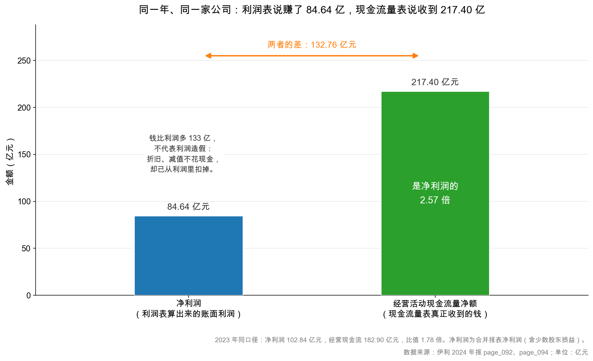
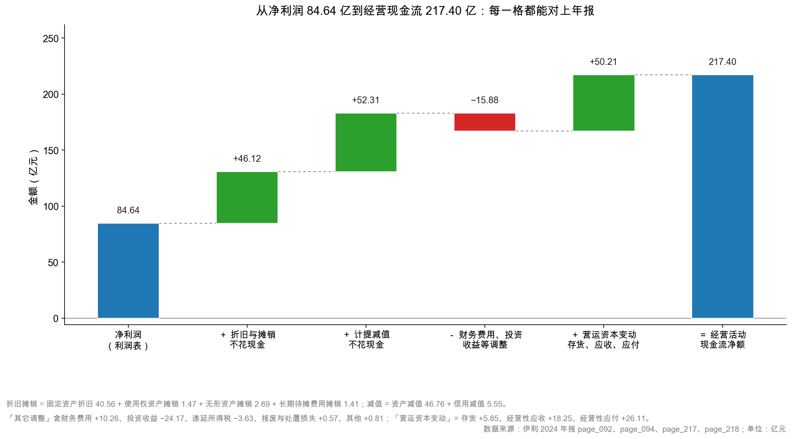

# 第 9 章：权责发生制——利润是算出来的，现金是收到的

> 本章你将：
> - 看懂伊利 2024 年最刺眼的一对数字：净利润 **84.64 亿元**，经营现金流 **217.40 亿元**，差 **132.76 亿元**；
> - 弄懂"权责发生制"到底改了什么规则，为什么它让利润和现金必然分叉；
> - 把 132.76 亿元的差额一项项对上：折旧摊销 **46.12 亿元**、减值 **52.31 亿元**、营运资本变动 **50.21 亿元**；
> - 分清"利润高但没钱"和"利润低但有钱"这两种截然相反的情形，各自意味着什么；
> - 学会一个两秒钟就能用的判断：**净现比**。

上一章讲完了"每笔交易动两个格子"。这一章要处理一个更尖锐的问题：
**如果每笔交易都记得那么清楚，为什么利润表的利润，和现金流量表的现金，会差出 133 亿？**

答案是一个词：权责发生制（accrual basis）。

---

## 9.1 一对刺眼的数字

先看两组数，都来自伊利 2024 年报：

| 指标 | 2024 年 | 2023 年 | 出处 |
|---|---|---|---|
| 净利润 | **84.64 亿元** | 102.84 亿元 | page_092 |
| 经营活动产生的现金流量净额 | **217.40 亿元** | 182.90 亿元 | page_094 |
| 净现比（经营现金流 ÷ 净利润） | **2.57 倍** | 1.78 倍 | 计算 |

<!-- src: 伊利股份2024年报/page_092.md 伊利股份2024年报/page_094.md -->

同一年、同一家公司、同一套账簿，两个数字差了 **132.76 亿元**。
更反常的是方向：**利润在下滑**（净利润同比 -17.7%），**现金在增长**（经营现金流同比 +18.9%）。

第一次看到这个对比，人的本能反应有两种，都不对：

**反应一："利润表是假的，现金流才是真的。"** 太粗暴。伊利的年报经信永中和审计，
是标准无保留意见（page_083）。而且若真虚增利润，现金流通常**更差**，不会更好。

**反应二："现金流高说明公司特别健康。"** 也太快。217.40 亿元里有相当一部分不是"赚来的"，
而是"收回来"的（收应收、卖存货），这种钱不可持续。

真相在中间，而且完全可以算清楚。这一章的任务，就是把那 132.76 亿元，一项一项对出来。

> 📌 **划重点：** 净利润和经营现金流不是"一个真一个假"的关系，它们是**同一家公司用两套规则算出来的两个数**。
> 利润回答"这一年我赚了多少"，现金回答"这一年我收到了多少"。
> 两个问题不同，答案当然不同。真正该做的不是二选一，而是**把差额解释清楚**。

---

## 9.2 权责发生制到底改了什么规则

要理解差异，先要理解"记账的时点"这件事。

假设你开了一家奶茶店（**示意数字**），12 月 20 日给一家公司送了 200 杯奶茶，货款 4,000 元，
约定 1 月 20 日付款。这一笔生意，什么时候算"做成"？

有两种记法：

**收付实现制（cash basis）：钱到手才算。**
12 月 20 日：什么都不记。1 月 20 日收到 4,000 元：记"收入 4,000"。
→ 结果：这笔生意记在了**明年**。

**权责发生制（accrual basis）：义务完成就算。**
12 月 20 日货送到、控制权转移：记"收入 4,000，应收账款 4,000"。
1 月 20 日收到钱：记"货币资金 4,000，应收账款 -4,000"。
→ 结果：收入记在**今年**，收钱记在**明年**。

**会计准则选择的是第二种。** 全球主要资本市场（含 A 股）都用权责发生制。

为什么？因为收付实现制有个致命缺陷：**它让利润可以被"付款时间"随意操纵。**
想今年的利润好看？催客户提前付款，或者拖到明年再付供应商的钱，利润就变了——
可生意本身一点没变。这种账，反映的是"资金的调度能力"，不是"生意的盈利能力"。

权责发生制的回答是：**收入在"货交了"时确认，成本在"货用了"时确认，跟钱什么时候进出无关。**
这样一来，利润反映的是"这一年做了多少生意、赚了多少"，不受付款节奏干扰。

但代价也随之而来：**利润和现金，从此必然分叉。**

分叉的机制，可以归纳成三个"时间差"：

| 时间差 | 名字 | 对利润的影响 | 对现金的影响 |
|---|---|---|---|
| 先交货、后收钱 | 应收账款 | 当期就确认收入（利润 +） | 当期没收到（现金 0） |
| 先收钱、后交货 | 合同负债 | 当期不确认收入（利润 0） | 当期就收到（现金 +） |
| 先花钱、后受益 | 折旧、摊销、减值 | 分摊到各期（利润 -） | 钱在买的时候一次性付掉了 |

再加上一类"永远不花现金"的项目：

| 项目 | 花现金吗 | 进利润表吗 | 结果 |
|---|---|---|---|
| 折旧 | 不花（买设备时花过了） | 进（每年扣） | 利润低、现金高 |
| 摊销 | 同上 | 进 | 同上 |
| 计提减值 | 不花 | 进 | 同上 |

这三类东西合起来，就解释了伊利那 132.76 亿元差额的绝大部分。

> 💡 **你可能会问：既然权责发生制这么麻烦，为什么不干脆用收付实现制？**
>
> 因为它会让"利润"变得毫无意义。举一个极端的例子：一家公司今年卖了 10 亿元的货，
> 全部赊账、明年才收款，同时今年一笔钱都没花（供应商也让它赊）。
> 按收付实现制，今年利润是 0，现金也是 0；按权责发生制，今年收入 10 亿元，利润可观。
> 哪个更能反映"这一年生意做得好不好"？答案很明确：后者。
>
> 而且权责发生制并没丢掉现金信息——它把现金信息放进了**另一张表**（现金流量表）。
> 两张表配合着看，比一张表信息量更大。这也是为什么年报必须同时披露三张表。

---

## 9.3 把 132.76 亿元一项项对出来

现在做正事。伊利 2024 年报 page_217~218 有一张表，叫"**现金流量表补充资料**"，
它的标题是"**将净利润调节为经营活动现金流量**"。

这张表就是官方给出的"差额解释"。它从净利润出发，一项项加回/减去，最后得到经营现金流。

先看四个大块（单位：亿元）：

| 步骤 | 项目 | 金额 | 性质 |
|---|---|---|---|
| 起点 | 净利润 | 84.64 | 利润表最后一行 |
| + | 折旧与摊销 | 46.12 | **不花现金的费用** |
| + | 计提减值 | 52.31 | **不花现金的费用** |
| - | 财务费用、投资收益等调整 | 15.88 | 这些钱算在筹资/投资活动里 |
| + | 营运资本变动（存货、应收、应付） | 50.21 | **占用或释放的现金** |
| = | 经营活动现金流量净额 | **217.40** | 现金流量表 |

验算：$84.64 + 46.12 + 52.31 - 15.88 + 50.21 = 217.40$。差 0.00。

<!-- src: 伊利股份2024年报/page_217.md 伊利股份2024年报/page_218.md -->

下面逐块拆开。

### 第一块：折旧与摊销 46.12 亿元——钱早就花过了

page_217 上的明细：

| 项目 | 金额（亿元） |
|---|---|
| 固定资产折旧、油气资产折耗、生产性生物资产折旧 | 40.56 |
| 使用权资产摊销 | 1.47 |
| 无形资产摊销 | 2.69 |
| 长期待摊费用摊销 | 1.41 |
| **合计** | **46.12** |

<!-- src: 伊利股份2024年报/page_217.md -->

这 46.12 亿元，在利润表里被当作费用扣掉了，所以净利润里已经减过它。
但**公司今年并没有为它付出一分钱现金**——买设备的钱，是很多年前一次性付的。

用一个奶茶店的例子说明（**示意数字**）：
小满花 40 万买设备，预计用 5 年，每年折旧 8 万。
- 第 1 年：现金流出 40 万（买设备），利润表只扣 8 万折旧；
- 第 2~5 年：现金流出 0，利润表每年扣 8 万。

所以在第 2~5 年，**利润表每年扣 8 万，但现金一分没出**。
这 8 万就要在"净利润 → 经营现金流"的桥上**加回来**。

伊利的 46.12 亿元是同一个道理，只是规模大了几万倍。
它的固定资产净值就有 346.19 亿元（page_087），原值更高，一年折旧 40 亿元，很正常。

**这就是"重资产行业"的现金流特征：折旧大，所以经营现金流常年高于净利润。**

### 第二块：计提减值 52.31 亿元——账面上的损失，不花现金

| 项目 | 金额（亿元） | 说明 |
|---|---|---|
| 资产减值损失 | 46.76 | 其中商誉减值 30.75、存货跌价 12.27、固定资产减值 3.67 |
| 信用减值损失 | 5.55 | 应收账款等的坏账准备 |
| **合计** | **52.31** | |

<!-- src: 伊利股份2024年报/page_211.md 伊利股份2024年报/page_217.md -->

减值是什么？简单说：**一项资产不值原来那么多钱了，账上把它"砍"下来，差额算损失。**

伊利 2024 年最大的一笔减值，是**澳优乳业的商誉减值 30.37 亿元**（page_184）。
当年伊利收购澳优时，付的价格高于澳优可辨认净资产的公允价值，差额记成"商誉"。
2024 年评估认为澳优未来赚不到那么多钱了，于是把商誉砍掉 30.37 亿元。

这笔减值：
- **进利润表**（所以净利润少了 30.37 亿元）；
- **不花一分钱现金**（伊利并没有真的付出 30 亿元）；
- **减少资产负债表上的商誉**（从 51.60 亿元降到 23.37 亿元）。

所以在桥上要**加回 30.37 亿元**。同理，存货跌价准备 12.27 亿元、固定资产减值 3.67 亿元，
都是"账上砍了、现金没动"，都要加回。

**加回之后，净利润里那部分"纸面损失"就被剔掉了。** 这就是为什么减值大的年份，
经营现金流会显著高于净利润——**不是因为生意变好了，而是因为利润被"纸面损失"压低了。**

> ⚠️ **易踩坑：** 看到"经营现金流是净利润的 2.57 倍"，就认为"公司现金流极其健康"。
> **必须先把加回项剔掉再看。** 伊利这 217.40 亿元可以分三层剥：
>
> | 层次 | 金额（亿元） | 净现比 | 还剩哪些"一次性" |
> |---|---|---|---|
> | 全部经营现金流 | 217.40 | 2.57 | 含全部加回项 |
> | 剔除折旧摊销 + 减值（98.43） | 118.97 | 1.41 | 仍含营运资本释放 |
> | 再剔除营运资本释放（50.21） | 68.76 | 0.81 | 只剩当期经营成果 |
>
> 三层数字都对，但读出来的结论完全不同。**0.81 看着不高，是因为分母（净利润）
> 被 52.31 亿元减值压低了**——减值是真损失，但今年不再掏现金。
> 所以正确的说法不是"2.57 倍很健康"或"0.81 倍很差"，而是：
> **伊利今年的现金流里，约一半来自"把压在外面的钱收回来"，靠的是收缩，不是增长。**

### 第三块：营运资本变动 50.21 亿元——把压在外面的钱收回来

| 项目 | 金额（亿元） | 方向 |
|---|---|---|
| 存货的减少 | 5.85 | 存货降了，释放现金（+） |
| 经营性应收项目的减少 | 18.25 | 应收降了，收回现金（+） |
| 经营性应付项目的增加 | 26.11 | 应付增了，占用别人现金（+） |
| **合计** | **50.21** | |

<!-- src: 伊利股份2024年报/page_218.md -->

这三项合起来叫**营运资本（working capital）变动**。它的逻辑是：

- **存货减少 5.85 亿元**：仓库里的货卖掉了，变成现金。这是"释放"；
- **应收减少 18.25 亿元**：客户欠的钱收回来了。这是"释放"；
- **应付增加 26.11 亿元**：欠供应商的钱变多了，相当于"占用"了别人的钱。这也是"释放"。

三项都是正的，合计释放 50.21 亿元现金。**但这三项都是"一次性"的。**

想想看：存货能一直减少吗？不能，减到零就没货可卖了。
应收能一直收回吗？不能，收完了就没有了。
应付能一直增加吗？不能，供应商也有底线。

**所以营运资本释放出来的现金，是"存量变现"，不是"增量创造"。**
今年释放 50.21 亿元，明年可能就变成"占用"（如果存货、应收重新增加）。

这就是为什么伊利的 2.57 倍不能简单外推。**看现金流质量，一定要区分"可持续的部分"和"一次性的部分"。**

### 第四块：其他调整 -15.88 亿元

这一块比较杂，主要是"算在筹资/投资活动里、但已经进了利润表"的项目：

| 项目 | 金额（亿元） | 为什么要调整 |
|---|---|---|
| 财务费用 | +10.26 | 利息支出算筹资活动，但进了利润表 |
| 投资收益 | -24.17 | 投资收益算投资活动，但进了利润表 |
| 递延所得税 | -3.63 | 不涉及当期现金 |
| 固定资产报废、处置损失 | +0.57 | 算投资活动 |
| 其他 | +0.81 | — |
| **合计** | **-15.88** | |

<!-- src: 伊利股份2024年报/page_218.md -->

这一块最容易被忽略，但它说明了一件事：**利润表里混着"非经营活动"的损益。**
伊利 2024 年投资收益 24.17 亿元（主要是处置子公司昌吉盛新的 25.80 亿元，page_210），
这笔钱算在投资活动现金流里，不在经营活动里，所以要从桥上**减掉**。

**这也是读利润表的一个关键提醒：营业利润里可能藏着"卖资产赚的钱"，那不是主业赚的。**
第 31 章会专门讲这一块。

---

## 9.4 两种情形：利润高但没钱，利润低但有钱

现在把视角拉高。伊利是"利润 84.64 亿元、现金 217.40 亿元"，属于"现金比利润多"。
但市场上还有另一种公司：**利润很高，现金很少。** 这两种情形，含义完全不同。

### 情形一：利润高、现金少（净现比小于 1）

**症状：** 净利润 10 亿元，经营现金流 3 亿元，净现比 0.3。

**可能的原因（按危险程度排序）：**

| 原因 | 机制 | 危险程度 | 怎么验证 |
|---|---|---|---|
| 应收账款暴增 | 赊销冲收入，钱没收到 | 高 | 应收增速 vs 收入增速 |
| 存货暴增 | 货压在仓库，没卖出去 | 高 | 存货增速、周转天数 |
| 虚构收入 | 根本没有真实交易 | 极高 | 应收/收入比、关联方、审计意见 |
| 正常扩张期 | 备货、铺渠道，先投入后回收 | 低 | 看后续年度现金是否回补 |
| 大额预付款 | 提前付供应商，占用资金 | 中 | 预付款项、其他应收款 |

**关键判断：** 一年是这样，可能是扩张；**连续三年是这样，几乎一定是问题。**
因为扩张总有结束的时候，如果三年都没回补，说明"赚的钱"从来没变成过现金。

反过来看伊利的对手蒙牛 2024 年：净利润只有 **2.25 亿元**，经营现金流却是 **83.32 亿元**，
净现比高达 **37 倍**。原因很清楚——当年计提了贝拉米商誉减值 11.55 亿元、
商标减值 34.90 亿元，合计 46.45 亿元（蒙牛 2024 年报 page_045、page_147、page_140）。
**37 倍不是"蒙牛特别能收钱"，是"利润被减值压得几乎归零"。**
同一个工具，在两家公司身上读出的意思完全不同——这就是为什么必须拆桥。

<!-- src: 伊利股份2024年报/page_092.md 蒙牛乳业2024年报/page_140.md 蒙牛乳业2024年报/page_147.md 蒙牛乳业2024年报/page_045.md -->

### 情形二：利润低、现金多（净现比大于 1，且差额来自加回项）

**症状：** 净利润 5 亿元，经营现金流 30 亿元，净现比 6。

**可能的原因：** 大额折旧摊销（重资产，中性偏正面）、大额减值（一次性洗澡，中性）、
营运资本释放（收应收、卖存货，一次性）、预收大增（偏正面，但要防压货）。

**关键判断：** 看差额来自哪一块。折旧摊销正常且可持续；减值与营运资本释放都是一次性。
伊利 2024 年正是三者叠加：46.12 + 52.31 + 50.21。
**所以 2.57 倍不能当作"伊利常年能赚 2.57 倍于利润的现金"来用。**

### 一个两秒钟的判断工具：净现比

**净现比 = 经营活动现金流量净额 ÷ 净利润。**

| 净现比 | 通常意味着 | 注意事项 |
|---|---|---|
| 小于 0.8 | 利润没有变成现金，要警惕 | 看是不是扩张期，连续多年则危险 |
| 0.8 ~ 1.2 | 正常，利润与现金基本匹配 | 大多数健康公司的常态区间 |
| 1.2 ~ 2.0 | 有较多折旧摊销，或营运资本释放 | 看差额来源 |
| 大于 2.0 | 有大额加回项（减值/折旧）或一次性释放 | 必须拆开看，不能直接外推 |

伊利 2024 年是 2.57，落在最后一档。**这就是为什么这一章要花这么大篇幅拆桥——
一个 2.57 的数字，可以读成"极其健康"，也可以读成"含大量一次性因素"，差别巨大。**

> 🔍 **翻到年报：** 打开 `page_217.md`，找到"**80、现金流量表补充资料**"下面的
> "**(1)现金流量表补充资料**"，表头写着"**将净利润调节为经营活动现金流量**"。
> 第一行是"净利润 8,463,710,355.65"，往下逐项加加减减，
> 最后一行是"经营活动产生的现金流量净额 21,739,740,393.38"。
> **这张表是整份年报里最被低估的一页。** 它把利润和现金之间的每一笔差异都列出来了，
> 而且不需要你做任何计算——公司已经替你算好了。

---

## 9.5 权责发生制的三个"副作用"

权责发生制解决了"利润被付款时间操纵"的问题，但它自己带来了三个副作用。
这三个副作用，是后面几周反复要处理的主题。

### 副作用一：给"操纵确认时点"留了空间

收入在"控制权转移"时确认。可"控制权什么时候转移"是有判断空间的：

- 把货发给经销商，算不算转移？如果经销商只是"代销"，不算；如果是"买断"，算。
- 年末最后一周发的货，算今年还是明年？
- 附有退货条款的销售，退货率怎么估？

这些判断，每一个都能影响几千万甚至几亿的利润。
**这也是为什么"收入确认政策"是年报附注里必看的一节**（伊利在附注三、重要会计政策里）。

### 副作用二：让"资产"科目成了利润的蓄水池

权责发生制要求把"已经发生但还没消耗"的支出记成资产。于是就有了这些科目：

| 科目 | 本质 | 可能的操纵 |
|---|---|---|
| 应收账款 | 已经确认收入、还没收到的钱 | 放宽账期冲收入 |
| 存货 | 已经买进来、还没卖掉的货 | 少提跌价准备撑利润 |
| 在建工程 | 已经花掉、还没转固的钱 | 迟迟不转固，少提折旧 |
| 无形资产 | 已经花掉、分年摊销的钱 | 该费用化的研发支出资本化 |
| 商誉 | 收购溢价的残留 | 该减值的不减值 |

**每一个"资产"科目，都可能变成"藏费用"的口袋。** 这是财务分析最重要的一条主线，第 3、4 周逐个拆。

### 副作用三：让"一次性损益"混进利润

权责发生制下，只要"权利义务发生了"，就要记账。于是：
卖掉一家子公司赚了 25.80 亿元（伊利 2024 年处置昌吉盛新，page_210），
这笔钱一次性进投资收益，把净利润撑高了；
但它和"卖牛奶"没有关系，明年不会再有。

**所以看利润，一定要区分"经常性"和"非经常性"。**
伊利 2024 年归母净利润 84.53 亿元，扣掉非经常性损益 24.42 亿元后，
扣非归母净利只有 **60.11 亿元**（page_008）——**这才是主业真正赚的钱**。
60.11 与 84.53 的这个差，就是"副作用三"的量化。第 33 章专门讲怎么剔。

<!-- src: 伊利股份2024年报/page_008.md 伊利股份2024年报/page_210.md -->

---

## 9.6 一张表：把两个数字放回它们该在的位置

最后，把这章的所有东西收进一张表。以后你看任何一家公司，都可以照着这张表走一遍。

| 问题 | 看哪个数字 | 伊利的答案 |
|---|---|---|
| 这一年赚了多少？ | 净利润 | 84.64 亿元（同比 -17.7%） |
| 主业赚了多少？ | 扣非归母净利润 | 60.11 亿元（同比 -40.0%） |
| 收到了多少现金？ | 经营现金流净额 | 217.40 亿元（同比 +18.9%） |
| 现金是利润的几倍？ | 净现比 | 2.57 倍 |
| 扣掉加回项后呢？ | （217.40 - 98.43）÷ 84.64 | 1.41 倍 |
| 可持续的部分有多少？ | 折旧摊销加回 | 46.12 亿元，只占 21% |

**最后一行是这章的精髓：217.40 亿元里，真正"可持续"的只有折旧摊销那 46.12 亿元；
剩下 102.52 亿元来自减值和营运资本释放，明年未必还有。**

这不是说伊利不好：这一年它确实收回了大量现金，资产负债表也更干净了。
而是说——**你不能拿 217.40 亿元去预测明年的现金流。**

**读财报最重要的能力，不是算出数字，而是知道这个数字明年还在不在。**

---

## ✍️ 想一想

### 问 1：净现比 2.57 倍，能不能直接用来估值

假设你要用"经营现金流 $\times$ 10 倍"给伊利估个值。手上有 2024 年经营现金流 217.40 亿元。
请回答：① 直接用 217.40 $\times$ 10 = 2,174 亿元，这个做法有什么问题？
② 如果要用，你会怎么调整？③ 调整后的结果大概是多少？

**解题思路：**
回到 9.3 节的四块拆解：217.40 里，哪一块是"生意本身产生的"，哪一块是"一次性变现的"？
折旧摊销是可持续的（每年都有），减值和营运资本释放是一次性的。
所以"可持续经营现金流"应该从净利润出发，只加回可持续的部分。

**参考答案：**

① **直接用 217.40 亿元有问题。** 因为其中 102.52 亿元（减值 52.31 + 营运资本 50.21）
是一次性因素：减值明年不会重复（商誉已经砍掉大半），营运资本也不可能年年释放。
拿一个"含一次性收益"的现金流去乘 10 倍，会把一次性的钱当成永续的钱，**高估价值**。

② 调整的方法：只保留可持续部分。

$$\text{可持续经营现金流} \approx \text{净利润} + \text{折旧摊销} = 84.64 + 46.12 = 130.76 \text{ 亿元}$$

或者更保守，用扣非净利润：

$$60.11 + 46.12 = 106.23 \text{ 亿元}$$

③ 按 130.76 亿元 $\times$ 10 倍 = **1,307.6 亿元**；按 106.23 亿元 $\times$ 10 倍 = **1,062.3 亿元**。
与直接用 217.40 亿元算出的 2,174 亿元相比，**低了 40%~50%**。

按 9.3 节最严的口径（68.76 亿元）算，只有 **687.6 亿元**。
所以"用经营现金流乘 10 倍"这一个动作，结果可以从 688 亿元一路坐到 2,174 亿元——
**差的不是模型，是口径。** 任何一个估值数字，如果不告诉你口径，就等于没告诉你。

这就是"现金流质量"对估值的实际影响：**差一个调整，估值能差一倍。**

（说明：这里的"10 倍"只是示意倍数，不是估值结论；真正的估值方法在第 49、50 章。
另外，用经营现金流乘倍数本身是粗略做法，严谨的做法是用自由现金流，第 39 章会讲。）

**易错点：**
① 直接用 217.40 亿元，不做任何调整。这是最常见的错误，也是最贵的错误；
② 把减值加回也当成可持续的。减值是一次性的——商誉砍完了就没了，明年不会再有 30 亿元减值；
③ 用"净利润 + 折旧摊销 + 减值"三项全加，得到 183 亿元。这等于假设"每年都有大额减值"，
   而实际上减值恰恰是异常的；
④ 忘了扣非。84.64 亿元里含 24.42 亿元非经常性损益，用扣非口径更保守。

### 问 2：一家公司连续三年净现比 0.4，你怎么判断

假设有一家公司（**示意数字**），连续三年：净利润 10 亿元、经营现金流 4 亿元，净现比 0.4。
同期营业收入每年增长 20%，应收账款每年增长 45%。

请回答：① 这家公司最可能出了什么问题？② 你会去看哪三个数字来确认？
③ 如果它说"我们在高速扩张，所以现金流暂时不好"，你信不信？

**解题思路：**
净现比长期低于 1，说明"赚的钱没变成现金"。再看应收增速（45%）远高于收入增速（20%），
说明"收入是靠赊账换来的"。这两个信号叠加，指向同一个方向。
然后用"扩张能不能解释"这个标准去检验公司的说法。

**参考答案：**

① **最可能的问题是：收入的质量在恶化，甚至可能是虚增。**
机制是这样的：为了做出 20% 的收入增长，公司放宽了信用政策（账期从 60 天放到 120 天，
或者对信用差的客户也发货）。结果是收入上去了，但钱收不回来，应收账款增速（45%）
远超收入增速（20%）。利润表好看了，现金没进来，净现比掉到 0.4。

**连续三年**是关键。如果只是一年，还可以解释为"年末集中发货"；
连续三年，说明这是一个系统性的模式，不是偶然。

② 我会看这三个数字：

| 看什么 | 期望看到什么（如果是虚增） | 在哪儿看 |
|---|---|---|
| 应收账款周转天数 | 持续上升（账期越来越长） | 附注"应收账款"、或自己算 |
| 坏账准备计提比例 | 计提不足（为了撑利润少提） | 附注"应收账款"的账龄与坏账政策 |
| 经营活动现金流入 / 营业收入（收现比） | 持续低于 1 且下降 | 现金流量表"销售商品收到的现金" |

补充两个我也会看的：**前五大客户占比**（如果客户集中度突然升高，可能是关联方）；
**审计意见类型**（是否从"标准无保留"变成"带强调事项段"）。

③ **不完全信，但也不会一口否定。** 判断标准是：**扩张期的现金流恶化，应该是"暂时的、有边界的"。**
具体说：
- 扩张期公司的应收会增加，但**增速应该和收入增速接近**，不该是收入的 2 倍多；
- 扩张期的净现比可以低，但**不该连续三年都在 0.4**。真在扩张，第三年应该有现金回补；
- 更关键的是：**扩张要有资本开支支撑**（建厂、买设备）。如果资本开支没增加，
  只有应收在涨，那就不叫扩张，叫"赊账换收入"。

伊利 2024 年正好是个反例：收入 -8.24%，应收 -6.7%（28.78 对 30.85 亿元），
存货 -14.1%（107.45 对 125.12 亿元），经营现金流 +18.9%。
**收入在降、应收和存货也在降、现金在增——这是"收缩但收钱"的形态，和上面那个案例正好相反。**

**易错点：**
① 只看"净现比低"就断定造假。有些行业（如工程建设）天然净现比低，因为垫资是行业惯例；
② 相信"我们在扩张"这个说法，但不去验证资本开支。真扩张一定有 capex；
③ 只看绝对值，不看趋势。净现比从 0.8 掉到 0.4 和常年 0.4，含义不同——前者是恶化信号，后者是商业模式；
④ 忽略"收现比"这个更直接的指标。净现比是"利润 vs 现金"，收现比是"收入 vs 收到的现金"，
   后者更贴近"卖货有没有收到钱"这件事。

### 问 3：为什么"折旧"要加回，而"付给员工的工资"不用加回

在"净利润 → 经营现金流"的桥上，折旧 40.56 亿元被加回了，但"支付给职工以及为职工支付的现金"
13.86 亿元没有被加回（它本来就在经营活动现金流出里）。
请解释这两者的区别，并说明"加回"这个动作到底在做什么。

**解题思路：**
关键是问一句：**这笔钱，今年有没有真的从银行账户里出去？**
然后再问：**它进没进利润表？**
把这两个问题的答案组合起来，就能判断该不该加回。

**参考答案：**

先看两个问题的答案：

| 项目 | 今年有现金流出吗 | 进了利润表吗 | 该加回吗 |
|---|---|---|---|
| 折旧 40.56 亿元 | **没有**（买设备的钱是过去付的） | 进了（作为费用扣掉） | **要加回** |
| 职工薪酬 13.86 亿元 | **有**（今年实际支付了） | 进了（作为费用扣掉） | **不加回** |

**"加回"这个动作，本质是在做一次"还原"：**
把利润表里那些"扣了但没花钱"的项目，还原回去，让"利润"逐步逼近"现金"。

- 折旧：利润表扣了，但现金没出 → 加回，利润就向现金靠近一步；
- 减值：利润表扣了，但现金没出 → 加回；
- 工资：利润表扣了，现金也出了 → **不能加回**，因为它已经真实发生，加了就重复算了。

换个说法：**桥上的每一个"加回"，都是在纠正"权责发生制"和"收付实现制"之间的时间差。**
折旧的时间差是"钱早付了、费晚扣了"；工资没有时间差（当年付、当年扣）。

**易错点：**
① 认为"折旧是费用，所以应该减"。在**利润表**里它确实是减项；但在"净利润 → 现金"的**桥**上，
   因为现金没动，所以要加回。**同一个项目，在两处的处理方向相反，这是最容易绕晕的地方**；
② 把"支付给职工的现金"也加回，理由是"人工成本也是一种投入"。这会导致重复计算——
   工资已经在经营活动现金流出里扣过一次了；
③ 混淆"加回"和"资本化"。加回是把非现金费用从利润里剔除，资本化是把支出记成资产——
   后者是操纵手段，前者是标准动作。

---

## 📎 数据出处

- 伊利股份 2024 年报：`page_092.md`（净利润 8,463,710,355.65 元、归母净利润 8,452,859,993.18 元）
- 伊利股份 2024 年报：`page_094.md`（经营活动产生的现金流量净额 21,739,740,393.38 元）
- 伊利股份 2024 年报：`page_217.md`（现金流量表补充资料：折旧、使用权资产摊销、无形资产摊销、长期待摊费用摊销、资产减值准备、信用减值损失）
- 伊利股份 2024 年报：`page_218.md`（存货减少、经营性应收项目的减少、经营性应付项目的增加、财务费用、投资损失）
- 伊利股份 2024 年报：`page_211.md`（资产减值损失明细：商誉 30.75 亿元、存货 12.27 亿元、固定资产 3.67 亿元）
- 伊利股份 2024 年报：`page_184.md`（澳优乳业商誉减值 3,037,222,489.82 元）
- 伊利股份 2024 年报：`page_210.md`（处置子公司昌吉盛新投资收益 25.80 亿元）
- 伊利股份 2024 年报：`page_008.md`（扣非归母净利润 6,011,274,945.92 元、非经常性损益 2,441,585,047.26 元）
- 数据汇总：`data/yili2024.json` 的 `income`、`cashflow`、`notes`、`nonrecurring`、`ratios` 段
- 本章 9.2、9.3 节奶茶店与小满设备折旧的记账示例均为**示意数字**

下一章：[第 10 章：三张表怎么连成一台机器](10-三张表怎么连成一台机器.md)
