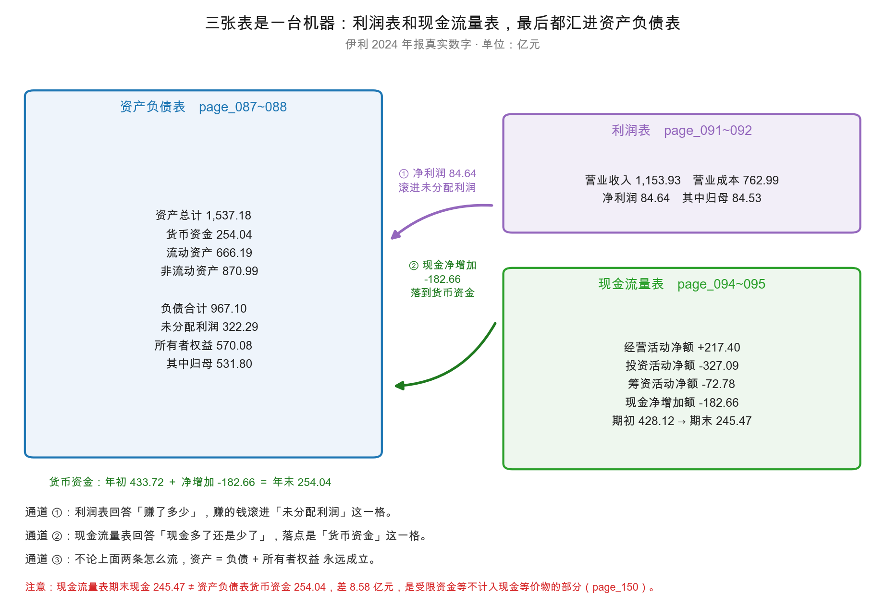
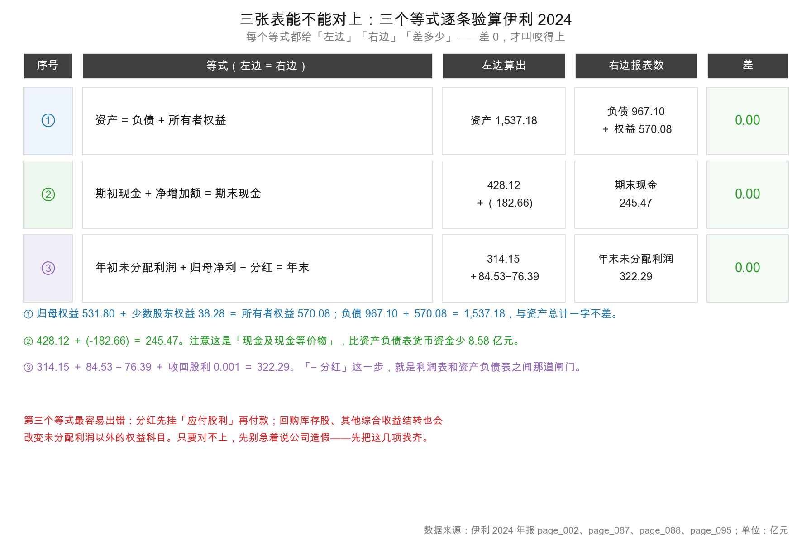

# 第 10 章：三张表怎么连成一台机器

> 本章你将：
> - 把三张表拼成一台机器：利润表和现金流量表，最后都汇进资产负债表；
> - 走通**通道一**：净利润怎么滚进"未分配利润"（伊利 2024 年末 **322.29 亿元**）；
> - 走通**通道二**：现金净减少 **182.66 亿元**怎么让货币资金从 433.72 亿元变成 **254.04 亿元**；
> - 走通**通道三**：**1,537.18 = 967.10 + 570.08** 这个恒等式，为什么每年都得成立；
> - 学会用三个等式做"三表勾稽"，知道对不上时有哪四种可能。

这一周走到最后了。我们已经有了：恒等式（第 7 章）、复式记账（第 8 章）、
权责发生制（第 9 章）。三样东西各自都懂，但它们是**散的**。

这一章把它们焊起来，给你看一台完整的机器。

---

## 10.1 三张表，其实是一台机器的三个仪表

先花一分钟把三张表的关系说清楚，用一台机器的比喻。

想象一台榨汁机：

- **利润表**是"这一年的产量表"——投进去多少料，出了多少汁，中间损耗多少；
- **现金流量表**是"这一年的水管记录"——进水管进了多少，出水管出了多少，水箱里净增多少；
- **资产负债表**是"这一刻的水箱"——水箱里现在有多少水，水箱有几个，每个多大。

关键关系在这里：**产量表和进水管记录会变，但水箱只有一个。**
到年底，水箱里的水位（资产负债表），必须等于年初水位加上这一年的净进出（现金流量表）。
同时，产量表算出来的"这一年赚的汁"（净利润），也会以某种方式进到水箱里
（如果没喝完、没倒掉，它就留在水箱里了）。

**这就是三张表的咬合关系：两张动态的（流量），汇入一张静态的（存量）。**

| 表 | 时间性质 | 回答的问题 | 伊利 2024 的关键数字 |
|---|---|---|---|
| 利润表 | 一段时期（2024.1.1 - 12.31） | 这一年赚了多少 | 净利润 84.64 亿元 |
| 现金流量表 | 一段时期（同上） | 这一年现金进出多少 | 净增加额 -182.66 亿元 |
| 资产负债表 | 一个时点（2024.12.31） | 这一刻有什么、欠什么 | 资产 1,537.18 亿元 |

**流量（flow）** 和 **存量（stock）** 这两组词，是理解三表关系的钥匙。
浴缸里的水是存量，水龙头流进来的水是流量。存量 = 期初存量 + 本期流量净额。
记住这个比方，剩下的都能推出来。

上图就是这一章的地图。左边是资产负债表（存量的终点），右上利润表，右下现金流量表。
三根箭头，就是三个通道。

> 📌 **划重点：** 三张表不是三个独立的东西，是**一台机器的三个仪表**。
> 两张流量表（利润表、现金流量表）汇报"这一年发生了什么"，一张存量表（资产负债表）记录"现在停在哪儿"。
> 流量必须能解释存量的变化，否则报表就有问题。

---

## 10.2 通道一：净利润 → 未分配利润

先走第一条通道。它连接利润表和资产负债表。

### 伊利 2024 年的实际计算

未分配利润（retained earnings）是资产负债表"所有者权益"里的一个科目，
意思是：**公司历年赚的钱，扣掉分红之后，留在公司里的那部分。**

伊利 2024 年的未分配利润是 **322.29 亿元**（32,229,030,347.49 元，page_088）。
2023 年是 **314.15 亿元**（31,414,532,460.31 元）。

一年增加了 **8.14 亿元**。这个 8.14 亿元怎么来的？

| 步骤 | 项目 | 金额（亿元） | 出处 |
|---|---|---|---|
| 起点 | 年初未分配利润 | 314.15 | page_088 |
| + | 归属于母公司股东的净利润 | 84.53 | page_092 |
| - | 已派发的 2023 年度现金红利 | 76.39 | page_045 |
| + | 股权激励对象离职收回的已分配股利 | 0.001 | page_002 |
| = | 年末未分配利润 | **322.29** | page_088 |

验算：$314.15 + 84.53 - 76.39 + 0.001 = 322.29$。差 0.00。

<!-- src: 伊利股份2024年报/page_088.md 伊利股份2024年报/page_092.md 伊利股份2024年报/page_045.md 伊利股份2024年报/page_002.md -->

**这条等式，就是利润表和资产负债表之间的那道闸门。** 它的意思是：

> 利润表算出"今年赚了 84.53 亿元"（归母口径），这笔钱**不会凭空消失**，
> 它会进到资产负债表里"未分配利润"这一格。
> 但股东会分走一部分（76.39 亿元），所以实际留在公司里的只有 8.14 亿元。

这就是为什么一家公司"每年都赚钱，但净资产不见得每年都涨"——
赚的钱有一部分被分掉了。**分红率越高的公司，未分配利润增长越慢。**

### 三个容易搞混的细节

**细节一：为什么用归母净利润 84.53，不用净利润 84.64？**

因为"未分配利润"是**归母权益**下的科目。
利润表上的净利润 84.64 亿元里，有 0.11 亿元属于少数股东（少数股东损益）。
那 0.11 亿元不进"未分配利润"，而进"少数股东权益"。

| 口径 | 金额（亿元） | 进哪里 |
|---|---|---|
| 净利润 | 84.64 | ——（这是合计） |
| 归母净利润 | 84.53 | 未分配利润（归母权益） |
| 少数股东损益 | 0.11 | 少数股东权益 |

**这就是第 7 章讲"权益分两层"的实际后果。** 一个小数点都不能混。

**细节二：为什么分的是 76.39 亿元，而不是 2024 年度方案的 77.26 亿元？**

因为**分红有时滞**。2024 年实际付出去的 76.39 亿元，是 2023 年度股东大会通过的分红方案
（每股 1.20 元，总股本 63.66 亿股，page_045）。

2024 年度的分红方案（每股 1.22 元，合计 77.26 亿元）是 2025 年 4 月才提出的，
它**完全不进 2024 年的报表**——既不减未分配利润，也不挂"应付股利"。
它是"资产负债表日后事项"，只在附注里披露。

page_088 上确实有一笔"应付股利"2.67 亿元，但那是**往年未领取的普通股股利**
（2.65 亿元）加上应付少数股东的股利（0.02 亿元，page_194），和 2024 年度方案无关。

**这是读年报最容易错的地方之一：不要把"今年宣告的分红"和"今年实际付出的分红"搞混。**

**细节三：那 8.14 亿元，是不是就是"公司今年多出来的钱"？**

**不是。** 未分配利润只是一个"账面累计数"，它不代表有一笔 8.14 亿元的现金放在那里。
这 8.14 亿元可能变成了存货、可能变成了设备、可能变成了应收账款，也可能真的变成了现金。
**权益科目的变化，反映的是"来源"，不是"形态"。**

### 通用公式

把伊利这个例子抽象出来，就是任何一个投资者都能用的通用公式：

$$\text{年末未分配利润} = \text{年初未分配利润} + \text{归母净利润} - \text{本年实际分红} \pm \text{其他调整}$$

"其他调整"包括：提取盈余公积（在权益内部搬家，不影响总额）、
回购库存股（减少权益）、其他综合收益结转、会计政策变更追溯调整等。
伊利 2024 年这一项很小，主要是收回的 0.001 亿元股利；盈余公积两年都是 32.00 亿元，没有变动。

**学会这个公式，你可以反过来验证公司的分红是否"真金白银"。**
如果一家公司说"我们今年分红 10 亿元"，但未分配利润只减少了 3 亿元，
那要么它同时赚了很多钱，要么它的分红是"送股"而不是"派现"。**这两种情况的含义完全不同。**

---

## 10.3 通道二：现金净增加额 → 货币资金

第二条通道连接现金流量表和资产负债表。

### 伊利 2024 年：钱少了 182.66 亿元

现金流量表最后三行是这样的（page_095）：

| 项目 | 金额（元） | 折合亿元 |
|---|---|---|
| 现金及现金等价物净增加额 | -18,265,559,844.13 | **-182.66** |
| 加：期初现金及现金等价物余额 | 42,812,079,851.67 | 428.12 |
| 六、期末现金及现金等价物余额 | 24,546,520,007.54 | **245.47** |

验算：$428.12 + (-182.66) = 245.47$。差 0.00。

<!-- src: 伊利股份2024年报/page_095.md -->

那 -182.66 亿元是从哪来的？拆开看三类活动：

| 活动 | 2024 年（亿元） | 2023 年（亿元） | 变化 |
|---|---|---|---|
| 经营活动净额 | **+217.40** | +182.90 | +34.50 |
| 投资活动净额 | **-327.09** | -160.44 | -166.65 |
| 筹资活动净额 | **-72.78** | +72.58 | -145.36 |
| 汇率变动影响 | -0.18 | +1.19 | — |
| **合计** | **-182.66** | +96.24 | — |

<!-- src: 伊利股份2024年报/page_095.md -->

翻译成一句人话：**这一年伊利做生意赚进来 217.40 亿元，但投资花掉 327.09 亿元、
筹资（还债+分红）净流出 72.78 亿元，两头一抵，净减少 182.66 亿元。**

投资活动为什么花了 327.09 亿元？看 page_095 的明细："投资支付的现金"342.54 亿元，
"购建固定资产、无形资产和其他长期资产支付的现金"39.78 亿元。
前者对应的是大额存单、定期存款的增加（page_166 注明："其他流动资产增加主要原因：
本期大额存单及定期存款增加所致"）。**所以"投资"的大头不是建厂，是把钱存起来。**

这也解释了第 12 章要讲的一个现象：**伊利的钱没有消失，是"搬家"了**——
从"货币资金"搬到了"其他流动资产"（大额存单 118.26 亿元）
和"其他非流动资产"（定期存款 279.77 亿元）里。
货币资金从 433.72 亿元降到 254.04 亿元，但"类现金"合计还有 652.07 亿元。

<!-- src: 伊利股份2024年报/page_087.md 伊利股份2024年报/page_166.md 伊利股份2024年报/page_188.md -->

### 一个必须讲清楚的 8.58 亿元差额

现在到了这一节最关键、也最容易被忽略的地方。

现金流量表的"期末现金"是 **245.47 亿元**。
资产负债表的"货币资金"是 **254.04 亿元**。

**两者不相等，差 8.58 亿元。** 为什么？

因为它们**定义不同**：

| 概念 | 定义 | 伊利 2024 年末 |
|---|---|---|
| 货币资金（资产负债表） | 库存现金 + 银行存款 + 其他货币资金 | **254.04 亿元** |
| 现金及现金等价物（现金流量表） | 货币资金中"可以随时动用"的部分 | **245.47 亿元** |

差在哪？page_150 的附注给了答案。货币资金的构成是：

| 项目 | 金额（元） | 折合亿元 |
|---|---|---|
| 库存现金 | 135,278.06 | 0.001 |
| 银行存款 | 24,518,402,363.98 | 245.18 |
| 其他货币资金 | 885,717,916.56 | 8.86 |
| **合计** | 25,404,255,558.60 | **254.04** |

"其他货币资金"8.86 亿元里，有：

- 存放中央银行法定存款准备金 7.80 亿元——**这部分不能随便动用**；
- 担保保证金 0.52 亿元；
- 已抵押银行存款及其他受限资金 0.09 亿元；
- 期货保证金 0.06 亿元；
- 在途资金 0.48 亿元、存出投资款 0.05 亿元、第三方平台资金 0.002 亿元。

其中前四项是明确"受限"的，**合计 8.42 亿元**（page_150 其他货币资金明细、page_188 附注七(31) 所有权或使用权受限资产）。这些钱会计入货币资金，但不计入现金及现金等价物。

那剩下的 **8.58 - 8.42 = 0.16 亿元**是什么？年报没有逐项说明这 0.16 亿的去向。最可能的解释是"三个月以上到期的定期存款"——按会计政策（page_112），现金等价物要求"从购买日起三个月内到期"，超过三个月的存款不能算现金等价物。

> 📌 **划重点：** 这里要学一个态度——**8.42 亿能对上，0.16 亿对不上，就老实说对不上**。不要为了凑数编一个原因。年报信息披露有颗粒度限制，读者能做的是：把能核实的核实到位，把不能核实的明确标为"未披露/推测"。这比"看起来很懂"重要得多。

<!-- src: 伊利股份2024年报/page_150.md -->

> ⚠️ **易踩坑：** 很多人在做三表勾稽时，直接拿"资产负债表货币资金"去对"现金流量表期末现金"，
> 一对发现差 8.58 亿元，就以为报表不平、公司造假。
> **这是一个标准的误判。** 两个科目本来就不是同一个东西。
> 正确的勾稽方式是：**期末现金及现金等价物 = 货币资金中可随时支用的部分 + 现金等价物**。
> 换句话说，要先从货币资金里扣掉受限、在途、准备金，再加上现金等价物。
> 严谨的验算还要考虑"现金等价物"（比如 3 个月内到期的短期债券投资）。
> page_218 的补充资料里单列了这一项：伊利 2023 年末现金等价物 10 亿元，2024 年末降为 0。
> 这 10 亿元的减少，同样包含在 -182.66 亿元的净增加额里。

> 🔍 **翻到年报：** 打开 `page_095.md`，找到最下面三行：
> "五、现金及现金等价物净增加额 -18,265,559,844.13"、
> "加：期初现金及现金等价物余额 42,812,079,851.67"、
> "六、期末现金及现金等价物余额 24,546,520,007.54"。
> 再打开 `page_087.md` 第一行"货币资金 25,404,255,558.60"。
> 两个数差 857,735,551.06 元，就是上面说的那 8.58 亿元。

---

## 10.4 通道三：恒等式，每年都得成立

第三条通道不是一个"科目到科目"的连接，而是**整个系统的外壳**。

第 7 章已经验算过：伊利 2024 年资产 1,537.18 = 负债 967.10 + 所有者权益 570.08。
这里要问一个更深的问题：**为什么它每年都成立？三张表都连起来了，为什么还能保证它成立？**

答案藏在复式记账里（第 8 章）。换个角度看会更清楚：**三张表是同一个记账系统的三个投影。**
想象一个立方体，正面拍是资产负债表，上面拍是利润表，侧面拍是现金流量表。
三张照片拍的是同一个东西，所以它们之间必然有几何关系——恒等式就是那个"边长关系"。

具体到机制上，是这样一条链：

1. 每一笔交易，至少动两个格子（第 8 章）；
2. 动完之后，$A = L + E$ 依然成立（因为两个格子要么两边同增同减，要么同边一增一减）；
3. 利润表是"权益变动"的一部分明细（收入增权益、费用减权益）；
4. 现金流量表是"资产中现金那一格"的变动明细；
5. 所以三张表天然咬合——**它们本来就是同一批交易的不同切面。**

**换句话说：三表勾稽不是"需要被满足的约束"，而是"复式记账的必然结果"。**
如果对不上，一定是某一环出了问题。

### 三个等式，逐条验算

现在把三个等式都用伊利 2024 年的真实数字验一遍。

**等式一（恒等式）：**

$$\text{资产} = \text{负债} + \text{所有者权益}$$

$$1{,}537.18 = 967.10 + 570.08 \quad \text{（差 0.00）}$$

**等式二（现金勾稽）：**

$$\text{期初现金} + \text{现金净增加额} = \text{期末现金}$$

$$428.12 + (-182.66) = 245.47 \quad \text{（差 0.00）}$$

**等式三（留存收益勾稽）：**

$$\text{年初未分配利润} + \text{归母净利润} - \text{已派现金红利} = \text{年末未分配利润}$$

$$314.15 + 84.53 - 76.39 + 0.001 = 322.29 \quad \text{（差 0.00）}$$

三个等式，全部为 0。**这就是"三张表咬得上"。**

| 等式 | 左边 | 右边 | 差额 | 说明 |
|---|---|---|---|---|
| ① 资产 = 负债 + 权益 | 1,537.18 | 967.10 + 570.08 | 0.00 | 系统外壳，永远成立 |
| ② 期初 + 净增 = 期末 | 428.12 - 182.66 | 245.47 | 0.00 | 现金流量表内部闭合 |
| ③ 年初 + 净利 - 分红 = 年末 | 314.15 + 84.53 - 76.39 | 322.29 | 0.00 | 利润表 → 资产负债表 |

<!-- src: 伊利股份2024年报/page_002.md 伊利股份2024年报/page_087.md 伊利股份2024年报/page_088.md 伊利股份2024年报/page_095.md -->

**三个等式里，等式③最重要，因为它连接了两张不同的表。** 等式①和②都在单张表内部，
只有等式③是"跨表"的。所以实战中，**先验等式③**——它是三表勾稽的试金石。

---

## 10.5 勾稽对不上，说明什么

理论上永远对得上。实践中，你自己算的时候，经常对不上。这时候怎么排查？

**第一步：先怀疑自己，按"四种可能"依次排查。**

| 可能 | 症状 | 怎么查 |
|---|---|---|
| ① 抄错年度列 | 差额和"同比变化"很接近 | 检查每个数字上方的年份 |
| ② 用错口径 | 差额刚好等于某个科目 | 归母 vs 全部、合并 vs 母公司、营业总收入 vs 营业收入 |
| ③ 漏了调整项 | 等式③差得最多 | 分红、盈余公积、库存股、其他综合收益 |
| ④ 四舍五入 | 差 0.01~0.05 | 用"元"的原始值重算 |

本章出现过好几个这样的例子：967.10 vs 967.11（四舍五入，差 0.01）；
货币资金 254.04 vs 期末现金 245.47（口径不同，差 8.58）；
未分配利润 +8.14 vs 84.53 - 76.39（对得上，只是别忘了 0.001 的收回股利）。

**第二步：四种可能都排除了，才考虑"报表本身有问题"。** 这时要问的不是"哪里抄错了"，
而是"这说明了什么"。合理解释有三类：

1. **会计政策变更的追溯调整。** 换了折旧年限之类的政策，要重述以前年度，
   "年初数"因此变了。合法，看附注"会计政策变更"。
2. **同一控制下企业合并的追溯重述。** 从母公司手里买子公司，按准则要重述比较期。合法，
   看附注"同一控制下企业合并"。
3. **真的有问题。** 收入跨期、费用少计、负债隐瞒。这类问题通常不会表现为"资产负债表不平"
   （编表软件会拦住），而是表现为**不同表之间、表和附注之间的数字矛盾**——那才需要警惕。

> 💡 **你可能会问：既然编表软件会自动校验，为什么还会有"三表不勾稽"的案例？**
>
> 因为软件校验的是"算术"，不是"逻辑"。
> 它只能保证"资产 = 负债 + 权益"这个加法是对的，
> 但保证不了"这笔收入是不是真的"、"这个减值提得够不够"。
>
> 举个具体的例子：一家公司虚构了 10 亿元收入，同时虚构了 10 亿元应收账款。
> 编表软件一算：资产 +10、权益 +10（通过利润），等式照样平。
> **三张表"勾稽得上"，但三张表都是假的。**
>
> 所以三表勾稽的作用是"排除低级错误"，不是"证明报表真实"。
> **判断真实性，要靠第 44 章那套红旗清单。**

---

## 10.6 一台机器的完整循环：一笔交易怎么走完三张表

最后，把这一周学到的东西全部串起来，走一遍完整循环。

假设伊利在 2024 年 12 月卖了一批奶粉，售价 1,000 万元（**示意数字**），
成本 600 万元，货款未收。这一笔交易，在三张表上分别留下什么？

| 步骤 | 动作 | 利润表 | 资产负债表 | 现金流量表 |
|---|---|---|---|---|
| 1 | 发货、控制权转移 | 营业收入 +1,000 | 应收账款 +1,000 | 无 |
| 2 | 结转成本 | 营业成本 +600 | 存货 -600 | 无 |
| 3 | 算利润 | 毛利 +400（税前） | 未分配利润 +（税后） | 无 |
| 4 | 收货款（假设次年收到） | 无 | 应收账款 -1,000，货币资金 +1,000 | 经营活动 +1,000 |

**看清楚这个表，你就看懂了权责发生制的全部后果：**
- 第 1~3 步，利润表上已经有 400 万元毛利了，但现金流量表上一分钱都没有；
- 第 4 步，现金流量表上才有 1,000 万元，但利润表上什么都没有。

**利润和现金，就这样在时间上错开了。** 这就是第 9 章那 132.76 亿元差额的微观来源。

如果一年做了 1,000 笔这样的交易、全部未收款，利润表会非常漂亮，现金流量表会非常难看，
资产负债表上堆满应收账款——**三张表依然勾稽得上，但公司可能已经快撑不住了。**

**所以读财报的正确姿势，从来不是"看某一张表"，而是"三张表对照着看"。**

| 你看到的组合 | 可能的含义 |
|---|---|
| 利润涨、现金涨、应收稳 | 健康的增长 |
| 利润涨、现金跌、应收涨 | 靠赊账冲收入，警惕 |
| 利润跌、现金涨、存货跌 | 收缩但收钱，中性偏好 |
| 利润跌、现金跌、应付涨 | 拖欠供应商，现金流紧张 |

伊利 2024 年落在第三行附近：净利润 -17.7%、经营现金流 +18.9%、应收 -6.7%、存货 -14.1%。
**"收缩但收钱"**——这不是最理想的形态，但比"靠赊账冲收入"健康得多。

---

## ✍️ 想一想

### 问 1：用等式三反推分红

假设你看另一家公司（**示意数字**），2024 年数据如下：

- 年初未分配利润 500 亿元
- 年末未分配利润 540 亿元
- 归母净利润 80 亿元
- 本年没有提取盈余公积、没有回购、没有其他权益变动

请回答：① 这家公司 2024 年实际分红多少？② 如果它对外宣称"我们今年分红 60 亿元"，
这个说法对不对？③ 如果它宣称的是"2024 年度分红方案 60 亿元"，那对不对？

**解题思路：**
直接用等式三：年末 = 年初 + 归母净利润 - 分红。移项求分红。
第 ②③ 问的关键是分清"本年实际支付的分红"和"本年宣告的分红方案"——两者差一年。

**参考答案：**

① 由 $\text{年末} = \text{年初} + \text{归母净利润} - \text{分红}$，移项得：

$$\text{分红} = 500 + 80 - 540 = 40 \text{ 亿元}$$

这家公司 2024 年实际支付了 **40 亿元**分红。

② **不对。** 如果实际只付了 40 亿元，宣称"分红 60 亿元"就是错的——
除非它把"宣告"和"支付"混在一起说，或者把"送股/转增"也折算成了金额。

③ **可能对。** 因为"2024 年度分红方案 60 亿元"通常是 2025 年才支付的。
这笔钱在 2024 年末还没付，所以不进 2024 年的"未分配利润"变动，
而是挂在 2024 年末的"应付股利"（负债）上。

所以正确的读法是：
- 2024 年**实际支付**的分红 40 亿元，对应的是 **2023 年度**的方案；
- 2024 年度**宣告**的方案 60 亿元，会在 2025 年支付，从 2025 年的未分配利润里扣。

**伊利就是这个结构**：2024 年实际付了 76.39 亿元（2023 年度方案，每股 1.20 元），
2024 年度方案是 77.26 亿元（每股 1.22 元），要 2025 年才付。

**易错点：**
① 把"宣告"当"支付"，导致等式三算不平，然后怀疑公司造假；
② 忘记"应付股利"这个过渡科目。宣告时进负债，支付时才减资产；
③ 用"净利润"而不是"归母净利润"去算。少数股东损益不进归母的未分配利润；
④ 忽略"提取盈余公积"。它是权益内部搬家，不影响未分配利润总额吗？
   **会影响**——提取盈余公积是从"未分配利润"转到"盈余公积"，未分配利润会减少。
   本题明确说"没有提取"，所以不用管；但如果提取了，必须减掉。

### 问 2：三张表里，哪一张最容易被操纵

有人问："三张表里，哪一张最不可信？"
请回答：① 从"操纵难度"看，三张表分别如何？② 如果你只能信一张表，你信哪张？为什么？
③ 这个选择有什么局限？

**解题思路：**
操纵难度取决于"这笔数字背后有多少外部证据"。
利润表的大部分数字是"公司自己判断"的结果（收入确认时点、坏账比例、折旧年限）；
现金流量表要对应银行流水，外部证据最强；资产负债表是两者的沉淀。
但别忘了：现金流量表也可以被"分类操纵"（把经营支出记成投资支出）。

**参考答案：**

① 从操纵难度看：

| 表 | 操纵难度 | 为什么 |
|---|---|---|
| 利润表 | **低** | 收入确认时点、坏账计提比例、折旧年限、减值测试假设，全是判断 |
| 资产负债表 | **中** | 科目余额要和凭证、盘点、函证对上，但"分类"和"减值"仍有空间 |
| 现金流量表 | **较高** | 每一笔都要对应银行流水，虚构现金极难（要伪造银行对账单，是重罪） |

② 如果只能信一张，我信**现金流量表**，特别是"经营活动现金流"。

理由：现金流量表的每一个数字，理论上都能追到银行账户的实际进出。
虚构 1 亿元收入很容易（签个假合同、开张发票），
虚构 1 亿元现金流入很难（要伪造银行流水，而且审计师会发函证给银行）。

③ 局限有三个，都很重要：

**局限一：现金流量表可以被"分类操纵"。**
把本该记在"经营活动"的支出，记到"投资活动"里去，经营现金流就好看了。
反过来，把投资活动的现金流入记成经营活动，也能美化。
这是会计史上最有名的一类操纵：**世通公司（WorldCom）**当年把线路租用费
记成"资本开支"，前后涉及金额数十亿美元，成了它崩塌的导火索之一。
**所以要看"经营活动现金流入的结构"，不只看净额。**

**局限二：现金流量表是"过去"，不是"未来"。**
今年现金流好，不代表明年好（第 9 章已经讲过：营运资本释放是一次性的）。

**局限三：现金流"真"，不等于"好"。**
一家公司可以靠"变卖资产"、"拖延付款"、"砍掉研发"来做出漂亮的现金流，
但这些都是"杀鸡取卵"。**现金流是"事实"，不是"判断"。**

所以更准确的说法是：**三张表要一起看。**
利润表告诉你"生意赚不赚钱"，现金流量表告诉你"钱有没有真的进来"，
资产负债表告诉你"家底厚不厚、风险大不大"。**任何一张单独看，都会得出片面结论。**

**易错点：**
① 认为"现金流量表不能操纵"。分类操纵、时点操纵（年末突击收款）都是真实存在的手法；
② 认为"利润表全是假的"。大部分公司的利润表是真实的，只是有"弹性"；
③ 只信一张表就下结论。三表对照才是正确姿势；
④ 忘记"审计意见"这个前置条件。如果审计意见不是"标准无保留"，三张表都要打折扣看。

### 问 3：为什么"三表勾稽得上"不能证明报表是真的

第 10.5 节说："三张表勾稽得上，但三张表都是假的"是可能的。
请用一个具体的例子说明这个机制，并回答：那"三表勾稽"这个工具还有什么用？

**解题思路：**
找一个"同时影响两张表、且金额相等"的造假手法。
最典型的是"虚构收入 + 虚构应收账款"——两边同时加，等式照样平。
然后想：勾稽检查的是"关系"，不是"事实"。它的价值在于"排除低级错误"。

**参考答案：**

**例子：虚构 10 亿元收入。**

一家公司想让今年的利润好看，于是和一家关联方签了一份假的销售合同，
货没发、钱没收到，但开了发票。会计上这样记：

| 格子 | 方向 | 金额 |
|---|---|---|
| 应收账款（资产） | +10 亿元 | |
| 营业收入（利润表 → 权益） | +10 亿元 | |

结果：
- 利润表：营业收入 +10 亿元，净利润 +（10 亿元 $\times$ 净利率）；
- 资产负债表：应收账款 +10 亿元，未分配利润 +（税后利润）；
- 现金流量表：**什么都没有**（钱没收到）。

现在做三表勾稽：
- 等式一（资产 = 负债 + 权益）：左边 +10 亿元（应收），右边 +10 亿元（权益），**平**；
- 等式二（现金勾稽）：现金流量表内部，跟这笔交易无关，**平**；
- 等式三（未分配利润）：年初 + 净利润 - 分红 = 年末，**平**。

**三个等式全平，但报表是假的。** 这就是"勾稽得上"和"报表真实"之间的那道鸿沟。

**那"三表勾稽"还有什么用？** 有三个用处，都很实在：

1. **排除低级错误。** 抄错年度、漏记科目、单位错（千元当元），这些都会被勾稽抓住。
   这是最基本、也最常用的功能。
2. **发现"不平衡"的造假。** 有些造假手法比较粗糙，只改了一边（比如只虚增收入，忘了虚增资产），
   这时候勾稽就会报警。**很多造假案是被"勾稽不平"揭开的。**
3. **建立"数字之间应该有什么关系"的直觉。** 一旦你熟练了，
   看到一个数字就能推出另一个数字大概是多少。这种直觉，是发现异常的基础。

**但要抓住"勾稽得上"的假报表，得靠别的工具：**

| 工具 | 抓什么 | 在哪一章 |
|---|---|---|
| 现金流 vs 利润（净现比） | 有利润没现金 | 第 9 章、第 36 章 |
| 应收增速 vs 收入增速 | 赊账冲收入 | 第 13 章 |
| 存货周转与跌价准备 | 库存积压、少提跌价 | 第 14 章 |
| 毛利率 vs 同业 | 异常高毛利 | 第 28 章 |
| 关联交易与表外担保 | 自买自卖、隐性负债 | 第 44 章 |
| 审计意见与会计师变更 | 审计师不敢签字 | 第 44 章 |

**易错点：**
① 认为"勾稽平了就万事大吉"。这是最常见的错觉，也是造假者最喜欢利用的心理；
② 认为"勾稽不平就一定是造假"。更可能是你抄错了（第 7 章列了四种可能）；
③ 只做等式一（恒等式），不做等式三（跨表勾稽）。等式一在单表内部，
   造假者最容易让它平；等式三跨了两张表，更容易暴露问题。

---

## 📎 数据出处

- 伊利股份 2024 年报：`page_087.md`（资产总计 153,718,003,927.97 元、货币资金、应收账款、存货）
- 伊利股份 2024 年报：`page_088.md`（负债合计、所有者权益、未分配利润、应付股利、盈余公积）
- 伊利股份 2024 年报：`page_091.md`（营业收入 115,393,310,976.69 元、营业成本 76,298,833,033.93 元）
- 伊利股份 2024 年报：`page_092.md`（净利润、归母净利润、少数股东损益）
- 伊利股份 2024 年报：`page_094.md`（经营活动现金流量净额 21,739,740,393.38 元）
- 伊利股份 2024 年报：`page_095.md`（三类活动净额、现金净增加额 -18,265,559,844.13 元、期末现金 24,546,520,007.54 元、投资支付的现金、购建长期资产）
- 伊利股份 2024 年报：`page_045.md`（2023 年度现金红利 7,639,318,446.00 元）
- 伊利股份 2024 年报：`page_002.md`（2024 年度分红方案 7,726,310,439.68 元、收回已分配股利 956,340.00 元）
- 伊利股份 2024 年报：`page_150.md`（货币资金构成：库存现金、银行存款、其他货币资金；担保保证金、法定存款准备金）
- 伊利股份 2024 年报：`page_194.md`（应付股利明细：普通股股利 264,603,772.89 元）
- 伊利股份 2024 年报：`page_166.md`、`page_188.md`（其他流动资产中的大额存单、其他非流动资产中的定期存款）
- 数据汇总：`data/yili2024.json` 的 `balance`、`income`、`cashflow`、`compare_2023` 段
- 本章 10.6 节 1,000 万元奶粉销售的记账示例为**示意数字**；问 1 的公司数据为**示意数字**

下一章：[第 11 章：资产按变现速度排队](../week03/11-资产按变现速度排队.md)
