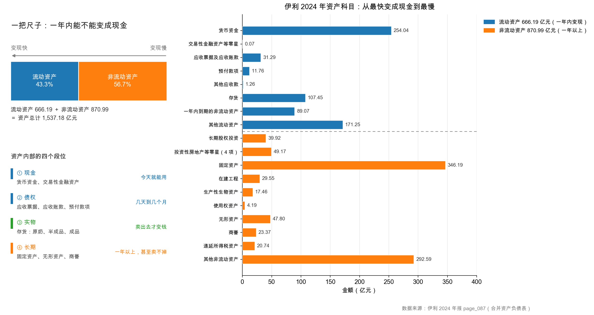

# 第 11 章：资产按变现速度排队

> 本章你将：
> - 拿到一把全周通用的尺子：**一年内能不能变成现金**；
> - 用这把尺子把伊利 1,537.18 亿元资产切成两半：流动资产 666.19 亿、非流动资产 870.99 亿；
> - 看懂资产负债表为什么从"货币资金"一路排到"其他非流动资产"，这个顺序本身就是信息；
> - 算出流动比率 0.74，并明白为什么这一家 0.74 的公司并没有"明天就还不上钱"；
> - 学会在年报里 30 秒定位流动资产合计与非流动资产合计。

---

## 11.1 先讲一个搬家公司的故事

假设你要搬家。屋子里的东西很多，但搬家公司只给你一个标准：**这件东西多久能变成现金？**

- 抽屉里的现金、银行卡余额：立刻，零天；
- 邻居欠你的 500 块，说好下周还：几天；
- 阳台上那台旧洗衣机，挂二手平台：两三周，还得看有没有人要；
- 你自己打的那套实木书柜：能卖，但得拆、得搬、得找到刚好要这个尺寸的人，可能是几个月，也可能永远卖不掉；
- 墙上那幅你爷爷留下的字画：理论上值钱，但"值多少"和"多久能变成钱"是两回事。

如果搬家公司只让你回答一个问题——"**一年之内，你能把这屋里的多少东西变成现金？**"——你会很自然地按上面的顺序把东西排成一队。**这个队伍的顺序，就是资产负债表上资产的排列顺序。**

会计把这件事做得更极端：它不问"大概多久"，只问一句"**一年以内，还是超过一年**"，然后一刀切成两堆。

> 📌 **划重点：** 资产端的排列顺序不是随便定的，是按"变成现金的快慢"从快到慢排。这条规则叫**流动性排序**（liquidity order），它是整张资产负债表的骨架。

## 11.2 一把尺子：一年

这把尺子叫**流动性**（liquidity）——一项资产变成现金的速度，以及变成现金时会不会打折。

会计用一条硬线把它切成两段：

| 分类 | 中文名 | 英文名 | 判定标准 |
|---|---|---|---|
| 一年内能变成现金 | 流动资产 | current assets | 预计在**一个营业周期内**（通常就是一年）变现、出售或耗用 |
| 一年以上才能变成现金 | 非流动资产 | non-current assets | 不满足上面那条的，全归这边 |

这里有个词要解释一下：**营业周期**（operating cycle）。它指的是"从掏钱买原料，到卖出产品、收回货款"这整圈要走多久。对伊利这样的乳制品公司，一圈大概两三个月；对造船厂，一圈可能三年。所以严格说，会计的尺子不是"365 天"，而是"一个营业周期，通常按一年算"。对绝大多数消费类公司，这两者没差别，你就记"一年"最省事。

> 💡 **你可能会问：为什么非要用"一年"这条线？用"半年"或者"三年"不行吗？**
>
> 因为一年刚好对上企业经营的节奏：大部分公司的应付账款、员工工资、短期借款，都是按年为单位滚动的。用同一条线切资产和负债，两边才能直接对比——就像你用同一把尺子量桌子的长和宽，才能算出面积。这条线一改，全表都乱。所以会计准则把它写死了，不许公司自己挑。

再用一家小店把"排队"这件事走一遍。下面全部是**示意数字**，不对应任何真实公司。

小满开了一家奶茶店，年末屋里有这些家当：

| 家当 | 金额（示意） | 变成现金要多久 | 排队位置 |
|---|---|---|---|
| 收银台里的现金 | 3 万 | 0 天 | 第 1 位 |
| 隔壁公司订了 200 杯、月底结账 | 2 万 | 约 20 天 | 第 2 位 |
| 仓库里的茶叶、牛奶、杯子 | 6 万 | 约 40 天（卖完才回本） | 第 3 位 |
| 制冰机、封口机、吧台 | 15 万 | 想卖掉得几个月，还得打折 | 第 4 位 |
| 店面装修 | 8 万 | 基本卖不掉，只能靠做生意慢慢赚回 | 第 5 位 |

按那把尺子一刀切下去：前三位（3 + 2 + 6 = 11 万）在一年内能变成现金，是**流动资产**；后两位（15 + 8 = 23 万）不行，是**非流动资产**。

注意一个反直觉的地方：**装修那 8 万块，明明是真金白银花出去的，却排在了最后。** 因为"花掉的钱"和"能变回多少钱"是两件事。会计的排序只认后者。

现在把尺子架到伊利 2024 年的资产负债表上。

## 11.3 伊利 2024：1,537.18 亿元被切成两半

先看总数。伊利 2024 年末资产总计 **1,537.18 亿元**（伊利 2024 年报，page_087.md），切成两堆：

| 项目 | 2024 年末（亿元） | 占总资产 | 2023 年末（亿元） |
|---|---|---|---|
| 流动资产合计 | **666.19** | 43.3% | 693.55 |
| 非流动资产合计 | **870.99** | 56.7% | 822.65 |
| **资产总计** | **1,537.18** | 100% | 1,516.20 |

<!-- src: 伊利股份2024年报/page_087.md -->

两句话就能读出这张表的意思：

**第一，非流动资产比流动资产多。** 870.99 对 666.19，多出 204.80 亿元。这说明伊利是一家**有厂房、有生产线、有牧场**的实体公司，不是一个"倒手买卖"的贸易公司。它的钱有一大半压在"一年之内搬不走的东西"上。

**第二，流动资产在缩、非流动资产在涨。** 流动资产从 693.55 亿降到 666.19 亿（少 27.36 亿），非流动资产从 822.65 亿涨到 870.99 亿（多 48.34 亿）。一缩一涨，总资产还微增 1.38%。这个"结构在挪动"的信号，本周后面几章会反复出现——尤其第 12 章那个"钱搬家"的故事。

看这张图的右边那一列。从上往下，就是资产科目排队的样子：

- 最上面是**货币资金 254.04 亿元**，本来就是现金，零天变现；
- 接着是**应收票据及应收账款 31.29 亿元**，别人欠它的钱，几天到几个月；
- 然后是**存货 107.45 亿元**，得先卖出去；
- **其他流动资产 171.25 亿元** 排在流动资产的最末，因为它里面装的是"一年内用得上、但形态比较杂"的东西；
- 再往下就跨过那条虚线，进入非流动资产：固定资产 346.19 亿、其他非流动资产 292.59 亿、无形资产 47.80 亿、商誉 23.37 亿……
- 最底下是**递延所得税资产 20.74 亿元**这类"连卖都不知道卖给谁"的项目。

注意"其他非流动资产 292.59 亿"这个位置很怪：它排在非流动资产里，金额却是**第二大**。第 15 章会告诉你，这里面有 279.77 亿其实是存单——**又一次"名字骗人"**。

> 🔍 **翻到年报：** 打开 `page_087.md`，从"流动资产:"那一行往下数。你会看到"货币资金"排第一，"流动资产合计 66,619,381,426.38"在第 40 行左右，再往下是"非流动资产:"，最后一行是"资产总计 153,718,003,927.97"。**这两个合计数，就是本周所有故事的起点。**

### 11.3.1 流动资产那 8 项，逐项过一遍

666.19 亿元不是一坨，它由 8 个科目拼起来。下表左半是 2024 年、右半是 2023 年，两列并排看，才看得出"哪一项在动"：

| 流动资产科目 | 2024 年末（亿元） | 2023 年末（亿元） | 变动（亿元） | 这一项本质是什么 |
|---|---|---|---|---|
| 货币资金 | 254.04 | 433.72 | **-179.68** | 银行存款、库存现金 |
| 交易性金融资产等零星 | 0.07 | 1.03 | -0.96 | 买的理财、远期外汇 |
| 应收票据 | 2.51 | 2.20 | +0.30 | 客户给的银行承兑汇票 |
| 应收账款 | 28.78 | 30.85 | -2.06 | 客户赊的货款 |
| 预付款项 | 11.76 | 14.80 | -3.04 | 先付给供应商的定金 |
| 其他应收款 | 1.26 | 1.95 | -0.69 | 押金、备用金、应收股利 |
| 存货 | 107.45 | 125.12 | **-17.67** | 原奶、半成品、成品、包装 |
| 一年内到期的非流动资产 | 89.07 | 19.52 | **+69.55** | 快到期的大额存单、贷款 |
| 其他流动资产 | 171.25 | 64.38 | **+106.87** | 待抵扣税、小额贷款、**大额存单** |
| **流动资产合计** | **666.19** | **693.55** | **-27.36** | — |

<!-- src: 伊利股份2024年报/page_087.md 伊利股份2024年报/page_166.md -->

（表中的"合计"直接用报表原数；分项各自四舍五入后相加，可能有 0.02 上下的尾差，这是正常的，别怀疑自己抄错。）

这张表里有三个"跳动"特别扎眼，我先把它们圈出来，本周后面三章逐个拆：

- **货币资金少了 179.68 亿**——看起来像"钱没了"，第 12 章告诉你钱去哪了；
- **存货少了 17.67 亿**——是卖得好还是不敢囤了？第 14 章回答；
- **其他流动资产多了 106.87 亿、一年内到期的非流动资产多了 69.55 亿**——这两项加起来多了 176.42 亿，几乎正好对上货币资金少掉的 179.68 亿。**这不是巧合。**

> ⚠️ **易踩坑：看变动金额，不要只看变动比例。**
>
> "预付款项 -20.5%""其他应收款 -35.5%"——比例很吓人，但绝对额只少了 3.04 亿和 0.69 亿，对 1,537 亿的总资产来说无关痛痒。反过来，"货币资金 -41.4%"和"其他流动资产 +166%"这两个比例，才是真正需要解释的。**先看绝对额排名，再看比例。** 这条经验能帮你避免 80% 的"抓错重点"。

## 11.4 为什么排序本身就是信息

你可能会想：不就是个排版顺序吗，能有多大意义？

意义很大，因为**排序把"这家公司的钱长什么样"直接画出来了**。同样是 1,500 亿资产，两种排法讲的是两个完全不同的生意：

| 长相 | 流动资产占比 | 典型公司 | 说明 |
|---|---|---|---|
| 轻资产、现金厚 | 高（60% 以上） | 白酒、软件、平台型公司 | 钱主要在银行和存货里，厂房少 |
| 重资产、家底实 | 中（40%~50%） | 乳制品、食品饮料 | 一边要囤货，一边要有厂 |
| 极重资产 | 低（30% 以下） | 电力、钢铁、航运 | 钱几乎全压在设备与工程上 |

伊利 43.3%，落在中间那一档，非常符合"**既要建厂、又要囤奶**"的乳业特征。

排序还能帮你快速判断一件事：**这家公司的资产，是"能生钱的"还是"占地方的"？**

- 货币资金、存货、应收账款，这三样是生意的血液，转得越快越赚钱；
- 固定资产、在建工程，是产能，用得上就是护城河，用不上就是包袱；
- 商誉、长期待摊费用、递延所得税资产，这三样比较特殊——它们值多少钱，完全取决于"未来的假设能不能兑现"。

> ⚠️ **易踩坑：排序靠前 $\neq$ 质量好。**
>
> 很多人一看"货币资金排第一，那肯定最优质"，就下结论"这家公司现金充足"。**错。** 排序只说明"变现快慢"，不说明"这笔钱是不是真的能动"。第 12 章你会看到：伊利账上 254.04 亿货币资金，同时还另有 398.03 亿"大额存单及定期存款"被放在另外两个科目里——只看第一行，你会严重低估它手里的钱。
>
> 反过来也成立：排序靠后的固定资产，不一定差。一家乳企的 346 亿生产线，是它每天生产 2 万吨奶的底气。

## 11.5 流动资产 vs 短期偿债：0.74 这个数字

排序的真正用途，是**把资产和负债放在同一把尺子上比**。

负债端也按同样的规则切：一年内要还的，叫**流动负债**（current liabilities）；一年以上才还的，叫**非流动负债**。伊利 2024 年末：

| 项目 | 金额（亿元） |
|---|---|
| 流动资产合计 | 666.19 |
| 流动负债合计 | **899.25** |
| 流动资产 - 流动负债 | **-233.06** |

<!-- src: 伊利股份2024年报/page_087.md 伊利股份2024年报/page_088.md -->

把这两个数一除，得到一个全课程都会反复用到的指标：

$$\text{流动比率} = \frac{\text{流动资产}}{\text{流动负债}} = \frac{666.19}{899.25} \approx 0.74$$

（`data/yili2024.json` 的 `ratios.current_ratio` 记的就是 0.7408。）

**0.74 是什么概念？** 教科书上的经验值是"2 左右比较安全，1 以下要警惕"。按这个标准，伊利应该拉警报了：一年内能变成现金的资产，只够还 74% 的一年内到期欠款。

但这家公司 2024 年赚了 84.53 亿元归母净利润，经营现金流 217.40 亿元，还照常分红。它显然没有"明天就断气"。

**为什么？** 有三个原因，逐个拆开看：

**第一，流动负债里有一块不是"真要现在还的钱"，但坦白说，硬债才是大头。**

先把 899.25 亿元拆干净（这是本章最重要的一张表，数字全部取自 page_088、page_195）：

| 类别 | 科目 | 金额（亿元） | 占比 |
|---|---|---|---|
| **硬债** | 短期借款 | 363.55 | |
| | 短期应付债券（藏在"其他流动负债"里） | 100.24 | |
| | 一年内到期的非流动负债 | 92.30 | |
| | **小计** | **556.08** | **61.8%** |
| **经营性占款** | 应付账款 | 123.13 | |
| | 合同负债 | 120.73 | |
| | 应付职工薪酬 | 37.77 | |
| | 其他应付款 | 27.70 | |
| | 应付票据 | 9.69 | |
| | 应交税费 | 8.50 | |
| | 其他流动负债（扣除短期应付债券后的待转销项税等） | 14.05 | |
| | **小计** | **341.57** | **38.0%** |
| 其他 | 衍生金融负债等 | 1.59 | 0.2% |
| | **合计** | **899.25** | **100%** |

看清楚了：**硬债 556.08 亿元，占 61.8%；经营性占款只有 341.57 亿元，占 38.0%。**

> 💡 **你可能会问：** 第 5 周会说「有息负债占负债总额的 62.6%」，这里是 61.8%，对不上？
> 因为**分母不同**：这里的分母是**流动负债 899.25 亿**（只算一年内要还的部分），
> 第 5 周的分母是**负债总额 967.10 亿**（含长期借款、租赁负债等非流动部分）。
> 两个数都对，只是回答的问题不一样：一个问「明年要还的债里多少是硬债」，一个问「全部负债里多少要付息」。

这跟很多人对快消公司的直觉不一样——通常大家以为"卖牛奶的公司都是先收钱、后付款，负债主要是占款"。伊利确实有 120.73 亿合同负债（占款），但**它同时也是个大借款人**：一年内要还或续借的硬债超过 556 亿。

所以对第 11.5 节那个"0.74 为什么不是危机"的问题，**第一条理由并不成立**，不能靠"负债大多是占款"来安慰自己。真正让伊利安全的是第二条和第三条。

> ⚠️ **易踩坑：** 网上很多文章会说"伊利负债率高但都是经营性负债，不用怕"——**这句话在这份年报上是错的**。你手上有了这张拆解表，就能自己判断，而不是背结论。这正是本教程要教的能力：**别信转述，去拆表。**

**第二，流动资产的 666.19 亿被"藏"了一部分。** 第 12 章会讲：伊利还有 118.26 亿元的大额存单藏在"其他流动资产"里，那本质上是现金。把这块算进来，能动的钱立刻厚一大截。

**第三，这家公司借钱不是为了活命，是为了"利差"。** 它一边有 652.07 亿元类现金，一边有 605.58 亿元有息负债，净有息负债是**负数**（-46.50 亿元）——也就是说，把能动的钱和要还的债相抵之后，它还"多"出 46.50 亿。这在第 5 周第 23 章会彻底讲透，这里你先记住一句话：

> 📌 **划重点：** 流动比率低，只说明"流动资产对流动负债的覆盖薄"，**不说明"还不上钱"**。要判断真危险还是假危险，必须再问三件事：① 流动负债里有多少是真正要付现的？② 流动资产里有多少是真正能动的？③ 这家公司的经营现金流是正的还是负的？

伊利这三问的答案分别是"**62% 是硬债，这一点不乐观**"、"**比账面更多，钱藏在非流动资产里**"、"**每年两百多亿正流入**"。所以 0.74 对它是个**结构性数字**，不是**危机信号**——但支撑这个结论的是第二、第三条，不是第一条。

换句话说：伊利不是"因为不用还债所以安全"，而是"**因为赚得多、借得动，所以扛得住**"。这两句话听着差不多，风险含义完全不同——前者是躺赢，后者依赖融资环境。第 5 周第 23 章会把这条线索讲到底。

### 11.5.1 再严一点：把存货也剔掉

流动比率有个明显的软肋：**它把存货当成"准现金"**。可存货要卖出去才变成钱，卖不出去就是一堆临期货。于是有人发明了更严的一把尺子：

$$\text{速动比率} = \frac{\text{流动资产} - \text{存货}}{\text{流动负债}} = \frac{666.19 - 107.45}{899.25} \approx 0.62$$

（`ratios.quick_ratio` = 0.6214。）伊利的速动比率只比流动比率低 0.12，说明**存货在流动资产里占比不大**（107.45 ÷ 666.19 $\approx$ 16%），这个结构其实相当健康——真正拖累流动比率的是"其他流动资产 171.25 亿"这类需要解释的科目，而不是存货。

顺带说一个常被忽略的细节：算速动比率时，教科书通常还会把"预付款项"也剔掉（因为预付款换来的是服务，不是现金）。如果连预付款也剔，伊利的分母不变、分子再少 11.76 亿，结果约 0.60。**你看，同一家公司，换个口径就是三个数：0.74、0.62、0.60。** 所以看到任何人甩给你一个比率，第一句该问的是"你怎么算的"。

> 📌 **划重点：** 比率不是事实，是"用一个公式对事实做的一次加工"。加工方式不同，结论就不同。**能自己算一遍，才不会被别人的数字牵着走。**

> ⚠️ **易踩坑：拿流动比率横向比不同生意，等于拿体重比身高。**
>
> 一家超市的流动比率常年 0.6~0.8，因为它卖货收现金、进货赊账，天生就该这样；一家房地产公司的流动比率 1.5，也可能因为存货（土地和在建楼盘）卖不掉而暴雷。**同一个数字，在不同的生意里含义完全不同。** 正确做法是：先看这家公司的商业模式该长什么样，再看它的数字偏不偏。

## 11.6 三分钟上手：在年报里找到这两个数

最后给你一套可以立刻用的动作。打开任何一份 A 股年报的合并资产负债表：

1. 搜索"**流动资产合计**"，记下数字，这是第一堆；
2. 搜索"**非流动资产合计**"，记下数字，这是第二堆；
3. 两个相加，应该等于"**资产总计**"——对不上就是抄错列了（A 股年报是两列并排，2024 和 2023 挨着，最容易串行）；
4. 再搜"**流动负债合计**"，用第一堆除以它，得到流动比率。

伊利这一步的结果：666.19 + 870.99 = 1,537.18 ✅，和"资产总计"分毫不差。这个验算动作，本周每章都要做一次，做熟了就是肌肉记忆。

### 11.6.1 一张"看资产"的起手式

把这套动作固化成四行，以后打开任何年报都能照着走：

| 步骤 | 动作 | 伊利 2024 的结果 | 这一行告诉你什么 |
|---|---|---|---|
| 第一步 | 抄下流动资产合计、非流动资产合计 | 666.19 / 870.99 | 这家公司是"轻"还是"重" |
| 第二步 | 两数相加，对"资产总计" | 1,537.18 ✅ | 你有没有抄错列 |
| 第三步 | 抄下流动负债合计，算流动比率 | 899.25 → 0.74 | 短期覆盖厚不厚 |
| 第四步 | 看流动资产里"最大的一项"是什么 | 货币资金 254.04（38%） | 这家公司的钱长什么样 |

第四步是我自己最常用的一步。**只看一项，就能大概猜出这家公司是什么路数**：最大的那项是货币资金，多半是个现金充裕的成熟公司；是应收账款，多半是 to B 生意、被客户占款；是存货，多半是制造或零售；是"其他流动资产"这类说不清的科目，那就要警惕了——伊利的"其他流动资产"占了流动资产的 25.7%，是第二大项，这就是本周要重点拆解的地方。

### 11.6.2 这一周和下一周怎么分工

你可能会问：非流动资产那 870.99 亿占了 56.7%，比流动资产还多，为什么这一周只讲流动资产？

因为**资产质量这个概念，在流动资产里最容易讲清楚，也最容易踩坑**。你看这一周要处理的三样东西——货币资金、应收账款、存货——它们都是"看起来最像钱"的科目，也正是财报里最容易做手脚的地方。先在这里把"看穿科目名字"的本事练出来，下一周再去处理固定资产、在建工程、无形资产、商誉这些更硬的骨头，就有了统一的判断框架。

两句话记住分工：

- **本周（第 11~15 章）**：流动资产三件套 + 一套通用的"资产体检"流程；
- **下周（第 16~20 章）**：非流动资产四件套（固定、在建、无形、商誉），核心是一件事——**折旧和减值，都是真实的成本**。

---

## ✍️ 想一想

### 问 1：这笔钱算流动资产吗

下面五项，哪些应该归入流动资产？（a）公司买的三年期国债，打算持有到期；（b）客户欠的货款，合同约定 60 天付；（c）仓库里的 500 吨奶粉；（d）公司买的商标；（e）预付给广告公司的明年一季度投放款。

**解题思路：** 别想"这东西值不值钱"，只想"一年内能不能变成现金"。特别小心（a）和（e）——它们的名字里都带着"短"或者"预付"，很容易让人误判。

**参考答案：**

| 选项 | 是不是流动资产 | 判据 |
|---|---|---|
| a）三年期国债，持有到期 | **不是** | 三年后才到期，超过一年。会计上归"债权投资"（非流动资产） |
| b）60 天付的货款 | **是** | 应收账款，一年内收回 |
| c）500 吨奶粉 | **是** | 存货，一年内会卖掉 |
| d）商标 | **不是** | 无形资产，不参加"一年内变现"的排队 |
| e）预付明年一季度广告款 | **是** | 预付款项，一年内会消耗掉（换成广告服务） |

答案是 **b、c、e**。

这里有个容易绕晕的点：**预付账款明明是"钱已经付出去了"，为什么还算流动资产？** 因为它换来的是"一年内会到手的服务"，服务一到手就完成了它的使命，相当于"还没变现的资产"。会计看的是"这笔钱一年内会不会消耗完"，而不是"钱还在不在"。

**易错点：** ① 把 a 算进去，理由是"国债随时能卖"。**能卖不等于打算卖**——公司声明"持有到期"，会计就按非流动资产记。② 把 e 排除，理由是"钱已经花掉了"。花掉的钱变成了"预付款项"这项资产，它还在表上。③ 把 d 算进去，理由是"商标也是无形资产，无形就是流动资产"——正好反了。

### 问 2：0.74 到底危不危险

假设有一家公司：流动资产 100 亿、流动负债 130 亿、流动比率 0.77，和伊利差不多。它每年的经营活动现金流净额是 **-5 亿**（负数）。请判断：它的短期偿债风险，比伊利高还是低？为什么？

**解题思路：** 流动比率只告诉你"存量够不够"，不告诉你"流量补不补得上"。把这两件事分开算，答案就出来了。

**参考答案：** 这家公司的风险**明显高于伊利**，尽管两家的流动比率几乎一样。

理由有三层：

1. **流量方向相反。** 伊利的经营现金流是 +217.40 亿元，每年有新钱进来，短期缺口可以靠"今年的收入"补上；这家公司是 -5 亿，每年还在往外漏，缺口只能靠"借新还旧"或"卖资产"补。
2. **缺口的性质不同。** 伊利的 -233.06 亿缺口，主要来自"占用上下游的钱"（应付、合同负债），这些钱会随生意滚动，不会集中到期；而一家现金流为负的公司，它的流动负债里往往硬债占比更高。
3. **可动用资产不同。** 伊利账外还有 398.03 亿元的大额存单没算进流动资产的口径里（第 12 章），实际可动用金额远高于 666.19 亿。

所以结论是：**流动比率是"体检指标"，不是"诊断结论"。** 看到 0.74，正确的动作是"再查三项"（硬债占比、可动用资产、经营现金流），而不是直接下判断。

**易错点：** ① 只比数字，答"两家一样危险"。这是把"存量指标"当成了全部。② 反过来答"伊利更危险，因为它借得多"。借钱多不等于危险，关键是借来的钱去干了什么、赚不赚得回利息——第 5 周会算这笔账。③ 忽略"经营现金流"这个关键变量，那这道题就白做了。

### 问 3：如果把这把尺子改成三年

假设会计准则把流动/非流动的分界线从"一年"改成"三年"。伊利报表上会发生什么变化？请至少说出两处，并说明这种改动会不会改变公司的真实价值。

**解题思路：** 先想"哪些科目会跨过这条线"，再想"跨过去之后，两边的合计数怎么变"，最后想"账面分类变了，生意本身变没变"。

**参考答案：**

**变化一：一批非流动资产会搬到流动资产里去。** 伊利有一笔 89.07 亿元的"一年内到期的非流动资产"（主要是快到期的存单），本来就算流动资产；但像"长期股权投资 39.92 亿""无形资产 47.80 亿"这类，只要三年内能处置变现，按新尺子就可能被划进流动资产。流动资产合计会明显变大，非流动资产合计相应变小。

**变化二：流动比率会立刻变好看。** 分母（流动负债）如果也按"三年内到期"重算，短期借款 363.55 亿、短期应付债券 100.24 亿仍然在里面，但一部分"一年内到期的非流动负债 92.30 亿"可能被移出。分子变大、分母变小，流动比率会从 0.74 升到 1 以上。

**但是：公司的真实价值一分钱都没变。** 厂房还是那批厂房，奶还是那些奶，欠银行的钱一分没少。变的只是"我们把它归到哪一栏"。这就是会计分类的本质——**它是一套约定，不是事实本身**。读财报时要时刻提醒自己：分类是人为的，现金流是客观的。

**易错点：** ① 答"公司变健康了"。分类变化不改变偿债能力，只改变呈现方式。② 只答"数字会变"，不举具体科目。这道题考的是"你知不知道哪些科目卡在这条线上"。③ 忘了分母也会变——只改分子不改分母，逻辑不完整。

## 📎 数据出处

- 伊利股份 2024 年报：`page_087.md`（合并资产负债表，流动资产合计、非流动资产合计、资产总计、各科目明细）
- 伊利股份 2024 年报：`page_088.md`（流动负债合计 899.25 亿元、短期借款等）
- 数据汇总：`data/yili2024.json` 的 `balance` 段、`compare_2023.balance` 段、`ratios.current_ratio`

下一章：[第 12 章：货币资金——账上的钱可能不在账上](12-货币资金-账上的钱可能不在账上.md)
