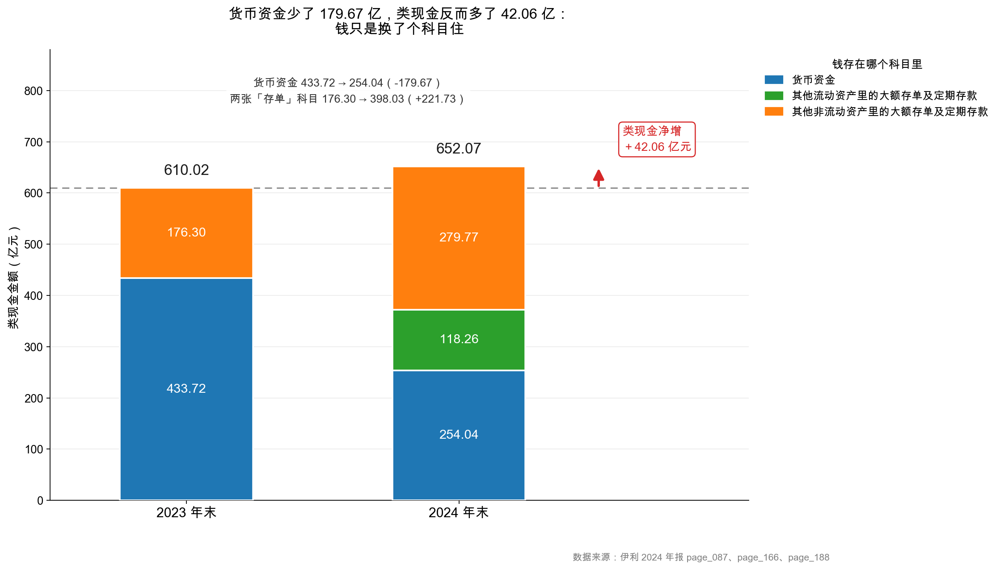

# 第 12 章：货币资金——账上的钱可能不在账上

> 本章你将：
> - 看到伊利 2024 年最反直觉的一件事：货币资金少了 179.68 亿，它手里的钱反而多了 42.06 亿；
> - 学会在三个不同科目里找同一笔钱：货币资金、其他流动资产、其他非流动资产；
> - 弄明白公司为什么要把钱"藏"到别的科目里（利率、资金管理、报表列示规则）；
> - 认识**受限资金**：账上写着 254.04 亿，不等于 254.04 亿都能花；
> - 拿到一份"查钱"的四步清单，以后看任何公司都能用。

---

## 12.1 三个账户的故事

先讲件生活里的事：你手里有 30 万，放在三个地方。

1. **工资卡活期**：8 万，随时能刷；
2. **银行 App 里的"智能存款"**：12 万，随时能取，T+1 到账；
3. **三年前存的一笔五年期大额存单**：10 万，提前取只按活期算利息。

请问：你有多少钱？答案当然是 30 万。但如果你只翻"工资卡"的余额，你会说"我有 8 万"——**错得离谱，而且方向是低估**。

有意思的是，公司记账时的处境和你一模一样，只是它的"三个地方"有正式的名字：

| 你的叫法 | 公司的科目 | 计入哪一栏 |
|---|---|---|
| 工资卡活期 | 货币资金（cash and bank balances） | 流动资产，第一行 |
| 智能存款 | 其他流动资产里的"大额存单及定期存款" | 流动资产，靠后 |
| 五年期大额存单 | 其他非流动资产里的"大额存单及定期存款" | **非流动资产** |

最后一行最容易出事：**同一笔钱，只因存期超过一年，就被挪进"非流动资产"**。你在流动资产那一栏找不到它，就会以为公司没钱了。

伊利 2024 年，正好把这个剧本演了一遍。

> 📌 **划重点：** "货币资金"这个科目，只装得下"现金和随时能取的银行存款"。**存期超过一年、或者被限制用途的钱，会被记到别的科目里去。** 所以判断一家公司有多少钱，永远不能只看第一行。

## 12.2 先看那个吓人的数字

翻开伊利 2024 年合并资产负债表的第一行：

| 项目 | 2024 年末 | 2023 年末 | 变动 |
|---|---|---|---|
| 货币资金 | **254.04 亿元** | **433.72 亿元** | **-179.68 亿元（-41.43%）** |

<!-- src: 伊利股份2024年报/page_087.md 伊利股份2024年报/page_025.md -->

179.68 亿，什么概念？比伊利一整年的归母净利润（84.53 亿）还多一倍。任何一个人看到这个数字，第一反应都该是："**出什么事了？**"

年报自己也给了说明。在"资产及负债状况"那一节，公司写得很干脆：

> (1) 货币资金减少原因：本期银行存款减少所致。

<!-- src: 伊利股份2024年报/page_025.md -->

这句话翻译一下就是："**因为银行存款少了。**"——等于没说。它描述的是现象，不是原因。你要的答案是"钱去哪了"，它给的是"钱变少了"。

那我们自己找。

🔍 **翻到年报：** 打开 `page_025.md`，这是"资产及负债状况"表。你会看到一行行科目 + 变动比例。注意看这一页上**同时变动的另外几行**：

| 科目 | 2024 年末（亿元） | 2023 年末（亿元） | 变动比例 |
|---|---|---|---|
| 货币资金 | 254.04 | 433.72 | **-41.43%** |
| 一年内到期的非流动资产 | 89.07 | 19.52 | **+356.37%** |
| 其他流动资产 | 171.25 | 64.38 | **+166.03%** |
| 其他非流动资产 | 292.59 | 197.13 | **+48.43%** |

<!-- src: 伊利股份2024年报/page_025.md -->

**四个数字摆在一起，故事就出来了。** 一个减了 179.68 亿，另外三个合计增了 69.55 + 106.87 + 95.46 = 271.88 亿。不能简单相减（还有其他因素），但方向很清楚：**钱不是消失了，是从第一行跑到了下面几行。**

## 12.3 钱的两个藏身处

要确认这个猜想，得去附注里查明细。年报的规矩是：主表给总数，附注给构成。我们挨个翻。

### 藏身处一：其他流动资产里的 118.26 亿

翻到 `page_166.md`，附注七(13)"其他流动资产"：

| 项目 | 期末余额（元） | 期初余额（元） |
|---|---|---|
| 待抵扣进项税 | 353,378,851.42 | 395,079,651.00 |
| 预缴所得税 | 107,627,013.26 | 246,214,370.89 |
| 应收退税款 | 164,888,705.26 | 116,719,382.11 |
| 短期小额贷款 | 2,498,202,054.12 | 2,300,267,358.84 |
| 应收保理款 | 2,127,183,613.66 | 2,316,412,201.34 |
| 碳排放权 | 32,010,678.31 | 46,883,861.58 |
| **大额存单及定期存款** | **11,826,346,397.86** | **0** |
| 合计 | 17,125,476,116.43 | 6,437,519,616.82 |

<!-- src: 伊利股份2024年报/page_166.md -->

请把目光停在倒数第二行：**大额存单及定期存款 118.26 亿元，2023 年这一项是 0。**

这一项 2023 年根本不存在，2024 年凭空长出来 118.26 亿。而这一页最下面，公司自己写了一句话：

> 其他流动资产增加主要原因：本期大额存单及定期存款增加所致。

<!-- src: 伊利股份2024年报/page_166.md -->

**这就是答案的第一半。** 货币资金少了 179.68 亿，其中 118.26 亿变成了"其他流动资产"里的大额存单。

### 藏身处二：其他非流动资产里的 279.77 亿

再翻到 `page_188.md`，附注七(30)"其他非流动资产"。这张表有三列数（账面余额、减值准备、账面价值），我们看"账面价值"那一列：

| 项目 | 2024 年末（亿元） | 2023 年末（亿元） |
|---|---|---|
| 预付工程设备款 | 6.05 | 9.21 |
| 中长期小额贷款 | 1.61 | 2.73 |
| 应收保理款 | 5.16 | 8.89 |
| **大额存单及定期存款** | **279.77** | **176.30** |
| 合计 | 292.59 | 197.13 |

<!-- src: 伊利股份2024年报/page_188.md -->

同样一句话跟在表下面：

> 其他非流动资产增加主要原因：本期大额存单及定期存款增加所致。

<!-- src: 伊利股份2024年报/page_188.md -->

**答案的第二半也找到了。** 这一项从 176.30 亿涨到 279.77 亿，多了 103.47 亿。

### 把钱拼起来

现在把三块拼在一起：

| 钱存在哪 | 2023 年末（亿元） | 2024 年末（亿元） | 变动（亿元） |
|---|---|---|---|
| 货币资金 | 433.72 | 254.04 | **-179.68** |
| 其他流动资产里的大额存单及定存 | 0 | 118.26 | **+118.26** |
| 其他非流动资产里的大额存单及定存 | 176.30 | 279.77 | **+103.47** |
| **类现金合计** | **610.02** | **652.07** | **+42.06** |

<!-- src: 伊利股份2024年报/page_087.md 伊利股份2024年报/page_166.md 伊利股份2024年报/page_188.md -->

（`data/yili2024.json` 的 `ratios.cash_and_deposits` 记的就是 652.07 亿元这个口径，定义写在 `definitions` 里：货币资金 + 两类大额存单。）

**结论就在最后一行：类现金不但没减少，反而多了 42.06 亿元。**

看这张图的时候，请把注意力放在"三层颜色"的变化上，而不是柱子的总高度：

- **蓝色（货币资金）这一段明显变矮了**，从 433.72 缩到 254.04；
- **绿色这一段是新长出来的**，2023 年根本没有，2024 年一下子 118.26；
- **橙色这一段变高了**，176.30 → 279.77；
- **三段的合计反而更高了**，610.02 → 652.07。

如果你只截取蓝色那一段给老板汇报，你会得到"公司现金流失 179.68 亿，形势严峻"；如果你看三段合计，你会得到"公司类现金增加 42.06 亿，流动性更好了"。**同一份报表，两个完全相反的结论——差别只在于你翻了几页。**

> ⚠️ **易踩坑：这就是"账上的钱可能不在账上"的真正含义。**
>
> 它不是公司造假藏钱，而是说：**会计科目按"形态"和"期限"分类，钱的"所有权"没变，但"住址"变了。** 只读主表第一行的人，会系统性低估这类公司手里的现金。反过来，如果"其他流动资产"里塞满说不清的东西（保理款、小额贷款、抵债资产），也要警惕——那不是现金，是风险。
>
> 伊利这个案例的教科书价值在于：**它同时展示了"藏钱"的两面**——既有真正的大额存单（好），也有一堆类金融业务（要留神）。

## 12.4 为什么会这样：三个真实的原因

到这里，一个自然的问题冒出来了：公司为什么要把钱从"货币资金"挪到"其他流动资产"和"其他非流动资产"里去？难道是故意的？

不是。背后是三件事叠加。

### 原因一：利率——存得越久，利息越高

大额存单和定期存款的利率，比活期存款高出一大截。一家账上常年有几百亿闲钱的公司，如果全放活期，等于每年白白送掉几个亿的利息。

伊利 2024 年的财务费用是 **-5.92 亿元**（负数，意思是"利息收入大于利息支出"），其中利息收入 24.55 亿元、利息支出 18.20 亿元。**那 24.55 亿的利息收入，很大一部分就来自这些大额存单。**

所以第一步的动机很朴素：**把钱存成利息更高的品种。**

### 原因二：列示规则——存期决定它住哪一栏

第二步是会计规则决定的。一笔银行存款记在哪个科目，主要看两件事：

| 情况 | 记到哪个科目 |
|---|---|
| 活期、随时可取、没有使用限制 | 货币资金 |
| 定期存款，但**一年内到期** | 其他流动资产（或"一年内到期的非流动资产"） |
| 定期存款，**到期日在一年以上** | 其他非流动资产 |

也就是说：**同样是"银行存款"，只因为存期跨过了"一年"这条线，它就从流动资产搬到了非流动资产。** 这条规则本身很合理——一年内取不出来的钱，确实不该算作"短期能动的钱"。但它带来了一个副作用：**流动资产合计会变小，货币资金会变小，可公司实际的钱没少。**

伊利 2024 年的情况正是这样：它把大量资金转成了期限更长的大额存单，于是 118.26 亿落在"一年内到期"这一档（其他流动资产），279.77 亿落在"一年以上"这一档（其他非流动资产）。

### 原因三：资金管理——把闲钱集中起来生息

第三个原因更偏经营层面。伊利旗下有财务公司（报表里能看到"存放财务公司存款"这个科目，2024 年为 0），还有商业保理、小额贷款、融资担保等类金融子公司。集团把各子公司的闲散资金归集起来统一做存款安排，是很自然的动作。

这也解释了"其他流动资产"里为什么还有一堆别的东西：短期小额贷款 24.98 亿（给经销商和供应商放的）、应收保理款 21.27 亿（给上下游做的保理）。这些是"类金融业务"，本质上是**用金融手段支持渠道**，不是纯现金。

> 💡 **你可能会问：那这 42.06 亿的"增加"，是不是也算好消息？**
>
> 一半是。钱确实更多了，而且是从低息活期转成了高息存单，利息收入会更好看。但也要看到另一面：**钱没有投进生意里。** 一家公司账上躺着 652 亿类现金，同时收入下滑 8.24%，这本身就是一个信号——它找不到足够好的投资机会，只能先把钱存起来。这个信号是好是坏，要结合它同时还在大额分红、还在回购来判断（2024 年分红付息合计 90.92 亿元）。第 8 周讲现金流时会再回到这里。

### 12.4.1 这次"搬家"在利润表上留下了指纹

有没有办法验证"钱真的变成了高息存款"？有——去利润表看财务费用。

| 项目 | 2024 年（亿元） | 2023 年（亿元） | 变化 |
|---|---|---|---|
| 财务费用 | **-5.92** | **-1.53** | 净收益多了 4.39 |
| 其中：利息费用 | 18.20 | — | — |
| 其中：利息收入 | 24.55 | — | — |

<!-- src: 伊利股份2024年报/page_091.md 伊利股份2024年报/page_092.md -->

财务费用是个"反着看"的科目：**它是负数，说明利息收入盖过了利息支出，公司靠钱本身在赚钱。** 2024 年这个负数从 -1.53 亿扩大到 -5.92 亿，净收益多出 4.39 亿元。

这 4.39 亿是从哪来的？伊利 2024 年的有息负债（605.58 亿，含租赁负债）比 2023 年同口径（约 576.75 亿）还多一些，利息支出按理该增加。可财务费用反而更"负"了——**唯一的解释就是利息收入涨得更快**。而利息收入涨，对应的是"存款规模更大、期限更长、利率更高"。

**这条证据链非常漂亮：** 主表上货币资金减少 → 附注里找到大额存单增加 → 利润表里利息收入增加。三张表从三个角度讲同一件事。这就是第 10 章说的"三张表是一台机器"，也是后面第 9 周"三表勾稽"要反复练的手艺。

再看一个反证。如果伊利是"钱真的丢了"（比如投资失败、被占用），那利息收入不但不会增加，反而会减少；同时"其他应收款"或"资产减值"里会出现异常。而 2024 年伊利的其他应收款是从 1.95 亿降到 1.26 亿的，减值是商誉和存货（第 4 周、本章第 14 章讲），跟"钱失踪"没有关系。**排除了这些可能，剩下的解释才站得住。**

## 12.5 还有一个更宽的口径：728.54 亿

刚才的 652.07 亿，用的是"货币资金 + 两类大额存单"这个口径。但它还不是最宽的。

翻 `page_165.md`，附注七(12)"一年内到期的非流动资产"：

| 项目 | 2024 年末（元） | 2023 年末（元） |
|---|---|---|
| 一年内到期的中长期小额贷款 | 170,623,603.97 | 432,419,072.42 |
| 一年内到期的中长期保理款 | 1,089,674,270.71 | 1,519,350,669.36 |
| **一年内到期的大额存单** | **7,646,992,933.15** | **0** |
| 合计 | 8,907,290,807.83 | 1,951,769,741.78 |

<!-- src: 伊利股份2024年报/page_165.md -->

**又是一个 76.47 亿元的一年内到期大额存单，2023 年同样是 0。**

如果把它也算进来：

$$\text{最宽口径类现金} = 254.04 + 118.26 + 76.47 + 279.77 = 728.54 \text{ 亿元}$$

2023 年对应是 610.02 亿元（那一年"一年内到期的大额存单"为 0）。**两个口径下，结论方向完全一致：钱变多了。**

> 📌 **划重点：口径决定结论，但方向不该被口径改变。**
>
> 652.07 也好，728.54 也好，都在说"伊利手里的钱比 2023 年多"。**如果一个结论只在某个特定口径下成立，换个算法就翻转，那这个结论本身就很脆弱。** 好的分析应该做到：主要口径给结论，辅助口径做交叉验证，两个口径打架时明确写出差异来源。这是本书反复强调的方法。

## 12.6 受限资金：账上的钱不一定能花

到这里，我们已经把"钱在哪"搞清楚了。但还有最后一层，也是最容易被忽略的一层：**这些钱，真的都能动吗？**

不一定。有些钱虽然在账上，但被"锁"住了：

- **保证金**：开银行承兑汇票要交保证金，做期货要交保证金，给别人做担保也要存保证金；
- **法定存款准备金**：财务公司存在央行的准备金，按规定不能动；
- **质押/抵押的存款**：拿去给借款做质押的定期存单。

年报对此有专门披露。翻 `page_189.md`，附注七(31)"所有权或使用权受限资产"：

| 项目 | 2024 年末账面价值（元） | 受限类型 |
|---|---|---|
| 存放中央银行法定存款准备金 | 780,420,020.51 | 其他 |
| 担保保证金 | 51,912,792.22 | 其他 |
| 期货保证金 | 645,545.67 | 其他 |
| 已抵押银行存款及其他受限资金 | 9,318,289.49 | 其他 |
| **合计** | **842,296,647.89** | — |

<!-- src: 伊利股份2024年报/page_189.md -->

**8.42 亿元受限，占货币资金 254.04 亿的 3.3%。**

这个比例很小，说明伊利的货币资金质量不错——绝大部分是真能动的。但换个公司就未必了：有些公司账上 100 亿货币资金，其中 80 亿是保证金和质押存款，看着很有钱，实际能动的只有 20 亿。

一个实用的近似算法：

$$\text{可自由动用的钱} \approx \text{货币资金} - \text{受限资金}$$

伊利：254.04 - 8.42 = **245.62 亿元**。这个数，才是它随时能拿去还债、分红、买东西的钱。

> ⚠️ **易踩坑：受限资金藏在附注里，主表上看不出来。**
>
> 资产负债表上"货币资金 254.04 亿"是一个总数，它**不区分**能动的和不能动的。你必须翻到附注七(31)才知道有 8.42 亿被锁住。这就是第 4 章说的"表看结论，注看真假"——主表给你一个漂亮的数字，附注告诉你这个数字的成分。
>
> **一个红旗信号：** 如果一家公司的"受限资金 ÷ 货币资金"超过 30%，同时又有大量短期借款，那它大概率是"存贷双高"——账上趴着很多钱，却还要借很多钱。这种结构要么是真的有钱但被锁死，要么是钱根本不存在。两种情况都值得我们停下来仔细看。

顺带说一个细节。伊利货币资金的构成也能在 `page_150.md` 查到：

| 项目 | 2024 年末（亿元） | 2023 年末（亿元） |
|---|---|---|
| 库存现金 | 0.001 | 0.001 |
| 银行存款 | 245.18 | 423.01 |
| 其他货币资金 | 8.86 | 10.71 |
| **合计** | **254.04** | **433.72** |

<!-- src: 伊利股份2024年报/page_150.md -->

（注：库存现金 135,278.06 元，四舍五入到亿元就是 0.001 亿元，几乎可以忽略。）

"其他货币资金"这 8.86 亿里，主要是存放央行的准备金 7.80 亿和担保保证金 0.52 亿——**正好对上刚才那张受限资产表**。两张表互相印证，数字咬得死死的，这才是一份健康年报该有的样子。

## 12.7 一份"查钱"的四步清单

把本章的方法固化成四步。以后看任何一家公司，都可以照着走：

| 步骤 | 查什么 | 在哪查 | 伊利 2024 的结果 |
|---|---|---|---|
| 第一步 | 货币资金，以及同比变动 | 主表第一行、page_025 变动表 | 254.04 亿，-41.43% |
| 第二步 | 搜"大额存单""定期存款""理财"，看散落在哪几个科目 | 附注里搜关键词 | 其他流动 118.26 + 其他非流动 279.77 + 一年内到期 76.47 |
| 第三步 | 加总成"类现金"，和去年比 | 自己算 | 652.07（或 728.54），去年 610.02，**增加** |
| 第四步 | 搜"受限"，看有多少钱被锁住 | 附注"所有权或使用权受限资产" | 8.42 亿，占 3.3% |

四步走完，"有多少钱、能动多少、比去年多了还是少了"就都有了答案。**这四步不超过十分钟，却能纠正一个可能让你亏钱的误判。**

最后回到本章的标题。"账上的钱可能不在账上"有两层意思，本章讲了两层：

1. **它可能在别的科目里**——大额存单被记到了"其他流动资产/其他非流动资产"，你只看货币资金就会漏掉 398 亿；
2. **它可能在账上但不能动**——受限资金 8.42 亿，写着你的名字，但你花不了。

读懂这两层，你才真正读懂了"货币资金"这四个字。

---

## ✍️ 想一想

### 问 1：这份研报的结论错在哪

某券商的研报写：「伊利 2024 年货币资金同比下降 41.4%，现金储备大幅收缩，短期偿债压力上升，维持'中性'评级。」请你指出这段话里至少两处错误，并给出你的修正版本。

**解题思路：** 先问"它看了几页报表"，再问"它的指标口径对不对"。特别注意"现金储备"这个词——它到底指什么？

**参考答案：**

**错误一：把"科目搬家"读成了"现金流失"。** 货币资金减少的 179.68 亿，绝大部分变成了其他流动资产（+118.26 亿大额存单）和其他非流动资产（+103.47 亿大额存单）里的存款。按"货币资金 + 两类大额存单"口径，类现金从 610.02 亿升到 **652.07 亿**，是**增加** 42.06 亿，不是收缩。

**错误二：只用一个科目判断偿债能力。** 短期偿债要看"能动的钱 vs 要还的债"。伊利有息负债合计 605.58 亿元，类现金 652.07 亿元，**净有息负债是 -46.50 亿元**——也就是说，把能动的钱和要还的债相抵，它还多出 46.50 亿。说它"短期偿债压力上升"与事实相反。

**修正版本（示范）：** 「伊利 2024 年货币资金 254.04 亿元，同比下降 41.4%，主要因公司把大量活期存款转为期限更长的大额存单，相关金额分别计入其他流动资产（118.26 亿元）与其他非流动资产（279.77 亿元）。按'货币资金 + 两类大额存单'口径，类现金合计 652.07 亿元，较 2023 年的 610.02 亿元增加 42.06 亿元；同期有息负债 605.58 亿元，净有息负债为 -46.50 亿元，短期偿债无压力。需关注的是：类现金充裕而收入下滑 8.24%，反映公司缺乏高回报的投资方向。」

**易错点：** ① 只指出错误，不给修正版本——重点是你能不能自己重写一遍。② 修正时把 652.07 和 728.54 混着用，不说口径。定一个主口径、一个辅助口径，写清楚。③ 只用类现金总额，不用"净有息负债"——总额大不代表结构好，相抵之后才说明问题。

### 问 2：什么情况下"类现金多"反而是坏消息

我们刚才说伊利类现金 652 亿是好事。但请你想一个反例：什么样的公司，账上"类现金"很多，你却应该警惕？请给出至少两个判断信号。

**解题思路：** 钱多的坏处不在"钱"本身，而在"钱的来源"和"钱的用途"。"来源"看它是借来的还是赚来的；"用途"看它是投出去了还是躺着。

**参考答案：**

**信号一：存贷双高——一边趴着巨额存款，一边扛着巨额有息负债。** 如果一家公司的类现金和它的有息负债同时很高（比如各占资产 30%），而存款利息收入明显低于借款利息支出，那就是"用高息借钱、存低息存款"，经济上完全说不通。这种情况下，账上的钱要么被锁死了（受限资金比例高），要么根本就不存在。

**信号二：钱多但经营现金流是负的。** 真正靠生意赚钱的公司，类现金应该是"每年新增"的；如果一家公司类现金很多，但经营活动现金流净额连续为负，说明这些钱不是赚来的，是借来的、增发来的，或者是卖资产换来的——这三条路都不可持续。

**信号三（加分项）：钱多但 ROE 下滑。** 现金躺账上不生钱，会拉低净资产收益率。伊利 2024 年加权 ROE 15.81%，比 2023 年的 20.20% 掉了 4.39 个百分点，一部分原因正是"钱没投出去"。

**易错点：** ① 答"钱多一定好"或"钱多一定坏"。都不对，要看结构和来源。② 只答"可能是造假"，不给具体信号。造假是结论，信号才是分析工具。③ 忽略"受限资金"这个最直接的检查点——它是区分"真有钱"和"假有钱"的第一道筛子。

### 问 3：自己算一遍"钱搬家"

假设 2025 年伊利又做了一次资金安排：把 200 亿元货币资金转成了三年期大额存单。其他一切不变。请回答：（a）货币资金变成多少？（b）其他非流动资产变成多少？（c）类现金合计变成多少？（d）流动比率会怎么变？

**解题思路：** 这是一道"会计分类"的纯练习。抓住一句话：**总钱数不变，只是换了科目住。** 然后逐个科目推。注意（d）要分清楚分子分母各变什么。

**参考答案：**（以 2024 年为基数，全部为示意推算）

- **（a）货币资金**：254.04 - 200 = **54.04 亿元**；
- **（b）其他非流动资产**：292.59 + 200 = **492.59 亿元**（三年期，到期日在一年以上，归非流动资产）；
- **（c）类现金合计**：54.04 + 118.26 + 279.77 + 200 = **652.07 亿元**——**完全没变**。这就是本题的核心；
- **（d）流动比率**：分子（流动资产）减少 200 亿，从 666.19 降到 466.19；分母（流动负债 899.25 亿）不变。流动比率从 0.74 降到 **0.52**。

第（d）问的结论特别值得记住：**一次纯粹的资金安排，就能让流动比率从 0.74 掉到 0.52，而公司的实际偿债能力一点没变。** 这就是为什么本书反复说"比率是加工出来的，不是事实本身"。

**易错点：** ① （b）答成"其他流动资产"——三年期超过一年，应该进非流动资产。② （c）答成"652.07 - 200 = 452.07"，把"搬家"当成了"花掉"。这是本题最典型的错误，也是本章要治的病。③ （d）只改分子不改分母，或者反过来改分母。流动负债一分钱没动。

## 📎 数据出处

- 伊利股份 2024 年报：`page_087.md`（货币资金 254.04 亿、2023 年 433.72 亿）
- 伊利股份 2024 年报：`page_025.md`（资产及负债状况变动表，"货币资金减少原因：本期银行存款减少所致"）
- 伊利股份 2024 年报：`page_166.md`（附注七(13) 其他流动资产，大额存单及定期存款 118.26 亿，2023 年为 0）
- 伊利股份 2024 年报：`page_188.md`（附注七(30) 其他非流动资产，大额存单及定期存款 279.77 亿 / 176.30 亿）
- 伊利股份 2024 年报：`page_165.md`（附注七(12) 一年内到期的非流动资产，一年内到期的大额存单 76.47 亿）
- 伊利股份 2024 年报：`page_189.md`（附注七(31) 所有权或使用权受限资产，合计 8.42 亿）
- 伊利股份 2024 年报：`page_150.md`（附注七(1) 货币资金构成）
- 数据汇总：`data/yili2024.json` 的 `balance`、`notes`、`ratios.cash_and_deposits`；补充明细见 `data/yili2024_supplement.json`

下一章：[第 13 章：应收账款与应收票据——赊账的代价](13-应收账款与应收票据.md)
