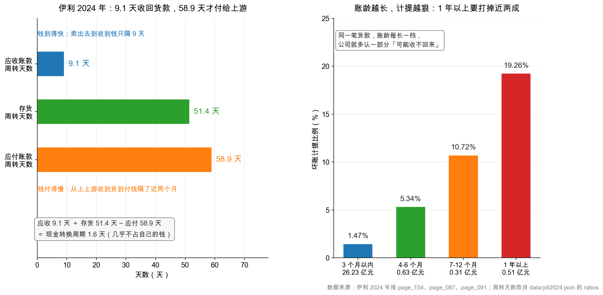

# 第 13 章：应收账款与应收票据——赊账的代价

> 本章你将：
> - 看懂赊账在账上留下的痕迹：一笔货卖出去，钱没回来，凭什么算收入；
> - 用伊利 28.78 亿元应收账款，算出它收回货款只要 **9.1 天**——快消品生意最硬的证据；
> - 学会"账龄分析法"：为什么同一笔 100 万的货款，账龄一年就要打掉 19%；
> - 分清应收账款和应收票据：一个是你求客户还，一个是银行替你担保；
> - 拆开 5.55 亿元"信用减值损失"，发现里面真正的客户坏账只有 0.16 亿。

---

## 13.1 熟客记账的代价

小区门口有家便利店，老板老陈做了二十年生意。熟客忘带钱，他说"下次一起给"；旁边工地的包工头来搬十条烟，也记在账上，月底结。

老陈有个小本子，记着谁欠多少。这本子有三个特点：

1. **它是老陈的资产。** 虽然钱没到手，但"别人欠我"确实值钱；
2. **它有可能收不回来。** 包工头去年跑了一个，欠的 3,800 块到现在没影；
3. **它占老陈的本钱。** 货是老陈先垫钱进的，钱压在外面，他就没法多进别的货。

公司做大了，这本小本子就有了正式名字：**应收账款**（accounts receivable / trade receivables）——已经交货、已经开票、但客户还没付的钱。

而"怕收不回来"这件事，也有正式的处理办法：**坏账准备**（allowance for doubtful accounts）——预先从利润里扣掉一部分，承认"这些钱里有一部分大概收不回来"。

> 📌 **划重点：** 应收账款是"已经确认的收入"和"还没到手的现金"之间的那条缝。**缝越宽，说明公司越弱势；缝里的坏账准备越厚，说明公司自己心里越没底。**

伊利这条缝有多宽？窄得意外。

## 13.2 伊利的应收账款：28.78 亿，只占收入的 2.5%

| 项目 | 2024 年末（亿元） | 2023 年末（亿元） | 变动 |
|---|---|---|---|
| 应收账款（净额） | **28.78** | **30.85** | -2.06（-6.7%） |
| 营业收入 | 1,153.93 | 1,257.58 | -8.24% |
| 应收账款 ÷ 营业收入 | **2.5%** | 2.5% | 基本持平 |

<!-- src: 伊利股份2024年报/page_087.md 伊利股份2024年报/page_091.md 伊利股份2024年报/page_007.md -->

先看第一个数字：**28.78 亿元**。这个数字本身说明不了什么，得跟收入比。伊利一年卖 1,153.93 亿元的货，年末只有 28.78 亿没收回来——**占比 2.5%**。

换个角度理解：如果伊利从明天起一分钱货都不卖了，只坐着收钱，28.78 亿大概 9 天就能收完（下面 13.4 节会算）。一门生意能做到"卖出去的货几乎当场收钱"，这在 A 股里是很稀缺的品质。

再看第二个数字：**它跟着收入一起降了。** 收入降 8.24%，应收账款降 6.7%，两个降幅接近。这是个**健康信号**——说明应收账款的下降是"生意变小了"带来的自然结果，不是"公司为了冲收入而放宽赊账"。

> ⚠️ **易踩坑：应收账款最危险的情况，是"收入不增、应收暴增"。**
>
> 那意味着公司在**放宽信用政策换收入**：以前要现款，现在允许客户赊 90 天；以前只赊给大客户，现在谁都赊。短期看收入好看了，实际上是"把货塞给渠道，钱先不收了"。这种收入的质量很差，往往过一两年就变成坏账。
>
> 判断口诀：**应收增速 > 收入增速，就要问为什么。** 伊利 2024 年应收增速（-6.7%）低于收入增速（-8.24%）的降幅……等等，这里要小心：两个都是负数，"-6.7% 比 -8.24% 高"，意味着应收降得比收入慢一点点。这个差异很小（1.5 个百分点），不构成信号。**看这类指标，一定要看差异有多大，而不是只看谁大谁小。**

## 13.3 坏账准备：一笔账，放久了就打折

应收账款在报表上是个"净额"——已经减掉了坏账准备。要看清楚，得翻附注。

翻 `page_153.md`，附注七(5)"应收账款"，第一张表是按**账龄**（aging）披露的：

| 账龄 | 2024 年末账面余额（亿元） | 占比 |
|---|---|---|
| 1 年以内 | 29.27 | 97.8% |
| 1 至 2 年 | 0.46 | 1.5% |
| 2 至 3 年 | 0.07 | 0.2% |
| 3 年以上 | 0.13 | 0.4% |
| **合计** | **29.93** | 100% |

<!-- src: 伊利股份2024年报/page_153.md -->

**97.8% 的应收账款都在一年以内。** 这个结构非常干净。作为对比，一家被渠道拖垮的公司，账上往往有 20%~30% 的应收账款账龄超过一年。

然后是坏账准备的计提。`page_154.md` 给了按账龄分档的计提比例：

| 账龄档位 | 应收账款（亿元） | 坏账准备（亿元） | 计提比例 |
|---|---|---|---|
| 3 个月以内 | 26.23 | 0.39 | **1.47%** |
| 4-6 个月 | 0.63 | 0.03 | **5.34%** |
| 7-12 个月 | 0.31 | 0.03 | **10.72%** |
| 1 年以上 | 0.51 | 0.10 | **19.26%** |

<!-- src: 伊利股份2024年报/page_154.md -->

这张表把"赊账的代价"写得明明白白：**同一笔货款，放得越久，公司自己认的损失比例越高。**

- 3 个月内：只认 1.47%，几乎等于"肯定会还"；
- 4-6 个月：跳到 5.34%，态度变成"有点悬"；
- 7-12 个月：10.72%，"大概率要打折"；
- 1 年以上：19.26%，"五分之一别指望了"。

除按账龄的"组合计提"，还有一项"按单项计提"：

| 类别 | 账面余额（亿元） | 坏账准备（亿元） | 计提比例 |
|---|---|---|---|
| 按单项计提 | 2.26 | 0.60 | **26.56%** |
| 按组合计提 | 27.68 | 0.55 | 1.99% |
| **合计** | **29.93** | **1.15** | 3.84% |

<!-- src: 伊利股份2024年报/page_154.md -->

"按单项计提"是给那些"已经明确出问题"的客户单独开的小灶——年报里的理由是"**收回难度较大**"，计提比例 26.56%，是组合计提（1.99%）的十三倍。

把两行加起来：应收账款账面余额 29.93 亿，坏账准备 1.15 亿，净额 28.78 亿。**验算一下：29.93 - 1.15 = 28.78 ✅**，和主表上的数字对上了。

看右边那张图，有一个容易忽略的细节：**4-6 个月这一档的金额只有 0.63 亿，7-12 个月只有 0.31 亿，1 年以上 0.51 亿。** 三档加起来 1.45 亿，占全部应收账款的 4.8%。

按金额算：**3 个月以内占 87.6%，三个月以上全部加起来才 4.8%，剩下 7.5% 是"按单项计提"的那部分问题账款。** 如果只看按组合计提的 27.68 亿，3 个月以内的比例是 **94.8%**。

这个结构，就是"先款后货"生意模式的直接证据——经销商要先打款（或账期极短），伊利才发货。

> 🔍 **翻到年报：** 打开 `page_154.md`，找"组合计提项目：组合 2"那张表。四行数据，四个比例：1.47%、5.34%、10.72%、19.26%。**这四个数字，就是"账龄"和"风险"之间的汇率。** 记住它，以后看任何公司的应收账款附注，都能用同一套逻辑去读。

## 13.4 9.1 天：这个数字是怎么算出来的

现在讲本章最重要的一个指标：**应收账款周转天数**（days sales outstanding，DSO）。

它的意思是："**卖出去的货，平均要多少天才能收回钱。**"公式是：

$$\text{应收账款周转天数} = \frac{\text{应收账款}}{\text{营业收入}} \times 365$$

代入伊利 2024 年的数：

$$\frac{28.78}{1{,}153.93} \times 365 \approx 9.1 \text{ 天}$$

（`data/yili2024.json` 的 `ratios.receivable_days` = 9.1，用的正是这个口径。）

**9.1 天是什么水平？** 几个参照系：

| 生意类型 | 典型应收天数 | 为什么 |
|---|---|---|
| 白酒（先款后货） | 接近 0，甚至为负（先收预收款） | 经销商抢着打款 |
| 乳制品（伊利） | **约 9 天** | 渠道强势，账期极短 |
| 商超零售 | 3~10 天 | 现款或短账期 |
| 工程机械 | 100~200 天 | 分期付款、按揭销售 |
| 建筑工程 | 200 天以上 | 甲方强势，结算周期长 |

9 天，意味着伊利几乎不靠"赊账"做生意。这是它商业模式的底色：**面对几百万个分散的经销商和小店，它有能力要求"先打款、后发货"。**

> 💡 **你可能会问：9.1 天这个数，用期末余额算合理吗？为什么不用平均数？**
>
> 问得好，这是"口径"问题。教科书的标准算法是用**平均余额**（期初 + 期末）÷ 2，因为收入是全年累加的，用平均数才匹配。用伊利的数据算：平均应收账款 =（28.78 + 30.85）÷ 2 = 29.82 亿，29.82 ÷ 1,153.93 $\times$ 365 $\approx$ **9.4 天**。
>
> 两个结果差 0.3 天。差异很小的原因是：伊利的应收账款余额一年里没什么大波动（30.85 → 28.78），所以"期末"和"平均"几乎一样。**但如果一家公司的应收账款在年内剧烈波动（比如年底突击回款），两种算法就会差很多**——那种情况下，用期末余额会系统性地低估天数。所以看到一个周转天数，第一件事是问：它用的是期末还是平均？

再补一个观察角度。9.1 天这个数字，和"应付账款周转天数"放在一起看才有意思。伊利 2024 年的应付账款周转天数约 **58.9 天**（用现金转换周期 1.6 天倒推：应收 9.1 + 存货 51.4 - 应付 58.9 = 1.6）。

**翻译成人话：伊利卖货 9 天收钱，买原料 59 天付钱。** 这一进一出，它不但不需要垫钱，还白用了上下游将近 50 天的资金。这个结构叫"负营运资本"倾向，是强势快消品公司的典型长相。第 9 周第 43 章会把这三个天数拼成"现金转换周期"，那时候你会看到伊利只有 **1.6 天**——几乎不占自己的钱。

## 13.5 应收票据：2.51 亿，和应收账款不是一回事

资产负债表上，应收账款上面还有一行：**应收票据**（notes receivable）。伊利 2024 年末 **2.51 亿元**（2023 年 2.20 亿）。

两行挨着，都是"别人欠我的钱"，但性质完全不同。

| 维度 | 应收账款 | 应收票据 |
|---|---|---|
| 本质 | 一张"欠条"，靠商业信用 | 一张**票据**，通常由银行承兑 |
| 谁保证付款 | 客户自己 | 银行（银行承兑）或客户（商业承兑） |
| 能不能转手 | 一般不能 | 可以**背书转让**给供应商，或**贴现**换现金 |
| 坏账风险 | 较高 | 银行承兑的极低 |
| 伊利 2024 金额 | 28.78 亿 | **2.51 亿** |

伊利的 2.51 亿票据，构成是这样的（`page_152.md`）：

| 类型 | 2024 年末（亿元） | 占比 |
|---|---|---|
| 银行承兑票据 | 2.49 | **99.06%** |
| 商业承兑票据 | 0.02 | 0.94% |
| **合计** | **2.51** | 100% |

<!-- src: 伊利股份2024年报/page_152.md -->

**99% 是银行承兑。** 这意味着这 2.51 亿基本没有坏账风险——到期银行付钱，付不出银行兜底。所以你会看到，伊利对这 2.51 亿票据**一分钱坏账准备都没提**（计提比例为空白）。而应收账款提了 1.15 亿。

这就是两类资产的"风险定价"差别，写在报表上就是两行不同的数字。

> ⚠️ **易踩坑：应收票据不是"没有风险"，要看是谁承兑。**
>
> 银行承兑票据（bank acceptance）——银行兜底，风险极低；
> 商业承兑票据（commercial acceptance）——**客户自己兜底**，本质就是一张"期限更长的应收账款"，风险高得多。
>
> 有些公司报表上"应收票据"几十亿，看起来很安全，翻开附注一看全是商业承兑，而且承兑人就是自己的关联方——那就不是"票据"，是"欠条换了张纸"。**看到应收票据，第一件事是翻附注看"银行承兑 / 商业承兑"的比例。**

还有一个细节值得看一眼。`page_152.md` 里有一张"期末已背书或贴现且在资产负债表日尚未到期的应收票据"表：

> 银行承兑票据，期末终止确认金额 **1.06 亿元**，期末未终止确认金额 0。

<!-- src: 伊利股份2024年报/page_152.md -->

翻译一下：伊利把手里的 1.06 亿元银行承兑票据**背书转让**给了别人（大概率是付给供应商），而且因为这些票据是银行承兑、风险极低，会计上做了"**终止确认**"——也就是从资产负债表上划掉了，视同"已经付了这笔钱"。

这是票据相对应收账款的又一个优势：**它能当钱花。** 应收账款只能等，票据可以转手。

一张票据到手，公司有三种用法：

| 用法 | 拿到什么 | 账上怎么变 |
|---|---|---|
| **持有到期** | 到期收回本金 | 一直挂在"应收票据"里 |
| **背书转让** | 抵付供应商货款 | 转给供应商，视风险决定是否终止确认 |
| **贴现** | 提前拿到现金（扣一点利息） | 换成"货币资金"，同时确认一笔借款（若附追索权） |

三种用法的经济含义完全不同：持有是"等"，背书是"花掉"，贴现是"借钱"。**看到一家公司的应收票据很大，要问一句：它是打算持有，还是准备拿去贴现？** 如果主要拿去贴现，那这笔票据本质上就是一笔"用票据做抵押的短期借款"，会在"筹资活动现金流"里留下痕迹。

## 13.6 拆开 5.55 亿"信用减值损失"

最后讲一个最容易误读的数字。

伊利 2024 年利润表上有一行：**信用减值损失 -5.55 亿元**（`page_091.md`）。看名字，你大概会以为"客户欠钱不还，公司认了 5.55 亿损失"。

**完全不是。** 翻 `page_211.md`，附注七(72)把这个数字拆开了：

| 项目 | 2024 年（亿元） | 2023 年（亿元） |
|---|---|---|
| 应收账款坏账损失 | **-0.16** | -0.02 |
| 其他应收款坏账损失 | +0.01 | -0.08 |
| 财务担保相关减值损失 | **-0.96** | -0.15 |
| 保理风险准备 | **-3.71** | -0.80 |
| 小额贷款损失准备 | **-0.56** | -0.52 |
| 应收代位追偿款坏账准备 | -0.16 | -0.03 |
| **合计** | **-5.55** | -1.60 |

<!-- src: 伊利股份2024年报/page_211.md -->

请把目光停在第一行：**应收账款坏账损失只有 -0.16 亿元。**

5.55 亿里，真正跟"客户欠货款不还"有关的，只有 0.16 亿，占 **2.9%**。剩下的 5.39 亿全是另一回事：

- **保理风险准备 3.71 亿**——伊利有个子公司做商业保理（帮经销商/供应商把应收账款提前变现），这块业务要计提风险准备；
- **财务担保相关减值 0.96 亿**——伊利有个融资担保子公司，给上下游的银行贷款做担保，担保也可能赔；
- **小额贷款损失准备 0.56 亿**——伊利有个互联网小贷公司，给经销商放贷；
- **应收代位追偿款 0.16 亿**——担保代偿之后形成的追偿权。

**这四笔加起来 5.39 亿，本质上是"伊利在给产业链做金融"。** 它不是在收自己的货款时被赖账，而是在**给上下游提供融资服务时承担了信用风险**。

这个区别非常重要，因为它的含义完全不同：

| 如果是客户赖账 | 如果是产业链金融亏损 |
|---|---|
| 说明产品卖不动、渠道不健康 | 说明金融业务风控有压力 |
| 是主业的问题 | 是"副业"的问题 |
| 要担心收入质量 | 要担心这块业务该不该做 |

年报自己也点明了原因：

> 信用减值损失增加主要原因：本期计提保理风险准备增加所致。

<!-- src: 伊利股份2024年报/page_211.md -->

### 13.6.1 顺着这条线，看看伊利的"产业链金融"有多大

既然 5.39 亿减值和金融业务有关，那这块业务到底铺了多大？附注里能拼出来：

| 科目 | 2024 年末（亿元） | 位置 |
|---|---|---|
| 短期小额贷款（给经销商、供应商） | 24.98 | 其他流动资产 |
| 应收保理款（一年内） | 21.27 | 其他流动资产 |
| 中长期小额贷款 | 1.61 | 其他非流动资产 |
| 应收保理款（一年以上） | 5.16 | 其他非流动资产 |
| 应收代位追偿款 | 0.10 | 其他流动资产 |
| **合计敞口** | **约 53.13** | — |

<!-- src: 伊利股份2024年报/page_166.md 伊利股份2024年报/page_188.md -->

**大约 53.13 亿元的类金融资产。** 相对于 1,537.18 亿的总资产，占 3.5%，不算大，但也不能忽略——因为它对应的正是那 5.39 亿的减值。

这件事该怎么评价？

**好的一面**：给经销商放贷、做保理，实质是**帮渠道解决资金周转**。经销商有钱进货，伊利的奶才卖得出去。这是"用金融工具加固渠道"的打法，蒙牛、海天、格力都做过。

**要警惕的一面**：这类业务的风险，会随着下游景气度变化而放大。如果乳业需求持续走弱，经销商还不上贷款、保理款收不回来，减值就会连着几年往上涨。2024 年保理风险准备从 0.80 亿跳到 3.71 亿，涨了 3.6 倍，就是一个值得盯的信号。

> 📌 **划重点：看减值损失，一定要拆到附注里看构成。**
>
> 主表上一行"信用减值损失 -5.55 亿"，可能是"客户赖账"，也可能是"金融业务计提"，还可能是"担保代偿"。三种情况的含义天差地别，但主表上长得一模一样。**这就是第 4 章说的"表看结论，注看真假"——减值是本章最好的例子。**

顺便留一个悬念。伊利 2024 年还有一笔更大的减值：**资产减值损失 -46.76 亿元**，其中商誉减值 30.75 亿、存货跌价 12.27 亿、固定资产减值 3.67 亿。这三块分别是第 4 周（商誉）、本章下一章（存货）、第 4 周（固定资产）的内容。**把 46.76 亿和 5.55 亿放在一起看，你会看到伊利 2024 年总共认了 52.31 亿的减值**——这个数字，占到归母净利润 84.53 亿的 62%。第 7 周会专门算这笔账。

## 13.7 三句话总结这一章

1. **应收账款是"缝"，缝的宽窄说明议价能力。** 伊利 28.78 亿、占收入 2.5%、周转 9.1 天——缝极窄，这是"先款后货"的证据。
2. **坏账准备是"折扣"，账龄越久折扣越狠。** 3 个月内打 1.47%，1 年以上打 19.26%。伊利 87.6% 的应收在 3 个月内（组合口径 94.8%），结构干净。
3. **数字的名字会骗人。** "信用减值 5.55 亿"听着像客户赖账，拆开一看，真正的客户坏账只有 0.16 亿，其余全是产业链金融业务的风险准备。

---

## ✍️ 想一想

### 问 1：这家公司的应收账款出了问题吗

A 公司 2024 年营业收入 100 亿元（同比增长 20%），应收账款年末 30 亿元（2023 年末 15 亿元），坏账准备 1.5 亿元。请判断：它的应收账款有没有异常？如果你只能再要一个数据，你要什么？

**解题思路：** 别只看应收的绝对额，把它和收入放在一起做"增速对比"；然后再看"应收占收入的比例"有没有跳变。最后想：哪个数据能一锤定音？

**参考答案：**

**异常很明显。** 三个角度都指向同一个结论：

1. **增速严重背离。** 收入增长 20%，应收账款从 15 亿涨到 30 亿，**增长 100%**。应收增速是收入增速的 5 倍——这是最典型的"放宽信用换收入"信号。
2. **应收占收入的比例跳变。** 2023 年 15 ÷ 83.3（2023 年收入 = 100 ÷ 1.2 $\approx$ 83.3）= 18%；2024 年 30 ÷ 100 = **30%**。一年之内从 18% 跳到 30%，说明"卖出去的货里，没收钱的比例大幅上升"。
3. **坏账准备偏薄。** 1.5 ÷ 30 = 5%，对一个应收激增的公司来说，这个计提比例偏低。如果账龄结构里 1 年以上的比重在上升，5% 是不够的。

**我还会要的一个数据：应收账款的账龄结构。** 因为它能回答"这些新增的应收是新近产生的（3 个月内），还是已经拖了很久的"。如果新增的 15 亿里有相当部分落在"1 年以上"，那基本可以确认收入质量有问题；如果全在 3 个月内，可能只是年底冲量，还需要看 2025 年一季度的回款情况。

**易错点：** ① 只看绝对额，答"应收账款从 15 亿涨到 30 亿，翻倍了，很危险"——没说清"危险在哪"，也没和收入对比。② 只看比例，答"应收占收入 30%，还行"——忽略了"一年内从 18% 跳到 30%"这个动态变化。③ 要的数据是"净利润"或"现金流"——那些当然也重要，但针对"应收是否异常"这个具体问题，账龄结构是最直接的答案。

### 问 2：为什么票据不用计提坏账

伊利对 2.51 亿元应收票据一分钱坏账准备都没提，却对 28.78 亿元应收账款提了 1.15 亿。请解释这个差异的合理性，并举一个"票据也需要计提"的反例。

**解题思路：** 从"谁承担付款责任"这个角度想。票据的核心不是"纸"，是"承兑人"。

**参考答案：**

**合理性在于承兑人不同。** 伊利的 2.51 亿票据里，99.06% 是**银行承兑票据**——到期由银行无条件付款，即使出票的企业破产了，银行照样要付。银行的信用等级远高于普通企业，所以这类票据的信用风险接近于零，不需要计提（会计准则上也要看"预期信用损失"，银行承兑的预期损失极低）。

而应收账款没有第三方担保，客户不付就是不付，所以要按账龄计提。

**反例：商业承兑票据。** 如果一家公司的应收票据全部是商业承兑（由客户自己承兑），那它本质上就是"期限 6 个月的应收账款"，风险一点没少。更极端的情况是：票据的承兑人就是公司的关联方，甚至是公司自己控制的财务公司——那这张票据的信用，等于公司自己的信用，"收票"只是账面上的腾挪。

**还有一种特殊情况：已贴现但未终止确认的票据。** 如果公司把票据贴现换了现金，但因为某些原因（比如附追索权）不能终止确认，那这笔票据仍然挂在表上，同时还要确认一笔借款——这种"一鱼两吃"的处理，是财报里常见的复杂地带。

**易错点：** ① 答"票据是银行开的所以没风险"——只有银行承兑才这样，商业承兑不是。② 答"票据期限短所以不用提"——期限短不等于没风险，3 个月的商业承兑一样可能违约。③ 忘了"票据可以背书转让"这个特性——它是票据相对应收账款最大的优势，也是分析时要多看一眼的地方。

### 问 3：把 5.55 亿当成"客户赖账"会错在哪

假设你是一位分析师，看到伊利"信用减值损失 5.55 亿元"，在报告里写下："公司渠道回款质量恶化，客户坏账大幅增加，同比增加 246%。"请指出这段话的问题，并说明正确的解读方式。

**解题思路：** 先验证"同比 +246%"这个数对不对（5.55 ÷ 1.60 - 1 = 247%，大致对），再看这个增长的**来源**是什么。

**参考答案：**

**问题一：归因错了。** 5.55 亿里，应收账款坏账损失只有 0.16 亿，占比 2.9%。真正的大头是保理风险准备 3.71 亿（66.9%）、财务担保减值 0.96 亿（17.4%）、小额贷款损失准备 0.56 亿（10.1%）。**这些不是"客户不付货款"，是"公司做金融业务承担的风险"。** 把它们说成"渠道回款质量恶化"，是把两个完全不同的问题混为一谈。

**问题二：忽略了"增长来自哪一项"。** 同比增加 3.95 亿（5.55 - 1.60），其中保理风险准备增加了 2.91 亿（3.71 - 0.80），占了增量的 74%。年报明确写了"本期计提保理风险准备增加所致"。所以增长的驱动因素是保理业务，不是应收账款。

**问题三：结论的方向错了。** 应收账款本身的质量其实在**改善**：应收账款从 30.85 亿降到 28.78 亿，坏账准备计提比例 3.84%，账龄 97.8% 在一年以内。这些指标都在说"回款质量良好"，和报告里"恶化"的结论相反。

**正确的解读方式：** 「公司 2024 年信用减值损失 5.55 亿元，同比增加 3.95 亿元，增量主要来自保理风险准备（+2.91 亿元）与财务担保减值（+0.81 亿元），反映产业链金融业务（保理、担保、小贷）的信用风险有所上升。与之相对，应收账款坏账损失仅 0.16 亿元，应收账款余额同比下降 6.7%，账龄结构稳定，主业回款质量未见恶化。需持续关注的是产业链金融业务的敞口与风控。」

**易错点：** ① 认可"同比 +246%"这个算法就完事了——数字对，但归因错，结论依然是错的。② 反过来走极端，答"减值都是金融业务，跟主业无关，可以忽略"——也不对，5.39 亿是真金白银的损失，只是它该被归到"金融业务"这个筐里，而不是"被无视"。③ 忘了看应收账款本身的趋势（余额、账龄、计提比例），只盯着减值损失这一个数。

## 📎 数据出处

- 伊利股份 2024 年报：`page_087.md`（应收账款 28.78 亿 / 30.85 亿、应收票据 2.51 亿 / 2.20 亿）
- 伊利股份 2024 年报：`page_091.md`（营业收入 1,153.93 亿、信用减值损失 -5.55 亿）
- 伊利股份 2024 年报：`page_153.md`（附注七(5) 应收账款账龄披露）
- 伊利股份 2024 年报：`page_154.md`（坏账准备分类披露、按账龄分档计提比例、单项计提）
- 伊利股份 2024 年报：`page_152.md`（附注七(4) 应收票据，银行承兑 / 商业承兑构成、已背书未终止确认）
- 伊利股份 2024 年报：`page_211.md`（附注七(72) 信用减值损失明细）
- 伊利股份 2024 年报：`page_007.md`（营业收入同比 -8.24%）
- 数据汇总：`data/yili2024.json` 的 `balance`、`ratios.receivable_days`、`ratios.cash_conversion_cycle_days`；明细见 `data/yili2024_supplement.json`

下一章：[第 14 章：存货——越放越不值钱](14-存货-越放越不值钱.md)
