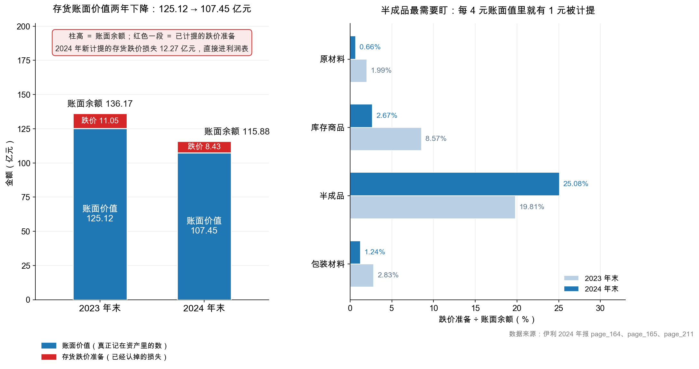

# 第 14 章：存货——越放越不值钱

> 本章你将：
> - 看懂存货这门"会腐烂的资产"：伊利 107.45 亿元存货，为什么和银行存款不是一个物种；
> - 拆开存货的四个口袋：原材料、半成品、库存商品、包装材料，看钱压在哪一格；
> - 算清 12.27 亿元存货跌价损失是怎么来的，以及"计提"和"转销"的区别；
> - 用存货周转率 7.10 次、周转天数 51.4 天，判断这门生意转得快不快；
> - 学会回答那个最容易答错的问题：存货下降 17.67 亿，是好事还是坏事。

---

## 14.1 一箱牛奶的七十二小时

先看一件很小的事。

超市货架上有一箱常温纯牛奶，生产日期是 3 月 1 日，保质期 6 个月。它从出厂到被买走，大概要走这么一段路：

1. 工厂灌装完，进成品仓：等经销商来拉，通常 3~7 天；
2. 经销商仓：等铺到门店，通常 7~15 天；
3. 门店货架：等顾客拿走，通常 15~30 天；
4. 如果一直没人买，到了 8 月底，它就**只能被拉走销毁**。

同一家工厂里还有低温酸奶，保质期 21 天，晚一天就是废品。再往上游看，牧场挤出来的生鲜乳几个小时就开始变质，必须当天冷链运到工厂。

**这条链上，每一样东西都在倒计时。** 这就是"存货"和"银行存款"最根本的差别：

| | 银行存款 | 存货 |
|---|---|---|
| 放着不动会怎样 | 还在那儿，还有利息 | **会烂、会过期、会跌价** |
| 价值确定吗 | 确定 | 不确定，要看能不能卖出去、卖什么价 |
| 一年后 | 还是那么多钱 | 可能一半不到 |

会计对这件事的回应是：**每年年底，把存货按"成本和可变现净值孰低"重新量一次，跌下来的部分，直接从利润里扣掉。** 这个动作叫**存货跌价准备**（inventory write-down）。

> 📌 **划重点：** 存货是资产负债表上唯一一项"放着不动就会自动贬值"的资产。固定资产会折旧（慢，按年摊），存货会跌价（快，可能一个季度就归零）。所以看存货，永远要同时看两个数：**余额**和**跌价准备**。

## 14.2 伊利 2024：107.45 亿，两年降了 17.67 亿

先看主表：

| 项目 | 2024 年末（亿元） | 2023 年末（亿元） | 变动 |
|---|---|---|---|
| 存货（净额） | **107.45** | **125.12** | **-17.67（-14.1%）** |
| 占流动资产比重 | 16.1% | 18.0% | -1.9 个百分点 |
| 占资产总计比重 | 7.0% | 8.3% | -1.3 个百分点 |

<!-- src: 伊利股份2024年报/page_087.md -->

107.45 亿元，是伊利流动资产里**第二大的一项**，仅次于货币资金 254.04 亿。这个体量对一家年营业成本 762.99 亿元的制造企业来说，算是相当克制——相当于它手里只压了**不到两个月的产量**。

再看跌价准备。翻 `page_164.md`，附注七(10) 的存货分类表有三列：账面余额、跌价准备、账面价值。

| 项目 | 2024 年账面余额 | 2024 年跌价准备 | 2024 年账面价值 | 2023 年账面价值 |
|---|---|---|---|---|
| 原材料 | 34.84 | 0.23 | 34.61 | 57.27 |
| 库存商品 | 49.08 | 1.31 | 47.77 | 38.58 |
| 半成品 | 27.24 | **6.83** | 20.41 | 24.85 |
| 包装材料 | 4.67 | 0.06 | 4.61 | 4.39 |
| 低值易耗品 | 0.001 | 0 | 0.001 | 0.01 |
| 委托加工物资 | 0.05 | 0 | 0.05 | 0.01 |
| **合计** | **115.88** | **8.43** | **107.45** | **125.12** |

<!-- src: 伊利股份2024年报/page_164.md -->

（单位：亿元，分项相加可能有 0.01~0.02 尾差。）

这张表逐行看。

**第一，原材料大幅下降。** 34.61 亿元，比 2023 年的 57.27 亿少了 22.66 亿，降幅 39.6%。这是存货总降幅的主要来源。原材料是什么？奶粉、糖、包装原纸、进口乳清粉……这些是要提前囤的。**它降了四成，说明公司在减少原料采购。**

**第二，库存商品反而上升。** 47.77 亿元，比 2023 年的 38.58 亿多了 9.19 亿，涨了 23.8%。这一项是已经做好、还没卖出去的成品。**它涨了，同时收入还跌了 8.24%——这两件事放在一起，值得停下来想一想。**

**第三，半成品的跌价准备高得扎眼。** 27.24 亿的账面余额里，计提了 6.83 亿的跌价准备，计提比例 **25.08%**。也就是说，伊利认为**半成品里有四分之一卖不出原价**。这个比例在四类存货里最高，是原材料（0.66%）的 38 倍。

**为什么半成品最惨？** 它是生产到一半的东西——等待灌装的奶液、等待包装的奶粉。既不能直接卖（没包装、没标签），也不能退（已经投料）。一旦产品结构变了、订单取消，它卡在中间，只能按"能卖多少算多少"估值。**这是产业链上最脆弱的一环。**

**第四，包装材料的计提比例降了。** 从 2023 年的 2.83% 降到 2024 年的 1.24%。这是好事——说明包装材料的周转在改善（印着旧包装的箱子用掉了）。

> 🔍 **翻到年报：** 打开 `page_164.md`，找"10、存货"下面的"（1）存货分类"。三列数：账面余额、存货跌价准备、账面价值。请你自己验算一行：半成品 27.24 - 6.83 = 20.41，和账面价值对得上吗？**这个减法，就是"存货跌价准备"在报表上的存在方式——它是一项"备抵"，挂在资产旁边，随时准备扣。**

## 14.3 12.27 亿元：跌价损失是怎么产生的

现在讲本章最核心的机制：**跌价准备是怎么动的。**

`page_165.md` 给了一张"存货跌价准备变动表"，它把一年里这笔准备金的进出全部列了出来：

| 项目 | 期初余额 | 本期计提 | 本期转回或转销 | 其他（外币折算） | 期末余额 |
|---|---|---|---|---|---|
| 原材料 | 1.16 | 0.13 | 1.05 | 0.02 | 0.23 |
| 库存商品 | 3.62 | 2.36 | 4.59 | 0.08 | 1.31 |
| 半成品 | 6.14 | **10.10** | 9.40 | 0.01 | 6.83 |
| 包装材料 | 0.13 | 0.01 | 0.08 | 0.01 | 0.06 |
| **合计** | **11.05** | **12.60** | **15.11** | **0.11** | **8.43** |

<!-- src: 伊利股份2024年报/page_165.md -->

（单位：亿元。）

这张表要慢慢读，因为它是"流量表"而不是"存量表"。四个动作分别是：

**① 期初余额 11.05 亿**——去年年底已经计提、还挂着的准备。

**② 本期计提 12.60 亿**——今年新认的损失。这一笔会**直接进利润表**，冲减当期利润。

**③ 本期转回或转销 15.11 亿**——这一项最容易搞混，它包含两种情况：

- **转回**（reversal）：原来以为卖不掉的货，后来卖掉了、而且卖了个好价，于是把之前提的准备冲回来，**增加利润**；
- **转销**（write-off）：货真的报废/销毁了，把"存货"和"对应的准备"同时从账上划掉，**不影响当期利润**（因为损失在计提那一年已经认过了）。

年报里给的说明是："本期原材料、库存商品等存货耗用或出售。"——意思是这 15.11 亿主要是**转销**：货被用掉或卖掉，对应的准备也跟着走。

**④ 期末余额 8.43 亿**——算一下：11.05 + 12.60 - 15.11 + 0.11 = 8.65，和 8.43 差 0.22，是四舍五入的尾差（精确值：11.05099 + 12.60269 - 15.11085 + 0.11356 = 8.65639 亿，与表列 8.42927 亿相差 0.227，属表格分项与合计的舍入差异，以合计数为准）。

**关键在"计提"和"转销"的区别。** 很多人看到"跌价准备从 11.05 亿降到 8.43 亿"，就以为"减值改善了"。**错。** 余额下降，可能是因为"提得少"，也可能是因为"销得多"。这一年伊利**新提了 12.60 亿**，比去年提得还多；只是同时**销掉了 15.11 亿**，所以净额才降下来。

而真正进利润表的那个数字，是 `page_211.md` 资产减值损失表里的这一行：

> 二、存货跌价损失及合同履约成本减值损失 **-1,227,261,714.62**（2023 年：-1,221,994,180.78）

<!-- src: 伊利股份2024年报/page_211.md -->

**12.27 亿元，2023 年是 12.22 亿元，几乎持平。**

请注意 12.60（计提）和 12.27（利润表损失）的 0.33 亿差额——这是因为有一部分计提发生在"合同履约成本"上，或者存在转回，两个口径略有不同。这种小额差异在年报里很常见，不用纠结；**关键是量级：每年提 12 亿左右的存货跌价，这是一个稳定的、结构性的成本。**

把它放到利润表里看，12.27 亿是什么概念？

| 参照 | 金额（亿元） | 存货跌价损失占比 |
|---|---|---|
| 归母净利润 | 84.53 | 14.5% |
| 利润总额 | 101.27 | 12.1% |
| 营业成本 | 762.99 | 1.6% |

<!-- src: 伊利股份2024年报/page_091.md 伊利股份2024年报/page_092.md -->

**12.27 亿的存货跌价，相当于归母净利润的 14.5%。** 换句话说，如果这批存货一点都没坏，伊利的利润会多出近 15%。这个量级，绝不是"可以忽略的小项"。

> ⚠️ **易踩坑：跌价准备的"余额下降"和"损失减少"是两件事。**
>
> 余额 = 期初 + 计提 - 转回/转销 + 其他。余额下降，可能是因为转销多（货卖掉了），也可能是因为计提少（今年没坏那么多）。**只有"计提"那一栏，才是当年真实的损失。**
>
> 判断方法很简单：去利润表找"资产减值损失"里的存货跌价那一行。**利润表里的数才是"这一年亏了多少"，资产负债表上的余额只是"累计还挂着多少"。**

## 14.4 周转率 7.10 次：这门生意转得快不快

讲完"值多少钱"，讲"转得多快"。

**存货周转率**（inventory turnover）的定义是：

$$\text{存货周转率} = \frac{\text{营业成本}}{\text{存货}}$$

伊利 2024 年：762.99 除以 107.45，约等于 **7.10 次**（`data/yili2024.json` 的 `ratios.inventory_turnover` = 7.1011）。

意思是：**一年里，伊利的存货平均被"卖空"7.1 次。** 换成天数：

$$\text{存货周转天数} = \frac{365}{7.10} \approx 51.4 \text{ 天}$$

**51.4 天。** 从原料入库到成品卖出收回钱，平均 51 天。

这个数字在制造业里算相当快。对比一下：白酒企业动辄 300~900 天（酒要窖藏），服装企业 150~250 天（等换季），家电企业 60~90 天。乳制品 51 天，符合"快消品、保质期短、必须快进快出"的行业特征。

> 💡 **你可能会问：为什么分子用"营业成本"而不是"营业收入"？**
>
> 因为存货是按**成本**记的，不是按售价记的。用成本除以成本，量纲才一致——"这一年卖掉的货，成本是多少；这些成本对应多少存货"，除出来才是"转了几圈"。
>
> 如果分子用收入，你会得到一个偏高的数（因为收入里含毛利），看起来"转得更快"，其实是虚的。**这是一个非常常见的错误，很多财经网站的数据就是这么算错的。**

### 14.4.1 一个口径陷阱：期末还是平均

刚才算的 7.10 次，用的是**期末存货**（107.45 亿）。但教科书的标准算法是用**平均存货**：

$$\text{平均存货} = \frac{125.12 + 107.45}{2} = 116.29 \text{ 亿元}$$

$$\text{存货周转率} = \frac{762.99}{116.29} \approx 6.56 \text{ 次}$$

$$\text{存货周转天数} = \frac{365}{6.56} \approx 55.6 \text{ 天}$$

**同一家公司，同一年的数据，两个答案：7.10 次 / 51.4 天，或者 6.56 次 / 55.6 天。** 差 8%。

哪个对？**两个都对，取决于你想回答什么问题：**

| 口径 | 结果 | 适合回答 |
|---|---|---|
| 期末存货 | 7.10 次 / 51.4 天 | "现在这个时点的存货，按今年的销售速度能撑多久" |
| 平均存货 | 6.56 次 / 55.6 天 | "这一年里，存货平均转了几圈"（趋势分析更稳） |

本书 `data/yili2024.json` 用的是期末口径（7.1011），因为要和资产负债表上的时点数直接对应。但你在做**多年趋势**时，一定要用同一种口径——如果用期末口径算 2024、用平均口径算 2023，得出的"改善"或"恶化"全是假的。

**顺手用期末口径看一眼 2023 年：** 营业成本 847.89 亿除以存货 125.12 亿 $\approx$ 6.78 次，周转天数约 53.9 天。2024 年是 51.4 天，**略微加快**，幅度不大但方向是好的。

## 14.5 存货下降 17.67 亿：好事还是坏事

这是本章最容易答错的问题。先给结论：**对伊利 2024 年，偏好事，但要加一个前提。**

判断的钥匙是**把存货的变化和收入的变化放在一起看**：

| 指标 | 2024 年 | 2023 年 | 变动 |
|---|---|---|---|
| 营业收入 | 1,153.93 | 1,257.58 | **-8.24%** |
| 存货（净额） | 107.45 | 125.12 | **-14.1%** |
| 存货周转天数 | 51.4 | 53.9 | -2.5 天 |

<!-- src: 伊利股份2024年报/page_087.md 伊利股份2024年报/page_007.md -->

**存货降幅（-14.1%）大于收入降幅（-8.24%），同时周转天数在缩短。** 这两条放在一起，指向一个结论：**公司在主动去库存，而且去得比销售下滑更快。**

为什么这是好事？因为如果存货降幅**小于**收入降幅（比如收入跌 8%，存货只跌 2%），那意味着货在仓库里越堆越多，卖不动——那才是坏消息。伊利的情况反过来：**它把库存压得比销售更狠**，等于提前把"卖不掉的风险"处理掉了一部分。

但要加三个前提，否则这个结论会站不住：

**前提一：要看跌价准备有没有同步上升。** 如果公司是为了"做出好看的存货数字"而硬压库存，同时又不肯计提跌价，那就是在藏损失。伊利 2024 年计提了 12.60 亿，和 2023 年的水平相当，**没有藏**。

**前提二：要看库存商品的绝对额。** 伊利的库存商品反而从 38.58 亿涨到 47.77 亿（+23.8%）。这说明"去库存"主要发生在**原材料端**（-39.6%），成品端其实在累库。这个组合的含义是：**公司判断原奶价格还会跌，所以少囤原料；但成品卖得慢，所以成品堆起来了。** 这不是一个纯粹的好消息。

**前提三：要看收入的下降是不是行业性的。** 翻年报的行业讨论部分，公司自己的说法是：

> 短期内，乳品消费规模较上年同期有所缩减，乳品市场处于阶段性的供给过剩。国内原料奶供应量增长超过需求量增长，导致供需不平衡，带动乳品零售价格下行……原料奶价格先降后稳，其它主要原辅材料价格较上年同期总体下行。

<!-- src: 伊利股份2024年报/page_010.md -->

这段话很重要，它给了两个信息：**① 需求在缩；② 原料在降价。**

第②点直接解释了为什么原材料存货要大幅下降——**原料降价的时候，囤货就是亏钱**。你今天按 4 元/公斤囤的奶粉，下个月市场价 3.5 元，账上就得计提跌价。所以原料降价周期里，正确动作就是"低库存、快周转"。伊利原材料降 39.6%，是理性的经营决策，不是"卖不动"。

还有个细节：半成品计提比例 2023 年是 19.81%，2024 年升到 **25.08%**。**存货总额在降，最脆弱的那一类反而计提得更狠。** 要么是产品结构变了，要么是公司对未来的判断更谨慎了。

### 14.5.1 一张表判断存货健康度

把上面的逻辑固化成一张检查表，以后看任何公司都能套：

| 看什么 | 健康 | 要警惕 | 伊利 2024 |
|---|---|---|---|
| 存货增速 vs 收入增速 | 存货增速更低 | 存货增速明显更高 | -14.1% vs -8.24%，健康 |
| 存货占总资产 | 稳定或下降 | 快速上升 | 7.0%（去年 8.3%） |
| 跌价计提比例 | 与同业相当、稳定 | 突然下降或远低于同业 | 7.3%（8.43/115.88），平稳 |
| 存货构成 | 原材料与成品比例稳定 | 成品占比骤升 | 成品占比 42.4%（去年 31.0%），要盯 |
| 周转天数趋势 | 稳中有降 | 连续上升 | 51.4 天（去年 53.9 天），略好 |

五项里四项健康、一项要盯（成品占比从 31.0% 升到 42.4%）。**这是一份"及格但有瑕疵"的答卷**——不是满分，但绝不是雷。

> 📌 **划重点：判断存货变动的好坏，只有一个方法——把存货增速和收入增速放在一起比。**
>
> - 存货增速 < 收入增速：去库存，偏健康；
> - 存货增速 > 收入增速：累库，要警惕（尤其是收入还在下滑的时候）；
> - 存货下降 + 收入下降 + 跌价计提上升：最坏组合，说明货真的坏了；
> - 存货下降 + 收入下降 + 跌价计提平稳：主动去库存，可以接受。

伊利 2024 年落在最后一档，但成品端有累库迹象，所以是"偏健康，但要继续盯"。

## 14.6 乳业的特殊：奶牛不算存货

最后讲一个伊利报表上很有意思的细节。

伊利资产负债表上有一行叫**生产性生物资产 17.46 亿元**（2023 年 16.59 亿）。这是什么？**奶牛。**

你可能会想：牛不就是"原材料"吗？挤出来的奶是产品，牛当然是原料。**但会计不这么分。** 判断标准是"这东西是被消耗掉，还是被反复使用"：

| 资产 | 伊利账上叫什么 | 为什么 |
|---|---|---|
| 奶牛（能反复产奶的成年母牛） | **生产性生物资产**（非流动资产） | 能用好几年，每年产奶，是"生产设备" |
| 肉牛、育肥牛（养大了就宰） | 消耗性生物资产（存货） | 一次性消耗掉 |
| 原奶、奶粉、糖 | 原材料（存货） | 一次性投入生产 |
| 灌装好的牛奶 | 库存商品（存货） | 等着卖 |

所以伊利的牛，和它的灌装机是同一类东西——**都是"生产工具"，都要计提折旧**（牛的折旧叫"生物资产折旧"，按产奶年限摊）。这也是为什么"生产性生物资产"排在非流动资产里，而不是存货里。

意义在于：**读报表不能只看科目名字，要看生意的实质。** 乳企的牛、航空公司的飞机、医院的床位，会计科目各不相同，但在生意里角色一样——**赚钱的工具**。

顺便说一句，蒙牛 2024 年的存货是 49.37 亿元，伊利是 107.45 亿元。差异很大，但两家的收入规模也不同（伊利 1,153.93 亿，蒙牛约 886.75 亿），不能直接比绝对额。要比就比周转天数——这是第 9 周"同业对比"会做的事。

---

## ✍️ 想一想

### 问 1：这家公司的存货出了什么问题

B 公司 2024 年营业收入 50 亿元（同比 -5%），存货年末 20 亿元（2023 年末 12 亿元），当年计提存货跌价准备 0.3 亿元（2023 年 0.28 亿元）。请判断：它的存货状况正常吗？如果你只能再要一个数据，你要什么？

**解题思路：** 三个指标一起看——存货增速 vs 收入增速、存货占收入的比例、跌价计提比例。任何一个单独看都可能误判。

**参考答案：**

**不正常，而且三个角度同时报警。**

1. **存货增速与收入增速严重背离。** 收入跌 5%，存货从 12 亿涨到 20 亿，**涨了 66.7%**。收入在缩、库存在涨，这是最典型的"货卖不动"。
2. **存货占收入的比例跳升。** 2023 年 12 除以 52.63（2023 年收入 = 50 除以 0.95）$\approx$ 22.8%；2024 年 20 除以 50 = **40%**。一年之内从 22.8% 跳到 40%，意味着"仓库里压的货，相当于 4.8 个月的收入"。
3. **跌价计提严重不足。** 0.3 除以 20 = **1.5%**。对一家存货激增、收入下滑的公司，1.5% 的计提比例明显偏薄——尤其如果新增的 8 亿存货里有相当部分是成品。

**我还会要的一个数据：存货的构成（原材料 / 在产品 / 库存商品）。** 因为三种构成的解释完全不同：

- 如果新增的主要是**原材料**，可能是"趁低价囤货"，需要再问"原料价格在涨还是在跌"；
- 如果新增的主要是**库存商品**，基本可以确认是"卖不动"，配合收入下滑，问题很严重；
- 如果新增的主要是**在产品**，可能是"生产计划失误"或者"订单取消"。

**易错点：** ① 只算"存货增长 66.7%"就下结论，没和收入对比——单看存货涨，可能只是公司在扩张。② 只看跌价计提比例低，就说"公司造假"——计提比例低有很多原因（账龄结构、品类特性），要结合构成看。③ 要的数据是"净利润"——对判断存货质量帮助不大，构成和账龄才是直接证据。

### 问 2：为什么半成品的计提比例最高

伊利 2024 年四类存货的跌价计提比例是：原材料 0.66%、库存商品 2.67%、半成品 **25.08%**、包装材料 1.24%。请解释：为什么半成品的计提比例会比库存商品高出近十倍？

**解题思路：** 从"这东西能不能直接卖"这个角度想。同样是"卖不掉"，三种存货的"残值"完全不同。

**参考答案：**

**核心原因是"可变现净值"不同。** 存货跌价准备的计提基准是"成本与可变现净值孰低"，而"可变现净值"取决于这东西**还能怎么处理**：

| 存货类型 | 卖不掉的时候能怎么办 | 可变现净值 |
|---|---|---|
| 原材料（奶粉、糖） | 退回供应商、转卖给同行、做饲料 | 较高，通常能收回七八成 |
| 库存商品（成品奶） | 打折促销、临期特卖、员工内购 | 中等，能收回五六成 |
| **半成品** | **几乎没办法**——没包装、没标签、没批次追溯，既不能上架也不能退 | **极低** |
| 包装材料 | 卖给废品回收、转给同行 | 按废纸/废塑料计价，很低但确定 |

半成品卡在"已经投料、还没成型"这个尴尬位置：往前一步要灌装（还得投包装、投人工），往后一步退不回原料。**一旦对应的产品不做了，它基本只能报废。**

再叠加一层：乳业的半成品（待灌装的奶液、待包装的奶粉）**保质期以小时/天计**。今天不灌装，明天就可能不合格。所以它的"可变现净值"折价最狠，计提比例最高，完全合理。

**这也解释了为什么 2024 年半成品的计提额（10.10 亿）占了全部计提（12.60 亿）的 80%。** 公司最担心的不是原料，也不是成品，是卡在中间的那一锅。

**易错点：** ① 答"半成品更接近过期"——不准确，半成品的问题不是"快过期"，是"没法单独卖"。② 答"半成品金额小所以比例高"——金额小和计提比例高没有因果关系。③ 忘了"可变现净值"这个概念，只用"保质期"解释——保质期只是原因之一，处置渠道才是关键。

### 问 3：如果伊利明年把存货压到 80 亿

假设 2025 年伊利把存货从 107.45 亿压到 80 亿，营业成本不变（仍是 762.99 亿）。请回答：（a）存货周转率变成多少？（b）这个"改善"是真的吗？（c）压库存有什么代价？

**解题思路：** （a）是纯计算。（b）和（c）要想清楚"压库存"这个动作在真实生意里意味着什么——它不可能没有成本。

**参考答案：**

**（a）周转率 = 762.99 除以 80 $\approx$ 9.54 次，周转天数 = 365 除以 9.54 $\approx$ 38.3 天。** 比现在的 51.4 天快了 13 天，看起来是巨大的改善。

**（b）不一定真。** 有三种可能，只有第一种是真改善：

| 情形 | 是不是真改善 | 怎么分辨 |
|---|---|---|
| 需求变好、货一到就卖光 | **是** | 收入同步增长，应收账款没有异常 |
| 强行压货、减少生产 | **不是** | 收入不增或下滑，产能利用率下降，单位成本上升 |
| 把货塞给经销商（移库） | **不是** | 收入可能虚增，但应收账款或合同负债会异常 |

**（c）压库存的代价至少有三个：**

1. **断货风险。** 乳制品的需求有波动（节假日、促销），库存是缓冲垫。压太薄，一旦需求反弹就断货，丢的是市场份额。
2. **单位成本上升。** 工厂是重资产，产量下降但折旧、人工不变，摊到每箱奶上的固定成本就上升，毛利率会掉。
3. **可能触发跌价的反向操作。** 如果为了压库存而低价甩货，售价下来了，反而要计提更多跌价。

所以"存货周转率越高越好"是个**伪命题**。真正健康的狀態是"周转率稳中有升，同时收入不掉、毛利不塌"。

**易错点：** ① （a）算完就完事，不回答（b）（c）。这道题的重点在后面的判断题。② 答"压库存没代价，现金回流更快"——只看到好处，忽略了断货和单位成本。③ 用"营业收入"当分子算周转率——应该用营业成本（见 14.4 节的解释）。

## 📎 数据出处

- 伊利股份 2024 年报：`page_087.md`（存货 107.45 亿 / 125.12 亿、流动资产合计）
- 伊利股份 2024 年报：`page_164.md`（附注七(10) 存货分类：账面余额、跌价准备、账面价值）
- 伊利股份 2024 年报：`page_165.md`（存货跌价准备变动表：计提 12.60 亿、转销 15.11 亿）
- 伊利股份 2024 年报：`page_211.md`（附注七(73) 资产减值损失：存货跌价损失 -12.27 亿）
- 伊利股份 2024 年报：`page_091.md`（营业成本 762.99 亿）
- 伊利股份 2024 年报：`page_092.md`（归母净利润 84.53 亿、利润总额 101.27 亿）
- 伊利股份 2024 年报：`page_007.md`（营业收入同比 -8.24%）
- 伊利股份 2024 年报：`page_010.md`（行业供需：阶段性供给过剩、原料奶价格先降后稳）
- 数据汇总：`data/yili2024.json` 的 `balance.inventory`、`notes.inventory_writedown`、`ratios.inventory_turnover`；明细见 `data/yili2024_supplement.json`

下一章：[第 15 章：实战——拆开伊利 2024 的资产结构](15-实战-拆开伊利2024的资产结构.md)
