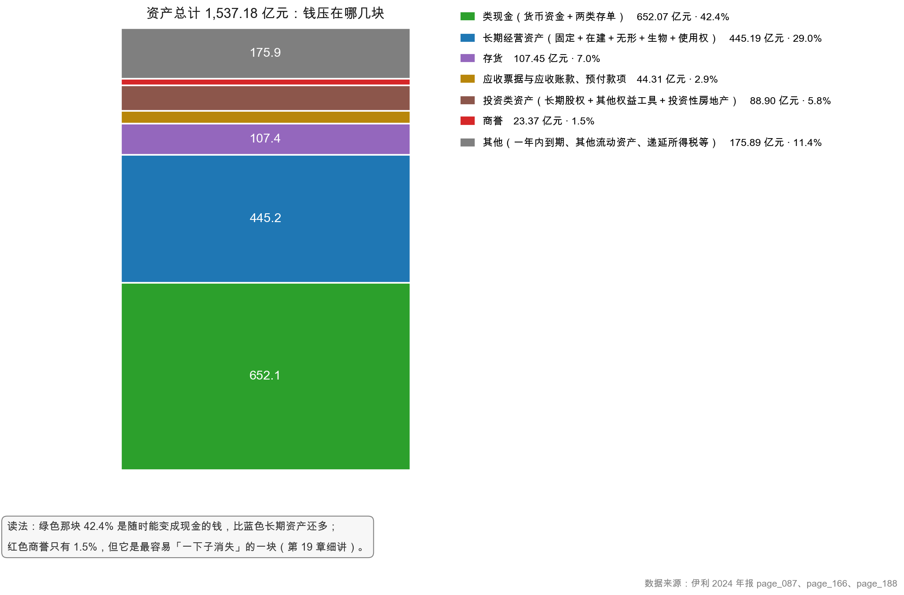
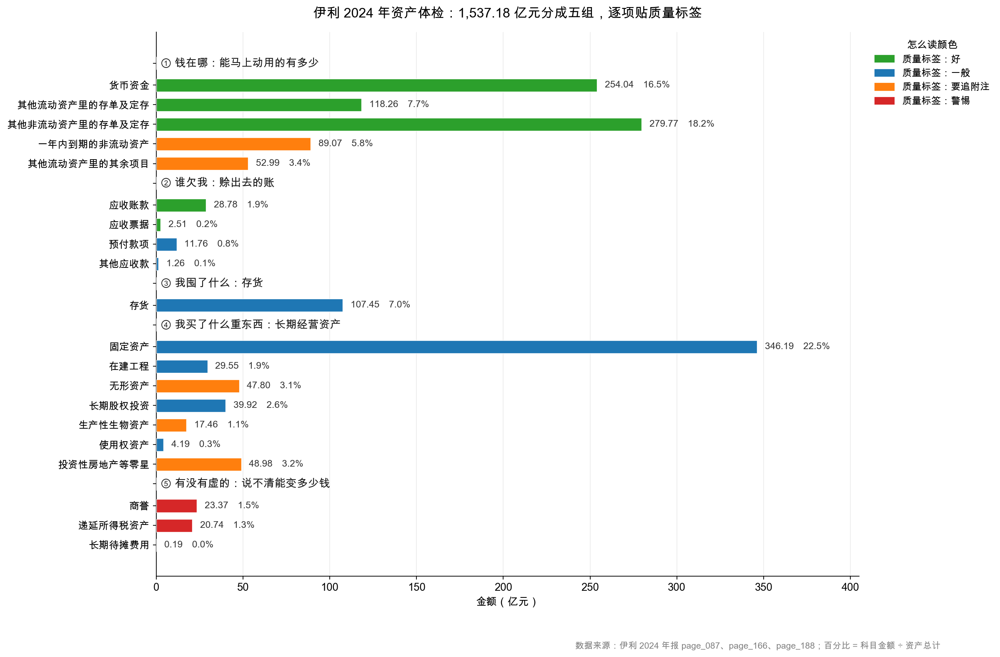

# 第 15 章：实战——拆开伊利 2024 的资产结构

> 本章你将：
> - 用一套"资产体检五问"，把伊利 1,537.18 亿元资产从头到尾过一遍；
> - 亲手填一张 20 个科目的体检表，给每一项贴上"好 / 一般 / 要追附注 / 警惕"的标签；
> - 抓住伊利的两个异常点：**商誉 23.37 亿**和**其他非流动资产 292.59 亿（占资产 19%）**；
> - 学会判断"哪些科目必须翻附注"，以及翻到附注后该找什么；
> - 独立写出三句话的资产质量结论——这是本周的毕业作业。

---

## 15.1 给资产做一次体检

前四章，我们把流动资产里的三件大事（钱、应收、存货）一件一件拆了。现在到了收口的时候。

但资产表上有二十几个科目，一只一只看会累死。所以真正做分析的人，不会"逐行读"，而是用**一组固定的问题**去扫。就像体检不是"从头到脚每寸都查"，而是"验血、量压、拍片"几项固定检查。

资产体检，我习惯问五个问题：

| 序号 | 问题 | 对应科目 | 关心什么 |
|---|---|---|---|
| ① | **钱在哪？** | 货币资金、大额存单、理财 | 有多少能动的钱 |
| ② | **谁欠我？** | 应收账款、应收票据、预付款项、其他应收款 | 被占用了多少资金，收得回来吗 |
| ③ | **我囤了什么？** | 存货 | 会不会烂在手里 |
| ④ | **我买了什么重东西？** | 固定资产、在建工程、无形资产、生物资产、使用权资产 | 产能是真本事还是包袱 |
| ⑤ | **有没有虚的？** | 商誉、长期待摊费用、递延所得税资产 | 值多少全靠假设 |

五问的顺序对应资产质量从"确定"到"不确定"的一条滑梯：**现金最确定，应收次之，存货再次，长期资产看经营，商誉看未来。**

> 📌 **划重点：资产体检的核心不是"算清每个科目多少钱"，而是"给每个科目定一个可信度"。** 一家公司资产 1,500 亿，如果其中 800 亿是"说不清值多少"的东西，那它的真实家底远没有账面看起来那么厚。

## 15.2 先看整体：七块拼图

在逐项体检之前，先把 1,537.18 亿拆成七块，看清楚重心在哪。

| 块 | 金额（亿元） | 占资产 | 一句话 |
|---|---|---|---|
| 类现金（货币资金 + 两类存单） | **652.07** | **42.4%** | 近一半资产是钱 |
| 长期经营资产（固定 + 在建 + 无形 + 生物 + 使用权） | 445.19 | 29.0% | 厂房、设备、牧场 |
| 存货 | 107.45 | 7.0% | 原料 + 半成品 + 成品 |
| 应收票据、应收账款、预付款项 | 44.31 | 2.9% | 被上下游占用的钱 |
| 投资类资产（长期股权投资 + 其他权益工具 + 投资性房地产） | 88.90 | 5.8% | 参股、财务投资 |
| **商誉** | **23.37** | **1.5%** | 并购留下的溢价 |
| 其他（一年内到期、其他流动资产、递延所得税等） | 175.89 | 11.4% | 杂项，要逐项看 |
| **资产总计** | **1,537.18** | 100% | — |

<!-- src: 伊利股份2024年报/page_087.md 伊利股份2024年报/page_166.md 伊利股份2024年报/page_188.md -->

这张表立刻告诉我们两件事：

**第一，伊利是"现金型"公司，不是"重资产"公司。** 42.4% 的资产是钱，29.0% 是经营性长期资产。这个结构在制造业里罕见——大部分制造企业"重资产为主、现金为辅"，伊利正好反过来。原因有三：乳业周转快、回款快；对上下游议价强；这些年没有大规模扩张。

**第二，"其他"这 175.89 亿是个筐，必须打开。** 占 11.4%，第四大块。占比超过 10% 的"其他"不去拆，等于给自己留了个盲区。15.4 节拆它。

> ⚠️ **易踩坑：看到"其他"两个字就跳过。**
>
> 财报里所有叫"其他"的科目——其他应收款、其他流动资产、其他非流动资产、其他应付款——都是"装不下或者不想单列"的东西的集合。**恰恰因为这些科目没有明确的名字，它们最容易藏问题。**
>
> 实战经验：一家公司如果"其他 XX"类科目合计超过总资产的 15%，就必须逐个打开看。伊利的 11.4% 已经接近这条线了。

## 15.3 体检表：20 个科目，四种标签

现在正式填表。规则是这样的：

| 标签 | 含义 | 判断标准 |
|---|---|---|
| 🟢 **好** | 质量高，几乎不用怀疑 | 本身是现金或接近现金，或有强信用背书 |
| 🔵 **一般** | 正常，符合行业特征 | 金额合理、趋势平稳、无明显异常 |
| 🟠 **要追附注** | 必须翻附注才能判断 | 构成复杂，或有多种可能解释 |
| 🔴 **警惕** | 天然带有"说不清"的成分 | 价值高度依赖未来假设 |

### ① 钱在哪（合计 794.13 亿，占 51.7%）

| 科目 | 金额（亿元） | 占比 | 标签 | 理由 |
|---|---|---|---|---|
| 货币资金 | 254.04 | 16.5% | 🟢 好 | 其中受限仅 8.42 亿（3.3%），能动 |
| 其他流动资产里的存单及定存 | 118.26 | 7.7% | 🟢 好 | 本质是现金，只是一年内到期 |
| 其他非流动资产里的存单及定存 | 279.77 | 18.2% | 🟢 好 | 本质是现金，只是期限超一年 |
| 一年内到期的非流动资产 | 89.07 | 5.8% | 🟠 要追附注 | 其中 76.47 亿是存单，剩下 12.60 亿是小贷和保理款 |
| 其他流动资产里的其余项目 | 52.99 | 3.4% | 🟠 要追附注 | 待抵扣税、小贷、保理款、碳排放权混在一起 |

<!-- src: 伊利股份2024年报/page_087.md 伊利股份2024年报/page_166.md 伊利股份2024年报/page_188.md 伊利股份2024年报/page_165.md -->

**这一组的结论：** 真正"躺着的钱"约 652.07 亿（三条绿色），另有 89.07 亿需要拆开看，其中大头仍是存单。**钱的质量很高。**

### ② 谁欠我（合计 44.31 亿，占 2.9%）

| 科目 | 金额（亿元） | 占比 | 标签 | 理由 |
|---|---|---|---|---|
| 应收账款 | 28.78 | 1.9% | 🟢 好 | 周转 9.1 天，97.8% 在一年内 |
| 应收票据 | 2.51 | 0.2% | 🟢 好 | 99% 银行承兑，零坏账准备 |
| 预付款项 | 11.76 | 0.8% | 🔵 一般 | 预付原料款，金额稳定 |
| 其他应收款 | 1.26 | 0.1% | 🔵 一般 | 押金备用金，金额小 |

<!-- src: 伊利股份2024年报/page_087.md 伊利股份2024年报/page_153.md 伊利股份2024年报/page_152.md -->

**这一组的结论：** 44.31 亿只占资产的 2.9%，**这是整张表最健康的一组**。说明伊利不靠赊账做生意，钱回得快。

### ③ 我囤了什么（107.45 亿，占 7.0%）

| 科目 | 金额（亿元） | 占比 | 标签 | 理由 |
|---|---|---|---|---|
| 存货 | 107.45 | 7.0% | 🔵 一般 | 周转 51.4 天，跌价计提 7.3%，成品占比升到 42.4% |

<!-- src: 伊利股份2024年报/page_087.md 伊利股份2024年报/page_164.md -->

**这一组的结论：** 及格但有瑕疵。原料降四成是好事，成品涨两成是要盯的点（第 14 章已详述）。

### ④ 我买了什么重东西（合计 534.09 亿，占 34.7%）

| 科目 | 金额（亿元） | 占比 | 标签 | 理由 |
|---|---|---|---|---|
| 固定资产 | 346.19 | 22.5% | 🔵 一般 | 核心产能，每年折旧 40.56 亿 |
| 在建工程 | 29.55 | 1.9% | 🔵 一般 | 比去年少 13.81 亿，说明在转固 |
| 无形资产 | 47.80 | 3.1% | 🟠 要追附注 | 主要是土地使用权和商标，要看摊销年限 |
| 长期股权投资 | 39.92 | 2.6% | 🔵 一般 | 参股牧场和联营企业 |
| 生产性生物资产 | 17.46 | 1.1% | 🟠 要追附注 | 奶牛，要看成活率和产奶年限 |
| 使用权资产 | 4.19 | 0.3% | 🔵 一般 | 租来的房产，金额小 |
| 投资性房地产等零星 | 48.98 | 3.2% | 🟠 要追附注 | 三项合在一起，需要分开看 |

<!-- src: 伊利股份2024年报/page_087.md -->

**这一组的结论：** 固定资产 346.19 亿是绝对主力，占资产 22.5%。这部分下一周（第 16~17 章）会彻底拆开。这里先记住一个数：**固定资产一年折旧 40.56 亿**，这笔钱不进现金流但进利润表，是"利润和现金分叉"的主因之一。

> 口径提醒：15.2 节"七块拼图"里**长期经营资产是 445.19 亿**（只算固定、在建、无形、生物、使用权）；这张体检表 ④ 组是 **534.09 亿**，多算了长期股权投资 39.92 亿和投资性房地产等零星 48.98 亿。同一张主表，**体检表按"问题"切，拼图按"资产性质"切**。看别人分析时先问清切法，再比数字。

### ⑤ 有没有虚的（合计 44.30 亿，占 2.9%）

| 科目 | 金额（亿元） | 占比 | 标签 | 理由 |
|---|---|---|---|---|
| **商誉** | **23.37** | **1.5%** | 🔴 警惕 | 从 51.60 亿减值到 23.37 亿，一年砍掉一半 |
| 递延所得税资产 | 20.74 | 1.3% | 🔴 警惕 | 要靠"未来能盈利"才能兑现 |
| 长期待摊费用 | 0.19 | 0.0% | 🔴 警惕 | 金额极小，但性质最虚 |

<!-- src: 伊利股份2024年报/page_087.md 伊利股份2024年报/page_184.md -->

**这一组的结论：** 只占 2.9%，金额不大，但**性质最值得警惕**——三项的共同点是"账面价值完全取决于未来假设能否兑现"：商誉靠子公司未来赚钱，递延所得税资产靠未来有利润可抵税，长期待摊费用靠未来继续经营慢慢摊。

### ⑥ 剩下的零头

| 科目 | 金额（亿元） | 占比 | 标签 | 理由 |
|---|---|---|---|---|
| 其他非流动资产里的非存单部分 | 12.83 | 0.8% | 🟠 要追附注 | 预付工程款 6.05 + 保理款 5.16 + 小贷 1.61 |

<!-- src: 伊利股份2024年报/page_188.md -->

**加总验算：** 794.13 + 44.31 + 107.45 + 534.09 + 44.30 + 12.83 = **1,537.11 亿**，与资产总计 1,537.18 亿差 0.07 亿，是四舍五入尾差（另有一笔 0.0005 亿的衍生金融资产未单列）。

**六格加起来等于总资产，这张体检表就站住了。** 不需要精确到分，但每块都要能对上大数。

## 15.4 异常点一：商誉 23.37 亿

现在讲本章第一个必须点名的异常。

| 项目 | 2023 年末 | 2024 年末 | 变动 |
|---|---|---|---|
| 商誉账面原值 | 55.59 | 58.13 | +2.54 |
| 商誉减值准备 | 3.99 | **34.76** | **+30.77** |
| **商誉净额** | **51.60** | **23.37** | **-28.24（-54.7%）** |

<!-- src: 伊利股份2024年报/page_184.md 伊利股份2024年报/page_087.md -->

**一年之内，商誉净额砍掉了一半多。**

拆开看更清楚。翻 `page_184.md` 的商誉明细，减值的来源高度集中：

| 被投资单位 | 商誉原值（亿元） | 2024 年计提减值（亿元） | 减值后剩余（亿元） |
|---|---|---|---|
| 澳优乳业股份有限公司 | 51.92 | **30.37** | 21.55 |
| 内蒙古康益佳生物技术有限公司 | 0.38 | 0.38 | 0 |
| THE CHOMTHANA COMPANY LIMITED | 3.12 | 0 | 3.12（已全额减值） |
| Westland Dairy Company Limited | 1.66 | 0 | 0（已全额减值） |
| 其他三家 | 1.05 | 0 | 不适用 |

<!-- src: 伊利股份2024年报/page_184.md -->

**澳优乳业一家，就计提了 30.37 亿元减值，占全部商誉减值的 98.7%。**

一句话说清：**伊利 2022 年花大价钱收购澳优（一家羊奶粉公司），收购价高于澳优净资产公允价值，差额 51.92 亿记成"商誉"。两年后，伊利承认"这笔溢价撑不住了"，一次性打掉 30.37 亿。**

这 30.37 亿，**直接进 2024 年的利润表**，是当年归母净利润 84.53 亿的 35.9%。换句话说：**如果没有这笔减值，伊利 2024 年的利润会是 114.9 亿左右。**

> 🔍 **翻到年报：** 打开 `page_184.md`，找"27、商誉"下面的两张表。第一张是"商誉账面原值"，第二张是"商誉减值准备"。**两张表要对着看**：原值告诉你"当初花了多少钱买溢价"，减值准备告诉你"现在认了多少亏"。两者相减，才是资产负债表上那个 23.37 亿。

先埋三个问题，第 4 周第 19~20 章逐一回答：

1. **商誉是怎么算出来的？**（收购价 - 可辨认净资产公允价值）
2. **为什么每年必须做减值测试？**（因为商誉不会自己摊销，只能靠测试）
3. **减值了 30 亿，为什么现金流一分没少？**（因为减值是非付现损失）

> ⚠️ **易踩坑：商誉减值不等于"亏了 30 亿现金"。**
>
> 减值是把账面上的一个数字往下调，钱早在 2022 年收购时就付出去了。所以你会看到一个奇怪的现象：伊利 2024 年净利润大跌 18.94%，但经营现金流反而增长 18.86%（217.40 亿）。**利润和现金背道而驰，减值就是主要原因之一。** 第 8 周会把这台"分叉机器"拆开。

## 15.5 异常点二：其他非流动资产 292.59 亿，占资产 19%

第二个异常点，比商誉更值得琢磨——因为它看起来完全正常。

| 项目 | 2024 年末（亿元） | 占总资产 | 2023 年末（亿元） |
|---|---|---|---|
| **其他非流动资产** | **292.59** | **19.0%** | 197.13 |
| 其中：大额存单及定期存款 | 279.77 | 18.2% | 176.30 |
| 其中：预付工程设备款 | 6.05 | 0.4% | 9.21 |
| 其中：应收保理款 | 5.16 | 0.3% | 8.89 |
| 其中：中长期小额贷款 | 1.61 | 0.1% | 2.73 |

<!-- src: 伊利股份2024年报/page_188.md -->

**为什么算"异常"？**

一个科目叫"其他"，却占总资产的 19%——**这本身就是矛盾。** "其他"该是零碎的、凑数的，不该是第二大资产。任何占比接近 20% 的科目，都必须能一句话说清它是什么。而"其他非流动资产 292.59 亿"这个说法，什么都没说。

打开附注才明白：**其中 279.77 亿是大额存单及定期存款，占这个科目的 95.6%。**

所以真相是：**伊利把近 280 亿元的钱，放在了一个叫"其他"的科目里。**

这件事有两层含义：

**第一层：这是列报规则的结果，不是财务操纵。** 存期超过一年的大额存单，按规定不能放"货币资金"，也不属于"债权投资"（因为不是债券），只能进"其他非流动资产"。所以这个"其他"里装的是最不"其他"的东西——现金。

**第二层：它给所有读报表的人挖了个坑。** 如果你只看"货币资金 254.04 亿"，你会觉得这家公司现金一般；如果你加上这个 279.77 亿，才看到它真正握着的钱。**这就是第 12 章"账上的钱可能不在账上"的完整版。**

> 💡 **你可能会问：既然这笔钱这么重要，公司为什么不单列一个科目，非要藏在"其他"里？**
>
> 因为会计准则的科目表是固定的，公司不能自己发明科目。大额存单在准则里没有专属位置，只能按期限归到"其他流动资产"或"其他非流动资产"。公司能做的，是在附注里披露明细——伊利确实披露了（`page_188.md`），而且写得很清楚。
>
> **所以这不是"藏"，是"规则导致的分散"。** 但作为读者，你必须知道去附注里找，否则就会被科目名字骗过去。

顺便说，这也是本书反复强调"附注才是正文"的最好例证：**主表上 292.59 亿的"其他"，附注里变成 279.77 亿的"现金"。同一个数字，两种身份。**

## 15.6 三个"必须翻附注"的信号

体检表里有 6 项被标成 🟠"要追附注"。判断一个科目该不该翻附注，常用三个信号：

**信号一：科目名字里有"其他"。** 其他应收款、其他流动资产、其他非流动资产、其他应付款。这类科目没有明确边界，什么都可能装。

**信号二：金额占比超过 5%，但看不出业务含义。** 比如"其他非流动资产"占 19%，但你在主表上看不出它是什么。反过来，"固定资产"占 22.5% 就不需要警醒——你知道那是厂房设备。

**信号三：同比变动超过 50%。** 第 12 章那个"其他流动资产 +166%"，就是最典型的例子。剧烈的同比变动，要么是业务真的变了，要么是科目之间在搬家，两种都需要解释。

翻到附注之后，找什么？三个东西：

| 找什么 | 为什么 | 伊利例子 |
|---|---|---|
| **构成明细** | 看这个"其他"里到底装了什么 | 其他非流动资产里 95.6% 是存单 |
| **减值/准备** | 看公司自己认了多少损失 | 应收账款计提 1.15 亿 |
| **文字说明** | 看公司怎么解释变动 | "本期大额存单及定期存款增加所致" |

## 15.7 毕业作业：三句话结论

把整章压缩成三句话，这就是你这一周的产出：

> **第一句（结构）：** 伊利 2024 年总资产 1,537.18 亿元，其中类现金 652.07 亿（42.4%）、长期经营资产 445.19 亿（29.0%）、存货 107.45 亿（7.0%），是一家"现金厚、资产轻、周转快"的乳业龙头。
>
> **第二句（质量）：** 资产质量整体良好——应收账款仅 28.78 亿、周转 9.1 天，应收票据 99% 银行承兑，存货跌价计提比例 7.3% 与去年持平，受限资金仅占货币资金的 3.3%。
>
> **第三句（风险）：** 两个点要盯——商誉 23.37 亿（一年内减值 30.37 亿，全部来自澳优），以及占比 19% 的"其他非流动资产"（其中 279.77 亿其实是存单，剩下 12.83 亿是保理款和小额贷款，属产业链金融敞口）。

> 📌 **划重点：三句话，一句讲结构，一句讲质量，一句讲风险。**
>
> 这就是一份合格的资产分析开头。以后再拿到一张资产负债表，别急着算比率：先问五个问题，再填那张带标签的表，最后逼自己写成三句话。**写得出三句话，才算真看懂了。**

顺带说一句下周的入口。这一周我们绕开了资产表上最"硬"的一块——固定资产、在建工程、无形资产、商誉减值。它们是伊利 870.99 亿非流动资产的主体，也是"折旧"和"减值"这两个概念的真正战场。**下周的第一句话就会问你：折旧，到底是不是成本？**

---

## ✍️ 想一想

### 问 1：给这个科目贴标签

C 公司资产负债表上有这么一项："**其他流动资产 45 亿元**，占总资产 12%，2023 年为 8 亿元（同比 +462%）"。附注显示：其中 30 亿是"待抵扣增值税进项税"，10 亿是"预付费用"，5 亿是"应收关联方款项"。请给这一项贴一个质量标签，并说明理由。

**解题思路：** 先看三项构成的性质（税、费用、关联方），再看增速是否合理，最后综合判断。注意"待抵扣进项税"是个特殊的东西——它不是钱，但也不是费用。

**参考答案：**

**标签应该是 🟠"要追附注"，并且其中 5 亿的"应收关联方款项"要单独标 🔴。**

逐项拆：

| 构成 | 金额 | 性质 | 单独标签 |
|---|---|---|---|
| 待抵扣增值税进项税 | 30 亿 | 已经付出去的税，未来可以抵减销项税 | 🔵 一般（确定性强，但变现形式是"少交税"，不是收现金） |
| 预付费用 | 10 亿 | 已经付了、还没到受益期的费用 | 🔵 一般 |
| 应收关联方款项 | 5 亿 | 关联方欠的钱 | 🔴 警惕（关联方占款是红旗） |

**整体判断：** 这一项从 8 亿涨到 45 亿，涨了 4.6 倍，而其中最大的一块（30 亿待抵扣进项税）通常是**大规模采购或新建项目**带来的——这和"其他流动资产"这个名字完全不匹配，必须解释清楚。如果同期公司在大量建厂（在建工程增加），那 30 亿进项税是合理的；如果公司没有扩张，却有 30 亿待抵扣税，就要问"这些采购是干什么的"。

**5 亿应收关联方款项**是最需要警惕的：关联方占款在 A 股是经典的红旗，尤其是当关联方是控股股东或其关联企业时。要查：这笔钱是什么时候形成的？有没有计息？有没有还款计划？

**易错点：** ① 一看"待抵扣税"占比最大就贴"好"标签——它不是现金，只能抵税，而且如果公司未来没有足够的销项税，这笔钱会一直挂着。② 只看总数 45 亿，不拆构成——那就完全失去了判断依据。③ 忽略"同比 +462%"这个信号——剧烈变动本身就是必须解释的事。

### 问 2：为什么商誉减值了，现金流反而更好

伊利 2024 年归母净利润下降 18.94%，但经营活动现金流净额从 182.90 亿增长到 **217.40 亿**（+18.86%）。已知当年计提了商誉减值 30.75 亿、存货跌价 12.27 亿。请解释：为什么"利润变差"和"现金变好"能同时发生？

**解题思路：** 回到第 9 章学的"权责发生制"。想一个问题：减值这笔账，动的是现金还是账？

**参考答案：**

**核心原因：减值是非付现损失（non-cash charge）。**

- 商誉减值 30.75 亿：钱在 2022 年收购澳优时就已经付出去了，2024 年只是把账面上的商誉数字往下调。**这一年没有任何现金流出。**
- 存货跌价 12.27 亿：同理，损失在计提时确认，但货还在仓库里（或者已经被转销），没有发生"额外付钱"的动作。

所以这两笔合计 43.02 亿的减值，**全额压低了净利润，但一分钱都没影响现金流**。

而现金流量表的编制逻辑正好相反：它从净利润出发，把不涉及现金的项目**加回来**。所以在"间接法"下，你会看到：

$$\text{经营活动现金流} = \text{净利润} + \text{折旧} + \text{减值} + \text{其他非付现项} - \text{营运资本增加}$$

伊利 2024 年：净利润 84.64 亿 + 折旧 40.56 亿 + 减值 52.31 亿，再加上营运资本变动等调整，得到 217.40 亿。

**这就是"利润和现金分叉"的机制。** 减值越多，这个分叉越大。

**但要提醒一句：** 分叉大不等于好事。减值虽然不花现金，但它说明"过去花的钱打了水漂"。伊利 2022 年收购澳优付出的真金白银，在 2024 年通过减值"确认"了损失。**现金流的"好"，是用过去投资的"坏"换来的。**

**易错点：** ① 答"因为现金流不算减值"——对，但太浅，要说出"钱早在收购那年就付出去了"。② 答"现金流变好说明公司经营改善"——部分对（经营现金流增长确实有营运资本改善的贡献），但忽略了减值这个最大变量。③ 忘了折旧也是非付现项——折旧 40.56 亿同样是"加回来"的大项。

### 问 3：如果只允许你问三个问题

假设你只能用三个问题来判断一家陌生公司的资产质量，你会问哪三个？请说明每个问题能排除什么风险。

**解题思路：** 不要贪多。资产质量的核心风险有三类：**钱是假的、货是假的、资产是虚的**。三个问题正好对应这三类。

**参考答案：**

**问题一：货币资金有多少是受限的？**

排除的风险：**"存贷双高"式的假现金。** 一家公司账上 100 亿现金，同时有 80 亿短期借款，如果这 100 亿里有 90 亿是保证金和质押存款，那它的"现金充裕"就是假的。查法：翻附注"所有权或使用权受限资产"，算受限资金占货币资金的比例。

**问题二：应收账款和存货，哪个涨得比收入快？**

排除的风险：**收入质量问题和库存积压。** 应收账款涨得比收入快，说明在放宽赊账换收入；存货涨得比收入快，说明货卖不动。两个都不快，说明这家公司的收入是"真卖出去、真收到钱"的。

**问题三：商誉和"其他"类科目，加起来占总资产多少？**

排除的风险：**资产虚胖。** 商誉是"说不清值多少"的典型，"其他 XX"是"不知道装了什么"的典型。这两类加起来如果超过总资产的 20%，这家公司的账面家底就要打折扣看。

**为什么是这三个？** 因为它们分别对应资产的三种"可信度危机"：
- 问题一查"钱是不是真的能动"（现金的可信度）；
- 问题二查"生意是不是真的在做"（经营资产的可信度）；
- 问题三查"账面是不是虚的"（估值的可信度）。

**易错点：** ① 三个问题都问"利润率""增长率"——那是利润表的事，不是资产质量。② 问"资产负债率多少"——那是偿债能力，虽然相关，但它是结果不是原因。③ 问题太宽泛（比如"这家公司好不好"），落不到具体科目上。

## 📎 数据出处

- 伊利股份 2024 年报：`page_087.md`（合并资产负债表全部资产科目、资产总计 1,537.18 亿）
- 伊利股份 2024 年报：`page_088.md`（负债与所有者权益）
- 伊利股份 2024 年报：`page_166.md`（其他流动资产明细，大额存单 118.26 亿）
- 伊利股份 2024 年报：`page_188.md`（其他非流动资产明细，大额存单 279.77 亿）
- 伊利股份 2024 年报：`page_165.md`（一年内到期的非流动资产，一年内到期大额存单 76.47 亿）
- 伊利股份 2024 年报：`page_184.md`（附注七(27) 商誉原值与减值准备明细，澳优减值 30.37 亿）
- 伊利股份 2024 年报：`page_164.md`（存货分类与跌价准备）
- 伊利股份 2024 年报：`page_153.md`、`page_154.md`（应收账款账龄与坏账计提）
- 伊利股份 2024 年报：`page_152.md`（应收票据构成）
- 伊利股份 2024 年报：`page_211.md`（资产减值损失与信用减值损失明细）
- 数据汇总：`data/yili2024.json`（`balance`、`notes`、`ratios`、`goodwill_detail`）；补充明细见 `data/yili2024_supplement.json`

下一章：[第 16 章：固定资产——折旧是真实的成本](../week04/16-固定资产-折旧是真实的成本.md)
