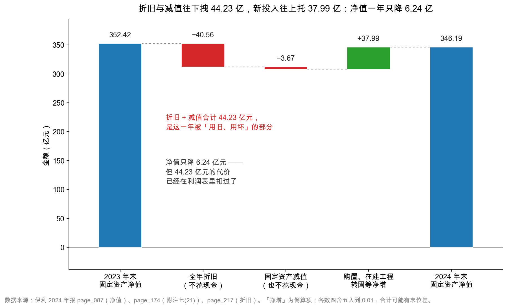
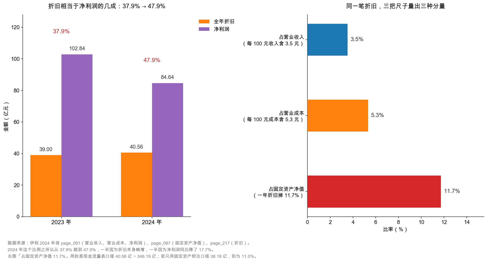

# 第 16 章：固定资产——折旧是真实的成本

> 本章你将：
> - 用一台用了十年的灌装机，看懂**原值、累计折旧、净值**这三个数字的关系；
> - 明白"折旧年限"是公司自己定的**估计**，不是老天爷给的事实——改一改，利润就变；
> - 搞清楚一件反直觉的事：折旧是**真实的成本**，却**一分钱现金都不花**；
> - 在伊利 2024 年报里亲手数出 40.56 亿元折旧，并算出它相当于净利润的 47.9%；
> - 学会用"折旧 ÷ 净利润"这个比值，判断一家公司是重资产还是轻资产。

---

## 16.1 从一台用了十年的灌装机说起

上一周我们把伊利的资产从"变现快慢"这个角度排了一遍队：货币资金、应收账款、存货……一路排到最慢的那一档。这一周接着往下走，去看那些**一年之内根本变不成现金**的东西。

先不讲报表，讲一家小厂。

假设你在 2015 年花 **100 万元**（示意数字）买了一台无菌灌装机。这台机器设计寿命大概十年，十年后报废，卖废铁能卖 5 万元。于是你心里有一本账：

- 机器买来那天，它"值"100 万；
- 十年之后，它"值"5 万；
- 中间消失的 95 万，不是被谁偷走了，而是**在这十年里一点一点被你用掉了**。

会计做的事，就是把"一点一点用掉"这件事，摊到每一年去记账。每年记 9.5 万（95 万 ÷ 10 年），记十年，账上这台机器的价值就从 100 万一路滑到 5 万。

这个"每年记一笔"的动作，就叫**折旧**（depreciation）。

生活里你其实天天在用这个概念，只是没给它起名字：你花 6,000 元买的手机，用三年，你心里会自动觉得"一年折 2,000 元"；你租的房子每年要付租金，你会把它算进每月开销——买机器和租机器，本质上是同一件事的两种付法：一个是**一次性付清、分期使用**，一个是**分期付、分期使用**。会计把前者"摊"成后者，好让每一年的利润都能公平地承担这笔代价。

> 📌 **划重点：** 折旧不是"资产贬值"，也不是"市场价下跌"，而是**把一笔已经付掉的资本开支，按使用年限分摊到各年**。它的作用是让利润表不失真——否则买机器那一年利润会突然很难看，后面九年又凭空变好。

## 16.2 原值、累计折旧、净值：三个数字，一台机器的一生

翻开伊利 2024 年报的附注七(21)（`page_174.md`），固定资产那张表分成四段，从上往下正好是一台机器的完整一生：

| 表里的名字 | 中文（英文） | 一句话解释 | 伊利 2024 年末 |
|---|---|---|---|
| 一、账面原值 | 原值（original cost） | 当初买它花了多少钱，**一旦入账基本不动** | 604.29 亿元 |
| 二、累计折旧 | 累计折旧（accumulated depreciation） | 从买来到今天，一共"用掉"了多少 | 253.39 亿元 |
| 三、减值准备 | 减值准备（impairment provision） | 认定它已经不值账上这个价，额外砍掉的部分 | 4.72 亿元 |
| 四、账面价值 | 净值（net book value） | 原值 - 累计折旧 - 减值准备 | **346.19 亿元** |

验算一下：604.29 - 253.39 - 4.72 = 346.19。三个数字咬得死死的，一分不差。资产负债表上"固定资产 346.19 亿元"（`page_087.md`）这个数，就是这张表的最后一行。

这张图把一年的变化画成了一条"桥"。左边是 2023 年末的 352.42 亿元，右边是 2024 年末的 346.19 亿元，中间四步：

1. **全年折旧 -40.56 亿元**：一年里被用旧、用掉的部分；
2. **固定资产减值 -3.67 亿元**：某些资产被认定"不值这个价了"，额外砍一刀（第 20 章细讲）；
3. **购置、在建工程转固等净增 +37.99 亿元**：新买的、新盖好的、从在建工程转过来的，减去处置报废的；
4. 落到 346.19 亿元。

看清楚了会发现一件很有意思的事：**折旧和减值把净值往下拽了 44.23 亿，新投入又托上来 37.99 亿，两下相抵，净值一年只降了 6.24 亿**（降幅 1.8%）。只看资产负债表，你会觉得"这家公司的厂房设备几乎没变"；但这句话背后，是 44 亿元的机器设备在这一年里被消耗掉了，同时又有 38 亿元的新设备补了进来。

这就是固定资产最容易被误读的地方：**它是一个"水池"，进水和出水同时开着，你看的只是水位**。

> 🔍 **翻到年报：** 打开 `page_174.md`，找到"四、账面价值"下面那两行。"1.期末账面价值"那一行的合计是 34,618,503,875.86 元，就是 346.19 亿元；"2.期初账面价值"是 35,242,168,110.11 元，就是 352.42 亿元。这两行数字和 `page_087.md` 资产负债表上"固定资产"一行的两列完全对得上——这是附注与主表的第一道勾稽。

## 16.3 折旧年限是估计，不是事实

现在到了这一章最要紧的一段。

那台灌装机"用十年"，是谁说的？

不是法律规定的，不是会计准则规定的，是**公司自己判断的**。准则只要求"在预计使用寿命内计提"，至于"预计使用寿命"是 8 年、10 年还是 15 年，由公司根据设备性质、使用强度、技术更新速度自己定，而且**每年年末要复核一次，觉得不合适就可以改**。

伊利在会计政策里把自己的估计写得清清楚楚（`page_131.md`）：

| 类别 | 折旧方法 | 折旧年限 | 残值率 |
|---|---|---|---|
| 房屋及建筑物 · 框架结构 | 年限平均法 | 20~45 年 | 5% |
| 房屋及建筑物 · 砖混结构 | 年限平均法 | 20~40 年 | 5% |
| 房屋及建筑物 · 轻钢结构 | 年限平均法 | 20 年 | 5% |
| 房屋及建筑物 · 附属建筑 | 年限平均法 | 8~20 年 | 5% |
| 机器设备 | 年限平均法 | **10 年** | 5% |
| 运输工具 · 大型运输车辆 | 年限平均法 | 10 年 | 5% |
| 运输工具 · 小型货车及轿车 | 年限平均法 | 5 年 | 5% |

"年限平均法"就是最朴素的算法：把（原值 - 残值）平均摊到每一年。机器设备按 10 年、5% 残值，年折旧率就是 9.5%。

现在做一个思想实验（以下全是**示意数字**，不对应伊利的真实设备）：

一家公司有 100 亿元机器设备，按 10 年折旧，每年折旧 9.5 亿元。如果管理层某天决定"我们的设备保养得好，能用 12 年"，年折旧率从 9.5% 降到约 7.9%，每年折旧变成 7.9 亿元——**凭空多出 1.6 亿元利润**，而车间里一台机器都没变，产量一件都没多。

反过来，把年限从 10 年改成 8 年，每年折旧变成 11.9 亿元，利润立刻少 2.4 亿元。

> ⚠️ **易踩坑：** 看到"会计估计变更"这六个字，一定要停下来看一眼方向。**延长折旧年限 = 增加当期利润**，缩短折旧年限 = 减少当期利润。这是完全合法的手段，也是财报里最常见的"温柔调节阀"之一。判断它是否合理，只需要问一句：**同行业的公司普遍按几年提？**如果同行都是 10 年，这家突然改成 15 年，那就要多问一句为什么。

那怎么知道公司有没有改过年限？两个地方：

1. **会计政策附注**（伊利的 `page_131.md`）：看年限表今年和去年是否一致；
2. **"重要会计估计变更"的专门披露**：真改了，准则要求单独说明影响金额。

伊利 2024 年**没有**发生折旧年限变更——年报第五节「公司对会计政策、会计估计变更原因和影响的分析说明」一栏勾的是「不适用」（`page_061.md`）。换句话说，这一年的 40.56 亿元折旧是在同一套规则下算出来的，和 2023 年的 39.00 亿元可以直接比。

## 16.4 折旧是真实的成本，但不花现金

接下来这件事，是整章的核心，也是很多人第一次读财报时最绕不过去的弯。

**折旧是一项真实的成本，但它不花一分钱现金。**

拆成两句话看：

**第一句：它是真实的成本。** 机器真的会旧、会坏、会被更先进的设备淘汰。一台灌装机十年后被淘汰，你必须再掏一笔钱买新的——这笔钱迟早要花。所以折旧不是"会计的游戏"，它对应着真实的、不可避免的经济代价。一家公司如果长期不更新设备，它的折旧会很低、利润会很好看，但产品质量和产能迟早出问题。**折旧低，不一定是好事。**

**第二句：它不花现金。** 买机器的钱，在买的那一年就已经付出去了（记在"购建固定资产支付的现金"里，第 17 章讲）。之后每年计提折旧，只是在账上把"已经付掉的钱"分期认成费用，**银行账户里的数字一动不动**。

把这两句话合起来，就得到了现金流量表补充资料里那条最重要的调整（`page_217.md`）：

> 净利润 84.64 亿元
> 加：固定资产折旧、油气资产折耗、生产性生物资产折旧 **40.56 亿元**
> ……

为什么"加"？因为算净利润时把折旧当费用减掉了，但折旧并没有真的付钱出去。要还原"经营活动实际收进来多少现金"，就得把它加回来。这条逻辑，第 9 章讲权责发生制时埋过一次伏笔，第 37 章讲间接法时还会再拆一遍；在这里你只要记住一句话：

> 📌 **划重点：** 折旧是"利润的减项、现金的无关项"。它在利润表里扣你一次，在现金流量表里又被加回来一次——**同一笔钱，两张表里方向相反**。凡是看到"某笔费用不花现金"，第一反应就应该是"它会在经营现金流里被加回"。

这张图左半边是我最想让你记住的一个比值：**折旧 ÷ 净利润 = 40.56 ÷ 84.64 = 47.9%**。

这句话翻译成人话是：**如果伊利这一年一分钱折旧都不用提，它的净利润会凭空多出将近一半。**反过来说，伊利每赚 100 元利润，背后压着 48 元的"机器消耗"。

右半边换三把尺子量同一笔钱：

- 占营业收入 3.5%——每卖 100 元牛奶，有 3.5 元是"机器的磨损"；
- 占营业成本 5.3%——在 762.99 亿元的成本里，折旧占 5.3%；
- 占固定资产净值 11.7%——现有这批固定资产，一年被折旧掉约八分之一。

2023 年这个比值是 39.00 ÷ 102.84 = 37.9%，2024 年升到 47.9%。升上去有两个原因，各占一半：折旧本身从 39.00 亿微增到 40.56 亿（+4.0%），而净利润从 102.84 亿降到 84.64 亿（-17.7%）。**分母缩得比分子快，比值就跳上去了**——这也是为什么"折旧占利润的比例"这个指标，在利润下滑的年份会显得格外刺眼。

## 16.5 在伊利报表上数一遍：40.56 亿从哪来

现在做一件很具体的事：把这 40.56 亿元拆开，看它到底由哪几笔组成。

你会遇到一个必须先解决的小麻烦：**固定资产附注里的"本期计提折旧"是 38.18 亿元，而现金流量表补充资料里写的是 40.56 亿元。差了 2.38 亿元。**

谁错了？都没错。差别在**口径**：

| 项目 | 金额 | 出处 |
|---|---|---|
| 固定资产本年计提折旧 | 38.18 亿元 | `page_174.md`（附注七(21)） |
| 投资性房地产本年计提折旧 | 0.38 亿元 | `page_172.md`（附注七(20)） |
| 生产性生物资产本年计提折旧 | 2.00 亿元 | `page_179.md`（附注七(23)） |
| **合计** | **40.56 亿元** | `page_217.md`（现金流量表补充资料） |

38.18 + 0.38 + 2.00 = 40.56。严丝合缝。

原来现金流量表补充资料那一行的完整名字是"**固定资产折旧、油气资产折耗、生产性生物资产折旧**"——它一口气把三类长期资产的折旧都装进去了：自己用的厂房设备（固定资产）、出租的房产（投资性房地产）、还有奶牛（生产性生物资产）。

<!-- src: 伊利股份2024年报/page_174.md 伊利股份2024年报/page_172.md 伊利股份2024年报/page_179.md 伊利股份2024年报/page_217.md -->

> 💡 **你可能会问：** 那我写分析时该用哪个数？
>
> 看你算的是什么。
> - 算"固定资产这一年消耗了多少"→ 用 **38.18 亿元**（固定资产附注口径）；
> - 算"经营现金流为什么比净利润高"→ 用 **40.56 亿元**（现金流量表口径，因为它要和补充资料里其他行加得上）；
> - 算"公司一年的总折旧摊销负担"→ 用 40.56 亿元，再叠加无形资产摊销 2.69 亿元、使用权资产摊销 1.47 亿元、长期待摊费用摊销 1.41 亿元（都在 `page_217.md` 同一张表里）。
>
> **最忌讳的是把两个口径混着用**——比如用 40.56 亿去除固定资产净值 346.19 亿，得出"折旧率 11.7%"，却宣称这是"固定资产的折旧率"。严格说，40.56 亿里只有 38.18 亿是固定资产的，正确算法是 38.18 ÷ 346.19 = 11.0%。差 0.7 个百分点，不算大，但做分析时这种"口径混用"会一路累积成大错。

除了折旧，这一年固定资产还有两笔值得单独看的账，都在 `page_175.md`：

**第一笔：暂时闲置的固定资产。** 账面原值 9.97 亿元，累计折旧 4.74 亿元，减值准备 4.51 亿元，账面价值只剩 **0.73 亿元**。也就是说，这批闲着没开工的设备，账上已经砍到原值的 7%。这是很实在的处理——闲置资产不打肿脸充胖子。

**第二笔：未办妥产权证书的固定资产。** 房屋及建筑物账面价值 **13.03 亿元**，年报给的原因是"新建项目投入使用时间较短，正在办理过程中"。这条本身不一定是问题，但它是一个提醒：**账上写着"房屋及建筑物"，法律上还不完全属于你**。真出纠纷时，这 13 亿元是可能要打问号的。

## 16.6 折旧告诉我们的三件事

把这一章收一收。折旧这个数字，能帮你回答三个问题。

**第一问：这家公司是重资产还是轻资产？**

用"固定资产 ÷ 总资产"看：伊利 346.19 ÷ 1,537.18 = **22.5%**。也就是说，公司每 100 元资产里，有 22.5 元压在了厂房设备上。这个比例在制造业里算中等——它比钢铁、电力、面板这类典型重资产（常见 50% 以上）轻得多，但比软件、白酒、互联网这类轻资产（常常个位数）重得多。

乳业是个"必须自己有厂"的生意：原奶要冷藏、灌装要无菌线、保质期短要求产能贴近市场。这些都不是能外包的东西。所以伊利带着 346 亿元的固定资产，是这门生意的**必然长相**，不是管理层的偏好。

**第二问：利润里有多少是"机器的磨损"？**

用"折旧 ÷ 净利润"看：47.9%。这个比值越高，说明这家公司的利润越"重"——赚来的钱里有很大一块必须留着更新设备，不能全分给股东。反过来，一家折旧只占利润 5% 的公司，理论上更"轻"，分红能力更强。

**第三问：这家公司是在保养设备，还是在吃老本？**

这个问题要等下一章才能完整回答，但线索已经出现了：2024 年伊利的资本开支是 39.78 亿元，比折旧 40.56 亿元还少 0.78 亿元。**当"新投入"少于"旧消耗"时，固定资产这个水池的水位就是在缓慢下降的**——这一年确实降了 6.24 亿元。这不必然是坏事（可能是产能已经够用、也可能是行业需求放缓），但它是必须被看见的信号。

> ⚠️ **易踩坑：** "折旧是真实成本"这句话，不等于"折旧越高的公司越差"。折旧高，往往意味着它**当年真的投了很多钱建产能**；折旧低，也可能是它**很多年没更新设备**。要判断好坏，得把折旧和资本开支放在一起看（下一章），再和收入增速放在一起看。单独看任何一个数，都会看错。

## ✍️ 想一想

> 建议先自己写两句话，再翻答案。想不清楚的地方，就是该回头重读的地方。

### 问 1：把折旧年限改长，利润会变成多少

某公司有机器设备原值 **50 亿元**（示意数字），残值率 5%，原来按 **10 年**折旧。现在管理层决定改成 **12 年**。假设所得税率 25%，其他一切不变。请回答：（1）每年折旧从多少变成多少？（2）税前利润增加多少？（3）净利润增加多少？（4）这个改动合不合法？

**解题思路：** 三步走。第一步，先算"应折旧总额"= 原值 $\times$（1 - 残值率），这是十年、十二年都不变的那个总数。第二步，除以年限得到年折旧，两者相减就是费用的变化。第三步，费用减少额 $\times$（1 - 税率）才是净利润的变化——**别漏了所得税这一层**。

**参考答案：**

应折旧总额 = 50 $\times$ (1 - 5%) = **47.5 亿元**，这个数不随年限变。

| 项目 | 按 10 年 | 按 12 年 | 变化 |
|---|---|---|---|
| 每年折旧 | 47.5 ÷ 10 = **4.75 亿元** | 47.5 ÷ 12 $\approx$ **3.96 亿元** | -0.79 亿元 |
| 税前利润 | 基准 | 基准 + 0.79 亿元 | +0.79 亿元 |
| 所得税（25%） | 基准 | 基准 + 0.20 亿元 | +0.20 亿元 |
| 净利润 | 基准 | 基准 + **0.59 亿元** | **+0.59 亿元** |

所以：折旧从 4.75 亿元降到约 3.96 亿元；税前利润增加 0.79 亿元；净利润增加约 **0.59 亿元**（0.79 $\times$ 75%）。

第四问：**合法**。折旧年限属于"会计估计"，准则允许公司在每年年末复核后调整，只要在附注里披露变更内容和影响金额即可。这是完全合规的操作，不需要谁批准。

**易错点：** ① 忘了残值率，直接用 50 ÷ 10 = 5 亿元当年折旧，后面全错；② 把"税前利润增加 0.79 亿"直接当成"净利润增加 0.79 亿"，漏掉所得税——这是本题最常见的错；③ 答"不合法，属于操纵利润"。**合法与合理是两件事**：它合法，但如果你发现同行都按 10 年、只有它改成 12 年，那这份"合法"就值得警惕；④ 忘了"应折旧总额不变"这个前提，误以为改年限会让总折旧变多或变少。总折旧一分不多一分不少，变的只是**摊到哪几年**。

### 问 2：40.56 亿和 38.18 亿，哪个才是对的

伊利 2024 年固定资产附注里写"本期计提折旧 38.18 亿元"，现金流量表补充资料里却写"固定资产折旧、油气资产折耗、生产性生物资产折旧 40.56 亿元"。两个数差 2.38 亿元。请问：（1）这是不是报表出错？（2）差额由什么构成？（3）如果我要算"经营现金流为什么比净利润高"，该用哪个？

**解题思路：** 先别急着判对错。财务报告里两个数不一致，九成是**口径不同**，只有一成是真错。解题的关键动作是：把两处的**完整标题**读一遍——注意现金流量表那一行的名字里，除了"固定资产折旧"，还写着什么。

**参考答案：**

（1）**不是出错**，是口径不同。

（2）差额 2.38 亿元，是另外两类资产的折旧：

| 组成 | 金额 | 出处 |
|---|---|---|
| 固定资产折旧 | 38.18 亿元 | `page_174.md` |
| 投资性房地产折旧 | 0.38 亿元 | `page_172.md` |
| 生产性生物资产折旧 | 2.00 亿元 | `page_179.md` |
| **合计** | **40.56 亿元** | `page_217.md` |

38.18 + 0.38 + 2.00 = 40.56，差额正好解释完。

（3）算"经营现金流为什么比净利润高"时，**必须用 40.56 亿元**。因为现金流量表补充资料是一整条加法链：净利润 84.64 亿 + 资产减值 46.76 亿 + 信用减值 5.55 亿 + 折旧 40.56 亿 + 摊销……每一行都要能和下一行加得上。你要是硬塞 38.18 进去，这条链就断了 2.38 亿，最后倒推出来的经营现金流会对不上 217.40 亿元。

**易错点：** ① 一口咬定"报表错了"或"公司造假"。2.38 亿元的差额在 1,537 亿元总资产面前只有 0.15%，而它有一个干净的解释——先找解释，再谈怀疑；② 用 38.18 亿去算折旧占净利润的比例，得出 45.1%，与正文的 47.9% 打架。两个数都能算，但**必须说明你用的是哪个口径**；③ 只记住"两个数不一样"，没记住"差别在哪三笔"。下次换一家公司（比如有大量出租房产的公司），差额会更大，到时候还得重新推一遍。

### 问 3：经营现金流远高于净利润，说明什么

伊利 2024 年净利润 84.64 亿元，经营活动现金流净额 217.40 亿元，后者是前者的 2.57 倍。有位朋友说："经营现金流是净利润的 2.5 倍，说明这家公司赚钱能力特别强。"这个说法对吗？请用本章学到的折旧知识，至少给出两个可能的原因。

**解题思路：** 先把"现金流比利润高"这件事拆成"哪些费用扣了利润但没付现金"。本章刚学的折旧是第一个；上一周学的存货跌价、这一周后面要学的商誉减值，都是同一类。**"不花现金的费用"越多，两者的差距越大。** 然后再想一层：这个差距是"好事"还是"中性"，取决于这些费用是什么性质。

**参考答案：**

这个说法**不准确**。经营现金流高于净利润，只能说明"利润里有相当一部分没有对应的现金流出"，不能直接推出"赚钱能力强"。

至少两个原因：

**原因一：折旧摊销。** 40.56 亿元折旧在利润表里扣掉了，但没付现金，算经营现金流时被加回来。仅这一项就贡献了 40.56 亿元的差距。

**原因二：减值损失。** 2024 年资产减值 46.76 亿元 + 信用减值 5.55 亿元，合计 52.31 亿元，同样只扣利润、不付现金（第 19、20 章细讲）。加回这一项，又贡献 52.31 亿元。

两项相加已经 92.87 亿元。84.64 + 92.87 $\approx$ 177.5 亿元，再加上摊销、营运资本变动等，走到 217.40 亿元是合理的。

所以正确的说法是：**"伊利的利润里，有相当大一块是被折旧和减值压下去的；这些压制不消耗现金，所以现金流看起来比利润漂亮得多。"**

但这里有个关键的分岔：

| 压制利润的项目 | 性质 | 对现金流的意义 |
|---|---|---|
| 折旧、摊销 | **每年都会发生**，是生意的常态成本 | 现金流高于利润是**结构性**的，可以持续 |
| 大额减值 | **偶发**，是过去决策的一次性清算 | 现金流高于利润是**一次性**的，明年不会重复 |

2024 年伊利的情况是两者叠加：折旧是常态，减值是一次性。所以看这一年 2.57 倍的"净现比"（经营现金流 ÷ 净利润），不能简单外推到明年——**明年没有这 52 亿元减值，这个比值会自动回落**。

**易错点：** ① 直接说"2.5 倍说明质量好"，把"结构性"和"一次性"混为一谈；② 只提折旧，忘了减值——2024 年伊利的减值比折旧还大；③ 反过来矫枉过正，说"现金流高是假的"。现金流是真的，217.40 亿元确实进了银行账户，只是**它的来源不是"多赚了"，而是"少付了"**。

## 📎 数据出处

- 伊利股份 2024 年报 `page_087.md`：合并资产负债表，"固定资产"346.19 亿元（2023 年 352.42 亿元）
- `page_174.md`：附注七(21) 固定资产情况——原值 604.29 亿元、累计折旧 253.39 亿元、减值准备 4.72 亿元、本年计提折旧 38.18 亿元
- `page_175.md`：暂时闲置固定资产（原值 9.97 亿元、账面价值 0.73 亿元）、未办妥产权证书的固定资产（13.03 亿元）
- `page_131.md`：会计政策——固定资产折旧年限与残值率
- `page_172.md` / `page_179.md`：投资性房地产折旧 0.38 亿元、生产性生物资产折旧 2.00 亿元
- `page_217.md`：现金流量表补充资料——折旧 40.56 亿元、无形资产摊销 2.69 亿元
- `page_091.md` / `page_092.md`：利润表——营业收入 1,153.93 亿元、营业成本 762.99 亿元、净利润 84.64 亿元
- `page_211.md`：资产减值损失——固定资产减值 3.67 亿元
- 数据汇总：`data/yili2024.json` 的 `balance`、`cashflow`、`notes`、`compare_2023` 段

<!-- src: 伊利股份2024年报/page_061.md 伊利股份2024年报/page_087.md 伊利股份2024年报/page_091.md 伊利股份2024年报/page_092.md 伊利股份2024年报/page_131.md 伊利股份2024年报/page_174.md 伊利股份2024年报/page_175.md 伊利股份2024年报/page_211.md 伊利股份2024年报/page_217.md -->

下一章：[第 17 章：在建工程与资本开支——扩张的脚印](17-在建工程与资本开支.md)。折旧讲的是"旧资产怎么被消耗掉"，下一章讲"新资产怎么长出来"：那 29.55 亿元还没开始干活的在建工程，和 39.78 亿元真金白银的资本开支。
