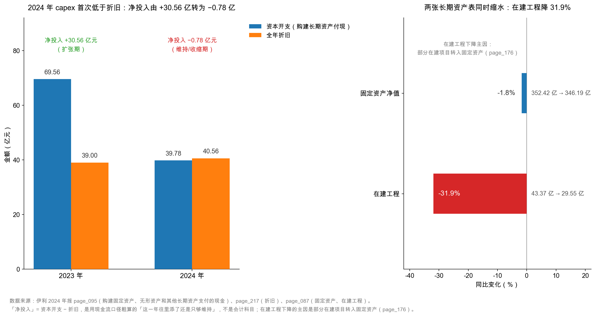

# 第 17 章：在建工程与资本开支——扩张的脚印

> 本章你将：
> - 弄懂**在建工程**（construction in progress）为什么叫"还没开始干活的资产"，以及它为什么不折旧；
> - 学会区分"在建工程"（账面状态）和"资本开支"（现金流向）——它们说的不是同一件事；
> - 看懂伊利 2024 年**资本开支 39.78 亿元、低于折旧 40.56 亿元**这个信号的含义；
> - 掌握"转固"（转入固定资产）这个动作，以及它如何决定未来的折旧负担；
> - 用"资本开支 ÷ 折旧"这一个比值，判断一家公司是在扩张、维持，还是收缩。

---

## 17.1 一块还没挂上墙的招牌

上一章我们讲的是"旧资产怎么被用掉"。这一章讲另一半：**新资产是怎么长出来的**。

还是从一家小店说起。

你盘下一间铺面，准备开第二家奶茶店。装修队进场了，先做水电，再贴瓷砖，最后装设备。这三个月里，你天天往工地跑，天天付钱：今天给装修队 3 万，明天买两台制冰机 5 万，后天付消防改造 2 万。**钱一直在出，但这家店一分钱营业额都没有。**

这三个月，账上应该怎么记？

如果把这 10 万元直接记成"费用"，那这三个月的利润会非常难看，而隔壁那家已经开业、正在赚钱的老店却毫发无伤——两家店明明是同一个人在经营，凭什么一家亏一家赚？更荒唐的是，等新店开业那天，账上会突然"多出"一堆本来就在那儿的设备。

所以会计发明了一个中间站：**在建工程**。

钱花出去了，先不记成费用，也不记成"能用的固定资产"，而是攒在"在建工程"这个格子里。等装修完工、设备调试完毕、真正能开门做生意的那一天，再一次性把这一格里的钱搬进"固定资产"，从那时起才开始计提折旧。

这个"搬"的动作，叫**转固**（transfer to fixed assets）。

> 📌 **划重点：** 在建工程是"已经花了钱、但还不能干活"的资产。它有三个特点：**不计提折旧**（还不能用，谈不上磨损）、**占用资金**（钱已经出去了）、**不产生收入**（还没开业）。它是资产负债表上最诚实的"未来"——你从它的规模，能看出这家公司打算干什么。



这张图左右两半，讲的是同一件事的两个侧面。

左半边是一组很关键的对比：2023 年，伊利花在"购建固定资产、无形资产和其他长期资产"上的现金是 **69.56 亿元**，而当年折旧只有 39.00 亿元——新投入是旧消耗的 1.78 倍，那是在**铺摊子**。2024 年，资本开支降到 **39.78 亿元**，折旧升到 40.56 亿元，比值变成 **0.98 倍**——新投入已经盖不住旧消耗了，这是在**守摊子**。

右半边更能说明问题：固定资产净值从 352.42 亿元微降到 346.19 亿元（-1.8%），而在建工程从 43.37 亿元掉到 **29.55 亿元**（-31.9%）。两条线一起往下，指向同一个结论：**这一年的伊利，不是在扩张，而是在收尾。**

## 17.2 在建工程：还没开始干活的资产

先把概念钉死。

**在建工程**（construction in progress），指企业正在建造、安装、改造，尚未达到预定可使用状态的固定资产项目。它的会计处理有三条铁律：

| 铁律 | 内容 | 为什么 |
|---|---|---|
| 一 | 建造期间发生的支出，计入在建工程，**不计入当期费用** | 这笔钱换来的是未来的产能，不是当期的消耗 |
| 二 | 在建工程**不计提折旧** | 折旧的本质是"使用造成的消耗"，还没使用，就谈不上消耗 |
| 三 | 达到预定可使用状态时，**转入固定资产**，从次月起计提折旧 | 从这一刻起，它开始"干活"，也开始"变旧" |

第二条最容易理解错。有人会想："机器放在工地上风吹日晒，不也在变旧吗？"

会。但会计上的折旧不是"物理老化"，而是"**经济利益的分摊**"。一台还没投产的设备，它的经济寿命一天都没开始消耗——你把它折旧了，等于把未来的成本提前扣到今年的利润上，反而失真。所以准则选择"等它开始干活，再开始摊"。

这也带来一个必须警惕的后果：**在建工程是一个可以合法"藏利润"的地方。**

想象一家公司今年利润差一点，只要有一个大项目拖着不转固，它就能继续不计提折旧——每拖一年，就少一笔折旧费用，利润就好看一点。反过来，如果它想在某一年"洗个澡"，就把几个项目一起转固，折旧集中爆发。这两种操作都不违规，因为"什么时候算达到预定可使用状态"是个**判断**，不是个日期。

> ⚠️ **易踩坑：** 看到一家公司在建工程**连续多年余额很高、迟迟不转固**，一定要多问一句。正常的工程有工期，一个厂区盖三五年还算合理，盖八年十年就反常了。判断方法很简单：把最近三年的在建工程余额排一排，看它是"高位稳定"还是"逐年转出"。前者要么是项目烂尾，要么是刻意拖延折旧。

那伊利的情况呢？`page_176.md` 给了明确回答：

> 在建工程减少主要原因：本期部分在建项目转入固定资产所致。

一句话，把 13.82 亿元的降幅解释清楚了——不是项目黄了，是**建完了，转固了**。转了多少？`page_174.md` 的固定资产原值表里有一行"（2）在建工程转入 **42.49 亿元**"。这就是 2024 年从"工地"搬进"车间"的金额。

## 17.3 29.55 亿元里都是什么

打开附注七(22)（`page_176.md`），在建工程按项目拆开，一共五个格子：

| 项目 | 2024 年末 | 2023 年末 | 变化 |
|---|---|---|---|
| 奶粉项目 | **22.50 亿元** | 25.32 亿元 | -2.82 亿元 |
| 其他项目 | 5.48 亿元 | 6.52 亿元 | -1.04 亿元 |
| 液态奶项目 | 1.13 亿元 | 3.42 亿元 | -2.29 亿元 |
| 冷饮项目 | 0.28 亿元 | 7.77 亿元 | **-7.49 亿元** |
| 酸奶项目 | 0.10 亿元 | 0.27 亿元 | -0.17 亿元 |
| **在建工程小计** | **29.49 亿元** | 43.29 亿元 | -13.80 亿元 |
| 工程物资 | 0.06 亿元 | 0.07 亿元 | -0.01 亿元 |
| **合计** | **29.55 亿元** | **43.37 亿元** | **-13.82 亿元** |

<!-- src: 伊利股份2024年报/page_176.md 伊利股份2024年报/page_087.md -->

这张表值得逐行读，因为它几乎是伊利这几年战略的一张"施工图"：

**第一，奶粉项目占了 22.50 亿元，是在建工程里的绝对大头（占 76.3%）。** 这个数字背后是澳优——2021 年伊利收购澳优乳业，看中的就是羊奶粉和婴幼儿配方奶粉这条线。奶粉产能的建设周期长、单条生产线贵，所以它的在建工程余额一直很高。

**第二，冷饮项目从 7.77 亿元掉到 0.28 亿元，降幅 96%。** 这不是"不做了"，而是"做完了"——大概率就是在这一年大批转固。液态奶项目同理，从 3.42 亿元降到 1.13 亿元。这两个数字合起来，正好解释了 42.49 亿元的转固额从哪来。

**第三，工程物资只有 0.06 亿元。** 工程物资是"买来准备用在工程上、但还没用掉的钢材水泥设备"。这个数字很小，说明伊利的工程不是"囤料待建"，而是"边建边用"——工程节奏是紧的，没有大量材料趴在仓库里。

把这张表和上一章的固定资产表放在一起看，一条完整的链条就出来了：

```
2023 年在建工程 43.37 亿
   → 2024 年投入新工程（含在 39.78 亿 capex 里）
   → 2024 年转固 42.49 亿
   → 2024 年末在建工程 29.55 亿
   → 固定资产净值 346.19 亿（其中新增的 42.49 亿开始计提折旧）
```

**转固不是终点，而是折旧的起点。** 这句话是本章最重要的一句。42.49 亿元的新资产从转固那天起，就加入了每年计提折旧的队伍。按伊利机器设备 10 年、残值 5% 的口径粗算，这 42.49 亿元未来每年会带来约 4.0 亿元的折旧（42.49 $\times$ 95% ÷ 10 $\approx$ 4.04 亿元，这是**估算**，因为实际构成里房屋占一部分、年限更长）。

这解释了上一章那个看着奇怪的组合：**折旧在涨（39.00 → 40.56 亿），而资本开支在降（69.56 → 39.78 亿）。** 因为折旧算的是"过去几年投下去的资产"，资本开算的是"今年新投的钱"——**折旧是昨天 capex 的回声，今天的 capex 是明天折旧的预告。** 两者之间隔着两三年，本来就不同步。

## 17.4 资本开支：39.78 亿元现金去了哪

现在换个视角：不看账面状态，看**现金**。

利润表里没有"资本开支"这个科目，因为它根本不进利润表——买设备的钱不进费用，进的是资产。所以你只能在现金流量表里找它，就在投资活动那一节（`page_095.md`）：

> 购建固定资产、无形资产和其他长期资产支付的现金 **39.78 亿元**（2023 年：69.56 亿元）

这行长得吓人，但拆开只有三件事：

| 这笔钱花在什么上 | 对应资产 | 是否进利润表 |
|---|---|---|
| 买设备、盖厂房 | 固定资产 / 在建工程 | 不进（分期折旧） |
| 买地、买软件、买专利 | 无形资产 | 不进（分期摊销） |
| 其他长期资产 | 长期待摊费用等 | 不进（分期摊销） |

**"资本开支"（capital expenditure，简称 capex）** 这个词，说白了就是"**这一年为了长期资产花掉的现金**"。它是现金流量表上的一个数，不是资产负债表上的一个科目——这一点特别容易混，务必分清：

| 你看到的词 | 在哪张表 | 说的是什么 | 伊利 2024 |
|---|---|---|---|
| 在建工程 | 资产负债表 | 此刻**还没干完**的工程值多少钱 | 29.55 亿元 |
| 固定资产 | 资产负债表 | 此刻**在用的**资产还值多少钱 | 346.19 亿元 |
| 资本开支 | 现金流量表 | 这一年为长期资产**付了多少现金** | 39.78 亿元 |
| 折旧 | 现金流量表补充资料 | 这一年**用掉了**多少旧资产 | 40.56 亿元 |

四个数字，四个不同的东西。混用其中任意两个，结论都会跑偏。

> 💡 **你可能会问：** capex 39.78 亿，为什么在建工程只降了 13.82 亿、固定资产只降了 6.24 亿？这 39.78 亿去哪了？
>
> 因为 capex 是**现金口径**，资产是**净额口径**，中间隔着三道"漏斗"：
>
> 1. **不是所有 capex 都变成资产**。有一部分进了无形资产（比如软件、土地使用权），有一部分是预付工程款，期末还挂在"其他非流动资产"里；
> 2. **资产在同期被折旧和减值扣掉了**。这一年折旧 40.56 亿、减值 3.67 亿，两边一抵，新增的 39.78 亿几乎被抵消干净；
> 3. **有处置和转出**。固定资产本期减少 23.27 亿元（处置报废 13.21 亿 + 其他减少 10.06 亿）。
>
> 所以 39.78 亿元的 capex，落到报表上是一场"进水和出水同时进行"的净额游戏。**看现金口径看趋势，看资产口径看家底，两者不可互相验算。**

## 17.5 一个比值：资本开支 ÷ 折旧

学到这里，你已经可以算一个特别有用的比值了：

$$\text{再投资强度} = \frac{\text{资本开支}}{\text{折旧}}$$

它的含义非常直白：**公司今年新投的钱，是旧资产消耗的几倍？**

| 比值 | 含义 | 通常出现在 |
|---|---|---|
| 明显大于 1（如 1.5~3） | 在扩张：新产能、新市场 | 成长期公司、行业景气上行 |
| 约等于 1（0.9~1.1） | 在维持：投的钱刚够补上消耗 | 成熟公司、行业见顶 |
| 明显小于 1（如 0.5~0.8） | 在收缩：只做必要维护，或先消化过剩产能 | 行业下行、去杠杆、整合期 |

伊利这三年的节奏，正好走了一遍完整的弧线：

| 年份 | 资本开支 | 折旧 | 比值 | 状态 |
|---|---|---|---|---|
| 2023 | 69.56 亿元 | 39.00 亿元 | **1.78** | 扩张 |
| 2024 | 39.78 亿元 | 40.56 亿元 | **0.98** | 维持/收缩 |

从 1.78 降到 0.98，一年之内完成的转向。这个转向意味着什么？三种解读，都成立，但含义完全不同：

**解读一：产能够了，不用再投了。** 前几年建成的产线陆续投产（42.49 亿元转固就是证据），产能利用率还有富余，再建就是浪费。这是**健康的收缩**。

**解读二：需求不行了，不敢投了。** 2024 年伊利营业收入 1,153.93 亿元，同比下降 8.24%（`page_007.md`）。收入在降，产能却在增加，那就更不该投。这是**被动的收缩**。

**解读三：钱要拿去做别的事。** 比如分红、还债、回购。2024 年伊利分配股利、利润或偿付利息支付的现金 90.92 亿元（`page_095.md`），比资本开支的两倍还多。这是**主动的选择**。

三种解读，光看 capex 和折旧两个数分不出来。要区分，得再加上收入增速和分红政策一起看。**这就是为什么第 17 章必须放在第 16 章后面：折旧告诉你"过去投了多少"，capex 告诉你"现在还投不投"，而"为什么"要等第 6 周读完利润表才能回答。**

> 🔍 **翻到年报：** 打开 `page_095.md`，找到"购建固定资产、无形资产和其他长期资产支付的现金"这一行。它上面一行是"投资活动现金流入小计"，下面一行是"投资支付的现金 342.54 亿元"。
>
> 注意后者——**342.54 亿元是买理财、存单的钱，不是买设备的钱**。很多人把这两个数看混，得出"伊利一年投资 380 亿"的错误结论。真正对应产能的，只有 39.78 亿元这一行。这个区分，第 12 章讲"钱搬家"时提过一次，在这里再次出现。

## 17.6 和蒙牛比一比：两种"重"

把蒙牛 2024 年的同一组数字摆过来（蒙牛年报以人民币千元列示，已换算成亿元）：

| 指标 | 伊利 | 蒙牛 |
|---|---|---|
| 固定资产净值 | 346.19 亿元 | 209.05 亿元 |
| 在建工程 | 29.55 亿元 | 22.78 亿元 |
| 资本开支 | 39.78 亿元 | 34.75 亿元 |
| 折旧 | 40.56 亿元 | 29.53 亿元 |
| 资本开支 ÷ 折旧 | **0.98** | **1.18** |
| 营业收入 | 1,153.93 亿元 | 886.75 亿元 |
| 固定资产 ÷ 营业收入 | 30.0% | 23.6% |

<!-- src: 蒙牛乳业2024年报/page_142.md 蒙牛乳业2024年报/page_147.md -->

这张表能读出两件事：

**第一，伊利的资产更"重"。** 每 100 元收入背后压着 30.0 元固定资产，蒙牛是 23.6 元。伊利自己建厂更多、产能更"实"；蒙牛有一部分产能靠代工和联营（比如现代牧业这类上游联营公司），固定资产相对轻。

**第二，两家的投资节奏不同步。** 伊利的 capex ÷ 折旧 已经落到 0.98（守），蒙牛还是 1.18（还在小幅投）。同一个行业、同一年，两家走在了不同的节奏上——这本身就是一条有价值的信息：**行业里的龙头不再扩产时，往往意味着整个行业的需求进入平台期。**

不过要小心一个陷阱：**"重"不等于"差"，"轻"也不等于"好"。** 重资产的好处是产能可控、质量可控、护城河更硬；坏处是退出难、折旧压力大、需求下滑时产能会变成包袱。轻资产反过来。判断哪种更好，唯一的标准是：**这门生意需要什么？**

乳业需要冷链、需要无菌灌装、需要贴近市场的产能，所以"重"是这门生意的必然长相。如果哪天伊利变得很"轻"，那才需要问一句：它是不是把厂卖了？

> ⚠️ **易踩坑：** 跨公司比"资本开支 ÷ 折旧"时，一定要确认**折旧口径一致**。伊利这个 40.56 亿元是"固定资产 + 投资性房地产 + 生产性生物资产"三项合计（上一章讲过），蒙牛的 29.53 亿元是"物业厂房设备折旧"单项。两者的边界不完全一样，比出来的 0.98 与 1.18 只能看**方向和量级**，不能当精确比值用。

## ✍️ 想一想

### 问 1：capex 低于折旧，是好事还是坏事

伊利 2024 年资本开支 39.78 亿元，低于折旧 40.56 亿元。请回答：（1）这意味着固定资产的"水池"在进水还是出水？（2）这个信号是好事还是坏事？（3）你需要再找哪两个数据才能判断？

**解题思路：** 先做一次最简单的"水池"推理：进水（capex）少于出水（折旧 + 减值），水位必然下降。然后注意——**"水位下降"本身是中性的**，好坏取决于原因。要区分原因，就得找能反映"需求"和"产能利用率"的数据。

**参考答案：**

（1）**出水**。进水 39.78 亿元，出水至少 40.56 亿元（折旧）+ 3.67 亿元（减值）= 44.23 亿元，净流出 4.45 亿元。实际固定资产净值降了 6.24 亿元，差额来自处置和转出。**这个水池的水位在缓慢下降。**

（2）**本身是中性的，不能直接判定好坏。** 它只说明"公司今年投的钱，不够补上旧资产的消耗"。这可能是理性的（产能已够、需求见顶），也可能是被迫的（没钱投、或者不敢投）。

（3）至少还要两个数据：

| 要补的数据 | 在哪找 | 怎么用 |
|---|---|---|
| **营业收入增速** | 利润表 / 主要会计数据（`page_007.md`） | 收入在涨而 capex 在降 → 效率提升，好；收入在降且 capex 在降 → 需求萎缩，要警惕 |
| **产能利用率或产量** | 年报"管理层讨论与分析"里的产销数据 | 产能利用率高（比如 85% 以上）还停止扩张 → 可能判断失误；利用率低还停止扩张 → 理性 |

伊利 2024 年营业收入同比下降 8.24%，属于"收入在降 + capex 在降"这一格。这个组合最需要警惕：**它不是"效率提升"，而是"需求在收缩"。**

**易错点：** ① 直接说"capex 低于折旧说明公司在衰退"——太急，也可能是主动收手；② 直接说"这是好事，说明不乱花钱"——同样太急，也可能是没钱可投；③ 忘了把减值算进"出水"。只算折旧会低估出水，得出"其实差不多"的错误结论。

### 问 2：在建工程为什么不折旧，长期不转固会怎样

（1）一台已经买来、装在工地上但还没投产的设备，为什么不计提折旧？（2）如果一家公司把一个早就完工的项目一直挂在"在建工程"里不转固，会对利润产生什么影响？（3）投资者怎么发现这件事？

**解题思路：** 第一问回到折旧的本质——它是"经济利益的分摊"，没开始用就没有分摊的起点。第二问顺着第一问推：不转固 = 不计提折旧 = 费用少 = 利润高，但要同时想"资产负债表会怎样"。第三问考的是**横向对比 + 纵向对比**两把尺子。

**参考答案：**

（1）因为折旧的本质是**把资产的经济利益按使用年限分摊到各期**。设备还没投产，它的经济寿命一天都没开始消耗，此时计提折旧等于把未来的成本提前扣到今年，反而让利润失真。准则因此规定：**达到预定可使用状态时转固，从次月起计提折旧。**

（2）影响有三层，一层比一层深：

| 层面 | 影响 |
|---|---|
| 利润表 | 少计提折旧 → 费用减少 → **当期利润虚高** |
| 资产负债表 | 在建工程虚高、固定资产虚低；资产总额不变，但**结构失真** |
| 未来 | 一旦转固，折旧集中释放，**未来某一年利润会突然塌陷** |

这就是所谓"**折旧的时间差**"：把费用往后推，短期好看，长期要还。和第 18 章要讲的"研发费用资本化"是同一个套路——**把今天的成本推到明天**。

（3）三把尺子一起用：

- **纵向**：把最近三到五年的在建工程余额排一排，看它是不是"只增不减"或"高位横盘"。正常的工程有工期，余额应该"涨—平—转出"；
- **横向**：和同行比"在建工程 ÷ 固定资产"。伊利是 29.55 ÷ 346.19 = 8.5%，如果某家公司常年 30% 以上，就要问为什么；
- **看附注**：年报会披露"在建工程本期转入固定资产金额"和"工程进度"。如果某个项目进度写着"100%"却连着两年没转固，那就是明牌。

**易错点：** ① 答"因为设备还没付完钱"。折旧与付没付钱无关，只与"能不能用"有关；② 只答"利润变高"，没答"未来会塌陷"。这道题的考点是**时间差**，不是单年影响；③ 忘了看附注里的"工程进度"。很多人只看余额，其实进度百分比才是最直接的证据。

### 问 3：42.49 亿元转固，未来每年多多少折旧

伊利 2024 年从在建工程转入固定资产 **42.49 亿元**。假设这批新资产全部是机器设备，按伊利会计政策（10 年、残值率 5%、年限平均法）计提折旧。请估算：（1）未来每年新增折旧多少？（2）如果其中一半其实是房屋建筑物（按 30 年、残值率 5%），估算会变成多少？（3）这个估算对判断伊利未来利润有什么用？

**解题思路：** 第一步，把"原值"换成"应折旧总额"= 原值 $\times$（1 - 5%）。第二步，除以年限。第三问注意：这是**估算**，必须说明假设，不能当成精确预测。

**参考答案：**

（1）全部按机器设备（10 年）：

$$42.49 \times (1 - 5\%) \div 10 = 40.37 \div 10 \approx 4.04 \text{ 亿元/年}$$

**未来每年新增折旧约 4.04 亿元。**

（2）一半机器设备、一半房屋（30 年）：

| 部分 | 金额 | 应折旧总额 | 年折旧 |
|---|---|---|---|
| 机器设备（10 年） | 21.25 亿元 | 20.18 亿元 | 2.02 亿元 |
| 房屋建筑物（30 年） | 21.25 亿元 | 20.18 亿元 | 0.67 亿元 |
| **合计** | 42.49 亿元 | — | **约 2.69 亿元/年** |

**从 4.04 亿元降到 2.69 亿元**——差了 1.35 亿元。这就是为什么"资产结构"这么重要：同样一笔钱，盖房子和买设备，未来的折旧负担能差一倍。

（3）三个用处：

- **预判利润压力**：4 亿元左右的新增折旧，相当于 2024 年归母净利润 84.53 亿元的 4.8%。如果收入不增长，这就是实打实的利润拖累；
- **验证折旧趋势**：2024 年折旧 40.56 亿元，比 2023 年的 39.00 亿元多了 1.56 亿元。而按上面的估算，转固带来的年化增量约 4 亿元——说明增量是**逐步**体现的（年中转固只提几个月），明年折旧还会继续往上走；
- **识别"折旧拐点"**：当 capex 连续几年低于折旧，新增转固会越来越少，折旧总额会在某一年见顶回落。那一年之后，利润会"轻"一些——这是重资产公司特有的利润节奏。

**易错点：** ① 忘了残值率，直接用 42.49 ÷ 10 = 4.25 亿元；② 把估算写成确定值。必须写"约""估算"，并说明假设（全部机器设备 / 一半房屋）；③ 忘了"年中转固只提几个月折旧"这件事，拿年化数字去对全年实际折旧，然后发现对不上就以为算错了。

## 📎 数据出处

- 伊利股份 2024 年报 `page_087.md`：在建工程 29.55 亿元（2023 年 43.37 亿元）、固定资产 346.19 亿元
- `page_176.md`：附注七(22) 在建工程明细（奶粉 22.50 亿元、其他 5.48 亿元、液态奶 1.13 亿元、冷饮 0.28 亿元、酸奶 0.10 亿元），及"在建工程减少主要原因：本期部分在建项目转入固定资产"
- `page_174.md`：附注七(21) 固定资产原值表——在建工程转入 42.49 亿元、购置 2.59 亿元、本期减少 23.27 亿元
- `page_095.md`：现金流量表——购建固定资产、无形资产和其他长期资产支付的现金 39.78 亿元（2023 年 69.56 亿元）；投资支付的现金 342.54 亿元；分配股利、利润或偿付利息支付的现金 90.92 亿元
- `page_217.md`：折旧 40.56 亿元（2023 年 39.00 亿元）
- `page_007.md`：营业收入同比 -8.24%
- `page_131.md`：折旧年限与残值率（机器设备 10 年、房屋 20~45 年、残值率 5%）
- 蒙牛乳业 2024 年报 `page_142.md`（固定资产 209.05 亿元、在建工程 22.78 亿元）、`page_147.md`（资本开支 34.75 亿元、折旧 29.53 亿元）
- 数据汇总：`data/yili2024.json`、`data/mengniu2024.json`

<!-- src: 伊利股份2024年报/page_007.md 伊利股份2024年报/page_087.md 伊利股份2024年报/page_095.md 伊利股份2024年报/page_131.md 伊利股份2024年报/page_174.md 伊利股份2024年报/page_176.md 伊利股份2024年报/page_217.md 蒙牛乳业2024年报/page_142.md 蒙牛乳业2024年报/page_147.md -->

下一章：[第 18 章：无形资产——研发费用该不该资本化](18-无形资产-研发费用该不该资本化.md)。厂房设备看得见摸得着，下一章要讲那些"看不见的资产"：47.80 亿元的无形资产里装着什么，以及 8.70 亿元研发费用为什么一分钱都没资本化。
