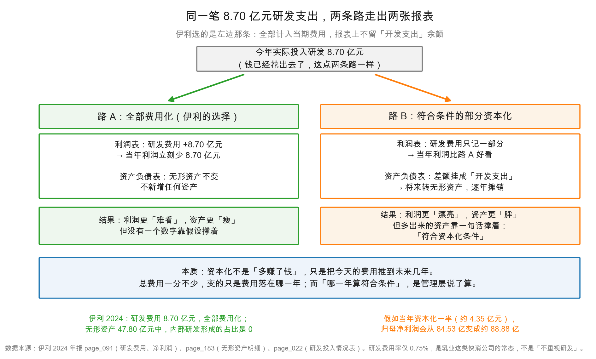

# 第 18 章：无形资产——研发费用该不该资本化

> 本章你将：
> - 认识无形资产（intangible assets）：没有实体、却能持续带来收入的资产；
> - 看清伊利 47.80 亿元无形资产里到底装着什么，以及为什么**商标权 19.79 亿元一分钱都不摊销**；
> - 搞懂研发支出的两条路——**费用化**与**资本化**，以及它们对利润的不同影响；
> - 明白伊利把 8.70 亿元研发费用**全部费用化**，是一种保守而诚实的选择；
> - 学会一个反直觉的判断：研发费用率只有 0.75%，不代表这家公司不重视研发。

---

## 18.1 一间药铺的"秘方"

上一章讲的厂房、设备，都是能看见、能摸到、能搬走的东西。这一章要讲一类看不见的资产。

设想一家开了八十年的老药铺。它最值钱的东西是什么？

不是那三间门面房——房子旧了，卖了也就那个价。不是柜台上的药材——药材会过期。真正值钱的是三样东西：**招牌**（街坊认这三个字）、**秘方**（别人配不出这个味道）、**老主顾**（一进门就知道他要什么）。

这三样东西，有一个共同点：**没有实体，但能持续带来收入。**

会计把这类东西叫**无形资产**（intangible assets）。定义可以拆成两半：

- **"无形"**：没有实物形态，你没法用手指去戳它；
- **"资产"**：它能被公司**控制**，并且**预期会带来经济利益**。

这两个条件缺一不可。招牌值钱，但如果不是你的（比如你只是加盟店），它就不是你的无形资产；秘方有价值，但如果全城都知道，它就不能再算"能被控制"。

会计上的无形资产，主要有这么几类：

| 类型 | 例子 | 怎么来的 |
|---|---|---|
| 土地使用权 | 厂区占的那块地 | 向政府受让，通常 50 年 |
| 商标权 | 品牌名字、logo | 自己注册的（成本极低）或收购来的（很贵） |
| 专利权 / 非专利技术 | 配方、工艺 | 自己研发或外购 |
| 软件 | ERP、生产管理系统 | 外购或定制开发 |
| 客户关系、收奶权 | 收购时带来的渠道与奶源 | 企业合并时确认 |
| 采矿权、许可权 | 特定经营资格 | 政府授予 |

> 📌 **划重点：** 无形资产和固定资产最大的区别，不是"看不看得见"，而是**它的价值更容易凭空消失**。厂房放十年还在，品牌可能一夜之间就砸了。所以无形资产这一栏，是资产负债表上"水分"最容易藏身的地方之一。

## 18.2 47.80 亿元里装着什么

伊利 2024 年末的无形资产净额是 **47.80 亿元**（2023 年 47.29 亿元，`page_087.md`），占总资产的 3.1%。金额不算大，但拆开看很有意思。

附注七(26)（`page_182.md`、`page_183.md`）给了完整的明细：

| 类别 | 账面原值 | 累计摊销 | 减值准备 | 账面价值 |
|---|---|---|---|---|
| 商标权 | 20.94 亿元 | **0** | 1.14 亿元 | **19.79 亿元** |
| 软件资料及开发 | 19.89 亿元 | 7.37 亿元 | 0.08 亿元 | 12.44 亿元 |
| 土地使用权 | 14.21 亿元 | 3.19 亿元 | 0 | 11.02 亿元 |
| 收奶权 | 2.78 亿元 | 1.02 亿元 | 0 | 1.76 亿元 |
| 采矿权 | 1.54 亿元 | 0.48 亿元 | 0 | 1.06 亿元 |
| 客户关系 | 1.01 亿元 | 0.21 亿元 | 0 | 0.80 亿元 |
| 非专利技术 | 1.42 亿元 | 0.58 亿元 | 0.17 亿元 | 0.67 亿元 |
| 专利权 | 0.21 亿元 | 0.04 亿元 | 0 | 0.17 亿元 |
| 许可权 | 0.11 亿元 | 0.02 亿元 | 0 | 0.09 亿元 |
| **合计** | **62.10 亿元** | **12.91 亿元** | **1.39 亿元** | **47.80 亿元** |

<!-- src: 伊利股份2024年报/page_182.md 伊利股份2024年报/page_183.md -->

验算：62.10 - 12.91 - 1.39 = 47.80。对得上。

这张表里有三件值得停下来看的事。

**第一件：商标权 19.79 亿元，是最大的一块（占 41.4%），但累计摊销是 0。**

为什么一分钱都不摊销？因为它的**使用寿命不确定**。伊利判断，这些商标（主要来自收购澳优等标的）可以无限期使用，没有法定的到期日，只要品牌还在经营，它就一直有效。会计准则对这种资产的规矩是：**不摊销，但每年必须做减值测试**——一旦发现它不值这个价了，就直接砍一刀。

这是一个极其重要的机制，因为它意味着：**商标权的账面价值，可以很多年一动不动，然后某一年突然大幅缩水。** 第 20 章要讲的蒙牛贝拉米案，就是 34.90 亿元的商标减值一次性砸下来——机制完全一样。

**第二件：软件资料及开发 12.44 亿元，是第二块（占 26.0%）。**

这是伊利这些年在数字化上的投入：ERP、供应链系统、渠道管理系统、工厂的自动化控制软件。它按年摊销，累计已经摊掉 7.37 亿元，还剩 12.44 亿元。这个数字说明伊利的数字化不是"喊口号"，是真金白银买进来的系统。

**第三件：土地使用权 11.02 亿元，累计摊销 3.19 亿元。**

土地按 50 年摊销，每年摊原值的 2% 左右。11.02 亿元的土地，对应原值 14.21 亿元，已经用掉了约 22% 的使用年限——大致相当于买来十一二年。

> 💡 **你可能会问：** 伊利自己注册的"伊利"商标，值多少钱？
>
> 账上可能是**零**。
>
> 因为自己注册的商标，成本只有注册费、设计费这些，通常几千到几万元，会计上按实际成本入账——**"伊利"这两个字再值钱，只要不是买来的，账上就几乎没有金额。**
>
> 这就是无形资产最反直觉的地方：**账上记录的，是你"花了多少钱买"，不是它"值多少钱"。** 一个自己养大的品牌，账面价值可能接近零；一个收购来的品牌，账面可能几十亿。同样是品牌，账面数字差了十万八千里——所以看无形资产，永远要问一句"它是怎么来的"。

## 18.3 无形资产怎么"变旧"：摊销

固定资产的"变旧"叫折旧，无形资产的"变旧"叫**摊销**（amortization）。

两者的逻辑一模一样：把一笔已经付掉的成本，按使用年限分摊到各年。区别只在名字，以及一点细节：

| 维度 | 折旧（固定资产） | 摊销（无形资产） |
|---|---|---|
| 对象 | 厂房、机器、设备 | 土地、软件、专利、客户关系 |
| 常见年限 | 房屋 20~45 年、机器 10 年 | 土地 50 年、软件 5~10 年 |
| 残值 | 通常 5% | 通常 0 |
| 特殊情形 | — | **使用寿命不确定的（如商标权）不摊销** |

伊利 2024 年无形资产摊销 **2.69 亿元**（`page_217.md`，`page_182.md` 的"本期计提"栏也是同一个数）。

2.69 亿元是什么概念？对比一下：折旧 40.56 亿元，无形资产摊销 2.69 亿元——**摊销只有折旧的 6.6%**。所以在伊利的成本结构里，无形资产摊销几乎可以忽略；真正压利润的，还是那 40.56 亿元的机器折旧。

把这几笔摊销放在一起看，会看得更清楚（全部来自 `page_217.md` 的现金流量表补充资料）：

| 项目 | 2024 年金额 |
|---|---|
| 固定资产折旧（含投资性房地产、生产性生物资产） | 40.56 亿元 |
| 无形资产摊销 | 2.69 亿元 |
| 使用权资产摊销 | 1.47 亿元 |
| 长期待摊费用摊销 | 1.41 亿元 |
| **合计** | **46.13 亿元** |

这 46.13 亿元，就是伊利一年里"不花现金、但要扣利润"的折旧摊销总额。它相当于归母净利润 84.53 亿元的 54.6%——**超过一半的利润，被这些"看不见的消耗"吃掉了。**

> ⚠️ **易踩坑：** 很多人把"无形资产摊销"和"商誉减值"混为一谈。区别很大：
>
> - **摊销**是**每年都发生**的、有规律的、可预测的（比如软件按 8 年摊）；
> - **减值**是**偶发**的、一次性的、不可预测的（比如商标突然被认定不值钱了）。
>
> 摊销像房租，月月都交；减值像房子塌了，赔一次大的。看报表时，前者可以外推，后者绝不能外推。

## 18.4 研发费用的两条路：费用化 vs 资本化

现在进入本章的正题，也是整章最难、最重要的一段。

一家公司今年花了 8.70 亿元搞研发。这笔钱，会计上有两条路可走：

**路 A：费用化（expense）**——全部计入当期的"研发费用"，从今年的利润里扣掉。一分不留。

**路 B：资本化（capitalize）**——把其中"符合条件"的部分，记成一项资产（先挂在"开发支出"，完成后转成无形资产），然后在未来几年摊销。今年的利润只承担一小部分。

这张图把两条路的差别画得很直白。同一起点（今年花了 8.70 亿元），走向两个完全不同的终点：

**路 A 的结果**：利润表上研发费用 +8.70 亿元，利润立刻少 8.70 亿元；资产负债表上什么也没多出来。

**路 B 的结果**：利润表上只记一部分（比如一半，4.35 亿元），利润比路 A 好看 4.35 亿元；资产负债表上多出 4.35 亿元的"开发支出"，将来转成无形资产，分 5 年、8 年慢慢摊销。

看出问题了吗？**两条路的"总费用"是一样的，只是分摊的时间不同。** 路 B 并没有让公司"多赚钱"，它只是把今天的成本推到了明天。

那为什么还有公司走路 B？两个原因：

1. **有些研发确实该资本化。** 已经进入开发阶段、技术可行性确定、未来能带来经济利益的項目，全算成当期费用确实扭曲了利润——这笔钱买的是未来几年的收入。准则允许资本化，正是为了处理这种情况。
2. **"符合条件"是管理层判断。** 什么叫"技术可行性已经确定"、什么叫"有足够的财务资源完成开发"？都要靠判断，判断就有空间。

> 📌 **划重点：** 资本化不是"多赚了钱"，而是"把今天的费用推到未来"。它对**现金流一分钱影响都没有**（钱都是今年花出去的），只影响**利润在年份之间的分布**。所以看到一家公司资本化比例很高，你要问的不是"它是不是造假"，而是"**它把多少成本推到了我看不见的年份**"。

那准则到底怎么划这条线？中国会计准则把研发分成两个阶段：

| 阶段 | 内容 | 会计处理 |
|---|---|---|
| **研究阶段** | 探索性的、为了获取新知识而做的调研、试验 | **必须费用化** |
| **开发阶段** | 在商业生产或使用前，把研究成果用于设计、建造 | **符合条件的可以资本化** |

"符合条件"要同时满足五条：技术可行性、有完成意图、有能力完成、能证明未来有经济利益、支出能可靠计量。五条里最软的是第一条和第四条——"可行性"和"经济利益"都要靠预测。

所以业内有一句半开玩笑的话：**资本化比例，是管理层对未来的信心指数。** 信心足，比例高；信心不足，或者想保守，比例低。

## 18.5 伊利的选择：8.70 亿元，一分不资本化

现在看伊利怎么选。

先看利润表（`page_091.md`）：研发费用 **8.70 亿元**（2023 年 8.50 亿元）。

再看两个关键证据：

**证据一：研发投入情况表（`page_022.md`）。**

> 本期费用化研发投入 869,976,531.80
> 本期资本化研发投入（空）
> 研发投入合计 869,976,531.80
> 研发投入总额占营业收入比例(%) 0.75
> 研发投入资本化的比重(%)（空）

"资本化研发投入"和"资本化比重"这两格是**空的**——不是忘了填，是**没有**。8.70 亿元研发投入，8.70 亿元全部费用化，资本化金额为零。

**证据二：资产负债表上的"开发支出"是空的（`page_087.md`）。**

资产负债表"开发支出"那一行，2024 年和 2023 年两列都没有数字。开发支出是资本化的"中转站"——研发支出要先挂在这里，等项目完成再转无形资产。这个格子空着，等于从另一个角度确认：**没有任何研发支出被资本化。**

**证据三：附注里的一句话（`page_183.md`）。**

> 本期末通过公司内部研发形成的无形资产占无形资产余额的比例是 0。

第三个证据最狠。它说的是：47.80 亿元无形资产里，**没有一分钱是自己研发出来的**。全部来自外购（土地、软件）和企业合并（商标、客户关系、收奶权）。

三个证据指向同一个结论：**伊利把研发支出全部费用化了，一分钱都没资本化。**

<!-- src: 伊利股份2024年报/page_022.md 伊利股份2024年报/page_087.md 伊利股份2024年报/page_183.md 伊利股份2024年报/page_091.md -->

这是好事还是坏事？

**从利润的角度看，这是"吃亏"的。** 如果伊利把 8.70 亿元里的四分之一资本化（合情合理，很多制造业公司都这么做），2024 年的利润就能多出约 2.18 亿元，相当于归母净利润的 2.6%。它没有这么做。

**从资产质量的角度看，这是"加分"的。** 因为：

| 维度 | 全部费用化 | 部分资本化 |
|---|---|---|
| 利润 | 当期更低 | 当期更高 |
| 资产 | 更"瘦"，没有水分 | 更"胖"，含判断成分 |
| 未来负担 | 无（今年扣完就完了） | 有（未来几年要摊销） |
| 可验证性 | 高（花了多少就是多少） | 低（"符合条件"无法外部验证） |

伊利选的是"利润更难看、但资产更干净"的那条路。用一句更直白的话说：**它没有把今天的成本推给明天的股东。**

> 🔍 **翻到年报：** 打开 `page_022.md`，找到"4、研发投入"下面的那张表。你会看到五行字，"本期费用化研发投入"后面跟着 869,976,531.80，"本期资本化研发投入"后面是空的，"研发投入资本化的比重(%)"后面也是空的。
>
> 翻页对照 `page_087.md`，找到"开发支出"那一行——两列都是空白。这两处对上了，才能确认"全部费用化"这个结论。只看一处，容易看漏。

## 18.6 研发费用率 0.75%，说明什么

最后一个问题，也是最多人误会的一个。

伊利 2024 年研发费用 8.70 亿元，营业收入 1,153.93 亿元，**研发费用率只有 0.75%**（`page_022.md` 直接给了这个数）。

0.75%，听起来很低。对比一下：一家科创板公司动辄 15%、20%，一家创新药公司可能 50%。伊利这个数字，连人家的零头都不到。

那是不是说明伊利"不重视研发"？

**不是。这恰恰是行业属性决定的。**

乳业的研发，和科技公司的研发，根本不是一个东西：

| 维度 | 乳业（伊利） | 科技/医药公司 |
|---|---|---|
| 研发做什么 | 配方改良、菌种筛选、工艺优化、包装保鲜 | 芯片架构、新药分子、操作系统 |
| 单个项目投入 | 几千万元级别 | 几亿到几十亿元 |
| 研发周期 | 1~3 年 | 5~10 年 |
| 研发成果怎么体现 | 体现在**产品毛利率**和**新品成功率**上 | 体现在**专利**和**新产品线**上 |
| 典型研发费用率 | 0.5%~2% | 10%~50% |

乳业的核心竞争力，从来不在"研发投入多少"，而在三件别的事：**奶源**（能不能稳定拿到优质原奶）、**渠道**（能不能把货铺到几百万个终端）、**品牌**（消费者在货架前选谁）。研发在这门生意里是"必要但不决定性"的角色——它让产品不落后，但不会因为多投一倍研发就翻倍赚钱。

所以 0.75% 这个数字，正确的读法是：

> **它符合乳业这类快消公司的常态，不是"不重视研发"，而是"这门生意不需要靠研发投入取胜"。**

反过来，如果哪天伊利的研发费用率突然从 0.75% 跳到 5%，那才是真正需要问的问题：它在赌什么？

> ⚠️ **易踩坑：** 跨行业比研发费用率，是最常见的错误之一。把伊利的 0.75% 和一家芯片公司的 20% 放在一张表里，然后得出"伊利不创新"的结论——这个比较毫无意义。**正确的比较对象，永远是同行**：伊利 0.75%，蒙牛大约在什么水平，飞鹤、光明呢？只有同行之间比，这个数字才有信息量。

## ✍️ 想一想

### 问 1：资本化一半，利润会变成多少

假设伊利 2024 年决定把 8.70 亿元研发投入的一半资本化（4.35 亿元），并按 5 年摊销、无残值。请计算：（1）2024 年研发费用变成多少？（2）2024 年利润总额会增加多少？（3）未来 5 年每年要多承担多少摊销？（4）这个操作会不会改变经营现金流？

**解题思路：** 分两步走。第一步算"今年少记多少费用"——注意资本化的部分今年不全是"零费用"，如果当年就转成无形资产开始摊销，还要扣当年摊销。为简化，题目通常假设"当年不摊销，从次年开始"。第二步算"未来多承担多少"——资本化的总额要在未来几年摊完。

**参考答案：**

（1）2024 年研发费用：

- 费用化部分：8.70 ÷ 2 = 4.35 亿元
- 资本化部分：4.35 亿元，不进当期费用（假设当年不摊销）
- **研发费用从 8.70 亿元降到 4.35 亿元**

（2）利润总额增加 **4.35 亿元**（费用少了 4.35 亿元）。按 25% 所得税率粗算，净利润增加约 3.26 亿元，相当于归母净利润 84.53 亿元的 3.9%。

（3）未来 5 年，每年摊销 4.35 ÷ 5 = **0.87 亿元**。五年累计摊销 4.35 亿元，正好把资本化的金额摊完。

所以完整的账是这样的：

| 年份 | 研发相关费用 | 与"全部费用化"相比 |
|---|---|---|
| 2024 | 4.35 亿元 | **少 4.35 亿元**（利润更好看） |
| 2025~2028 | 4.35 + 0.87 = 5.22 亿元 | 每年**多 0.87 亿元**（利润更难看） |
| 2029 | 4.35 亿元 | 回到正常 |

（4）**完全不影响经营现金流。** 8.70 亿元现金在今年就付出去了，资本化只是账面上把它记成资产而不是费用，现金流出方向、金额一分不变。

**这就是资本化最本质的特征：它只改利润的时间分布，不改现金。**

**易错点：** ① 忘了未来摊销，得出"资本化让公司白赚 4.35 亿"的结论。总费用一分不少，只是往后挪；② 把"利润总额增加 4.35 亿"直接当"净利润增加 4.35 亿"，漏掉所得税；③ 以为资本化能改善现金流。这是最典型的混淆——**利润和现金是两回事**，第 9 章讲过，这里再验一次。

### 问 2：为什么商标权不摊销，商誉要减值

伊利的商标权 19.79 亿元，累计摊销是 0；而商誉 23.37 亿元也不摊销，但每年必须做减值测试。请回答：（1）这两类资产有什么共同点，为什么都不摊销？（2）既然不摊销，它们的价值怎么"变少"？（3）这对投资者意味着什么风险？

**解题思路：** 先找共同点——它们都是"使用寿命不确定"或"无法单独分离"的资产，没有确定的"用完"时点。再想：不摊销的话，价值靠什么机制往下走？只有一个答案：减值。最后想风险：不摊销意味着**利润表上常年没有这笔成本**，一旦减值就是一次性的大额冲击。

**参考答案：**

（1）共同点：**它们都没有确定的使用寿命，也没有可预期的"消耗速度"。**

- 商标权：品牌可以无限期使用，法定的商标注册虽然要续展，但只要续展就一直有效，所以会计上判定为"使用寿命不确定"；
- 商誉：它是"收购价超出可辨认净资产的部分"，本身不是一项可以单独拿出来卖的资产，也没有年限，只能挂在那儿。

准则对这类资产的规矩是：**不摊销，但每年至少做一次减值测试。**

（2）价值靠**减值**往下走。每年年末，公司要估算这些资产"能收回多少钱"（可收回金额），如果账面价值高于可收回金额，就把差额计提为减值损失，直接冲减利润。

所以它们的账面价值曲线不是"平滑下滑"，而是"**长期横盘 + 突然跳水**"：

| 资产 | 平时 | 出事时 |
|---|---|---|
| 商标权 | 账面一动不动，利润表上零成本 | 一次性计提巨额减值（蒙牛贝拉米商标减值 34.90 亿元） |
| 商誉 | 账面一动不动，利润表上零成本 | 一次性计提巨额减值（伊利澳优商誉减值 30.37 亿元） |

（3）对投资者意味着三层风险：

**第一层：利润被"美化"了。** 因为不摊销，这些资产常年不在利润表上产生成本。一家靠收购堆起来的公司，利润里其实少算了一块"资产消耗"。

**第二层：风险是"聚集"的，不是"分散"的。** 摊销是每年消化一点，减值是一次性全砸下来。所以这类资产越大，利润的"尾部风险"越大——平时看着很稳，某一年突然巨亏。

**第三层：减值的时间点，管理层有话语权。** 什么时候认定"可收回金额下降了"，需要判断。所以减值可能早来，也可能晚来；可能在业绩差的年份一次性出清（"洗大澡"），也可能一年提一点。第 20 章会专门讲这个。

**易错点：** ① 答"因为它们没有实体"。固定资产里的土地也没有实体消耗，但土地要摊销——真正的判据是"**使用寿命是否确定**"，不是"有没有实体"；② 以为"不摊销"等于"不用管"。恰恰相反，不摊销的资产要年年考，考不过就大额计提；③ 把商标权和商誉当成一回事。商标权可以单独转让、可以授权收费；商誉不能单独存在，只能跟着整个业务走。

### 问 3：研发费用率 0.75%，该不该担心

有位朋友看完伊利的报表说："研发费用只占收入 0.75%，这家公司没有技术含量，长期会被淘汰。"请评价这个说法，并给出你自己的判断框架。

**解题思路：** 先判断这个比较是否用了正确的参照系——是拿伊利和谁比？再想：乳业的竞争力到底由什么决定？最后给出一个可操作的框架：什么时候 0.75% 是正常的，什么时候它是危险的信号。

**参考答案：**

这个说法**站不住脚**，主要错在参照系。

**第一，0.75% 要和同行比，不能和科技公司比。** 乳业的研发费用率普遍在 0.5%~2% 之间，伊利 0.75% 处于行业正常区间。拿它和一家芯片公司的 20% 比，就像拿一家餐馆的"厨房设备投入"和一家钢铁厂比——两个生意的成本结构根本不同。

**第二，乳业的竞争力不在研发投入的绝对额。** 三件事决定这门生意：奶源（原奶的成本与稳定性）、渠道（能不能铺到下沉市场）、品牌（货架前消费者选谁）。研发的作用是"让产品不落后"，不是"让产品领先一个代际"。

**第三，判断框架应该是这样的：**

| 情形 | 判断 |
|---|---|
| 研发费用率与同行接近，且新品持续推出 | **正常**，不必担心 |
| 研发费用率明显低于同行，且新品断档、毛利率下滑 | **警惕**，可能是产品力在退化 |
| 研发费用率突然大幅上升（如从 0.8% 到 5%） | **要问**：在赌什么新赛道？钱从哪来？ |
| 研发全部费用化、资本化为零 | **加分**，说明会计政策保守 |
| 研发大量资本化、开发支出余额快速膨胀 | **警惕**，需要看资本化比例和摊销政策 |

伊利 2024 年属于第一行 + 第四行：费率正常，且全部费用化。**这是一个"没有惊喜，但也没有水分"的组合。**

**易错点：** ① 只用"研发费用率"一个指标判断技术含量。研发的效果要看**结果**（新品收入占比、毛利率变化），不看投入比例；② 忽略"全部费用化"这个事实。同样是 0.75%，全部费用化和一半资本化，含金量差很多；③ 反过来过度吹捧"费用化就是好"。费用化确实保守，但如果一家公司连该资本化的开发项目也全费用化，可能是它**没有能资本化的项目**——那反而是坏消息。

## 📎 数据出处

- 伊利股份 2024 年报 `page_087.md`：无形资产 47.80 亿元（2023 年 47.29 亿元）；"开发支出"行为空
- `page_182.md` / `page_183.md`：附注七(26) 无形资产明细（商标权 19.79 亿元、软件 12.44 亿元、土地使用权 11.02 亿元等）；"本期末通过公司内部研发形成的无形资产占无形资产余额的比例是 0"
- `page_091.md`：利润表——研发费用 8.70 亿元（2023 年 8.50 亿元）
- `page_022.md`：研发投入情况表——费用化 8.70 亿元、资本化空白、占营业收入 0.75%、资本化比重空白
- `page_209.md`：附注七(66) 研发费用明细（职工薪酬 2.76 亿元、调研试验设计费 4.45 亿元等）
- `page_217.md`：无形资产摊销 2.69 亿元、使用权资产摊销 1.47 亿元、长期待摊费用摊销 1.41 亿元
- `page_131.md`：折旧与摊销的会计政策
- 数据汇总：`data/yili2024.json` 的 `balance`、`income`、`cashflow`、`ratios` 段

<!-- src: 伊利股份2024年报/page_022.md 伊利股份2024年报/page_087.md 伊利股份2024年报/page_091.md 伊利股份2024年报/page_182.md 伊利股份2024年报/page_183.md 伊利股份2024年报/page_209.md 伊利股份2024年报/page_217.md -->

下一章：[第 19 章：商誉——并购留下的定时炸弹](19-商誉-并购留下的定时炸弹.md)。无形资产里最特殊的一类，既不是买来的技术、也不是自己养的牌子，而是"收购时多付的那笔钱"：23.37 亿元商誉，和它背后那 30.75 亿元的减值。
