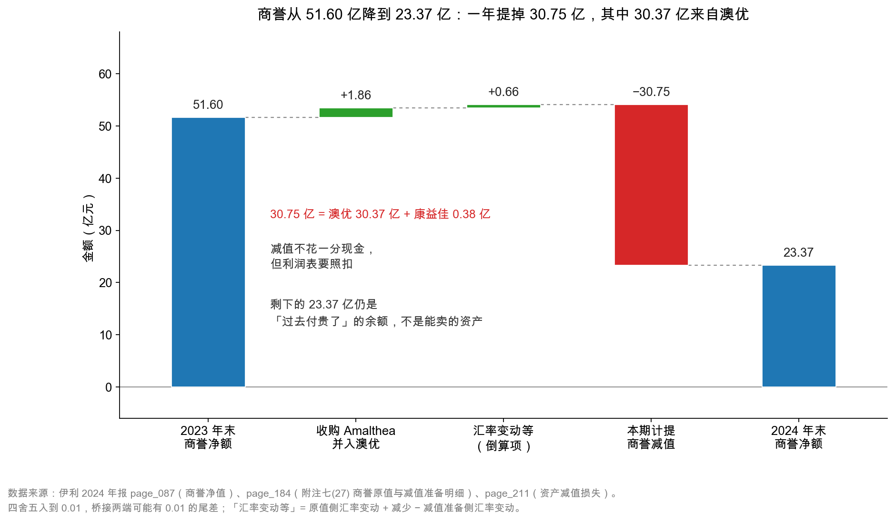

# 第 19 章：商誉——并购留下的定时炸弹

> 本章你将：
> - 用"买房子"的类比，搞懂商誉（goodwill）到底是怎么产生的；
> - 亲手验算伊利 2024 年商誉从 51.60 亿元走到 23.37 亿元的那本账；
> - 明白为什么商誉**每年都必须做减值测试**，以及"资产组"这个概念的作用；
> - 记住两条硬规则：**减值不花一分钱现金**，但**一经计提不可转回**；
> - 学会一个观念转变：商誉不是资产，是"过去付贵了的证据"。

---

## 19.1 一套多花了钱买来的房子

前面三章讲的资产，都是"花钱买东西"：买设备、盖厂房、买软件、买地。这些东西有个共同点——**你付出的钱，和你拿到的东西，大致对得上。**

这一章要讲的商誉，是个例外：**你付出的钱，远多于你拿到的东西。**

先讲个生活里的例子。

你看中一套房子，房东开价 **500 万元**（示意数字）。你请评估师去看，评估师把房子里里外外算了一遍：房子本身 380 万，装修 40 万，家具家电 30 万，合计 **450 万元**。

也就是说，按"一样一样拆开算"的口径，这套房子值 450 万；但房东要 500 万。中间差的 **50 万元** 是什么？

可能是这个小区的位置好、学区好、邻居好，也可能是你特别喜欢这个户型。这些东西**真实存在、真实值钱**，但你没法把它们单独拆下来卖——你买的是"整套"，不是"零件"。

会计把并购里的这个差额，叫**商誉**。

伊利 2021 年收购澳优乳业，就是同一件事的企业版：它付出的对价，高于澳优可辨认净资产（把厂房、渠道、存货、品牌一项一项按公允价值评估后加总）的份额，差额就记成商誉。

> 📌 **划重点：** 商誉 = **收购价 - 被收购方可辨认净资产的公允价值**。它买的不是某样具体东西，而是"这家公司作为一个整体，比它的零件加起来更值钱"的那部分——品牌溢价、渠道关系、团队、市场份额，都算在里面。**商誉只在并购中产生**，一家公司自己经营得再好，也不会凭空长出商誉。



这张图是本章的核心。左边 51.60 亿元是 2023 年末的商誉净额，右边 23.37 亿元是 2024 年末，中间四步：

| 步骤 | 金额 | 发生了什么 |
|---|---|---|
| 2023 年末商誉净额 | 51.60 亿元 | 起点 |
| 收购 Amalthea 并入澳优 | **+1.86 亿元** | 新的并购，产生新的商誉 |
| 汇率变动等 | +0.66 亿元 | 海外子公司的商誉按期末汇率折算 |
| **本期计提商誉减值** | **-30.75 亿元** | 管理层认了：这些商誉不值账上这个价了 |
| 2024 年末商誉净额 | **23.37 亿元** | 终点 |

51.60 + 1.86 + 0.66 - 30.75 = 23.37。一年之间，商誉少了 **28.23 亿元**，降幅 54.7%。

**这是伊利上市以来最大的一次商誉减值。** 一年的减值额，相当于当年归母净利润 84.53 亿元的 36.4%。

## 19.2 商誉到底怎么算出来的

把公式写严谨一点。假设 A 公司花 **30 亿元** 收购 B 公司 100% 股权，收购日 B 公司可辨认净资产的公允价值是 **10 亿元**（厂房值多少、存货值多少、品牌值多少，逐项评估后加总）。那么：

$$\text{商誉} = 30 - 10 = 20 \text{ 亿元}$$

这 20 亿元记在 A 公司的合并资产负债表上，作为一项"资产"。

如果只收购 80% 呢？那就按份额算：

$$\text{商誉} = 30 - 10 \times 80\% = 22 \text{ 亿元}$$

（中国准则下还有个技术细节："少数股东权益是否按公允价值计量"会影响商誉金额。初学阶段知道"按份额算"就够了。）

这里有几个必须搞清楚的点：

**第一，商誉只出现在合并报表上。** 因为它是"收购"这个动作产生的，只有把被收购公司并进来，才会出现这个差额。伊利母公司自己的资产负债表上，是没有这笔商誉的。所以你看到"商誉 23.37 亿元"，一定要知道它说的是**合并报表**。

**第二，商誉不能单独卖掉。** 厂房能卖，专利能转让，品牌能授权——商誉不行。它依附于"整个业务"，业务没了，商誉就凭空消失。这是它和无形资产最本质的区别：

| 维度 | 无形资产（如商标权） | 商誉 |
|---|---|---|
| 能不能单独转让 | 能（可以卖、可以授权） | **不能** |
| 怎么产生 | 外购、自行研发、并购 | **只在并购中产生** |
| 有没有年限 | 有（或"使用寿命不确定"） | 没有 |
| 怎么减少 | 摊销（或减值） | **只能减值** |
| 报表位置 | 非流动资产，单独一行 | 非流动资产，单独一行 |

**第三，商誉的金额，取决于"你付了多少钱"，而不是"它值多少钱"。** 这是商誉最危险的地方。

同样一家公司，A 公司花 30 亿买，商誉 20 亿；B 公司花 50 亿买，商誉 40 亿。被买的公司一模一样，商誉却差一倍——因为商誉记录的是**买方的出价**，不是标的的价值。买贵了，商誉就大；商誉大，未来减值的压力就大。

> 💡 **你可能会问：** 那为什么公司愿意出高价？
>
> 三个常见原因，一个比一个现实：
>
> 1. **真的看好。** 标的所在的赛道正在风口上，晚一年买可能就买不到了，于是溢价抢；
> 2. **协同效应。** 买方认为自己能把标的的渠道、产能、品牌整合进来，产生"1+1>2"的效果。这部分协同，会计上不允许单独确认为资产，只能全部塞进商誉；
> 3. **管理层想做大。** 并购能迅速把收入规模做上去，管理层的薪酬、声望往往和规模挂钩。这是代理问题，第 2 章讲过。
>
> 三种动机里只有第二种算"理性溢价"，但它最难验证——**协同效应到底实现了没有，往往要三五年后才知道**。商誉的减值，通常就在那时候来。

## 19.3 伊利 2024 年的商誉账本

现在翻开附注七(27)（`page_184.md`），把这本账逐行对一遍。

**第一张表：商誉账面原值。**

| 被投资单位 | 期初 | 企业合并形成 | 汇率变动 | 期末 |
|---|---|---|---|---|
| 澳优乳业 | 49.39 亿元 | **+1.86 亿元** | +0.68 亿元 | **51.92 亿元** |
| THE CHOMTHANA（泰国） | 3.07 亿元 | — | +0.05 亿元 | 3.12 亿元 |
| Westland Dairy（新西兰） | 1.66 亿元 | — | — | 1.66 亿元 |
| 阿尔山伊利天然矿泉 | 0.55 亿元 | — | — | 0.55 亿元 |
| Canary Enterprises | 0.42 亿元 | — | -0.04 亿元 | 0.39 亿元 |
| 内蒙古康益佳 | 0.38 亿元 | — | — | 0.38 亿元 |
| Oceania Dairy | 0.11 亿元 | — | — | 0.11 亿元 |
| **合计** | **55.59 亿元** | **+1.86 亿元** | **+0.72 亿元** | **58.13 亿元** |

新增的 1.86 亿元，年报有一句注释：

> 澳优乳业股份有限公司本期企业合并形成的商誉 185,699,100.17 元为收购 Amalthea Group B.V. 而产生。

也就是说，伊利通过澳优又收购了一家荷兰羊奶企业 Amalthea，这笔收购产生了 1.86 亿元新商誉。**商誉就是这样一层层堆上去的：每次并购都在原来的基础上再加一层。**

**第二张表：商誉减值准备。**

| 被投资单位 | 期初 | 本期计提 | 汇率变动 | 期末 |
|---|---|---|---|---|
| 澳优乳业 | 0 | **30.37 亿元** | — | **30.37 亿元** |
| THE CHOMTHANA | 1.67 亿元 | — | +0.02 亿元 | 1.69 亿元 |
| Westland Dairy | 1.66 亿元 | — | — | 1.66 亿元 |
| 阿尔山伊利 | 0.55 亿元 | — | — | 0.55 亿元 |
| 内蒙古康益佳 | 0 | **0.38 亿元** | — | 0.38 亿元 |
| Oceania Dairy | 0.11 亿元 | — | — | 0.11 亿元 |
| **合计** | **3.99 亿元** | **30.75 亿元** | **+0.02 亿元** | **34.76 亿元** |

这张表信息量极大，值得逐行读：

**第一，本期计提的 30.75 亿元，30.37 亿元来自澳优，0.38 亿元来自康益佳。**

- **澳优 30.37 亿元**：这是绝对主角，占本期减值的 98.8%。澳优的商誉原值 51.92 亿元，一次提掉 30.37 亿元，剩余净值 21.55 亿元；
- **康益佳 0.38 亿元**：全额提完，商誉归零。这家公司原来的商誉就只有 0.38 亿元，一次提干净。

**第二，有三家的商誉已经"提干净"了。**

Westland（1.66 亿元）、阿尔山（0.55 亿元）、Oceania（0.11 亿元），减值准备等于原值，净值都是零。这三笔商誉已经全部认亏，往后不会再影响利润——**坏消息出清了。**

**第三，剩下的风险集中在澳优一家。**

2024 年末 23.37 亿元商誉净额里，澳优占 21.55 亿元，**92.2%**。换句话说，伊利商誉的剩余风险，几乎就是"澳优这一笔"的风险。

<!-- src: 伊利股份2024年报/page_184.md 伊利股份2024年报/page_087.md -->

把两张表合起来验算：

| 项目 | 期初 | 期末 |
|---|---|---|
| 商誉原值 | 55.59 亿元 | 58.13 亿元 |
| 减：减值准备 | 3.99 亿元 | 34.76 亿元 |
| **商誉净额** | **51.60 亿元** | **23.37 亿元** |

58.13 - 34.76 = 23.37，与资产负债表上的"商誉 23.37 亿元"（`page_087.md`）完全一致。第一张表、第二张表、主表，三处咬得严丝合缝。

> 🔍 **翻到年报：** 打开 `page_184.md`。这一页上下两张表，上面是"商誉账面原值"，下面是"商誉减值准备"。请重点看下面那张表的第五行——"澳优乳业股份有限公司"，本期计提栏写着 3,037,222,489.82 元，期末余额也是 3,037,222,489.82 元。**期初是空的，说明这笔减值是一次性新提的，不是往年累积的。** 这个细节很重要：它告诉你，2024 年是澳优商誉第一次被大规模减值。

## 19.4 为什么每年都必须做减值测试

商誉不摊销，那它的价值怎么"变少"？

只有一个机制：**减值测试**（impairment test）。

规则是这样的：每年年末（不管有没有迹象），公司都要把商誉"分摊"到相关的**资产组**（asset group）或**资产组组合**上，然后估算这个资产组"能收回多少钱"（可收回金额），再和它的账面价值比：

- 账面价值 $\leq$ 可收回金额 → 没问题，不动；
- 账面价值 > 可收回金额 → 差额计提减值，直接冲减当年利润。

伊利 2024 年报里对澳优商誉的减值，就是这么来的。管理层认为，澳优相关资产组未来能产生的现金流（折现后）已经低于账面价值，差额 30.37 亿元，一次性提掉。

**什么是"资产组"？** 这个概念很重要，但很容易被忽略。

商誉不能单独产生现金流——你不能把"商誉"拿出来卖钱。它只能依附于某个能独立产生现金流的业务单元。所以准则要求：把商誉分摊到"**能够独立产生现金流入的最小资产组合**"上，然后对这个组合整体做测试。

对伊利来说，澳优就是一个资产组（羊奶粉、婴幼儿配方奶粉业务）。测试的逻辑是：

```
澳优资产组的账面价值
  = 澳优的固定资产 + 无形资产 + 存货 + 商誉 + ……
对比
澳优资产组的可收回金额
  = 未来若干年预计现金流的折现值（或公允价值减处置费用）
```

如果前者大于后者，就把商誉减到"能对得上"为止。

> ⚠️ **易踩坑：** 减值测试里最关键的两个输入——"未来现金流预测"和"折现率"——**都是管理层自己定的**，外部投资者看不到完整模型。
>
> 这意味着：商誉减值的时间点和金额，有很大的判断空间。管理层可以：
> - **早提**：今年业绩本来就差，索性多提一点，把包袱一次性甩掉；
> - **晚提**：今年业绩刚好达标，能拖一年是一年；
> - **分批提**：每年提一点，让利润波动看起来更平滑。
>
> 三种做法都不违规。所以看到商誉减值，别只问"提了多少"，要问"**为什么是这一年**"。

## 19.5 减值不花一分钱现金，但直接吃掉利润

这是本章第二个必须记牢的点，也是很多人第一次看减值时的困惑：

**计提 30.75 亿元减值，公司的银行账户里，一分钱都没有少。**

为什么？因为商誉本来就不是"钱"，它只是收购时记在账上的一个数字。把它减掉，只是承认"这个数字虚高了"，不涉及任何现金流动。

但它在利润表上是实打实的：

| 报表 | 影响 |
|---|---|
| **利润表** | 资产减值损失 +30.75 亿元 → 营业利润减少 30.75 亿元 → 净利润减少 30.75 亿元 |
| **资产负债表** | 商誉减少 30.75 亿元 → 总资产减少 30.75 亿元 → 净资产减少 30.75 亿元 |
| **现金流量表** | **完全没有影响**（经营活动、投资活动、筹资活动都不动） |

所以会出现一个看起来很矛盾的现象：**利润大幅下滑，现金流却可能创新高。**

伊利 2024 年正是这样：归母净利润 84.53 亿元，同比下降 18.94%；而经营活动现金流净额 217.40 亿元，同比**增长 18.86%**（`page_007.md`）。一降一升，方向相反——因为利润里被减值砍掉的那 30.75 亿元，在现金流里根本不存在。

（第 16 章讲过：不花现金的费用，算经营现金流时会被加回。折旧如此，减值也如此。）

**第二条硬规则：商誉减值一经计提，不可转回。**

这是中国会计准则的明确规定：商誉的减值损失确认后，**在以后会计期间不得转回**。

为什么这么规定？因为如果允许转回，就会出现一种操作：今年多提一点（把利润压低），明年再转回来（把利润做高）——减值就成了利润的"蓄水池"。准则干脆把这条路堵死：**提了就是提了，永远不能反悔。**

所以商誉减值对利润的影响是**单向的、永久的**：

| 项目 | 能不能转回 |
|---|---|
| 应收账款坏账准备 | 能（收回来了就可以转回） |
| 存货跌价准备 | 能（价格回升可以转回） |
| 固定资产减值 | **不能** |
| 商誉减值 | **不能** |

这条规则的含义很直接：**每一笔商誉减值，都是从股东权益里永久划走的一块。** 它不是"今年难看、明年好看"的时间差，而是实实在在的价值毁灭。

> 📌 **划重点：** 商誉减值的三句话——**不花现金**（所以现金流不受影响）、**吃掉利润**（所以净利润会掉）、**不可转回**（所以是永久性的价值损失）。三句话缺一不可，少记一句都会看错。

## 19.6 商誉不是资产，是"过去付贵了"的证据

学到这里，可以做一个观念上的转变了。

教科书把商誉放在"非流动资产"里，和固定资产、无形资产并列。但从投资者的角度看，**商誉更像是一张"欠条"，而不是一项"资产"**。

理由很简单：

- 厂房能生产东西，无形资产能收费，商誉**什么也做不了**。它不能单独出售、不能抵押、不能授权；
- 商誉唯一的作用，是"记住当年这笔收购付了多少钱"。它是**历史成交价的 residue（残留）**；
- 一旦被收购的业务不行了，商誉第一个被减掉，而且减了不能转回。

所以更准确的读法是：

> **商誉 = 过去某次收购中，买方多付的那部分钱，暂时还挂在账上。**

这句话有一个很有用的推论：**商誉的规模，反映的是这家公司历史上的并购风格。**

| 商誉 / 总资产 | 说明 |
|---|---|
| 很低（低于 3%） | 主要靠内生增长，并购少或并购很便宜 |
| 中等（3%~10%） | 有并购，但控制得住 |
| 偏高（10%~20%） | 并购是规模的重要来源，要盯剩余商誉的集中度 |
| 很高（高于 20%） | 靠并购拼起来的规模，减值的潜在冲击大 |

伊利 2024 年：23.37 ÷ 1,537.18 = **1.5%**。这个比例很低——即使全额减值，也只影响总资产的 1.5%。这是伊利让人放心的一点：**它的家底不是靠并购堆出来的。**

对比一下蒙牛：商誉 76.78 亿元（2023 年 89.52 亿元），总资产 1,062.93 亿元，占比 **7.2%**——是伊利的近 5 倍。这个差别，正好解释了为什么 2024 年蒙牛的减值冲击比伊利更致命（第 20 章详述）。

> ⚠️ **易踩坑：** "商誉占比低"不等于"没有风险"。要看**绝对额**和**集中度**：
>
> - 伊利商誉只占总资产 1.5%，但 23.37 亿元里 21.55 亿元压在澳优一家身上，**集中度 92.2%**；
> - 换句话说，只要澳优再出问题，这 21.55 亿元还得继续减。
>
> 所以正确的问法是：**剩下的商誉，集中在谁身上？那个业务现在怎么样了？**

## ✍️ 想一想

### 问 1：算一算这笔收购的商誉

A 公司以 12 亿元现金收购 B 公司 60% 的股权。收购日 B 公司可辨认净资产的公允价值为 15 亿元。请计算：（1）这笔收购产生多少商誉？（2）如果收购 100% 股权、价格 20 亿元，商誉是多少？（3）三年后 B 公司业绩大幅下滑，A 公司对这笔商誉计提 4 亿元减值，这对 A 公司的现金流有什么影响？

**解题思路：** 第一问用"收购价 - 可辨认净资产公允价值 $\times$ 持股比例"。第二问持股比例变成 100%。第三问回到本章的核心结论：减值不花现金，但要注意它对**利润**和**净资产**的影响。

**参考答案：**

（1）商誉 = 12 - 15 $\times$ 60% = 12 - 9 = **3 亿元**。

（2）商誉 = 20 - 15 $\times$ 100% = 20 - 15 = **5 亿元**。

注意这里有个有意思的对比：第二问付的钱更多（20 亿 vs 12 亿），商誉也更大（5 亿 vs 3 亿）——**商誉的大小，取决于你付了多少钱，不取决于标的多好。**

（3）**对现金流没有任何影响。** 4 亿元减值不涉及一分钱现金流动，经营活动、投资活动、筹资活动现金流都不变。

但它会影响另外两张表：

| 报表 | 影响 |
|---|---|
| 利润表 | 资产减值损失 +4 亿元，净利润减少 4 亿元（税前） |
| 资产负债表 | 商誉减少 4 亿元，总资产减少 4 亿元，净资产减少 4 亿元（税后影响要看递延所得税） |
| 现金流量表 | **无影响** |

而且这 4 亿元**永远不能转回**——即使 B 公司后来业绩恢复了，这 4 亿元也不会回到账上。

**易错点：** ① 第一问忘了乘持股比例，算成 12 - 15 = -3（负商誉）。收购 60% 时，只按 60% 的净资产份额比；② 以为减值会减少现金。这是最典型的错误，减值只动账面；③ 以为"业绩恢复了减值就能转回"。商誉减值不可转回，这是硬规则。

### 问 2：为什么减值是这一年，不是去年或明年

伊利 2024 年对澳优计提 30.37 亿元商誉减值。请回答：（1）这笔减值"应该"发生在哪一年，有客观标准吗？（2）管理层在时点上有多大的判断空间？（3）作为投资者，你更担心"今年一次性提完"还是"每年提一点"？

**解题思路：** 第一问回到减值测试的机制：测试每年都做，但"可收回金额"要靠预测，而预测会随经营情况变化。第二问想管理层的三个选项（早提、晚提、分批提）。第三问没有标准答案，但可以从"信息透明度"和"未来风险"两个角度分析。

**参考答案：**

（1）**没有精确的客观标准。** 准则要求每年做一次减值测试，但"可收回金额"是用**未来现金流折现**算出来的，而未来现金流是预测。预测变了，结论就变了。所以严格说，减值的"正确时点"取决于"什么时候有足够证据表明未来现金流下降了"——这本身就是一个判断。

（2）空间相当大。管理层至少有三个选项：

| 选项 | 做法 | 对利润的影响 |
|---|---|---|
| 早提 | 今年业绩本来就差，一次性多提 | 当年利润很差，但**明年包袱轻** |
| 晚提 | 今年刚好达标，能拖就拖 | 当年利润好看，但**风险在累积** |
| 分批提 | 每年提一点 | 利润波动平滑，但**每年都有一笔** |

三个选项都合规，因为它们都建立在"对未来的判断"上。

（3）两种都值得担心，但担心的点不同：

**"今年一次性提完"的风险**是：可能有"洗大澡"（big bath）的成分——把未来几年该提的减值集中在业绩最差的一年提掉，让当年"一次亏个够"，明年轻装上阵。这对当期股东不公平，但对下一年好看。**判断方法**：看这一年是不是本来就很差（营收降、利润降），如果是，一次性大额减值的动机就比较强。

**"每年提一点"的风险**是：风险被"分期付款"了，投资者每年都看到一笔"不痛不痒"的减值，容易麻木，直到某一年累积成大坑。**判断方法**：把最近几年的减值加总，看占商誉原值的比例。

伊利 2024 年的情况：营业收入下降 8.24%，归母净利润下降 18.94%——**本来就是差年**。在这种年份一次性提 30.37 亿元，动机上是"说得通"的（业务确实变差了），但也确实符合"洗大澡"的典型特征。这正是第 20 章要展开的问题。

**易错点：** ① 答"减值时点由审计师决定"。审计师是复核，不是决定，决定权在管理层；② 一口咬定"就是洗大澡"。洗大澡是**动机推测**，需要证据（业绩差 + 一次性大额 + 次年利润反弹），不能只凭金额大就下结论；③ 忽略"业绩本来就差"这个背景。同样是 30 亿元减值，在好年景提和在差年景提，含义完全不同。

### 问 3：23.37 亿元商誉，还剩多少风险

伊利 2024 年末商誉净额 23.37 亿元，其中澳优 21.55 亿元、其他六家合计约 1.82 亿元。请回答：（1）如果澳优业务继续恶化，最多还能计提多少减值？（2）这个"最大损失"占伊利净资产的比例是多少？（3）你会因此调低对伊利的估值吗？

**解题思路：** 第一问是"剩余商誉还有多少可以减"——注意只能减到零，不能减成负数。第二问用归母权益做分母。第三问是开放题，关键是想清楚"减值是不是真的价值损失"。

**参考答案：**

（1）**最多还能计提 23.37 亿元**（全部商誉减到零）。如果只考虑澳优，最多 21.55 亿元。

注意：减值不能把商誉减成负数——商誉不是负债，减到零就到头了。所以 23.37 亿元是"商誉减值的理论上限"。

（2）23.37 ÷ 531.80（归母权益）= **4.4%**。如果只看澳优的 21.55 亿元，占比 4.1%。

这个比例不算高。作为对比：如果一家公司商誉占净资产 50%，那全额减值的后果就是"净资产腰斩"。

（3）**分两层看，结论不一样。**

**第一层：会计上的影响，已经反映在股价里了吗？**

商誉减值不花现金，也不影响公司的经营能力——澳优的工厂还在生产，渠道还在卖货，只是账上少了一个数字。所以**从"公司值多少钱"的角度（现金流折现），商誉减值本身不改变价值**。

但市场往往会反应，因为：
- 它暴露了"当年这笔收购做错了"；
- 它让净资产（PB 的分母）变小，账面看起来"更贵"了；
- 它可能预示澳优未来的盈利能力真的下降了。

**第二层：真正的风险不在商誉，在澳优这家公司。**

商誉减值只是"承认问题"，问题本身是"澳优赚不到预期的钱"。所以要判断的其实是：

| 要判断的事 | 看什么 |
|---|---|
| 澳优的业务还行不行 | 奶粉业务的收入增速、毛利率、市场份额 |
| 剩下的 21.55 亿元商誉还会不会减 | 澳优未来的现金流预测是否继续下调 |
| 这笔收购整体亏了多少 | 收购对价 vs 澳优现在的盈利能力 |

如果澳优业务稳定，那 21.55 亿元商誉就一直挂着，不减也不影响现金流；如果继续恶化，就还得减——但减值的**上限是 21.55 亿元，占净资产 4.1%**，这个数字是可以承受的。

**易错点：** ① 把"商誉减值"当成"现金损失"。它是账面损失，不减少可支配现金；② 忘了减值有上限。商誉减到零就到头，不会像负债一样"越滚越大"；③ 只算商誉占总资产（1.5%），忽略占净资产（4.4%）。对股东来说，**净资产才是你的那部分**，用净资产做分母更合理。

## 📎 数据出处

- 伊利股份 2024 年报 `page_087.md`：商誉净额 23.37 亿元（2023 年 51.60 亿元）
- `page_184.md`：附注七(27) 商誉——账面原值表（期初 55.59 亿元、企业合并形成 1.86 亿元、汇率变动 0.72 亿元、期末 58.13 亿元）、减值准备表（期初 3.99 亿元、本期计提 30.75 亿元、期末 34.76 亿元）；澳优本期计提 30.37 亿元、康益佳 0.38 亿元；注释说明 1.86 亿元来自收购 Amalthea Group B.V.
- `page_211.md`：附注七(73) 资产减值损失——商誉减值损失 30.75 亿元
- `page_007.md`：归母净利润 84.53 亿元、同比 -18.94%；营业收入同比 -8.24%
- `page_088.md`：归母权益 531.80 亿元
- 蒙牛乳业 2024 年报 `page_142.md`：商誉 76.78 亿元（2023 年 89.52 亿元）；总资产 1,062.93 亿元
- 数据汇总：`data/yili2024.json` 的 `goodwill_detail`、`balance`、`notes` 段

<!-- src: 伊利股份2024年报/page_007.md 伊利股份2024年报/page_087.md 伊利股份2024年报/page_088.md 伊利股份2024年报/page_184.md 伊利股份2024年报/page_211.md 蒙牛乳业2024年报/page_142.md -->

下一章：[第 20 章：实战——商誉减值 30.75 亿那一年](20-实战-商誉减值30亿那一年.md)。账本已经拆完了，下一章把它放回 2024 年这一整年里：52.31 亿元减值、84.53 亿元归母净利润、217.40 亿元经营现金流，以及蒙牛贝拉米那笔 39.81 亿元的对照。
