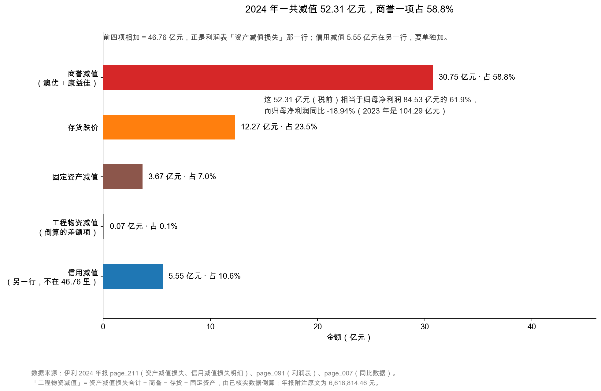
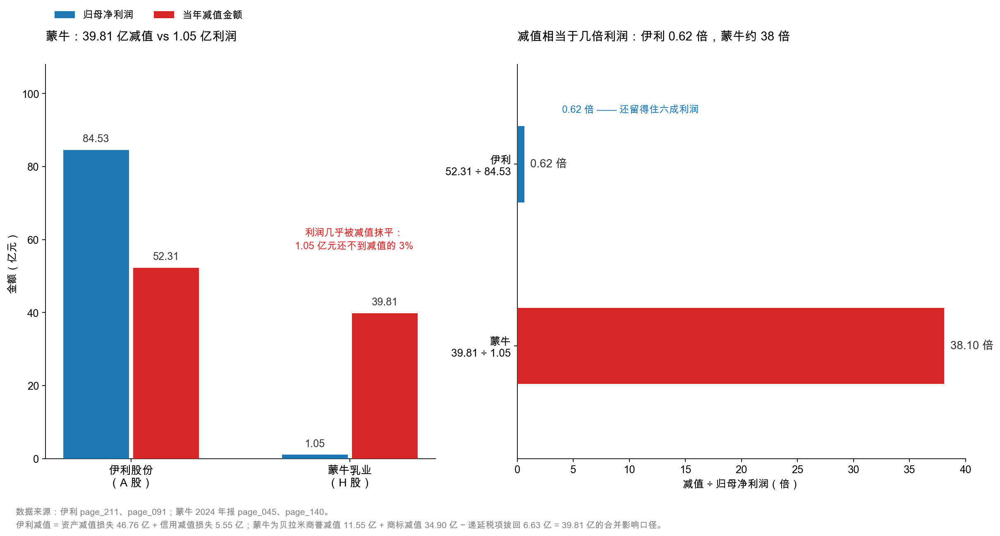
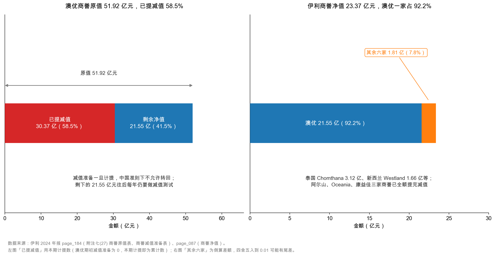

# 第 20 章：实战——商誉减值 30.75 亿那一年

> 本章你将：
> - 把 2024 年伊利的减值事件，还原成一条从"并购"到"认亏"的完整链条；
> - 看清 52.31 亿元减值、84.53 亿元归母净利润、60.11 亿元扣非、217.40 亿元经营现金流这四个数怎么共存；
> - 对照蒙牛贝拉米案，理解同一枚炸弹在两种资产负债表上能炸出多大的坑；
> - 学会投资者面对减值必问的三个问题：**这笔商誉怎么来的、剩下的还有多少风险、管理层是不是在洗大澡**。

---

## 20.1 先把这一年的账摆出来

第 19 章我们把伊利的商誉账本拆完了：原值 58.13 亿元、减值准备 34.76 亿元、净额 23.37 亿元，其中本期计提的 30.75 亿元有 30.37 亿元来自澳优。

但商誉减值只是一整块拼图里最大的一片。这一年伊利的减值，远不止商誉。

打开附注七(73)（`page_211.md`）：

| 减值项目 | 2024 年金额 | 2023 年金额 |
|---|---|---|
| 存货跌价损失 | **12.27 亿元** | 12.22 亿元 |
| 固定资产减值损失 | **3.67 亿元** | 0.69 亿元 |
| 工程物资减值损失 | 0.07 亿元 | — |
| **商誉减值损失** | **30.75 亿元** | — |
| **资产减值损失合计** | **46.76 亿元** | 15.26 亿元 |

注意最后一行：**2023 年资产减值损失只有 15.26 亿元，2024 年跳到 46.76 亿元，涨了 2.07 倍**，涨的部分几乎全是商誉减值——2023 年那一行是空的（零），2024 年一次性来了 30.75 亿元。

旁边还有一行：附注七(72)的**信用减值损失 5.55 亿元**（2023 年 1.60 亿元）。这一行和"资产减值损失"在利润表上是**两个不同的科目**，千万别合并：

| 科目 | 一句话 | 伊利 2024 |
|---|---|---|
| 资产减值损失 | 存货、固定资产、商誉这些**实物/无形**资产不值钱了 | 46.76 亿元 |
| 信用减值损失 | 别人欠你的钱**可能收不回来**（坏账） | 5.55 亿元 |

两项加总：46.76 + 5.55 = **52.31 亿元**，这才是 2024 年"因为东西不值钱、钱可能收不回"而从利润里扣掉的总额。

图按金额从大到小排，重心一眼可见：**商誉占 58.8%，存货跌价 23.5%，固定资产 7.0%，信用减值 10.6%，零头不到 0.1%。** 注意图里那句"前四项相加 = 46.76 亿元"——利润表的"资产减值损失"只含前四项，信用减值 5.55 亿元在另一行。**两个数一旦混起来，后面所有比例都会算错。**

<!-- src: 伊利股份2024年报/page_211.md 伊利股份2024年报/page_091.md -->

## 20.2 一条完整的链条：从收购到认亏

现在把时间轴拉开。这笔 30.37 亿元不是 2024 年凭空冒出来的，它有一条长达三年多的因果链。

**第一环：买入（2021 年）。**

2021 年，伊利通过子公司收购澳优乳业，进入羊奶粉和婴幼儿配方奶粉赛道。收购时，伊利付出的对价高于澳优可辨认净资产的公允价值，差额形成商誉——2023 年末澳优的商誉原值是 49.39 亿元（`page_184.md`）。

年报不会单独写一行"付了多少溢价"，但可以从商誉规模倒推：**49.39 亿元商誉意味着，当年那笔收购里将近 50 亿元买的是"澳优作为一个整体的价值"，而不是厂房、存货、专利。**

**第二环：加码（2024 年）。** 澳优又收购了荷兰羊奶企业 Amalthea Group B.V.，新增商誉 1.86 亿元，商誉原值升到 51.92 亿元。

有意思的是：**这一年恰好也是澳优商誉被大额减值的一年。** 一边在买（新增 1.86 亿元），一边在认亏（计提 30.37 亿元）。说明管理层的判断是分裂的——长期看好羊奶赛道，但承认当年那笔收购付得太贵。

**第三环：认亏（2024 年末）。** 减值测试的结果是：澳优相关资产组的可收回金额低于账面价值，差额 30.37 亿元一次性计提。

**第四环：传导到三张表。** 这一环是本章的核心。

**利润表**（`page_091.md`、`page_092.md`）：

| 项目 | 2024 年 | 2023 年 | 变化 |
|---|---|---|---|
| 营业总收入 | 1,157.80 亿元 | 1,261.79 亿元 | -8.2% |
| 营业成本 | 762.99 亿元 | 847.89 亿元 | -10.0% |
| 资产减值损失 | **-46.76 亿元** | -15.26 亿元 | 多扣 31.50 亿元 |
| 信用减值损失 | -5.55 亿元 | -1.60 亿元 | 多扣 3.95 亿元 |
| 营业利润 | 101.82 亿元 | 118.73 亿元 | -14.2% |
| 利润总额 | 101.27 亿元 | 119.63 亿元 | -15.3% |
| 净利润 | 84.64 亿元 | 102.84 亿元 | -17.7% |
| 归母净利润 | **84.53 亿元** | 104.29 亿元 | **-18.94%** |

**资产负债表**：商誉 51.60 → 23.37 亿元，总资产 1,516.20 → 1,537.18 亿元（+1.4%），归母权益 535.39 → 531.80 亿元（-0.67%）。

**现金流量表**：经营活动现金流净额 **217.40 亿元**，同比增长 **18.86%**。

三张表放在一起，出现了一个非常刺眼的组合：**利润跌了 18.94%，现金流涨了 18.86%。**

很多人看到这里会懵：减值 52 亿元，现金流怎么反而更好了？

答案第 16 章讲过：**减值不花一分钱现金。** 它是账面上的"认亏"，不涉及资金流动，所以算经营现金流时会被原封不动加回来（`page_217.md` 里"加：资产减值准备 46.76 亿元""信用减值损失 5.55 亿元"两行清清楚楚）。

> 📌 **划重点：** 减值是"利润的减项、现金的无关项"。2024 年伊利的利润表和现金流量表讲的是两个故事：利润表说"这一年过得不好"（-18.94%），现金流量表说"这一年收钱收得很好"（+18.86%）。**两个都是真的，只是它们描述的不是同一件事。**

## 20.3 扣非净利润为什么跌得更狠

上面那张表里，有一行比归母净利润更值得盯：**扣非归母净利润 60.11 亿元，同比下降 40.04%**（`page_007.md`）。

归母净利润跌 18.94%，扣非跌 40.04%——**差了 21 个百分点。** 这个差距从哪来？

答案在"非经常性损益"里。伊利 2024 年的非经常性损益合计 **24.42 亿元**（`page_008.md`~`page_009.md`），最大的一笔是：

> 非流动性资产处置损益 **25.64 亿元**，其中处置子公司昌吉盛新实业有限责任公司股权的收益 **25.80 亿元**（`page_210.md`）。

算一下就明白了：

$$84.53 - 24.42 = 60.11 \text{ 亿元}$$

归母净利润 84.53 亿元里，有 24.42 亿元是"卖东西卖出来的"（主要是昌吉盛新的股权），不是"卖牛奶赚出来的"。剔掉这部分，剩下的 60.11 亿元才是主业的真实盈利。

**这就是扣非跌得比归母更狠的原因：**

| 项目 | 2024 | 2023 | 变化 |
|---|---|---|---|
| 归母净利润 | 84.53 亿元 | 104.29 亿元 | -18.94% |
| 非经常性损益 | **24.42 亿元** | 4.02 亿元 | **+507.6%** |
| 扣非归母净利润 | **60.11 亿元** | 100.26 亿元 | **-40.04%** |

2023 年非经常性损益只有 4.02 亿元，2024 年变成 24.42 亿元——多出的 20.40 亿元"意外之财"把归母净利润托住了。掀掉这块遮羞布，主业利润其实跌了 40.04%。

<!-- src: 伊利股份2024年报/page_007.md 伊利股份2024年报/page_008.md 伊利股份2024年报/page_009.md 伊利股份2024年报/page_210.md -->

所以 2024 年伊利的真实画像是三句话：**主营**被减值和需求双重打击（收入 -8.24%、扣非 -40.04%）；**一次性收益**卖了昌吉盛新股权赚 25.80 亿元；**现金流** 217.40 亿元非常健康，因为减值和卖股权都不影响经营现金流。只看归母（-18.94%）会低估问题，只看扣非（-40.04%）会忽略回笼的现金，只看现金流（+18.86%）会误以为一切安好。

> ⚠️ **易踩坑：** 有人会说"卖子公司赚的钱也是钱，凭什么剔除？"——**是钱，但它不可持续。** 昌吉盛新只能卖一次，明年不会再有第二家。用一次性的收益去掩盖经常性的下滑，是分析里最常见的自我欺骗。扣非净利润存在的意义，就是把这层遮羞布掀掉。

## 20.4 对照蒙牛：贝拉米那 39.81 亿元

伊利的故事讲完了，现在换个镜头。

同一年，同一个行业，蒙牛也踩了一颗商誉炸弹——而且比伊利那颗更大、更贵、更典型。

**收购（2019 年 9 月）。** 蒙牛以每股 12.65 澳元（约 68.15 港元）收购澳洲奶粉品牌贝拉米（Bellamy's）全部股份，总代价 **14.6 亿澳元，折合人民币 71.4 亿元**（蒙牛 2024 年报 `page_046.md`）。收购形成商誉 5.50 亿澳元、无限使用年期商标 11.32 亿澳元。

**认亏（2024 年）。** 蒙牛在 2024 年报里写得很直白（`page_047.md`）：

> 进入二零二四年，生育率仍然保持在低位，婴幼儿奶粉市场竞争激烈……导致二零二四年贝拉米实际收入及净利润大幅低于二零二三年年底预测的金额，而且其在国内市场的份额和盈利能力亦未能达到预期水平。

于是三项减值一起上（`page_045.md`）：

| 项目 | 金额 |
|---|---|
| 商誉减值 | **11.55 亿元** |
| 无限使用年期商标减值 | **34.90 亿元** |
| 拨回递延税项（减少所得税费用） | -6.63 亿元 |
| **合计影响** | **39.81 亿元** |

注意第三项是**负数**——它是"拨回递延税项"，意思是以前确认的递延所得税资产不再成立，要冲回，这会**增加**所得税费用。年报把它算进"综合影响 39.81 亿元"里，是加总后的净影响。

减值之后，贝拉米的商誉减到**零**，商标从 51.02 亿元减到 **16.12 亿元**。

**结果：蒙牛 2024 年归母净利润只剩 1.05 亿元**（`page_140.md`，2023 年 48.09 亿元）。

这是本章最该记住的一张图。左半边，蒙牛那根蓝色的"利润柱"几乎看不见——1.05 亿元摆在 39.81 亿元的减值柱旁边，就是一根牙签。右半边换成比值 **减值 ÷ 归母净利润**：伊利 52.31 ÷ 84.53 = **0.62 倍**（吃掉六成，还剩四成），蒙牛 39.81 ÷ 1.05 = **38.10 倍**。

<!-- src: 蒙牛乳业2024年报/page_045.md 蒙牛乳业2024年报/page_140.md 蒙牛乳业2024年报/page_046.md 蒙牛乳业2024年报/page_047.md -->

**同样是几十亿的减值，为什么结局差这么远？** 不是减值金额差多少（52.31 亿对 39.81 亿，一个量级），而是**分母不一样**：

| 对比项 | 伊利 | 蒙牛 |
|---|---|---|
| 营业收入 | 1,153.93 亿元 | 886.75 亿元 |
| 减值前利润（大致） | 84.53 + 52.31 $\approx$ 136.84 亿元 | 1.05 + 39.81 $\approx$ 40.86 亿元 |
| 减值金额 | 52.31 亿元 | 39.81 亿元 |
| **减值 ÷ 减值前利润** | **38.2%** | **97.4%** |

伊利减值前一年能赚 130 多亿元，52 亿元虽疼，只吃掉不到四成；蒙牛减值前一年只赚 40 亿元左右，39.81 亿元几乎把利润全抹平。**这就是"利润缓冲垫"的差别**——同样一记重拳，打在壮汉身上是淤青，打在瘦子身上是骨折。

蒙牛的缓冲垫为什么这么薄？两个原因：

1. **主业利润率低。** 蒙牛 2024 年毛利率 39.57%（比伊利 33.88% 还高），但销售费用率 26.04%（伊利 19.05%）——**赚的毛利一大半又花回渠道里去了。** 伊利净利率 7.33%，蒙牛只有 0.12%。
2. **联营公司拖后腿。** 联营公司现代牧业 2024 年也计提商誉减值 5.99 亿元，导致蒙牛应占其业绩亏损 8.27 亿元。这是"表外商誉"传导回来的第二重打击。

> 💡 **你可能会问：** 那蒙牛这笔收购是不是彻底失败了？
>
> 从会计上看，是的：71.4 亿元买来的东西，商誉减到零、商标从 51 亿元砍到 16 亿元，账面价值只剩当初的一小半。
>
> 但从经营上看，结论要谨慎。贝拉米还在卖货，品牌还在，只是"值不了当年那个价"。**收购失败不等于业务归零**——它只说明当年那个价格付错了。这两件事，在报表上是同一个数字，在现实里是两回事。

## 20.5 剩下的商誉，还有多少风险

减完这 30.37 亿元，伊利的商誉还剩多少风险？这是投资者最该追问的第二个问题（第一个是"这笔商誉怎么来的"）。

**左半边：澳优这一笔还剩多少。** 原值 51.92 亿元，已提减值 30.37 亿元（58.5%），剩余净值 **21.55 亿元**——这就是"可能还会再减"的上限，最多减到零为止。

**右半边：全公司的商誉集中在谁身上。** 23.37 亿元里澳优占 21.55 亿元，**92.2%**。其他六家（泰国 Chomthana 3.12 亿元、新西兰 Westland 1.66 亿元等）加起来只有 1.81 亿元，其中三家（Westland、阿尔山、Oceania）的商誉已**全额提完减值**，净值为零。

结论很清楚：**伊利的商誉风险，几乎就是"澳优这一笔"的风险。**

那这 21.55 亿元还会不会再减？答案藏在减值测试的假设里。年报 `page_185.md` 把澳优资产组的底牌摊开了：

| 关键参数 | 2024 年取值 |
|---|---|
| 资产组账面价值 / 可收回金额 | 148.63 亿元 / 97.30 亿元 |
| 预测期 | 2025~2029 年 |
| 折现率 | **11.53%** |
| 稳定期增长率 / 毛利率 | **2.00%** / 44.74% |

**明年就盯这三个数：折现率、稳定期增长率、稳定期毛利率。** 折现率上调、增长率下调，都是"还要再减"的提前信号——它们往往比减值公告早一年出现。

伊利 2024 年已经下调了对澳优的预期（否则不会提 30.37 亿元）。如果 2025 年新生儿数量继续下降、奶粉价格战继续，剩下的 21.55 亿元还有可能再减。

但要说清楚：**21.55 亿元占归母权益 531.80 亿元的 4.1%**，就算全额减完，净资产也只降 4.1%——可以承受，不致命。

<!-- src: 伊利股份2024年报/page_184.md 伊利股份2024年报/page_087.md 伊利股份2024年报/page_088.md -->

## 20.6 管理层是不是在"洗大澡"

现在到了最难、也最容易被带偏的问题：**为什么是这一年？**

"洗大澡"（big bath）是财务分析里的术语，指**管理层在业绩本来就很差的一年，把未来几年该提的减值、该确认的费用一次性全部提掉**，让当年"一次亏个够"，好让后面几年"轻装上阵"。它的特征有四个：时机（当年业绩本来就差）、金额（一次性、大额、远超往年）、理由（"行业环境变化""审慎性原则"）、后续（次年利润明显反弹）。

拿这把尺子量一量伊利 2024 年：

**符合的特征：** 业绩本来就差（营业收入 -8.24%、扣非 -40.04%）；金额巨大且一次性（30.37 亿元，澳优商誉往年是零）；理由充分（出生率下降、竞争加剧是客观事实）。

**不符合的特征：** 没有"减到底"——真正的洗大澡常把商誉一次减到零（蒙牛对贝拉米就是这么干的），伊利留了 21.55 亿元，说明它**没有把坏消息一次出清**。

所以更准确的判断是：**伊利做的是"审慎减值"，不是典型的"洗大澡"。** 它承认澳优这笔收购付贵了，但没有把坏消息全堆在 2024 年。

> ⚠️ **易踩坑：** 看到大额减值就喊"洗大澡"，是很容易犯的错。区分"审慎减值"和"洗大澡"，关键看两点：
>
> 1. **有没有减到底**：减到零（像蒙牛对贝拉米）更像洗大澡；留一截（像伊利留 21.55 亿元）更像审慎；
> 2. **次年是否反弹**：如果 2025 年利润突然大增、且没有经营改善的支撑，那洗大澡的嫌疑就很大。
>
> 这两条都要等一年才能验证。所以对 2024 年的伊利，正确的态度是：**记下这个疑点，等 2025 年报来验证**，而不是现在就下结论。

## 20.7 投资者该问的三个问题

把这一章收成一张清单。以后遇到任何一家公司计提大额减值，按这三问走一遍。

**问题一：这笔商誉是怎么来的？当年收购价合理吗？**

要查三样：**商誉的原值和形成时间**（哪一年年报第一次出现、对价多少）、**被收购方现在的经营状况**（收入、利润、份额是涨是跌）、**当年说的"协同效应"实现了几成**。

伊利的情况：澳优商誉原值 51.92 亿元，主要形成于 2021 年收购；2024 年奶粉行业下行，协同效应没有完全兑现，于是减值 30.37 亿元。

**问题二：剩下的商誉还有多少风险？**

要算两个比例：**剩余商誉 ÷ 归母净资产**（伊利 23.37 ÷ 531.80 = **4.4%**，可承受），**最大一笔 ÷ 商誉总额**（澳优 21.55 ÷ 23.37 = **92.2%**，高度集中）。前者告诉你"最坏情况有多坏"，后者告诉你"风险集中在哪"。只看第一个会忽略集中度，只看第二个会高估绝对冲击。

**问题三：管理层是不是在洗大澡？**

用 20.6 节那两条尺子量。伊利 2024 年没有减到底（留了 21.55 亿元），所以嫌疑不大，但仍需 2025 年报验证。

> 🔍 **翻到年报：** 打开 `page_211.md`，把"资产减值损失"那张表和上一年的数字并排看。2023 年 15.26 亿元、2024 年 46.76 亿元，多了 31.50 亿元，其中 30.75 亿元是商誉。**这个"多出来的部分从哪来"，就是本章全部内容的起点。**
>
> 再翻到 `page_184.md`，看商誉减值准备表里澳优那一行：期初空白、本期计提 30.37 亿元、期末 30.37 亿元。**期初是空的，说明这是第一次提**——这一条，是判断"是不是洗大澡"的关键证据之一。

## ✍️ 想一想

### 问 1：把这一年重新算一遍

伊利 2024 年：归母净利润 84.53 亿元、非经常性损益 24.42 亿元、资产减值损失 46.76 亿元、信用减值损失 5.55 亿元、经营现金流 217.40 亿元。请计算：（1）扣非归母净利润；（2）如果把 52.31 亿元减值全部加回（不考虑所得税），归母净利润会变成多少？（3）为什么经营现金流不受减值影响？

**解题思路：** 第一问是减法：归母净利润减非经常性损益。第二问是加法：归母净利润 + 减值总额，但要注意这是"税前"口径的粗算。第三问回到第 16 章的结论：减值不花现金。

**参考答案：**

（1）扣非归母净利润 = 84.53 - 24.42 = **60.11 亿元**。这个数字年报上直接给了（`page_007.md`），可以验算。

（2）84.53 + 52.31 = **136.84 亿元**。

但要注意这是**粗算**，有三个不严谨的地方：

- 减值 52.31 亿元是**税前**的，加回利润后要多交所得税。按 25% 算，税后影响约 39.23 亿元，加回后约 123.76 亿元；
- 部分减值（如存货跌价）可能已经影响了成本结转，不能简单加回；
- 减值可能带来递延所得税资产的确认或冲回，进一步影响税额。

所以严谨的说法是：**"如果没有这 52.31 亿元减值，归母净利润大约会在 120~137 亿元之间"**，具体数字要重建整个利润表才能确定。

（3）因为减值**不涉及任何现金流动**。商誉、存货、固定资产的账面价值被调低，只是会计上的"认亏"，银行账户里的钱一分没动。所以在编制现金流量表时，这 52.31 亿元会被作为"不涉及现金的费用"加回（`page_217.md` 的补充资料里就是这么做的）。

**易错点：** ① 第二问忘了考虑所得税，直接说"利润会变成 136.84 亿"——这个数偏高；② 把"加回减值"理解成"公司多赚了 52 亿"。不是多赚，是"本来就没少赚，只是账上扣了"；③ 以为减值会影响经营现金流。这是最典型的错误，减值和现金流完全无关。

### 问 2：为什么蒙牛比伊利惨这么多

伊利 2024 年减值 52.31 亿元，归母净利润 84.53 亿元；蒙牛减值 39.81 亿元，归母净利润只有 1.05 亿元。蒙牛的减值金额比伊利还少 12.5 亿元，为什么利润却几乎归零？

**解题思路：** 关键不在分子（减值金额），在分母（减值前的利润）。先算两家的"减值前利润"，再看减值占它的比例。然后想：为什么蒙牛的分母这么小？

**参考答案：**

先算"减值前利润"（粗略口径）：

| 公司 | 归母净利润 | 减值金额 | 减值前利润（约） | 减值占比 |
|---|---|---|---|---|
| 伊利 | 84.53 亿元 | 52.31 亿元 | 136.84 亿元 | **38.2%** |
| 蒙牛 | 1.05 亿元 | 39.81 亿元 | 40.86 亿元 | **97.4%** |

**蒙牛的减值，几乎等于它减值前的全部利润。** 这就是"利润缓冲垫"的差别：伊利的垫子有 136 亿元厚，蒙牛只有 41 亿元。

那为什么蒙牛的垫子这么薄？两个原因：

**第一，主业利润率低。** 蒙牛毛利率 39.57%，比伊利 33.88% 还高；但销售费用率 26.04%，远高于伊利的 19.05%。赚来的毛利，一大半又投回渠道。结果伊利净利率 7.33%，蒙牛只有 0.12%。

**第二，联营公司拖累。** 蒙牛的联营公司现代牧业 2024 年也计提商誉减值 5.99 亿元，蒙牛应占其亏损 8.27 亿元。这是主业之外的"第二重打击"，伊利没有这个包袱。

所以同样是几十亿减值，伊利是"伤筋"，蒙牛是"骨折"。

**易错点：** ① 只比减值金额（39.81 亿少于 52.31 亿），得出"蒙牛受影响更小"的结论——完全反了；② 忘了联营公司的影响。蒙牛的利润里还要扣掉应占联营公司的亏损；③ 用"减值 ÷ 营业收入"来比。这个比例看不出冲击，因为收入是"规模"，不是"缓冲垫"，**利润才是**。

### 问 3：如果你是分析师，2025 年该盯什么

假设你现在要给伊利写一份 2025 年的跟踪报告。基于 2024 年这场减值，请列出三个你最该盯的指标，并说明每个指标"变好"和"变坏"分别意味着什么。

**解题思路：** 回到本章的三个问题：商誉还剩多少风险（21.55 亿元）、减值是不是洗大澡（看次年是否反弹）、主业有没有恢复（扣非利润）。每个问题对应一个可观测的指标。

**参考答案：**

**指标一：澳优相关业务的收入与利润（或奶粉分部数据）。**

- **变好**：收入止跌、毛利率回升 → 说明 21.55 亿元商誉暂时安全，不需要再减；
- **变坏**：收入继续下滑、份额继续丢 → 2025 年可能还要再提减值，最多 21.55 亿元。

**指标二：扣非归母净利润的增速。**

- **变好**：扣非利润恢复正增长 → 说明 2024 年的下滑是周期性的，不是结构性的；
- **变坏**：扣非继续下滑 → 说明主业真的在下台阶，减值是"业务变差"的结果而不是"一次性出清"。

特别要注意：**2025 年的归母净利润如果大幅反弹，先看扣非。** 如果归母涨、扣非不涨，那反弹是"没有减值"带来的，不是经营改善。这正是检验"洗大澡"的关键。

**指标三：商誉减值测试的关键假设（附注里披露）。**

- **变好**：折现率、增长率假设没变 → 管理层对澳优的预期稳住了；
- **变坏**：折现率上调、增长率下调 → 这是"还要再减"的提前信号，往往比减值本身早一年出现。

三个指标，一个看"风险还剩多少"，一个看"主业行不行"，一个看"管理层怎么想"。三个方向对上，结论才站得住。

**易错点：** ① 只盯归母净利润。它会被非经常性损益和减值反复扰动，是最不可靠的指标；② 忘了看附注里的减值测试假设。这是最早的预警信号，很多人只等减值公告出来才反应；③ 把"2025 年利润反弹"直接当成"经营改善"。要拆开看：是减值没了，还是主业真的好了。

## 📎 数据出处

- 伊利股份 2024 年报 `page_211.md`：附注七(72) 信用减值损失 5.55 亿元、附注七(73) 资产减值损失 46.76 亿元（商誉 30.75 亿、存货 12.27 亿、固定资产 3.67 亿、工程物资 0.07 亿）
- `page_184.md`：附注七(27) 商誉明细（澳优本期计提 30.37 亿元、康益佳 0.38 亿元）；`page_185.md`：商誉减值测试的关键假设（账面价值 148.63 亿元、可收回金额 97.30 亿元、折现率 11.53%、稳定期增长率 2.00%）；`page_210.md`：处置长期股权投资 25.80 亿元（昌吉盛新）
- `page_007.md`：归母净利润 84.53 亿元（-18.94%）、扣非 60.11 亿元（-40.04%）、经营现金流 217.40 亿元（+18.86%）；`page_008.md` / `page_009.md`：非经常性损益 24.42 亿元
- `page_091.md` / `page_092.md`：利润表全表；`page_217.md`：现金流量表补充资料（减值被加回）；`page_088.md`：归母权益 531.80 亿元
- 蒙牛乳业 2024 年报 `page_045.md`：贝拉米商誉减值 11.55 亿元、商标减值 34.90 亿元、递延税项拨回 6.63 亿元、合计影响 39.81 亿元
- `page_046.md`：2019 年 9 月收购贝拉米，每股 12.65 澳元（68.15 港元），总代价 14.6 亿澳元（71.4 亿元）
- `page_047.md`：减值原因（出生率低位、竞争激烈、收入与利润低于预测）
- `page_140.md`：蒙牛归母净利润 1.05 亿元（2023 年 48.09 亿元）
- 数据汇总：`data/yili2024.json`、`data/mengniu2024.json`

<!-- src: 伊利股份2024年报/page_007.md 伊利股份2024年报/page_008.md 伊利股份2024年报/page_009.md 伊利股份2024年报/page_088.md 伊利股份2024年报/page_091.md 伊利股份2024年报/page_092.md 伊利股份2024年报/page_184.md 伊利股份2024年报/page_185.md 伊利股份2024年报/page_210.md 伊利股份2024年报/page_211.md 伊利股份2024年报/page_217.md 蒙牛乳业2024年报/page_045.md 蒙牛乳业2024年报/page_046.md 蒙牛乳业2024年报/page_047.md 蒙牛乳业2024年报/page_140.md -->

下一章：[第 21 章：负债分两类——要付息的 vs 占用别人的](../week05/21-负债分两类-要付息的vs占用别人的.md)。本周到这里结束：资产这一侧已经翻完，下周开始看资产负债表的右边——伊利那 967.10 亿元负债里，哪些要付利息、哪些是占用别人的钱。
