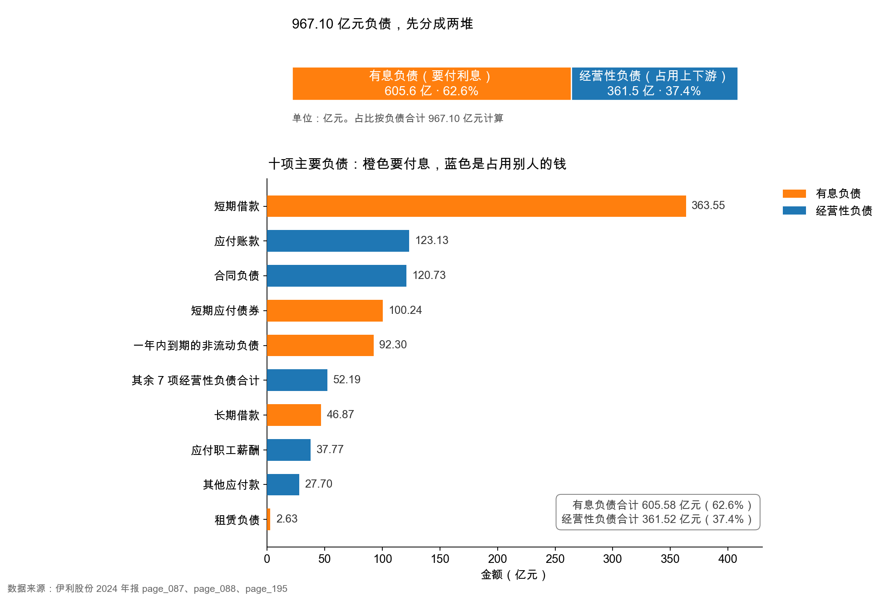

# 第 21 章：负债分两类——要付息的 vs 占用别人的

> 本章你将：
> - 拿到一把给负债分类的尺子：**这笔钱要不要付利息**；
> - 把伊利 967.10 亿元负债拆成两堆——有息负债 605.58 亿、经营性负债 361.52 亿；
> - 学会在年报里找出"藏起来的借款"，比如塞在"其他流动负债"里的 100.24 亿元短期应付债券；
> - 亲手验算一个反直觉的结论：伊利的有息负债占了负债总额的 62.6%，它并不属于"靠占款过日子"的那类公司；
> - 明白"资产负债率 62.91% 高不高"这个问题，为什么不能只看这一个数字就回答。

---

## 21.1 煎饼摊的两笔欠款

先讲个摆摊的故事。全部是**示意数字**，不对应任何真实公司。

老周在写字楼下摆煎饼摊，生意不错。到了月底，他欠着两笔钱：

**第一笔，欠面粉厂 8,000 元。** 面粉是月初拉走的，说好月底结账。这笔钱他一点都不慌——因为面粉已经做成煎饼卖出去了，钱在抽屉里。而且下个月他还要接着拉面粉，面粉厂也不会催他催得太紧。**这笔欠款，是他和供应商之间的正常节奏。**

**第二笔，向隔壁老王借了 20,000 元，月息一分。** 这笔钱是当初买煎饼炉子借的，说好三个月还。每个月他要掏出 200 元利息，到期还得凑出 2 万元本金。**这笔欠款，是有代价的、有期限的、到期必须拿现金出来的。**

同样是"欠钱"，这两笔的性质完全不同。

第一笔，只要摊子还在开，它就会一直滚动下去：这个月欠 8,000，下个月还掉，又欠新的 8,000。它不需要老周某一天集中掏出 8,000 元现金，因为它已经变成了抽屉里的营业收入。

第二笔不一样。炉子早就买完了，那 2 万元变成了机器，机器不会自己变成 2 万元现金。到期那天，老周必须从抽屉里、或者从别处，拿出真金白银。

**会计把这两笔欠款，分别叫"经营性负债"和"有息负债"。** 这个区分，是读资产负债表右边那一半的第一把钥匙。

> 📌 **划重点：** 负债不是一坨。判断一家公司的负债危不危险，第一个动作永远是：**把它拆成"要付利息的"和"不付利息的"两堆**。要付利息的那堆，有代价、有期限、到期要用现金还；不付利息的那堆，通常随生意滚动，是产业链地位的体现。

## 21.2 两类的判断标准

把尺子说清楚。

| 分类 | 中文名 | 英文名 | 判断标准 | 典型科目 |
|---|---|---|---|---|
| 要付利息 | 有息负债 | interest-bearing debt | 借来的钱，按约定利率计息，有明确到期日 | 短期借款、应付债券、长期借款、租赁负债、一年内到期的非流动负债 |
| 不付利息 | 经营性负债 | operating liabilities | 经营活动自然产生的欠款，通常不计息 | 应付账款、应付票据、合同负债、应付职工薪酬、应交税费、其他应付款 |

这里要多说一句：**"不付利息"不等于"没有成本"。** 应付账款拖供应商三个月，供应商可能会在报价里把这笔资金占用算进去；合同负债收了经销商的钱，公司要承担交货义务。这些成本是隐性的，体现在价格和商业关系里，不体现在利润表的"利息费用"那一行。

但对偿债分析来说，这个区分仍然是第一位的，因为**只有有息负债会到期索命**。

> 💡 **你可能会问：** 怎么知道一笔负债要不要付息？科目名字看不出来啊。
>
> 三个办法，从快到慢：
>
> 1. **看名字**。带"借款""债券""票据（应付债券类）""租赁负债"的，基本都是有息；带"应付账款""应付职工薪酬""应交税费"的，基本都无息。这个办法能覆盖九成。
> 2. **看附注**。每个重要科目都有附注，会写清楚"是否计息、利率区间、到期日"。伊利的短期借款附注在 `page_189.md`，会写明质押/抵押/保证借款的构成。
> 3. **看现金流量表**。筹资活动里的"取得借款收到的现金""偿还债务支付的现金""分配股利、利润或偿付利息支付的现金"，这三行画出了有息负债的进出。凡是能在这三行里找到踪迹的，都是有息负债。
>
> 第 3 个办法最可靠，因为它绕过了科目名字，直接看现金流。本章后面会用它来抓一笔"藏起来"的债。

## 21.3 伊利 2024：967.10 亿元负债，拆成两堆

现在把尺子架到伊利 2024 年末的资产负债表上。

负债合计 **967.10 亿元**（伊利 2024 年报，page_088.md）。拆开看：

| 分类 | 金额（亿元） | 占负债合计 | 主要科目 |
|---|---|---|---|
| **有息负债** | **605.58** | **62.6%** | 短期借款 363.55、短期应付债券 100.24、一年内到期 92.30、长期借款 46.87、租赁负债 2.63 |
| **经营性负债** | **361.52** | **37.4%** | 应付账款 123.13、合同负债 120.73、应付职工薪酬 37.77、其他应付款 27.70、其他流动负债中的非债券部分 14.05、递延所得税负债 10.40、应付票据 9.69、应交税费 8.50、递延收益 7.80、衍生金融负债 1.59、长期应付职工薪酬 0.16 |
| **合计** | **967.10** | 100% | — |

<!-- src: 伊利股份2024年报/page_088.md 伊利股份2024年报/page_195.md -->

（有息负债五项各自四舍五入后相加是 605.59 亿元，与 `ratios.interest_bearing_debt` 记录的 605.58 亿元差 0.01 亿元——这是尾差，不是抄错。同理，经营性负债十一项相加会得到 361.53 亿元，与 967.10 - 605.58 = 361.52 也差 0.01 亿元。本章正文一律用"合计相减"得到的 361.52，它比"分项相加"更准。）

这张图分上下两块。上面那条 100% 堆叠条，是把 967.10 亿元先一刀切成两段：橙色 605.58 亿元要付利息，蓝色 361.52 亿元是占用上下游的钱。下面那张横向条形图，是把两边各自最大的几项摊开排隊，颜色和上面一一对应。

看下面这张条形图，第一眼就该注意到一件事：**排在最前面的不是应付账款，是短期借款 363.55 亿元。** 它一根柱子就占了负债总额的 37.6%，比"应付账款 + 合同负债"加起来还多。

这个排序本身就说明了很多问题，本章后面会反复回到它。

> 🔍 **翻到年报：** 打开 `page_088.md`，从"流动负债:"那一行开始往下数。你能看到"短期借款 36,354,630,548.02"排在第一行；再往下第 12 行左右是"其他流动负债 11,428,659,480.32"；第 13 行是"流动负债合计 89,924,532,161.51"。**这一页就是本章的全部原料**——967.10 亿元负债的每一个子项，都在这半页纸上。

### 21.3.1 有息负债那 605.58 亿元，五项逐个认

| 科目 | 2024 年末（亿元） | 2023 年末（亿元） | 变动 | 这是什么 |
|---|---|---|---|---|
| 短期借款 | 363.55 | 397.55 | -34.00 | 一年内到期的银行借款 |
| 短期应付债券 | 100.24 | 0 | **+100.24** | 超短期融资券，**藏在"其他流动负债"里** |
| 一年内到期的非流动负债 | 92.30 | 24.35 | **+67.95** | 长期借款和债券中，一年内到期的那部分 |
| 长期借款 | 46.87 | 117.05 | **-70.18** | 一年以上到期的银行借款 |
| 租赁负债 | 2.63 | 2.38 | +0.26 | 租房子租设备，未来要付的租金折现 |
| **有息负债合计** | **605.58** | — | — | — |

<!-- src: 伊利股份2024年报/page_088.md 伊利股份2024年报/page_195.md -->

这张表里有一行必须单独讲，因为它最容易被漏掉。

**短期应付债券 100.24 亿元，不在"应付债券"那一行，而在"其他流动负债"里。**

如果你只看资产负债表，会看到"应付债券"这一行是空的（2023 年还有 35.41 亿元），很容易得出"伊利的债券都还完了"这个结论。**错。** 打开附注七(44)（`page_195.md`），"其他流动负债"114.29 亿元的构成是这样的：

| 其他流动负债的构成 | 金额（亿元） |
|---|---|
| **短期应付债券** | **100.24** |
| 待转销项税 | 12.19 |
| 担保赔偿准备金 | 1.65 |
| 未到期责任准备金 | 0.20 |
| **合计** | **114.29** |

<!-- src: 伊利股份2024年报/page_195.md -->

也就是说，那 114.29 亿元里，有 100.24 亿元是**债**，剩下 14.05 亿元是税和准备金。年报的"主要负债情况及其变动原因"那张表写得很直白（`page_079.md`）：

> 其他流动负债 114.29 亿元，2023 年余额 10.70 亿元，变动比例 968.07%，"本期短期融资券增加所致"。

**一年之间从 10.70 亿元涨到 114.29 亿元，涨了将近 10 倍。** 这就是为什么本章要专门教"藏起来的债"这件事——科目名字叫"其他"，里面装的可能是最硬的那笔债。

> ⚠️ **易踩坑：** 看到"其他流动负债""其他非流动资产"这种带"其他"的科目，必须点开附注。
>
> "其他"是报表编制时留给"装不进标准科目"的杂物的抽屉。抽屉里可能是一堆零钱（待转销项税、押金），也可能是 100 亿元的债。**只看报表主表，"其他"两个字什么都不告诉你；点开附注，"其他"才会说话。**
>
> 伊利这个抽屉里，2024 年 88% 是债（100.24 ÷ 114.29）。你不点开，就会把 100 亿元有息负债当成经营性占款。

顺便说一句那笔 100.24 亿元的短期融资券是什么。它是企业在银行间债券市场发的、期限通常在 270 天以内的短期债券，伊利 2024 年发的两期各 50 亿元，利率 2.01%，2025 年 9 月到期（`page_080.md`）。**2.01% 的融资成本**，这个数字先记住，第 23 章讲"借钱划不划算"时要用。

### 21.3.2 经营性负债那 361.52 亿元，是产业链地位

再看另一堆。经营性负债里最大的是两项：应付账款 123.13 亿元、合同负债 120.73 亿元，加起来 243.86 亿元，占了经营性负债的三分之二。

这两项的性质，正好是"占用别人钱"的两个方向：

**应付账款 123.13 亿元 = 我先拿货，后付钱。** 打开附注七(36)（`page_191.md`），这 123.13 亿元是这么构成的：

| 应付账款构成 | 金额（亿元） | 占应付账款 |
|---|---|---|
| 原辅材料等货款 | 70.38 | 57.2% |
| 营销及运输费 | 27.73 | 22.5% |
| 工程及设备款 | 11.86 | 9.6% |
| 其他 | 13.15 | 10.7% |
| **合计** | **123.13** | 100% |

<!-- src: 伊利股份2024年报/page_191.md -->

这张表有个细节值得琢磨：**应付账款里最大的一块不是原料，是"原辅材料等货款"70.38 亿元；第二大块是"营销及运输费"27.73 亿元。** 后者说明伊利连广告费、运费都是先做后付——一年 219.82 亿元的销售费用，年末还欠着 27.73 亿元没结。

这就是大公司的日常：**它不需要一手交钱一手交货，它有账期。** 账期越长、金额越大，说明它在产业链上越强势。

**合同负债 120.73 亿元 = 我先收钱，后交货。** 这是另一个方向的占款，也是第 22 章整章的主题，这里先记住它的存在。

> 📌 **划重点：** 应付账款是"我欠供应商"，合同负债是"我欠客户（货）"。这两项合起来 243.86 亿元，接近负债总额的四分之一，它们**不付利息、不需集中偿还、随生意滚动**。这是伊利作为行业龙头从上下游拿到的"无息贷款"。

### 21.3.3 一个必须说清楚的反直觉结论

到这里，很多教程会顺势写一句："所以伊利 62.91% 的负债率不可怕，因为大部分是经营性占款。"

**但伊利的数据不支持这句话。** 我们把数字摆出来：

| | 金额（亿元） | 占负债合计 |
|---|---|---|
| 有息负债 | 605.58 | **62.6%** |
| 经营性负债 | 361.52 | 37.4% |

**伊利的有息负债占了负债总额的 62.6%，是"占大头"的那一类。** 它不属于白酒、超市那种"靠占款做生意、几乎不借钱"的类型。

这个发现很重要，因为它把判断的方向整个改掉了：

- 如果一家公司负债 967 亿元、其中 90% 是应付账款和合同负债，那你可以说"这债不是真债"；
- 伊利不是。它有 605.58 亿元要付利息的钱，2024 年为此付了 18.20 亿元利息（`page_209.md` 财务费用附注：利息支出 1,819,520,437.71 元）。

**那它为什么还是安全的？** 答案不在负债端，在资产端——它账上的类现金有 652.07 亿元，比有息负债还多。这个"资产端对冲"的故事，是第 23 章的全部内容。

> ⚠️ **易踩坑：** 不要把"负债率高不一定是坏事"当成一句可以套用的咒语。
>
> 这句话是对的，但它只是一个**提示**，不是一个**结论**。它提示你"去看构成"，而不是告诉你"这家公司没事"。真正的结论必须自己算出来：伊利的有息负债占 62.6%，所以"占款多所以安全"这个解释对伊利**不成立**。
>
> 每家公司都要重新算一遍。算完你可能发现它是"占款型"（安全），也可能是"借款型"（要看现金覆盖），还可能是"两头都重"（最危险）。

## 21.4 资产负债率 62.91% 到底高不高

现在回答那个最常被问的问题。

$$\text{资产负债率} = \frac{\text{负债合计}}{\text{资产总计}} = \frac{967.10}{1{,}537.18} \approx 62.91\%$$

（`ratios.debt_ratio` = 0.6291。）

62.91% 这个数字，单看是偏高的。教科书常说的"安全线"是 50%，超过 60% 就要留意。按这个标准，伊利该被划进"杠杆偏高"那一档。

但这个判断至少有三个漏洞。

**第一，分母里有一大块是"虚的"。** 资产 1,537.18 亿元里，商誉 23.37 亿元、无形资产 47.80 亿元、递延所得税资产 20.74 亿元——这些资产的"变现能力"取决于假设，不是硬邦邦的厂房设备。如果把它们从分母里剔掉，负债率会更高（967.10 ÷ 1,445.27 $\approx$ 66.9%）。**换句话说，用资产负债率衡量风险，其实还偏乐观了。**

**第二，分子的构成千差万别。** 同样是 60% 的负债率，一家公司可能是"60% 全是应付账款"，另一家可能是"60% 全是银行贷款"。前者的风险远低于后者。**这就是本章花一整节拆两堆的原因。**

**第三，资产负债率完全不看"资产的流动性"和"现金流的强弱"。** 一家负债率 70%、但每年经营现金流 200 多亿元的公司，比一家负债率 40%、但每年现金流为负的公司安全得多。比率是静态的快照，现金流是动态的电影。

所以正确的问法不是"62.91% 高不高"，而是三个连环问：

| 问题 | 伊利 2024 的答案 | 在哪看 |
|---|---|---|
| 这 967 亿元里，多少要付利息？ | 605.58 亿元，62.6% | `page_088.md`、`page_195.md` |
| 要付利息的那部分，账上有钱覆盖吗？ | 类现金 652.07 亿元，覆盖得住 | `page_087.md`、`page_166.md`、`page_188.md` |
| 每年赚的现金，够不够付利息？ | 经营现金流 217.40 亿元，利息 18.20 亿元，覆盖 11.9 倍 | `page_094.md`、`page_209.md` |

<!-- src: 伊利股份2024年报/page_087.md 伊利股份2024年报/page_088.md 伊利股份2024年报/page_094.md 伊利股份2024年报/page_166.md 伊利股份2024年报/page_188.md 伊利股份2024年报/page_195.md 伊利股份2024年报/page_209.md -->

三问的答案都是"没问题"，但**理由不是"负债率不高"，而是"有息负债被现金和现金流盖住了"**。这两句话听起来像，其实是两回事。

> 💡 **你可能会问：** 那资产负债率这个指标还有用吗？
>
> 有用，但它是一个**筛子**，不是一个**判决**。它的正确用法是：
>
> 1. 先看它，快速筛出"杠杆明显异常"的公司（比如 85% 以上，或者一年之内从 40% 跳到 70%）；
> 2. 对筛出来的公司，再拆有息/无息、再看现金覆盖、再看现金流；
> 3. 对没筛出来的公司，也别放过——有些公司负债率只有 30%，但借的是美元债、明年集中到期，一样会出事。
>
> 一句话：**资产负债率负责"引起注意"，不负责"下结论"。**

## 21.5 三分钟上手：把任何一家公司的负债拆成两堆

最后给一套可以立刻用的动作，打开任何一份年报都能照着走。

**第一步，抄四个数。** 在合并资产负债表上找到：负债合计、短期借款、长期借款、应付债券。

**第二步，抓"藏起来的债"。** 点开两个附注：其他流动负债、一年内到期的非流动负债。前者里面常有短期融资券，后者里面是长期借款和债券中一年内到期的部分。这两项如果金额大，必须计入有息负债。

**第三步，加总。** 有息负债 = 短期借款 + 应付债券 + 短期应付债券 + 一年内到期的非流动负债 + 长期借款 + 租赁负债。

**第四步，算占比。** 有息负债 ÷ 负债合计。这个比例告诉你，这家公司是"借款型"还是"占款型"。

伊利这一步的结果：

| 步骤 | 动作 | 结果 |
|---|---|---|
| 一 | 抄负债合计、短期借款、长期借款、应付债券 | 967.10 / 363.55 / 46.87 / 0 |
| 二 | 抓其他流动负债、一年内到期 | 114.29（内含债券 100.24）、92.30 |
| 三 | 加总五项 | 605.58 亿元 |
| 四 | 算占比 | 62.6%，**借款型** |

<!-- src: 伊利股份2024年报/page_088.md 伊利股份2024年报/page_195.md -->

第四步的结果，是本章最有价值的一句话：**伊利是"借款型"公司，它的安全性不来自占款，来自现金。**

### 21.5.1 两类公司，两种看法

把这个框架再往前推一步。拆完两堆之后，你会遇到三种长相，对应三种完全不同的分析重点：

| 长相 | 有息负债占比 | 典型公司 | 该看什么 |
|---|---|---|---|
| 占款型 | 低于 20% | 白酒、超市、物业 | 占款能不能持续（看应付+合同负债是否稳定） |
| 借款型 | 40%~70% | 乳业、制造、公用事业 | 现金能不能覆盖（看类现金、期限结构、利息覆盖） |
| 两头重 | 有息高 + 占款也高 | 扩张期的地产、部分新能源 | 两头都要看，最危险 |

伊利落在第二档。它的 361.52 亿元经营性负债不算少（37.4%），但不足以改变"借款型"的定性。

这句话的意义在于：**它决定了第 23 章要讲什么。** 如果伊利是占款型，第 23 章该讲"占款能不能持续"；因为它是借款型，第 23 章必须讲"现金够不够、期限错配有多严重"。

### 21.5.2 本章和后面四章怎么分工

- **第 21 章（本章）**：给负债分类，搭好框架，算出 605.58 / 361.52 这个切分；
- **第 22 章**：专门讲经营性负债里最大的那一项——合同负债 120.73 亿元，以及它背后的"压货"疑云；
- **第 23 章**：专门讲有息负债 605.58 亿元，以及为什么 652.07 亿元类现金能把它盖住，但期限错配仍然真实存在；
- **第 24 章**：翻到负债下面那一栏，讲所有者权益 570.08 亿元；
- **第 25 章**：把这一周的方法装成一套"偿债体检四步法"，拿伊利和蒙牛对着做一遍。

一句话记住本章：**负债先分类，分类先看息。**

---

## ✍️ 想一想

### 问 1：这笔负债该归哪一堆

下面六项负债，请判断各自属于"有息"还是"经营性"，并说明理由。

（a）短期借款 50 亿元；（b）应付账款 30 亿元；（c）合同负债 20 亿元；（d）一年内到期的长期借款 15 亿元；（e）应付职工薪酬 8 亿元；（f）租赁负债 3 亿元。

**解题思路：** 不要看科目名字里有没有"借款"两个字，要问一个问题：**这笔钱，公司有没有为"占用它"付出利息？到期时需不需要拿现金出去？**

**参考答案：**

| 选项 | 归类 | 理由 |
|---|---|---|
| a）短期借款 | **有息** | 银行借款，按利率计息，有到期日 |
| b）应付账款 | 经营性 | 欠供应商的货款，通常不计息，随采购滚动 |
| c）合同负债 | 经营性 | 已收客户的钱、还没交货，不计息，交货即了结 |
| d）一年内到期的长期借款 | **有息** | 本质还是借款，只是快到期了，从非流动挪到了流动 |
| e）应付职工薪酬 | 经营性 | 欠员工的工资，不计息，下个月就发 |
| f）租赁负债 | **有息** | 未来租金的折现值，会计准则要求确认利息，本质是"借钱租东西" |

答案是 **a、d、f 属于有息负债**，合计 68 亿元；b、c、e 属于经营性负债，合计 58 亿元。

这里最容易错的是（f）租赁负债。很多人觉得"租来的东西不算借钱"，但会计上恰恰相反：租赁负债要按折现后的金额入账，每期还要确认"利息费用"。它的经济实质就是"用借款的方式取得资产使用权"。

**易错点：** ① 把（c）合同负债当成"预收款所以是好事"就不归类了——它仍然是负债，只是不付息。② 把（d）漏掉，理由是"它已经不在长期借款那一行了"。一年内到期的长期借款会从"长期借款"挪到"一年内到期的非流动负债"，**挪了位置，债还在**。③ 把（f）归成经营性，理由是"租金是经营开支"。租金是经营开支，但租赁负债是融资行为，两件事。

### 问 2：两家公司，同样 60% 的负债率

A 公司：总资产 100 亿元，总负债 60 亿元，其中有息负债 8 亿元、经营性负债 52 亿元；经营现金流每年 12 亿元。

B 公司：总资产 100 亿元，总负债 60 亿元，其中有息负债 55 亿元、经营性负债 5 亿元；经营现金流每年 2 亿元。

两家公司的资产负债率一模一样，都是 60%。请判断：哪家的偿债风险更高？高在哪？

**解题思路：** 负债率相同，说明"总量"相同。要找差异，只能往"结构"和"现金流"两个方向走。

**参考答案：** **B 公司的风险明显更高。**

理由有三层：

**第一层，债务的性质不同。** A 公司 60 亿元负债里，52 亿元是应付账款、合同负债这类占款——只要生意在转，它们会一直滚动，不需要某天集中还清。B 公司 55 亿元是有息负债，有到期日、有利率、到期必须拿现金。

**第二层，利息负担不同。** 假设利率都是 4%，A 公司一年付息 0.32 亿元，B 公司一年付息 2.20 亿元。B 公司的经营现金流只有 2 亿元，**付完利息几乎不剩**；A 公司付完利息还剩 11.68 亿元。

**第三层，抗冲击能力不同。** 如果收入下滑 20%，A 公司的现金流可能从 12 亿降到 9 亿，仍然宽裕；B 公司从 2 亿降到 1 亿，立刻付不起利息，只能借新还旧，而借新还旧又要看银行脸色。

**所以：资产负债率相等，风险可以差十倍。** 差异全部藏在"有息占比"和"现金流覆盖"这两个地方。

**易错点：** ① 答"一样危险，因为负债率相同"——这是把总量当成了全部。② 只比有息负债的绝对额，不看现金流。B 公司的问题不只是"借得多"，更是"赚得少"。③ 忘了算利息。有息负债的第一杀伤力不是本金，是每年必须付的利息——本金可以借新还旧滚下去，利息是刚性的现金流出。

### 问 3：如果那 100.24 亿元没被找到

假设你读伊利年报时，只看了资产负债表主表，没有点开"其他流动负债"的附注。你会把有息负债算成多少？这个错误会导致什么结论？

**解题思路：** 先算漏掉之后的数字，再想"这个错误的数字会把你带到哪个判断上"。

**参考答案：**

**漏算后的有息负债 = 605.58 - 100.24 = 505.34 亿元。**

负债合计仍是 967.10 亿元，于是有息负债占比从 62.6% 降到 **52.2%**。看起来差别不算天翻地覆，但真正的伤害在下一步：

你会算出"净有息负债 = 505.34 - 652.07 = **-146.73 亿元**"，然后得出"伊利是净现金 146.73 亿元的公司，非常安全"这个结论。

这个结论**方向是对的，但程度被夸大了 3 倍多**（真实值是 -46.50 亿元）。更麻烦的是，你会完全看不到"一年内到期 556.08 亿元、货币资金只有 254.04 亿元"这个期限错配的事实——因为那 100.24 亿元短期融资券，恰恰是**一年内就要还**的。

**结论：漏掉一笔藏在"其他"里的债，不只是数字错，是会把"有期限压力的短债"误判成"可以慢慢还的长债"。** 这是读财报里最典型的一类错误：不是算错，是没看见。

**易错点：** ① 答"差别不大，反正都是净现金"。方向对不等于结论对，-146.73 和 -46.50 对风险判断的含义完全不同。② 只补了金额，没意识到这笔债的**期限**是一年内——补数字的同时必须补期限。③ 反过来过度反应，答"伊利其实很危险"。它不危险，只是没有"净现金 146 亿"那么宽裕。

## 📎 数据出处

- 伊利股份 2024 年报：`page_088.md`（合并资产负债表负债与权益部分：负债合计 967.10 亿元、短期借款、应付账款、合同负债、其他流动负债、一年内到期的非流动负债、长期借款、租赁负债）
- 伊利股份 2024 年报：`page_195.md`（附注七(44) 其他流动负债：短期应付债券 100.24 亿元、待转销项税 12.19 亿元）
- 伊利股份 2024 年报：`page_191.md`（附注七(36) 应付账款构成、七(37) 预收款项、七(38) 合同负债）
- 伊利股份 2024 年报：`page_079.md`（主要负债情况及其变动原因：其他流动负债 +968.07%）
- 伊利股份 2024 年报：`page_080.md`（短期融资券明细：两期各 50 亿元、利率 2.01%）
- 伊利股份 2024 年报：`page_209.md`（附注七(67) 财务费用：利息支出 18.20 亿元）
- 伊利股份 2024 年报：`page_094.md`（经营活动现金流量净额 217.40 亿元）
- 数据汇总：`data/yili2024.json` 的 `balance` 段、`ratios.interest_bearing_debt`（605.58 亿元）、`ratios.debt_ratio`（0.6291）

下一章：[第 22 章：合同负债与预收款——先收钱是不是好生意](22-合同负债与预收款.md)
