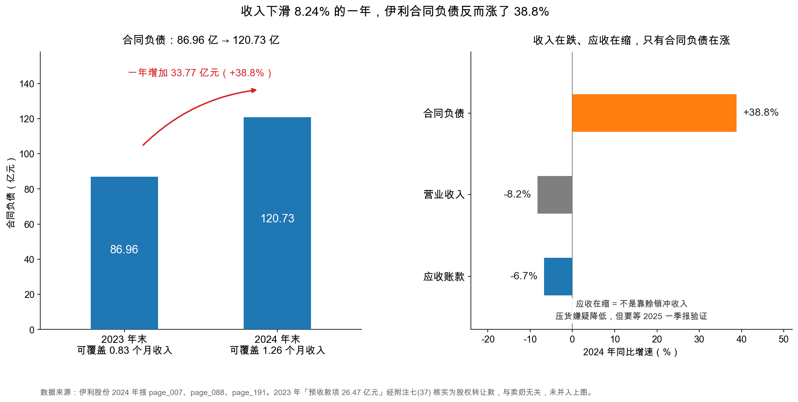

# 第 22 章：合同负债与预收款——先收钱是不是好生意

> 本章你将：
> - 用"理发店卖年卡"的类比，搞懂合同负债（contract liabilities）到底是什么；
> - 看懂伊利合同负债从 86.96 亿元涨到 120.73 亿元（+38.8%）这本账；
> - 分清"预收货款"和"预收股权转让款"——2023 年那 26.47 亿元根本不是卖奶收的钱；
> - 学会本周最重要的一道判断题：收入跌 8.24%、合同负债却涨 38.8%，到底是渠道看好还是向经销商压货；
> - 拿到三个可以立刻用的验证动作，并用蒙牛的数据做一次交叉印证。

---

## 22.1 理发店的年卡

先从一个你大概办过的东西说起。**下面这家理发店的数字是示意，不对应任何真实商家。**

小区门口那家理发店，推出年卡：一次付 3,600 元，一年内剪 24 次。你办了卡，店老板收到 3,600 元现金。

这 3,600 元，在老板眼里是什么？

**它不是收入。** 老板还没给你剪过一次头。这笔钱是"他欠你的 24 次服务"。如果明天店关门了，这 3,600 元理论上还要退给你（虽然现实中很难）。

会计把这种"已经收到钱、但还没交付商品或服务"的义务，叫**合同负债**。

把它的三个特征说清楚：

| 特征 | 说明 |
|---|---|
| 已经收到钱 | 现金已经进了公司账户，这一点和白条（应收账款）完全不同 |
| 还没交付 | 义务没完成，所以不能算收入 |
| 交付时转收入 | 每剪一次头，就从"合同负债"里划掉 150 元，记成"收入" |

所以合同负债有个很有意思的性质：**它是"欠货"，不是"欠钱"。**

欠银行的钱，到期要拿现金还；欠客户的货，到期拿产品交付就行。交付这个动作，不动用一分钱现金——它只是把资产负债表上的一项负债，搬到利润表上变成收入。

> 📌 **划重点：** 合同负债是**已经到手的现金**加上**还没履行的交货义务**。它不花现金、不付利息，交付即了结。这是它和银行贷款最本质的区别：**一个要还钱，一个只要发货。**

伊利的合同负债，就是这句话的乳业版：经销商先把货款打过来，伊利还没发货，于是这笔钱挂在"合同负债"里，等发货确认收入时再转出去。

## 22.2 从"预收款项"到"合同负债"：一次改名

你可能在老年报里见过另一个词：**预收款项**（advance from customers）。

2017 年之后，中国会计准则修订，把"预收款项"里跟"卖商品、提供服务"有关的部分，单独拿出来叫**合同负债**；剩下的（比如预收的租金、预收的股权转让款）还留在"预收款项"里。

所以你在伊利 2024 年的资产负债表上，会看到两行并排：

| 科目 | 2024 年末（亿元） | 2023 年末（亿元） |
|---|---|---|
| 预收款项 | **0** | **26.47** |
| 合同负债 | **120.73** | 86.96 |

<!-- src: 伊利股份2024年报/page_088.md -->

看到"预收款项从 26.47 亿变成 0"，很多人的第一反应是"这笔钱没了"或者"重分类到合同负债了"。**两个猜测都不对。**

打开附注七(37)（`page_191.md`），2023 年那 26.47 亿元"预收款项"的构成只有一行：

| 预收款项构成 | 2024 年末 | 2023 年末（亿元） |
|---|---|---|
| 股权转让款 | — | **26.47** |
| 合计 | — | 26.47 |

<!-- src: 伊利股份2024年报/page_191.md -->

**它是股权转让款——某个买家预付给伊利、要买伊利某个子公司股权的钱。** 这跟卖牛奶一点关系都没有。

2024 年这笔款项结清了，余额归零（年报没有说明具体原因，但这不影响判断：无论交易完成还是终止，它都不是货款）。

这个细节值得停一下，因为它教了一件事：

> ⚠️ **易踩坑：** 看到两个科目名字长得像，不要自动假设"重分类"。
>
> "预收款项 26.47 亿变成 0、合同负债从 86.96 涨到 120.73"，如果你直接写"预收款项重分类进合同负债，所以同口径增长 6.4%"，**你就编出了一个不存在的事实**。真相是：那 26.47 亿元是股权转让款，跟合同负债没有一分钱关系，两边各自独立变动。
>
> 判断方法很简单：**点开附注，看构成。** 附注七(37) 只有"股权转让款"一行，附注七(38) 只有"货款"一行，两清。

很多人（包括一些写研报的人）会在这一步偷懒：把"预收款项 + 合同负债"加总算增速，得出"只增长 6.4%"的结论，然后说"所以合同负债增长没那么夸张"。

**这个算法在伊利身上是错的。** 因为分子里混进了卖股权的钱。

### 22.2.1 那合同负债 120.73 亿元到底是什么

看附注七(38)（`page_191.md`）：

| 合同负债构成 | 2024 年末（亿元） | 2023 年末（亿元） |
|---|---|---|
| 货款 | **120.73** | **86.96** |
| 合计 | 120.73 | 86.96 |

<!-- src: 伊利股份2024年报/page_191.md -->

**干干净净一行："货款"。** 全部是经销商提前打过来的买奶钱。

年报的"管理层讨论与分析"里也有一句话解释（`page_026.md`）：

> (12) 合同负债增加原因：本期预收经销商的货款增加所致。

一句话，没有别的解释。

## 22.3 伊利 2024：86.96 亿 → 120.73 亿

把两年放在一起看：

| | 2023 年末 | 2024 年末 | 变动 |
|---|---|---|---|
| 合同负债（亿元） | 86.96 | 120.73 | **+33.77（+38.8%）** |
| 相当于几个月的收入 | 0.83 个月 | **1.26 个月** | +0.43 个月 |

<!-- src: 伊利股份2024年报/page_088.md 伊利股份2024年报/page_007.md -->

（"相当于几个月收入"的算法：合同负债 ÷（全年营业收入 ÷ 12）。2024 年是 120.73 ÷ 96.16 = 1.26 个月；2023 年是 86.96 ÷ 104.80 = 0.83 个月。）

左图是合同负债两年的对比，柱子里标了金额，柱顶上标了"能覆盖几个月的收入"。右图把三件事放在一起比增速：合同负债 +38.8%、营业收入 -8.24%、应收账款 -6.7%。

**右边这张图是本章的核心。** 它摆出了一个矛盾：**收入在跌，应收账款在缩，只有合同负债在猛涨。**

先解释"能覆盖 1.26 个月收入"这个指标怎么用。

它的意思是：假设伊利明天起一分钱新订单都收不到，光是账上已经收了的这 120.73 亿元货款，就够支撑 1.26 个月的收入确认。这个数越大，说明"未来的收入已经提前锁在账上了"。2023 年是 0.83 个月，2024 年变成 1.26 个月，**锁定的程度提高了 52%**。

对乳业这种"经销商打款、厂家发货"的生意，这个指标通常在 0.5~1.5 个月之间波动。伊利 1.26 个月，在正常区间偏高的位置。

## 22.4 本周最重要的判断题：涨 38.8% 是好事还是坏事

现在到了本章最关键的地方。请你把下面这个事实在脑子里放稳：

**伊利 2024 年营业收入 1,153.93 亿元，同比 -8.24%；合同负债 120.73 亿元，同比 +38.8%。**

一个在跌，一个在涨，方向相反。这有两种完全不同的解释。

### 解释一（好）：渠道看好，提前打款

经销商判断明年（或者下个季度）货好卖，于是提前把钱打过来锁定货源、锁定价格、拿到返利政策。公司账上现金更充裕，未来的收入更有保障。

在这个解释下，合同负债增长是**需求旺盛的信号**，是好事。

### 解释二（坏）：向经销商压货，提前确认收款

公司为了完成当年的回款指标，用政策（返利、账期、返点）逼着经销商在年底前多打款。经销商的钱是打过来了，但货压在经销商的仓库里卖不动。

在这个解释下，合同负债增长是**渠道库存积压的信号**，是坏事——因为下一期经销商不会再打款了，收入会进一步下滑。

> 💡 **你可能会问：** 这两种解释，光看年报能分清吗？
>
> **不能。** 这是必须坦白的一点。合同负债只告诉你"钱收到了"，不告诉你"货卖不卖得动"。
>
> 想知道货卖不卖得动，得看渠道库存、终端动销、经销商数量——这些数据在年报里往往没有，得靠季度数据、行业数据、甚至实地调研。
>
> 但**能缩小范围**。年报里有三组数字，可以帮你判断"哪一种解释更可能"。这就是下一节要讲的三个验证动作。

## 22.5 三个验证动作

### 动作一：看应收账款有没有同步上升

这是最有效的一招，逻辑很简单：

**如果公司是靠"赊销"把收入冲上去的**（先把货塞给经销商，钱以后再收），那么应收账款会跟着暴涨。

**如果公司是靠"预收"把钱收进来的**，应收账款不应该涨，甚至会跌。

伊利 2024 年：

| 科目 | 2023 年末（亿元） | 2024 年末（亿元） | 变动 |
|---|---|---|---|
| 应收账款 | 30.85 | 28.78 | **-6.7%** |
| 应收票据 | 2.20 | 2.51 | +13.8% |
| 应收账款 + 应收票据 | 33.05 | 31.29 | -5.3% |

<!-- src: 伊利股份2024年报/page_087.md -->

**应收账款在跌，跌了 6.7%，跌幅和收入跌幅（-8.24%）基本同步，甚至略好。**

这个结果说明：伊利没有靠赊销冲收入。它一边收着预收款（+38.8%），一边应收还在收缩。**"压货"的嫌疑因此降低了一档。**

但也只是"降低一档"，不能排除。因为压货有两种：一种是"塞货不收钱"（应收会涨），一种是"塞货但要求先打款"（应收不涨，合同负债涨）。伊利如果是后者，这个动作就查不出来。

> 📌 **划重点：** "应收不涨"只能排除"赊销式压货"，排除不了"打款式压货"。要彻底分清，必须看下一期的收入兑现——这就是动作三。

### 动作二：看"待转销项税"有没有跟着涨

这一招偏技术，但很好用。

伊利预收经销商货款时，钱是**含税**收进来的（货款 + 13% 增值税）。但这时候纳税义务还没发生（货没发），所以这笔税不能记"应交税费"，要记到一个叫**待转销项税**的科目里，藏在"其他流动负债"下面。

于是有了一个交叉验证：**如果合同负债是真金白银收进来的，待转销项税应该跟着涨。**

| 科目 | 2023 年末（亿元） | 2024 年末（亿元） | 变动 |
|---|---|---|---|
| 待转销项税 | 9.85 | 12.19 | +23.7% |
| 合同负债 | 86.96 | 120.73 | +38.8% |

<!-- src: 伊利股份2024年报/page_195.md 伊利股份2024年报/page_191.md -->

待转销项税确实涨了，涨了 23.7%。方向一致，但幅度小于合同负债的 38.8%。

这个差怎么解释？两种可能：一是新增的预收款里有一部分已经开票（开票就要确认销项税，不进"待转"）；二是待转销项税里还混着别的业务。**这属于辅助信号，不能单独下结论。** 但它至少说明：合同负债的增长有真实的税务痕迹，不是凭空造出来的一笔数。

### 动作三：看下一期收入有没有兑现（最硬的一条）

前面两个动作都是"侧面推理"，这一条是"正面验证"。

逻辑：**合同负债是"未来的收入"。如果它是健康的预收，下一期（2025 年一季度）的收入应该能看到它的兑现——合同负债转成收入，收入增速转正或至少不再恶化。**

如果 2025 年一季报出来，收入继续下滑、合同负债也开始下降，那就说明：2024 年底那波预收，是"寅吃卯粮"，把 2025 年的收入提前挪到了 2024 年。这是典型的压货特征。

> 🔍 **翻到年报：** 打开 `page_191.md`，找到"38、合同负债"这一节。你会看到一张只有两行的小表：项目"货款"、期末余额 12,072,785,359.81、期初余额 8,695,772,664.08。**就这么两行，是本章所有推算的起点。** 顺便往上看一眼"37、预收款项"，你会发现它的构成是"股权转让款"——这就是 22.2 节讲的那个坑。

**这一条我没办法在本书里替你做完**，因为 2025 年一季报不在我们手上的这份年报里。但动作本身你要记住：**读到任何"预收/合同负债大增"的公司，第一件事就是去翻它下一期的报告。**

### 22.5.1 一个外部的旁证：蒙牛也在涨

一个人涨，可能是他自己的问题；同行一起涨，多半是行业的事。

蒙牛 2024 年的数据（蒙牛乳业 2024 年报，page_254.md、page_255.md）：

| | 2023 年末 | 2024 年末 | 变动 |
|---|---|---|---|
| 蒙牛合同负债（亿元） | 22.86 | 28.42 | **+24.3%** |
| 蒙牛营业收入（亿元） | 986.24 | 886.75 | **-10.1%** |

<!-- src: 蒙牛乳业2024年报/page_254.md 蒙牛乳业2024年报/page_255.md 蒙牛乳业2024年报/page_140.md -->

**蒙牛也是"收入跌、合同负债涨"，而且形态几乎一样。**

这就把"伊利单独向经销商压货"的可能性又压低了一档。更合理的解释是行业性的：

- 2024 年乳业整体需求偏弱，两家收入都在跌；
- 年末经销商打款政策（返利、锁价）的节奏，让预收款集中在年底；
- 春节备货的时点，也会影响年末合同负债的余额。

**但这也只是"旁证"。** 两家一起压货，也是可能的——行业不景气的时候，龙头一起向渠道要回款，恰恰是最常见的情形。

> ⚠️ **易踩坑：** 不要因为"同行也一样"就放过这个问题。
>
> 同行对照能排除"公司个体造假"，排除不了"行业性透支"。2013~2014 年白酒行业调整期，几家龙头同时向经销商压货，报表上的预收款也是先涨后崩。当时如果只看"大家都一样"，就会错过最大的风险。
>
> **正确的态度是：把同行对照当成"降低嫌疑"，不当成"洗清嫌疑"。** 真正的判决要等下一期收入。

### 22.5.2 顺带一个坑：港股报表上找不到"合同负债"

如果你去翻蒙牛的合并财务状况表（`page_143.md`），会看到流动负债只有六行：应付账款及票据、其他应付款项及预提费用、计息银行及其他借贷、衍生金融工具、应付所得税、其他金融负债。

**没有"合同负债"这一行。**

那 28.42 亿元记在哪？打开附注 28（`page_254.md`）："其他应付款项及预提费用 11,244,088 千元"里面，有一行小计叫"按摊余成本计量的金融负债 8,402,467 千元"，再往下才单独列出"合同负债 2,841,621 千元"。

**这是 A 股和港股列报习惯的差别：** A 股要求"合同负债"在报表主表上单独占一行；港股允许把它并进"其他应付款项及预提费用"，只在附注里拆开披露。

**后果是：** 一个只扫主表的读者，会以为蒙牛没有预收款。而实际它有 28.42 亿元，相当于 0.38 个月的收入。

## 22.6 合同负债这门生意，好在哪、坑在哪

最后把合同负债这件事，从伊利拉到一般层面。

### 好在哪：三种"先收钱"的生意

| 类型 | 例子 | 合同负债的性质 | 好处 |
|---|---|---|---|
| 预付费卡 | 理发店年卡、健身卡 | 卖服务，先收钱后消费 | 现金流极好，但要防"跑路" |
| 经销商预打款 | 伊利、白酒、家电 | 卖货，先打款后发货 | 锁定需求，占用渠道资金 |
| 项目预付款 | 工程、软件定制 | 按合同节点收款 | 降低垫资压力 |

这三类的共同点是：**公司在交付之前就拿到了现金。** 这意味着它的经营现金流会**好于**利润表上的收入——因为收钱在前、确认收入在后。

伊利的收现比可以印证这一点：2024 年销售商品收到的现金 1,306.52 亿元，营业收入 1,153.93 亿元，收现比 1.13（`page_094.md`、`page_091.md`）。**每确认 1 元收入，实际收回了 1.13 元现金。** 多出来的 0.13 元，一部分就来自合同负债的增加。

### 坑在哪：三个必须警惕的信号

| 信号 | 含义 | 怎么查 |
|---|---|---|
| 合同负债暴涨 + 收入下跌 | 可能在透支下一期 | 看下一期收入（动作三） |
| 合同负债暴涨 + 应收也暴涨 | 可能同时在赊销和预收，两边做量 | 对比两个增速 |
| 合同负债突然暴跌 | 渠道不玩了，或者公司在清理 | 看附注有没有解释 |

反过来，还有一种情况要小心：**合同负债占比极低，但收入增长很快。** 这说明公司完全靠赊销做量，一分钱预收都拿不到——这种生意的现金流会很差，是"纸面繁荣"的典型。

还有一层容易忽略的区别：**合同负债和预收账款不是同一个东西。** 合同负债对应的是"明确的交货义务"，要按合同逐笔对应；预收账款可能只是收了一笔定金、还没签具体合同。前者能用来推算"未来几个月的收入"，后者不行。伊利 2024 年合同负债 120.73 亿元全部是"货款"，属于前者；2023 年那 26.47 亿元预收款项是"股权转让款"，连经营活动都算不上，属于两头都不沾。

> 📌 **划重点：** 合同负债是一个"温度计"，但它测的不是"公司好不好"，而是"渠道还愿不愿意先给钱"。温度计读数高，可能是天气热（需求好），也可能是有人在旁边烤火（压货）。**要看下一期。**

## 22.7 一句话把这章收住

伊利 2024 年的合同负债 120.73 亿元，是一笔干净的钱：附注里只有"货款"一行，没有股权转让款混进来；应收账款同步收缩，说明不是靠赊销冲量；待转销项税跟着涨，说明有真实的税务痕迹；蒙牛也在涨，说明有行业性的成分。

**但它同比 +38.8%、而收入 -8.24%，这个背离本身就是一个必须回答的问题。** 本章给了你三个动作，其中最后一个（看下一期收入）只能由你自己去完成。

这就是读财报的常态：**年报能告诉你"发生了什么"，很少能告诉你"这意味着什么"。** 判断要靠你自己补上下一期的数据。

下一章，我们从"欠货"转向"欠钱"——那 605.58 亿元有息负债，以及它背后的期限错配。

---

## ✍️ 想一想

### 问 1：这 26.47 亿元该怎么算

某位分析师写道："伊利 2024 年合同负债 120.73 亿元，2023 年合同负债 86.96 亿元加预收款项 26.47 亿元共 113.43 亿元，同口径增长 6.4%，增速温和，无需担心。"

请判断：这段话哪里错了？错得严重吗？

**解题思路：** 先问"这两个科目装的是不是同一种东西"，再想"加总的前提是什么"。

**参考答案：** 这段话的**数字没算错，前提错了**。

**错在哪：** 2023 年那 26.47 亿元"预收款项"，经附注七(37) 核实，构成只有一项——**股权转让款**。它是某个买家预付的、购买伊利子公司股权的钱，跟卖牛奶没有任何关系。而合同负债 86.96 亿元全部是"货款"。**把"卖股权的预收款"和"卖牛奶的预收款"加在一起算增速，等于把苹果和橘子榨成一杯果汁再称重。**

**错得严重吗：** 严重。因为它把一个"需要解释的异常"（+38.8%）包装成了"温和增长"（+6.4%），直接取消了读者继续追问的理由。这是分析里最危险的一类错误——**不是算错，是让问题消失**。

**正确的写法是：** 合同负债（货款）从 86.96 亿元增长到 120.73 亿元，同比 +38.8%；同期营业收入 -8.24%，两者方向相反，需要进一步验证是否属于渠道压货。2023 年的预收款项 26.47 亿元为股权转让款，与合同负债无关，不应合并计算。

**易错点：** ① 只看两个科目名字像就合并，不点开附注。② 觉得"反正都是预收，合并一下更保守"——不，合并会制造一个虚假的"同口径"，比不合并更误导。③ 反过来，认为"预收款项变 0 说明这笔钱被重分类进合同负债了"——也不对，它是随着股权交易完成而消失的，两边独立。

### 问 2：三个信号，哪个最可疑

下面三家公司，都是"合同负债同比增长 40% 左右"。请判断哪一家最可疑，并说明你会先查什么。

A 公司：收入 +35%，应收账款 +5%，合同负债 +40%。
B 公司：收入 -8%，应收账款 -7%，合同负债 +40%。
C 公司：收入 -8%，应收账款 +45%，合同负债 +40%。

**解题思路：** 合同负债的增长，要和"收入"和"应收"放在一起看。三个数一起读，才知道钱是从哪来的。

**参考答案：**

**C 公司最可疑，B 公司次之，A 公司最正常。**

| 公司 | 读法 | 可疑程度 |
|---|---|---|
| A | 收入涨 35%，应收只涨 5%，合同负债涨 40% | 低。收入增长有预收款支撑，且没有靠赊销，是健康的组合 |
| B | 收入跌 8%，应收也跌，合同负债涨 40% | 中。可能是渠道提前打款，也可能是"打款式压货"，需要看下一期收入 |
| C | 收入跌 8%，应收却涨 45%，合同负债还涨 40% | **高**。一边收预收款、一边大幅赊销，两个方向同时在放量，最像"为了做数字，什么手段都用上了" |

**我会先查什么：** C 公司先查应收账款的账龄和坏账准备——应收涨 45% 而收入在跌，说明货可能塞给了信用更差的客户。B 公司先查下一期收入——这是唯一能判决"压货"的证据。

**易错点：** ① 只看合同负债一个数，答"三家都差不多"。② 认为"合同负债涨就是好事"，忽略它和收入、应收的组合关系。③ 把 A 公司也判成可疑，理由是"涨太多了"——A 公司的收入也在涨 35%，合同负债涨 40% 是匹配的。

### 问 3：如果合同负债明天全部转成收入

假设伊利 2025 年 1 月 1 日，把 120.73 亿元合同负债全部发货、全部确认收入。请回答：① 这一天伊利多了多少现金？② 利润表上多了多少收入？③ 资产负债表上哪些数字会变？

**解题思路：** 记住一句话——合同负债转收入，是"账上搬了一个格子"，不是"收了一笔钱"。钱早在收预收款那天就进来了。

**参考答案：**

**① 现金：一分钱都不会多。**

120.73 亿元现金，早在经销商打款那天就进了伊利账户，当时记的是"借：银行存款 / 贷：合同负债"。现在发货，只是把"合同负债"这个负债科目划掉，没有任何现金流入。

**② 收入：利润表上多 120.73 亿元营业收入**（严格说是含税金额拆出增值税后的净额，约 106.84 亿元；这里为了讲清楚机制，先按 120.73 亿元理解）。

同时，存货会减少（货发出去了），营业成本会增加。

**③ 资产负债表的变化：**

| 科目 | 变化 | 原因 |
|---|---|---|
| 合同负债 | **-120.73 亿元** | 义务履行完毕，负债消失 |
| 存货 | 减少（金额等于这批货的成本） | 货发出去了 |
| 未分配利润 | 增加（收入 - 成本 - 税） | 利润进了权益 |
| 货币资金 | **不变** | 钱早就收到了 |

**这道题的意义：** 它让你亲眼看到"合同负债不花现金"这件事。一家靠预收做生意的公司，它的经营现金流会长期高于净利润——不是因为赚钱效率高，而是因为"收钱在前、记收入在后"的时间差。

**易错点：** ① 答"现金增加 120.73 亿元"——这是最常见的错，把"确认收入"当成了"收到钱"。② 忘了存货会减少，只答负债和收入两边动。③ 认为"合同负债转收入会让公司更值钱"——公司价值没变，只是把"未来的收入"提前搬到了"现在的收入"，总收入不变。

## 📎 数据出处

- 伊利股份 2024 年报：`page_088.md`（合同负债 120.73 亿元、预收款项 0、2023 年合同负债 86.96 亿元与预收款项 26.47 亿元）
- 伊利股份 2024 年报：`page_191.md`（附注七(37) 预收款项＝股权转让款、七(38) 合同负债＝货款）
- 伊利股份 2024 年报：`page_026.md`（管理层讨论：合同负债增加原因——预收经销商货款增加）
- 伊利股份 2024 年报：`page_087.md`（应收账款 28.78 亿元、应收票据 2.51 亿元及 2023 年对比数）
- 伊利股份 2024 年报：`page_195.md`（附注七(44) 待转销项税 12.19 亿元、2023 年 9.85 亿元）
- 伊利股份 2024 年报：`page_007.md`（营业收入 1,153.93 亿元、同比 -8.24%）
- 伊利股份 2024 年报：`page_091.md`（营业收入）、`page_094.md`（销售商品收到的现金 1,306.52 亿元）
- 蒙牛乳业 2024 年报：`page_254.md`、`page_255.md`（合同负债 28.42 亿元 / 22.86 亿元及变动表）、`page_140.md`（营业收入 886.75 亿元）
- 数据汇总：`data/yili2024.json` 的 `balance.contract_liabilities`、`compare_2023.balance.contract_liabilities`、`notes.contract_liabilities_goods`

下一章：[第 23 章：有息负债与债务结构——短债长投的危险](23-有息负债与债务结构.md)
