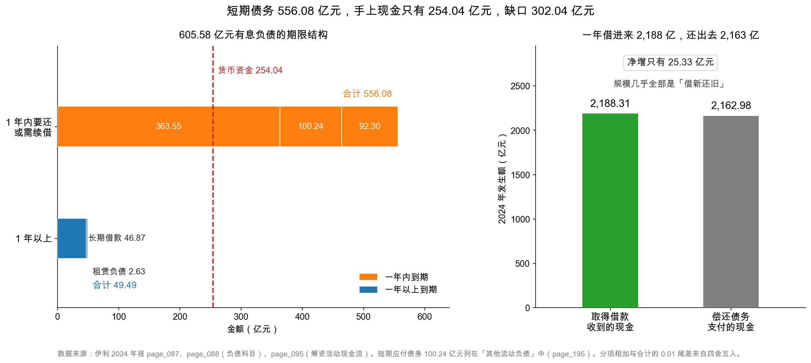
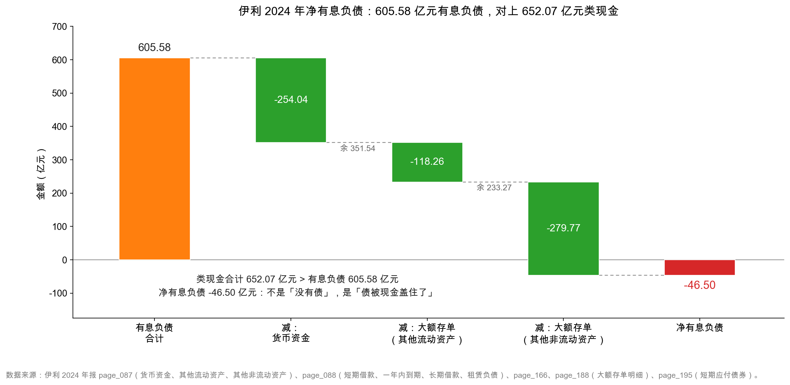

# 第 23 章：有息负债与债务结构——短债长投的危险

> 本章你将：
> - 把 605.58 亿元有息负债拆到每一项，看清它到底借了什么、向谁借、什么时候还；
> - 学会找"类现金"——伊利的 652.07 亿元分散在三个科目里，只看货币资金会漏掉 398.03 亿元；
> - 亲手算出净有息负债 -46.50 亿元，并明白"净现金"和"很安全"不是同一句话；
> - 回答第 11 章留下的问题：流动比率只有 0.74，为什么没有流动性危机；
> - 看懂真正的风险在哪：556.08 亿元一年内要还或续借，而货币资金只有 254.04 亿元，靠一年滚动 2,200 亿元借款维持。

---

## 23.1 一个关于"短债长投"的老故事

先讲一个在财经新闻里反复出现的情节。**以下全部是示意数字，不对应任何真实公司。**

某老板要建一座工厂，总投资 20 亿元，建成后每年赚 3 亿元，约七年回本。他手上只有 2 亿元，于是找银行借 18 亿元。银行说：可以，但只能给**一年期**流动资金贷款，一年一续。

老板算了一笔账：利率 5%，18 亿元一年利息 9,000 万元，工厂每年赚 3 亿元，付得起。**于是他签了。**

头三年一切顺利：每年到期，银行收回旧贷款、再放一笔新的（叫"续贷"），工厂照常转。
第四年，宏观环境变了，银行收紧额度，说"先还上，我们再看"。老板拿不出 18 亿元现金——钱全在厂房和机器里。故事结束。

**这个情节的名字，叫"短债长投"：用一年内要还的钱，去干十年才回本的事。**

它的问题不在于"借钱"，也不在于"借得多"，而在于**期限错配**：资产回收期十年，负债到期日一年，中间九年全靠"每年都能续上"这个假设。假设一旦不成立，链条就断。

伊利不是那个老板——它每年赚 217 亿元现金，账上还有几百亿存款。但伊利身上**同样存在期限错配**，只是缓冲更厚。这一章就是把这件事看清楚：既不吓自己，也不骗自己。

> 📌 **划重点：** 判断债务风险，只有"借了多少"是不够的，必须问三件事：**借的是长期还是短期？手上的钱能不能覆盖？每年赚的现金够不够付利息？** 这三问合起来，才叫"债务结构"。

## 23.2 605.58 亿元有息负债，五项逐个认

第 21 章已经把这五项列出来了，这里换个角度看——按"什么时候到期"重排：

| 科目 | 金额（亿元） | 到期时间 | 本质 |
|---|---|---|---|
| 短期借款 | 363.55 | 一年内 | 银行流动资金贷款 |
| 短期应付债券 | 100.24 | 一年内 | 超短期融资券（银行间市场） |
| 一年内到期的非流动负债 | 92.30 | 一年内 | 长期借款、债券中快到期的部分 |
| **小计：一年内** | **556.08** | — | — |
| 长期借款 | 46.87 | 一年以上 | 银行项目贷款 |
| 租赁负债 | 2.63 | 一年以上 | 未来租金的折现 |
| **小计：一年以上** | **49.49** | — | — |
| **合计** | **605.58** | — | — |

<!-- src: 伊利股份2024年报/page_088.md 伊利股份2024年报/page_195.md -->

这张表最刺眼的是最后两行：**556.08 对 49.49。**

**91.8% 的有息负债在一年内到期。** 也就是说，605.58 亿元里只有不到 50 亿元能"明年再说"，其余 556 亿元明年之内必须还掉、或者续借。

这个结构是怎么形成的？看两年的变化就明白了：

| 科目 | 2023 年末（亿元） | 2024 年末（亿元） | 变动 |
|---|---|---|---|
| 短期借款 | 397.55 | 363.55 | -34.00 |
| 短期应付债券 | 0 | 100.24 | **+100.24** |
| 一年内到期的非流动负债 | 24.35 | 92.30 | **+67.95** |
| 长期借款 | 117.05 | 46.87 | **-70.18** |
| 应付债券 | 35.41 | 0 | -35.41 |
| 租赁负债 | 2.38 | 2.63 | +0.25 |
| **有息负债合计** | **576.74** | **605.58** | +28.84 |

<!-- src: 伊利股份2024年报/page_088.md -->

这张表讲了一个很清楚的故事：**伊利主动把债务"变短"了。**

- 长期借款从 117.05 亿元砍到 46.87 亿元，少了 70.18 亿元；
- 应付债券从 35.41 亿元清零；
- 同时，短期融资券从 0 加到 100.24 亿元。

长期的钱还掉了，短期的钱借进来。总量只增加了 28.84 亿元，但结构从"长短混搭"变成了"几乎全靠短期"。

**为什么这么做？** 年报给了线索：那两期短期融资券利率 **2.01%**（`page_080.md`），而长期借款利率通常要高一截。利率下行环境里，**用短债替换长债能省利息**。

这是理性的财务决策，代价是：**再融资频率提高了。** 原来三年续一次的钱，现在一年要续好几次。

> 💡 **你可能会问：** 一年内到期 556 亿元，是不是意味着伊利明年要拿出 556 亿元现金？
>
> 不是。**"到期"和"还钱"是两件事。**
>
> 绝大多数短期借款到期时，银行会"收回再放"——账上走一笔，额度还在。短期融资券到期，公司会发新的一期去接。这个过程叫**滚动续借**，是大型企业的常规操作。
>
> 现金流量表把这件事记得清清楚楚：2024 年伊利"取得借款收到的现金"2,188.31 亿元、"偿还债务支付的现金"2,162.98 亿元（`page_095.md`）。**一年借进来 2,188 亿元、还出去 2,163 亿元，净增只有 25.33 亿元。**
>
> 2,188 亿元，是 605.58 亿元有息负债的 3.6 倍。这就是"滚动"的规模——**同一年里，钱借了又还、还了又借，来回滚了三四轮。**

左图是期限结构。上面那根橙色条是 556.08 亿元，由短期借款、短期应付债券、一年内到期三块拼成；下面那根蓝色条只有 49.49 亿元。**红色虚线是货币资金 254.04 亿元**——你能看到，橙色条远远超出了虚线的位置。

右图是滚动规模：借进来 2,188.31 亿元，还出去 2,162.98 亿元，两根柱子几乎一样高。

**这两张图放在一起，就是本章的核心矛盾：短债远多于手上的现金，靠的是滚动。**

## 23.3 类现金 652.07 亿元：钱藏在三个地方

现在转到资产端。只看"货币资金"这一行，伊利 2024 年末有 **254.04 亿元**（`page_087.md`），比 2023 年的 433.72 亿元少了 179.68 亿元，看起来钱在大幅减少。

但第 12 章讲过那个"钱搬家"的故事：钱没消失，只是被挪到另外两个科目，变成了大额存单和定期存款。

| 藏钱的地方 | 科目 | 金额（亿元） | 是否算进流动资产 |
|---|---|---|---|
| 第一处 | 货币资金 | 254.04 | 是 |
| 第二处 | 其他流动资产里的"大额存单及定期存款" | 118.26 | **是**（在流动资产里，但不在"货币资金"那一行） |
| 第三处 | 其他非流动资产里的"大额存单及定期存款" | **279.77** | **否**（在非流动资产里） |
| **合计：类现金** | — | **652.07** | — |

<!-- src: 伊利股份2024年报/page_087.md 伊利股份2024年报/page_166.md 伊利股份2024年报/page_188.md -->

三个数字都来自附注，可以逐一核对：

- `page_166.md`（附注七(13) 其他流动资产）：大额存单及定期存款 **11,826,346,397.86 元**，2023 年这一项是空白；
- `page_188.md`（附注七(30) 其他非流动资产）：大额存单及定期存款 **27,976,779,910.00 元**，2023 年是 17,630,148,346.08 元；
- 两处附注都写了一句同样的话："本期大额存单及定期存款增加所致"。

254.04 + 118.26 + 279.77 = **652.07 亿元**（`ratios.cash_and_deposits` = 65,207,381,866.46 元）。

> 🔍 **翻到年报：** 打开 `page_188.md`，找到"30、其他非流动资产"那张表。表格最后一行是"大额存单及定期存款 27,976,779,910.00"。**这一行 279.77 亿元，就是伊利藏在非流动资产里的现金**，也是"流动比率 0.74 却不危机"这个谜题的关键一块拼图。同一页再往下，是"31、所有权或使用权受限资产"，写着受限资金的金额（几亿元级别），可以用来判断"这 652 亿元里有多少是不能动的"。

### 23.3.1 为什么要藏起来

这里有个很自然的问题：既然是大额存单，为什么不放在"货币资金"里？

三个原因，都很现实：

**第一，会计分类的要求。** 期限超过一年、或公司打算持有到期的定期存款，不能算"现金及现金等价物"，要单独列示。伊利那 279.77 亿元期限在一年以上，所以进了"其他非流动资产"。

**第二，收益更高。** 活期利率极低，大额存单和定期存款能拿到高得多的利息。伊利 2024 年利息收入 24.55 亿元（`page_209.md`），不是白来的。

**第三，报表好看。** 把存款放在非流动资产里，流动比率会显得紧；反过来，想让流动比率好看的公司，会把存单放进"其他流动资产"。伊利那 118.26 亿元就在"其他流动资产"里——一年内到期的那种。

> ⚠️ **易踩坑：** 把"货币资金"当成"公司手上所有的钱"，是读财报最常见的错误之一。
>
> 伊利账上真正的钱是 652.07 亿元，不是 254.04 亿元。差了 398.03 亿元，差了 1.6 倍。
>
> 这个错误会直接毁掉你的判断：如果你只用 254.04 亿元去对 605.58 亿元有息负债，会得出"净有息负债 351.54 亿元，杠杆很高"的结论——**完全相反。**
>
> 找钱的动作要固定成三步：① 看货币资金；② 翻"其他流动资产"和"其他非流动资产"的附注，找"大额存单/定期存款/结构性存款"；③ 再看"交易性金融资产"里有没有理财。三步走完，才是这家公司真正的"类现金"。

## 23.4 净有息负债 -46.50 亿元：一个负数

现在把两边对上。

$$\text{净有息负债} = \text{有息负债} - \text{类现金} = 605.58 - 652.07 = -46.50 \text{ 亿元}$$

（`ratios.net_interest_bearing_debt` = -4,649,507,365.13 元。）

这张图是一条"减法桥"。从左边 605.58 亿元出发，减三次：

- 减货币资金 254.04 亿元，余 351.54 亿元；
- 减其他流动资产里的大额存单 118.26 亿元，余 233.27 亿元；
- 减其他非流动资产里的大额存单 279.77 亿元，落到 **-46.50 亿元**。

最后那根红色的短柱子朝下，是因为结果是负数。

**这个负数怎么读？** 它说的是：**如果把伊利所有有息负债一次性还清，账上的类现金不但够，还会剩 46.50 亿元。**

这就是"净现金"（net cash）状态。在 A 股制造业里相当少见——大部分公司的净有息负债是正数，叫"净负债"。

### 23.4.1 但是，"净现金"不等于"很安全"

这里必须停下来说透一句话，因为它是本章最容易滑过去的地方。

净有息负债 -46.50 亿元是一个**存量**概念：比较的是"某时刻账上有多少钱"和"某时刻欠多少钱"。它没回答的问题是：**这些钱和这些债，到期时间对得上吗？**

回到 23.2 节那张表：

| | 金额（亿元） |
|---|---|
| 一年内到期的有息负债 | 556.08 |
| 货币资金（真的躺在账上、随时能动的） | 254.04 |
| **缺口** | **302.04** |

**556.08 亿元明年要还或要续，能立刻动用的现金只有 254.04 亿元。**

那 279.77 亿元的大额存单呢？它在"其他非流动资产"里，期限在一年以上——**它恰好是"一年内动不了"的那部分钱。** 你可以提前支取，但要损失利息，有些品种还不能提前支取。

所以真实的情况是：

- **总量上**：类现金 652.07 亿元 > 有息负债 605.58 亿元，净现金 46.50 亿元，安全垫存在；
- **期限上**：短期债务 556.08 亿元 > 可动用现金 254.04 亿元，缺口 302.04 亿元，靠滚动续借填。

**这两句话同时成立。** 只说前一句，是报喜不报忧；只说后一句，是危言耸听。

> 📌 **划重点：** 净有息负债回答"总共够不够"，期限结构回答"到期那天够不够"。**大公司通常总量够、期限紧；出事的公司往往是总量也不够、期限还紧。** 伊利属于前者——它的风险不是"还不上"，是"必须一直借得到"。

## 23.5 回到第 11 章：0.74 为什么不是危机

第 11 章留下一个问题：伊利流动比率只有 0.74（666.19 ÷ 899.25），按教科书该拉警报，可它并没有出事。当时给了三条线索，现在可以逐条落实。

**线索一：流动负债里有一大块不是"真要现在还的钱"。** 899.25 亿元里，应付账款 123.13 亿元、合同负债 120.73 亿元、应付职工薪酬 37.77 亿元、应交税费 8.50 亿元、其他应付款 27.70 亿元——都随生意滚动。真正硬邦邦的是有息的那 556.08 亿元。

**线索二：流动资产里有一部分"不是钱"，非流动资产里有一部分"是钱"。** 666.19 亿元里已经包含了"其他流动资产"里的 118.26 亿元大额存单（算对了）；但非流动资产里还有 279.77 亿元大额存单，**没算进流动比率**（漏了）。

**线索三：经营现金流强劲。** 217.40 亿元（`page_094.md`），相当于流动负债的 24.2%。每年有新钱进来，缺口可以靠"今年的收入"补。

把前两条量化一下，做一次"调整后的流动比率"：

| 口径 | 分子（亿元） | 分母（亿元） | 流动比率 |
|---|---|---|---|
| 报表原样 | 666.19 | 899.25 | **0.74** |
| 把 279.77 亿元大额存单挪进流动资产 | 945.96 | 899.25 | **1.05** |
| 再把这 120.73 亿元合同负债从流动负债里剔掉（欠货不欠钱） | 945.96 | 778.52 | **1.22** |

<!-- src: 伊利股份2024年报/page_087.md 伊利股份2024年报/page_088.md 伊利股份2024年报/page_188.md -->

**从 0.74 到 1.22。** 同一家公司，同一张报表，三个数字。

这就是第 11 章那句话的完整版：**比率不是事实，是"用一个公式对事实做的一次加工"。** 而这次加工里，漏掉了 279.77 亿元现金，是多算了一笔"欠货"的债。

> ⚠️ **易踩坑：** 调整口径是为了"看清"，不是为了"调好看"。
>
> 上面那个 1.22，不是"伊利的真实流动比率"，而是"如果按经济实质重新归类，会是多少"。它不能拿去和别的公司比——因为别的公司你没有做同样的调整。
>
> 做这种调整的唯一目的，是回答"74% 的覆盖率到底危不危险"这个问题。答案是：**账面上确实紧，但紧的原因主要是分类，不是缺钱。**
>
> 反过来，如果你发现自己为了让数字好看，一次又一次地"调整口径"，那就该警觉了——那是自我说服，不是分析。

## 23.6 真正的风险：滚动能力

讲到这里，伊利的债务画面已经清楚了：总量安全（净现金 46.50 亿元）、期限紧（短债缺口 302.04 亿元）、现金流强（217.40 亿元）。

那么风险到底在哪？

**风险在"滚动"这两个字上。**

伊利每年要滚 2,000 多亿元的借款。这个动作能持续，依赖三个前提：

| 前提 | 伊利的现状 | 一旦不成立会怎样 |
|---|---|---|
| 银行愿意续贷 |  AAA 级信用、合作银行多，目前没问题 | 额度收紧，必须拿现金还，缺口 302.04 亿元 |
| 债券市场能发新券 | 2.01% 的超短融发得很顺 | 市场冻结，100.24 亿元到期还不上 |
| 经营现金流不断 | 217.40 亿元，连续多年为正 | 收入下滑 + 回款变慢，现金流断裂 |

这三个前提平时看起来理所当然，但历史上同时失效过：**2013 年"钱荒"**，银行间利率飙升、短融发不出去，一批靠短债滚动的企业当场断粮；**2018 年民企违约潮**，银行抽贷、续贷中断，很多"经营正常"的公司倒在再融资上。

伊利穿越过这些周期，因为它是龙头、现金流厚、账上还有几百亿存款。**但对一家普通公司，三条里断一条就是生死问题。**

> 💡 **你可能会问：** 伊利为什么不干脆把债务长期化，避开这个风险？
>
> 因为它要算另一笔账：**利息。** 短融 2.01%，长期借款可能要 3% 以上。605.58 亿元的债务，利差 1 个百分点就是一年 6 亿元。用短债换长债，省下真金白银，付出"再融资风险"。
>
> 典型的财务权衡：**用确定性换成本。** 大公司通常选"省利息"，因为它们相信自己能一直滚下去；小公司被迫选"省风险"，因为滚不动。
>
> 你要判断的是：**这家公司"一直滚下去"的自信有没有依据。** 依据是三条——信用评级、现金流、现金厚度。伊利三条都有。

### 23.6.1 利息这笔账：伊利是"净收利息"的公司

最后算一笔有意思的账。

伊利 2024 年的利息支出是 **18.20 亿元**，利息收入是 **24.55 亿元**（`page_209.md` 财务费用附注）。利息收入比利息支出还多 6.36 亿元，所以财务费用是 **-5.92 亿元**（负数，等于给利润贡献了 5.92 亿元）。

| 项目 | 金额（亿元） |
|---|---|
| 利息支出 | 18.20 |
| 利息收入 | -24.55 |
| 汇兑净损失 | -0.12 |
| 手续费 | 0.56 |
| **财务费用合计** | **-5.92** |

<!-- src: 伊利股份2024年报/page_209.md -->

**一家有 605.58 亿元有息负债的公司，净利息是收进来的。** 这件事本身就说明了它的资金状况：借的钱和存的钱规模相当，而存款的收益率（含财务公司、小贷、保理业务的利息收入）高于借款成本。

有两个比率可以算：

$$\text{利息覆盖倍数} = \frac{\text{经营现金流}}{\text{利息支出}} = \frac{217.40}{18.20} \approx 11.9 \text{ 倍}$$

$$\text{平均借款利率（粗算）} = \frac{18.20}{(576.74 + 605.58) \div 2} \approx 3.1\%$$

（分母用期初、期末有息负债的平均值 591.16 亿元。）

**11.9 倍**：一年赚进来的经营现金，够付 11.9 年利息。**3.1%**：平均融资成本只有 3% 出头，比很多制造业公司低一半。即使利率上升 1 个百分点，利息支出也只增加到 24 亿元左右，仍只有经营现金流的九分之一。

> ⚠️ **易踩坑：** 利息覆盖倍数要用"经营现金流"，不要用"净利润"。
>
> 净利润里已经扣掉了利息，用它去除以利息，等于"扣完利息之后再算能付几年利息"，逻辑上是绕的。更常见的错误是用"息税前利润（EBIT）"，那个口径也可以用，但对有大量折旧的公司会低估偿债能力。
>
> 最稳的口径是：**经营现金流 ÷ 利息支出**。因为付利息用的是现金，不是利润。伊利这个数是 11.9 倍，蒙牛是 5.7 倍（83.32 ÷ 14.68，蒙牛 2024 年报 page_148.md、page_140.md），差距一目了然——第 25 章会展开。

## 23.7 一张表收住这一章

把本章的所有数字放在一张表里：

| 指标 | 伊利 2024 | 怎么读 |
|---|---|---|
| 有息负债 | 605.58 亿元 | 占负债总额 62.6%，是"借款型"公司 |
| 其中一年内到期 | 556.08 亿元（91.8%） | 债务高度短期化 |
| 类现金 | 652.07 亿元 | 分散在三个科目，只看货币资金会漏 398.03 亿元 |
| 净有息负债 | **-46.50 亿元** | 净现金状态 |
| 短期债务缺口 | 556.08 - 254.04 = **302.04 亿元** | 期限错配真实存在 |
| 一年滚动借款规模 | 借 2,188.31 / 还 2,162.98 亿元 | 净增仅 25.33 亿元，其余全是续借 |
| 利息支出 | 18.20 亿元 | 平均成本约 3.1% |
| 利息覆盖倍数 | 217.40 ÷ 18.20 = **11.9 倍** | 利息压力很小 |
| 财务费用 | **-5.92 亿元** | 净收利息，不是净付利息 |

<!-- src: 伊利股份2024年报/page_088.md 伊利股份2024年报/page_094.md 伊利股份2024年报/page_095.md 伊利股份2024年报/page_209.md -->

一句话总结：**伊利不缺钱，但它欠的钱很短。** 前一句让它现在安全，后一句让它永远需要银行。两件事不矛盾，必须同时说——只讲前一句，会在融资环境收紧时措手不及；只讲后一句，会错过一家好公司。

---

## ✍️ 想一想

### 问 1：为什么不能只看货币资金

某位投资者说："伊利货币资金 254.04 亿元，有息负债 605.58 亿元，净负债 351.54 亿元，杠杆很高，不碰。"

请指出他错在哪，并把正确的算法写出来。

**解题思路：** 先问"这家公司所有的钱是不是都在'货币资金'这一行"，再去资产端找遗漏。

**参考答案：**

**他的错误是：只数了三个口袋里的一个。**

伊利真正的"类现金"是 652.07 亿元，分布在三个科目：

| 位置 | 金额（亿元） |
|---|---|
| 货币资金 | 254.04 |
| 其他流动资产——大额存单及定期存款 | 118.26 |
| 其他非流动资产——大额存单及定期存款 | 279.77 |
| **合计** | **652.07** |

**正确的算法：** 净有息负债 = 605.58 - 652.07 = **-46.50 亿元**（净现金），而不是 +351.54 亿元（净负债）。

**差了将近 400 亿元，结论从"杠杆很高"变成"净现金"。** 这个错误的杀伤力，比算错一个小数点大得多。

**为什么会犯这个错：** 因为"货币资金"排在资产负债表资产端的第一行，太显眼了。人有一种本能——看到第一行就以为那是全部。而 279.77 亿元藏在资产端的最后几行（其他非流动资产），翻页就看不到了。

**易错点：** ① 只补上"其他流动资产"的 118.26 亿元，漏掉"其他非流动资产"的 279.77 亿元——这个更常见，因为前者在流动资产里，容易被看到。② 把"交易性金融资产"也算进去。伊利的交易性金融资产只有 0.06 亿元（`page_087.md`），是权益工具投资，不是现金等价物，不该算。③ 忘了扣除受限资金。严格算"可动用现金"要减掉受限部分，伊利受限资金在几亿元级别（`page_188.md` 附注七(31)），不影响结论，但习惯要养成。

### 问 2：净现金的公司会不会出事

A 公司：净有息负债 -50 亿元（净现金），但一年内到期债务 400 亿元，货币资金 100 亿元，经营现金流 -20 亿元。

B 公司：净有息负债 +30 亿元（净负债），一年内到期债务 50 亿元，货币资金 80 亿元，经营现金流 +60 亿元。

哪一家更危险？请用本章的框架分析。

**解题思路：** 净有息负债是"总量"，期限结构和现金流是"结构"和"流量"。三个维度分开看，再合起来判断。

**参考答案：** **A 公司危险得多，尽管它的净有息负债是负数。**

| 维度 | A 公司 | B 公司 | 谁更安全 |
|---|---|---|---|
| 净有息负债（总量） | -50 亿元（净现金） | +30 亿元（净负债） | A |
| 短期缺口（期限） | 400 - 100 = **300 亿元** | 50 - 80 = **-30 亿元**（现金够） | **B** |
| 经营现金流（流量） | **-20 亿元** | +60 亿元 | **B** |

**A 公司的问题是"结构性的"：** 它的净现金可能来自一批五年期的大额存单，而一年内要还 400 亿元。存款取不出来，债务到期了，中间 300 亿元的缺口只能靠再融资。而它的经营现金流还是负的——每年还在往外漏钱。

**B 公司的问题是"总量上的"，但可控：** 它确实净负债 30 亿元，但短期债务只有 50 亿元，手上现金 80 亿元，一年内不缺钱；每年还能赚 60 亿元现金，两年就能把净负债还清。

**结论：** 净有息负债是负数，只能说明"总资产够抵总负债"，不能说明"明天不会断粮"。**真正决定生死的是期限和现金流。**

**易错点：** ① 看到 A 是净现金就判它安全——这是本章最想纠正的直觉。② 只看短期缺口，忽略现金流方向。A 公司如果现金流是 +100 亿元，300 亿元缺口两年也能填上，危险程度会下降。③ 认为"净负债就一定危险"——B 公司净负债 30 亿元，但它一年就能还清，一点也不危险。

### 问 3：把 279.77 亿元挪个位置

假设伊利 2025 年把那 279.77 亿元大额存单全部改成"一年内到期"，会计上要把它从"其他非流动资产"挪到"其他流动资产"。

请回答：① 流动比率会变成多少？② 净有息负债会变吗？③ 公司的真实偿债能力变了吗？

**解题思路：** 这是一道"分类变化 vs 实质变化"的题，和第 11 章问 3 是同一个套路。

**参考答案：**

**① 流动比率会从 0.74 升到 1.05。**

流动资产从 666.19 亿元变成 666.19 + 279.77 = 945.96 亿元，流动负债不变（899.25 亿元），945.96 ÷ 899.25 = 1.05。

**② 净有息负债一分不变，还是 -46.50 亿元。**

因为类现金的总额没变（还是 652.07 亿元），有息负债也没变（还是 605.58 亿元）。变的只是"这笔钱被归到哪一栏"。

**③ 真实偿债能力：变好了一点点，但没有数字上显示的那么多。**

变好的一点点是真实的：如果这笔存单真的一年内到期，它就真的可以随时变现去还债，短期缺口的 302.04 亿元会缩小到 22.27 亿元。**这是实质改善。**

但要注意：**会计分类的改变，通常跟着的是真实的期限改变。** 如果只是"改个分类"而存单还是三年期，那就是纯粹的报表粉饰，一分钱的实际偿债能力都没增加。

**这道题的落点：** 分类变化有时对应实质变化，有时不对应。**判断方法是问一句"这笔钱真的能提前拿出来吗"，而不是看它在哪一栏。**

**易错点：** ① 答"流动比率不变，因为总额没变"——流动比率恰恰只受分类影响。② 答"偿债能力大幅提升"，把分类当成了实质。③ 忘了②这一问，只算流动比率，没检查净有息负债是否受影响。

## 📎 数据出处

- 伊利股份 2024 年报：`page_088.md`（短期借款 363.55 亿元、一年内到期的非流动负债 92.30 亿元、长期借款 46.87 亿元、租赁负债 2.63 亿元及 2023 年对比数）
- 伊利股份 2024 年报：`page_195.md`（附注七(43) 一年内到期的非流动负债构成、七(44) 其他流动负债中的短期应付债券 100.24 亿元）
- 伊利股份 2024 年报：`page_087.md`（货币资金 254.04 亿元、流动资产合计 666.19 亿元、其他流动资产 171.25 亿元、其他非流动资产 292.59 亿元）
- 伊利股份 2024 年报：`page_166.md`（附注七(13) 其他流动资产：大额存单及定期存款 118.26 亿元）
- 伊利股份 2024 年报：`page_188.md`（附注七(30) 其他非流动资产：大额存单及定期存款 279.77 亿元；七(31) 受限资产）
- 伊利股份 2024 年报：`page_095.md`（取得借款收到的现金 2,188.31 亿元、偿还债务支付的现金 2,162.98 亿元）
- 伊利股份 2024 年报：`page_094.md`（经营活动现金流量净额 217.40 亿元）
- 伊利股份 2024 年报：`page_209.md`（附注七(67) 财务费用：利息支出 18.20 亿元、利息收入 24.55 亿元、合计 -5.92 亿元）
- 伊利股份 2024 年报：`page_080.md`（短期融资券两期各 50 亿元，利率 2.01%）
- 蒙牛乳业 2024 年报：`page_148.md`（经营活动现金净额 83.32 亿元）、`page_140.md`（融资成本 14.68 亿元）
- 数据汇总：`data/yili2024.json` 的 `ratios.interest_bearing_debt`（605.58 亿元）、`ratios.cash_and_deposits`（652.07 亿元）、`ratios.net_interest_bearing_debt`（-46.50 亿元）、`ratios.current_ratio`（0.7408）

下一章：[第 24 章：所有者权益——归母与少数股东](24-所有者权益-归母与少数股东.md)
