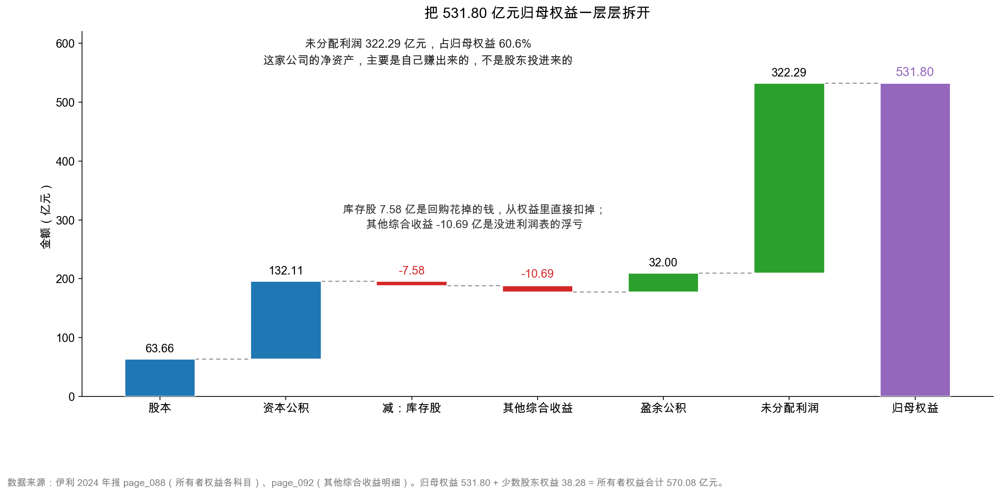

# 第 24 章：所有者权益——归母与少数股东

> 本章你将：
> - 用"三个人合伙开店"的类比，搞懂归母权益（equity attributable to owners of the parent）和少数股东权益（non-controlling interests）的区别；
> - 把伊利 531.80 亿元归母权益拆成六个格子：股本、资本公积、库存股、其他综合收益、盈余公积、未分配利润；
> - 亲手验算未分配利润从 314.15 亿元走到 322.29 亿元的那本账，误差小到 96 万元；
> - 看懂库存股和其他综合收益这两个"反直觉"的科目——它们都是负数，都从权益里扣；
> - 算出每股净资产 8.35 元，为第 10 周的估值备好原料。

---

## 24.1 三个人合伙开面馆

先讲一个合伙的故事。**以下全部是示意数字，不对应任何真实公司。**

老张、老李、老王三个人合伙开面馆。老张出 60 万元，老李出 30 万元，老王出 10 万元，一共 100 万元。三个人说好，按出资比例分利润：老张 60%，老李 30%，老王 10%。

第一年赚了 20 万元，全部分掉：老张 12 万、老李 6 万、老王 2 万。

第二年，他们想再开一家分店。这次没让老张一个人出钱，而是拉了小陈专门投这家分店：小陈出 40 万元，占分店 30% 的股份，总店出 70%。

关键在这里：**分店由总店控制**（总店说了算），所以分店的 100 万元资产要**全额**并进总店的账。但分店那 100 万元净资产，只有 70 万元归老张他们，剩下 30 万元归小陈。

**现在问题来了：如果有人问"这家总店值多少钱"，你能把分店的 100 万元全算成老张他们的吗？**

不能。资产可以全额并，**权益必须按份额拆**。老张他们能主张的，只有其中 70%。

上市公司的报表，把这件事拆成两行：

- **归属于母公司所有者权益**（简称"归母权益"）：属于上市公司股东的那部分；
- **少数股东权益**：属于子公司里其他股东的那部分。

伊利 2024 年末的数字是：

| 项目 | 金额（亿元） | 占比 |
|---|---|---|
| 归属于母公司所有者权益（归母权益） | **531.80** | 93.3% |
| 少数股东权益 | **38.28** | **6.7%** |
| **所有者权益合计** | **570.08** | 100% |

<!-- src: 伊利股份2024年报/page_088.md -->

**这 38.28 亿元是什么？** 就是上面那个"小陈的 30%"——伊利的一批非全资子公司里，不属于伊利的那部分净资产。

举个具体的例子。假设伊利持有某子公司 60% 的股权，这家子公司的净资产是 100 亿元。那么在合并报表上：

- 100 亿元全部并进"所有者权益"（因为控制它，要全额合并）；
- 其中 60 亿元算伊利的（进"归母权益"）；
- 剩下的 40 亿元算别人的（进"少数股东权益"）。

**这就是"控制"和"拥有"的区别：控制要全额合并，拥有只按比例算。** 合并报表把子公司 100% 的资产负债并进来，再在权益栏把不属于自己的部分单独拎出来，叫"少数股东权益"。

> 📌 **划重点：** 合并报表的资产、负债是"全额"的（因为控制），但权益要分两堆：**归母权益（我的）+ 少数股东权益（别人的）**。看一家公司的"净资产"，默认看归母那一堆，因为那才是你作为股东能分到的。

## 24.2 权益这一栏，为什么有六个格子

打开伊利资产负债表的最后一段（`page_088.md`），你会看到"所有者权益"下面排着六行：

| 科目 | 2024 年末（亿元） | 2023 年末（亿元） | 一句话 |
|---|---|---|---|
| 实收资本（股本） | 63.66 | 63.66 | 股东按面值投入的"本金" |
| 资本公积 | 132.11 | 133.80 | 股东投入超过面值的部分 |
| 减：库存股 | 7.58 | 3.50 | 公司回购自己的股票，从权益里扣 |
| 其他综合收益 | **-10.69** | -4.72 | 没进利润表的"浮盈浮亏" |
| 盈余公积 | 32.00 | 32.00 | 按规定从利润里强制留下的钱 |
| 未分配利润 | **322.29** | 314.15 | 历年赚的、还没分掉的钱 |
| **归母权益合计** | **531.80** | 535.39 | — |
| 少数股东权益 | 38.28 | 37.81 | 子公司里别人的份额 |
| **所有者权益合计** | **570.08** | 573.20 | — |

<!-- src: 伊利股份2024年报/page_088.md -->

这六个格子，其实只讲了两件事：

**第一件：股东投进来多少钱。** 股本 63.66 + 资本公积 132.11 = 195.77 亿元。这是伊利从成立到现在，股东真金白银投进来的（扣除回购）。

**第二件：公司自己赚了多少、留下多少。** 盈余公积 32.00 + 未分配利润 322.29 = 354.29 亿元。这是历年利润里没有分掉、留在公司里的部分。

两个数一加，再减掉库存股和其他综合收益，就是归母权益：

$$195.77 + 354.29 - 7.58 - 10.69 = 531.79 \approx 531.80 \text{ 亿元}$$

（尾差 0.01 亿元来自各科目四舍五入，不是抄错。）

这张瀑布图从左往右走：股本 63.66 → 加资本公积 132.11 → 减库存股 7.58 → 减其他综合收益 10.69 → 加盈余公积 32.00 → 加未分配利润 322.29 → 落到归母权益 531.80 亿元。

蓝色是"股东投的"，绿色是"自己赚的"，红色是"扣减项"。**一眼就能看出这家公司的净资产是从哪来的。**

## 24.3 未分配利润 322.29 亿元：一家公司攒了多少年

图上最粗的那根柱子，是未分配利润 322.29 亿元，占归母权益的 **60.6%**。

这个比例说明了一件很重要的事：**伊利的净资产，主要是自己赚出来的，不是股东不断投进来的。**

对比一下就很清楚：股东累计投入 195.77 亿元，公司累计留存 354.29 亿元。后者是前者的 1.8 倍。**如果一家公司的净资产主要靠"资本公积"撑着，说明它一直在向股东要钱；如果主要靠"未分配利润"撑着，说明它能自己造血。**

伊利属于后者。

### 24.3.1 验算：314.15 怎么变成 322.29

未分配利润这一行，是整张资产负债表上**唯一一个能和三张表勾稽起来**的权益科目。它的变动有一个固定的公式：

$$\text{期末未分配利润} = \text{期初} + \text{归母净利润} - \text{当年分掉的现金股利}$$

伊利的数字：

| 项目 | 金额（亿元） | 出处 |
|---|---|---|
| 2023 年末未分配利润 | 314.15 | `page_088.md` |
| 加：2024 年归母净利润 | +84.53 | `page_007.md` |
| 减：2024 年派发的 2023 年度现金红利 | -76.39 | `page_002.md` |
| 加：收回已分配的现金股利 | +0.001 | `page_002.md` |
| **2024 年末未分配利润** | **322.29** | `page_088.md` |

<!-- src: 伊利股份2024年报/page_088.md 伊利股份2024年报/page_007.md 伊利股份2024年报/page_002.md -->

314.15 + 84.53 - 76.39 + 0.001 = **322.29 亿元**。分毫不差。

那个"+0.001"是什么？年报第 2 页写得很细：

> 本年度因部分股权激励对象离职原因，收回已分配的现金股利 956,340.00 元。

**96 万元。** 因为几个拿了限制性股票的员工离职了，他们之前领过的分红要退回来。这笔钱小到在报表上看不见（四舍五入后是 0.00 亿元），但它确实在账上，而且恰好让等式闭合成 322.29。

> 🔍 **翻到年报：** 打开 `page_088.md`，找到"未分配利润 32,229,030,347.49"这一行；再打开 `page_002.md`，找到"派发 2023 年度现金红利 7,639,318,446.00 元"和"收回已分配的现金股利 956,340.00 元"。**三个数字一加一减，就是本章最漂亮的一次勾稽验证。** 这种"能对上"的感觉，读财报读久了会上瘾。

### 24.3.2 一个反直觉的细节：它一边攒钱，一边几乎全分掉

看到"未分配利润 322.29 亿元"，很容易以为伊利是家"赚了钱不分"的吝啬公司。

**恰恰相反。** 伊利 2024 年度利润分配预案：每股派 1.22 元（含税），合计 **77.26 亿元**，占当年归母净利润 **91.40%**（`page_002.md`）。

| 年度 | 归母净利润（亿元） | 现金分红（亿元） | 分红率 |
|---|---|---|---|
| 2023 年度（2024 年派发） | 104.29 | 76.39 | 73.2% |
| 2024 年度（预案） | 84.53 | 77.26 | **91.40%** |

<!-- src: 伊利股份2024年报/page_002.md 伊利股份2024年报/page_007.md -->

**赚 84.53 亿元，分掉 77.26 亿元，只留下 7 亿元出头。**

那 322.29 亿元的未分配利润是怎么攒下来的？答案在时间上：它是**过去二十多年**一年一年累下来的。每年留下几个亿、十几个亿，二十多年就是三百多亿。**这不是"某一年不分红"的结果，是"长期微留"的结果。**

这个细节很重要，因为它纠正了一个常见的误解：**未分配利润大，并不等于公司不分红。** 一家成熟公司可以"每年分掉九成利润"，同时账上仍有一大笔历史留存——两个事实并不矛盾。

> 💡 **你可能会问：** 既然分红率已经 91.4%，那它未来还能保持高分红吗？
>
> 能不能保持，取决于两件事：**自由现金流够不够、有没有大额资本开支计划。**
>
> 伊利 2024 年自由现金流（经营现金流减资本开支）是 177.61 亿元（`ratios.free_cash_flow`），分红 77.26 亿元，覆盖率 2.3 倍。看起来还有空间。
>
> 但 2024 年 capex 只有 39.78 亿元，是近年低点（2023 年是 69.56 亿元）。如果未来重启产能扩张，capex 回到 70 亿元以上，自由现金流会降到 145 亿元左右，分红空间就会被压缩。
>
> **高分红能不能持续，本质上问的是"这家公司还有没有好的投资机会"。** 没有好机会、把钱分给股东，是理性的；有好机会却不投，是失职。第 10 周估值时，这个判断会直接影响你给的估值区间。

## 24.4 库存股 7.58 亿元：一个负号

再看图上那两根红色的柱子。

**库存股 7.58 亿元。** 这个名字很容易误解——它听起来像"公司仓库里的存货"。**完全不是。**

库存股（treasury stock）是**公司回购自己的股票、还没注销的那部分**。回购的时候，公司花真金白银从市场上买回自己的股票，这笔钱不能记成"资产"（公司不能持有自己作为资产），只能从权益里扣掉。

伊利 2024 年回购花了 **7.59 亿元**（`page_216.md`，"支付其他与筹资活动有关的现金"里的"股票回购 758,635,266.98 元"），年末库存股余额 7.58 亿元。两个数几乎一样，说明这批回购的股票还没注销。

回购对股东意味着什么？

| 角度 | 影响 |
|---|---|
| 股本 | 减少（若注销），利润摊到更少的股数上，EPS 上升 |
| 现金 / 权益 | 各减少约 7.6 亿元 |
| 股东 | 留下来的股东，持股比例被动上升 |

**回购和分红，是公司把利润还给股东的两种方式**：分红是"发钱"，回购是"减少份数"。伊利 2024 年两样都做了——分红 77.26 亿元（预案），回购 7.59 亿元。

> ⚠️ **易踩坑：** 库存股是"减项"，不是"资产"。
>
> 你在资产负债表上看到的"减：库存股 7.58 亿元"，那个"减"字是科目名称的一部分，意思是"这一项要从权益里减掉"。
>
> 常见错误：把库存股当成"公司持有的股票，值 7.58 亿元，是资产"。不对。**公司回购自己的股票，钱花出去了，什么资产都没换回来**——换来的是"股本变少"，这在权益端体现为减少。
>
> 所以库里那 7.58 亿元，是"已经花掉、不会再回来"的钱。它不会变成现金，也不会产生收益。

## 24.5 其他综合收益 -10.69 亿元：没进利润表的浮亏

第二根红柱子是**其他综合收益 -10.69 亿元**。这个科目最抽象，但值得花点时间，因为它藏着一类"利润表上看不见的损益"。

先把它的定义说清楚：

**其他综合收益（other comprehensive income，简称 OCI）是"按照会计准则，不进入当期利润表、但会改变权益的那部分利得和损失"。**

什么样的东西会走这条路？主要有四类：

| 类型 | 例子 | 为什么不进利润表 |
|---|---|---|
| 外币报表折算差额 | 伊利新西兰子公司的资产，按期末汇率折算成人民币 | 只是折算差异，没有真实交易 |
| 现金流量套期储备 | 用远期外汇合约锁定未来收付的汇率 | 套期工具和被套期项目要配比，不能单边进利润 |
| 其他权益工具投资公允价值变动 | 持有的非交易性股票，股价涨跌 | 不打算卖，波动不算"已实现" |
| 重新计量设定受益计划 | 员工退休金计划的精算假设变化 | 长期负债的估计调整 |

伊利 2024 年的明细（`page_092.md`）：

| 其他综合收益的构成（归属母公司，税后） | 金额（亿元） |
|---|---|
| 外币财务报表折算差额 | **-4.11** |
| 现金流量套期储备 | **-1.46** |
| 权益法下可转损益的其他综合收益 | -0.24 |
| 其他权益工具投资公允价值变动 | -0.16 |
| 权益法下不能转损益的其他综合收益 | -0.01 |
| 重新计量设定受益计划变动额 | +0.004 |
| **合计（本期发生额）** | **-5.97** |

<!-- src: 伊利股份2024年报/page_092.md -->

（这里要区分两个数：**本期发生额 -5.97 亿元**，是 2024 年一年新增的；**期末余额 -10.69 亿元**，是历年累积下来的。资产负债表上记的是后者。）

累计余额从 2023 年的 -4.72 亿元，变成 2024 年的 -10.69 亿元，正好减少了 5.97 亿元——和本期发生额对上。

### 24.5.1 这 -10.69 亿元该怎么理解

三条：

**第一，它是"已发生、但没进利润"的损失。** 主要是汇率变动导致海外资产折算缩水（-4.11 亿元）和外汇套期浮亏（-1.46 亿元）。这些损失真实存在——若现在卖掉海外子公司，折算差额会从 OCI 转进利润表，变成真亏损。

**第二，它不影响现金流。** 折算差额只是"记账货币"的变化，钱没真进出，所以看经营现金流（217.40 亿元）时不用管这 -10.69 亿元。

**第三，它会让"净利润"和"净资产增加"对不上。** 这是最容易困惑的地方：

| 项目 | 金额（亿元） |
|---|---|
| 2024 年归母净利润 | 84.53 |
| 加：归属母公司的其他综合收益 | -5.97 |
| **归属母公司的综合收益总额** | **78.56** |

<!-- src: 伊利股份2024年报/page_092.md -->

**赚了 84.53 亿元利润，但权益只增加了 78.56 亿元**，差的 5.97 亿元就是 OCI 的浮亏。年报上有一个专门的科目叫"综合收益总额"，就是为这件事准备的。

> 📌 **划重点：** 利润表只记录"已经实现的"损益；其他综合收益记录"按准则不能进利润、但确实改变了权益"的损益。**两者相加，才是股东权益真正增加的钱。** 看一家公司"赚了多少"，要同时看这两个数。

## 24.6 少数股东权益 38.28 亿元：别人的 6.7%

回到开头那个合伙的故事。

伊利的所有者权益 570.08 亿元里，有 38.28 亿元（6.7%）不属于伊利的股东，属于一批非全资子公司的其他股东。

**这 38.28 亿元怎么来的？** 伊利的子公司里，很多不是 100% 持股：

- 廊坊伊利乳品有限公司，持股 75%（`page_228.md`）；
- 天津伊利康业冷冻食品有限公司，持股 55%；
- 内蒙古伊家好奶酪有限责任公司，持股 62.96%（`page_230.md`）；
- 澳优乳业，伊利持股约 59%（这个比例本章后面会教你怎么反推）。

这些子公司里，25%、45%、37.04%、41% 的股权属于别人。它们按持股比例享有的净资产，汇总起来就是 38.28 亿元。

有个细节：年报"重要的非全资子公司"一栏，伊利勾的是"**不适用**"（`page_231.md`）。说明**没有哪一家子公司的少数股东权益大到需要单独披露**——38.28 亿元是很多家子公司一点点凑起来的，很分散。

### 24.6.1 一个技巧：从商誉减值反推持股比例

伊利没有在年报里直接写"持有澳优 59.17%"。但你可以推出来。

第 19 章讲过，伊利 2024 年对澳优计提了商誉减值。附注七(27) 的表格下面有一句注（`page_185.md`）：

> 澳优商誉减值 513,304.46 万元为包含少数股东的全部商誉减值，其中影响合并报表的澳优商誉减值为 303,722.25 万元。

翻译一下：**澳优这家公司的商誉总共减了 51.33 亿元，但伊利在合并报表上只承担了 30.37 亿元。**

两个数一除：

$$\frac{30.37}{51.33} \approx 59.2\%$$

**这就是伊利的持股比例。**

为什么？因为商誉减值是按"这家公司的全部商誉"算的，但合并报表只按持股比例承担属于母公司的那部分，剩下的由少数股东承担。

**这个技巧很实用**：任何一笔"全额 vs 合并报表承担额"的减值、分红、收益，都能反推持股比例，不用等公司披露。

> 💡 **你可能会问：** 少数股东权益 38.28 亿元，会影响我判断这家公司吗？
>
> 会影响两个地方：
>
> **第一，看 ROE 要用归母口径。** 伊利 2024 年加权平均 ROE 是 15.81%（`page_007.md`），分母用的是归母权益，不是 570.08 亿元。如果用全部权益算，ROE 会变成 84.64 ÷ 570.08 = 14.85%，低估了股东的回报。原因是少数股东那部分权益，产生的利润也归少数股东，不该算进"我的回报率"。
>
> **第二，看"净资产"要用归母口径。** 算每股净资产、PB、清算价值，都用 531.80 亿元，不用 570.08 亿元。
>
> 一句话：**只要涉及"股东能得到多少"，就用归母；只要涉及"公司整体规模"，才用合计。**

## 24.7 每股净资产 8.35 元

最后一个数字，是第 10 周估值要用的原料。

$$\text{每股净资产} = \frac{\text{归母权益}}{\text{总股本}} = \frac{531.80}{63.66} \approx 8.35 \text{ 元/股}$$

（`ratios.book_value_per_share` = 8.3539。）

这个 8.35 元的意思是：**如果把伊利所有资产按账面价值卖掉、所有负债还掉，剩下的钱分给 63.66 亿股，每股 8.35 元。**

注意三个限定词：

| 限定 | 含义 |
|---|---|
| **账面价值** | 资产按账面数字算，不是按市价。伊利的固定资产、商誉实际能卖多少钱，可能高于也可能低于账面 |
| **所有负债还掉** | 包括那 967.10 亿元负债，一分不剩 |
| **分给 63.66 亿股** | 用总股本，不是用流通股本 |

所以 8.35 元是**下限性质的参考值**，不是"这家公司值 8.35 元/股"。真实价值取决于它未来能赚多少钱，那是第 49 章 DCF 的事。但它有个很实际的用途：**和股价对比，算市净率（PB）。**

假设股价是 20 元（**示意数字，不是真实报价，你需要自己去查最新价**），那么：

$$\text{PB} = \frac{20}{8.35} \approx 2.4 \text{ 倍}$$

意思是：市场愿意为伊利每 1 元账面净资产，付 2.4 元。这个倍数高不高，取决于它的 ROE——ROE 15.81% 的公司，PB 2.4 倍不算贵；ROE 5% 的公司，PB 2.4 倍就贵了。这是第 48 章"PB 与 ROE"的主题。

## 24.8 一张表收住这一章

| 科目 | 金额（亿元） | 占归母权益 | 性质 |
|---|---|---|---|
| 股本 | 63.66 | 12.0% | 股东投入（面值） |
| 资本公积 | 132.11 | 24.8% | 股东投入（溢价） |
| 减：库存股 | -7.58 | -1.4% | 回购，扣减 |
| 其他综合收益 | -10.69 | -2.0% | 未进利润的浮亏 |
| 盈余公积 | 32.00 | 6.0% | 强制留存 |
| 未分配利润 | 322.29 | 60.6% | 历年累积留存 |
| **归母权益** | **531.80** | 100% | — |
| 少数股东权益 | 38.28 | — | 别人的份额 |
| **所有者权益合计** | **570.08** | — | — |

<!-- src: 伊利股份2024年报/page_088.md -->

一句话总结：**伊利的 531.80 亿元净资产，六成是自己赚出来的，三成半是股东投的，剩下的是两个负数在往回扣。**

这个结构，是一家成熟消费公司的典型长相：不再需要大量外部融资（股本、资本公积多年不变），靠自身盈利滚大净资产，同时把绝大部分利润分给股东。

---

## ✍️ 想一想

### 问 1：这笔钱该算谁的

伊利持有甲公司 70% 股权、乙公司 100% 股权。甲公司净资产 50 亿元，乙公司净资产 80 亿元。

请回答：① 合并报表上的"所有者权益合计"里，这两家公司一共贡献多少？② 其中归母权益多少、少数股东权益多少？③ 如果甲公司当年赚了 10 亿元，合并利润表上的"净利润"里有多少来自甲公司，其中归母多少？

**解题思路：** 记住一句话——**控制要全额合并，拥有只按比例算。** 资产、负债、收入全额并；权益和利润要拆成两堆。

**参考答案：**

**① 所有者权益合计：130 亿元。**

100% 的甲公司（50 亿元）+ 100% 的乙公司（80 亿元）= 130 亿元。因为伊利对两家都构成控制，要全额合并。

**② 归母 115 亿元，少数股东 15 亿元。**

| | 全部净资产 | 归母份额 | 少数股东份额 |
|---|---|---|---|
| 甲公司（70%） | 50 | 35 | **15** |
| 乙公司（100%） | 80 | 80 | 0 |
| 合计 | 130 | **115** | **15** |

少数股东权益 = 50 $\times$ 30% = 15 亿元。

**③ 甲公司赚的 10 亿元，全额进合并净利润，其中归母 7 亿元。**

合并利润表的"净利润"是 10 亿元（全额），下面再分两行："归属于母公司股东的净利润 7 亿元""少数股东损益 3 亿元"。

**这就是伊利报表的结构。** 2024 年伊利净利润 84.64 亿元，其中归母 84.53 亿元、少数股东损益 0.11 亿元（`page_092.md`）——少数股东损益很小，说明非全资子公司的盈利能力不强，或者持股比例都很高。

**易错点：** ① 只按持股比例合并甲公司的资产负债（35 亿元的资产并进来）——错，控制要全额并。② 把 15 亿元少数股东权益算进"归母权益"——那会让每股净资产算错。③ 忘了利润也要拆两堆，只拆了权益。

### 问 2：未分配利润对不上，问题出在哪

某公司 2023 年末未分配利润 100 亿元，2024 年净利润 20 亿元，当年派发现金股利 5 亿元。但 2024 年末报表上的未分配利润是 118 亿元，不是 115 亿元。

请列出至少三种可能的原因，并说明怎么验证。

**解题思路：** 未分配利润的变动，除了"净利润"和"分红"，还有哪些东西会动它？

**参考答案：** 差了 3 亿元（118 - 115）。可能的解释：

| 可能原因 | 机制 | 怎么验证 |
|---|---|---|
| **盈余公积计提** | 按公司法，净利润的 10% 要提法定盈余公积，从"未分配利润"转到"盈余公积"——**这会让未分配利润减少，不是增加** | 看盈余公积有没有增加。注意方向：这条会解释"少 3 亿"，不是"多 3 亿" |
| **会计政策变更/前期差错更正** | 追溯调整期初未分配利润 | 看"所有者权益变动表"的"上年年末余额调整"栏 |
| **同一控制下企业合并** | 合并方按被合并方的账面净资产追溯调整 | 看附注"同一控制下企业合并" |
| **其他综合收益转入** | 某些 OCI 项目在处置时转入留存收益（如其他权益工具投资处置） | 看"所有者权益变动表"各列之间的结转 |
| **库存股注销/股权激励** | 回购注销、限制性股票解锁，会在资本公积和未分配利润之间调整 | 看资本公积的变动 |
| **分红金额记错** | 实际派发 2 亿元而不是 5 亿元（比如部分股东未领取） | 看现金流量表"分配股利、利润或偿付利息支付的现金" |

**最可能的原因是"其他综合收益转入"或"资本公积调整"。** 这两种都会让未分配利润**增加**而不经过净利润。

**验证的黄金动作：打开"所有者权益变动表"。** 这张表（在资产负债表和利润表之后）会把未分配利润这一列，从期初到期末的每一笔变动都列出来：本年净利润、提取盈余公积、对股东的分配、其他。**一行一行读完，一定对得上。**

**易错点：** ① 只想到"分红"和"净利润"两个因素，答"报表错了"。② 把"盈余公积"的方向搞反——提取盈余公积是**减少**未分配利润。③ 不知道有"所有者权益变动表"这张表，只会硬猜。伊利 2024 年那张表在 `page_093.md` 附近，有兴趣可以翻。

### 问 3：91.4% 的分红率能持续吗

伊利 2024 年度分红预案是 77.26 亿元，占归母净利润 91.40%。请从"现金流"和"投资机会"两个角度，判断这个分红率能不能持续。

**解题思路：** 分红的上限不是利润，是**自由现金流**。先算自由现金流，再看公司有没有更好的用途。

**参考答案：**

**先算自由现金流：**

| 项目 | 金额（亿元） |
|---|---|
| 经营活动现金流净额 | 217.40 |
| 减：购建长期资产支付的现金（capex） | -39.78 |
| **自由现金流** | **177.61** |

<!-- src: 伊利股份2024年报/page_094.md 伊利股份2024年报/page_095.md -->

分红 77.26 亿元 ÷ 自由现金流 177.61 亿元 = **43.5%**。

**从现金流看：完全撑得住。** 分红只花掉自由现金流的四成多，还剩 100 亿元可以用于还债、回购、或者留着。

**从投资机会看：需要观察。** 2024 年 capex 只有 39.78 亿元，是近年低点（2023 年 69.56 亿元，2022 年更高）。capex 低，说明公司暂时没有大项目要投——这正是它能提高分红率的原因。

但如果未来重启扩张（比如新建产能、并购），capex 回到 70 亿元以上，自由现金流会降到 145 亿元左右，77.26 亿元的分红就要占掉 53%。**仍然撑得住，但安全垫变薄了。**

**结论：短期（1~2 年）这个分红率可以持续；中期要看 capex 会不会回升，以及收入能不能止跌。** 如果 2025 年收入继续下滑、经营现金流跟着减少，91.4% 的分红率就会成为压力。

**易错点：** ① 用"净利润"而不是"自由现金流"判断分红能力——利润不等于现金，这是第 9 章的核心。② 只看一年，不看 capex 的历史变化。③ 认为"分红率高就是好公司"——高分红也可能是"没有增长机会"的信号，对成长股是坏事。

## 📎 数据出处

- 伊利股份 2024 年报：`page_088.md`（所有者权益全部科目：股本 63.66 亿元、资本公积 132.11 亿元、库存股 7.58 亿元、其他综合收益 -10.69 亿元、盈余公积 32.00 亿元、未分配利润 322.29 亿元、归母权益 531.80 亿元、少数股东权益 38.28 亿元）
- 伊利股份 2024 年报：`page_092.md`（其他综合收益明细：外币折算 -4.11 亿元、现金流量套期 -1.46 亿元；净利润 84.64 亿元、归母 84.53 亿元、少数股东损益 0.11 亿元；综合收益总额）
- 伊利股份 2024 年报：`page_002.md`（2023 年度现金红利 76.39 亿元、收回已分配股利 96 万元、2024 年度分红预案 77.26 亿元占 91.40%）
- 伊利股份 2024 年报：`page_007.md`（归母净利润 84.53 亿元、加权平均 ROE 15.81%）
- 伊利股份 2024 年报：`page_216.md`（股票回购支付 7.59 亿元）
- 伊利股份 2024 年报：`page_185.md`（澳优商誉减值全额 51.33 亿元、影响合并报表 30.37 亿元，可反推持股比例）
- 伊利股份 2024 年报：`page_228.md`、`page_230.md`、`page_231.md`（子公司持股比例：廊坊伊利 75%、伊家好奶酪 62.96%；重要非全资子公司"不适用"）
- 伊利股份 2024 年报：`page_094.md`、`page_095.md`（经营现金流 217.40 亿元、capex 39.78 亿元）
- 数据汇总：`data/yili2024.json` 的 `balance` 段、`ratios.book_value_per_share`（8.3539）、`ratios.free_cash_flow`（177.61 亿元）

下一章：[第 25 章：实战——伊利 vs 蒙牛的负债与偿债体检](25-实战-伊利vs蒙牛偿债体检.md)
