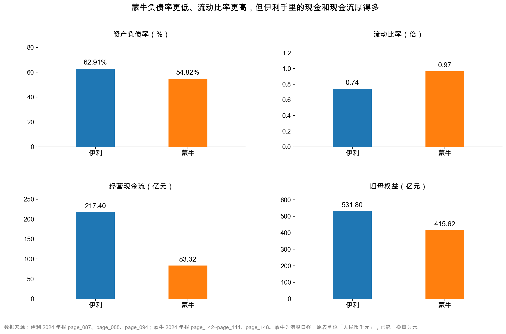
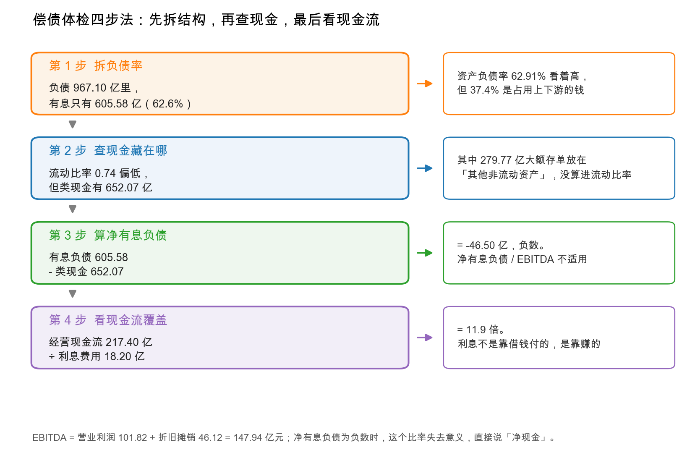

# 第 25 章：实战——伊利 vs 蒙牛的负债与偿债体检

> 本章你将：
> - 把本周四章的方法装成一套可复用的"偿债体检四步法"，以后打开任何年报都能照着走；
> - 用八个指标把伊利和蒙牛放在一张表里对照，看清"数字更好看"和"公司更强"是两回事；
> - 亲手算出净有息负债 / EBITDA、利息覆盖倍数这两个关键比率，并知道它们什么时候失效；
> - 明白同业对照的正确姿势：先比结构，再比趋势，最后才比数字；
> - 回答一个反直觉的问题：蒙牛负债率更低、流动比率更高，为什么偿债能力反而不如伊利。

---

## 25.1 一张体检表

前面四章，我们从不同角度拆了伊利资产负债表的右半边：负债分两类（第 21 章）、合同负债（第 22 章）、有息负债与期限（第 23 章）、所有者权益（第 24 章）。

四章下来，你手里应该有一堆数字。但数字本身不会告诉你"这家公司健不健康"——就像量了身高体重血压，还得有个医生把这些读数翻译成结论。

这一章就是那个"翻译"的过程。做法是：**找一家同行业的公司，用同一套指标对着看。**

对照公司选蒙牛乳业（2319.HK），理由有三个：它是伊利最直接的竞争对手；它的规模量级接近（总资产 1,062.93 亿元对 1,537.18 亿元）；它是港股，报表格式和伊利不同，正好练一次"跨市场对照"。

先把八个数摆在桌上：

| 指标 | 伊利 2024 | 蒙牛 2024 | 谁"更好看" |
|---|---|---|---|
| 总资产 | 1,537.18 亿 | 1,062.93 亿 | 伊利 |
| 总负债 | 967.10 亿 | 582.67 亿 | — |
| 资产负债率 | **62.91%** | **54.82%** | **蒙牛**（更低） |
| 流动资产 | 666.19 亿 | 357.68 亿 | 伊利 |
| 流动负债 | 899.25 亿 | 370.07 亿 | — |
| 流动比率 | **0.74** | **0.97** | **蒙牛**（更高） |
| 归母权益 | 531.80 亿 | 415.62 亿 | 伊利 |
| 经营现金流 | **217.40 亿** | **83.32 亿** | **伊利**（2.6 倍） |

<!-- src: 伊利股份2024年报/page_087.md 伊利股份2024年报/page_088.md 伊利股份2024年报/page_094.md 蒙牛乳业2024年报/page_142.md 蒙牛乳业2024年报/page_143.md 蒙牛乳业2024年报/page_144.md 蒙牛乳业2024年报/page_148.md -->

**前四个指标，蒙牛赢两个；后四个指标，伊利赢得干脆。**

如果你只看前两行（负债率、流动比率），结论会是"蒙牛财务更稳健"。如果你看到最后一行（经营现金流 217.40 亿对 83.32 亿），你会开始怀疑这个结论。

本章要做的，就是把这个怀疑变成一套有依据的判断。

四张小图，两两对照。上面两张是偿债指标（负债率、流动比率），蒙牛的柱子更"好看"；下面两张是实力指标（经营现金流、归母权益），伊利的柱子高出一大截。

**记住这个画面。** 它是本章的核心矛盾，也是"同业对照"最容易踩的坑。

## 25.2 为什么蒙牛的数字更好看

先把"蒙牛更稳健"这个印象拆开，看看它是怎么形成的。

### 负债率 54.82% 对 62.91%

$$\text{蒙牛资产负债率} = \frac{582.67}{1{,}062.93} \approx 54.82\%$$

$$\text{伊利资产负债率} = \frac{967.10}{1{,}537.18} \approx 62.91\%$$

蒙牛低 8.09 个百分点。单看这个数，蒙牛的财务杠杆确实更保守。

**但这个比较里藏着一个不公平：两家公司的负债结构不一样。**

伊利的有息负债 605.58 亿元，占负债总额 62.6%（第 21 章算过）。蒙牛呢？

| 蒙牛有息负债的构成 | 金额（亿元） |
|---|---|
| 流动——计息银行及其他借贷 | 166.62 |
| 非流动——计息银行及其他借贷 | 179.76 |
| **合计** | **346.37** |

<!-- src: 蒙牛乳业2024年报/page_143.md -->

蒙牛有息负债 346.37 亿元，占负债总额 582.67 亿元的 **59.4%**。

**两家公司有息负债占比几乎一样（62.6% 对 59.4%）。** 所以"负债率低 8 个百分点"这件事，不能解释成"蒙牛更少借钱"——它只是"总负债更少"，而有息负债的比例是相当的。

那蒙牛少的那部分负债是什么？主要是经营性负债少。伊利的应付账款 123.13 亿元 + 合同负债 120.73 亿元 = 243.86 亿元；蒙牛的应付账款及票据 86.47 亿元 + 合同负债 28.42 亿元 = 114.89 亿元。**伊利从上下游占到的钱，是蒙牛的两倍多。**

这是一个很有意思的反转：

> 📌 **划重点：** 负债率高，有时是因为"占款能力强"。伊利负债率比蒙牛高 8 个百分点，其中一部分恰恰是它产业链地位更强的体现——它能欠供应商更多、能收经销商更多预付款。**把"负债率高"直接等同于"风险高"，会把优势读成劣势。**

### 流动比率 0.97 对 0.74

$$\text{蒙牛流动比率} = \frac{357.68}{370.07} \approx 0.97$$

$$\text{伊利流动比率} = \frac{666.19}{899.25} \approx 0.74$$

蒙牛高 0.23，而且接近 1。伊利只有 0.74。

**但第 23 章已经讲过，伊利的 0.74 是被"藏起来的现金"压低的：**

| | 伊利 | 蒙牛 |
|---|---|---|
| 报表流动比率 | 0.74 | 0.97 |
| 非流动资产里的大额存单/定期存款 | **279.77 亿元** | 需另查附注 |
| 把这块加回流动资产后的流动比率 | **1.05** | — |

伊利把 279.77 亿元现金放在"其他非流动资产"里，所以流动比率被压到 0.74。如果这笔钱放在"其他流动资产"，流动比率立刻变成 1.05，反超蒙牛的 0.97。

**这里要非常小心：** 蒙牛的非流动资产里也有"其他金融资产 162.06 亿元"（`page_142.md`），其中可能也含存款和理财。**我没有逐一核实蒙牛这笔钱的期限结构，所以不能反过来说"蒙牛也藏了钱、调整后不如伊利"。** 我能确定的只有一件事：**两家的流动比率，都不是可以直接对比的干净数字。**

> ⚠️ **易踩坑：** 跨公司比流动比率，必须先确认两家的"现金放在哪"。
>
> A 股和港股的列报习惯不同：A 股公司常把大额存单放进"其他流动资产"或"其他非流动资产"；港股公司常放进"其他金融资产"。**同样是 1 亿元存款，放的位置不同，流动比率能差 0.1 以上。**
>
> 正确做法：比之前先把两家的"类现金"都找出来，用同一个口径重算。找不到就明说"这个数不可比"，别硬比。

## 25.3 伊利的优势在哪：现金流

前面两个指标蒙牛赢，但都不牢靠。真正拉开差距的，是现金流。

| | 伊利 | 蒙牛 | 倍数 |
|---|---|---|---|
| 经营活动现金流净额 | **217.40 亿元** | **83.32 亿元** | **2.61 倍** |
| 营业收入 | 1,153.93 亿元 | 886.75 亿元 | 1.30 倍 |
| 经营现金流 ÷ 营业收入 | **18.8%** | **9.4%** | 2.0 倍 |

<!-- src: 伊利股份2024年报/page_094.md 伊利股份2024年报/page_091.md 蒙牛乳业2024年报/page_148.md 蒙牛乳业2024年报/page_140.md -->

**伊利的收入只是蒙牛的 1.3 倍，但经营现金流是蒙牛的 2.6 倍。**

这不是规模差异造成的，是**质量差异**：伊利每 100 元收入能收回 18.8 元经营现金，蒙牛只能收回 9.4 元。

这个差距从哪来？三个可能：

**第一，收现能力。** 伊利 2024 年销售商品收到的现金 1,306.52 亿元，收现比 1.13（`page_094.md`）。蒙牛的经营现金流则被"支付利息 7.76 亿元、支付所得税 13.40 亿元"扣掉了一大块（`page_148.md`）。

**第二，占用上下游的能力。** 伊利的应付账款 + 合同负债 243.86 亿元，蒙牛 114.89 亿元。占款多，经营现金流就好看。

**第三，利润的"含金量"。** 蒙牛 2024 年归母净利润只有 1.05 亿元（`page_140.md`），主要是被贝拉米商誉减值 11.55 亿元、商标减值 34.90 亿元压的。这些减值不花现金，所以它的经营现金流（83.32 亿元）远高于净利润——这一点和伊利 2024 年的情况类似（伊利净利 84.64 亿元、经营现金流 217.40 亿元）。

**但即便考虑减值，蒙牛的现金流绝对额仍然只有伊利的四成。** 这个差距是实打实的。

> 💡 **你可能会问：** 经营现金流差这么多，是不是说明蒙牛的生意模式不如伊利？
>
> 不能这么快下结论。至少有三个因素要考虑：
>
> 1. **规模**：伊利收入是蒙牛的 1.3 倍，现金流本来就应该更大。
> 2. **一次性因素**：蒙牛 2024 年有大额减值、有联营公司（现代牧业）亏损拖累，这些会影响现金流的质量判断。
> 3. **会计口径**：港股把"支付利息"放在经营活动里，A 股放在筹资活动里。蒙牛经营现金流已经扣了 7.76 亿元利息，伊利没有。**这个口径差会让蒙牛的经营现金流"显得"更低。**
>
> 第 3 点尤其重要：按同一口径（把利息加回），蒙牛经营现金流约 91 亿元、伊利仍约 217 亿元（伊利利息在筹资活动），差距从 2.61 倍收窄到 2.39 倍——方向不变，幅度要修正。
>
> 这就是跨市场对照的日常：**每个数字背后都有一套口径，比之前先问"这两根柱子是不是同一把尺子量的"。**

## 25.4 偿债体检四步法

讲了这么多对照，现在把它固化成一套流程。以后你拿到任何一家公司的年报，都可以照着走这四步。

### 第 1 步：拆负债率，看有息占多少

**动作：** 算资产负债率，然后把负债拆成有息、经营性两堆，算有息占比。

**为什么：** 负债率只告诉你"总共欠多少"，有息占比才告诉你"多少要付利息"。

**伊利的结果：** 负债率 62.91%，有息负债 605.58 亿元占 62.6%，**属于"借款型"公司**。

**判读标准：**

| 有息占比 | 类型 | 关注点 |
|---|---|---|
| 低于 20% | 占款型 | 占款能不能持续 |
| 20%~50% | 混合型 | 两头都要看 |
| 高于 50% | 借款型 | 现金覆盖、期限结构、利息负担 |

### 第 2 步：查现金藏在哪

**动作：** 除了货币资金，翻"其他流动资产""其他非流动资产""交易性金融资产"的附注，把所有"大额存单/定期存款/结构性存款/理财"找出来。

**为什么：** 只数货币资金，会严重低估公司的现金。

**伊利的结果：** 货币资金 254.04 亿元 + 其他流动资产里 118.26 亿元 + 其他非流动资产里 279.77 亿元 = **类现金 652.07 亿元**。

**这一步的杀伤力：** 如果漏掉后面两项，你会把 652.07 亿元算成 254.04 亿元，净有息负债从 -46.50 亿元变成 +351.54 亿元，结论完全反转。

### 第 3 步：算净有息负债

**动作：** 净有息负债 = 有息负债 - 类现金。

**为什么：** 它回答"总共够不够"。

**伊利的结果：** 605.58 - 652.07 = **-46.50 亿元**（净现金）。

**判读标准：**

| 净有息负债 / EBITDA | 含义 |
|---|---|
| 小于 0 | 净现金，几乎无杠杆风险 |
| 0~2 倍 | 健康，两年内的 EBITDA 能还清 |
| 2~4 倍 | 偏高，要看现金流稳定性 |
| 大于 4 倍 | 高杠杆，警惕 |

**伊利的 EBITDA 怎么算：**

$$\text{EBITDA} = \text{营业利润} + \text{折旧摊销} = 101.82 + 46.12 = 147.94 \text{ 亿元}$$

（折旧 40.56 亿元 + 使用权资产摊销 1.47 亿元 + 无形资产摊销 2.69 亿元 + 长期待摊费用摊销 1.41 亿元，精确合计 46.12 亿元，分项四舍五入后相加会得到 46.13，差 0.01 属正常；`page_217.md`。）

因为净有息负债是负数，**这个比率对伊利不适用**——你不能用 -46.50 去除以 147.94 得到 -0.31 倍，然后说"负 0.31 倍很好"。**净现金公司不用这个指标，直接说"净现金 46.50 亿元"就行。**

但你要会算，因为大部分公司不是净现金。举个对照：蒙牛的有息负债 346.37 亿元，现金及银行结存 173.39 亿元（`page_142.md`），净有息负债约 172.98 亿元。蒙牛的 EBITDA 粗算（税前利润 9.99 + 融资成本 14.68 + 折旧摊销约 34.05）约 58.72 亿元，**净有息负债 / EBITDA 约 2.9 倍**——落在"偏高"那一档。

> ⚠️ **易踩坑：** EBITDA 是个"粗口径"，不同人算出来能差 10%。
>
> 差异主要来自三处：① 折旧摊销取"现金流量表补充资料"的数还是"附注"的数（伊利这两个数就不一样：现金流量表口径 40.56 亿元，固定资产附注口径 38.18 亿元）；② 要不要把"使用权资产折旧"算进去；③ 营业利润要不要加回减值损失。
>
> **所以 EBITDA 只能自己和自己比（看趋势），不能和别人比（口径不同）。** 用净有息负债 / EBITDA 做同业对照时，两家必须用同一套算法。

### 第 4 步：看现金流覆盖利息

**动作：** 利息覆盖倍数 = 经营现金流 ÷ 利息支出。

**为什么：** 还不上本金可以续借，付不起利息就是违约。利息是刚性的。

**伊利的结果：** 217.40 ÷ 18.20 = **11.9 倍**。

**蒙牛的结果：** 83.32 ÷ 14.68 = **5.7 倍**（蒙牛融资成本 14.68 亿元，`page_140.md`）。

**判读标准：**

| 覆盖倍数 | 含义 |
|---|---|
| 大于 8 倍 | 利息压力很小 |
| 4~8 倍 | 正常 |
| 2~4 倍 | 偏紧，利润下滑就会吃紧 |
| 小于 2 倍 | 危险，靠借新还旧付利息 |

**两家都在安全区，但伊利是蒙牛的两倍。**

> 🔍 **翻到年报：** 打开伊利 `page_209.md`（财务费用附注），找到"利息支出 1,819,520,437.71"那一行；再打开蒙牛 `page_140.md`（综合损益表），找到"Finance costs 融資成本 (1,467,790)"那一行。**这两个数，就是第 4 步的分母。** 注意蒙牛的单位是"人民币千元"，1,467,790 千元 = 14.68 亿元——港股的千元单位，是跨市场对照最容易栽跟头的地方。

## 25.5 四步法跑完，结论是什么

把两家的四步结果并排放：

| 步骤 | 伊利 | 蒙牛 | 谁更强 |
|---|---|---|---|
| 1. 负债率 / 有息占比 | 62.91% / 62.6% | 54.82% / 59.4% | 蒙牛（略） |
| 2. 类现金 | 652.07 亿元 | 173.39 亿元（现金及银行结存） | **伊利** |
| 3. 净有息负债 | **-46.50 亿元**（净现金） | 约 +172.98 亿元 | **伊利** |
| 4. 利息覆盖 | **11.9 倍** | 5.7 倍 | **伊利** |

<!-- src: 伊利股份2024年报/page_088.md 伊利股份2024年报/page_188.md 伊利股份2024年报/page_209.md 蒙牛乳业2024年报/page_142.md 蒙牛乳业2024年报/page_140.md 蒙牛乳业2024年报/page_148.md -->

**四步里伊利赢三步，第 3 步还是"净现金对净负债"的量级差异。** 所以本章开头那个问题的答案是：

> **蒙牛负债率更低、流动比率更高，但伊利的偿债能力更强。**
>
> 原因不是"伊利的数字更好看"（它有两个数字更难看），而是：**伊利的现金厚度和现金流强度，足以覆盖它更高的负债。**

这句话有三个关键词，缺一不可：**现金厚度**（652.07 亿元）、**现金流强度**（217.40 亿元）、**覆盖更高的负债**（605.58 亿元）。三个数放在一起，才构成"安全"。

### 25.5.1 但蒙牛不是"差公司"

写到这里必须补一句，否则会误导。

蒙牛的偿债能力，放在 A 股和港股的整体分布里，仍然是**中上水平**：负债率 54.82%、利息覆盖 5.7 倍、经营现金流 83.32 亿元，都远好于"危险线"。

它 2024 年的问题是**利润**，不是**偿债**：

| | 伊利 | 蒙牛 |
|---|---|---|
| 营业收入（亿元） | 1,153.93 | 886.75 |
| 归母净利润（亿元） | 84.53 | **1.05** |
| 净利率 | 7.33% | **0.12%** |
| 毛利率 | 33.88% | 39.57% |

<!-- src: 伊利股份2024年报/page_091.md 蒙牛乳业2024年报/page_140.md -->

**蒙牛毛利率比伊利高 5.69 个百分点（39.57% 对 33.88%），净利率却只有 0.12%。**

高毛利、低净利，说明钱都花在中间了：销售费用率 26.04%（伊利 19.05%）、其他费用 64.53 亿元、联营公司亏损 8.72 亿元、再加上贝拉米那 39.81 亿元的减值。

**这是"盈利能力"的问题，第 7 周会专门讲。** 本章只需要记住一句：**偿债能力和盈利能力是两个维度，一家公司可以"还得起债但赚不到钱"。** 蒙牛 2024 年就是这种状态。

## 25.6 同业对照的正确姿势

最后把"怎么对照"讲透——这一节可能是本章最有长期价值的部分。

### 三条原则

**原则一：先比结构，再比数字。**

看到"蒙牛负债率 54.82%，伊利 62.91%"，不要立刻下结论。先问：这两家的负债结构一样吗？有息占比各是多少？占款能力谁强？

**结构不同的两个数字，放在一起比是没意义的。** 就像比两个人的体重，得先知道身高。

**原则二：先比趋势，再比绝对值。** 一年的数字可能是偶然的，要看三年五年。伊利 2024 年负债率 62.91%，2023 年是 62.20%（942.99 ÷ 1,516.20），基本持平——**说明杠杆是稳定的，不是一年之内突然加上去的。** 这个信息比"62.91% 高不高"重要得多。

**原则三：比之前先对齐口径。** A 股和港股至少有四处口径差异，会直接影响偿债指标：

| 差异点 | A 股（伊利） | 港股（蒙牛） | 影响 |
|---|---|---|---|
| 单位 | 元 | **人民币千元** | 差 1000 倍，最容易出错 |
| 利息支出位置 | 筹资活动 | **经营活动** | 港股经营现金流被压低 |
| 报表名称 | 资产负债表 / 利润表 | **财务状况表 / 损益表** | 搜索关键词要用繁体 |
| 少数股东 | 少数股东权益 | **非控股股东权益** | 名字不同，含义一样 |

<!-- src: 蒙牛乳业2024年报/page_142.md 蒙牛乳业2024年报/page_148.md -->

**这四条里，第一条（千元）最致命。** 蒙牛总资产 106,292,792 千元，如果你当成"元"，会算出 1.06 亿元的总资产——比实际小 1000 倍。数据文件 `data/mengniu2024.json` 已经把千元换算成元，但你自己读 raw 年报时，一定要先看表头。

> ⚠️ **易踩坑：** 同业对照最常见的三个错误。
>
> ① **拿不同商业模式的公司比。** 乳业和白酒的负债率天然不同（白酒预收款多、几乎不借钱），比了也没意义。要选"生意模式相似、规模量级接近"的公司。
>
> ② **只比一年。** 一年的数字可能被一次性事件扭曲（蒙牛 2024 年就被 39.81 亿元减值扭曲了）。至少看三年。
>
> ③ **比完就下"谁更好"的结论。** 对照的目的是"理解差异从哪来"，不是"评个高低"。蒙牛净利率 0.12% 不代表它是坏公司，可能只是 2024 年这一年特殊；伊利净现金也不代表它永远安全，融资环境一变，短债滚动就会紧。

### 25.6.1 把这一周的方法带走

最后，把本周五章的内容压成一张卡片，方便你以后翻：

| 章 | 核心问题 | 关键动作 | 伊利的答案 |
|---|---|---|---|
| 21 | 负债里多少要付息？ | 拆有息 / 经营性 | 605.58 / 361.52，借款型 |
| 22 | 先收的钱是好是坏？ | 看附注构成 + 下一期收入 | 120.73 亿货款，+38.8% 待验证 |
| 23 | 短债能不能滚下去？ | 算净有息负债 + 期限结构 | 净现金 46.50 亿，短债缺口 302.04 亿 |
| 24 | 净资产是谁的？ | 分归母 / 少数股东 | 531.80 / 38.28 |
| 25 | 和同行比谁更强？ | 四步法 + 对齐口径 | 伊利赢在现金和现金流 |

**下周去哪：** 资产负债表这一整块（资产 + 负债 + 权益）到本章就讲完了。第 6 周开始看利润表——从营业收入一层一层减到营业利润，看这家公司到底靠什么赚钱。

那是一个全新的视角：**资产负债表告诉你"这家公司有什么"，利润表告诉你"它靠什么赚"。** 两张表合起来，才是一家公司的完整画像。

---

## ✍️ 想一想

### 问 1：如果只看两个指标

假设你只有 30 秒看一家公司的偿债能力，只能看两个指标。你会选哪两个？为什么？请用本章的案例说明。

**解题思路：** 想清楚"偿债"这件事最怕什么——怕的是"到期拿不出钱"。哪个指标最接近"到期能拿出多少钱"？

**参考答案：** 我会选 **① 净有息负债 ÷ EBITDA** 和 **② 利息覆盖倍数**。

**为什么是这两个：**

| 指标 | 回答的问题 | 为什么不可替代 |
|---|---|---|
| 净有息负债 / EBITDA | 总共欠的钱，几年能还清 | 它同时考虑了"欠多少"和"每年能赚多少"，是存量与流量的比值 |
| 利息覆盖倍数 | 每年的利息，赚的现金够不够付 | 利息是刚性的现金流出，付不起利息就是违约的开始 |

**为什么不用资产负债率：** 它只看总量，不看结构，也不看现金流。伊利 62.91% 和一家 62.91% 但现金流为负的公司，风险天差地别。

**为什么不用流动比率：** 它太容易被"现金放在哪一栏"操纵。伊利的 0.74 和调整后的 1.22，是同一家公司。

**用这两个指标回看本章：**

| | 伊利 | 蒙牛 |
|---|---|---|
| 净有息负债 / EBITDA | 净现金，不适用（负 46.50 亿元） | 约 2.9 倍 |
| 利息覆盖倍数 | 11.9 倍 | 5.7 倍 |

两个指标都指向伊利更强。

**但要补一句：** 这两个指标对"净现金公司"会失效（分母是负数）。所以严格说，30 秒版应该是**三个**：净有息负债（看正负）、净有息负债 / EBITDA、利息覆盖。

**易错点：** ① 选资产负债率和流动比率——这两个恰恰是最容易被结构和分类扭曲的。② 只选一个，答"净有息负债/EBITDA 就够了"——它不告诉你利息压力，而利息是更早爆的那根弦。③ 忘了净现金公司会让比率失效。

### 问 2：蒙牛的问题到底在哪

有人说："蒙牛负债率比伊利低、流动比率比伊利高，所以蒙牛财务更健康，只是 2024 年运气不好，被减值拖累了。"

请评价这个说法。它对在哪、错在哪？

**解题思路：** 把这句话拆成三个判断：① 负债率低 = 更健康？② 流动比率高 = 更健康？③ 只是运气不好？

**参考答案：**

**对的部分：** 蒙牛的负债率（54.82% 对 62.91%）和流动比率（0.97 对 0.74）确实更好看，这是事实。2024 年的利润确实被减值严重拖累（贝拉米商誉 11.55 亿元 + 商标 34.90 亿元，合计影响 39.81 亿元），这也是事实。

**错的部分有三处：**

**第一，"负债率低 = 更健康"不成立。** 两家有息负债占比几乎一样（59.4% 对 62.6%）。伊利负债率高出的部分，主要来自更强的占款能力（应付+合同负债 243.86 亿元对 114.89 亿元）。**这是优势，不是风险。**

**第二，"流动比率高 = 更健康"也不成立。** 伊利的 0.74 是被 279.77 亿元"藏在非流动资产里的现金"压低的，调整后是 1.05，反超蒙牛。**这个指标在两家之间不可比。**

**第三，"只是运气不好"低估了问题。** 蒙牛 2024 年毛利率 39.57%，比伊利高 5.7 个百分点；但净利率只有 0.12%。**从 39.57% 到 0.12%，中间漏掉的钱不是一次减值能解释的**——销售费用率 26.04%、其他费用 64.53 亿元、联营公司亏损 8.72 亿元，这些是持续性的经营问题，不是一次性的。

**正确的说法是：** 蒙牛的偿债能力不算差（利息覆盖 5.7 倍仍在安全区），但它的问题在盈利能力，且盈利能力的问题不完全是一次性的。而伊利的偿债能力更强，强在现金厚度和现金流，不在负债率。

**易错点：** ① 全盘否定，答"蒙牛很危险"——它不危险，5.7 倍利息覆盖是安全的。② 全盘接受，答"蒙牛只是运气不好"——忽略了费用率和联营亏损这些结构性问题。③ 只比较数字，不看数字背后的结构。

### 问 3：把两家公司的负债率算法换一下

假设你决定用"有息负债 ÷ 总资产"这个指标，重新比较两家的杠杆。

请计算：① 伊利和蒙牛的这个指标各是多少？② 结论和用资产负债率比，有什么不同？③ 这个指标比资产负债率更好吗？

**解题思路：** 先算数，再想"这个指标过滤掉了什么、又漏掉了什么"。

**参考答案：**

**① 计算：**

| | 有息负债（亿元） | 总资产（亿元） | 有息负债 / 总资产 |
|---|---|---|---|
| 伊利 | 605.58 | 1,537.18 | **39.4%** |
| 蒙牛 | 346.37 | 1,062.93 | **32.6%** |

<!-- src: 伊利股份2024年报/page_088.md 蒙牛乳业2024年报/page_142.md 蒙牛乳业2024年报/page_143.md -->

**② 结论的变化：**

用资产负债率比：伊利 62.91%、蒙牛 54.82%，差距 **8.09 个百分点**。
用有息负债/总资产比：伊利 39.4%、蒙牛 32.6%，差距 **6.8 个百分点**。

**差距缩小了，但方向没变**——伊利的杠杆仍然更高。这说明伊利高出的负债率里，有一部分确实是"真债"，不能全部用"占款能力强"解释。

**③ 这个指标更好吗？**

**更"干净"，但不更"全面"。**

好处是：它剔除了经营性负债的干扰，直接看"借来的钱占总资产多少"，跨公司可比性更强。

坏处是：它完全忽略了"公司有多少现金"。伊利有息负债/总资产 39.4%，但类现金 652.07 亿元——**借钱多，存钱更多。** 这个指标看不见这一层。

所以三个指标各有分工：

| 指标 | 看什么 | 盲区 |
|---|---|---|
| 资产负债率 | 总杠杆 | 不分有息/无息 |
| 有息负债 / 总资产 | 真实债务杠杆 | 不看现金 |
| 净有息负债 / EBITDA | 债务与赚钱能力的匹配 | 净现金公司失效 |

**没有哪个指标是"最好"的。** 正确做法是三个一起看，让它们互相补盲区。

**易错点：** ① 算错分母，用"总负债"去除有息负债（那是占比，不是杠杆率）。② 认为"有息负债/总资产更低就一定更安全"——它不看现金，也不看到期时间。③ 只算一个指标就下结论。

## 📎 数据出处

- 伊利股份 2024 年报：`page_087.md`（总资产 1,537.18 亿元、流动资产 666.19 亿元）、`page_088.md`（总负债 967.10 亿元、流动负债 899.25 亿元、归母权益 531.80 亿元、有息负债各科目）
- 伊利股份 2024 年报：`page_091.md`（营业收入 1,153.93 亿元、营业利润 101.82 亿元）
- 伊利股份 2024 年报：`page_094.md`（经营现金流 217.40 亿元、销售商品收到现金 1,306.52 亿元）
- 伊利股份 2024 年报：`page_188.md`（其他非流动资产中的大额存单 279.77 亿元）
- 伊利股份 2024 年报：`page_209.md`（利息支出 18.20 亿元、利息收入 24.55 亿元）
- 伊利股份 2024 年报：`page_217.md`（折旧摊销明细：折旧 40.56 亿元、使用权资产摊销 1.47 亿元、无形资产摊销 2.69 亿元、长期待摊费用摊销 1.41 亿元）
- 蒙牛乳业 2024 年报：`page_142.md`（总资产 1,062.93 亿元、流动资产 357.68 亿元、现金及银行结存 173.39 亿元）
- 蒙牛乳业 2024 年报：`page_143.md`（总负债 582.67 亿元、流动负债 370.07 亿元、有息借贷流动 166.62 亿元 / 非流动 179.76 亿元）
- 蒙牛乳业 2024 年报：`page_144.md`（归母权益 415.62 亿元、非控股股东权益 64.63 亿元）
- 蒙牛乳业 2024 年报：`page_140.md`（营业收入 886.75 亿元、归母净利润 1.05 亿元、融资成本 14.68 亿元）
- 蒙牛乳业 2024 年报：`page_148.md`（经营现金流 83.32 亿元、支付利息 7.76 亿元、支付所得税 13.40 亿元）
- 数据汇总：`data/yili2024.json` 的 `ratios` 段（debt_ratio 0.6291、current_ratio 0.7408、interest_bearing_debt 605.58 亿元、cash_and_deposits 652.07 亿元、net_interest_bearing_debt -46.50 亿元）；`data/mengniu2024.json` 的 `balance` 段与 `ratios` 段（debt_ratio 0.5482、current_ratio 0.9665）

下一章：[第 26 章：利润表的结构——一层一层减下去](../week06/26-利润表的结构.md)
