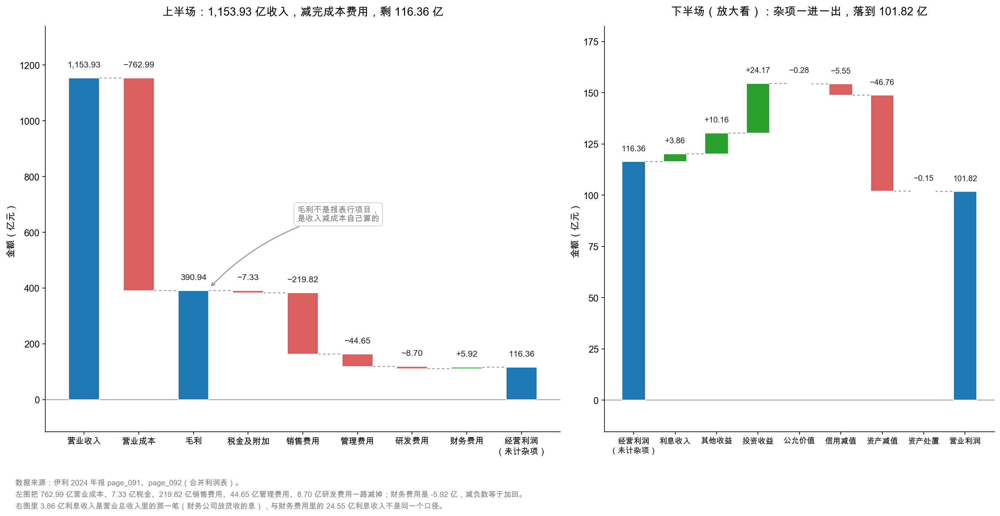

# 第 26 章：利润表的结构——一层一层减下去

> 本章你将：
> - 看懂利润表其实是一张"只做减法"的表，而且减的顺序有讲究；
> - 分清两个最容易混的孪生数字：**营业总收入 1,157.80 亿元** 与 **营业收入 1,153.93 亿元**；
> - 把 1,037.57 亿元"营业总成本"拆成六个口袋，看清钱到底被谁拿走了；
> - 弄明白一件反直觉的事：伊利的**财务费用是 -5.92 亿元**，负数不是写错了；
> - 学会从营业收入一路走到营业利润 101.82 亿元，中间每一步都不跳过。

---

## 26.1 一张只做减法的表

前五周我们一直在资产负债表上打转：资产怎么排队、固定资产怎么折旧、商誉怎么减值、负债怎么分类。那张表回答的是"**这一刻，公司有什么、欠什么**"——它是一张照片。

从这一周开始，我们换一张表。它回答的是另一个问题："**这一年，公司赚了多少**"——它是一段录像。

先不讲伊利，讲一张你每个月都见过的东西：工资条。

工资条从上往下是这么排的：

> 应发工资 20,000
> 减：个人社保公积金 3,000
> 减：个人所得税 1,200
> 到手 15,800

只做减法，而且**顺序是固定的**：先扣法定的，再扣税的，最后才是你能拿走的。

利润表就是一家公司的工资条，只不过它长得多、减得也多：

> 营业总收入 1,157.80
> 减：营业总成本 1,037.57
> 加：其他收益、投资收益……
> 减：减值损失……
> 营业利润 101.82

看到这里，你可能会想：不就是收入减支出吗，有什么难的？

难的地方有两处，而且都在"顺序"上。

**第一处：减的顺序决定了你看到什么。** 一家公司把"投资收益 24.17 亿元"放在营业利润**之上**，你就没法从营业利润里一眼看出"主业赚了多少"。伊利的投资收益恰恰在上面——这是本章最后要处理的麻烦。

**第二处：每一层减法都对应一个不同的"责任人"。** 营业成本是采购和生产部门的事，销售费用是市场部门的事，减值损失是管理层过去决策的事，所得税是国家的事。**一层一层减下去，其实是在一层一层追责。**

> 📌 **划重点：** 资产负债表是"时点照片"，利润表是"期间录像"。利润表的结构不是随意的，它按"谁花的钱、这钱该不该花、花了还剩下什么"的顺序排列。读利润表的核心动作，是**在每一层停下来问一句：这一层的数字，是谁的责任？**

## 26.2 第一层：营业总收入不等于营业收入

打开伊利 2024 年报第 91 页，合并利润表的第一行不是"营业收入"，而是"营业总收入"：

| 项目 | 2024 年 | 2023 年 |
|---|---|---|
| 一、营业总收入 | **1,157.80 亿元** | 1,261.79 亿元 |
| 其中：营业收入 | **1,153.93 亿元** | 1,257.58 亿元 |
| 其中：利息收入（财务公司） | 3.86 亿元 | 4.21 亿元 |

两个数字差了 3.86 亿元。差在哪？就差在那一行"利息收入"上。

用报表上的原始数字相加：115,393,310,976.69 + 386,243,672.61 = 115,779,554,649.30，正是"营业总收入"那一格。换成亿元：1,153.93 + 3.86 = 1,157.79，而原始数字精确到分相加是 1,157.7955，四舍五入才成了 1,157.80。**差的那 0.01 亿元，是四舍五入的痕迹，不是报表出错。**

**为什么一家卖牛奶的公司会有"利息收入"？**

因为伊利旗下有一张金融牌照——它有自己的财务公司（可以理解为集团内部的"小银行"），给上下游的经销商、供应商放贷、做保理，收的利息就记在这一行。这在 A 股叫"金融类收入"，监管要求单列。

于是就有了这条等式：

$$\text{营业总收入} = \text{营业收入} + \text{利息收入} + \text{已赚保费} + \text{手续费及佣金收入}$$

伊利没有保险业务，也没有券商业务，所以后两项是空的。对绝大多数制造业公司来说，这个等式会退化成一句更朴素的话：**营业总收入就等于营业收入，两者一样。**

但对伊利不一样。而这一年的差别，正好是 3.86 亿元——不到总收入的 0.34%。看起来微不足道，可它会在后面制造一个大麻烦：算毛利率、算费用率的时候，**分母用哪个？**

> ⚠️ **易踩坑：** 用"营业总收入"当分母算毛利率，会算出 33.76%；用"营业收入"当分母，才是 33.88%。差了 0.12 个百分点。0.12 个点在伊利这种体量上等于 1.4 亿元。更麻烦的是，如果你在算 2023 年时用了这个口径、算 2024 年时用了那个口径，两年的"毛利率变动"就会凭空多出或少于 0.1 个百分点——而你完全不知道自己错在哪。
>
> **统一规则：毛利率、费用率、净利率的分母一律用"营业收入"。** 那 3.86 亿元利息收入没有对应的营业成本，混进来会把毛利率算高。

> 🔍 **翻到年报：** 打开 `page_091.md`，第一行"一、营业总收入"是 115,779,554,649.30，第二行"其中:营业收入"是 115,393,310,976.69。两行相减得 386,243,672.61，正好等于第三行"利息收入"。年报用"其中"两个字告诉你：营业收入是营业总收入的**组成部分**，不是并列关系。

后面再看到"利息收入"这个词，你还要多留一个心眼：**伊利报表上有两个"利息收入"。**

| 出现的位置 | 2024 年金额 | 含义 |
|---|---|---|
| 营业总收入 里 | 3.86 亿元 | 财务公司放贷收的利息，是**收入** |
| 财务费用 明细里 | 24.55 亿元 | 公司自己存款收的利息，是**费用的减项** |

一个在利润表最上面，一个在利润表中间的费用明细里；一个是"我做生意赚的"，一个是"我存钱赚的"。名字一模一样，性质完全不同。第 29 章讲财务费用时还会回到这里。

## 26.3 第二层：营业总成本里的六个口袋

第一层减完，接下来是最大的一刀：**营业总成本 1,037.57 亿元**。

这个数字很吓人——它相当于营业收入的 89.9%。也就是说，每收进来 100 元，就有 89.9 元立刻被成本费用拿走。

但它不是一个笼统的数字。年报把它拆成六个口袋：

| 口袋 | 2024 年 | 2023 年 | 占营业收入比（2024） |
|---|---|---|---|
| 营业成本 | **762.99 亿元** | 847.89 亿元 | 66.12% |
| 税金及附加 | 7.33 亿元 | 7.33 亿元 | 0.63% |
| 销售费用 | **219.82 亿元** | 225.72 亿元 | 19.05% |
| 管理费用 | 44.65 亿元 | 51.54 亿元 | 3.87% |
| 研发费用 | 8.70 亿元 | 8.50 亿元 | 0.75% |
| 财务费用 | **-5.92 亿元** | -1.53 亿元 | -0.51% |
| **合计** | **1,037.57 亿元** | 1,139.44 亿元 | 89.92% |

六个数字加起来：762.99 + 7.33 + 219.82 + 44.65 + 8.70 - 5.92 = 1,037.57。和表上的"营业总成本"一分不差。这是利润表的第二道勾稽。

<!-- src: 伊利股份2024年报/page_091.md -->

这六个口袋是**性质完全不同的六种钱**：

**营业成本 762.99 亿元，是"做出来"的钱。** 原奶、包材、糖、人工、厂房折旧、从工厂到仓库的运费——凡是"让这盒牛奶存在"所花的钱都在这里。**卖得越多，花得越多**，和销量几乎同步，所以它最"硬"。

**税金及附加 7.33 亿元，是"交给国家"的钱。** 注意它不是企业所得税（所得税在利润表最下面），而是消费税、城建税、教育费附加、房产税、土地使用税、印花税这些"经营环节的税"。伊利这一年的税金及附加是 7.33 亿元，和 2023 年的 7.33 亿元几乎一模一样——这类税跟着流转额和房产土地走，不太随利润波动。

**销售费用 219.82 亿元，是"卖出去"的钱。** 广告、促销、经销商返利、销售人员工资、仓储费。这是第二大支出，占营业收入 19.05%——**每卖 100 元牛奶，有 19 元花在"卖"这个动作上。** 第 29 章拆开讲。

**管理费用 44.65 亿元，是"管起来"的钱。** 总部薪酬、办公楼折旧、咨询审计费、差旅。它和销量关系不大，更像"维持公司运转"的固定开销。

**研发费用 8.70 亿元，是"想未来"的钱。** 新品配方、菌种研究、包装工艺。有趣的是，它是六个口袋里**唯一比去年增加**的一个（8.50 → 8.70，+2.33%）。

**财务费用 -5.92 亿元，是"借钱和存钱"的净结果。** 负数。这一项值得单独用一节讲。

> 📌 **划重点：** 营业总成本不等于营业成本。**营业成本只是六个口袋里的一个**（虽然它最大，占 73.5%）。看到"成本"两个字就要问：是"营业成本"，还是"营业总成本"？前者是 762.99 亿元，后者是 1,037.57 亿元，差 274.58 亿元。这两个词在中文里只差一个字，在报表上差出一家中小型上市公司的体量。

## 26.4 第三层：财务费用是负数，说明什么

现在来处理那个"-5.92"。

很多人第一次看到利润表上有一项费用是负数，第一反应是"印错了吧"。不是印错。**财务费用是负数，意思是"财务这件事，整体上给公司赚了钱，而不是花了钱"。**

翻开附注七(67)（`page_209.md`），财务费用的四个组成部分清清楚楚：

| 项目 | 2024 年 | 2023 年 |
|---|---|---|
| 利息支出 | 18.20 亿元 | 21.93 亿元 |
| 利息收入 | **-24.55 亿元** | -24.79 亿元 |
| 汇兑净损失 | -0.12 亿元 | 0.69 亿元 |
| 手续费 | 0.56 亿元 | 0.64 亿元 |
| **合计** | **-5.92 亿元** | -1.53 亿元 |

先看前两行，这是全部的关键：

- 公司借的钱要付利息：**18.20 亿元**（支出）；
- 公司账上的存款收利息：**24.55 亿元**（收入）；
- 两下相抵：24.55 - 18.20 = **净收 6.36 亿元**。

这就是负数的来源。**伊利存的钱比借的钱"更值钱"**——它的存款利息收入，比借款利息支出还多出 6.36 亿元。

再往下看：汇兑这一项是 -0.12 亿元（也是收益），手续费是 0.56 亿元（支出）。把符号一起带进来算：**-6.36（净利息收益）- 0.12（汇兑收益）+ 0.56（手续费）= -5.92 亿元**。注意这里的 6.36 在费用表里是"-6.36"——收益要写成负的费用，才加得进去。

那 2023 年为什么只有 -1.53 亿元？看利息支出那一列：**21.93 → 18.20，一年少了 3.73 亿元**。年报在 `page_018.md` 里给的原因很直接："财务费用变动原因说明：主要是本期利息支出减少所致。" 借得少了、或者借得便宜了，支出就降下来了。

这件事值得多想一层。一家公司能把财务费用做成负数，通常意味着三件事同时成立：

1. **它账上有大量现金**（货币资金 254.04 亿元，加上大额存单等类现金合计 652.07 亿元）；
2. **它的有息负债成本不高**（605.58 亿元有息负债，利息支出 18.20 亿元，粗算成本率约 3.0%）；
3. **它的存款收益率不低**（24.55 ÷ 652.07，粗算约 3.8%）。

正常情况下借款利率应该高于存款利率，伊利反过来，靠的是把大部分钱存成了**大额存单和定期存款**（第 12 章讲过，那些钱不在"货币资金"里，藏在"其他流动资产"和"其他非流动资产"里），利率明显高于活期。

（这两个百分比是用**期末余额**粗算的，不是平均余额，只能当数量级看，不能当成精确的利差。）

> 💡 **你可能会问：财务费用是负数，是不是说明这家公司"不务正业"，靠吃利息过日子？**
>
> 不是。算一下量级就清楚了：净利息收益 6.36 亿元，对比营业利润 101.82 亿元，只占 6.2%；对比营业收入 1,153.93 亿元，只占 0.55%。它是一笔"顺手赚的零花钱"，不是主业。
>
> 真正要警惕的是另一种情况：**财务费用是负数，但金额巨大**（比如占营业利润三成以上）。那说明这家公司的主业可能已经不怎么赚钱，利润靠账上现金撑着。判断标准很简单——把财务费用净收益从营业利润里剔掉，看剩下的部分还像不像一门生意。

## 26.5 第四层：从 116.36 到 101.82，中间那 14.54 亿

到这里，我们可以先算两个"毛坯版"的经营结果：

$$1{,}157.80 - 1{,}037.57 = 120.23 \text{ 亿元（营业总收入口径）}$$

$$1{,}153.93 - 1{,}037.57 = 116.36 \text{ 亿元（营业收入口径）}$$

这两个数差 3.86 亿元，就是那笔利息收入——它挂在营业总收入里，却没有对应的营业成本，所以"白"留在上面。**116.36 亿元才是"主业自己挣出来的钱"**：卖牛奶的收入，减去做牛奶、卖牛奶、管公司、搞研发、借钱存钱的所有成本费用。这个数字利润表上没有，得自己算。

现在从 116.36 走到营业利润 101.82。注意：因为 116.36 已经把 3.86 亿元利息收入排除在外，第一步就得把它加回来，再走后面六笔：

| 加减项 | 2024 年 | 性质 | 能不能持续 |
|---|---|---|---|
| 加：利息收入（财务公司） | +3.86 亿元 | 营业总收入里那一笔，无对应成本 | 随放贷规模走 |
| 加：其他收益 | +10.16 亿元 | 主要是政府补助 9.84 亿元 | 年年有，但金额会变 |
| 加：投资收益 | **+24.17 亿元** | 其中处置子公司股权 25.80 亿元 | **一次性** |
| 加：公允价值变动 | -0.28 亿元 | 持有的金融资产价格波动 | 波动，不可预测 |
| 减：信用减值损失 | -5.55 亿元 | 应收款、保理业务的坏账准备 | 随业务规模走 |
| 减：资产减值损失 | **-46.76 亿元** | 商誉 30.75 亿、存货 12.27 亿、固定资产 3.67 亿 | **今年特别大** |
| 减：资产处置收益 | -0.15 亿元 | 卖旧设备的盈亏 | 零星 |
| **营业利润** | **101.82 亿元** | | |

验算一遍：116.36 + 3.86 + 10.16 + 24.17 - 0.28 - 5.55 - 46.76 - 0.15 = 101.81，和报表上的 101.82 差 0.01，是各数保留两位小数造成的。

（如果从营业总收入口径的 120.23 出发，就不用加那 3.86 亿元——它本来就在里面。两条路走到同一个地方，这是对账的好习惯：**换个起点再算一遍，看能不能对上。**）

<!-- src: 伊利股份2024年报/page_091.md 伊利股份2024年报/page_210.md 伊利股份2024年报/page_211.md -->

这七笔账里，有两笔必须现在就标红：**投资收益 +24.17 亿元** 和 **资产减值 -46.76 亿元**。

前者是"卖了一家子公司赚的钱"——附注七(69)写得很清楚："本期转让控股子公司昌吉盛新实业有限责任公司股权，处置收益增加。" 这种钱今年有、明年不一定有。

后者是"认定某些资产不值账上那个价了"——其中最大的一笔是商誉减值 30.75 亿元（第 19、20 章已经拆过）。**减值不花一分钱现金，但它全额扣减利润。**

一进一出，正好 24.17 - 46.76 = -22.59 亿元。**如果这两笔都不发生，营业利润会是 124.41 亿元，比 2023 年的 118.73 亿元还高 4.8%。**

这就是本书最重要那条洞见的第一次露面。第 30 章会把它彻底拆开，这里先记住一个感觉：**营业利润这一行，被两笔"非经营"的东西拽住了。**

这张图分两半看。

**左半边是"主业"**：蓝色第一根是营业收入 1,153.93 亿元；红色第二根是营业成本 -762.99 亿元，一下子砍到 390.94 亿元的毛利；然后是四根小一点的红条——税金 -7.33、销售费用 -219.82、管理费用 -44.65、研发费用 -8.70；中间冒出一根**绿色**的短条 +5.92 亿元，那就是财务费用为负带来的"加分"；最后落在 116.36 亿元。

**右半边是"杂项"**，注意它的纵轴刻度比左边小得多（0 到 175，左边是 0 到 1200），所以看起来幅度很大——这叫"放大看"。从 116.36 出发：加利息收入 +3.86、其他收益 +10.16、投资收益 +24.17，减公允价值 -0.28、信用减值 -5.55、资产减值 -46.76、资产处置 -0.15，落到 101.82。

**最该看到的一件事是：左边五根红条合计 1,043.49 亿元，右边那两根大条（投资收益与资产减值）的净影响只有 22.59 亿元。** 决定伊利赚不赚钱的是左边；决定这一年"账面好看不好看"的是右边。

而绝大多数人只看右边。

> ⚠️ **易踩坑：** 看到"营业利润 101.82 亿元"，就以为这是"卖牛奶赚的钱"。不是。这里面混着 24.17 亿元卖股权的收益、10.16 亿元政府补助，也扣掉了 52.31 亿元减值。**营业利润是一个"大杂烩"科目**，它的名字里有"营业"两个字，但内容远不止营业。
>
> 真正干净的"主业利润"，得自己动手算：营业收入 - 营业总成本 = 116.36 亿元（本章口径）；或者更进一步，把减值也加回来，得到 154.13 亿元（第 30 章口径）。三个数字——101.82、116.36、154.13——说的是三件不同的事，混着用必然出错。

## 26.6 三层利润，一层比一层靠近股东

营业利润下面还有三行，很多人扫一眼就过去了，其实它们的分工非常清楚。

| 层次 | 2024 年 | 2023 年 | 这一层在说什么 |
|---|---|---|---|
| 营业利润 | 101.82 亿元 | 118.73 亿元 | 经营活动 + 投资理财 + 减值之后的成果 |
| 加：营业外收入 | 0.78 亿元 | 2.30 亿元 | 与经营无关的偶然所得（罚款收入、捐赠等） |
| 减：营业外支出 | 1.33 亿元 | 3.82 亿元 | 与经营无关的偶然支出（捐赠、赔偿等） |
| **利润总额** | **101.27 亿元** | 117.21 亿元 | 交所得税之前的全部所得 |
| 减：所得税费用 | 16.63 亿元 | 14.37 亿元 | 交给国家的 |
| **净利润** | **84.64 亿元** | 102.84 亿元 | 全体股东（含少数股东）的 |
| 减：少数股东损益 | 0.11 亿元 | -1.44 亿元 | 不属于母公司股东的那一小块 |
| **归母净利润** | **84.53 亿元** | 104.29 亿元 | **属于你（如果持有伊利股票）的** |

<!-- src: 伊利股份2024年报/page_092.md -->

三层利润，三个用途。**营业利润**用来判断"生意本身好不好"——它是唯一在所得税和偶然收支之前的利润，最能反映经营。

**利润总额**用来算"有效税率"。伊利 2024 年 16.63 ÷ 101.27 = 16.42%，低于 25% 的法定税率，说明它享受了税收优惠（西部大开发、农产品加工、研发加计扣除等）。如果某一年突然从 16% 跳到 25%，就要问为什么（第 34 章细讲）。

**归母净利润**才是"每股收益"的分子。84.53 亿元 ÷ 63.66 亿股 = 1.33 元/股，和年报上印的 EPS 一致。

注意一个细节：**2024 年少数股东损益只有 0.11 亿元，2023 年是 -1.44 亿元。** 说明伊利绝大部分子公司是 100% 控股的，少数股东几乎不分走利润。对照蒙牛：2024 年净利润 2.25 亿元，少数股东拿走 1.20 亿元，归母只剩 1.05 亿元——**一半以上的利润不归股东**，这一行必须盯住（第 34 章）。

现在把整张表串起来，用一句话概括它的结构：

> **营业总收入 → 减营业总成本 → 加/减杂项 → 营业利润 → 加/减营业外 → 利润总额 → 减所得税 → 净利润 → 减少数股东 → 归母净利润。**

一条道走到黑，中间不回头。这就是利润表的全部骨架。

## ✍️ 想一想

> 建议先自己写两句话，再翻答案。想不清楚的地方，就是该回头重读的地方。

### 问 1：营业总收入还是营业收入

某位朋友要算伊利 2024 年的"销售费用率"，他用了这个算法：219.82 ÷ 1,157.80 = 18.99%。你说他这个数对吗？如果不对，正确是多少？两种算法差多少？这个差别在什么情况下会变得重要？

**解题思路：** 先问一句"分母该用哪个"。分母必须和分子"配套"——销售费用是为了卖牛奶花的，对应的收入应该是卖牛奶的收入（营业收入），而不是包含财务公司利息的营业总收入。然后再算一遍，比较两个结果。最后想一层：什么样的公司，这两个口径差得特别大？

**参考答案：**

不对。他拿"营业总收入"当分母，而销售费用对应的是"营业收入"。

| 算法 | 分母 | 结果 |
|---|---|---|
| 他的算法 | 营业总收入 1,157.80 亿元 | 18.99% |
| 正确算法 | 营业收入 1,153.93 亿元 | **19.05%** |

差 0.06 个百分点。看起来微不足道，但有两点要注意：

第一，**方向是错的**。用大分母算，费用率被系统性低估——伊利有 3.86 亿元利息收入，任何以营业总收入为分母的比率都会被压低一点。

第二，**跨年比较时最危险**。如果 2023 年用营业收入（1,257.58 亿元）、2024 年用营业总收入（1,157.80 亿元），你会算出"费用率从 17.95% 升到 18.99%，升 1.04 个百分点"，而真实答案是"升到 19.05%，升 1.10 个百分点"。口径一乱，结论就从"明显恶化"变成"略有恶化"。

什么时候这个差别会变得重要？**金融类收入占比高的公司。** 如果利息收入占到营业总收入的 5%、10%，用错分母的误差就不是 0.06 个点，而是几个点了。

**易错点：** ① 觉得"营业总收入更大更全面，用它肯定没错"——错，比率的分母要和分子同口径；② 只记住"要用营业收入"，但算毛利率时又忘了，用了营业总收入；③ 反过来矫枉过正，认为"营业总收入这个科目没用"——它有用，用来看"公司所有来源的总收入规模"，只是不适合当经营比率的分母。

### 问 2：财务费用 -5.92 亿元，到底赚了还是亏了

伊利 2024 年财务费用是 -5.92 亿元。请回答：（1）这个负数意味着公司在"财务活动"上是净赚还是净亏？净额多少？（2）把利息支出 18.20 亿元、利息收入 24.55 亿元、汇兑 -0.12 亿元、手续费 0.56 亿元四项拆开，验算一遍 -5.92 是怎么来的。（3）如果一家公司的财务费用是 -30 亿元，而营业利润只有 20 亿元，你会怎么判断这家公司？

**解题思路：** 第一步先搞清楚"费用为负"的会计含义——费用是利润的减项，减一个负数等于加。第二步按附注的四行逐项相加，注意哪几行本身就是负数（利息收入在费用表里以负号列示）。第三步是个判断题，关键动作是"把财务费用净收益从营业利润里剔掉，看剩下多少"。

**参考答案：**

（1）**净赚**。财务费用是利润的减项，-5.92 亿元意味着"减掉一个负数"，等于给利润**加**了 5.92 亿元。也就是说，伊利的借钱、存钱、换汇、付手续费这一整套财务活动，2024 年整体上给公司贡献了 5.92 亿元利润。

（2）验算：

| 项目 | 金额（亿元） | 方向 |
|---|---|---|
| 利息支出 | 18.20 | 支出，加 |
| 利息收入 | -24.55 | 收入，本身带负号 |
| 汇兑净损失 | -0.12 | 收益，本身带负号 |
| 手续费 | 0.56 | 支出，加 |
| **合计** | **-5.92** | |

18.20 - 24.55 - 0.12 + 0.56 = -5.91，与报表上的 -5.92 差 0.01 亿元，是各数四舍五入到两位小数造成的。

拆开看更清楚：**利息收入 24.55 亿元 > 利息支出 18.20 亿元**，光利息这一项就净赚 6.36 亿元；汇兑又添了 0.12 亿元；手续费花掉 0.56 亿元。6.36 + 0.12 - 0.56 = 5.92。

（3）**要非常警惕。** 财务净收益 30 亿元，营业利润只有 20 亿元——**把财务收益剔掉，主业其实亏了 10 亿元**。这种结构常见于两类公司：账上现金极多、主业萎缩的老公司；刚卖掉大资产、钱还没花出去的公司。

正确处理是算"剔除财务收益的营业利润"：20 - 30 = -10 亿元，再问：这 -10 亿元是暂时的（行业周期底部），还是结构性的（主业已无竞争力）？答案要去现金流量表和收入趋势里找。

**易错点：** ① 把"-5.92 亿元"读成"财务费用花了 5.92 亿元"，符号读反，后面全错；② 忘了利息收入在费用明细里是以负数列示的，把它当成正数加进去，算出 18.20 + 24.55 + 0.56 = 43.31 亿元；③ 第（3）问答"财务费用为负说明公司有钱，是好事"——**要看占比**。占比小是好事，占比大到超过营业利润就是危险信号。

### 问 3：把投资收益和减值都拿掉，伊利还赚钱吗

伊利 2024 年营业利润 101.82 亿元，其中含投资收益 +24.17 亿元（主要是卖子公司股权）、资产减值 -46.76 亿元、信用减值 -5.55 亿元。假设这三笔都不发生，营业利润会变成多少？和 2023 年的 118.73 亿元比，是升还是降？这个算法有什么问题？

**解题思路：** 第一步做加减法，注意符号。第二步比较。第三步是本题的重点——**任何"假设某笔不发生"的调整，都要问一句"这个假设合理吗"**。减值和投资收益性质不同：一个是"少记了损失"，一个是"多记了收益"，能不能同等对待？

**参考答案：**

先算调整后的营业利润：

$$101.82 - 24.17 + 46.76 + 5.55 = 129.96 \text{ 亿元}$$

比 2023 年的 118.73 亿元高 11.23 亿元，增幅 9.5%。

（如果只加回两项减值、不动投资收益：101.82 + 46.76 + 5.55 = 154.13 亿元，增幅 29.8%。这个数字第 30 章会详细讲，它对应的是"剔除减值后的经营性利润"。）

**这个算法的问题有三个：**

**问题一：把"一次性收益"和"一次性损失"同等对待，方向就错了。** 卖子公司赚的 24.17 亿元是真金白银进的账，但明年不会再有；减值 52.31 亿元是"认定资产不值这个价"，明年可能还有。同时剔掉两者，等于假设"这家公司既不卖资产也不减值"——一个不存在的公司。

**问题二：减值可能不是"一次性的"。** 伊利的商誉减值主要来自澳优乳业。如果澳优的经营持续不及预期，明年还可能继续减值。把减值无条件加回，等于假设"管理层今年把该提的都提完了"——这是猜测，不是事实。

**问题三：投资收益里有"真"有"假"。** 24.17 亿元里，处置长期股权投资收益 25.80 亿元是一次性的；"交易性金融资产持有期间收益" 0.53 亿元和"权益法核算的长期股权投资收益" -2.15 亿元却是经常性的。一刀切地剔掉 24.17 亿元，会把经常性部分也误伤。

**正确的说法是**：伊利 2024 年营业利润 101.82 亿元里，有约 22.59 亿元的"非经营净拖累"（投资收益 +24.17，两项减值 -52.31）。**这个拖累是解释"营业利润为什么降 14.2%"的关键，但它不能被简单"加回去"当成真实利润。** 第 30 章给出更严谨的处理方式，并说明它的局限。

**易错点：** ① 符号搞错，把 +24.17 也加回去，算出 154.13 + 24.17 = 178.3 亿元；② 直接说"减值加回来就是真实利润"，不做任何限定；③ 忘了 2023 年也有减值（16.86 亿元），只调整 2024 年不调整 2023 年，两年不可比。

## 📎 数据出处

- 伊利股份 2024 年报 `page_091.md`：合并利润表上半段——营业总收入 1,157.80 亿元、营业收入 1,153.93 亿元、利息收入 3.86 亿元、营业总成本 1,037.57 亿元及其六个明细、其他收益 10.16 亿元、投资收益 24.17 亿元、公允价值变动 -0.28 亿元、信用减值 -5.55 亿元、资产减值 -46.76 亿元、资产处置 -0.15 亿元、营业利润 101.82 亿元
- `page_092.md`：合并利润表下半段——营业外收支、利润总额 101.27 亿元、所得税 16.63 亿元、净利润 84.64 亿元、归母净利润 84.53 亿元、少数股东损益 0.11 亿元、每股收益 1.33 元
- `page_018.md`：管理层讨论与分析——营业收入 -8.24%、营业成本 -10.01%、财务费用变动原因
- `page_209.md`：附注七(67) 财务费用明细——利息支出 18.20 亿元、利息收入 24.55 亿元、汇兑 -0.12 亿元、手续费 0.56 亿元
- `page_210.md`：附注七(69) 投资收益——处置长期股权投资 25.80 亿元；附注七(68) 其他收益——政府补助 9.84 亿元
- `page_211.md`：附注七(72)(73) 信用减值与资产减值明细
- 数据汇总：`data/yili2024.json` 的 `income` 段、`compare_2023.income` 段、`core_earnings` 段

<!-- src: 伊利股份2024年报/page_091.md 伊利股份2024年报/page_092.md 伊利股份2024年报/page_018.md 伊利股份2024年报/page_209.md 伊利股份2024年报/page_210.md 伊利股份2024年报/page_211.md -->

下一章：[第 27 章：收入确认——什么时候才算卖出去](27-收入确认-什么时候才算卖出去.md)。这一章我们把 1,153.93 亿元当成了一个既成事实，下一章要追问它：这盒牛奶到底在什么时刻才算"卖出去"？为什么伊利收到的现金（1,306.52 亿元）比它确认的收入还多 152.59 亿元？
