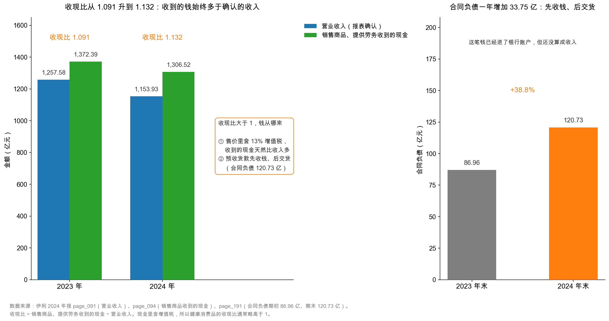

# 第 27 章：收入确认——什么时候才算卖出去

> 本章你将：
> - 用一箱牛奶从工厂到超市货架的五个瞬间，看懂"控制权转移"这条收入确认的唯一标准；
> - 弄明白为什么伊利确认了 1,153.93 亿元收入，却收到了 1,306.52 亿元现金，中间那 152.59 亿元是什么；
> - 学会算"收现比"（1.132），并用它给任何一家公司的收入"验真"；
> - 搞清楚 120.73 亿元合同负债是怎么先变成现金、再慢慢变成收入的；
> - 知道管理层在年报里怎么解释收入下滑 8.24%，哪句话能信、哪句话要打折扣。

---

## 27.1 五个瞬间：一箱牛奶什么时候算"卖出去"

上一章我们把 1,153.93 亿元当成一个既成事实，从头减到尾。这一章要停下来追问一句：**这盒牛奶，到底在哪一刻才算"卖出去"？**

听起来无聊，但这一步决定了 1,153.93 亿元里有多少是真的。跟着一箱常温酸奶走一遍，从呼和浩特的工厂到你手上，中间有五个瞬间：

**瞬间一：生产完成，进了成品仓库。** 牛奶还在伊利自己手里。这时候能不能确认收入？不能——货还在自己仓库，一分钱没收到，客户是谁都不知道。

**瞬间二：发给经销商，签了合同，货已经装车走了。** 货在高速公路上，钱还没到账。算卖了吗？**这就要看合同怎么写的。** 如果合同约定"送到经销商仓库才算交付"，那路上这批货仍然算伊利的存货（这叫"在途商品"）；如果约定"装车即视为交付"，那出厂那一刻风险就转移了。

**瞬间三：经销商签收，货进了他的仓库。** 从这一刻起，经销商能自己决定这箱奶卖给谁、卖多少钱、放在哪个货架。伊利不再控制它，也不再承担它卖不掉的风险（除非有退货条款）。**这就是"卖出去"的时刻。**

**瞬间四：经销商把货款打过来。** 钱到账了。但这和"卖出去"是两件事——可能三个月后才打款（赊销），也可能半年前就打了预付款（预收）。

**瞬间五：消费者在超市买走，喝掉了。** 这已经和伊利的收入无关——收入在瞬间三就确认完了。消费者买不买，影响的是经销商下一次的订单。

五个瞬间里最关键的是**瞬间三**，会计上叫**控制权转移**（transfer of control）。

生活里你其实很熟悉这个概念，只是没这么叫过。你在网上买一台电视：

- 下单付款，钱已经付了，但电视不是你的——商家还能取消订单；
- 发货出库，在快递车上，也不是你的——丢了是商家和快递公司的事；
- **快递送到你家门口、你签收，才是你的**——从这一刻起，你可以砸了它、送人、转卖，商家管不着。

"签收"就是控制权转移。收入就在这一刻确认，不在付款那一刻，也不在发货那一刻。

> 📌 **划重点：** 收入确认的唯一标准是**控制权转移**，不是"收到钱"，也不是"发出货"。判断标准是一句大白话：**从哪一刻起，这件东西的好坏、涨跌、能不能卖掉，都由买方自己承担了？** 那一刻就是收入确认点。

## 27.2 年报里那条会计政策，逐字读一遍

这条原则不是我们编的，它写在伊利年报的附注里。摊开 `page_140.md`，找到"34、收入"那一条：

> 本公司在履行了合同中的履约义务，即在客户取得相关商品或服务控制权时，按照分摊至该项履约义务的交易价格确认收入。
>
> 取得相关商品控制权，是指能够主导该商品的使用并从中获得几乎全部的经济利益。

再翻到 `page_141.md`，伊利把自己的具体做法写得更直白：

> 本公司的收入主要包括乳制品等商品的销售，采取经销与直营相结合的销售模式，**在按照合同约定方式交付商品后，即在客户取得相关商品控制权时确认收入**。本公司给予客户的信用期与行业惯例一致，**不存在重大融资成分**。

这句话里有三个信息，每一个都值得停一下：

**第一个信息："交付商品后"确认。** 伊利是"时点确认"，不是"时段确认"。盖一栋楼、做三年期软件服务，活儿一点点干，收入也按进度确认；卖牛奶不是——一箱奶交付就是交付，不存在"完成了 60%"。

**第二个信息："经销与直营相结合"。** 伊利大部分收入来自经销（2024 年经销 1,107.96 亿元，直营 33.25 亿元，附注七(61)）。经销商是独立的公司，伊利把货交给他们、他们签收，控制权就转移了。**这里埋着一个风险：如果伊利把货压给经销商，而经销商其实卖不动，收入照样确认了。** 这就是"压货"（channel stuffing），本章最后一节细讲。

**第三个信息："不存在重大融资成分"。** 如果客户能分三年付款，本质上伊利在"借钱给客户"，收入里就该拆出一块利息。伊利说信用期与行业惯例一致（通常几十天），不构成融资。**这句话反过来提醒你去看应收账款：** 2024 年应收账款 28.78 亿元，只占收入的 2.5%，周转 9 天左右——确实不像在放贷。

> 🔍 **翻到年报：** 打开 `page_140.md`，从"34、收入"这一条往下读三行，你会看到"履约义务""控制权""某一时段内履行"三个词。再翻 `page_141.md` 第一段，伊利列出了判断控制权转移的五个迹象：现时收款权利、法定所有权转移、实物转移、主要风险和报酬转移、客户已接受。**这五条不用背，但要知道它们存在**——将来你看到一家公司收入确认政策写得很含糊（比如只说"发货即确认"却不说客户何时签收），就知道该警惕了。

## 27.3 收入 1,153.93 亿，收现 1,306.52 亿：差在哪

现在做一件很具体的事：把利润表第一行和现金流量表第一行放在一起。

| 项目 | 2024 年 | 出处 |
|---|---|---|
| 营业收入（利润表确认） | **1,153.93 亿元** | `page_091.md` |
| 销售商品、提供劳务收到的现金 | **1,306.52 亿元** | `page_094.md` |
| 差额 | **152.59 亿元** | |

<!-- src: 伊利股份2024年报/page_091.md 伊利股份2024年报/page_094.md -->

一个是"我确认赚了多少"，一个是"我实际收到多少"。差了 152.59 亿元，收到的比确认的还多。

这不是矛盾，这是**增值税**。

伊利卖一箱奶，价签上写着 100 元，这 100 元里含着增值税。假设适用 13% 的税率，那么：

- 伊利真正"赚到"的（不含税收入）是 100 ÷ 1.13 = **88.50 元**；
- 代国家收的（销项税）是 100 - 88.50 = **11.50 元**。

利润表只记那 88.50 元，因为另外 11.50 元从来不是伊利的钱，它只是过一下手，要交给税务局。但现金流量表记的是**实际进账的 100 元**，因为银行账户里确实多了 100 元。

于是就有了这个关系：

$$\text{销售收现} \approx \text{营业收入} \times (1 + \text{增值税率})$$

代进去：1,153.93 $\times$ 1.13 = **1,303.94 亿元**。实际收现 1,306.52 亿元，比这个推算多 2.58 亿元。

<!-- src: 伊利股份2024年报/page_091.md 伊利股份2024年报/page_094.md -->

**这 2.58 亿元是"营运资本"的零头**：合同负债增加（预收先到账、货还没发）、应收账款减少（去年欠的钱今年收回），两个方向都该让收现变多，为什么只多 2.58 亿元？

因为预收的 120.73 亿元里含增值税。等发货确认收入时，不含税的部分转成营业收入，税额部分先挂成"待转销项税额"（2024 年末 **12.19 亿元**，在"其他流动负债"里，`page_195.md`），开票申报时才转成"应交税费"。**所以 120.73 亿元合同负债是含税的，不是全部都会变成收入。**

**这里必须说清楚一个限度：上面这套推算只是数量级，不是精确勾稽。** 伊利的收入里混着 13%、9%、6% 几种税率，还有免税的农产品，所以不能指望"乘 1.13"能分毫不差地对上。但方向是对的，量级是对的——**152.59 亿元的差额里，大约 150 亿元是增值税**（150.01 ÷ 152.59 = 98.3%）。

> ⚠️ **易踩坑：** 有人看到"收现 1,306.52 亿 > 收入 1,153.93 亿"，立刻下结论："伊利虚减了收入，藏了 152 亿利润！"
>
> 这是把增值税忘干净了。中国的增值税是价外税，利润表不含税、现金流量表含税，两者天生差一个税率。**消费品公司的收现比通常在 1.05 到 1.15 之间，这不是造假，这是常识。**
>
> 真正该警惕的是反过来的情况：**收现比长期明显低于 1**（比如 0.8），那说明确认的收入收不回来，要么是应收账款堆成山，要么是收入本身有问题。

## 27.4 收现比：一把给收入验真的尺子

把上面那个关系写成一个比率，就是这一章最该带走的工具：

$$\text{收现比} = \frac{\text{销售商品、提供劳务收到的现金}}{\text{营业收入}}$$

伊利 2024 年：1,306.52 ÷ 1,153.93 = **1.132**。
伊利 2023 年：1,372.39 ÷ 1,257.58 = **1.091**。

<!-- src: 伊利股份2024年报/page_094.md 伊利股份2024年报/page_095.md -->

两年都大于 1，而且 2024 年比 2023 年**又高了 0.041**。

这个"又高了"值得琢磨。收现比上升，意味着"每确认 1 元收入，收回来的现金更多了"。在收入下降 8.24% 的年份，收现比反而上升，说明**伊利在收紧钱袋子**——货照发，但钱收得更急了。

看这张图的左半边。蓝色是利润表确认的收入，绿色是实际收到的现金。**两年都是绿柱子比蓝柱子高**，这就是收现比大于 1 的直观样子。2024 年两根柱子都比 2023 年矮（收入降了），但绿色的"高出部分"比例更大——1.132 对 1.091。

图的右半边是合同负债：86.96 亿元 → 120.73 亿元，一年增加 33.75 亿元，增幅 38.8%。这根橙色的柱子里装的是"已经收钱、但还没交货"的订单。

把两件事连起来，逻辑就通了：2024 年收现比从 1.091 升到 1.132，一部分原因是**预收的钱变多了**——经销商年底提前打款，钱进了账户，货要等 2025 年初才发，所以这 33.75 亿元大部分还挂在合同负债上，没变成 2024 年的收入。

年报自己也是这么说的。`page_019.md` 解释经营现金流为何增长 18.86% 时写道：

> 经营活动产生的现金流量净额变动原因说明，主要因 2025 年春节备货，预收经销商货款增加使得本期经营活动现金流量净额增加所致。

这句话含金量很高。它等于管理层亲口承认：**2024 年现金流好看，有一部分是"把明年的钱提前收到了今年"**。这不是坏事（说明渠道愿意打款、产品有需求），但它提醒你：**这笔钱明年不会再来一次**。2025 年春节一过，合同负债会吐出去变成收入，现金流就不会有今年这么漂亮。

> 💡 **你可能会问：收现比到底多少算好？**
>
> 没有统一标准，得看生意模式：
>
> | 生意类型 | 典型收现比 | 原因 |
> |---|---|---|
> | 白酒、调味品（先款后货） | 1.1 ~ 1.2 | 经销商先打款，还含增值税 |
> | 乳制品、饮料（先款后货为主） | 1.05 ~ 1.15 | 同上，但账期稍松 |
> | 家电、汽车零部件（有账期） | 0.85 ~ 1.0 | 大客户压账期 |
> | 工程、建筑（垫资） | 0.6 ~ 0.9 | 干完活才结算 |
>
> 所以正确的用法不是"看绝对数"，而是**跟自己比、跟同行比**：伊利 1.132 在乳业里是健康的；如果某一年掉到 0.95，那才需要翻附注找原因。

## 27.5 合同负债 120.73 亿：先收钱，后交货

合同负债这个科目，第 22 章已经讲过一遍。这里换个角度，把它放进"收入确认"的链条里再看一次。

一笔预收款的生命周期是这样的：

| 步骤 | 动作 | 会计上怎么记（假设 100 万元含 13% 增值税） |
|---|---|---|
| 1 | 经销商打款 100 万元 | 银行存款 +100 万；合同负债 +100 万（含税，全额挂账） |
| 2 | 伊利发货，经销商签收 | 合同负债 -100 万；营业收入 +88.5 万（不含税）；应交税费 +11.5 万 |
| 3 | 若已确认收入但尚未开票 | 应交税费转成"待转销项税额"11.5 万，挂到其他流动负债，等开票再转回 |

**注意第 2 步：收入是在"发货签收"那一刻增加的，不是在"收到钱"那一刻。** 这就是权责发生制（第 9 章）在这个科目上的具体表现。

所以合同负债的本质是：**一笔已经到账、但还不能算成收入的钱。** 它在资产负债表上是负债（伊利欠经销商一批货），在利润表上是"还没发生"，在现金流量表上却已经算进了"销售商品收到的现金"。

这也解释了为什么合同负债的变化，是判断收入质量的一个好指标：

- **合同负债增加**：渠道愿意提前打款，需求旺，下一期收入有保障（但也可能是压货）；
- **合同负债减少**：上一期的预收转成了收入，或者渠道不愿意打款了；
- **合同负债突然大幅增加，同时收入在下滑**：这是最值得警惕的组合——可能是公司在给经销商压货，用预收款撑现金流。

伊利 2024 年是第一种情况：合同负债 +38.8%，收入 -8.24%。表面上"一增一减"很矛盾，但年报给了合理解释（2025 年春节备货）。判断这个解释真假，有一个简单的交叉验证：**看 2025 年一季度的收入有没有相应增长。** 如果合同负债大增、下一个季度收入却没跟上，那这笔预收就是"硬塞"的。

（本书只覆盖 2024 年报，2025 年一季报的数据请你自己去查——这是把教程用起来的第一步。）

## 27.6 管理层怎么解释 -8.24%

收入下滑 8.24%，是伊利 2024 年最显眼的一个数字。年报里关于它的解释，散在三个地方，一层比一层细。

**第一层：一句话结论（`page_018.md`）。**

> 营业收入变动原因说明：主要是本期产品销量减少、销售价格下降所致。

翻译成人话：**卖得少了，也卖得便宜了。**

**第二层：行业背景（`page_010.md`）。**

> 短期内，乳品消费规模较上年同期有所缩减，乳品市场处于阶段性的供给过剩。国内原料奶供应量增长超过需求量增长，导致供需不平衡，带动乳品零售价格下行。

关键在"行业"两个字：不是伊利一家卖不动，是需求在缩、供给在过剩、价格在跌。**行业性下滑和公司性下滑性质完全不同**——前者会随供需再平衡修复，后者往往是竞争力出了问题。

**第三层：分品类的量价拆解（`page_019.md`）。** 这是年报里最有信息量、也最少人读的一段：

| 品类 | 2024 年收入 | 同比 | 销量影响 | 结构影响 | 价格影响 |
|---|---|---|---|---|---|
| 液体乳 | 750.03 亿元 | **-12.32%** | -60.46 亿元 | -9.70 亿元 | **-35.21 亿元** |
| 奶粉及奶制品 | 296.75 亿元 | **+7.53%** | +22.58 亿元 | +7.34 亿元 | -9.15 亿元 |
| 冷饮产品 | 87.21 亿元 | -18.41% | -19.52 亿元 | -3.18 亿元 | +3.03 亿元 |

<!-- src: 伊利股份2024年报/page_019.md -->

这张表值得逐行读。

**液体乳**是伊利半壁江山（750.03 亿元，占主营业务收入 65.7%），掉了 105.37 亿元：销量少收 60.46 亿元（约 57%）、结构变化少收 9.70 亿元（约 9%）、**价格降了少收 35.21 亿元（约 33%）**。

价格占了三分之一，这是"价格战"的直接证据——但注意，是**行业性的价格下行**（原奶过剩带动零售价跌），不是伊利单方面降价抢份额。

**奶粉及奶制品**是唯一增长的品类，+7.53%，而且增长几乎全来自**销量**（+22.58 亿元），价格还是拖累（-9.15 亿元）。这一块的毛利率是 41.02%，比液体乳的 30.98% 高 10 个百分点——**高毛利品类在长大，低毛利品类在缩水**。这个结构变化，正是下一章"毛利率为什么逆势上升"的一半答案。

**冷饮**掉了 18.41%，量价都在跌，是三个品类里最弱的。

> 📌 **划重点：** 读收入下滑，要拆成三层：**行业在不在缩（看 MD&A 行业段）→ 公司份额有没有丢（看分品类增速 vs 行业）→ 到底是量的问题还是价的问题（看量价拆解表）。** 三层都读完，你才有资格说"这家公司不行了"或者"这只是周期"。
>
> 伊利 2024 年的答案是：行业在缩（第一层成立）、液体乳丢量也丢价（第二层部分成立）、但奶粉在逆势增长（第三层给了缓冲）。**一句话：不是全面溃败，是结构在换挡。**

## 27.7 三个收入陷阱：压货、提前确认、退货

收入是利润表的第一行，也是造假者最爱动手的一行。因为收入一动，后面所有数字都跟着动，而且收入的造假最"省事"——签个假合同就行。

不需要成为审计师，你只要记住三种最常见的套路，以及它们在报表上留下的痕迹。

**陷阱一：压货（channel stuffing）。**

做法：年底把货硬塞给经销商，经销商签收了，收入就确认了。货其实堆在经销商的仓库里，来年再慢慢卖，或者干脆退回来。

痕迹：
- 收入增长，但**销售收现没跟上**（收现比下降）；
- **应收账款**或**应收票据**大幅增加；
- 下一季度收入突然失速；
- **合同负债**异常下降（如果原来是预收模式）。

伊利 2024 年这四条一条都不符合：收现比升到 1.132，应收账款从 30.85 亿元降到 28.78 亿元，合同负债大增。**从报表痕迹看，没有压货的迹象。**

**陷阱二：提前确认。**

做法：货还没交付、客户还没签收，就先把收入记上；或者把"试用""寄售"的货当成已销售。

痕迹：
- 收入增速远高于同行，但**存货周转率同时下降**（货其实还在自己或客户仓库）；
- 应收账款周转天数快速拉长；
- 季度收入分布异常（比如第四季度突然占全年 40%）。

**陷阱三：退货与返利不预估。**

做法：给经销商承诺"卖不掉可以退"，但在确认收入时不预估退货率，把全部货款都记成收入。

痕迹：
- 附注里"预计退货负债"很小甚至为零，但行业普遍有退货；
- 销售费用里的"促销费""返利"金额巨大且波动剧烈；
- 收入增长与退货率变化方向矛盾。

伊利在会计政策里对这类事项有交代（收入按"分摊至履约义务的交易价格"确认，可变对价按最可能发生金额估计）。**有交代就可以被检验，没交代才可怕。**

> ⚠️ **易踩坑：** 把"收入增长"直接等同于"生意变好"。收入可以靠压货、靠并购、靠降价换来，这三种增长的质量完全不同。判断质量的三把尺子：**收现比（钱收回来了吗）、毛利率（降价换来的增长会压毛利）、应收账款周转天数（赊账换来的增长会拉长天数）。** 三个指标一起看，增长是真是假基本藏不住。

## ✍️ 想一想

> 建议先自己写两句话，再翻答案。想不清楚的地方，就是该回头重读的地方。

### 问 1：为什么收到的钱比确认的收入多

伊利 2024 年营业收入 1,153.93 亿元，销售商品收到的现金 1,306.52 亿元，多出 152.59 亿元。请回答：（1）这 152.59 亿元主要由什么构成？大概多少？（2）如果一家公司的收现比只有 0.75，你会怎么判断？（3）收现比能不能大于 1.5？什么情况下会出现？

**解题思路：** 第一问的关键是想起"增值税是价外税"——利润表不含税、现金流含税。第二问反过来想：收现比小于 1，说明确认的收入没收回现金，钱去哪了？第三问是个边界测试，逼你想清楚"收现比"这个比率的分子分母各自包含什么。

**参考答案：**

（1）主要是**增值税**。伊利销售商品收到的现金是含税金额，而利润表确认的营业收入是不含税金额。按 13% 的税率粗算：

$$1{,}153.93 \times 13\% = 150.01 \text{ 亿元}$$

150.01 亿元占 152.59 亿元的 **98.3%**。剩下约 2.58 亿元是营运资本的零头（预收增加、应收减少等），量级很小——因为预收款里的增值税还没确认，挂在"待转销项税额"12.19 亿元里。

（2）收现比 0.75 意味着：每确认 1 元收入，只收回 0.75 元现金。差额去哪了？无非三个方向：

| 可能原因 | 该去哪里验证 |
|---|---|
| 应收账款大幅增加（赊销） | 资产负债表应收账款、周转天数 |
| 应收票据增加（收了票据没收到钱） | 应收票据科目 |
| 收入本身有问题（虚构） | 收现比连续多年低于 0.8，且应收、存货同步异常 |

健康公司的收现比偶尔低于 1 是正常的（比如大客户账期临时拉长），但**连续三年低于 0.9**，就必须当成红旗处理。

（3）**能，但不正常。** 收现比大于 1.5 通常出现在三种情况：

- **预收模式极强**：比如高端白酒在春节前集中打款，合同负债暴增，当年收现远超收入；
- **有大量非商品销售的现金流入混进来**：注意这个科目的全名是"销售商品、**提供劳务**收到的现金"，如果公司有代收代付、代建、贸易代理业务，现金会虚高；
- **在回收以前年度的欠款**：应收账款大幅下降，一次性收回旧账。

判断方法：看合同负债和应收账款的变动方向。如果收现比高是因为合同负债大增，那是好事（预收）；如果是因为应收账款一次性收回，那是"补以前的洞"，不可持续。

**易错点：** ① 第（1）问答"因为伊利卖得好，多收了钱"——把会计口径差异当成了经营优势；② 用"营业收入 $\times$ 1.13"算出 1,303.94 亿元后，发现和 1,306.52 亿元差 2.58 亿元，就认为"数据有问题"——税率是混合的（13%、9%、6%），本来就不会分毫不差；③ 第（3）问答"不可能大于 1.5，超过就是造假"，太绝对。

### 问 2：合同负债增加 38.8%，是好事还是坏事

伊利 2024 年合同负债从 86.96 亿元增加到 120.73 亿元，增幅 38.8%，而同期营业收入下降 8.24%。请回答：（1）合同负债增加，对现金流和利润分别有什么影响？（2）"收入下降、合同负债大增"这个组合，可能是好事也可能是坏事，怎么区分？（3）如果 2025 年一季度伊利收入没有增长，你会怎么调整判断？

**解题思路：** 第一问要分清"现金流"和"利润"两条线——预收款进的是现金，不是利润。第二问问的是"动机"：渠道主动打款是好事，公司硬压是坏事，区别在于"下一期能不能消化"。第三问是给自己留一个验证机制。

**参考答案：**

（1）**对现金流：正面，且是当期的。** 经销商打款，银行存款增加，直接计入"销售商品、提供劳务收到的现金"。2024 年伊利经营现金流 217.40 亿元，同比 +18.86%，年报明确说其中有"预收经销商货款增加"的贡献。

**对利润：当期没有影响，未来才有。** 收到钱时记的是合同负债（负债），不是收入。要等发货、经销商签收，才转成营业收入。所以这 33.75 亿元对 2024 年的利润表**一分钱贡献都没有**，它会在 2025 年陆续变成收入。

（2）区分好坏，看三件事：

| 判断维度 | 好事的特征 | 坏事的特征 |
|---|---|---|
| 打款动机 | 经销商预判需求旺，主动提前打款备货 | 公司给了高额返利、账期优惠，硬压 |
| 价格与毛利 | 毛利率稳定或上升 | 毛利率下降（靠让利换打款） |
| 下一期消化 | 下一季度收入随之增长 | 下一季度收入不增，合同负债又吐回去 |

伊利 2024 年的情况：毛利率从 32.58% 升到 33.88%（没有让利），合同负债增加有明确的季节性理由（2025 年春节备货）。**从已有证据看，偏向前一种。**

（3）如果 2025 年一季度收入没有相应增长，那就说明这 33.75 亿元预收**没有转化成真实的销售**，只是"钱在账上转了一圈"。这时候要做的三件事：

- 看 2025 年一季报的合同负债有没有掉回去（如果掉回去了，说明货没发出去，钱退了）；
- 看存货有没有同步增加（货压在仓库里）；
- 看销售费用里的促销费有没有异常上升（靠促销才把货推出去）。

三个都中，就把"预收大增"从"需求旺"改判为"渠道压货"。

**易错点：** ① 把合同负债增加当成"已经赚到的利润"，其实它连收入都还不是；② 只看增幅 38.8% 就说"需求爆发"，不看基数（86.96 亿元的基数上增加 33.75 亿元，相当于一个多月的销售收入）；③ 忘了季节性——乳业的春节备货每年都有，要跟 2023 年同期比，而不是跟"没有春节"的季度比。

### 问 3：收入下滑 8.24%，是行业问题还是公司问题

伊利的收入掉了 8.24%。管理层在年报里给的解释是"行业需求缩减、原奶供给过剩、价格下行"，同时"产品销量减少、销售价格下降"。有人说这是"甩锅给行业"。请用本章学到的量价拆解，给出你自己的判断：这 8.24% 里，有多少是行业性的，有多少是公司性的？

**解题思路：** 先别站队，先找证据。三个证据源：行业整体增速（能不能找到同业数据）、公司分品类增速（哪些在涨、哪些在跌）、量价拆分（是卖得少还是卖得便宜）。然后做一个关键判断：**如果全行业都在跌同样的幅度，那就是行业问题；如果只有它跌，那就是公司问题。**

**参考答案：**

先看分品类（`page_019.md`）：

| 品类 | 同比 | 主要拖累 |
|---|---|---|
| 液体乳 | -12.32% | 销量 -60.46 亿元、价格 -35.21 亿元 |
| 奶粉及奶制品 | **+7.53%** | 全靠销量 +22.58 亿元 |
| 冷饮 | -18.41% | 销量 -19.52 亿元 |

**三个品类，两个跌一个涨，而且跌的幅度差很多**（液体乳 -12.32%，冷饮 -18.41%）。如果纯粹是行业需求问题，三个品类应该同步下跌；现在奶粉逆势 +7.53%，说明**伊利在奶粉这个细分市场里是抢到了份额的**。

再看量价：

- 液体乳的 105.37 亿元收入损失里，销量贡献 60.46 亿元（57%），价格贡献 35.21 亿元（33%），结构贡献 9.70 亿元（9%）；
- **量和价都在跌，但量跌得更多。**

我的判断是：**这 8.24% 里，行业性因素占大头，公司性因素占小头，但不能说完全没有公司性因素。**

理由：

1. **行业性证据充分**：年报行业段明确写"乳品消费规模较上年同期有所缩减""原料奶供应量增长超过需求量增长，导致供需不平衡，带动乳品零售价格下行"。原奶过剩是全行业的事，不是伊利一家能造成的。
2. **公司性证据也存在**：液体乳是伊利份额最高的品类（市占率行业第一），**份额最高的品类跌得最狠（-12.32%），这本身就是一个信号**——要么是这个品类整体在萎缩（常温奶被鲜奶、酸奶、植物奶分流），要么是伊利在这个品类上守份额守得辛苦。
3. **奶粉的增长是主动调整的结果**：奶粉毛利率 41.02%，比液体乳高 10 个百分点，伊利把资源往这里倾斜，是理性的结构选择，不是"碰巧"。

所以更准确的说法是：**伊利正在经历一次"品类换挡"——低毛利的液体乳在缩，高毛利的奶粉在长。** 收入总额因此下降 8.24%，但毛利率反而上升 1.30 个百分点。**收入下降不等于生意变差，要看你下降的是哪一块。**

**易错点：** ① 只看总收入 -8.24% 就下结论"伊利不行了"，不看分品类；② 反过来，看到奶粉 +7.53% 就说"结构优化成功"，不看到液体乳 750 亿元的基本盘还在缩；③ 把"行业性"当成免责金牌——**行业性下滑也会持续好几年，行业问题一样能杀死一家公司**，只是它不该被记在管理层的能力账上。

## 📎 数据出处

- 伊利股份 2024 年报 `page_091.md`：营业收入 1,153.93 亿元
- `page_094.md`：合并现金流量表——销售商品、提供劳务收到的现金 1,306.52 亿元（2023 年 1,372.39 亿元）、经营活动现金流量净额 217.40 亿元
- `page_095.md`：2023 年销售收现 1,372.39 亿元（用于计算 2023 年收现比）
- `page_140.md` / `page_141.md`：附注"34、收入"——控制权转移、时点确认、经销与直营、不存在重大融资成分
- `page_191.md`：附注七(38) 合同负债——期末 120.73 亿元、期初 86.96 亿元
- `page_195.md`：附注七(42) 其他流动负债——待转销项税额 12.19 亿元
- `page_018.md`：营业收入 -8.24% 的原因说明
- `page_019.md`：分品类量价拆解（液体乳、奶粉、冷饮）、2025 年春节备货导致预收增加
- `page_010.md`：行业供需与原料奶价格背景
- `page_206.md`：附注七(61) 营业收入分解——经销 1,107.96 亿元、直营 33.25 亿元
- 数据汇总：`data/yili2024.json` 的 `income`、`cashflow`、`balance`、`compare_2023`、`notes` 段

<!-- src: 伊利股份2024年报/page_091.md 伊利股份2024年报/page_094.md 伊利股份2024年报/page_095.md 伊利股份2024年报/page_140.md 伊利股份2024年报/page_141.md 伊利股份2024年报/page_191.md 伊利股份2024年报/page_195.md 伊利股份2024年报/page_018.md 伊利股份2024年报/page_019.md 伊利股份2024年报/page_010.md 伊利股份2024年报/page_206.md -->

下一章：[第 28 章：毛利率——生意的底色](28-毛利率-生意的底色.md)。这一章我们看到收入掉了 8.24%，也看到高毛利的奶粉在长大。下一章要把这两件事合起来算一笔账：**为什么收入在跌，毛利率反而升了 1.30 个百分点？** 以及，毛利率高就一定好吗——蒙牛会用 39.57% 的毛利率告诉你"不一定"。
