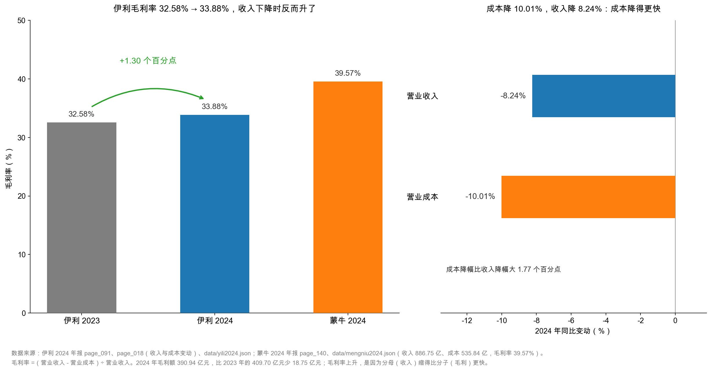
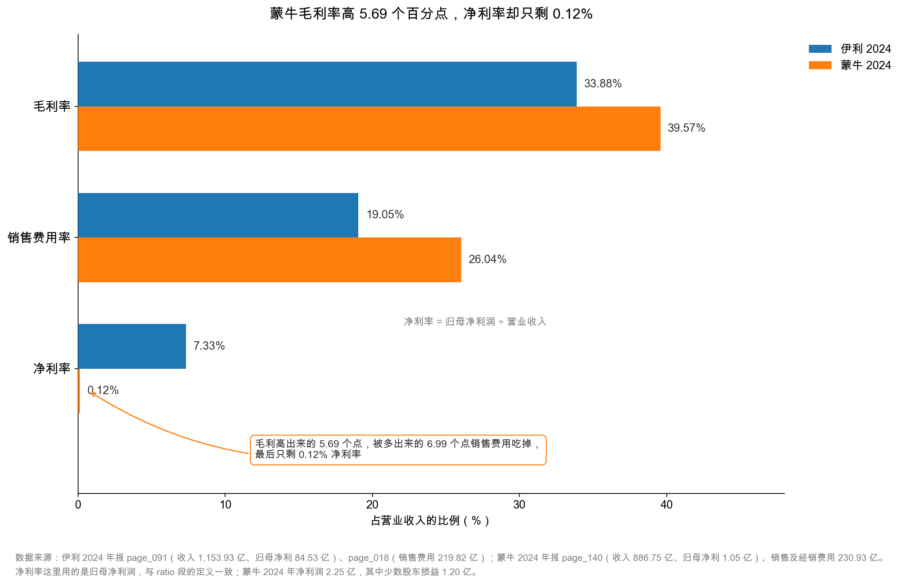

# 第 28 章：毛利率——生意的底色

> 本章你将：
> - 用一个煎饼摊算清毛利率，并明白它衡量的是"这门生意天生能留下多少"；
> - 亲手算出伊利 2024 年毛利 390.94 亿元、毛利率 33.88%，并发现一个矛盾：**毛利率升了，毛利额却降了**；
> - 拆开毛利率上升的 1.30 个百分点，看清其中约 1.1 个点来自成本下降、约 0.2 个点来自产品结构；
> - 用蒙牛 39.57% 的毛利率和 0.12% 的净利率，理解为什么"毛利率高不等于好生意"；
> - 记住毛利率最容易骗人的三个地方：口径、结构、会计政策。

---

## 28.1 一个煎饼摊的毛利率

上一章我们把收入拆到了品类和量价。这一章要问一个更狠的问题：**这门生意，天生能留下多少？**

先看一个煎饼摊。

一套煎饼卖 **8 元**。面糊、鸡蛋、薄脆、酱料、煤气，合计 **3 元**。那么：

- 毛利润 = 8 - 3 = **5 元**；
- 毛利率 = 5 ÷ 8 = **62.5%**。

这 5 元要拿去付摊位费、水电、自己的工钱，最后剩下的才是利润。但请注意：**62.5% 这个数字，在卖第一套煎饼之前就已经定了。** 它由两件事决定——你能卖多少钱（价格），和你花多少钱做出来（成本）。摊位费涨了、人工涨了，毛利率一点不变；只有"煎饼降价"或"鸡蛋涨价"，毛利率才动。

这就是毛利率和费用率最根本的区别：

| 比率 | 由谁决定 | 变了说明什么 |
|---|---|---|
| 毛利率 | 产品价格、原材料成本、产品结构 | 生意的**体质**变了 |
| 费用率 | 公司的经营效率、投放策略 | 公司的**管理**变了 |

所以本章的标题叫"生意的底色"。**毛利率告诉你这是一门什么生意，费用率才告诉你这门生意经营得好不好。** 顺序不能反。

伊利 2024 年的毛利率是 33.88%。翻译成煎饼摊的语言：**每收 100 元，先扣掉 66.12 元的原料、包材、人工、折旧、运费，剩下 33.88 元，用来付广告费、管理人员工资、研发、利息和税。**

33.88% 在 A 股是什么水平？比家电（常常 25% 上下）高，比白酒（常常 70% 以上）低得多，比同为乳业的蒙牛（39.57%）低。它不高不低，正好是一门"必须自己有牧场、有工厂、有冷链、还要天天打广告"的生意的样子。

> 📌 **划重点：** 毛利率 =（营业收入 - 营业成本）÷ 营业收入。它的分子分母**都只跟"做出来"有关**，跟"卖出去"和"管起来"无关。所以毛利率是三家比率里最"纯"的一个——它几乎不受管理层当期决策的影响（除非管理层改了采购策略或产品结构），最能反映生意的本来面目。

## 28.2 算一遍：390.94 亿元毛利，33.88% 毛利率

伊利的利润表上**没有"毛利"这一行**。这和中国会计准则的列报格式有关：营业总收入下面直接就是营业总成本，中间不插入毛利。

所以毛利要自己算：

$$\text{毛利} = \text{营业收入} - \text{营业成本}$$

2024 年：1,153.93 - 762.99 = **390.94 亿元**；
2023 年：1,257.58 - 847.89 = **409.70 亿元**。

$$\text{毛利率} = \frac{390.94}{1{,}153.93} = 33.88\%$$

2023 年是 409.70 ÷ 1,257.58 = **32.58%**。

<!-- src: 伊利股份2024年报/page_091.md -->

两年一比，得到这一章最重要的一个数字：

$$\text{毛利率变动} = 33.88\% - 32.58\% = +1.30 \text{ 个百分点}$$

**收入下降 8.24%，毛利率却上升 1.30 个百分点。** 这就是本书那条核心洞见的第一块拼图。

但先别急着高兴。把毛利额也放在一起看，你会发现一个刺眼的矛盾：

| 指标 | 2024 年 | 2023 年 | 变化 |
|---|---|---|---|
| 营业收入 | 1,153.93 亿元 | 1,257.58 亿元 | **-8.24%** |
| 营业成本 | 762.99 亿元 | 847.89 亿元 | -10.01% |
| **毛利额** | **390.94 亿元** | **409.70 亿元** | **-4.58%** |
| **毛利率** | **33.88%** | **32.58%** | **+1.30 个百分点** |

<!-- src: 伊利股份2024年报/page_091.md 伊利股份2024年报/page_018.md -->

**毛利率升了，毛利额降了 18.75 亿元。**

这不是矛盾，这是除法的一个基本性质：**比率上升，只说明"分子缩得比分母慢"，不说明分子变大了。**

用一个更小的例子看清楚。一家店去年卖 100 元、成本 70 元，毛利 30 元，毛利率 30%。今年卖 80 元、成本 54 元，毛利 26 元，毛利率 32.5%。**毛利率从 30% 升到 32.5%，但老板口袋里的毛利从 30 元变成了 26 元——他赚得更少了。**

伊利 2024 年就是这个状态。它"更会赚钱"了（每一元收入留下的毛利更多），但它"赚得更少"了（总毛利额下降）。两句话都对，说的是两件事。

> ⚠️ **易踩坑：** 看到"毛利率提升"就写"盈利能力增强"。**毛利率是效率指标，毛利额才是规模指标。** 一家公司在收缩期最容易出现"毛利率上升、毛利额下降"——砍掉低毛利业务、降价保份额、原材料降价，都会造成这个组合。
>
> 正确的问法是：**毛利率上升，是因为"同样的东西卖得更贵了"（好事），还是因为"不赚钱的东西不卖了"（中性），还是因为"原材料便宜了"（外生的，会用完）？** 这三种原因，可持续性完全不同。

## 28.3 为什么逆势上升：拆开那 1.30 个百分点

现在做本章的核心工作：把这 1.30 个百分点拆开。

毛利率的变化只有三个来源，没有第四个：

$$\text{毛利率变动} = \text{价格效应} + \text{成本效应} + \text{结构效应}$$

- **价格效应**：卖得更贵还是更便宜；
- **成本效应**：原材料、人工、制造费用涨了还是跌了；
- **结构效应**：高毛利产品的占比升了还是降了。

先看最粗的一层证据——**收入降 8.24%，成本降 10.01%，成本降得更快 1.77 个百分点**。这一条几乎就解释了一切：分母（收入）缩了 8.24%，分子里减掉的那块（成本）缩了 10.01%，减得更多，剩下的比例自然更大。

再看成本为什么降得这么快。翻到 `page_021.md` 的成本分析表：

| 成本构成 | 2024 年 | 占主营业务成本 | 同比 |
|---|---|---|---|
| 直接材料 | 580.18 亿元 | **77.63%** | **-11.42%** |
| 直接人工 | 24.87 亿元 | 3.33% | -6.75% |
| 制造费用 | 87.64 亿元 | 11.73% | -6.19% |
| 装卸运输费 | 54.63 亿元 | 7.31% | -4.36% |

<!-- src: 伊利股份2024年报/page_021.md -->

**直接材料跌了 11.42%，是四类成本里跌得最狠的**，而它占了成本的 77.63%。原材料一降价，整张成本表就跟着往下走。

原材料为什么降？年报在行业段给了答案（`page_010.md`）：

> 国内原料奶供应量增长超过需求量增长，导致供需不平衡，带动乳品零售价格下行。……原料奶价格先降后稳，其它主要原辅材料价格较上年同期总体下行。

**原奶过剩 → 原奶降价 → 伊利成本下降。** 这是一条外生的、行业性的因果链，跟伊利自己努力不努力关系不大。

现在看结构效应。三个品类的毛利率和增速是这样的：

| 品类 | 2024 年收入 | 收入同比 | 毛利率 | 毛利率变动 |
|---|---|---|---|---|
| 液体乳 | 750.03 亿元 | -12.32% | 30.98% | +0.62 个百分点 |
| 奶粉及奶制品 | 296.75 亿元 | **+7.53%** | **41.02%** | **+2.88 个百分点** |
| 冷饮产品 | 87.21 亿元 | -18.41% | 37.42% | -1.03 个百分点 |

<!-- src: 伊利股份2024年报/page_019.md 伊利股份2024年报/page_020.md -->

高毛利的奶粉在长（+7.53%，毛利率 41.02%），低毛利的液体乳在缩（-12.32%，毛利率 30.98%）。奶粉占主营业务收入的比重，从 2023 年的 22.2% 升到 2024 年的 **26.0%**。这个"贵的占比变大"的过程，就是结构效应。

那结构效应到底贡献了多少？做一个粗算（以下是**估算，不是年报披露数字**）：

**第一步**，算出 2023 年各品类的毛利率：液体乳 30.98 - 0.62 = 30.36%，奶粉 41.02 - 2.88 = 38.14%，冷饮 37.42 + 1.03 = 38.45%。

**第二步**，假设 2024 年**各品类毛利率都没变**，只让收入结构变成 2024 年的样子，算一个"纯结构"毛利率：

$$\frac{750.03 \times 30.36\% + 296.75 \times 38.14\% + 87.21 \times 38.45\% + 7.22 \times 18.30\%}{1{,}141.21} = 32.92\%$$

**第三步**，和 2023 年的主营业务毛利率 32.72% 比：32.92 - 32.72 = **+0.20 个百分点**，这是结构效应。

**第四步**，2024 年实际主营业务毛利率是 34.03%，减去"纯结构"的 32.92%：34.03 - 32.92 = **+1.11 个百分点**，这是各品类自身毛利率提升的效果（也就是成本效应）。

| 效应 | 贡献 | 说明 |
|---|---|---|
| 结构效应 | 约 +0.20 个百分点 | 高毛利奶粉占比从 22.2% 升到 26.0% |
| 成本效应 | 约 +1.11 个百分点 | 原奶等直接材料降价，各品类毛利率普遍抬升 |
| **合计** | **约 +1.31 个百分点** | 与年报披露的 +1.30 基本吻合 |

**这个结果和很多人的直觉相反。** 大家喜欢讲"产品结构优化带来毛利率提升"——听起来是管理层的功劳，很体面。但算下来，**结构只贡献了 0.2 个点，真正的主力是成本下降，贡献了 1.1 个点。**

而成本下降是原奶周期给的，不是伊利挣来的。

这个区别非常重要，因为它决定了这 1.30 个百分点能不能持续：**原奶价格不会一直跌。** 等供需再平衡、奶价回升，成本效应会反转，毛利率大概率要回落。而结构效应（奶粉占比提升）是可以持续的，只是它一年只贡献 0.2 个点，撑不起大局。

> 🔍 **翻到年报：** 打开 `page_021.md`，找到"成本分析表"里"分产品情况"那一段。液体乳的直接材料是 406.78 亿元，比上年 477.17 亿元降了 14.75%；奶粉的直接材料是 137.64 亿元，反而增了 4.15%（因为销量涨了）。**同一个"直接材料"科目，两个品类一降一升，这就是"量"和"价"在打架。** 读成本表一定要分品类看，只看合计数会把两件相反的事平均掉。

左边这张图是本章的主数字：三根柱子，伊利 2023（32.58%）、伊利 2024（33.88%）、蒙牛 2024（39.57%）。绿色箭头标出那 +1.30 个百分点。

右边这张图是"为什么"：收入 -8.24%，成本 -10.01%，两根横条都朝左（都是下降），但成本那根更长。**在毛利率这个除法里，分母缩 8.24%、分子里的减项缩 10.01%，结果一定是升。** 这不是巧合，是算术。

## 28.4 毛利率高就一定好吗：蒙牛的 39.57% 与 0.12%

现在把蒙牛拉进来。

蒙牛 2024 年：营业收入 886.75 亿元，营业成本 535.84 亿元，毛利 350.90 亿元，**毛利率 39.57%**。

比伊利高 **5.69 个百分点**。

如果毛利率是唯一的尺子，结论很清楚：蒙牛的生意比伊利好。但把利润表往下读三行，你会看到完全不同的画面：

| 指标 | 伊利 2024 | 蒙牛 2024 | 差额 |
|---|---|---|---|
| 毛利率 | 33.88% | **39.57%** | 蒙牛高 5.69 个点 |
| 销售费用率 | 19.05% | **26.04%** | 蒙牛高 6.99 个点 |
| 净利率 | **7.33%** | 0.12% | 伊利高 7.21 个点 |
| 归母净利润 | 84.53 亿元 | 1.05 亿元 | — |

<!-- src: 伊利股份2024年报/page_091.md 伊利股份2024年报/page_018.md 蒙牛乳业2024年报/page_140.md -->

看懂这张表，你就懂了毛利率的全部局限。

**蒙牛每卖 100 元，能留下 39.57 元的毛利——比伊利多 5.69 元。但它转手就要花 26.04 元在销售上，比伊利多花 6.99 元。** 多留下的 5.69 元，还不够多花出去的 6.99 元，净亏 1.30 元。再扣掉管理费用、财务费用、减值，最后只剩 0.12 元的净利率。

这张图上，橙色（蒙牛）在"毛利率"这一组明显更长，在"销售费用率"这一组也更长，到"净利率"这一组几乎缩成一条线。**三组柱子连起来看，就是一个"高毛利被高费用吃掉"的完整故事。**

那为什么蒙牛的销售费用率这么高？这已经超出本章范围（第 29 章会讲费用率），但可以先给一个方向性的解释：**毛利率高，往往意味着产品定位更高端、需要更多的品牌投入去支撑那个价格。** 高价不是白来的，它要用广告费、渠道费、终端促销费去维持。**毛利率和销售费用率，常常是一对"连体婴"。**

所以正确的说法不是"毛利率越高越好"，而是：

> **毛利率高，说明这门生意有定价权；但定价权能不能变成利润，要看它花多少钱去维持这个定价权。**

伊利 33.88% 的毛利率配上 19.05% 的销售费用率，剩下 14.83 个点；蒙牛 39.57% 配 26.04%，剩下 13.53 个点。**两条路走到同一个地方，伊利的路更省力一点。**

> 💡 **你可能会问：那到底该看毛利率还是净利率？**
>
> 两个都要看，但用途不同：
>
> - **毛利率**用来判断"这门生意值不值得做"——它是天花板。毛利率 10% 的生意，再怎么省费用也做不出高利润；
> - **净利率**用来判断"这家公司做得怎么样"——它是落地值。
> - **两个之间的差额（毛利率 - 净利率）**，告诉你"为了把东西卖出去、把公司管起来，花掉了多少"。差额越小，效率越高。
>
> 伊利的差额是 33.88 - 7.33 = 26.55 个点，蒙牛是 39.57 - 0.12 = 39.45 个点。**同样是卖牛奶，蒙牛把 39 个点花在了中间环节，伊利只花了 26 个点。** 这个差额，才是两家公司真正的差距所在。

## 28.5 毛利率最容易骗人的三个地方

毛利率是个好指标，但它有三个"滤镜"，每一个都能让数字变形。

**滤镜一：口径——运费放哪里。**

2020 年新收入准则实施后，"销售商品发生的运输费"从"销售费用"挪到了"营业成本"。这一挪，毛利率会**下降**（成本变大），销售费用率也会下降。所以：

- 拿 2019 年和 2020 年的毛利率直接比，会得出"毛利率大幅下滑"的错误结论；
- 拿不同准则下的两家公司比毛利率，也可能失真。

伊利 2024 年装卸运输费 54.63 亿元就在营业成本里（`page_021.md`），占主营业务成本 7.31%。如果把它挪回销售费用，毛利率会升到约 38.7%，销售费用率会升到约 23.8%。**同一家公司，同一个年份，换个口径，两个指标都变 5 个点。**

**滤镜二：结构——低毛利业务拉低整体。**

一家公司如果有两块业务：一块毛利率 50%，一块毛利率 5%（比如贸易、代工、物流），合起来的毛利率可能只有 25%。这个 25% 既不反映高毛利业务的竞争力，也不反映低毛利业务的战略价值。

伊利的"其他产品"（含矿泉水等）2024 年毛利率 23.55%，收入只有 7.22 亿元，占比 0.6%，影响很小。但如果这个比例升到 10%，整体毛利率就会被明显拉低——**不是因为主业变差了，而是因为分子分母里混进了别的东西。**

**滤镜三：会计政策——成本怎么归集。**

营业成本里放什么、不放什么，是有判断空间的：

- 生产设备的**折旧**算营业成本，还是算管理费用？放前者会压低毛利率；
- 生产人员的**薪酬**算营业成本，还是算管理费用？同上；
- 存货跌价准备算"资产减值损失"（在毛利之下），还是直接冲减成本（在毛利之上）？伊利放在资产减值损失里，所以**不影响毛利率**，但会大幅影响营业利润。

第三条尤其要注意。伊利 2024 年存货跌价损失 12.27 亿元，如果把它算进营业成本，毛利率会从 33.88% 降到约 32.8%。**它没这么做，是合规的；但你要知道，毛利率这个数字"没有承担"存货跌价的风险。**

> ⚠️ **易踩坑：** 用毛利率给两家公司排名，然后下结论"这家更好"。毛利率只能在同一行业、同一口径、同一业务结构下横向比。跨行业比毛利率（比如拿乳业和软件比），等于拿体温计去量身高。
>
> 就算是同行业，也要先做三件事：① 确认运费在不在成本里；② 确认有没有低毛利的贸易/代工业务混着；③ 确认减值是不是放在毛利之下。三件事做完，再比。

## ✍️ 想一想

> 建议先自己写两句话，再翻答案。想不清楚的地方，就是该回头重读的地方。

### 问 1：毛利率升了，为什么毛利额降了

伊利 2024 年毛利率从 32.58% 升到 33.88%，但毛利额从 409.70 亿元降到 390.94 亿元，少了 18.75 亿元。请回答：（1）这两件事为什么能同时发生？用算式说明。（2）如果一家公司连续三年"毛利率上升、毛利额下降"，你会怎么判断它？（3）什么样的公司会出现"毛利率下降、毛利额上升"？

**解题思路：** 第一问写成"毛利率 = 毛利额 ÷ 收入"，然后让毛利额和收入同时下降，但收入降得更快，看比率怎么走。第二问是一个趋势判断题，关键是把"效率"和"规模"分开。第三问是反向测试，检验你是不是真的理解了分子分母。

**参考答案：**

（1）因为毛利率是除法，它的升降只取决于**分子和分母谁缩得更快**。

$$33.88\% = \frac{390.94}{1{,}153.93}, \quad 32.58\% = \frac{409.70}{1{,}257.58}$$

毛利额从 409.70 降到 390.94，降了 **4.58%**；收入从 1,257.58 降到 1,153.93，降了 **8.24%**。分子降得慢、分母降得快，比率就上升。

用一个小例子更直观：去年卖 100 元、毛利 30 元（30%），今年卖 80 元、毛利 26 元（32.5%）。毛利率升了 2.5 个点，口袋里却少了 4 元。

（2）**这是一家正在收缩的公司，而且收缩得还算体面。**

连续三年"毛利率升、毛利额降"，说明三件事同时成立：

- 它在丢掉一些收入（多半是低毛利的、或者价格战打不动而放弃的份额）；
- 它丢掉的是"不赚钱的部分"，所以剩下的部分毛利率更高；
- 它的绝对规模在缩小，**规模效应会慢慢消失**——固定成本（总部、工厂折旧、研发）摊在更小的收入上，费用率会上升。

判断这类公司，关键看两个数：**毛利额什么时候止跌**，以及**费用率的上升有没有吃掉毛利率的改善**。如果毛利额连续三年降、费用率连续三年升，那就是"越缩越瘦"，不是"精益求精"。伊利 2024 年毛利额降了 1 年，还看不出趋势，需要再看两年。

（3）**"毛利率降、毛利额升"通常出现在扩张期，尤其是靠降价换量。**

比如一家公司去年卖 100 元、毛利 30 元（30%）；今年降价促销，卖 150 元、毛利 36 元（24%）。毛利率掉了 6 个点，但毛利额多了 6 元。这种增长叫"以价换量"，短期看规模变大，长期看如果成本降不下来，就是把自己的护城河填了。

判断标准：**看它的单位成本有没有同步下降。** 如果降价的同时成本也降（比如规模效应、原材料降价），那是良性；如果成本没降、纯靠让利，那是在透支。

**易错点：** ① 把"毛利率上升"直接当成"赚得更多"，不看毛利额；② 认为"毛利率上升一定是好事"——收缩期的毛利率上升，可能是"放弃市场"的结果；③ 第（3）问答不出来，说明还在死记"毛利率越高越好"，没有真正理解它是一个比率。

### 问 2：1.30 个百分点里，有多少是伊利的功劳

本章粗算的结果是：伊利毛利率上升 1.30 个百分点，其中约 0.20 个点来自产品结构（高毛利奶粉占比提升），约 1.11 个点来自各品类毛利率的普遍提升（主要是原奶降价）。

请回答：（1）这个拆分说明了什么？（2）如果 2025 年原奶价格回升 10%，伊利的毛利率大概会怎么变？（3）管理层在年报里会怎么描述这个 1.30 个百分点？你该怎么读这种描述？

**解题思路：** 第一问的关键词是"外生"和"内生"。第二问要做一个方向性的敏感性估算，不需要精确——只要把"成本涨 10% 对毛利率的影响"算个数量级。第三问是"读管理层语言"的训练，注意区分"事实"和"归因"。

**参考答案：**

（1）说明**这 1.30 个百分点里，绝大部分不是伊利的功劳，而是原奶周期给的**。

- 结构效应 0.20 个点，是管理层主动调整品类结构的结果，**可持续、可复制**，但一年只能贡献 0.2 个点；
- 成本效应 1.11 个点，是行业性的原奶过剩带来的，**不可持续、不可复制**，奶价一回升就会反转。

这个拆分改变了对公司的判断：如果 1.30 个点主要来自结构优化，那是"经营能力提升"，可以给更高的估值；如果主要来自原材料降价，那是"周期红利"，估值时不该外推。

（2）做一个粗算。营业成本 762.99 亿元里，直接材料 580.18 亿元（占主营业务成本 77.63%）。假设原奶及相关材料涨价 10%，成本增加约 58 亿元，营业成本变成约 821 亿元。

$$\text{新毛利率} = \frac{1{,}153.93 - 821}{1{,}153.93} = 28.9\%$$

**毛利率会从 33.88% 掉到约 29%，掉将近 5 个百分点。** 而毛利额会从 390.94 亿元掉到约 333 亿元，少赚近 58 亿元——这比伊利一年的净利润（84.64 亿元）的一半还多。

这个测算很粗（假设收入不变、只算直接材料、涨价全部传导不了），但它说明一件事：**乳业是一个对原材料价格高度敏感的生意。** 毛利率的 1 个点，在伊利身上就是 11.5 亿元毛利。

（3）管理层的说法可以在 `page_018.md` 找到：

> 营业成本变动原因说明：主要是本期产品销量减少、原材料价格下降所致。

注意这句话的结构：**它把"原材料价格下降"和"销量减少"并列，都归为成本下降的原因，一个字都没提"产品结构优化"。**

这是很诚实的表述。管理层没有把周期红利包装成自己的功劳——至少在这一句里没有。但年报的其他地方（比如"持续推动业务转型""产品结构升级"）会反复强调结构优化，那是**战略叙事**，不是**财务归因**。

读这种描述的正确姿势：

| 看到的话 | 性质 | 该怎么用 |
|---|---|---|
| "原材料价格下降导致成本下降" | 财务归因，可验证 | 直接采信，并追问"能持续多久" |
| "产品结构持续升级" | 战略叙事，难验证 | 用分品类收入占比去验证，别只听 |
| "毛利率提升反映竞争力增强" | 混合表述 | 拆开算，看结构效应占多少 |

**易错点：** ① 第（1）问答"说明公司经营能力提升"——把周期红利算成了能力；② 第（2）问试图精确算出小数点后两位——方向性估算就够了，原材料涨价向成本的传导有滞后、有对冲（比如提价、调整配方）；③ 第（3）问把管理层的每一句话都当宣传，或者都当谎言——**财务归因部分通常可信，战略叙事部分需要用数据验证**。

### 问 3：蒙牛毛利率更高，为什么反而不赚钱

蒙牛 2024 年毛利率 39.57%，比伊利高 5.69 个百分点；但净利率只有 0.12%，比伊利低 7.21 个百分点。请回答：（1）这中间的差额去哪了？（2）"毛利率高"到底意味着什么，不意味着什么？（3）如果让你只选一个指标判断"这是不是一门好生意"，你选哪个？为什么？

**解题思路：** 第一问沿着利润表从上往下走，看毛利之后还有哪些减项。第二问是一个概念辨析。第三问没有标准答案，但答得好不好，取决于你有没有理解"单一指标的局限"。

**参考答案：**

（1）沿着利润表往下走，毛利 350.90 亿元之后，蒙牛还要扣：

| 减项 | 金额 | 占收入比 |
|---|---|---|
| 销售及经销费用 | 230.93 亿元 | 26.04% |
| 行政（管理）费用 | 42.29 亿元 | 4.77% |
| 其他费用 | 64.53 亿元 | 7.28% |
| 财务费用（净） | 14.68 亿元 | 1.66% |
| 应占联营公司亏损 | 8.72 亿元 | 0.98% |
| 减值等 | 3.72 亿元 | 0.42% |

粗算下来：350.90 - 230.93 - 42.29 - 64.53 - 14.68 - 8.72 - 3.72 = -13.97；再加上其他收益 10.32 亿元、利息收入 14.12 亿元，回到 10 亿元上下（报表上的利润总额是 9.99 亿元，差的那几千万是零星项目的四舍五入）；扣掉所得税 7.75 亿元，净利润只剩 **2.25 亿元**，其中 1.20 亿元还归少数股东，归母净利润 **1.05 亿元**。

**一句话：毛利留下的 350.90 亿元，被费用、减值和税吃掉了 340 多亿元。**

（2）"毛利率高"意味着：

- 这门生意的**产品有溢价**（能卖得比成本高很多）；
- 或者**成本控制得好**（同样的售价，成本更低）。

"毛利率高"**不**意味着：

- 公司赚钱（费用可能更高）；
- 产品有护城河（溢价可能是靠巨额广告费买来的）；
- 生意更好做（维持高毛利往往要持续投入）。

**毛利率是"天花板"，不是"落地值"。** 天花板高，说明有空间；能不能落到地上，看费用。

（3）如果只能选一个，我选**净利率**，但要加一个前提：**同时看它的三年趋势。**

理由：

- 净利率是"所有环节都走完之后剩下的"，它包含了对费用、减值、税的全部检验，最难造假（因为要造假得一路造到底）；
- 但它有个致命缺点：**单一年份的净利率会被一次性项目扭曲**。伊利 2024 年净利率 7.33%，如果不算那 52.31 亿元减值，净利率会到约 11.8%；蒙牛 2024 年净利率 0.12%，如果不算贝拉米相关的减值，也会好看很多。

所以正确的用法是：**看三年净利率的趋势线，而不是单点。** 趋势向上，说明生意在变好；单点跳一下，多半是减值或投资收益在作怪。

（如果允许选两个，我会加**收现比**——净利率告诉你"赚不赚钱"，收现比告诉你"钱收不收得回来"。两个都对，才是真的好。）

**易错点：** ① 第（1）问只算销售费用，忘了"其他费用"这一大块（蒙牛 64.53 亿元，占收入 7.28%，是它利润薄的另一个主因）；② 第（2）问答"毛利率高说明产品好"——太笼统，没有区分"定价权"和"成本优势"；③ 第（3）问答"毛利率"，理由是"它是生意的底色"——这句话本身没错，但作为**单一**判断指标，毛利率会漏掉费用这一半。

## 📎 数据出处

- 伊利股份 2024 年报 `page_091.md`：营业收入 1,153.93 亿元、营业成本 762.99 亿元
- `page_018.md`：营业收入 -8.24%、营业成本 -10.01%、成本变动原因（销量减少、原材料价格下降）
- `page_019.md` / `page_020.md`：分品类收入、成本、毛利率及变动（液体乳 30.98%、奶粉 41.02%、冷饮 37.42%、其他 23.55%）
- `page_021.md`：成本分析表——直接材料 580.18 亿元（占 77.63%，同比 -11.42%）、直接人工、制造费用、装卸运输费
- `page_010.md`：行业供需——原奶供应过剩、价格下行
- `page_206.md`：附注七(61) 主营业务收入 1,141.21 亿元、主营业务成本 752.83 亿元
- 蒙牛乳业 2024 年报 `page_140.md`：营业收入 886.75 亿元、营业成本 535.84 亿元、销售及经销费用 230.93 亿元、归母净利润 1.05 亿元
- 数据汇总：`data/yili2024.json` 的 `income`、`core_earnings`、`ratios` 段；`data/mengniu2024.json` 的 `income`、`ratios` 段

<!-- src: 伊利股份2024年报/page_091.md 伊利股份2024年报/page_018.md 伊利股份2024年报/page_019.md 伊利股份2024年报/page_020.md 伊利股份2024年报/page_021.md 伊利股份2024年报/page_010.md 伊利股份2024年报/page_206.md 蒙牛乳业2024年报/page_140.md -->

下一章：[第 29 章：三费与研发——钱花在哪](29-三费与研发-钱花在哪.md)。这一章我们看到毛利率留下 33.88 元，但这 33.88 元还没落袋——下一章要一笔一笔扣掉销售费用 219.82 亿元、管理费用 44.65 亿元、研发费用 8.70 亿元，看看最后还剩几个点。剧透：只剩 9.58 个点，而其中最大的一笔，是广告费。
