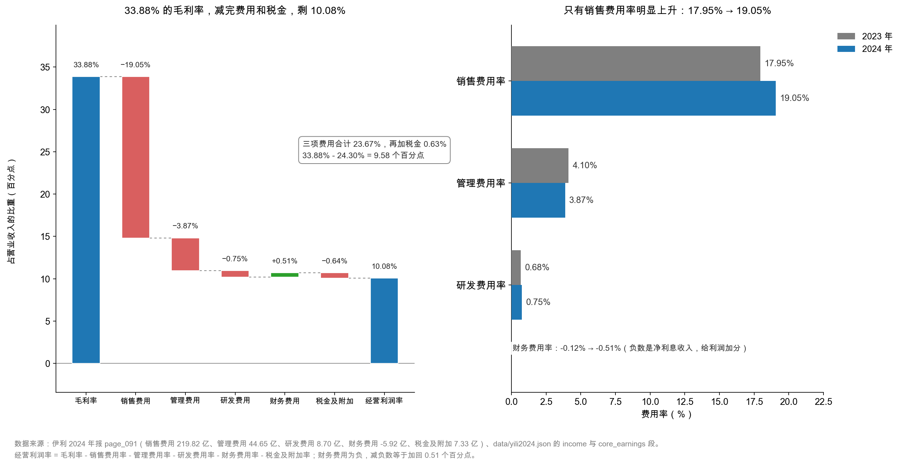

# 第 29 章：三费与研发——钱花在哪

> 本章你将：
> - 把销售费用 219.82 亿元拆开，看到其中 136.12 亿元是广告营销费——**比全年净利润还多 51 亿元**；
> - 学会用"费用率"而不是"费用额"来判断一家公司花钱的效率；
> - 算清一件让利润承压的事：收入降 8.24%，销售费用只降 2.61%，费用率因此上升 1.10 个百分点，等于多花了 12.71 亿元；
> - 看懂管理费用为什么能降 13.37%、研发费用为什么只有 0.75%；
> - 把毛利率 33.88% 一路减到 9.58 个百分点，得到"经营利润率的毛坯"。

---

## 29.1 三个口袋的分工

上一章我们把毛利算出来了：390.94 亿元，33.88%。这 390.94 亿元还不是股东的——它要先付三笔钱。

第一笔，**把货卖出去**。牛奶有保质期，货架上摆不满就会被竞品占位，所以广告、促销、返利、销售人员，一样都不能少。这笔钱记在**销售费用**。

第二笔，**让公司运转**。总部的水电、财务、法务、人事、审计、办公楼折旧。这笔钱记在**管理费用**。

第三笔，**为明天做准备**。新配方、新菌种、新包装、新工艺。这笔钱记在**研发费用**。

三个口袋，三种性质：

| 费用 | 花钱的目的 | 能不能砍 | 砍了的后果 |
|---|---|---|---|
| 销售费用 | 把今天的货卖出去 | 能砍，但砍了收入会掉 | 份额下滑，恢复很慢 |
| 管理费用 | 让公司正常运转 | 能砍，且砍了短期不影响收入 | 组织能力受损，几年后显现 |
| 研发费用 | 为明天的产品做准备 | 最容易砍 | 三五年后产品力枯竭 |

这三笔加起来，加上税金及附加，就是"毛利到营业利润"之间最大的一道鸿沟。本章的任务，就是把这道鸿沟量出来。

> 📌 **划重点：** 看费用，永远看两个数：**绝对额**（花了多少）和**费用率**（每 100 元收入里花了多少）。绝对额告诉你规模，费用率告诉你效率。**收入在变的年份，只有费用率能跨年比较。**

## 29.2 销售费用 219.82 亿元：广告费占六成

先看最大的那个口袋。

伊利 2024 年销售费用 **219.82 亿元**，比 2023 年的 225.72 亿元下降 2.61%。占营业收入 **19.05%**——每卖 100 元牛奶，有 19.05 元花在"卖"这个动作上。

翻开附注七(64)（`page_208.md`），这 219.82 亿元被拆成八项：

| 明细 | 2024 年 | 占比 | 2023 年 | 同比 |
|---|---|---|---|---|
| **广告营销费** | **136.12 亿元** | **61.92%** | 139.91 亿元 | -2.71% |
| 职工薪酬 | 66.24 亿元 | 30.13% | 68.42 亿元 | -3.18% |
| 仓储费 | 4.89 亿元 | 2.23% | 4.85 亿元 | +0.80% |
| 差旅费 | 4.81 亿元 | 2.19% | 4.70 亿元 | +2.30% |
| 折旧修理费 | 4.18 亿元 | 1.90% | 4.15 亿元 | +0.68% |
| 其他 | 1.96 亿元 | 0.89% | 2.15 亿元 | -8.81% |
| 办公费 | 1.30 亿元 | 0.59% | 1.18 亿元 | +10.52% |
| 物耗劳保费 | 0.33 亿元 | 0.15% | 0.36 亿元 | -9.47% |
| **合计** | **219.82 亿元** | 100% | 225.72 亿元 | -2.61% |

<!-- src: 伊利股份2024年报/page_208.md -->

这张表最重要的一行是第一行：**广告营销费 136.12 亿元，占销售费用的 61.92%，占营业收入的 11.80%。**

136.12 亿元是什么概念？把它和几个数字放在一起：

| 对比 | 金额 | 广告费是它的几倍 |
|---|---|---|
| 归母净利润 | 84.53 亿元 | **1.61 倍** |
| 研发费用 | 8.70 亿元 | **15.6 倍** |
| 管理费用 | 44.65 亿元 | 3.05 倍 |
| 资产减值损失 | 46.76 亿元 | 2.91 倍 |

**伊利一年花的广告费，是它一年净利润的 1.6 倍，是研发费用的 15.6 倍。**

这个对比不是为了说明"广告费太高了"（对快消品来说，这笔钱是必需的），而是为了让你看清这门生意的重心：**乳业是一个"必须持续对消费者说话"的行业。** 牛奶是同质化程度很高的商品，消费者站在冷柜前的那三秒钟，决定权在"我认识哪个牌子"——而"认识"是靠钱堆出来的。

第二行也值得看：**职工薪酬 66.24 亿元，占 30.13%。** 伊利有六万多名员工，其中销售系统的人占了相当比例。这笔钱是刚性的——裁员能省，但省下来的是渠道能力。

剩下的六项加起来只占 7.96%，都是"维持销售系统运转"的杂项。

> 🔍 **翻到年报：** 打开 `page_208.md`，找到"64、销售费用"那张表。注意它的第一行不是"广告费"而是"广告营销费"——多了"营销"两个字。这两个字里包含的不只是电视和网络广告，还有终端促销、陈列费、导购员费用、电商平台的推广费。**所以 136.12 亿元不能简单理解成"打广告的钱"，它是"把货推到消费者面前"的全部开销。**

## 29.3 费用率：为什么收入降 8.24%，费用率反而升 1.10 个点

现在来看本章最需要算清楚的一件事。

销售费用的绝对额降了（225.72 → 219.82，-2.61%），这看起来是好事——公司在省钱。但销售费用率反而**上升**了：

$$\frac{219.82}{1{,}153.93} = 19.05\%, \quad \frac{225.72}{1{,}257.58} = 17.95\%$$

19.05 - 17.95 = **+1.10 个百分点**。

原因还是那个除法的性质：**分子降了 2.61%，分母降了 8.24%，分子降得慢，比率就上升。**

用一个更狠的方式把这件事"金额化"——如果销售费用跟着收入同比例下降，它应该是多少？

$$225.72 \times \frac{1{,}153.93}{1{,}257.58} = 225.72 \times 91.76\% = 207.11 \text{ 亿元}$$

实际花了 219.82 亿元，比"同比例下降"多花了 **12.71 亿元**。

这 12.71 亿元，就是"费用刚性"的代价：**收入可以一年掉 8%，但广告合同签了、销售人员养着、终端陈列费该付还得付，费用掉不了那么快。**

同样的算法可以用在管理费用和研发费用上：

| 费用 | 2023 年 | 按收入同比例应降至 | 2024 年实际 | 超额（+）或节省（-） |
|---|---|---|---|---|
| 销售费用 | 225.72 亿元 | 207.11 亿元 | 219.82 亿元 | **+12.71 亿元** |
| 管理费用 | 51.54 亿元 | 47.29 亿元 | 44.65 亿元 | **-2.64 亿元** |
| 研发费用 | 8.50 亿元 | 7.80 亿元 | 8.70 亿元 | **+0.90 亿元** |
| **合计** | 285.76 亿元 | 262.20 亿元 | 273.17 亿元 | **+10.97 亿元** |

三项费用合计"超额支出"10.97 亿元，除以营业收入 1,153.93 亿元，正好是 **0.95 个百分点**——和前面算的"三费费用率上升 0.94 个百分点"对得上（差 0.01 是四舍五入）。

<!-- src: 伊利股份2024年报/page_091.md 伊利股份2024年报/page_018.md 伊利股份2024年报/page_208.md -->

这张表把 2024 年的利润压力说清楚了：

- **销售费用是唯一的压力源**（多花 12.71 亿元）；
- **管理费用在帮忙**（省了 2.64 亿元）；
- **研发费用小幅超支**（多花 0.90 亿元，但这是"该花的钱"）。

10.97 亿元的净超额支出，相当于 2024 年营业利润（101.82 亿元）的 **10.8%**。换句话说：**如果三项费用都跟着收入同比例下降，伊利 2024 年的营业利润会多出约 11 亿元，降幅会从 -14.2% 收窄到 -5.0% 左右。**

这就是为什么读利润表不能只看"费用降了没有"，要看"费用降得够不够快"。

> ⚠️ **易踩坑：** 看到"销售费用同比下降 2.61%"，就在报告里写"公司降本增效成效显著"。**在收入下滑的年份，费用下降是必然的（广告投放跟着销量走），关键是降得够不够。**
>
> 判断标准：**费用增速 vs 收入增速。** 费用增速低于收入增速，费用率下降，才是真的降本；费用增速高于收入增速，费用率上升，那是"被动省钱但没省够"。
>
> 伊利 2024 年：销售费用 -2.61%，收入 -8.24%，费用增速**高于**收入增速 5.63 个百分点——所以费用率上升 1.10 个点。这个结论和"降本增效"四个字正好相反。

## 29.4 管理费用 44.65 亿元：唯一真正降下来的

管理费用是三个口袋里唯一"降得比收入快"的。

44.65 亿元，比 2023 年的 51.54 亿元下降 **13.37%**，降幅明显大于收入的 8.24%。费用率从 4.10% 降到 **3.87%**，降了 0.23 个百分点。

钱是怎么省下来的？看附注七(65)（`page_208.md`）：

| 明细 | 2024 年 | 占比 | 2023 年 | 同比 |
|---|---|---|---|---|
| **职工薪酬** | **26.24 亿元** | **58.77%** | 32.38 亿元 | **-18.96%** |
| 其他 | 5.86 亿元 | 13.12% | 6.14 亿元 | -4.64% |
| 折旧修理费 | 4.67 亿元 | 10.46% | 5.10 亿元 | -8.37% |
| 无形资产摊销 | 2.38 亿元 | 5.33% | 2.12 亿元 | +12.45% |
| 咨询审计费 | 1.96 亿元 | 4.39% | 1.79 亿元 | +9.62% |
| 差旅费 | 1.81 亿元 | 4.05% | 2.12 亿元 | -14.65% |
| 办公费 | 1.12 亿元 | 2.51% | 1.18 亿元 | -5.19% |
| 物耗劳保费 | 0.61 亿元 | 1.37% | 0.72 亿元 | -14.46% |
| **合计** | **44.65 亿元** | 100% | 51.54 亿元 | -13.37% |

<!-- src: 伊利股份2024年报/page_208.md -->

答案就在第一行：**职工薪酬从 32.38 亿元降到 26.24 亿元，一年少了 6.14 亿元，降幅 18.96%。**

管理费用总共降了 6.89 亿元，其中 6.14 亿元来自薪酬，占了 89%。年报在 `page_018.md` 里也是这么说的："管理费用变动原因说明：主要是本期职工薪酬费用减少所致。"

**一行薪酬，解释了整个管理费用的下降。** 这是读附注的典型收获——利润表上只写"管理费用 44.65 亿元"，附注告诉你是"总部的人少了/薪酬降了"。

这里要提醒一句：**管理费用降 13.37%，不等于"管理效率提升"。** 它可能来自三种完全不同的原因：

- 组织优化、人效提升（好事，可持续）；
- 裁员、降薪（中性偏负，短期省钱，长期伤组织）；
- 一次性因素（比如去年有笔大额咨询费，今年没有）（不可持续）。

年报只说了"职工薪酬减少"，没说为什么减少。**这就是年报的边界：它告诉你"是什么"，很少告诉你"为什么"。** 想知道为什么，得去业绩说明会、投资者关系记录、或者下一年的年报里找。

> 💡 **你可能会问：管理费用降了 6.89 亿元，为什么股价没反应？**
>
> 因为 6.89 亿元在伊利的体量里太小了。它相当于营业收入的 0.60%、营业利润的 6.8%。而同期资产减值损失增加了 31.50 亿元（15.26 → 46.76），是管理费用节省额的 4.6 倍。
>
> **读利润表要有"量级感"：先找最大的那几笔，再看小笔。** 伊利的量级排序是：营业成本 762.99 亿 > 销售费用 219.82 亿 > 资产减值 46.76 亿 > 管理费用 44.65 亿 > 投资收益 24.17 亿 > 信用减值 5.55 亿 > 研发费用 8.70 亿。管理费用的变化，排在第 4 位之后。

## 29.5 研发费用 8.70 亿元：0.75% 的研发强度意味着什么

研发费用 8.70 亿元，比 2023 年的 8.50 亿元增长 2.33%。**它是三项费用里唯一增长的。**

但费用率只有 **0.75%**——每 100 元收入里，只有 0.75 元花在研发上。

拆开看（附注七(66)，`page_209.md`）：

| 明细 | 2024 年 | 占比 |
|---|---|---|
| 调研试验设计费 | 4.45 亿元 | 51.16% |
| 职工薪酬 | 2.76 亿元 | 31.77% |
| 折旧修理费 | 0.86 亿元 | 9.87% |
| 其他 | 0.63 亿元 | 7.21% |
| **合计** | **8.70 亿元** | 100% |

<!-- src: 伊利股份2024年报/page_209.md -->

一半以上是"调研试验设计费"——就是真的在做实验、做测试、做配方。这不是把研发费用当成一个"调节利润的池子"的做法（有些公司会把乱七八糟的开支塞进研发费用），伊利的研发费用结构是实的。

**0.75% 的研发强度，是高了还是低了？**

这个问题不能简单回答，得看行业。乳业的研发和科技公司完全不是一回事：一款新酸奶的研发，主要是配方调整、菌种筛选、保质期测试，投入远小于一款芯片。所以拿乳业的研发费用率去和医药、半导体比，没有意义。

有意义的是两个比较：

**第一，和自己的销售费用比。** 8.70 ÷ 219.82 = **3.96%**。也就是说，伊利每花 100 元在"卖"上，只花 4 元在"研发"上。这个比例说明：**伊利是一家营销驱动型公司，不是研发驱动型公司。** 这不是贬义——快消品行业本来就是这样，消费者买牛奶看的是品牌和新鲜度，不是配方专利。

**第二，看研发有没有"资本化"。** 这是一个技术性但很重要的点。研发支出在会计上有两条路：

- **费用化**：全部计入当期研发费用，直接减少当期利润；
- **资本化**：符合条件的部分计入"开发支出"（资产），以后再慢慢摊销，当期利润不受影响。

伊利 2024 年资产负债表上"开发支出"是 **0**（`page_087.md`），说明它把 8.70 亿元**全部费用化**了。这是保守的做法——没有用资本化来美化利润。第 18 章讲过这个选择的含义，这里只要记住结论：**看到"开发支出"很大的公司，要多问一句"资本化的条件是什么"。**

> 📌 **划重点：** 研发费用率低，不一定是坏事（行业属性决定）；但研发费用"突然资本化"一定是信号（利润压力大）。判断方法：看资产负债表的"开发支出"科目有没有从 0 变成一个大数，同时看现金流量表"研发投入"和利润表"研发费用"的差额。

## 29.6 一路减到 9.58 个点

现在把这一章和上一章接起来。

毛利率 33.88%，减掉三项费用，再减掉税金及附加：

$$33.88\% - 19.05\% - 3.87\% - 0.75\% - 0.63\% = 9.58\%$$

**9.58 个百分点。** 这就是"经营利润率的毛坯"——伊利每收 100 元，扣掉成本、三项费用、税金之后，还剩 9.58 元。这 9.58 元还要再去面对减值、投资收益、营业外收支、所得税。

如果再把财务费用的净收益加回来（-0.51%，减负数等于加）：

$$9.58\% + 0.51\% = 10.08\%$$

10.08% 就是"扣完所有经营开支后的经营利润率"。

**9.58 个点是什么水平？** 拿蒙牛粗算一下（它的报表科目和 A 股不同：销售及经销费用 26.04%、行政费用 4.77%、另有"其他费用"7.28%，且不单列研发费用）：

$$39.57\% - 26.04\% - 4.77\% - 7.28\% \approx 1.5\%$$

这个 1.5% 是"毛利减完三项主要费用"之后的残余，还没扣财务费用（1.66%）和应占联营公司亏损（0.98%）——扣完就是负的了，所以蒙牛的利润总额只有 9.99 亿元，靠其他收益和利息收入才撑回正数（第 28 章有完整拆解）。

**伊利还有 9.58 个点，蒙牛只剩 1.5 个点左右。** 两家毛利率只差 5.69 个点，这个"毛利之后的残余"却差 8 个点以上——差距全部产生在"毛利之后、营业利润之前"这段路上。这就是第 28 章那句话的算术版本：**毛利率是生意的底色，天生的；经营利润率是干出来的。**

左图是这条"减法链"：33.88% 的毛利率，被销售费用砍掉 19.05 个点，管理费用砍掉 3.87 个点，研发 0.75 个点，税金 0.63 个点，中间财务费用加回 0.51 个点，最后落在 10.08%。

看到这张图，你会立刻明白一件事：**毛利率 33.88%，最后只剩 10.08%——中间那 23.80 个百分点，全部是"把牛奶送到消费者嘴里"的成本。**

右图是三项费用率的两年对比。三组柱子中，只有销售费用率那组的 2024 年（蓝）比 2023 年（灰）长；管理费用率、研发费用率两组，蓝色都更短或几乎持平。

**一张图看完：2024 年伊利的费用问题，就一个——销售费用率升了 1.10 个点，其他两项都在改善。**

## ✍️ 想一想

> 建议先自己写两句话，再翻答案。想不清楚的地方，就是该回头重读的地方。

### 问 1：广告费 136 亿元，是护城河还是无底洞

伊利 2024 年广告营销费 136.12 亿元，是归母净利润（84.53 亿元）的 1.61 倍。请回答：（1）这个比例说明什么？（2）如果伊利明年把广告费砍掉 30%（省 40.8 亿元），利润会怎么变？这个推演有什么问题？（3）怎么判断一笔广告费花得值不值？

**解题思路：** 第一问别急着下判断，先想"快消品为什么必须打广告"。第二问是一个陷阱题——**会计上利润会增加，但经营上收入会掉**，要把两件事分开算。第三问要给出可操作的观察方法，不能停留在"看效果"这种空话。

**参考答案：**

（1）说明三件事：

- **这是一门营销驱动的生意**。净利润的 1.6 倍花在广告上，意味着"品牌"是它最重要的资产，也是最大的开销；
- **利润对广告投放高度敏感**。广告费变动 10%，影响利润 13.6 亿元，相当于净利润的 16%；
- **广告费是"半刚性"的**。它可以砍，但砍了收入会跟着掉——它不是纯粹的费用，更像"必须持续缴纳的入场费"。

（2）会计上：省 40.8 亿元，税前利润增加 40.8 亿元，按 16.4% 的有效税率算，净利润增加约 **34.1 亿元**，从 84.64 亿元变成 118.7 亿元，增幅 40%。

**但这个推演有三个致命问题：**

第一，**收入会掉。** 广告停了，消费者认知会衰减，经销商信心会动摇，收入大概率下滑。如果收入掉 10%（115 亿元），毛利减少约 39 亿元——刚好把省下的 40.8 亿元吃掉。**这是一笔零和交易，甚至可能倒亏。**

第二，**份额的损失是不可逆的。** 乳业是双寡头格局，伊利少投的广告费，蒙牛会接过去。份额一旦丢了，再抢回来要花几倍的钱。

第三，**这个推演假设"其他一切不变"**，而现实中广告费的削减通常伴随着渠道投入的削减、销售人员的减少，连锁反应远超 40.8 亿元。

所以正确的说法是：**"砍广告能增厚利润"在会计上成立，在经营上不成立。** 这类"看起来能立刻增利"的动作，恰恰是分析时要最警惕的。

（3）判断广告费花得值不值，看三个可观察的指标：

| 指标 | 怎么算 | 说明什么 |
|---|---|---|
| 单位广告费产出 | 营业收入 ÷ 广告营销费 | 伊利 2024 年 = 1,153.93 ÷ 136.12 = **8.48 元**，即每花 1 元广告带来 8.48 元收入 |
| 广告费率趋势 | 广告费 ÷ 营业收入 | 2024 年 11.80%，2023 年 11.13%（139.91 ÷ 1,257.58），**上升 0.67 个点** |
| 收入增速 vs 广告增速 | 两者对比 | 广告 -2.71%，收入 -8.24%：广告降得慢，说明在"守"，不是在"攻" |

最值得警惕的组合是：**广告费率持续上升，收入却不增长。** 那说明钱花出去了没效果，是在"买收入"而不是"建品牌"。伊利 2024 年是"守势"——收入在掉，广告费不敢大砍，费率被动上升 0.67 个点。这个状态可以维持一两年，维持三年以上就要问：是不是品牌力在衰减？

**易错点：** ① 第（2）问只算利润增加、不算收入减少，得出"砍广告能大幅增利"的结论；② 第（1）问答"广告费太高了，应该削减"——用制造业的思维看快消品；③ 第（3）问答"看广告效果好不好"——不可操作，要给出可计算的指标。

### 问 2：费用率上升 1.10 个点，相当于多少钱

伊利销售费用率从 17.95% 升到 19.05%，上升 1.10 个百分点。请回答：（1）这 1.10 个百分点相当于多少亿元的"超额支出"？（2）如果销售费用率维持 17.95% 不变，伊利 2024 年的营业利润会是多少？（3）为什么"费用率上升"比"费用额上升"更值得警惕？

**解题思路：** 第一问有两种算法：用"费用率差额 $\times$ 收入"，或者用"实际费用 - 按收入同比例应降到的费用"。两种算法结果应该接近，可以互相验证。第二问是一个反事实推演，注意只调整销售费用，其他不动。第三问要讲清"比率"和"绝对额"在跨年比较中的差别。

**参考答案：**

（1）两种算法：

**算法一**：1.10% $\times$ 1,153.93 = **12.69 亿元**。

**算法二**：按收入同比例下降，销售费用应为 225.72 $\times$ 91.76% = 207.11 亿元；实际 219.82 亿元；超额 = 219.82 - 207.11 = **12.71 亿元**。

两个结果差 0.02 亿元，是四舍五入造成的。取 **12.7 亿元**。

（2）如果销售费用率维持 17.95%，销售费用应该是：

$$1{,}153.93 \times 17.95\% = 207.13 \text{ 亿元}$$

实际 219.82 亿元，多了 12.69 亿元。把这 12.69 亿元加回营业利润：

$$101.82 + 12.69 = 114.51 \text{ 亿元}$$

对比 2023 年的 118.73 亿元，降幅从 -14.2% 收窄到 **-3.6%**。

（注意：这里假设销售费用减少不影响收入。现实中费用砍了收入可能也会掉，所以 114.51 亿元是一个"上限值"，真实情况会低一些。）

（3）因为**费用额会跟着收入一起变，费用率不会**。

举例：一家公司收入从 100 亿降到 80 亿，销售费用从 20 亿降到 18 亿。

- 看绝对额：费用降了 2 亿（-10%），"降本有效"；
- 看费用率：从 20% 升到 22.5%，"效率恶化"。

**两个结论完全相反，而费用率的那个才是对的。** 因为费用降 10% 是"跟着收入降"，但收入降了 20%，费用没降够——每 1 元收入上摊的费用反而更多了。

更根本的原因是：**费用里有大量固定成本**（总部人员、办公楼、系统、品牌投放的底线预算）。收入下降时，这些成本摊不开，费用率必然上升。这就是"经营杠杆"的负面版本——**收入上升时，费用率下降，利润加速增长；收入下降时，费用率上升，利润加速下滑。**

伊利 2024 年就处在后一种状态：收入 -8.24%，营业利润 -14.2%，**利润降幅是收入降幅的 1.7 倍**。这个放大倍数，就是经营杠杆在起作用。

**易错点：** ① 只算一种算法，不交叉验证；② 第（2）问忘了"费用减少可能影响收入"这个前提，把 114.51 亿元当成必然会实现的数字；③ 第（3）问答"因为费用率是比率，更科学"——太笼统，要说出"固定成本摊不开"这个机制。

### 问 3：研发费用率 0.75%，是不是太低了

伊利 2024 年研发费用 8.70 亿元，研发费用率 0.75%；同期销售费用率 19.05%。有人说："一家号称要做'全球乳业五强'的公司，研发投入只有销售费用的 4%，这说明它根本不重视创新。"请评价这个说法。

**解题思路：** 先别站队。第一步，搞清楚乳业的研发到底在研发什么（决定研发强度的合理区间）。第二步，看研发费用的"质量"——是全部费用化还是有资本化。第三步，看研发的"产出"在哪里（新品收入占比、专利、菌种库），而不只是看投入。

**参考答案：**

这个说法**抓住了一个真实的反差，但结论下得太快**。

**先承认它对的部分：** 8.70 亿元研发对 219.82 亿元销售费用，比例确实只有 3.96%。这个结构说明伊利是营销驱动型公司，不是研发驱动型公司。这个判断是准确的。

**但它漏掉了三件事：**

**第一，乳业的研发强度和科技行业不可比。** 一款新酸奶的研发，核心是配方、菌种、工艺、保质期，投入规模远小于芯片、创新药。全球乳业巨头的研发费用率普遍在 1% 上下（这是行业属性，不是伊利一家的问题）。用 0.75% 去和医药公司的 15% 比，是拿体温计量身高。

**第二，要看研发的"质量"。** 伊利 8.70 亿元全部费用化，"开发支出"科目为 0（`page_087.md`）——没有把研发支出资本化来美化利润。对比一些公司把研发资本化、挂在资产上慢慢摊，伊利的处理是保守的。**研发费用率低但全部费用化，比"研发费用率高但一半资本化"要诚实。**

**第三，研发的产出不在利润表的"研发费用"里。** 伊利的研发成果体现在：

- 新品收入占比（年报里通常有披露）；
- 高毛利品类的增长（奶粉 +7.53%、毛利率 41.02%，背后是配方和产品力）；
- 菌种库、专利数量（附注或 MD&A 里有零星披露）。

**我的判断是：** 0.75% 的研发费用率，对乳业来说是**正常偏低**的水平，谈不上"不重视创新"，但也确实说明它的竞争力更多来自品牌和渠道，而不是技术壁垒。这个判断的实践含义是：**分析伊利时，应该重点盯品牌投入的效率（广告费产出比）和渠道库存，而不是盯研发管线。**

**易错点：** ① 直接说"0.75% 太低了，不重视研发"——跨行业比较；② 反过来说"乳业不需要研发"——也不对，菌种、工艺、健康化（低糖、高蛋白）都是真研发；③ 忘了看"开发支出"这个科目，把"研发费用低"和"研发投入低"混为一谈（有些公司的研发投入记在固定资产或无形资产里）。

## 📎 数据出处

- 伊利股份 2024 年报 `page_091.md`：销售费用 219.82 亿元、管理费用 44.65 亿元、研发费用 8.70 亿元、财务费用 -5.92 亿元、税金及附加 7.33 亿元
- `page_018.md`：三项费用变动比例（销售 -2.61%、管理 -13.37%、研发 +2.33%）及原因说明
- `page_208.md`：附注七(64) 销售费用明细（广告营销费 136.12 亿元、职工薪酬 66.24 亿元等）、附注七(65) 管理费用明细（职工薪酬 26.24 亿元等）
- `page_209.md`：附注七(66) 研发费用明细（调研试验设计费 4.45 亿元等）、附注七(67) 财务费用明细
- `page_087.md`：资产负债表"开发支出"为 0（研发全部费用化）
- `page_021.md`：成本分析表（装卸运输费 54.63 亿元在营业成本内）
- 数据汇总：`data/yili2024.json` 的 `income`、`compare_2023.income`、`core_earnings`、`ratios` 段

<!-- src: 伊利股份2024年报/page_091.md 伊利股份2024年报/page_018.md 伊利股份2024年报/page_208.md 伊利股份2024年报/page_209.md 伊利股份2024年报/page_087.md 伊利股份2024年报/page_021.md -->

下一章：[第 30 章：实战——伊利利润表逐行读](30-实战-伊利利润表逐行读.md)。这一章我们把 33.88% 减到了 9.58%，但营业利润那一行写的是 101.82 亿元，对应的利润率是 8.82%——中间差的 0.76 个百分点，是投资收益和减值在打架。下一章会把整张表逐行读一遍，然后做一件让结论反转的事：**把减值加回去。**
