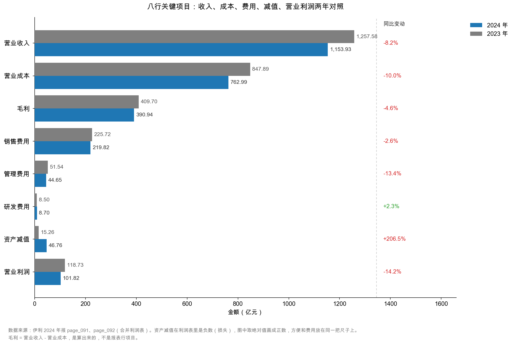
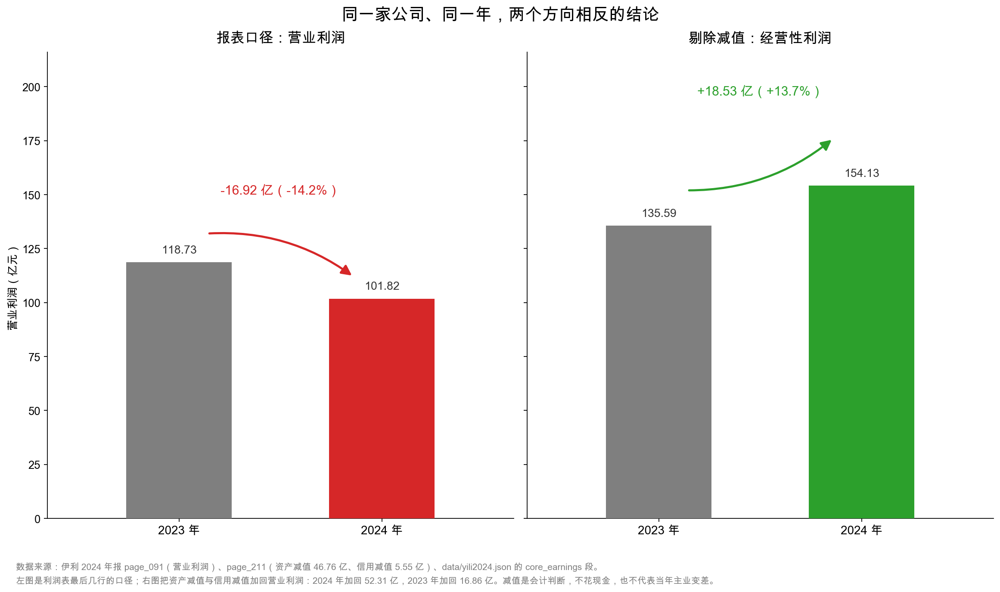

# 第 30 章：实战——伊利利润表逐行读

> 本章你将：
> - 用一套五步流程，把伊利利润表从第一行读到最后一行的 EPS；
> - 拿到一张 2024 vs 2023 的逐行对照表，每一行都配一句"这一行在说什么"；
> - 亲手做一次"剔除减值"的调整，把 101.82 亿元变成 154.13 亿元；
> - 看清同一个数字为什么能被读成两个相反的结论："利润大跌 14.2%"与"主业增长 13.7%"；
> - 带走一张"这一行不对劲时该问什么"的五问清单，将来套在任何一家公司上。

---

## 30.1 五步读法：不要从第一行读到最后一行

前面四章，我们是一块一块拆的：结构、收入、毛利率、费用。这一章要把它们装回一台机器，并且真的读一遍。

先说方法。很多人读利润表的方式是"从第一行往下看，看到最后一行"，这其实是最低效的读法——因为利润表是按"会计逻辑"排的，不是按"重要性"排的。你会在销售费用上停留很久，却漏掉减值那一行。

我用的顺序是这样五步：

**第一步：先看两头，不看中间。** 先看第一行（营业收入）和最后一行（归母净利润），算出各自的增速。伊利 2024 年：收入 -8.24%，归母净利润 -18.94%。**利润降幅是收入降幅的 2.3 倍**——这个"放大倍数"本身就是一个信号，说明中间有某个东西在放大波动。带着这个问题再往下读。

**第二步：拆结构，找最大的四块。** 营业成本 762.99 亿元、销售费用 219.82 亿元、资产减值 46.76 亿元、管理费用 44.65 亿元。**先看这四块，其他都可以后看。** 因为它们加起来占了"收入减利润"这个差额的绝大部分。

**第三步：逐行比两年，标出"动了"的行。** 不是所有行都值得看，只有变动幅度大的行才值得追问。判断标准：变动超过 10%，或者绝对额超过 10 亿元。

**第四步：把"一次性"的东西标出来。** 投资收益 +24.17 亿元（卖子公司）、资产减值 -46.76 亿元（商誉为主）。这两笔都不是每年都有的。

**第五步：回到比率，做交叉验证。** 毛利率、费用率、收现比、经营现金流增速——四个比率互相印证，看它们说的是不是同一个故事。

> 📌 **划重点：** 读利润表的顺序是"**两头 → 大块 → 异动 → 一次性 → 比率**"，不是"从第一行读到第十行"。先建立"哪里不对"的假设，再去那一行找证据，比顺序通读快十倍。

## 30.2 逐行读：二十四行，一句话一行

下面是伊利 2024 年利润表的完整对照。增减幅度是我按原始数字算的（保留一位小数），"这一行在说什么"是读完之后的判断。

| 行项目 | 2024 年 | 2023 年 | 增减 | 这一行在说什么 |
|---|---|---|---|---|
| 营业总收入 | 1,157.80 | 1,261.79 | -8.24% | 含 3.86 亿利息收入，规模在缩 |
| 营业收入 | 1,153.93 | 1,257.58 | -8.24% | 卖牛奶的钱，缩了 103.65 亿 |
| 营业总成本 | 1,037.57 | 1,139.44 | -8.94% | 成本降得比收入快，是毛利率上升的原因 |
| 　营业成本 | 762.99 | 847.89 | -10.01% | 原奶降价 + 销量减少，降幅最大的一块 |
| 　税金及附加 | 7.33 | 7.33 | +0.02% | 几乎没动，跟着房产土地走 |
| 　销售费用 | 219.82 | 225.72 | **-2.61%** | **降得不够快，费用率上升 1.10 个点** |
| 　管理费用 | 44.65 | 51.54 | -13.37% | 唯一真正降下来的，靠薪酬省 6.14 亿 |
| 　研发费用 | 8.70 | 8.50 | +2.33% | 唯一增长的费用，但只占收入 0.75% |
| 　财务费用 | -5.92 | -1.53 | 不适用 | 净利息收入，白赚 5.92 亿 |
| 加：其他收益 | 10.16 | 10.98 | -7.41% | 政府补助 9.84 亿，年年有但会变 |
| 加：投资收益 | **24.17** | -0.31 | 扭亏 | **卖子公司股权赚 25.80 亿，一次性** |
| 加：公允价值变动 | -0.28 | 2.78 | 转负 | 持有的金融资产跌价，金额小 |
| 减：信用减值 | -5.55 | -1.60 | **+245.9%** | 保理风险准备增加，跟着金融业务走 |
| 减：资产减值 | **-46.76** | -15.26 | **+206.5%** | **商誉 30.75 亿，本期最大的一笔** |
| 减：资产处置 | -0.15 | -0.21 | -26.4% | 卖旧设备的零星损益 |
| **营业利润** | **101.82** | **118.73** | **-14.2%** | 被投资收益托了一下、被减值砸了一下 |
| 加：营业外收入 | 0.78 | 2.30 | -66.2% | 罚款、赔偿等偶然所得，在缩 |
| 减：营业外支出 | 1.33 | 3.82 | -65.2% | 捐赠等偶然支出，也在缩 |
| **利润总额** | **101.27** | **117.21** | **-13.6%** | 营业外净支出 0.55 亿，影响很小 |
| 减：所得税 | 16.63 | 14.37 | **+15.7%** | **利润降了，税却升了，有效税率从 12.3% 升到 16.4%** |
| **净利润** | **84.64** | **102.84** | **-17.7%** | 税把降幅又放大了 4 个点 |
| 　少数股东损益 | 0.11 | -1.44 | 转正 | 几乎不分走利润，归母和净利差不多 |
| **归母净利润** | **84.53** | **104.29** | **-18.94%** | 你（如果持股）能分到的那一块 |
| 每股收益 | 1.33 元 | 1.64 元 | -18.90% | 分母是 63.66 亿股 |

<!-- src: 伊利股份2024年报/page_091.md 伊利股份2024年报/page_092.md 伊利股份2024年报/page_007.md -->

（单位：亿元。财务费用是负数，"不适用"是年报自己的写法，因为负数费用的变动率没有经济含义。）

这张表有 24 行，但真正"动了"的只有六行：**营业收入、营业成本、销售费用、投资收益、资产减值、所得税**。其余十八行，要么几乎没动，要么金额小到不影响判断。

**这就是逐行读的产出：不是读懂每一行，而是从二十多行里挑出六行。**

这张图把最重要的八行抽出来横着比。看的时候注意三件事：

**第一，蓝条（2024）比灰条（2023）短，是常态**——收入、成本、毛利、销售费用、管理费用、营业利润，六行都在缩。这是收缩年份的正常长相。

**第二，资产减值那一组的蓝条是灰条的三倍多**（15.26 → 46.76）。这是全场唯一一个"反向"的柱子，也是本章的主角。

**第三，研发费用那一组的蓝条略长**（8.50 → 8.70），但两根柱子都很短，视觉上几乎看不出差别——**这就是"量级感"：同样叫"增长 2.33%"，在 8.7 亿元的体量上只值 0.2 亿元，改不了任何结论。**

## 30.3 三行真正在动：哪一个是信号，哪一个是噪音

现在来处理那六行异动。它们可以分成两类。

**第一类：真实的经营变化（信号）。**

**营业收入 -8.24%**：这是真的。行业需求在缩（原奶过剩、消费疲软），液体乳 -12.32%，奶粉 +7.53%。第 27 章已经拆过，这是"品类换挡"，不是"全面溃败"。

**营业成本 -10.01%**：这也是真的。原奶降价 + 销量减少，成本降得比收入快，毛利率因此上升 1.30 个百分点（第 28 章）。

**销售费用 -2.61%**：这是"没降够"。收入降 8.24%，费用只降 2.61%，费用率上升 1.10 个百分点，等于多花 12.71 亿元（第 29 章）。

这三行加起来，讲的是一个清晰的故事：**收入在缩、成本降得更快、费用降得不够快。** 三者相抵，主业其实是"毛利率改善、费用率恶化、净效果略负"。

**第二类：一次性的会计动作（噪音）。**

**投资收益 +24.17 亿元**：卖子公司昌吉盛新的股权，一次性。它让营业利润"虚高"了 24.17 亿元。

**资产减值 -46.76 亿元**：商誉 30.75 亿元（澳优）、存货 12.27 亿元、固定资产 3.67 亿元。它让营业利润"虚低"了 46.76 亿元。

**信用减值 -5.55 亿元**：保理风险准备 3.71 亿元为主，也跟着金融业务走。

这三行加起来，净影响是 24.17 - 52.31 = **-28.14 亿元**。也就是说：**如果没有这三笔，伊利 2024 年的营业利润会比报表上的 101.82 亿元高 28.14 亿元，达到 129.96 亿元，比 2023 年还高 9.5%。**

**所得税 +15.7%** 是个特殊的存在——它既不是经营信号，也不是会计动作，而是"税会差异"的结果（减值里有相当一部分不能税前扣除，导致有效税率上升）。第 34 章会专门讲，这里只记一个事实：**利润降了 13.6%，税却升了 15.7%，有效税率从 12.26% 跳到 16.42%，把净利的降幅从 -13.6% 放大到 -17.7%。**

> ⚠️ **易踩坑：** 把"投资收益 24.17 亿元"和"资产减值 46.76 亿元"当成两件互不相干的事分别评价（"投资收益不错""减值很糟"），而不去看它们的**净影响**。这两笔在时间上凑到一起不是偶然——一家公司在"洗大澡"的年份，常常一边处置资产确认收益、一边集中计提减值，让利润表"一次亏够"。
>
> 我不下"伊利在洗大澡"的结论（动机无法从报表证明），但**数字上的特征是吻合的**：减值集中、金额巨大、且恰好被一笔处置收益部分对冲。这个特征值得你记下来，将来在别的公司身上再看到，就知道该翻哪几页。第 32 章会把减值的构成彻底拆开。

## 30.4 啊哈时刻：把减值加回去

现在到了这一章、也是这一周、甚至是整本书最重要的一步。

伊利 2024 年营业利润 101.82 亿元，比 2023 年的 118.73 亿元下降 14.2%。如果你只读到这里，结论是：**这家公司不行了。**

但只要做一次简单的加法，画面就完全反过来。

减值损失是什么？是公司说"这些资产（商誉、存货、设备）不值账上那个价了"，于是把差额一次性从利润里扣掉。**它有三个特点：**

1. **不花一分钱现金**——没有一笔钱付出去，只是账面数字调整；
2. **是对过去决策的一次性清算**——商誉减值是当年收购澳优买贵了，跟 2024 年卖了多少钱牛奶无关；
3. **金额由管理层判断**——折现率、增长率假设稍有不同，同一笔商誉可以提 20 亿元，也可以提 35 亿元（示意数字，不是伊利的实际区间）。

所以，要看清"主业到底赚了多少"，就得把它加回去：

$$\text{剔除减值后的经营性利润} = \text{营业利润} + \text{资产减值} + \text{信用减值}$$

2024 年：101.82 + 46.76 + 5.55 = **154.13 亿元**；
2023 年：118.73 + 15.26 + 1.60 = **135.59 亿元**。

| 项目 | 2024 年 | 2023 年 | 变化 |
|---|---|---|---|
| 营业利润（报表口径） | 101.82 亿元 | 118.73 亿元 | **-14.2%** |
| 加回：资产减值 + 信用减值 | 52.31 亿元 | 16.86 亿元 | +35.45 亿元 |
| **剔除减值后的经营性利润** | **154.13 亿元** | **135.59 亿元** | **+13.7%** |

<!-- src: 伊利股份2024年报/page_091.md 伊利股份2024年报/page_211.md -->

这张图是整本书的核心画面。

左边：101.82 对 118.73，红色箭头向下，-14.2%。
右边：154.13 对 135.59，绿色箭头向上，+13.7%。

**同一家公司，同一年，同一份报表，两个方向完全相反的结论。**

差别只在于：你把那 52.31 亿元的减值，当成"经营的一部分"，还是当成"一次性的事"。

**只看利润表最后一行的人，看到的是"利润跌了 19%，公司不行了"。**
**会翻附注、会加回减值的人，看到的是"主业利润涨了 13.7%，公司在轻装上阵"。**

两种人买的是同一只股票，判断完全相反，动作也完全相反：前者卖出，后者买入。

### 但这个加法有边界，必须说清楚

写到这里，我必须停下来讲三件事，否则上面那段话会变成一句危险的鸡汤。

**第一，减值不是"假的损失"。** 商誉减值 30.75 亿元，本质是伊利当年收购澳优时**付多了钱**。那 30.75 亿元是真金白银付出去的收购对价的一部分，只是当时记成了商誉、现在才认账。**它不是"没发生"，而是"发生过了，只是今年才承认"。**

所以"加回减值"的正确含义是：**把"过去决策的代价"从"今年经营的成绩"里剥离出来**，而不是"这笔损失不存在"。

**第二，减值可能连续发生。** 如果澳优的经营持续不及预期，2025 年还可能继续减值。那样的话，"剔除减值"就不是一次性调整，而是每年都要做的常规动作——这时候加回减值，等于系统性地高估利润。

伊利 2024 年的商誉减值 30.75 亿元，是**第一次**大规模计提（第 20 章讲过，2023 年商誉减值是 0）。第一次集中计提，通常意味着"把该认的账一次认完"，这是"一次性"的可能性更大。但这只是概率判断，不是事实。

**第三，减值也可能是经营恶化的证据。** 存货跌价 12.27 亿元（同比只微增 0.4%）、固定资产减值 3.67 亿元（同比大增 428%），这两个数字背后是"东西卖不动了""产能闲置了"。**存货跌价年年都有，它更像经营成本，而不是一次性损失。**

所以更严谨的算法，是只加回"商誉减值"这一笔：

$$101.82 + 30.75 = 132.57 \text{ 亿元}$$

对比 2023 年的 118.73 亿元（2023 年商誉减值为 0），增幅 **+11.7%**。

**结论依然是"主业在增长"，只是增幅从 13.7% 收敛到 11.7%。** 这个数字更保守，也更难被反驳。

> 💡 **你可能会问：那到底该用哪个数字？154.13 还是 132.57？**
>
> 两个都用，但要标清楚口径，并且看它们的**方向是否一致**。
>
> - 154.13 亿元（加回全部减值）是"乐观口径"，回答"如果今年没有任何减值，主业赚多少"；
> - 132.57 亿元（只加回商誉减值）是"保守口径"，回答"如果只把买贵的那笔账剥掉，主业赚多少"；
> - 101.82 亿元（报表口径）是"会计口径"，回答"按规矩算，今年赚多少"。
>
> 三个数字，方向一致（都在说"主业没有报表上那么差"），幅度不同。**分析的价值不在于选出"正确"的那一个，而在于知道它们各自回答什么问题。** 只报一个数、不说口径，才是真的危险。

## 30.5 三条独立证据，指向同一个方向

一个孤立的数字可以被解释成任何样子。所以最后一步，是找**独立的**证据来交叉验证。

"主业在变好"这个判断，除了"剔除减值 +13.7%"，还有三条证据：

| 证据 | 2024 年 | 2023 年 | 变化 | 它独立在哪 |
|---|---|---|---|---|
| 毛利率 | 33.88% | 32.58% | **+1.30 个百分点** | 只跟"卖价 - 成本"有关，跟减值无关 |
| 收现比 | 1.132 | 1.091 | **+0.041** | 只跟"收到多少现金"有关，跟利润口径无关 |
| 经营活动现金流净额 | 217.40 亿元 | 182.90 亿元 | **+18.86%** | 现金流量的确认规则和利润完全不同 |

<!-- src: 伊利股份2024年报/page_091.md 伊利股份2024年报/page_094.md -->

这三条证据之所以"独立"，是因为它们各自走的是不同的会计路径：

- 毛利率只用了收入和成本两个数，减值在它下面好几行，碰不到它；
- 收现比只用了现金流量表的一个数除以利润表的一个数，跟减值完全无关；
- 经营现金流是从"收到的现金 - 付出去的现金"直接算的，一分钱的减值都不会出现在里面（减值不花现金）。

**三条路径，同一个方向：毛利率在改善、钱收得更急、现金流在增长。**

再加上"剔除减值后主业利润 +13.7%"，四条证据互相印证。**这比任何单一数字都可靠。**

反过来，如果只有"剔除减值后利润增长"这一条，而毛利率在降、收现比在降、现金流在缩，那就该怀疑：这个"增长"是不是只是会计调整的产物？

> 🔍 **翻到年报：** 打开 `page_094.md`，找到"经营活动产生的现金流量净额"那一行：2024 年 21,739,740,393.38，2023 年 18,290,357,650.56。再翻 `page_007.md`，"主要会计数据"表里第三行"经营活动产生的现金流量净额"后面直接写着"18.86"。**年报替你把增速算好了，但你要自己确认它和利润的方向是相反的还是相同的——2024 年是相反的（利润 -17.7%，现金流 +18.86%），这个"相反"本身就是信息。**

## 30.6 五问清单：这一行不对劲时该问什么

逐行读的终点，不是记住伊利的数字，而是形成一套"看到异常就问"的条件反射。下面五问，可以套在任何一家公司上。

**第一问（针对营业收入）：增速和收现比对得上吗？**

- 收入增长，但收现比低于 0.9 → 钱没收回来，可能是赊销换增长，也可能是虚构收入；
- 收入增长，但应收账款周转天数快速拉长 → 同上；
- 收入下降，但收现比上升 → 可能在收紧信用、主动放弃低质量客户（伊利 2024 年就是这样，属于健康）。

**第二问（针对毛利率）：这 1 个点是价、是成本、还是结构？**

- 价格驱动 → 看能不能持续（品牌力、竞争格局）；
- 成本驱动 → 看原材料周期（伊利 2024 年是原奶降价，会反转）；
- 结构驱动 → 看高毛利品类的增速能不能维持。

**第三问（针对费用率）：是分子的问题还是分母的问题？**

- 费用率上升，先算"如果费用跟着收入同比例降，应该是多少"，差额就是"没降够"的部分（伊利 2024 年是 12.71 亿元）；
- 再看是哪一项费用在超支（伊利是销售费用，管理费用反而在省）。

**第四问（针对减值和投资收益）：一次性还是经常性？**

- 看**连续几年**：连续三年都有大额减值 → 那是经营成本，不是一次性；
- 看**现金流**：减值不影响现金流，如果"减值很大 + 现金流很好"，说明减值偏会计；如果"减值很大 + 现金流也差"，说明是真的烂了；
- 看**对冲**：同一年的处置收益和减值金额是否接近（伊利 24.17 对 52.31，部分对冲）。

**第五问（针对所得税和少数股东）：有没有在半路截走利润？**

- 有效税率突然从 15% 跳到 25% → 税收优惠到期，或递延所得税调整；
- 少数股东损益占净利润比例突然变大 → 有重要子公司不是全资，利润被分走（蒙牛 2024 年就是典型：净利润 2.25 亿元，少数股东拿走 1.20 亿元）。

## 30.7 把结论写成三句话

读完一张利润表，最后要能把它压缩成三句话。伊利 2024 年，我的是这样：

> **第一句（事实）：** 收入 1,153.93 亿元（-8.24%），归母净利润 84.53 亿元（-18.94%），报表上的数字是"双降"。
>
> **第二句（拆解）：** 双降的原因不是主业垮了，而是三件事叠加——收入受行业需求拖累、销售费用降得不够快（多花 12.71 亿元）、一次性减值 52.31 亿元集中计提。
>
> **第三句（判断）：** 把减值剥离后，经营性利润 154.13 亿元（+13.7%），毛利率 +1.30 个百分点，经营现金流 +18.86%，三条独立证据同向。**这家公司 2024 年的主业，比报表上好看。**

三句话，一句事实、一句拆解、一句判断。中间那句最关键——**没有拆解的判断，都是猜。**

## ✍️ 想一想

> 建议先自己写两句话，再翻答案。想不清楚的地方，就是该回头重读的地方。

### 问 1：154.13 亿元这个数字，站得住吗

有人说："把减值加回去算利润，就是自欺欺人——亏了就是亏了。"也有人说："减值根本不花现金，加回去才是真实利润。"请评价这两种说法，并给出你自己的处理方式。

**解题思路：** 两种说法各抓住了一半。第一种抓住了"减值对应真实的经济损失"，第二种抓住了"减值不影响现金"。关键是找到"减值到底是什么"的准确定义，然后据此决定"加回多少、加回哪一部分"。

**参考答案：**

**第一种说法对了一半。** 减值确实对应真实的经济损失——商誉减值 30.75 亿元，是当年收购澳优付多了钱；存货跌价 12.27 亿元，是东西真的卖不动了。说"亏了就是亏了"，在"这笔损失真实存在"这个层面上是对的。

但它错在：**把"过去决策的代价"和"今年经营的成绩"混在一张表上看。** 2024 年卖了 1,153.93 亿元牛奶，赚了多少？这个问题的答案不该被"2019 年收购澳优买贵了"这件事污染。**剥离，不是为了否认损失，而是为了看清今年的经营。**

**第二种说法也对了一半。** 减值不花现金，这是事实（现金流量表里一分钱都找不到）。所以"加回减值来看经营现金流"是对的。

但它错在：**加回减值来看"利润"，等于假装那笔钱没付过。** 收购对价是真金白银付出去的，只是分几年认账。如果把减值永久性地剔除，等于说"这家公司可以一直用高价买东西、然后不算账"——这显然荒谬。

**我的处理方式：分三层，标口径，看方向。**

| 口径 | 算法 | 2024 年 | 回答什么问题 |
|---|---|---|---|
| 会计口径 | 营业利润 | 101.82 亿元 | 按规矩算，今年赚多少 |
| 保守口径 | 营业利润 + 商誉减值 | 132.57 亿元 | 只剥离"买贵了"那一笔 |
| 乐观口径 | 营业利润 + 全部减值 | 154.13 亿元 | 假设今年完全没减值 |

三个数字都与 2023 年比（118.73 亿元）：-14.2%、+11.7%、+13.7%。**三个方向不完全一致（第一个是降，后两个是升），这本身就是重要信息**——它告诉你"结论对口径敏感"，所以不能只报一个数。

再加一条纪律：**如果一家公司连续三年都需要"剔除减值"才好看，那就不要剔了。** 连续三年的减值，就是经营成本。

**易错点：** ① 站队其中一种说法，不做区分；② 把"加回减值"当成"利润更好"，而不追问"这笔减值是哪一年的事"；③ 只算一个口径就下结论，不说明口径。

### 问 2：有效税率从 12.3% 升到 16.4%，说明什么

伊利 2024 年利润总额 101.27 亿元，所得税 16.63 亿元，有效税率 16.42%；2023 年是 117.21 亿元利润、14.37 亿元税，有效税率 12.26%。**利润降了 13.6%，税却升了 15.7%。** 请回答：（1）这在算术上是怎么发生的？（2）可能的原因有哪些？（3）它对"归母净利润 -18.94%"这个数字有多大影响？

**解题思路：** 第一问是纯算术：税率 = 税 ÷ 利润总额，分子升分母降，比率必然升。第二问要想到"税会差异"——会计上的费用，税法不一定认。第三问做一个反事实：如果税率维持 12.26%，净利润会是多少。

**参考答案：**

（1）算术上：

$$\text{有效税率} = \frac{\text{所得税费用}}{\text{利润总额}}$$

2024 年：16.63 ÷ 101.27 = 16.42%；2023 年：14.37 ÷ 117.21 = 12.26%。

分子（税）从 14.37 升到 16.63（+15.7%），分母（利润总额）从 117.21 降到 101.27（-13.6%）。**分子涨、分母跌，比率必然大幅上升。**

（2）可能的原因，按可能性排序：

**第一，减值里的"不可扣除部分"变大。** 会计上计提的减值损失，税法往往不认（要等实际处置或损失确认时才认）。伊利 2024 年计提了 52.31 亿元减值，其中相当一部分不能税前扣除，于是"会计利润"降了，但"应纳税所得额"没降那么多——税就显得"相对变重"。

**第二，税收优惠的结构变化。** 伊利享受西部大开发、农产品加工等优惠税率，如果某些子公司的优惠到期，或者优惠利润的占比下降，有效税率就会上升。

**第三，递延所得税资产的确认与转回。** 2024 年递延所得税资产从 16.99 亿元增到 20.74 亿元，说明有部分可抵扣暂时性差异被确认，这通常会**降低**税率——所以它不是税率上升的主因，反而在起缓冲作用。

（3）做一个反事实：如果 2024 年的有效税率维持 12.26%：

$$\text{净利润} = 101.27 \times (1 - 12.26\%) = 88.85 \text{亿元}$$

实际 84.64 亿元。**税率上升吃掉了约 4.2 亿元净利润**，相当于净利润的 5%。

如果没有这 4.2 亿元，净利润会是 88.85 亿元，同比降幅从 -17.7% 收窄到 **-13.6%**——和利润总额的降幅一致。

换句话说：**税率上升，把净利的降幅从 13.6% 放大到了 17.7%，多放了 4 个点。**

**易错点：** ① 只看"所得税费用增加 15.7%"就说"公司税负加重"，不看分母（利润总额）在同向变化；② 把"有效税率 16.42%"和"法定税率 25%"直接比，得出"享受了 8.58 个点优惠"——优惠是分项目、分地区的，不能这么简单相减；③ 忘了少数股东损益这一层（伊利 2024 年只有 0.11 亿元，影响很小；但蒙牛是 1.20 亿元，占净利润一半以上，绝不能忽略）。

### 问 3：如果只允许你看三个数字，你选哪三个

假设你被困在一个没有网络的地方，只能拿到伊利 2024 年的三个数字（不能看整张报表）。请回答：（1）你选哪三个？为什么？（2）用这三个数字，你能得出什么结论、不能得出什么结论？（3）如果换一家公司（比如一家地产商、一家软件公司），你的三个数字会变吗？

**解题思路：** 这道题没有标准答案，考的是"你知不知道每个指标的边界"。好的答案会说明"为什么选它"和"它看不到什么"。第三问是关键——不同商业模式，关键指标不同。

**参考答案：**

（1）我选：**营业收入及增速、经营活动现金流净额、毛利率。**

理由：

- **营业收入 + 增速**：定规模和方向。没有它，其他比率都没有分母；
- **经营活动现金流净额**：定"利润是不是真的"。它是唯一一个不依赖会计判断、直接来自银行流水的数字；
- **毛利率**：定"这门生意的体质"。它不受费用投放、减值、税率影响，最接近"生意的本来面目"。

（2）能得出：

- 规模在缩（收入 -8.24%）；
- 生意体质在改善（毛利率 +1.30 个点）；
- 利润的"含金量"很高（经营现金流 217.40 亿元，是净利润 84.64 亿元的 2.57 倍）。

**不能得出：**

- 净利润是多少（需要成本、费用、税）；
- 减值有多大（这是 2024 年最关键的信息，三个数字里完全看不到）；
- 有息负债和偿债能力（需要资产负债表）；
- 未来的增长（需要行业和战略信息）。

**这就是"三个数字"的代价：你能看到"生意在变好"，但看不到"账面利润为什么难看"，也就无法做出"市场是不是误判了"的判断。** 信息越少，结论越安全，但也越没用。

（3）会变，而且必须变：

| 公司类型 | 我会换成 | 原因 |
|---|---|---|
| 地产商 | 合同销售额、有息负债、经营性现金流 | 收入按交付确认，滞后于销售；杠杆是生死线 |
| 软件/SaaS | 收入增速、续费率、经营现金流 | 毛利率天然很高（80% 以上），看不出差异；续费率才是命门 |
| 银行 | 净息差、不良率、拨备覆盖率 | 收入、毛利率这些概念在银行报表里根本不适用 |
| 重资产制造 | 产能利用率、单位成本、资本开支 | 利润对产能利用率极度敏感 |

**易错点：** ① 选"净利润、ROE、EPS"——这三个都是结果指标，互相高度相关，等于只选了一个；② 第（2）问答"什么都能看出来"，高估了三个数字的信息量；③ 第（3）问答"不变"——说明还没有建立"指标要匹配商业模式"的意识。

## 📎 数据出处

- 伊利股份 2024 年报 `page_091.md`：合并利润表上半段全部行项目（营业总收入至营业利润）
- `page_092.md`：合并利润表下半段（营业外收支、利润总额、所得税、净利润、归母净利润、每股收益）
- `page_007.md`：主要会计数据——营业收入 -8.24%、归母净利润 -18.94%、经营现金流 +18.86%
- `page_211.md`：附注七(72)(73) 信用减值 5.55 亿元、资产减值 46.76 亿元（商誉 30.75 亿元、存货 12.27 亿元、固定资产 3.67 亿元）
- `page_210.md`：附注七(69) 投资收益 24.17 亿元（处置长期股权投资 25.80 亿元）
- `page_094.md`：经营活动现金流量净额 217.40 亿元（2023 年 182.90 亿元）
- `page_087.md`：递延所得税资产 20.74 亿元（2023 年 16.99 亿元）
- 数据汇总：`data/yili2024.json` 的 `income`、`compare_2023.income`、`core_earnings`、`cashflow`、`ratios` 段

<!-- src: 伊利股份2024年报/page_091.md 伊利股份2024年报/page_092.md 伊利股份2024年报/page_007.md 伊利股份2024年报/page_211.md 伊利股份2024年报/page_210.md 伊利股份2024年报/page_094.md 伊利股份2024年报/page_087.md -->

下一章：[第 31 章：其他收益、投资收益与公允价值变动——利润里的杂项](../week07/31-其他收益投资收益与公允价值变动.md)。这一章我们把投资收益 24.17 亿元和减值 52.31 亿元当成"一次性的两笔"处理掉了，但它们的内部结构远比这复杂：24.17 亿元里有多少是卖股权、多少是联营企业亏损？10.16 亿元其他收益里，政府补助占多少、明年还会有吗？第 7 周会把这几笔账一笔一笔拆开，并把"利润含水量"这件事做完。
