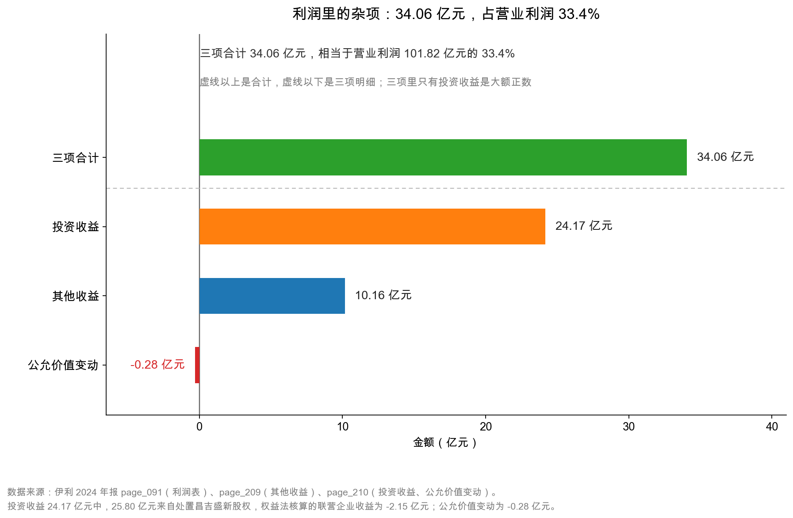
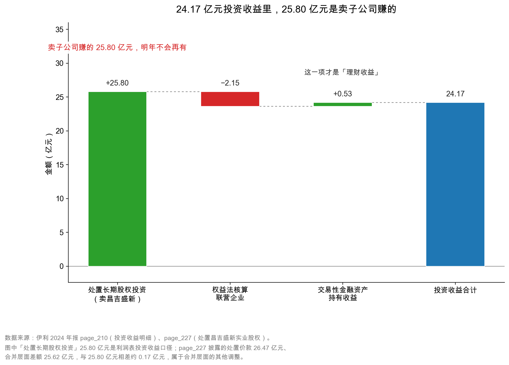

# 第 31 章：其他收益、投资收益与公允价值变动——利润里的杂项

> 本章你将：
> - 看懂利润表里紧跟在"营业总成本"后面的那三行：其他收益、投资收益、公允价值变动；
> - 弄清 10.16 亿元政府补助里，哪一部分明年还会有、哪一部分不会；
> - 拆开 24.17 亿元投资收益，看清 25.80 亿元是"卖子公司赚的"，不是"卖牛奶赚的"；
> - 拿到一把尺子：凡是和主业无关、或明年不会重演的钱，都必须单独拎出来看。

---

## 31.1 利润表下半场：一堆加减号

第 26 章我们走过一遍利润表的上半场：营业总收入减去营业总成本，中间的差额是毛利，再一层层减掉销售费用、管理费用、研发费用、财务费用，剩下的叫"营业利润"。

但如果你真的翻开伊利 2024 年报的合并利润表（`page_091.md`），会发现"营业利润"前面并不是干干净净的一减到底，而是**又加了一串东西**：

| 利润表上的行 | 伊利 2024 | 伊利 2023 |
|---|---|---|
| 二、营业总成本 | 1,037.57 亿元 | 1,139.44 亿元 |
| 加：其他收益 | **10.16 亿元** | 10.98 亿元 |
| 加：投资收益 | **24.17 亿元** | -0.31 亿元 |
| 加：公允价值变动收益 | **-0.28 亿元** | 2.78 亿元 |
| 加：信用减值损失 | -5.55 亿元 | -1.60 亿元 |
| 加：资产减值损失 | -46.76 亿元 | -15.26 亿元 |
| 加：资产处置收益 | -0.15 亿元 | -0.21 亿元 |
| 三、营业利润 | **101.82 亿元** | 118.73 亿元 |

前六行里，有三行是"加项"（其他收益、投资收益、公允价值变动），三行是"减项"（两项减值、资产处置）。这一章讲前三行，下一章讲减值。

为什么这三行要单独拎出来讲？

打个比方。你开了一家面馆，一年卖面赚了 10 万元。这个数字很干净，来源只有一个：客人吃面付的钱减去面粉、房租、人工。

现在换一种记法：面馆赚了 6 万元，但你把家里闲置的商铺卖了，赚了 4 万元；再加上街道办给的油烟改造补贴 0.5 万元；再减去你买的理财亏了 0.5 万元。最后一算，账上还是 10 万元。

**同样是 10 万元，含金量完全不同。** 第一种是"明年还能赚 10 万"，第二种是"明年可能只有 6 万，甚至 5.5 万"。

利润表把这两类钱记在了同一个"营业利润"里。会计上没错——它们确实都让股东权益增加了。但作为分析者，你必须自己动手把它们分开。

> 📌 **划重点：** 营业利润里有两种钱：一种来自"卖东西"，一种来自"卖东西之外"。前者可以重复，后者大多不能。看利润的第一步，就是把后者找出来、量出来。

## 31.2 其他收益：政府补助的两种命运

先看第一行。

"其他收益"这个科目名很别扭，因为它听上去像"其他的收益"，实际上它有明确的定义：**与公司日常活动相关、但又不属于营业收入的政府补助，以及一些零碎的返还。**

伊利 2024 年的其他收益是 10.16 亿元，比 2023 年的 10.98 亿元略降。翻开附注七(68)（`page_209.md`），这 10.16 亿元被拆成三块：

| 其他收益的构成 | 2024 年 | 2023 年 |
|---|---|---|
| 政府补助 | **9.84 亿元** | 10.77 亿元 |
| 个税手续费返还 | 0.05 亿元 | 0.06 亿元 |
| 税收减免 | 0.27 亿元 | 0.15 亿元 |
| 合计 | **10.16 亿元** | 10.98 亿元 |

三块里政府补助占 96.8%，所以讨论其他收益，本质上就是讨论政府补助。

**政府补助为什么会出现在利润表里？** 因为它是真金白银。地方招商引资给的土地补贴、农业农村部门的良种补贴、工信部门的智能制造专项、科技部门的科研项目经费——这些钱打到了公司账上，当然要算收益。

但这里有个关键区别，很多人第一次看年报时会忽略：

**政府补助不是"一笔钱"，而是"好几种钱"的统称。** 它至少可以分成三种到账方式，而每一种对利润的影响节奏完全不同：

| 到账方式 | 会计处理 | 对利润的影响 | 伊利 2024 的例子 |
|---|---|---|---|
| 补偿已发生的费用或损失 | 直接计入当期"其他收益" | 当年一次性增厚利润 | 各类一次性奖励、贴息 |
| 补偿以后期间的成本费用 | 先计入"递延收益"（负债） | 分摊到未来若干年 | 科研项目资金 7.80 亿元（`page_201.md`） |
| 与资产相关（补建设投入） | 计入"递延收益"，随资产折旧分期转入 | 分摊到资产使用寿命内 | 生产基地建设补贴 |

伊利 2024 年确认的 9.84 亿元政府补助，是从这三种方式里"汇"出来的：一部分是当年新到账、当年就认的；一部分是以前年度挂在递延收益里、今年按进度转出来的。**所以"今年补助多"不等于"今年争取到的补助多"，这两件事要分开看。**

> 💡 **你可能会问：** 政府补助不是"白给的钱"吗？为什么有的算"非经常性损益"，有的不算？

因为监管规则把政府补助分成了两类：

1. **偶发的、一次性的**——比如搬迁补偿、一次性奖励。这类要计入"非经常性损益"，在算扣非净利润时被剔掉（第 33 章详讲）。
2. **与正常经营业务密切相关、符合国家政策规定、按照确定的标准享有、对公司损益产生持续影响的**——比如按销量给的良种补贴、按政策给的增值税减免。这类被认定为**经常性**，留在扣非净利润里。

伊利 2024 年的 9.84 亿元政府补助里，被认定为非经常性的只有 **3.94 亿元**（`page_008.md`）。剩下的 **5.90 亿元**，公司认为它是"持续影响"的，所以留在了扣非口径里。

这两个数字放在一起看，信息量很大：

| 口径 | 金额 | 含义 |
|---|---|---|
| 其他收益里的政府补助 | 9.84 亿元 | 今年实际确认的补助总额 |
| 其中：非经常性 | 3.94 亿元 | 偶发，明年不一定有 |
| 其中：经常性 | **5.90 亿元** | 公司主张"年年都有、按标准给" |

**"年年都有"这件事，是可以验证的。** 伊利 2023 年的政府补助是 10.77 亿元，2024 年是 9.84 亿元，两年都在 10 亿元上下。再往前看几年，这个数字也大致稳定在这个量级。**一个连续多年稳定在 10 亿元附近的补贴，市场是会部分把它当成"可持续利润"来定价的**——因为它的可预测性接近一项正常业务收入。

但这不等于它是"真本事"。

> ⚠️ **易踩坑：** 有人看到"政府补助连续五年都有"，就把它当成核心竞争力。这是错的。"稳定"和"可控"是两回事。补助的金额、标准、发放节奏都由政策决定，公司一分钱也做不了主。政策一变（比如补贴退坡、地方财政紧张），这 10 亿元会在一年内消失。**正确的态度是：承认它可预测，但在估值时给它打个折，或者干脆不算进"核心盈利能力"。**

还有一条线索值得追。资产负债表上有"递延收益"科目（`page_201.md`），伊利 2024 年末余额 7.80 亿元，附注写明"主要是政府给予的科研项目资金"。这笔钱的逻辑是：**补助已经到账，但对应的项目还没完成，所以先挂在负债里，等以后逐年转进利润表的"其他收益"。**

这意味着：**未来几年，其他收益里至少还有 7.80 亿元的"存货"等着确认。** 这是一条"藏在负债里的利润管道"——它不是坏事，但也提醒你：今年的 10.16 亿元里，有一部分是"以前收到的钱，今年才认账"，不是"今年新争取到的钱"。

<!-- src: 伊利股份2024年报/page_091.md 伊利股份2024年报/page_209.md 伊利股份2024年报/page_201.md 伊利股份2024年报/page_008.md -->

> 🔍 **翻到年报：** 打开 `page_209.md`，搜索"68、其他收益"。你会看到一张三行的表，最后一行"合计 1,016,458,994.97"。这个数字除以 1 亿，就是 10.16 亿元。再打开 `page_201.md` 找"51、递延收益"，看那张表的"期末余额"列。

## 31.3 投资收益：24.17 亿元里，25.80 亿元是卖子公司赚的

第二行更有意思。

伊利 2024 年的投资收益是 **24.17 亿元**。2023 年是 **-0.31 亿元**。

一年之间，这个科目从"亏 3 千万"变成"赚 24 亿"，摆动了 24.48 亿元。**利润表上任何一个科目，只要一年之内摆动超过 20 亿元，都必须翻附注。**

附注七(69)（`page_210.md`）只有三行有效内容：

| 投资收益的构成 | 2024 年 | 2023 年 |
|---|---|---|
| 权益法核算的长期股权投资收益 | **-2.15 亿元** | -0.60 亿元 |
| 处置长期股权投资产生的投资收益 | **25.80 亿元** | 0.03 亿元 |
| 交易性金融资产在持有期间的投资收益 | 0.53 亿元 | 0.15 亿元 |
| 合计 | **24.17 亿元** | -0.31 亿元 |

三行，三种完全不同的性质。

**第一行，权益法核算的长期股权投资收益 -2.15 亿元。**

伊利持有一些联营企业的股权（比如某些牧场、某些区域乳企），持股比例通常在 20%~50% 之间，不够控股，不能合并报表，于是用"权益法"记账：**被投资公司今年赚多少，伊利就按持股比例确认多少收益；亏多少，就确认多少损失。**

-2.15 亿元意味着：伊利参股的这一批公司，2024 年合计让伊利分担了 2.15 亿元的亏损。这已经是连续第二年为负（2023 年 -0.60 亿元）。

这条信息不该被忽略。**联营企业持续亏损，说明伊利的"外围投资"没有创造价值，反而在拖后腿。** 它虽然金额不大（占营业利润 2.1%），但方向是负的，而且恶化。

**第二行，处置长期股权投资产生的投资收益 25.80 亿元。**

这是全章的主角。

"处置长期股权投资"翻译成人话就是：**把一家子公司的股权卖掉了。**

卖的是谁？附注里没写在这张表上，但年报另一处（`page_227.md`，"处置子公司"）交代得清清楚楚：

| 项目 | 内容 |
|---|---|
| 子公司名称 | 昌吉盛新实业有限责任公司 |
| 丧失控制权时点 | 2024 年 1 月 |
| 处置价款 | 26.47 亿元 |
| 处置比例 | 100% |
| 处置方式 | 转让 |
| 处置价款与享有净资产份额的差额 | **25.62 亿元** |

**一家 100% 控股的子公司，整个卖掉了，收回 26.47 亿元现金，而它在合并报表上的净资产份额远低于这个数，差额 25.62 亿元，全部变成了利润。**

这就是为什么投资收益会从 -0.31 亿元跳到 24.17 亿元。**不是伊利的投资能力突然变强了，是它卖了一家公司。**

> 📌 **划重点：** 处置收益的本质是"把未来的收益一次性提前变现"。卖掉一家子公司，你拿到一笔钱，但从此以后这家公司赚的每一分钱都跟你没关系了。**账面上今年的利润变好看了，但"能持续赚钱的资产"少了一块。** 这是一次资产形态的转换，不是一次经营的改善。

（两个数字差 0.17 亿元：利润表上的处置收益 25.80 亿元，与 `page_227.md` 披露的 25.62 亿元略有差异，属于合并层面的其他调整。看年报时遇到这种小额差异是正常的，不必纠结，但要知道它存在。）

**第三行，交易性金融资产持有期间的投资收益 0.53 亿元。**

这是伊利拿闲置资金买理财、买债券基金赚的利息和分红。0.53 亿元，占营业利润 0.5%，无关痛痒。

但它和"公允价值变动"那一行是一对，下一节一起讲。

<!-- src: 伊利股份2024年报/page_210.md 伊利股份2024年报/page_227.md -->

## 31.4 公允价值变动：-0.28 亿元，一场账面游戏

第三行，公允价值变动收益，2024 年是 **-0.28 亿元**，2023 年是 **+2.78 亿元**。

"公允价值"这个词听上去很学术，其实就是"当前市场价"。"公允价值变动收益"就是：**你手里持有的金融资产，按年末市价重新估一次，比年初涨了多少、跌了多少。**

生活里的例子：你去年花 10 万元买了黄金，年底金价涨了，你的黄金值 12 万元。你没卖，但你的"身价"涨了 2 万元。这 2 万元就是"公允价值变动收益"。

它有两个特点：

1. **它是账面数字，不是现金。** 只要没卖出，这 2 万元就永远是"浮盈"，一分钱现金都没进来。
2. **它会来回摆动。** 今年涨 2.78 亿元，明年可能跌 0.28 亿元，后年又涨回去。

伊利 2024 年的 -0.28 亿元，附注七(71)（`page_210.md`）拆得很细：

| 公允价值变动的来源 | 2024 年 | 2023 年 |
|---|---|---|
| 交易性金融资产 | -0.24 亿元 | 2.78 亿元 |
| 交易性金融负债 | -0.04 亿元 | — |
| 合计 | **-0.28 亿元** | 2.78 亿元 |

金额很小，但方向值得注意：**从 +2.78 亿元到 -0.28 亿元，一年之间摆动了 3.06 亿元。** 这 3.06 亿元全部落在营业利润里，而它跟卖牛奶一毛钱关系都没有。

**这里藏着一个容易被忽略的分岔口。** 同样是"持有的股票涨了"，会计上可能走两条完全不同的路：

| 分类 | 涨价记在哪 | 影响利润表吗 | 伊利 2024 年末余额 |
|---|---|---|---|
| 交易性金融资产 | 公允价值变动损益 | **影响**（进营业利润） | 0.06 亿元 |
| 其他权益工具投资 | 其他综合收益（OCI） | **不影响** | 20.95 亿元 |

伊利资产负债表上"其他权益工具投资"有 20.95 亿元（`page_009.md`），这部分资产的市价涨跌**不经过利润表**，而是直接记在"其他综合收益"里，跳过利润、直接进净资产。2024 年伊利其他综合收益的税后净额是 **-6.39 亿元**（`page_092.md`），其中"其他权益工具投资公允价值变动"-0.16 亿元、"外币报表折算差额"-4.11 亿元是主要的两块。

**这意味着：利润表并不能完整反映一家公司当年"净资产的真实变化"。** 有些亏损（或盈利）绕过了利润表，藏在"其他综合收益"和"综合收益总额"里。伊利 2024 年净利润 84.64 亿元，但综合收益总额只有 78.25 亿元——**差了 6.39 亿元，就是这些"没进利润表的损益"。**

看年报时，如果你只盯"净利润"那一行，会漏掉这块。正确的做法是顺手看一眼利润表最下面的"综合收益总额"。

> ⚠️ **易踩坑：** 公允价值变动收益和投资收益里的"处置金融资产收益"经常被混为一谈。区别是：**没卖 = 公允价值变动；卖了 = 投资收益。** 一家公司如果连续几年"公允价值变动收益"都很大，你要警惕：它可能在用金融资产的价格波动来调节利润的节奏——想做好看的时候卖一点，不想做的时候留着浮亏不确认。

## 31.5 三项合计 34.06 亿元：占营业利润三分之一

把三行加起来：10.16 + 24.17 - 0.28 = **34.06 亿元**。

伊利 2024 年的营业利润是 101.82 亿元。**34.06 ÷ 101.82 = 33.4%。**

换句话说：**报表上每 3 元营业利润里，就有 1 元不是"卖牛奶"赚的。**

这张图把三项横着排开。读图时注意三件事：

第一，**三项合计 34.06 亿元，是"其他收益 + 公允价值变动"两项之和（9.88 亿元）的 3.4 倍**。也就是说，这三项里真正的大头只有一个：投资收益。

第二，**投资收益那一根柱子（24.17 亿元）里，25.80 亿元是卖子公司。** 如果把这 25.80 亿元拿掉，投资收益立刻变成 -1.63 亿元——一家每年靠理财和联营企业"倒贴"1.6 亿元的公司，和一家"投资赚了 24 亿"的公司，是完全不同的两家公司。

第三，**公允价值变动那根柱子是负的，而且短得几乎看不见。** 但它的"摆动幅度"（3.06 亿元）比它的"余额"（-0.28 亿元）大十倍。看这类科目，永远要看两年之差，不要只看一年绝对值。

再往里拆一层，投资收益的 24.17 亿元是怎么拼出来的：

这张瀑布图从 0 开始：先加 25.80 亿元的处置收益，柱子一下子冲到 25.80；再减 2.15 亿元的联营企业亏损；再加 0.53 亿元的理财收益；最后落在 24.17 亿元。

图里那句"卖子公司赚的 25.80 亿元，明年不会再有"，是这张图唯一需要记住的话。**因为"明年不会再有"这五个字，正是下一章要处理的问题的另一半。**

<!-- src: 伊利股份2024年报/page_091.md 伊利股份2024年报/page_210.md 伊利股份2024年报/page_227.md -->

## 31.6 一个更狠的算法：把 25.80 亿元也剔掉

第 30 章结尾留了一个悬念：伊利 2024 年营业利润 101.82 亿元，同比 -14.2%；但把 52.31 亿元减值加回去，"经营性利润"是 154.13 亿元，同比 **+13.7%**。

那个 +13.7% 是对的，但它有一个前提：**它把 25.80 亿元的卖子公司收益留在了里面。**

如果你是一个更严格的分析者，你会问：**卖子公司也是一次性的，凭什么它留在"经营性利润"里，减值就要加回？**

这个质疑完全成立。所以我们做第二层剥离：

| 口径 | 2024 年 | 2023 年 | 变化 |
|---|---|---|---|
| 营业利润（报表口径） | 101.82 亿元 | 118.73 亿元 | -14.2% |
| 加回：减值 | +52.31 亿元 | +16.86 亿元 | — |
| 经营性利润（第 32 章口径） | **154.13 亿元** | **135.59 亿元** | **+13.7%** |
| 再减：处置子公司收益 | -25.80 亿元 | -0.03 亿元 | — |
| **经营性利润（再剔一次性收益）** | **128.33 亿元** | **135.56 亿元** | **-5.4%** |

第三行和第五行，差了 25.80 亿元；结论从"+13.7%"翻成"-5.4%"。

**这就是"剥离口径"的威力，也是它的危险。** 同一家公司、同一年，你可以得出三个方向不同的结论：

- 只看报表：-14.2%，衰退；
- 加回减值：+13.7%，变好；
- 再加回减值、又剔掉卖资产：-5.4%，微降。

三个数字都是"算对了"的。区别只在于：**你把哪些项目当成"一次性的"。**

> 💡 **你可能会问：** 那到底哪个才是对的？

没有唯一答案，但有正确的做法：**把三个数都算出来，然后看它们的区间。** 伊利的真实情况大概是：

- 主业（卖牛奶）的盈利能力，2024 年比 2023 年 **略有下降**（-5% 左右），不是崩塌；
- 报表上的 -14.2% 里，**大约 35 亿元是减值多提**（会计判断），**约 25 亿元是卖资产的一次性收益**（把跌幅托住了）；
- 所以"报表很难看"和"主业很糟糕"是两件事。

**这个区间判断，比任何一个单点数字都可靠。** 第 35 章我们会把这个方法整理成一张清单。

> 📌 **划重点：** 剥离一次性项目时，最容易犯的错是"只剔坏消息、不剔好消息"。看到减值就加回、看到卖资产就装看不见，这是自我欺骗。**要么都剔，要么都不剔。**

最后把本章的三个科目压成一张速查表，以后翻开任何一家公司的利润表，照这个表对一遍就行：

| 科目 | 一句话本质 | 可持续吗 | 该看什么 |
|---|---|---|---|
| 其他收益 | 与主业相关、但不由客户付钱的补助 | 可预测、不可控 | 补助占比、连续几年是否稳定、递延收益还剩多少 |
| 投资收益 | 卖股权赚的 + 参股公司分的 + 理财赚的 | 前两项基本不可持续 | 必须翻附注拆成三行，找出"处置"那一行 |
| 公允价值变动 | 持有的金融资产按市价重估 | 不可持续，且会来回摆 | 看两年之差，不看当年绝对值 |

三行的共同点是：**它们都能让利润变好看，但都不能让公司明年多卖一箱牛奶。**

## ✍️ 想一想

### 问 1：伊利的政府补助连续多年在 10 亿元左右，为什么不能把它当成"核心竞争力"？

**解题思路：** 从"可预测性"和"可控性"两个维度分开评估。可预测性回答"明年大概还有多少"，可控性回答"公司能不能自己决定有多少"。

**参考答案：** 因为它可预测但不可控。可预测性上，伊利 2023 年政府补助 10.77 亿元、2024 年 9.84 亿元，加上资产负债表上 7.80 亿元的递延收益，未来两三年大概率还有 8~10 亿元入账，所以市场会部分把它当作可持续利润。但可控性上，补助的金额、标准、发放节奏全由政策决定，公司无法通过经营努力去"多赚"这部分钱；一旦补贴退坡或地方财政收紧，这 10 亿元可能在一年内归零。**判断标准是：如果这项收入消失，公司能不能靠自己的经营把它补回来？能，才是核心竞争力；不能，就只是一份"政策性红利"。**

**易错点：** 把"稳定"直接等同于"优质"。稳定只说明它可预测，不说明它属于公司的能力。另外，不要把"其他收益 10.16 亿元"和"非经常性损益里的政府补助 3.94 亿元"混为一谈——前者是全部补助，后者只是被认定为偶发的那部分。

### 问 2：如果一家公司连续三年"投资收益"都很大，但"经营活动现金流"很差，你会怎么判断？

**解题思路：** 先分清投资收益的三个来源（联营企业、处置资产、理财），再看每一类是否产生现金，最后和现金流交叉验证。

**参考答案：** 第一步拆来源。如果投资收益主要来自"处置长期股权投资"，说明公司在卖资产换利润，这是一次性的，且往往伴随"能赚钱的资产变少"；如果来自"权益法核算的联营企业"，那只是账面按比例确认的利润，联营企业不分红就一分钱现金都收不到；如果来自"交易性金融资产"，那本质是理财收益，规模通常有限。第二步看现金。处置资产会带来投资活动现金流入，但不进经营活动现金流；权益法收益通常完全不进现金流。所以"投资收益大 + 经营现金流差"这个组合，大概率意味着**利润是靠卖东西或按比例算出来的，主业本身没有产生现金**。第三步看趋势：连续三年都靠处置资产撑利润，说明可卖的资产在减少，这种模式有尽头。

**易错点：** 只看投资收益总额，不看构成。伊利 2024 年投资收益 24.17 亿元，如果只看总额会以为"投资能力很强"，拆开才发现 25.80 亿元是卖子公司、-2.15 亿元是联营企业亏损、只有 0.53 亿元是真正的理财收益。

### 问 3：把 25.80 亿元处置收益剔掉后，伊利的"经营性利润"是 128.33 亿元，同比 -5.4%。这个数字和"加回减值后的 +13.7%"矛盾吗？

**解题思路：** 先确认两个数字各自的口径（是否包含处置收益），再判断它们描述的是不是同一件事。

**参考答案：** 不矛盾，它们回答的是两个不同的问题。"加回减值后的 154.13 亿元（+13.7%）"回答的是：**如果 2024 年的减值水平和 2023 年一样，伊利的营业利润会是多少？** 它保留了卖子公司的一次性收益，所以偏高。"再剔处置收益后的 128.33 亿元（-5.4%）"回答的是：**如果既不许多提减值、也不许卖资产，伊利靠主业能赚多少？** 这是最严格的口径。两个数字的差额 25.80 亿元，正好就是处置收益。正确的用法是把它们当成一个区间：伊利的真实经营状况在"-5.4%"和"+13.7%"之间，靠近"-5%"那一端更接近"主业"，靠近"+13.7%"那一端更接近"假如没有减值风波"。

**易错点：** 拿两个不同口径的数字直接比较，得出"数据打架"的结论。口径不同的数字不能相减，只能并列展示、分别解释。

## 📎 数据出处

- 伊利股份 2024 年报：`page_091.md`（合并利润表，其他收益/投资收益/公允价值变动三行）、`page_209.md`（附注七(68) 其他收益）、`page_210.md`（附注七(69) 投资收益、七(71) 公允价值变动）、`page_227.md`（处置子公司昌吉盛新）、`page_201.md`（附注 51 递延收益）、`page_008.md`（非经常性损益中的政府补助）
- 数据汇总：`data/yili2024.json` 的 `income`、`notes`、`core_earnings`、`compare_2023.income` 段

下一章：[第 32 章：减值损失——一次性的大坑](32-减值损失-一次性的大坑.md)
