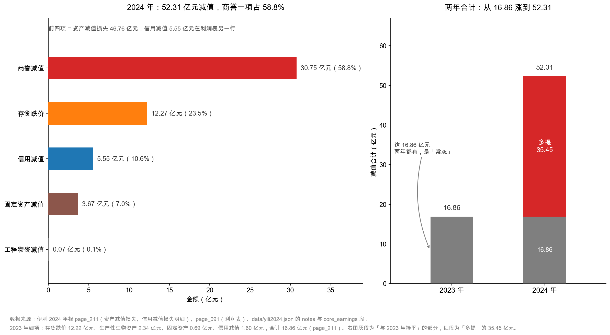
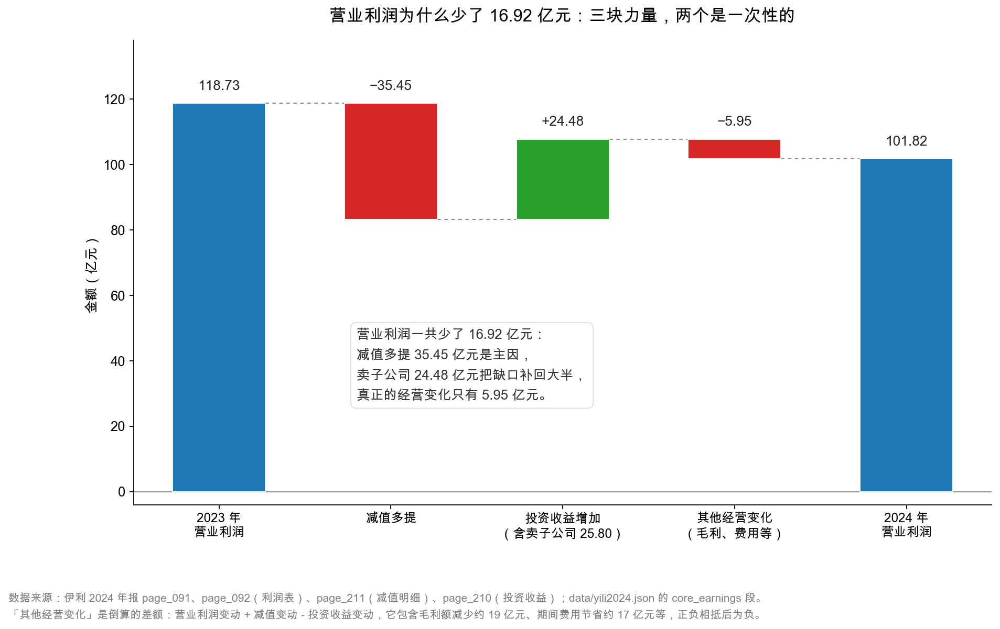

# 第 32 章：减值损失——一次性的大坑

> 本章你将：
> - 分清"资产减值损失"和"信用减值损失"这两个科目，知道它们各自管什么；
> - 拆开伊利 2024 年 52.31 亿元的减值，看清其中 35.45 亿元是"今年多提的"；
> - 亲手完成本周最重要的一次计算：**营业利润 -14.2%，但剔除减值后的经营性利润 +13.7%**；
> - 学会分辨"正常的会计估计"和"洗大澡"，拿到三条判断线索。

---

## 32.1 一个想不通的组合，和两个长得很像的科目

先把第 30 章结尾的那组数字再摆一次：

| 项目 | 2024 年 | 2023 年 | 变化 |
|---|---|---|---|
| 营业收入 | 1,153.93 亿元 | 1,257.58 亿元 | -8.2% |
| 营业利润 | **101.82 亿元** | 118.73 亿元 | **-14.2%** |
| 归母净利润 | 84.53 亿元 | 104.29 亿元 | -18.9% |
| 扣非归母净利润 | 60.11 亿元 | 100.26 亿元 | -40.0% |
| 经营活动现金流净额 | **217.40 亿元** | 182.90 亿元 | **+18.9%** |

这张表里有一个组合，第一次看会觉得很别扭：

**收入跌了 8.2%，利润跌了 14.2% 到 40%，但现金流涨了 18.9%。**

按常识，生意变差的时候，应该是"利润跌、现金也跌"才对。为什么会出现"利润大跌、现金大涨"？

第 16 章讲折旧时给过一个线索：**有些成本不花钱。** 折旧是一种，减值也是一种。

但只讲"减值不花钱"还不够。因为如果减值是"每年都差不多"的常态，那它不该造成这么大的波动——2023 年也有减值，2024 年也有减值，两者相抵，利润的跌幅应该跟收入差不多才对。

**真正的问题是：2024 年的减值，比 2023 年多了多少？**

答案在这一章。而答案揭晓的那一刻，就是整套教程的"啊哈时刻"。

先别急着算，还有一件事要弄清：利润表上其实有**两个**减值科目，它们长得很像，含义完全不同。

伊利 2024 年的利润表上，"营业利润"前面有两行负号，长得像双胞胎：

| 科目 | 2024 年 | 2023 年 | 附注 |
|---|---|---|---|
| 信用减值损失 | **-5.55 亿元** | -1.60 亿元 | 七(72) |
| 资产减值损失 | **-46.76 亿元** | -15.26 亿元 | 七(73) |

它们名字只差两个字，含义却完全不同：

| 科目 | 在说什么 | 生活类比 | 伊利 2024 |
|---|---|---|---|
| 资产减值损失 | 你**自己的东西**不值钱了：存货跌价、厂房设备减值、商誉减值 | 冰箱里囤的牛奶过期了 | 46.76 亿元 |
| 信用减值损失 | 你**该收的钱**可能收不回来了 | 借给朋友的钱，他失业了 | 5.55 亿元 |

一个管"我有的东西"，一个管"别人欠我的钱"。**这两个数千万不能合并成一个"减值"，否则后面所有比例都会算错。**

> 💡 **你可能会问：** 明明都是"东西不值钱了"，为什么要拆成两个科目？

因为会计准则想区分两类风险。**资产减值**是经营风险：存货卖不动、产能过剩、买贵了。**信用减值**是信用风险：客户赖账、担保代偿、保理出问题。这两类风险的性质不同，看报表的人需要分别判断——存货跌价可能是行业周期，应收账款坏账可能是客户质量。混在一起，就看不出问题出在哪。

先看信用减值这 5.55 亿元（`page_211.md`，附注七(72)）：

| 信用减值的构成 | 2024 年 | 2023 年 |
|---|---|---|
| 保理风险准备 | **-3.71 亿元** | -0.80 亿元 |
| 财务担保相关减值损失 | -0.96 亿元 | -0.15 亿元 |
| 小额贷款损失准备 | -0.56 亿元 | -0.52 亿元 |
| 应收账款坏账损失 | -0.16 亿元 | -0.02 亿元 |
| 应收代位追偿款坏账准备 | -0.16 亿元 | -0.03 亿元 |
| 其他应收款坏账损失 | +0.01 亿元 | -0.08 亿元 |
| 合计 | **-5.55 亿元** | -1.60 亿元 |

看这张表，第一反应可能是："应收账款坏账才 0.16 亿元，伊利的客户质量真好。"

这个判断只对了一半。**真正的大头不在应收账款，在"保理风险准备" 3.71 亿元和"财务担保" 0.96 亿元。**

"保理"是什么？简单说，伊利有自己的金融板块（融资租赁、商业保理、小额贷款），给上下游的经销商、供应商提供融资服务。经销商拿伊利开的票或者应收账款来借钱，伊利先把钱垫上。**如果经销商还不上，这笔钱就成了伊利的损失。**

所以这 3.71 亿元不是"卖牛奶收不回钱"，而是"**给渠道放贷收不回钱**"。这是两件完全不同的事：

- 应收账款坏账 0.16 亿元 → 卖牛奶的信用风险，很低；
- 保理 + 担保 + 小贷合计 5.23 亿元 → **金融业务的风险，是 2024 年新冒出来的**（2023 年三项合计只有 1.47 亿元）。

年报里写得很克制："信用减值损失增加主要原因：本期计提保理风险准备增加所致。"（`page_211.md`）

> ⚠️ **易踩坑：** 很多人看到"信用减值 5.55 亿元"，第一反应是"伊利的经销商大量赖账"。这是误读。**应收账款坏账只有 0.16 亿元，占 5.55 亿元的 2.9%。** 真正的风险在保理和担保——那是伊利自己做的类金融业务，风险敞口在渠道端，而不是在消费者端。判断一家公司的信用风险，必须拆到明细，不能只看科目名。

## 32.2 46.76 亿元资产减值：商誉占了三分之二

再看大头。资产减值损失 46.76 亿元，附注七(73)（`page_211.md`）拆成五行：

| 资产减值的构成 | 2024 年 | 2023 年 |
|---|---|---|
| 商誉减值损失 | **-30.75 亿元** | — |
| 存货跌价损失 | **-12.27 亿元** | -12.22 亿元 |
| 固定资产减值损失 | -3.67 亿元 | -0.69 亿元 |
| 工程物资减值损失 | -0.07 亿元 | — |
| 生产性生物资产减值损失 | — | -2.34 亿元 |
| 合计 | **-46.76 亿元** | -15.26 亿元 |

这张表几乎不需要解释，只需要指出三个事实：

**事实一：商誉减值 30.75 亿元，占资产减值的 65.8%，而 2023 年这一行是空的。**

商誉是收购时"付多了的钱"（第 19 章详讲）。伊利 2021 年收购澳优乳业，形成大额商誉。2024 年，澳优相关的资产组可收回金额低于账面价值，一次性计提 **30.37 亿元**（`page_184.md`），加上另一家子公司康益佳的 0.38 亿元，合计 30.75 亿元。

**2023 年这一行是零。** 也就是说，这 30.75 亿元是 2024 年"凭空"多出来的一个减项。

**事实二：存货跌价 12.27 亿元，两年几乎一模一样（2023 年 12.22 亿元）。**

这是个非常重要的观察。**存货跌价是"常态"，不是"意外"。** 乳业的原奶有保质期，成品有货架期，每年都必然有一部分存货要打折或者报废。12 亿元左右的存货跌价，应该被看成伊利"做生意的固定成本"，而不是"今年出了大事"。

记住这条，第 35 章算"剔除减值后的利润"时会用到——**把 12.27 亿元存货跌价也当成"一次性"加回去，是不对的。**

**事实三：固定资产减值从 0.69 亿元涨到 3.67 亿元，涨了 4.3 倍。**

固定资产减值通常意味着"某些产线不赚钱了、要闲置或淘汰"。3.67 亿元不算大，但方向值得留意：**它是产能过剩的一个信号**，和收入下滑 8.2% 是同一个故事的两面。

**这里有一条容易被忽略的规则：商誉减值一旦计提，就永远不能转回。** 而存货跌价、固定资产减值，在导致减值的因素消失后是可以转回的。这条差别决定了两件事的性质完全不同：存货跌价明年可能"卖出去、冲回一点"，商誉减值则是**永久性的**——那 30.75 亿元，从股东权益里彻底消失了，以后再也不会"涨回来"。所以同样是减值，商誉减值对净资产的伤害更"实"。

这张图分左右两半。

**左半边**把 2024 年的 52.31 亿元拆成五段：商誉 30.75（58.8%）、存货 12.27（23.5%）、信用 5.55（10.6%）、固定资产 3.67（7.0%）、工程物资 0.07（0.1%）。注意图里那行小字：**前四项其实是"资产减值损失 46.76 亿元"，信用减值 5.55 亿元在利润表上是另一行**，两者相加才是 52.31 亿元。

**右半边**是两年对比，而且做了一次"拆解"：2024 年那根柱子被分成两段——灰色的是"和 2023 年持平的 16.86 亿元"，红色的是"多提的 35.45 亿元"。

这个拆分是本章的钥匙。

<!-- src: 伊利股份2024年报/page_211.md 伊利股份2024年报/page_091.md 伊利股份2024年报/page_184.md -->

> 🔍 **翻到年报：** 打开 `page_211.md`，先找"72、信用减值损失"，再找"73、资产减值损失"。两张表都只有五六行，加起来不到一屏。**这是整份 270 页年报里性价比最高的两页**——52.31 亿元的来龙去脉，全在这两页上。

## 32.3 关键计算：35.45 亿元

把两年的减值并排：

| 项目 | 2024 年 | 2023 年 | 差额 |
|---|---|---|---|
| 资产减值损失 | 46.76 亿元 | 15.26 亿元 | +31.50 亿元 |
| 信用减值损失 | 5.55 亿元 | 1.60 亿元 | +3.95 亿元 |
| **合计** | **52.31 亿元** | **16.86 亿元** | **+35.45 亿元** |

**2024 年比 2023 年多计提了 35.45 亿元的减值。**

现在回到 32.1 节开头那个想不通的组合。营业利润从 118.73 亿元降到 101.82 亿元，少了 **16.92 亿元**。而减值多提了 **35.45 亿元**。

**一个减项多提了 35.45 亿元，最后营业利润只少了 16.92 亿元——说明别的项目多贡献了大约 18.5 亿元。** 那 18.5 亿元从哪来？一部分是投资收益多出来的 24.48 亿元（第 31 章），一部分是费用节省，一部分被毛利额下降抵消。

我们把这条链条画出来：

这张瀑布图从 118.73 亿元出发，先往下走 35.45 亿元（减值多提），再往上走 24.48 亿元（投资收益增加，其中 25.80 亿元是卖子公司），再往下走 5.95 亿元（其他经营变化），最后落在 101.82 亿元。

读图时注意那个标注框里的最后一句话：**"真正的经营变化只有 5.95 亿元。"**

这句话是怎么来的？倒算的：

$$\text{其他经营变化} = (101.82 - 118.73) + 35.45 - 24.48 = -5.95 \text{ 亿元}$$

意思是：把"减值"和"投资收益"这两个一次性因素都拿掉之后，伊利的营业利润其实只变动了 -5.95 亿元。

**注意：这个 -5.95 亿元里，还混着毛利额下降和费用节省两股相反的力量。** 毛利额（营业收入 - 营业成本）从 413.91 亿元降到 394.81 亿元，少了 19.10 亿元；但销售费用、管理费用合计也省了约 17 亿元。两股力量相抵，净影响才是 -5.95 亿元。

**这就是"拆开看"的价值：一个 -14.2% 的数字，拆完之后变成了"减值多提 35.45 亿元、卖资产补回 24.48 亿元、经营本身只差 5.95 亿元"三句话。**

顺便说一句：这张图也解释了为什么"看同比"永远不够。**同比只告诉你方向，不告诉你原因。** 同一个 -14.2%，可能是"卖不动了"，可能是"成本涨了"，也可能是"今年多提了减值"。三者的应对方式完全不同——第一个要担心，第二个要盯毛利，第三个反而可能是好事。**分析的工作，就是把"同比"翻译成"原因"。**

## 32.4 啊哈时刻：+13.7%

现在做本周最重要的一次计算。

**思路：既然 2024 年的减值里，有 35.45 亿元是"今年多提的"，那就把它加回去，看看"如果减值水平和 2023 年一样"，伊利能赚多少。**

用公式写就是：

$$\text{剔除减值后的经营性利润} = \text{营业利润} + \text{资产减值} + \text{信用减值}$$

注意这里加回的是**全部** 52.31 亿元（不是 35.45 亿元）。理由是：**"经营性利润"这个概念要回答的是"减值之前的利润是多少"，所以两年都要加回全部减值，这样两年才可比。** 加回 52.31 亿元和 16.86 亿元，两年的口径就统一了；如果只加回差额 35.45 亿元，那就变成了"混合口径"，没法看趋势。

算出来：

| 项目 | 2024 年 | 2023 年 | 变化 |
|---|---|---|---|
| 营业利润 | 101.82 亿元 | 118.73 亿元 | -14.2% |
| 加回：资产减值损失 | +46.76 亿元 | +15.26 亿元 | — |
| 加回：信用减值损失 | +5.55 亿元 | +1.60 亿元 | — |
| **剔除减值后的经营性利润** | **154.13 亿元** | **135.59 亿元** | **+13.7%** |

**同一家公司、同一年、同一张利润表，两个数字，方向完全相反：**

- 报表说：营业利润 **-14.2%**；
- 剔掉减值说：经营性利润 **+13.7%**。

而且这不是"数字游戏"。有三条独立的证据支持"主业在变好"：

| 证据 | 2024 年 | 2023 年 | 变化 |
|---|---|---|---|
| 毛利率 | **33.88%** | 32.58% | **+1.30 个百分点** |
| 销售费用率 | 19.05% | 17.95% | +1.10 个百分点 |
| 收现比（销售收现 ÷ 营业收入） | **1.132** | 1.091 | **+0.041** |
| 经营活动现金流净额 | 217.40 亿元 | 182.90 亿元 | **+18.9%** |

毛利率逆势上升 1.30 个百分点，说明收入下滑不是靠降价换来的——**原奶成本下降、产品结构往上走**，这两件事同时发生。收现比从 1.091 升到 1.132，说明**每 1 元收入收回来的现金更多了**，渠道没有靠赊账硬撑。经营现金流涨了 18.9%，是"主业变好"最硬的一条独立证据（第 8 周详讲）。

> 📌 **划重点：** 只读利润表的人看到"利润跌了 19%"，会得出"公司不行了"；会看附注和现金流的人看到"主业利润 +13.7%、现金流 +18.9%"，会得出"公司在出清历史包袱"。**两种人买的是同一只股票，判断完全相反。** 差别不在消息，在会不会把"一次性"和"经常性"分开。

这就是 CURRICULUM 里说的"全书最重要的一条洞见"，也是这一周的高潮。**它不是一个技巧，是一种看世界的方式：报表上的数字，是很多件事叠加之后的结果；分析的工作，是把叠加拆成单件。**

## 32.5 为什么减值不影响现金流

还有一个问题必须回答：**52.31 亿元的减值，为什么没有让现金流变差？**

答案在现金流量表的补充资料里（`page_217.md`，间接法）：

| 间接法的调整项 | 2024 年 |
|---|---|
| 净利润 | 84.64 亿元 |
| 加：资产减值准备 | **46.76 亿元** |
| 加：信用减值损失 | **5.55 亿元** |
| 加：固定资产折旧 | 40.56 亿元 |
| …… | …… |
| 经营活动产生的现金流量净额 | **217.40 亿元** |

间接法的逻辑是：**从净利润出发，把"记在利润里但没花钱的项目"一个个加回去，还原成现金。**

减值就在这个"加回去"的名单里，而且排在很前面。原因是：

**减值这笔分录，借方是"资产减值损失"（减少利润），贷方是"XX 减值准备"（减少资产账面价值）。整个过程中，一分钱现金都没有动。**

打个比方：你花 100 万元买了一台机器，用了三年，账上还剩 60 万元。今年你判断它只值 20 万元了，于是计提 40 万元减值。**这 40 万元让你的利润少了 40 万，但你的银行账户没有任何变化**——钱在三年前买机器的时候就已经付出去了。

所以：

- **利润表**：减值是真真切切的减项，一分不少地扣；
- **现金流量表**：减值被原封不动加回来，一分不影响；
- **资产负债表**：减值的对面是资产账面价值下降，机器从 60 万元变成 20 万元。

**同一件事，在三张表上留下三种不同的痕迹。** 这就是为什么伊利的利润跌 18.9%、现金流涨 18.9%——两个数字都是真的，它们只是描述了不同的事。

> 💡 **你可能会问：** 那减值是不是"假的"，可以不管它？

不是。**减值是"非现金"的，但不是"无意义"的。** 它至少说明两件事：第一，当年那笔收购付贵了（商誉减值 30.75 亿元）；第二，管理层承认了这个错误。而且减值会**永久性地降低未来的折旧摊销基数**——资产账面价值变低了，以后每年计提的折旧也变少了，**明年的利润会因此变好**。这就是"洗大澡"背后的真实动机。

**还有一件事比"减值是现金还是账面"更重要：减值本身也分三六九等。** 同样是减值，有的年年都有、属于做生意的成本，有的一次性爆发、属于历史包袱：

| 减值类型 | 伊利 2024 | 性质 | 该怎么处理 |
|---|---|---|---|
| 存货跌价 | 12.27 亿元 | **常态**，与原奶保质期、产品货架期相伴 | 不能当成一次性，留在"主业利润"里 |
| 商誉减值 | 30.75 亿元 | **一次性**，源于 2021 年收购定价 | 可以加回，但要盯住剩余商誉 |
| 固定资产减值 | 3.67 亿元 | 半常态，产能调整时集中出现 | 谨慎处理，看是否连续多年 |
| 保理风险准备 | 3.71 亿元 | **新出现的风险**，随渠道金融业务规模走 | 不能加回，这是真实的经营风险 |

这张表是本章最该带走的东西。**"减值"不是一个大类，而是四种完全不同的事。**

第 35 章算"84.53 亿元里有多少水分"时，会用到这张表：加回商誉减值是有道理的，加回存货跌价就有点自欺欺人了；而保理风险准备 3.71 亿元，**一分钱都不该加回**——它是伊利自己放贷收不回来的钱，是真实亏损。

## 32.6 批判视角：管理层是不是在"洗大澡"

讲到这里，必须停下来泼一盆冷水。

前面我们说"减值多提 35.45 亿元，所以主业其实在变好"。这个推论有一个隐含假设：**减值是一次性的、被动的、不可避免的。**

但还有另一种可能：**减值是一次性的、主动的、被管理层选出来的。**

这种操作有个形象的名字，叫"**洗大澡**"（big bath）。逻辑是：

1. 今年反正业绩已经不好了（收入 -8.2%，市场预期很低）；
2. 那就把未来几年该计提的减值，**一次性全提了**；
3. 结果是今年特别难看，但明年的折旧摊销基数变小、包袱变轻，**明年随随便便就能做出增长**；
4. 如果管理层当年有考核压力、或者新官上任，动机就更强。

**怎么判断伊利 2024 年是"被动减值"还是"主动洗澡"？** 给你三条可以自己查的线索：

**线索一：减值是否集中在某一年？**

看历史。伊利 2023 年资产减值 15.26 亿元、2024 年 46.76 亿元。**如果 2022 年、2021 年都在 15 亿元上下，只有 2024 年跳到 46 亿元，那就是"集中"**；如果过去几年本来就波动很大（10 亿、25 亿、15 亿），那 46 亿元只是波动的一部分。伊利的商誉减值在 2023 年是零、2024 年是 30.75 亿元，这个"从零到 30 亿"的跳跃，本身就说明**减值的时点是由管理层判断决定的，不是均匀发生的**。

**线索二：减值之后，商誉还剩多少？**

这是最关键的一条。伊利商誉原值 58.13 亿元、减值准备 34.76 亿元、净额 **23.37 亿元**（`page_087.md`、`page_184.md`）。

- 如果减完之后商誉几乎归零，说明"包袱一次性出清"，明年再减的空间很小——这是"真洗澡"，洗完确实轻了；
- 如果减完之后还剩一大块（伊利属于这种，还剩 23.37 亿元，其中澳优还剩约 21.55 亿元），说明**风险没有出清，未来还有可能再减**。

伊利的情况是：**澳优商誉从 51.92 亿元减到约 21.55 亿元，减了 58%，但没减完。** 这意味着 2025 年若澳优业绩继续不达预期，还可能再提。**"一次性"这个词，在用之前要打个问号。**

**线索三：下一年是否恢复正常？**

如果 2025 年的减值回到 15 亿元左右、利润恢复增长，那 2024 年就是"洗澡"；如果 2025 年继续大额减值，那 2024 年就不是洗澡，而是"问题在持续暴露"。**这一条只能等，但它是最有说服力的。** 读到年报时如果拿不到下一年的数据，就把这条写进你的"待验证清单"，不要急着下结论。

> ⚠️ **易踩坑：** 看到"减值多提"就一口咬定"公司在洗澡、明年会好"，这是另一端的偏见。**减值是会计估计，估计可能对，也可能错。** 正确的姿态是：承认"减值压住了利润"这个事实，同时对"减值明年不会再有"这个假设保持怀疑。第 35 章我们会给两个口径——一个乐观（全部加回）、一个保守（只加回商誉减值），让你看到区间有多宽。

## ✍️ 想一想

### 问 1：伊利 2024 年资产减值 46.76 亿元、信用减值 5.55 亿元。如果有人把这两个数加总成"52.31 亿元减值"，然后说"其中存货跌价占 23.5%"，这样算对不对？

**解题思路：** 先确认分母是什么，再确认分子属于哪个科目。

**参考答案：** 分两步看。第一步，"52.31 亿元减值"这个加总**是对的**——两项都是因资产不值钱而从利润里扣掉的钱，加总起来描述"这一年一共扣了多少"没问题。第二步，"存货跌价占 23.5%"这个比例**也是对的**，因为分母用的是 52.31 亿元：12.27 ÷ 52.31 = 23.5%。但如果换成"存货跌价占资产减值的比例"，就是 12.27 ÷ 46.76 = 26.2%，数字完全不同。**所以关键不是加总对不对，而是每次算比例时，要说清分母是"资产减值 46.76 亿元"还是"减值合计 52.31 亿元"。** 混用分母，是这一章最容易犯的错。

**易错点：** 把信用减值 5.55 亿元也算进"资产减值损失"里，然后去和利润表的"资产减值损失"那一行对账，发现对不上。利润表上这两行是分开列的，永远不要把 5.55 亿元塞进 46.76 亿元。

### 问 2：为什么"剔除减值后的经营性利润"要加回全部 52.31 亿元，而不是只加回多提的 35.45 亿元？

**解题思路：** 想清楚这个指标要回答什么问题，再判断哪种算法能回答它。

**参考答案：** 因为"经营性利润"要回答的是"**减值之前的利润水平是多少**"，而不是"减值比去年多了多少"。2024 年加回 52.31 亿元得 154.13 亿元，2023 年加回 16.86 亿元得 135.59 亿元——两年都加回全部减值，口径统一，才能比较出 +13.7%。如果只加回差额 35.45 亿元，2024 年变成 137.27 亿元，而 2023 年不加，那就是拿"减值前的 2024"去比"减值后的 2023"，口径不一致，算出来的增长率没有意义。**一句话：做同比，要么两年都调整，要么两年都不调整。**

**易错点：** 把"加回全部减值"误解成"假装减值没发生"。加回减值不是抹掉事实，而是换一个视角看同一组事实——就像看一个人，既可以看他"今年瘦了 5 斤"，也可以看他"现在 70 公斤"，两个说法都对，只是回答的问题不同。

### 问 3：伊利的商誉减值后还剩 23.37 亿元。这个数字对 2025 年的利润意味着什么？

**解题思路：** 从"剩余商誉的规模""对应资产组的盈利能力""减值的会计性质"三个角度推。

**参考答案：** 意味着三件事。第一，**风险没有出清**：23.37 亿元商誉里，澳优相关的约 21.55 亿元仍是敞口，如果澳优未来的收入和利润继续低于减值测试的假设，2025 年还可能再提减值。第二，**但减值的"弹药"少了很多**：从 51.92 亿元减到 21.55 亿元，即使再减，单次规模也很难重现 30 亿元的级别。第三，**减值会降低未来的摊销基数**：商誉本身不摊销，但减值后的资产组账面价值变低，未来折旧摊销会少一些，这对 2025 年的利润是**正向**的。综合起来：2025 年大概率不会再有 30 亿元级别的商誉减值，但"完全不出事"也不能打包票。**给估值时，把"剩余商誉 23.37 亿元"当成一个可能再损失的上限，而不是已经消失的历史。**

**易错点：** 认为"减值提完了就一劳永逸"。商誉减值的规则是"每年都要做减值测试"，只要资产组还在，测试就每年都要做一次，结论每年都可能变。

## 📎 数据出处

- 伊利股份 2024 年报：`page_091.md`（合并利润表，信用减值/资产减值两行）、`page_092.md`（营业利润→净利润）、`page_211.md`（附注七(72) 信用减值、七(73) 资产减值）、`page_184.md`（商誉减值明细）、`page_087.md`（商誉净额）、`page_217.md`（现金流量表补充资料，间接法加回减值）、`page_007.md`（主要会计数据）
- 数据汇总：`data/yili2024.json` 的 `income`、`notes`、`core_earnings`、`compare_2023.income`、`goodwill_detail` 段

下一章：[第 33 章：非经常性损益——把一次性因素剔掉](33-非经常性损益.md)
