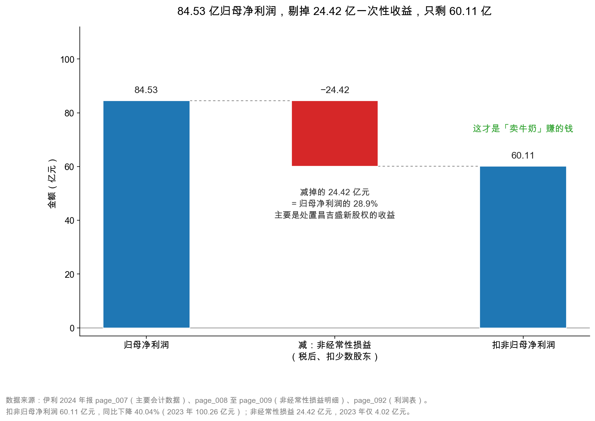

# 第 33 章：非经常性损益——把一次性因素剔掉

> 本章你将：
> - 看懂 A 股年报里那张"非经常性损益"表，以及监管为什么强制要求披露；
> - 拆开伊利 2024 年的 24.42 亿元非经常性损益，看清最大的一笔从哪来；
> - 弄明白一个反直觉的事实：**商誉减值不在非经常性损益里**；
> - 用扣非归母净利润给伊利 2024 年下一个判断：-40.04% 是这份年报最刺眼的数字。

---

## 33.1 一张藏在第 8 页的表，和它为什么必须存在

第 31 章和第 32 章，我们一直在做同一件事：**把"一次性的钱"从利润里认出来、量出来。**

但你可能一直有个疑问：**我凭什么自己判断哪笔是一次性的？我说是就是吗？**

好消息是：这件事不用你自己判断。**中国的监管早就替你想好了——A 股上市公司必须在年报里披露一张"非经常性损益"表。**

伊利 2024 年报的这张表在 `page_008.md` 到 `page_009.md`，紧跟在"主要会计数据"后面。标题是"十、非经常性损益项目和金额"。

它的样子是：左边一列是监管规定的项目清单（二十来项，大部分公司只填其中几项），中间是 2024 年金额、2023 年金额、2022 年金额三列，最后三行是"减：所得税影响额""少数股东权益影响额（税后）""合计"。

伊利这张表的最后一行写着：**合计 24.42 亿元**。

而第 007 页的"主要会计数据"里有这么一行：

| 主要会计数据 | 2024 年 | 2023 年 | 增减 |
|---|---|---|---|
| 归属于上市公司股东的净利润 | 84.53 亿元 | 104.29 亿元 | -18.94% |
| 归属于上市公司股东的**扣除非经常性损益的净利润** | **60.11 亿元** | 100.26 亿元 | **-40.04%** |

**84.53 - 24.42 = 60.11。** 两个数字严丝合缝地对上了。

这就是本章要讲的全部内容：**归母净利润减去非经常性损益，等于扣非归母净利润。**

> 📌 **划重点：** 非经常性损益不是"公司自己随便定义的"，而是监管列了一张清单，公司照着填。清单之外的重大项目，如果公司认为是非经常性的，还要单独说明理由。**这张表的存在，就是为了让不同公司的"主业利润"可以横向比较。**

**这张表为什么必须存在？** 因为它解决的是一个真实存在过的困局。

假设有两家公司，今年都赚 10 亿元：

- **A 公司**：卖牛奶赚了 10 亿元，年年如此；
- **B 公司**：卖牛奶赚了 2 亿元，把一栋楼卖了赚了 8 亿元。

如果只看"归母净利润"，两家都是 10 亿元，市盈率一样，看起来一样便宜。

**但 A 公司明年还能赚 10 亿元，B 公司明年大概只能赚 2 亿元。** 用同样的价格买，一个 10 倍 PE，一个 50 倍 PE。

在没有强制披露的年代，这种"卖楼保壳""卖资产撑业绩"的做法非常普遍，尤其在业绩承诺期、扭亏保壳年、大股东减持前。投资者看到的"利润增长"，可能是卖掉一栋楼换来的。

于是监管出了这张表：**把监管认为"不属于正常经营"的项目列出来，要求公司逐项披露，并且算出"扣掉这些之后的净利润"。**

这张表的名字叫"非经常性损益"（non-recurring gains and losses），算出来的结果叫"扣非净利润"（net profit excluding non-recurring items）。

**"扣非"这两个字，是 A 股财报里信息含量最高的两个字。** 因为它回答的是那个最重要的问题：**这家公司靠主业，到底能赚多少？**

> 💡 **你可能会问：** 港股和美股有这张表吗？

没有强制版本。港股没有"扣非净利润"这个法定披露项，美股公司常用"调整后净利润"（adjusted net income）这种自己定义的口径，各家公司口径五花八门，经常被批评为"管理层想怎么调就怎么调"。**A 股的"非经常性损益"因为有统一的清单，横向可比性反而更好。** 这是一个中国特色的制度优势，值得知道。

## 33.2 24.42 亿元是怎么算出来的

现在把伊利这张表拆开。它一共填了五项（其余项目空白）：

| 非经常性损益项目 | 2024 年 | 2023 年 |
|---|---|---|
| 非流动性资产处置损益 | **+25.64 亿元** | -0.20 亿元 |
| 计入当期损益的政府补助（剔除持续性补助后） | +3.94 亿元 | +4.32 亿元 |
| 金融资产/负债公允价值变动及处置损益 | -0.28 亿元 | +2.78 亿元 |
| 单独进行减值测试的应收款项减值准备转回 | +0.11 亿元 | +0.16 亿元 |
| 因相关经营活动不再持续而发生的一次性费用 | -0.13 亿元 | -0.35 亿元 |
| 除上述各项之外的其他营业外收支 | -0.23 亿元 | -1.17 亿元 |
| **小计（税前）** | **+29.06 亿元** | +5.55 亿元 |
| 减：所得税影响额 | **-4.60 亿元** | -1.32 亿元 |
| 减：少数股东权益影响额（税后） | **-0.04 亿元** | -0.21 亿元 |
| **合计** | **24.42 亿元** | 4.02 亿元 |

这张表有三个地方值得停下来看。

**第一处：25.64 亿元的非流动资产处置损益，占了全表的 88%。**

这 25.64 亿元从哪来？第 31 章已经交代过：**卖掉昌吉盛新实业有限责任公司的 100% 股权，处置收益 25.80 亿元**（`page_210.md`、`page_227.md`）。

注意，这里出现了一个小小的错位：非经常性损益表里写的是"非流动性资产处置损益 25.64 亿元"，而投资收益附注里写的是"处置长期股权投资 25.80 亿元"。**两者差 0.16 亿元。**

为什么？因为"非流动性资产处置损益"这个项目，除了包含卖股权的收益，还要**扣掉当年处置固定资产的损失**（伊利 2024 年处置固定资产损失 0.42 亿元，`page_213.md`），加上一些小项。25.80 - 0.42 再加减一些小项，就接近 25.64 了。

**还有一个容易忽略的细节：非经常性损益表里的"2023 年金额"列，是"重述后"的数字。**

如果一家公司在 2024 年发生了会计政策变更或者同一控制下合并，它会把 2023 年的对比数一起调整。所以你拿 2023 年的年报和 2024 年报里的"2023 年非经常性损益"对比，偶尔会发现两个数字不一样。**这不是印错了，是重述。** 遇到这种情况，以最新一期年报里的对比数为准，因为那才是和本期同口径、可以直接比的数据。

同理，"扣非归母净利润 2023 年 100.26 亿元"这个数，如果 2025 年的年报里重述过，也会变。**看跨年数据时，永远用"最新一版年报里的历史对比列"，而不是"当年那版年报里的本期数"。** 这条规则在第 42 章算 ROE、第 43 章算周转率时都会再用到。

> ⚠️ **易踩坑：** 看到"25.64"和"25.80"两个数字不一致，就以为哪个抄错了。**它们本来就是两个不同口径的数字**：25.80 是"投资收益"科目里的处置股权收益，25.64 是"非经常性损益"表里的非流动资产处置净损益（含固定资产处置损失）。看年报时遇到这种"差一点点"，先想口径，再想错误。

**第二处：政府补助只算了 3.94 亿元，不是 9.84 亿元。**

第 31 章讲过：其他收益里有 9.84 亿元政府补助，但被认定为"非经常性"的只有 3.94 亿元。剩下的 5.90 亿元，公司认为符合"与正常经营业务密切相关、按确定标准享有、对损益产生持续影响"的条件，所以留在了扣非口径里。

**这是整张表里最需要"带着怀疑看"的一行。** 因为"是否持续影响"是一个判断，不是一条硬规则。同样的补助，有的公司全额算非经常性，有的公司拆成两块。伊利的处理是拆开——这在乳业里算常见做法（良种补贴、收储补贴确实年年有），但你作为读者要知道：**这 5.90 亿元是被"留在主业里"的，如果把它也剔掉，扣非净利润会从 60.11 亿元降到 54.21 亿元。**

**第三处：小计 29.06 亿元，为什么最后只剩 24.42 亿元？**

因为要交税，还要分给少数股东：

$$\text{合计} = 29.06 - 4.60 - 0.04 = 24.42 \text{ 亿元}$$

**这一步非常重要，也是最多人算错的地方。** 非经常性损益表算的是"税后、归属母公司"的金额，而利润表上的"投资收益 24.17 亿元"是"税前、合并口径"的金额。**两个数字不能直接相减，也不能直接相加。**

举个例子：卖子公司赚 25.80 亿元（税前），要交 25% 的企业所得税，实际到手约 19.35 亿元。非经常性损益表里的"所得税影响额 4.60 亿元"，主要就是这笔税。

<!-- src: 伊利股份2024年报/page_008.md 伊利股份2024年报/page_009.md 伊利股份2024年报/page_007.md 伊利股份2024年报/page_210.md 伊利股份2024年报/page_213.md -->

> 🔍 **翻到年报：** 打开 `page_008.md`，往下翻到"十、非经常性损益项目和金额"。注意表头有**四列**：项目、2024 年金额、附注、2023 年金额，再往右还有 2022 年金额。**这张表给了三年数据，是用来让你看"哪些项目年年都有"的。** 比如政府补助连续三年都有（3.94、4.32、11.11 亿元），而处置损益三年是 25.64、-0.20、0.39 亿元——**一眼就能看出哪个是常态、哪个是偶发。**

## 33.3 最反直觉的一条：商誉减值不算非经常性损益

现在讲这一章、也是这一周最容易让人摔跤的一个知识点。

你可能会自然地想：**商誉减值 30.75 亿元，明明是一次性的，为什么不在非经常性损益表里？**

翻开监管的清单（《公开发行证券的公司信息披露解释性公告第 1 号——非经常性损益》），里面列的二十来项，包括：非流动资产处置损益、政府补助、公允价值变动、债务重组、非货币性资产交换、委托理财、自然灾害损失、一次性费用……**没有"资产减值损失"，也没有"商誉减值"。**

为什么？

因为监管的逻辑是：**减值属于"日常经营中可能发生的资产价值下降"，是经常性损益。**

这个逻辑听上去有点违和，但站得住脚：一家公司持有存货、厂房、商誉，这些东西每年都要做减值测试，测试结果可能提、也可能不提。**提减值本身是正常的会计程序，不是"偶然事件"。** 如果允许把减值放进非经常性损益，那公司只要在某一年大提一笔减值，就能把当年的扣非净利润做得很低，第二年再"恢复"，形成"洗大澡"的完美工具。

**所以规则是：减值留在扣非净利润里，不许剔。**

这条规则带来一个非常重要的推论：

> 📌 **划重点：** 伊利 2024 年扣非净利润 -40.04%，**这 40% 里有一大半是减值造成的，而减值是"经常性"的。** 换句话说：按监管口径，减值不是"意外"，它就是主业的一部分。你不能一边说"扣非 -40% 太惨了"，一边说"减值是一次性的、要加回"——**这两句话在监管口径下是矛盾的。**

那怎么办？答案是：**两个口径都看，并且说清各自在回答什么问题。**

| 口径 | 伊利 2024 | 回答的问题 | 局限性 |
|---|---|---|---|
| 归母净利润 | 84.53 亿元 | 股东今年分到多少账面利润 | 含 24.42 亿元一次性收益，虚高 |
| 扣非归母净利润 | 60.11 亿元 | 主业按监管口径赚多少 | 含 52.31 亿元减值，可能虚低 |
| 扣非 + 加回减值（第 35 章） | 约 103.82 亿元 | 减值之前，主业能赚多少 | 假设减值全是一次性的，偏乐观 |

**三个数字，从 60.11 到 103.82，差了 43.71 亿元。** 这个区间有多宽，就说明"利润质量"这件事有多难判断。

这张瀑布图只有三根柱子，但它把本章的核心讲完了。

左边 84.53 亿元是报表最显眼的那一行，也是媒体标题里最常出现的数字。中间那根红色的柱子是 24.42 亿元，也就是非经常性损益——**注意它是"税后、扣少数股东后"的金额，所以能直接从 84.53 里减掉。** 右边 60.11 亿元，是扣非归母净利润。

图上那句标注"减掉的 24.42 亿元 = 归母净利润的 28.9%"，是这张图最该记住的比例。**接近三成的归母净利润，不是卖牛奶赚的。**

## 33.4 -40.04%：这份年报里最刺眼的数字

现在把三个增速并排放：

| 指标 | 2024 年 | 2023 年 | 变化 |
|---|---|---|---|
| 营业收入 | 1,153.93 亿元 | 1,257.58 亿元 | **-8.24%** |
| 归母净利润 | 84.53 亿元 | 104.29 亿元 | **-18.94%** |
| 扣非归母净利润 | 60.11 亿元 | 100.26 亿元 | **-40.04%** |

**收入跌 8%，归母净利跌 19%，扣非净利跌 40%。**

三层的跌幅一层比一层深，每一层都多了一个"放大器"：

- 收入 -8.24% → 归母 -18.94%：放大器是**减值**（52.31 亿元，同比多提 35.45 亿元）；
- 归母 -18.94% → 扣非 -40.04%：放大器是**非经常性收益减少**——等等，这里要小心。

第三层的逻辑不是"收益减少"，而是"2024 年有一笔 2023 年没有的收益"。2023 年非经常性损益只有 4.02 亿元，2024 年是 24.42 亿元，**多了 20.40 亿元**。这多出来的 20.40 亿元把归母净利润托住了，所以归母只跌 18.94%；一旦剔掉，扣非就跌 40.04%。

**换个说法：如果没有卖昌吉盛新那 25.80 亿元，伊利的归母净利润会是 60.11 亿元，同比跌 40%。** 卖子公司这个动作，把报表上的跌幅从 40% 缩小到了 19%，**少跌了 21 个百分点。**

这就是"非经常性损益"最典型的用法：**它不一定让公司"虚增利润"（钱是真的），但它会让"利润的同比变化"失真。**

> ⚠️ **易踩坑：** 有人会说"卖子公司赚的钱也是钱，凭什么剔除？"——**是钱，但它不可持续。** 昌吉盛新只能卖一次，明年不会再有第二家。用一次性的收益去掩盖经常性的下滑，是分析里最常见的自我欺骗。**扣非净利润存在的意义，就是把这层遮羞布掀掉。** 但反过来也要小心：扣非把减值留在了里面，所以它也可能"过度悲观"。两个方向都要防。

## 33.5 实操：三分钟定位这张表

讲完原理，给一套可以立刻用的动作。拿到任何一份 A 股年报，按这四步走，三分钟就能拿到"扣非"这个数。

**第一步：翻到"主要会计数据"。** 位置通常在"第二节 公司简介和主要财务指标"里，伊利是 `page_007.md`。找三行：营业收入、归属于上市公司股东的净利润、归属于上市公司股东的扣除非经常性损益的净利润。**这三行是整份年报的"封面数字"，几乎所有媒体标题都从这里取。**

**第二步：记住"三个增速"。** 伊利 2024 年这三个数是 -8.24%、-18.94%、-40.04%。**如果三个跌幅一层比一层深，说明有"放大器"；如果扣非跌幅比归母小，说明当年有一次性损失（比如大额减值或处置亏损）。** 这个"增幅差"本身就是一条线索，指向你下一步该翻哪一页。

**第三步：翻到"非经常性损益项目和金额"。** 位置紧跟在主要会计数据后面，伊利是 `page_008.md` 到 `page_009.md`。**先看"合计"那一行，再看金额最大的那一项。** 大多数年份，最大的那一项就解释了 80% 的原因。

**第四步：回到附注，验证最大那一项。** 比如 2024 年最大的是"非流动性资产处置损益 25.64 亿元"，就去附注七(69)（`page_210.md`）看投资收益明细，再去 `page_227.md` 看处置了哪家子公司。**两步交叉验证，数字对得上，这条信息就可以用了。**

| 步骤 | 看哪里 | 伊利 2024 的答案 | 花多久 |
|---|---|---|---|
| 1 | 主要会计数据（`page_007.md`） | 归母 84.53 亿、扣非 60.11 亿 | 1 分钟 |
| 2 | 算三个增速 | -8.24%、-18.94%、-40.04% | 30 秒 |
| 3 | 非经常性损益表（`page_008.md`） | 合计 24.42 亿，最大项 25.64 亿 | 1 分钟 |
| 4 | 附注验证（`page_210.md`、`page_227.md`） | 卖昌吉盛新，处置收益 25.80 亿 | 1 分钟 |

**这套动作的价值在于：它把"读年报"变成了一件有固定路线的事。** 你不需要读完 270 页，只需要知道这四个位置在哪。第 5 章讲的"十分钟定位 20 个关键数字"，用的就是同一套思路。

> 🔍 **翻到年报：** 现在就拿伊利年报练一次。先看 `page_007.md` 记住三个数，再看 `page_008.md` 找最大的那一项，最后翻 `page_210.md` 验证。整套动作做完，你应该能在三分钟内说出："伊利 2024 年扣非 60.11 亿元，同比 -40%，主要因为 2023 年没有那笔 25.80 亿元的卖子公司收益。"

## 33.6 扣非净利润的三个使用陷阱

扣非净利润很好用，但它不是万能的。三个陷阱，每个都值得记住。

**陷阱一：把扣非当成"可持续利润"。**

扣非只是"剔掉了监管清单上的项目"，**它并没有剔掉所有的一次性因素**。最典型的就是减值——减值明明是一次性的，但按规则留在扣非里。所以：

- 一家公司如果某年大提减值，扣非会异常低；
- 一家公司如果某年冲回减值（存货跌价可以转回），扣非会异常高。

**扣非不是"干净利润"，它只是"监管口径的利润"。** 想得到"可持续利润"，还得自己再调整一步（第 35 章）。举个具体例子：伊利 2024 年扣非 60.11 亿元，但里面有 12.27 亿元存货跌价、3.71 亿元保理风险准备——前者是常态成本，后者是真实的坏账风险，**这两块都不该被"加回"，可是它们也都不该被当成"主业的正常盈利水平"**。所以 60.11 亿元这个数，既不是"太惨"，也不是"刚好"，它只是"按规则算出来的那个数"。

**陷阱二：跨公司比较时，忘了口径差异。**

同样是"扣非净利润"，不同公司的"非经常性"边界可能不一样。比如政府补助：伊利把 5.90 亿元留在了扣非里，另一家公司可能全额剔掉。**这会直接导致两家的扣非净利润不可比。**

跨公司比较时，正确做法是：**先看两家的非经常性损益明细表，确认大项的处理方式一致，再比。** 如果差异很大，就退回到"营业利润"或者"毛利率"这种更靠上的指标去比。

**陷阱三：只看一年，不看三年。**

非经常性损益表给了三年数据（2022、2023、2024），这是有意的。**单看一年，你只能知道"今年有没有一次性收益"；看三年，你才能知道"这家公司是不是经常靠一次性收益过日子"。**

伊利三年的非经常性损益：2022 年 8.45 亿元、2023 年 4.02 亿元、2024 年 24.42 亿元。**2024 年是异常的**——前两年都在 10 亿元以下，2024 年跳到 24 亿元，原因就是那笔卖子公司。这个"异常"本身就是信息。

反过来，如果一家公司连续五年非经常性损益都占归母净利润的 30% 以上，那它的"主业"其实一直没赚到钱——**扣非净利润会连续五年远低于归母净利润，这个 pattern 比任何单年数字都危险。**

> 💡 **你可能会问：** 那我看年报时，应该先看归母还是先看扣非？

**先看归母，再看扣非，最后看两个的差距。** 归母是"结果"，扣非是"主业的底色"，差距是"这一次性因素的规模"。三个一起看，才能形成判断。只看归母会被一次性收益骗，只看扣非会被减值吓到。

## ✍️ 想一想

### 问 1：伊利 2024 年非经常性损益 24.42 亿元，其中处置昌吉盛新的收益是 25.80 亿元（税前）。为什么非经常性损益合计比 25.80 亿元还少？

**解题思路：** 从"税前 vs 税后"和"正项 vs 负项"两个维度拆。

**参考答案：** 有两个原因。第一，**税**。25.80 亿元是税前收益，要交企业所得税，非经常性损益表里的"所得税影响额 4.60 亿元"主要就是这笔税。第二，**表里还有负项**：公允价值变动 -0.28 亿元、一次性费用 -0.13 亿元、其他营业外收支 -0.23 亿元，这些都要从 25.64 亿元里扣。所以完整算式是：25.64（处置净损益）+ 3.94（政府补助）- 0.28 - 0.13 - 0.23 + 0.11 = 29.06（税前小计），再减 4.60（所得税）、0.04（少数股东），等于 24.42 亿元。**核心是记住：非经常性损益表是"税后、归母"口径，不能拿利润表上的税前数字直接对比。**

**易错点：** 把 25.80 亿元和 24.42 亿元直接相减，得出"还有 1.38 亿元的其他收益"这种结论。两个数字一个是投资收益科目的税前数、一个是非经常性损益表的税后数，没有可比性。

### 问 2：商誉减值明明是一次性的，为什么监管不让它进非经常性损益？这个规则合理吗？

**解题思路：** 从"规则想防什么"和"规则带来了什么副作用"两面看。

**参考答案：** 规则想防的是"利用减值调节利润"。如果减值可以算非经常性，公司就会在业绩差的年份大提减值（把扣非做低），第二年再轻松恢复，形成"洗大澡"的合法通道。把减值留在扣非里，等于告诉公司：**你提的减值，要自己承担后果，不能甩给"非经常"。** 这个逻辑是合理的。但它有副作用：**当减值真的是一次性的时候（比如伊利 2024 年的商誉减值 30.75 亿元），扣非净利润就会被压得过分低**，让"扣非 -40.04%"这个数字看起来比实际情况更糟。所以规则是"防作弊优先"，代价是"偶尔失真"。作为读者，你要知道这个代价的存在，并且自己动手做第二次调整。

**易错点：** 认为"监管说它是经常性，它就真的是经常性"。监管的分类是为了"防止操纵"，不是为了"精确描述经济实质"。这两件事经常不一致，分析者要有自己的判断。

### 问 3：如果一家公司连续三年扣非净利润都是负的，但归母净利润都是正的，你会怎么判断？

**解题思路：** 先算"非经常性损益占归母净利润的比例"，再看这些非经常性收益的来源，最后判断这种模式的可持续性。

**参考答案：** 这是最危险的财务画像之一，可以分三步。第一步量化：非经常性损益 = 归母净利润 - 扣非净利润，如果连续三年这个差额都大于归母净利润，说明**主业一直在亏，全靠非经常性项目把总利润拉正**。第二步看来源：如果来源是政府补助，说明公司在靠政策输血；如果是处置资产，说明公司在卖家底，而家底是有限的；如果是公允价值变动，说明利润随市场波动，完全不可控。第三步看趋势：卖的资产是不是越来越少？补助是不是在退坡？如果两者都在减少，那这家公司的"正利润"维持不了几年。**结论：这类公司的估值不该用 PE，因为分母是假的；应该用 PB 或者清算价值去估。**

**易错点：** 只看"归母净利润为正"就认为公司没问题。**利润的正负号，比利润的大小更容易骗人。** 一年正一年负的公司并不可怕，可怕的是"主业一直亏、靠外力维持正号"——这种公司往往在某个时点会突然"业绩变脸"，因为家底卖完了。

## 📎 数据出处

- 伊利股份 2024 年报：`page_007.md`（主要会计数据，归母与扣非归母）、`page_008.md`~`page_009.md`（非经常性损益项目明细表）、`page_210.md`（投资收益明细）、`page_227.md`（处置昌吉盛新）、`page_213.md`（营业外收支明细）、`page_092.md`（合并利润表）
- 数据汇总：`data/yili2024.json` 的 `income`、`nonrecurring`、`notes` 段

下一章：[第 34 章：所得税与少数股东损益——净利润 $\neq$ 归母净利润](34-所得税与少数股东损益.md)
