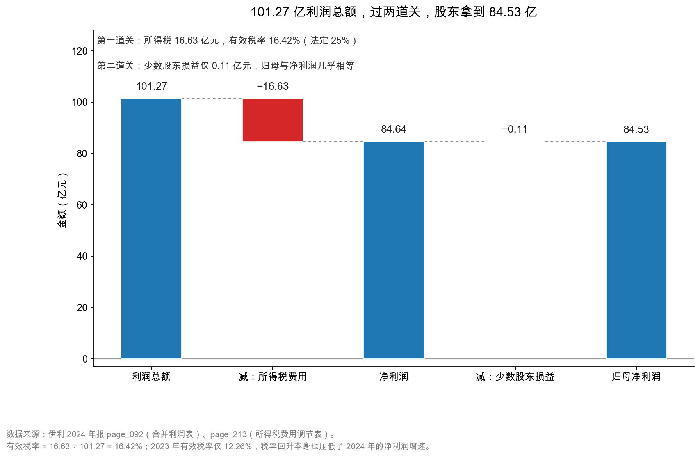

# 第 34 章：所得税与少数股东损益——净利润 $\neq$ 归母净利润

> 本章你将：
> - 走完利润表最后的"两道关"：从利润总额到净利润，再到归母净利润；
> - 学会算有效税率，并知道它为什么可以远低于法定 25%；
> - 看懂递延所得税——一笔"今年多交、明年能抵"的钱藏在哪；
> - 记住净利润的三个层次，以及为什么必须一层层往下剥。

---

## 34.1 最后两道关

前面三章，我们一直在利润表的"上半场"打转：收入、成本、费用、杂项收益、减值。

现在走到最后。伊利 2024 年利润表的最后五行是这样的（`page_092.md`）：

| 项目 | 2024 年 | 2023 年 |
|---|---|---|
| 三、营业利润 | 101.82 亿元 | 118.73 亿元 |
| 加：营业外收入 | 0.78 亿元 | 2.30 亿元 |
| 减：营业外支出 | 1.33 亿元 | 3.82 亿元 |
| **四、利润总额** | **101.27 亿元** | 117.21 亿元 |
| 减：所得税费用 | **16.63 亿元** | 14.37 亿元 |
| **五、净利润** | **84.64 亿元** | 102.84 亿元 |
| 归属于母公司股东的净利润 | **84.53 亿元** | 104.29 亿元 |
| 少数股东损益 | **0.11 亿元** | -1.44 亿元 |
| 基本每股收益 | 1.33 元 | 1.64 元 |

这张表里有三道减法，每一道都可能让数字走样：

1. **营业利润 → 利润总额**：加减"营业外收支"。伊利 2024 年是净支出 0.55 亿元，金额不大，但 2023 年是净支出 1.52 亿元，两年都不为零。
2. **利润总额 → 净利润**：减"所得税费用"。这是本章重点之一。
3. **净利润 → 归母净利润**：减"少数股东损益"。这是本章重点之二。

三道减法全都走完，101.82 亿元的营业利润变成 84.53 亿元的归母净利润，**中间蒸发了 17.29 亿元**，占营业利润的 17.0%。

> 📌 **划重点：** "净利润"不是一个数，而是三个数：**净利润（含少数股东）、归母净利润（只算母公司股东）、扣非归母净利润（再剔一次性）**。看年报时如果只记一个，一定记归母——因为那才是你作为股东能分到的那一份。

## 34.2 第一道关：所得税 16.63 亿元，有效税率 16.42%

先看所得税。

伊利 2024 年利润总额 101.27 亿元，所得税费用 16.63 亿元。两者相除：

$$\text{有效税率} = \frac{16.63}{101.27} = 16.42\%$$

**16.42%，比法定企业所得税率 25% 低了 8.58 个百分点。**

这 8.58 个百分点意味着什么？如果按 25% 交税，伊利要交 25.32 亿元，实际只交了 16.63 亿元，**少交了 8.69 亿元**。这 8.69 亿元，直接变成了股东的利润。

**为什么能少交这么多？** 附注七(77)（`page_213.md`）给了一张"会计利润与所得税费用调整过程"表，这张表是本章最值得研究的一页：

| 调整项 | 金额 | 对税率的影响 |
|---|---|---|
| 利润总额 | 101.27 亿元 | — |
| 按法定/适用税率计算的所得税费用 | 15.19 亿元 | 15.00% |
| 加：子公司适用不同税率的影响 | +4.08 亿元 | +4.03 个百分点 |
| 加：不可抵扣的成本、费用和损失 | +5.62 亿元 | +5.55 个百分点 |
| 加：本期未确认递延所得税资产的可抵扣亏损 | +0.84 亿元 | +0.83 个百分点 |
| 加：调整以前期间所得税 | +0.45 亿元 | +0.44 个百分点 |
| 减：免税项目所得的影响 | -8.21 亿元 | -8.11 个百分点 |
| 减：使用前期未确认递延税资产的可抵扣亏损 | -1.31 亿元 | -1.30 个百分点 |
| 减：非应税收入的影响 | -0.02 亿元 | -0.02 个百分点 |
| **所得税费用** | **16.63 亿元** | **16.42%** |

这张表要分两半看。

**加项（让税率变高的）：**

- **不可抵扣的成本、费用和损失 +5.62 亿元**。这是最大的一笔"加税"。什么费用不能抵税？业务招待费只能按 60% 抵扣、超标部分不能抵；罚款、滞纳金不能抵；某些捐赠不能抵。伊利这个数不小，说明有相当一部分支出在税法上不被承认。
- **子公司适用不同税率 +4.08 亿元**。这一项是"加"的，说明有些子公司的税率**高于** 15%（基准），比如注册在境内、但不享受优惠的子公司按 25% 交。
- **未确认递延所得税资产的可抵扣亏损 +0.84 亿元**。意思是：某些子公司今年亏了钱，本来可以"留着以后抵税"，但公司判断它未来大概率赚不回来，所以不确认这笔"未来的抵税权"，当年就得多交税。

**减项（让税率变低的）：**

- **免税项目所得的影响 -8.21 亿元**。这是最大的一笔"减税"。什么所得免税？最典型的是**国债利息收入**、**符合条件的居民企业之间的股息红利**。伊利持有大额存单、债券，利息收入里有一部分是免税的；从子公司分回的股息，在合并层面也会抵销，但单体报表上可能涉及。
- **使用前期未确认递延税资产的可抵扣亏损 -1.31 亿元**。意思是：以前年度亏损时"没敢确认"的抵税权，今年赚钱了，用上了，所以少交税。

**为什么"按法定税率计算的所得税费用"是 15.19 亿元、对应 15.00%，而不是 25%？**

这个问题很容易卡住。答案是：**这张表的"基准税率"不是 25%，而是公司主体实际适用的优惠税率。**

伊利年报的"六、税项"章节（`page_149.md`~`page_150.md`）把这件事写得很清楚，三条优惠叠在一起：

| 优惠依据 | 内容 | 影响 |
|---|---|---|
| 西部大开发政策 | 本公司及位于西部大开发政策适用地区的部分子公司，2024 年适用 **15%** 优惠税率 | 把基准从 25% 拉到 15% |
| 农产品初加工、牲畜饲养 | 依据企业所得税法第二十七条，本公司及部分子公司的农产品初加工项目所得、牲畜饲养所得**免征**企业所得税 | 直接产生"免税所得" |
| 高新技术企业 | 部分子公司在 2024 年适用 **15%** 优惠税率 | 加重低税率的权重 |

同时年报也列了"不同税率纳税主体"：香港金港商贸 16.5%、新西兰的 Oceania Dairy 和 Westland Dairy 28%、印尼 PT Yili 22%、泰国 THE CHOMTHANA 20%、澳优荷兰主体 25.8%。**所以伊利的实际税率是一张"拼图"，15% 只是拼图里最大的一块。**

把 15% 和最终的 16.42% 放在一起看，逻辑就清楚了：**基准 15% + 不可抵扣费用 5.55 - 免税所得 8.11 + 其他零星项，最后落在 16.42%。**

那张调整表里"免税项目所得的影响 -8.21 亿元"这一项，主要就是上面第二条——**农产品初加工和牲畜饲养所得免税**。伊利自己有牧场、有原奶业务，这部分所得在税法上不交企业所得税。**这不是"税务筹划"，是农业政策给的红利。**

> 💡 **你可能会问：** 有效税率低，是不是好事？

**通常是好事，但要分清"结构性低"和"一次性低"。**

- **结构性低**：高新技术企业 15%、农产品初加工免税、研发费用加计扣除。这些是年年都有的，属于"持久的税收优势"，应该被计入长期盈利能力。伊利属于这种。
- **一次性低**：某年确认了一大笔递延所得税资产、某年处置了免税资产、某年有以前年度亏损可以抵。这些只发生一次，明年税率就会回去。

**伊利 2024 年的 16.42% 属于"结构性偏低 + 部分一次性"的混合。** 一个可以参考的对比：2023 年伊利的有效税率只有 **12.26%**（所得税 14.37 亿元 ÷ 利润总额 117.21 亿元）。

| 年份 | 利润总额 | 所得税费用 | 有效税率 |
|---|---|---|---|
| 2024 年 | 101.27 亿元 | 16.63 亿元 | **16.42%** |
| 2023 年 | 117.21 亿元 | 14.37 亿元 | **12.26%** |

**有效税率从 12.26% 升到 16.42%，涨了 4.16 个百分点。** 这意味着：即使利润总额不变，光是税率上升，净利润就会少 4 亿多元。**税率变化，是利润分析里最容易被忽略的一个"隐形变量"。**

> ⚠️ **易踩坑：** 用"利润总额乘以 25%"去估算净利润，在伊利身上会错得很离谱。25% 的税率算出来是 25.32 亿元，实际只有 16.63 亿元，差 8.69 亿元——**差不多是归母净利润的 10%。** 正确做法是用"利润总额乘以有效税率"，而有效税率要自己去两年报表里算，不要假设。

<!-- src: 伊利股份2024年报/page_092.md 伊利股份2024年报/page_213.md 伊利股份2024年报/page_149.md 伊利股份2024年报/page_150.md -->

> 🔍 **翻到年报：** 打开 `page_213.md`，找到"77、所得税费用"。它下面有两张表：第一张"(1) 所得税费用表"只有三行——当期所得税费用 20.26 亿元、递延所得税费用 -3.63 亿元、合计 16.63 亿元。第二张"(2) 会计利润与所得税费用调整过程"就是上面那张九行的表。**先看第一张，理解"当期 + 递延 = 合计"；再看第二张，理解"为什么合计比 25% 少"。**

## 34.3 递延所得税：藏在资产负债表里的"未来抵税权"

刚才那张表里有一行特别值得单独讲：**递延所得税费用 -3.63 亿元。**

"递延"这两个字，是会计里最容易让人放弃的地方。但它的逻辑其实很简单，用一个例子就能说清。

**例子：** 你开公司，今年买了一批货，成本 100 万元，但到年底还没卖出去。会计上，这 100 万元是"存货"，不算成本，所以账面利润里没有扣它。但税法上，有些情况下税务局会说"你这笔支出今年可以先抵"。

于是出现了一个时间差：

- **会计**：今年不扣，明年卖出去了再扣；
- **税务**：今年就扣了。

结果：**今年少交税，明年多交税。** 这个"今年少交的部分"，就是"递延所得税负债"；反过来，如果"今年多交、明年少交"，就是"递延所得税资产"。

**换个说法：递延所得税资产 = 一笔"预付的税"，未来能抵；递延所得税负债 = 一笔"欠着的税"，未来要补。**

伊利 2024 年末：

| 项目 | 金额 | 含义 |
|---|---|---|
| 递延所得税资产 | **20.74 亿元** | 未来可以少交的税 |
| 递延所得税负债 | **10.40 亿元** | 未来要多交的税 |
| 净额 | **+10.34 亿元** | 净"未来抵税权" |

这 20.74 亿元的递延所得税资产，是由一堆"现在不能抵、以后能抵"的差异堆出来的。附注七(29)（`page_186.md`~`page_187.md`）列了明细，最大的几项是：

| 形成递延所得税资产的项目 | 可抵扣暂时性差异 | 递延所得税资产 |
|---|---|---|
| 可抵扣亏损 | 24.57 亿元 | **5.24 亿元** |
| 资产减值准备 | 22.52 亿元 | **4.39 亿元** |
| 政府补助 | 20.62 亿元 | **4.30 亿元** |
| 应付职工薪酬 | 21.32 亿元 | **3.29 亿元** |
| 内部交易未实现利润 | 5.73 亿元 | 1.16 亿元 |
| 合同负债 | 5.99 亿元 | 0.90 亿元 |
| 其他 | — | 1.46 亿元 |
| **合计** | **108.47 亿元** | **20.74 亿元** |

这张表信息量很大，挑三个说：

**第一，"资产减值准备"贡献了 4.39 亿元的递延所得税资产。** 这直接呼应第 32 章：伊利 2024 年计提了 52.31 亿元减值，这些减值在会计上扣了利润，但税法上要"实际发生损失"才能抵税。所以公司先确认一笔"未来能抵的税" 4.39 亿元，相当于**把减值带来的税盾提前记到了账上**。这也是为什么减值的"税后影响"不是 52.31 亿元，而是 $52.31 \times (1 - 16.42\%) \approx 43.72$ 亿元（第 35 章会用这个数）。

**第二，"可抵扣亏损" 5.24 亿元，是最大的一项。** 说明伊利有一些子公司在亏损，这些亏损可以"留着以后抵税"。但要注意：**如果公司判断这些子公司未来赚不回来，就不能确认这笔资产**——附注里另有一张表"未确认递延所得税资产明细"，伊利有 18.53 亿元的可抵扣亏损和资产减值准备**没有**确认递延所得税资产（`page_187.md`）。**这部分是"账外的潜在好处"，一旦未来盈利，可以少交税，但不体现在今天的资产负债表上。**

**第三，"政府补助" 4.30 亿元。** 政府补助收到时，会计上可能分期确认收益，但税法上可能一次性计入应纳税所得额。这个时间差也形成了递延所得税资产。

> 📌 **划重点：** 递延所得税资产是"藏在资产里的好处"——它不产生现金流入，但未来会减少现金流出。**一家公司如果递延所得税资产很大，说明它过去"多交了税"或者"提了很多不能抵税的减值"，这两种情况在未来都会转化为"少交税"。** 这是一种合法的、被会计规则允许的"利润蓄水池"。

## 34.4 第二道关：少数股东损益，这次只有 0.11 亿元

走完所得税，剩下 84.64 亿元的净利润。但这 84.64 亿元不全归伊利的股东。

原因很简单：**伊利有很多子公司不是 100% 持股的。** 比如某家子公司伊利持股 80%，另外 20% 属于别人。这家子公司赚了 1 亿元，合并报表上会把 1 亿元全部计入"净利润"，但其中 0.2 亿元属于那 20% 的股东——这 0.2 亿元就是"少数股东损益"。

伊利 2024 年：

| 项目 | 2024 年 | 2023 年 |
|---|---|---|
| 净利润 | 84.64 亿元 | 102.84 亿元 |
| 减：少数股东损益 | **0.11 亿元** | **-1.44 亿元** |
| 归母净利润 | **84.53 亿元** | 104.29 亿元 |
| 少数股东损益占净利润 | **0.13%** | -1.40% |

**0.11 亿元，占净利润的 0.13%。** 几乎可以忽略。

这说明什么？**说明伊利的子公司绝大多数是 100% 控股的，或者少数股东持股比例极低。** 对比一下第 24 章的数字：伊利少数股东权益 38.28 亿元，占所有者权益 570.08 亿元的 6.7%。权益占 6.7%，但损益只占 0.13%——**说明这些少数股东持股的子公司，盈利能力远低于集团平均水平。**

这个反差本身就是一条信息：**伊利把赚钱的业务放在全资子公司里，把不赚钱的（或者微利的）业务放在有少数股东的合资公司里。** 这在集团型企业里很常见，不算问题，但解释了为什么"净利润"和"归母净利润"这次几乎相等。

**注意 2023 年的少数股东损益是 -1.44 亿元（负数）。** 意思是：那些合资公司当年合计亏损，少数股东按比例分担了 1.44 亿元的亏损，**反而让归母净利润比净利润更高**（104.29 > 102.84）。

**这就是少数股东损益最反直觉的地方：它可以是正的，也可以是负的。**

- 少数股东损益为正 → 归母净利润 < 净利润（合资公司在赚钱，要分给别人）；
- 少数股东损益为负 → 归母净利润 > 净利润（合资公司在亏钱，别人帮你分担）。

> ⚠️ **易踩坑：** 看到"归母净利润 104.29 亿元 > 净利润 102.84 亿元"，以为抄错了。**没有错。** 2023 年少数股东损益是 -1.44 亿元，所以 102.84 - (-1.44) = 104.29。**归母净利润可以大于净利润，这不是异常，是少数股东在分担亏损。**

这张图把两道关画在一起。左起第一根柱子是利润总额 101.27 亿元，中间的红柱是所得税 16.63 亿元，落到净利润 84.64 亿元；再往右那一小段是少数股东损益 0.11 亿元，几乎看不见，最后落在归母净利润 84.53 亿元。

**读图时请注意最后两根柱子的高度几乎一样。** 这在很多公司身上并不成立——有些公司少数股东损益能占到净利润的 20%~30%，那时候"净利润"和"归母净利润"会差出一大截。**伊利这次是特例，不要把特例当通例。**

<!-- src: 伊利股份2024年报/page_092.md 伊利股份2024年报/page_186.md 伊利股份2024年报/page_187.md 伊利股份2024年报/page_088.md -->

## 34.5 三个层次：为什么必须一层层剥

现在把本章和前三章串起来。同样一家伊利、同一年，利润有四个数字：

| 层次 | 伊利 2024 | 同比 | 回答什么问题 | 谁最关心 |
|---|---|---|---|---|
| 营业利润 | 101.82 亿元 | -14.2% | 主业+杂项，减值之后 | 分析师（看经营） |
| 净利润 | 84.64 亿元 | -17.7% | 全体股东（含少数）能分多少 | 少数股东 |
| **归母净利润** | **84.53 亿元** | **-18.9%** | **上市公司股东能分多少** | **股民、媒体、PE** |
| 扣非归母净利润 | 60.11 亿元 | -40.0% | 剔掉一次性后，主业赚多少 | 价值投资者 |

四个数字，四个跌幅：-14.2%、-17.7%、-18.9%、-40.0%。**一层比一层深。**

为什么要一层层剥？因为每一层都在回答一个不同的问题，而**不同的问题对应不同的使用场景**：

- **算市盈率（PE）**，分母必须用"归母净利润"。因为市值是"归母股东"的市值，分子分母要对应。用净利润会高估分母（把少数股东的钱也算进来了），用扣非会得到一个"假设没有一次性因素"的 PE，那不是市场实际支付的价格。
- **判断主业好坏**，必须用"扣非归母净利润"，而且要再叠加对减值的调整（第 35 章）。因为归母净利润会被一次性收益扭曲。
- **看经营效率**，用"营业利润"更合适。因为它还没被税率、少数股东比例、非经常性项目干扰，最接近"经营本身的结果"。
- **算 ROE**，分子用"归母净利润"，分母用"归母净资产"，口径要一致（第 42 章详讲）。

> 💡 **你可能会问：** 四个数字，我该信哪个？

**不该"信"任何一个，该"用"对应的那个。** 它们不是四个互相竞争的答案，而是四个不同角度的描述。就像看一个人，身高、体重、体脂率、血压，没有哪个"更真实"，只有"你想知道什么"。

**但如果只能记一个，记归母净利润 84.53 亿元。** 因为所有的估值指标、所有的媒体标题、所有的分红计算，都从它出发。

## 34.6 一张表看懂"利润是怎么一层层少下去的"

最后，把整条路径压成一张表。这张表建议你抄下来，以后看任何一家公司的利润表，都可以照着填：

| 步骤 | 项目 | 伊利 2024 | 这一步在扣什么 |
|---|---|---|---|
| 1 | 营业总收入 | 1,157.80 亿元 | — |
| 2 | 减：营业总成本 | -1,037.57 亿元 | 成本、税金、四项费用 |
| 3 | 加：其他收益、投资收益、公允价值变动 | +34.06 亿元 | 杂项（第 31 章） |
| 4 | 减：信用减值、资产减值、资产处置 | -52.46 亿元 | 减值（第 32 章） |
| 5 | **= 营业利润** | **101.82 亿元** | — |
| 6 | 加减：营业外收支 | -0.55 亿元 | 与经营无关的偶发收支 |
| 7 | **= 利润总额** | **101.27 亿元** | — |
| 8 | 减：所得税费用 | -16.63 亿元 | 给国家的（有效税率 16.42%） |
| 9 | **= 净利润** | **84.64 亿元** | — |
| 10 | 减：少数股东损益 | -0.11 亿元 | 给合资伙伴的 |
| 11 | **= 归母净利润** | **84.53 亿元** | — |
| 12 | 减：非经常性损益 | -24.42 亿元 | 一次性收益（第 33 章） |
| 13 | **= 扣非归母净利润** | **60.11 亿元** | — |

十三行，从 1,157.80 亿元走到 60.11 亿元。

**这十三行里，第 4 行（减值）和第 12 行（非经常性损益）是 2024 年最不正常的两行**——一行多扣了 35.45 亿元，一行多给了 20.40 亿元。两股力量方向相反，最后把 84.53 亿元这个数字"夹"在了中间。

**第 35 章要做的事，就是把这个"夹"的过程拆开，告诉你 84.53 亿元里到底有多少水分。**

> 📌 **划重点：** 利润表是一条"漏斗"，每往下一层就少一点、也多一点解释。**看得懂漏斗的人，看的是一个过程；看不懂的人，只看到最后那个数。** 而恰恰是最后那个数，最容易被扭曲。

## ✍️ 想一想

### 问 1：伊利 2024 年有效税率 16.42%，比法定 25% 低 8.58 个百分点。这算是"税收优惠"还是"会计处理"？

**解题思路：** 先区分"税法给的优惠"和"会计确认的差异"，再看两者各占多少。

**参考答案：** 两者都有，但以"税法给的优惠"为主。从调整表看：基准税率用的是 15%（高新技术企业优惠），这本身就是税法给的；"免税项目所得 -8.21 亿元"也是税法给的（国债利息、股息红利等）；"不可抵扣的费用 +5.62 亿元"是税法不允许抵，属于"反向"的税收影响。真正属于"会计处理"的只有递延所得税那部分（当期所得税 20.26 亿元、递延 -3.63 亿元），它影响的是"什么时候交"，不是"总共交多少"。**所以准确说法是：伊利的低税率主要来自高新技术企业资格和免税所得，是结构性的、可持续的；但其中也有一部分来自"以前年度亏损今年用上了"这种一次性因素，明年不一定重复。**

**易错点：** 把"有效税率低"直接等同于"公司会理财"或"公司避税"。有效税率是税法、公司架构、业务结构三者共同作用的结果，跟"经营能力"没直接关系。

### 问 2：伊利 2024 年递延所得税资产 20.74 亿元、负债 10.40 亿元。这 10.34 亿元的净额，对分析有什么用？

**解题思路：** 从"它是什么""它会不会变成现金""它对未来利润有什么影响"三个角度想。

**参考答案：** 三个用途。第一，**它是一个"未来利润的缓冲垫"**：这 20.74 亿元的递延所得税资产，未来会以减少所得税费用的方式，逐步变成利润。如果某一年伊利主业不太好，只要确认一部分递延所得税资产，就能"托一下"净利润。第二，**它是"过去多交税"的证据**：递延所得税资产越大，说明过去"会计上扣了、税法上不让扣"的项目越多（比如减值准备、政府补助、应付薪酬），这些项目在未来都会"反向"影响利润。第三，**它有一个"质量"问题**：20.74 亿元里，有 5.24 亿元来自"可抵扣亏损"——这部分能不能用上，取决于那些亏损的子公司未来能不能盈利。如果判断不能，就要计提减值（也就是"不确认"）。附注里另有一张表显示，伊利还有 18.53 亿元的亏损和减值准备**没有**确认递延所得税资产，说明管理层对这部分是悲观的。

**易错点：** 把递延所得税资产当成"现金"。它不是现金，是"未来少交税的权利"，而且这个权利能不能兑现，取决于未来有没有足够的应纳税所得额。

### 问 3：如果一家公司的"少数股东损益"连续三年都占净利润的 30%，你会怎么调整你的分析？

**解题思路：** 从"谁在赚钱""归母股东实际拿到多少""估值指标该用哪个分母"三个角度调整。

**参考答案：** 三处调整。第一，**看利润的归属结构**：少数股东损益占 30%，说明公司有大量不是全资的优质子公司，或者说"赚钱的业务有一大半是和别人合伙做的"。这时候"净利润"这个数字对股民的意义大打折扣——100 元净利润里只有 70 元归你。第二，**估值必须用归母**：PE 的分母用归母净利润，ROE 的分子用归母净利润、分母用归母净资产，绝不能用含少数股东的口径，否则会系统性高估。第三，**要追问"为什么"**：是因为历史上合资建厂？是因为收购时只买了 70%？还是因为把优质资产放在了合资平台？不同的原因对应不同的前景——如果是"优质资产在合资公司"，那未来可能还有增持的机会；如果是"赚钱的业务都让別人分走了"，那这家公司的"含金量"就要打折。

**易错点：** 直接用"净利润"算 PE 和 ROE。这两个指标的口径必须严格对应"归母"，用错会把估值算低（分母变大），得出"看起来很便宜"的错误结论。

## 📎 数据出处

- 伊利股份 2024 年报：`page_092.md`（合并利润表下半段：利润总额、所得税、净利润、归母、少数股东）、`page_213.md`（附注七(77) 所得税费用及调整过程）、`page_149.md`~`page_150.md`（六、税项：主要税种税率与税收优惠）、`page_186.md`~`page_187.md`（附注七(29) 递延所得税资产/负债明细）、`page_088.md`（少数股东权益）、`page_007.md`（主要会计数据）
- 数据汇总：`data/yili2024.json` 的 `income`、`balance`、`compare_2023.income` 段

下一章：[第 35 章：实战——伊利 2024 的 84.5 亿里有多少水分](35-实战-84亿里有多少水分.md)
