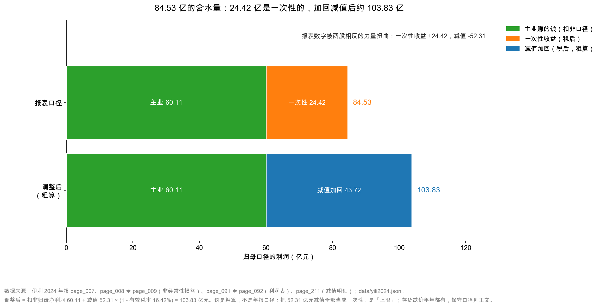

# 第 35 章：实战——伊利 2024 的 84.5 亿里有多少水分

> 本章你将：
> - 把 84.53 亿元归母净利润拆成"可持续"和"一次性"两层，得到一张分层图；
> - 学会算"剔除减值后的经营性归母利润"，并且知道这个数的乐观边界和保守边界；
> - 拿到一张"利润质量三问"清单，可以套用到任何一家公司；
> - 用一句话回答本周的核心问题：伊利 2024 年到底是变差了，还是变好了？

---

## 35.1 先把桌子摆好，然后做第一层剥离

四章下来，我们手里有六组数字。现在把它们全部摆到一张桌子上：

| 数字 | 金额 | 出处 | 性质 |
|---|---|---|---|
| 归母净利润 | 84.53 亿元 | `page_007.md` | 报表结果 |
| 非经常性损益 | 24.42 亿元 | `page_008.md`~`page_009.md` | 一次性收益（税后） |
| 扣非归母净利润 | 60.11 亿元 | `page_007.md` | 主业（监管口径） |
| 资产减值损失 | 46.76 亿元 | `page_211.md` | 会计估计（税前） |
| 信用减值损失 | 5.55 亿元 | `page_211.md` | 会计估计（税前） |
| 减值合计 | 52.31 亿元 | 上两项相加 | — |

外加三个比例：有效税率 16.42%、少数股东损益占净利润 0.13%、非经常性损益占归母净利润 28.9%。

**这张桌子上的六个数，互相关联，而且方向相反。**

- 24.42 亿元的一次性收益，把归母净利润**往上托**了；
- 52.31 亿元的减值，把归母净利润**往下压**了；
- 两个力量同时作用，最后落在 84.53 亿元。

**这个 84.53 亿元，是一个"被两股相反力量夹住"的数字。** 它既不反映"公司今年靠主业赚了多少"，也不反映"公司今年实际恶化了多少"。**更麻烦的是，这两股力量的性质完全不同：一个是一次性的（卖资产），一个是会计判断（减值）。** 前者拿掉就没了，后者你怎么看它，它就怎么变。

本章的任务，就是把这个"夹"字拆开。

**第一层剥离：剔掉一次性收益。** 这一步最简单，因为监管已经替我们算好了。

**归母净利润 84.53 亿元，减去非经常性损益 24.42 亿元，得到扣非归母净利润 60.11 亿元。**

第 33 章讲过这张桥，这里只补一句：**这 24.42 亿元里，25.64 亿元是"非流动性资产处置损益"，主要就是卖掉昌吉盛新的那 25.80 亿元。**

所以第一层剥离的实质是：**把"卖子公司赚的钱"从利润里拿掉。**

拿掉之后，60.11 亿元就是"按监管口径，伊利靠主业赚的钱"。同比 -40.04%，是这份年报里最刺眼的数字。

但第 33 章也留了一个尾巴：**这 60.11 亿元里，还压着 52.31 亿元的减值。而减值是"经常性"的（监管口径），所以它没被剔掉。**

于是有了第二层剥离。

## 35.2 第二层剥离：把减值加回去

在动手之前，先记住一句话：**剥离不是"把不好的数字改好"，而是"把混在一起的两件事分开"。** 分完之后，两件事都还在，只是你终于能分别看它们了。

**思路**：减值是会计估计，不是现金支出。如果把减值加回去，就能看到"减值之前，主业能赚多少"。

**但这里有一个技术问题必须先解决：口径要对齐。**

- 非经常性损益 24.42 亿元，是**税后、归母**口径；
- 减值 52.31 亿元，是**税前、合并**口径。

**两个口径不一样的数字，不能直接加减。** 必须先把减值换算成"税后、归母"口径。

换算分两步：

**第一步，考虑税。** 减值在会计上扣了利润，因此少交了所得税。所以减值对净利润的"净影响"不是 52.31 亿元，而是：

$$52.31 \times (1 - 16.42\%) = 43.72 \text{ 亿元}$$

这里的 16.42% 是第 34 章算出的有效税率。**为什么要乘 (1 - 税率)？** 因为每 1 元减值，让利润少 1 元，同时也让应交的税少 0.1642 元，所以净利润实际只少了 0.8358 元。

**第二步，考虑少数股东。** 严格来说还要乘以"归母比例"。但伊利 2024 年少数股东损益只占净利润的 0.13%，**这个调整小到可以忽略**，所以我们不做。

于是：

$$\text{剔除减值后的经营性归母利润} = 60.11 + 43.72 = 103.83 \text{ 亿元}$$

**这就是本周最重要的一张表：**

| 层次 | 金额 | 说明 |
|---|---|---|
| 归母净利润 | **84.53 亿元** | 报表最显眼的一行 |
| 减：非经常性损益（税后） | -24.42 亿元 | 处置子公司 25.64 亿元等，明年不会再有 |
| **扣非归母净利润** | **60.11 亿元** | 主业赚的钱（监管口径） |
| 加回：减值损失（税后，按 16.42% 税率粗算） | +43.72 亿元 | 会计估计，不是现金流出 |
| **剔除减值后的"经营性归母利润"** | **约 103.83 亿元** | 这才是主业真实赚钱能力（粗算上限） |

这张图只有两根横条，但它把整周的内容压在了一起。

**上面那根**是报表口径：绿色 60.11 亿元（主业）+ 橙色 24.42 亿元（一次性）= 84.53 亿元。
**下面那根**是调整口径：绿色还是 60.11 亿元（主业不变）+ 蓝色 43.72 亿元（减值加回）= 103.83 亿元。

**两根条的第一个色块完全一样长**，这不是画错了——**主业就是 60.11 亿元，它不因为你怎么调整而改变。** 变的只是"你在它上面叠加了什么"：

- 叠加一次性收益，得到 84.53 亿元（报表数字）；
- 叠加减值影响，得到 103.83 亿元（调整数字）。

**84.53 和 103.83 之间差 19.30 亿元。** 这个差额，就是"报表数字"和"主业能力"之间的距离。

**顺便说清楚 43.72 亿元这个数是怎么来的，因为很容易记错。**

它不是"减值 $\times$ 税率"，也不是"减值 ÷ (1 - 税率)"，而是"减值 $\times$ (1 - 税率)"。区别在哪？**减值是"从利润里减掉"的项目，所以它的税盾是"少交的税"，要减掉。** 如果某个项目是"加到利润里"的（比如政府补助），那它的税后影响才是"乘以税率"那一侧的减法。**方向记错，数字会差一倍以上。** 一个简单的检验办法：减值 52.31 亿元，税后应该是 43.72 亿元左右（变小），不可能是 61 亿元（变大）。

## 35.3 这个 103.83 亿元，可信吗？

**必须马上打一个问号。**

103.83 亿元是一个"上限"，它建立在两个乐观假设上：

**假设一：52.31 亿元减值全部是"一次性的"。**

但第 32 章已经拆过：52.31 亿元里，**存货跌价 12.27 亿元是年年都有的常态**（2023 年 12.22 亿元、2024 年 12.27 亿元，几乎一模一样）。把常态也当成一次性加回去，是不诚实的。

**假设二：减值明年不会再来。**

但第 32 章也讲过：伊利商誉减完之后还剩 23.37 亿元（其中澳优约 21.55 亿元），**风险没出清**。2025 年如果澳优继续不达预期，还可能再提。

所以更严谨的做法，是**给两个口径**：

| 口径 | 加回什么 | 计算 | 结果 |
|---|---|---|---|
| **乐观（上限）** | 加回全部减值 52.31 亿元 | 60.11 + 43.72 | **103.83 亿元** |
| **保守** | 只加回商誉减值 30.75 亿元（税后） | $60.11 + 30.75 \times (1 - 16.42\%)$ | **约 85.81 亿元** |

为什么"保守口径"要只加回商誉减值？因为 2023 年的商誉减值是零，**所以 2024 年的 30.75 亿元商誉减值，"全部"就等于"多提的部分"**——这一笔确实是"去年没有、今年才冒出来"的，加回它有道理。而存货跌价 12.27 亿元去年就有 12.22 亿元，是常态，不该加回。

再往下保守一层，可以只加回"商誉减值里澳优那 30.37 亿元"，甚至**一分钱都不加回**（也就是回到扣非 60.11 亿元）。

**所以 84.53 亿元这个数字，真实的"主业区间"是这样的：**

| 口径 | 金额 | 一句话 |
|---|---|---|
| 最保守：扣非归母（不加回任何减值） | 60.11 亿元 | 监管口径，减值算主业成本 |
| 半程：扣非 + 商誉减值（税后） | 85.81 亿元 | 只把"买贵了"这部分加回 |
| 最乐观：扣非 + 全部减值（税后） | 103.83 亿元 | 假设减值全是一次性的 |

**60.11 到 103.83，区间宽度 43.72 亿元，相当于归母净利润的 51.7%。**

这个区间宽得吓人。**它说明一件事：对伊利 2024 年的利润，"会计判断"的影响比"经营本身"的影响还大。**

> ⚠️ **易踩坑：** 很多分析文章会直接写"伊利 2024 年真实利润 103.8 亿元，被减值掩盖了"，然后据此说"严重低估"。这个说法**只给了区间的一端**。严谨的写法是："剔除减值后约 103.8 亿元，但其中 12.27 亿元存货跌价属于常态，若只加回商誉减值则约 85.8 亿元。" **给出区间，比给出单点更专业，也更诚实。**

## 35.4 推演：2025 年的三种情形，以及它对估值的意义

做了这么多剥离，最后还是回到一个实际问题：**这些调整到底有什么用？**

用处在于：**它能帮你把"明年的利润"算出一个范围。** 下面做一个非常粗糙的推演，只用来演示方法，**所有假设都写在表里，不是预测**。

**假设（三条，全部是"示意"，不是公司的指引）：**

1. 2025 年主业经营水平和 2024 年持平（不再恶化，也不改善）；
2. 2025 年没有新的处置子公司收益（一次性收益为零）；
3. 2025 年减值的三种可能：继续维持 52.31 亿元 / 回到常态 16.86 亿元 / 完全消失。

| 情形 | 减值假设 | 归母净利润（示意推演） | 相对 2024 年的 84.53 亿元 |
|---|---|---|---|
| A：包袱没出清 | 仍是 52.31 亿元 | **60.11 亿元** | **-28.9%** |
| B：回到常态 | 16.86 亿元 | **约 89.74 亿元** | **+6.2%** |
| C：完全消失 | 0 亿元 | **约 103.83 亿元** | **+22.8%** |

三种情形怎么算出来的？以 B 为例：从 2024 年的 84.53 亿元出发，先减掉不会重演的 24.42 亿元一次性收益，再加上"少提的减值"：$(52.31 - 16.86) \times (1 - 16.42\%) = 29.63$ 亿元。84.53 - 24.42 + 29.63 = 89.74 亿元。

C 就是本章前面算的 103.83 亿元；A 就是扣非归母 60.11 亿元（因为假设主业持平，又没有一次性收益，也没有"多提的减值"可以加回）。

**这张表最该看的是"跨情形"的差距：60.11 到 103.83，差 43.72 亿元。**

它告诉你一件事：**在"主业完全不变"这个前提下，光是减值的会计选择，就能让 2025 年的利润在 -28.9% 到 +22.8% 之间摆动。** 这就是为什么"预测利润"这件事极难——你预测的不是经营，是会计判断。

**所以对普通投资者来说，与其预测明年利润，不如做三件事：**

1. 把"三档情形"都算出来，看自己能不能接受最差的那一档；
2. 盯住"减值"这个变量，它比收入增速更能解释利润的波动；
3. 用现金流和毛利率做交叉验证，因为它们不受减值影响。

**这里有一个思维习惯值得专门说一句：不要"预测一个数"，要"给出一个范围"。**

刚学财报的人最爱问的问题是"明年利润多少"。这个问题没有答案——因为利润里混着经营、混着会计判断、混着一次性的处置决定，这三样东西的可预测性完全不同。**专业的做法是：把可预测的部分（主业、毛利率、费用率）和不可预测的部分（减值、处置、公允价值）分开，前者做假设，后者做情形。** 情形不需要多，三个就够：好、中、坏。

这也是本章后面"利润质量三问"背后的同一个思路——**先把利润拆成"能预测的"和"不能预测的"，再决定给每一部分多少权重。**

**把镜头再拉远一点：这些利润口径的差别，对估值意味着什么？**

第 10 周会细讲市盈率（PE），这里只用一个简化版说明问题。**PE = 市值 ÷ 归母净利润。反过来，如果 PE 不变，利润变化多少，市值就该变化多少。**

假设市场给伊利的 PE 是 15 倍（**这是示意数字，不是真实报价，你需要自己去查最新股价和市值**）：

| 用哪个利润 | 金额 | 对应市值（PE = 15 倍，示意） |
|---|---|---|
| 归母净利润 | 84.53 亿元 | 1,268 亿元 |
| 扣非归母净利润 | 60.11 亿元 | 902 亿元 |
| 调整后（乐观） | 103.83 亿元 | 1,557 亿元 |

**同一家公司，用三个不同的利润，估出来的市值能差 655 亿元（902 到 1,557）。**

当然，市场不会真的用"调整后利润"给你估值——**市场用的是"它认为可持续的那个利润"**。如果市场认为减值是一次性的，它就会用接近 103.83 亿元的口径；如果市场认为减值还会再来，它就会用接近 60.11 亿元的口径。

**所以"利润质量"这件事，最终会体现为"估值倍数的高低"，而不是"估值的对错"。** 一家利润"含水量高"的公司，市场会给它更低的 PE，因为它知道那个利润不可持续。

> 💡 **你可能会问：** 那我怎么知道市场用的是哪个口径？

**看两件事：一是卖方研究报告里用的 EPS 是哪一年、哪个口径；二是公司在业绩说明会上强调哪个数字。** 如果公司反复强调"扣非净利润"，说明它知道归母里有水分；如果公司只讲归母，你就要自己多算一步。**这是第 44 章"红旗清单"里的一条：只讲一个口径、且总是讲最好看的那个口径的公司，要打个问号。**

<!-- src: 伊利股份2024年报/page_007.md 伊利股份2024年报/page_008.md 伊利股份2024年报/page_009.md 伊利股份2024年报/page_091.md 伊利股份2024年报/page_092.md 伊利股份2024年报/page_211.md -->

> 📌 **划重点：** 区间思维不是"含糊"，恰恰是"精确"——它精确地表达了"我们知道多少、不知道多少"。**一个孤零零的数字会骗人，一个诚实的区间不会。**

## 35.5 利润质量三问：一张可以带走的清单

七周下来，我们拆了伊利很多次。现在把方法固化成一个可以复用的清单。**看任何一家公司的利润，问三个问题。**

### 第一问：利润里有多少不是主业赚的？

**动作**：算"非经常性损益 ÷ 归母净利润"。

**伊利 2024**：24.42 ÷ 84.53 = **28.9%**。

**怎么判断**：

| 比例 | 含义 | 该做什么 |
|---|---|---|
| 小于 10% | 正常，主业占绝对主导 | 可以直接用归母净利润做分析 |
| 10%~30% | 需要留意 | 必须看扣非，并翻非经常性损益明细 |
| 大于 30% | 警惕 | 归母净利润已经不能代表主业，分析一律用扣非 |
| 连续三年大于 30% | 危险 | 主业可能长期不赚钱，靠外力维持正利润 |

伊利 28.9%，**正好卡在"需要留意"的上沿**。而这 28.9% 的来源是"卖了一家子公司"，性质上比"连续多年的政府补助"更"一次性"——**所以实际严重程度比数字看起来更高。**

> 🔍 **翻到年报：** 做完这三问，再回 `page_211.md` 看一眼那两张减值表。**这一次你会发现，同一张表你已经能读出三层信息了**：金额（52.31 亿元）、结构（商誉占 58.8%）、性质（商誉一次性、存货常态、保理是真实风险）。第 4 章说"附注才是正文"，这一章就是那句话的兑现。

### 第二问：利润里有多少被"会计估计"压住了或抬高了？

**动作**：算"减值合计 ÷ 营业利润"，并和上年比。

**伊利 2024**：52.31 ÷ 101.82 = **51.4%**；2023 年是 16.86 ÷ 118.73 = **14.2%**。

**怎么判断**：

| 比例 | 含义 |
|---|---|
| 小于 10% | 减值影响很小，利润基本反映经营 |
| 10%~30% | 正常波动范围 |
| 大于 30% | 减值成了利润的主要变量，必须单独分析 |
| 比上年翻倍以上 | 高度警惕：要么是真出问题，要么是在"洗大澡" |

伊利从 14.2% 跳到 51.4%，**翻了三倍多**。这正是第 32 章那三条判断线索要用上的地方：减值是否集中（是，商誉从 0 到 30.75 亿元）、商誉还剩多少（23.37 亿元，没出清）、下一年是否恢复（待验证）。

### 第三问：利润有没有现金支撑？

**动作**：算"经营活动现金流净额 ÷ 净利润"（净现比），以及"销售收现 ÷ 营业收入"（收现比）。

**伊利 2024**：净现比 217.40 ÷ 84.64 = **2.57**；收现比 1,306.52 ÷ 1,153.93 = **1.132**。

**怎么判断**：

| 指标 | 健康区间 | 伊利 2024 | 说明 |
|---|---|---|---|
| 净现比 | 大于 1 | **2.57** | 利润有充足现金支撑，且有大量非现金费用（折旧、减值）加回 |
| 收现比 | 接近或大于 1 | **1.132** | 每 1 元收入收回 1.13 元现金，没有靠赊账做收入 |

**净现比 2.57 是一个很夸张的数字**——它意味着每 1 元净利润背后有 2.57 元经营现金。这在重资产、高折旧、大减值的公司里是正常的（折旧 40.56 亿元、减值 52.31 亿元都不花钱，都要加回）。**但也要注意：净现比长期远大于 1，可能说明公司在大规模计提非现金费用，利润被"人为压低"了——这恰好和第一问、第二问的结论互相印证。**

三个问题问完，把答案摆在一起：

| 问题 | 伊利 2024 的答案 | 结论 |
|---|---|---|
| 多少不是主业赚的 | 28.9% | 偏高，归母净利润被托住 |
| 多少被会计估计影响 | 51.4%（上年 14.2%） | 极高，减值成了主变量 |
| 有没有现金支撑 | 净现比 2.57、收现比 1.132 | 非常健康，主业在产生现金 |

**三个答案指向同一个结论：这是一家"利润表难看、现金流好看"的公司。**

## 35.6 收束：84.53 亿元，往上看是衰退，往下拆是变好

现在回答本周的核心问题。

**伊利 2024 年，到底是变差了，还是变好了？**

**如果你只看一个数字，你会得到两个完全相反的答案：**

- 看归母净利润 84.53 亿元，同比 -18.9% → **变差了**；
- 看经营活动现金流 217.40 亿元，同比 +18.9% → **变好了**。

**两个数字都是真的。** 它们之所以相反，是因为它们描述的不是同一件事：

- 归母净利润里，压着 52.31 亿元减值（会计判断），托着 24.42 亿元一次性收益（卖资产）；
- 经营现金流里，减值被加回（不花钱），卖资产的现金进了投资活动（不进经营）。

**所以正确的说法是：**

> 伊利 2024 年的**报表利润**确实变差了（-18.9%），但**主业能力**在变好：毛利率逆势上升 1.30 个百分点，收现比从 1.091 升到 1.132，经营现金流增长 18.9%。利润下滑的主因是**一次性减值**（多提 35.45 亿元）和**一次性收益的消失**（2023 年没有卖子公司），而不是"卖不动牛奶了"。

**用一句话概括这一周：**

> **84.53 亿元这个数字，往上看是"衰退"，往下拆是"主业其实在变好、只是被减值压住了"。**

这句话就是 CURRICULUM 里说的"全书最重要的一条洞见"，也是第 6、7、8 三周共同的高潮。第 6 周从毛利率看到"成本在改善"，第 7 周从减值看到"包袱在出清"，第 8 周会从现金流看到"钱真的收回来了"——**三条独立的证据，指向同一个结论。**

**但请记住第 32 章的批判视角：这个结论有一个未经验证的假设——减值明年不会再来。** 如果 2025 年伊利又提 30 亿元减值，那"洗大澡、轻装上阵"的说法就不成立，而是"问题在持续暴露"。

**把这句话写进你的笔记本：**

> 判断一家公司的利润，不是找一个"正确"的数字，而是找到"这个数字被什么扭曲了"，然后估计扭曲的方向和幅度。

最后，把本周五章的方法串成一条线，方便你以后回看：

| 章 | 学到的动作 | 在伊利身上得到了什么 |
|---|---|---|
| 第 31 章 | 把"其他收益、投资收益、公允价值变动"三行单独拎出来 | 34.06 亿元杂项，其中 25.80 亿元是卖子公司 |
| 第 32 章 | 把两项减值加回营业利润，算"经营性利润" | 154.13 亿元，同比 +13.7%（报表是 -14.2%） |
| 第 33 章 | 用归母减非经常性，得扣非 | 60.11 亿元，同比 -40.04% |
| 第 34 章 | 走完所得税和少数股东两道关，算有效税率 | 16.42%，比法定 25% 低 8.58 个百分点 |
| 第 35 章 | 两层剥离，得到区间而不是单点 | 60.11 到 103.83 亿元；只加回商誉减值的口径约 85.81 亿元 |

**五个动作，从"看一行"到"看一个区间"。** 这就是从"会读报表"到"会分析公司"的距离。

## ✍️ 想一想

### 问 1：如果只用一句话向朋友解释"伊利 2024 年利润跌了 19%，但其实没那么糟"，你会怎么说？说这句话时，你必须补充哪个限定条件？

**解题思路：** 一句话要包含"跌的是什么、没跌的是什么、为什么"，限定条件要指出这个判断的薄弱环节。

**参考答案：** 一句话可以是："伊利 2024 年归母净利润跌 18.9%，但其中 35.45 亿元是比去年多提的减值，把这部分加回去，经营性利润反而是 +13.7%；同时毛利率还上升了 1.30 个百分点，经营现金流涨了 18.9%，说明主业没坏。"必须补充的限定条件是：**"这个判断假设减值是一次性的、明年不会再来。"** 因为 52.31 亿元减值里有 12.27 亿元存货跌价是年年都有的常态，商誉减值后还剩 23.37 亿元没出清，所以"明年不会再有"只是一个假设，不是事实。**说结论时要带上假设，这是专业和忽悠的分界线。**

**易错点：** 只说"减值是一次性的、加回去就好了"，不提假设。这样说明显偏向乐观，一旦 2025 年再提减值，结论就会被打脸。

### 问 2：伊利 2024 年净现比（经营现金流 ÷ 净利润）是 2.57，远高于 1。这是好事还是坏事？

**解题思路：** 先解释净现比为什么可以大于 1，再判断"远大于 1"在什么情况下是好事、什么情况下是警告。

**参考答案：** 净现比大于 1 本身是正常的，因为净利润里扣了很多"不花钱的费用"：折旧 40.56 亿元、减值 52.31 亿元，这些在算现金流时都要加回来。伊利 2.57 的净现比，主要是这两项造成的，**说明利润的"含金量"很高——账面上的利润背后有实打实的现金**。但它也有另一面：净现比长期远大于 1，意味着公司在持续计提大额非现金费用，**利润被"人为压低"了**。这时候要追问：这些费用是"必要的"（比如正常的折旧、常态的存货跌价），还是"选择性的"（比如某一年集中提减值）？前者是健康的，后者可能意味着管理层在调节利润的节奏。**所以答案取决于减值的性质，而不是净现比这个数字本身。**

**易错点：** 把"净现比高"直接等同于"公司质量好"。净现比高只说明"利润有现金支撑"，不说明"利润的水平是合理的"。一家每年大提减值、把利润压得很低的公司，净现比也会很高。

### 问 3：假设你只能拿到三个数字来做利润质量分析，你会选哪三个？为什么？

**解题思路：** 从"利润的规模、利润的纯度、利润的现金支撑"三个维度各选一个，并说明每个数字能排除什么错误。

**参考答案：** 我会选这三个：**归母净利润、扣非归母净利润、经营活动现金流净额。** 理由：归母净利润给"规模"——它是一切估值指标的起点，也是市场共识的锚；扣非归母净利润给"纯度"——它和归母的差额就是非经常性损益，一减就知道"有多少不是主业赚的"；经营活动现金流给"真实性"——它排除掉所有非现金项目，是利润的"验钞机"。三个数字放在一起，能排除三类错误：只看归母会被一次性收益骗，只看扣非会被减值吓到，只看现金流会忽略"现金流好但利润在萎缩"的可能。**如果还能加第四个，我会加"资产减值损失"，因为它能解释扣非和归母之间的大部分差异。**

**易错点：** 选"净利润"而不是"归母净利润"。净利润含少数股东，对股民没有直接意义，而且会把估值算错。

## 📎 数据出处

- 伊利股份 2024 年报：`page_007.md`（主要会计数据：归母、扣非归母、经营现金流）、`page_008.md`~`page_009.md`（非经常性损益明细）、`page_091.md`~`page_092.md`（合并利润表）、`page_211.md`（资产减值与信用减值明细）、`page_213.md`（所得税费用）、`page_217.md`（现金流量表补充资料）、`page_184.md`（商誉减值）
- 数据汇总：`data/yili2024.json` 的 `income`、`nonrecurring`、`notes`、`core_earnings`、`ratios`、`goodwill_detail` 段
- 本周配图脚本：`figures/gen_w07d31_misc_income.py`、`gen_w07d31_investment_bridge.py`、`gen_w07d32_impairment_compare.py`、`gen_w07d32_operating_bridge.py`、`gen_w07d33_parent_to_deducted.py`、`gen_w07d34_profit_layers.py`、`gen_w07d35_profit_water.py`

下一章：[第 36 章：为什么利润不等于现金](../week08/36-为什么利润不等于现金.md)
