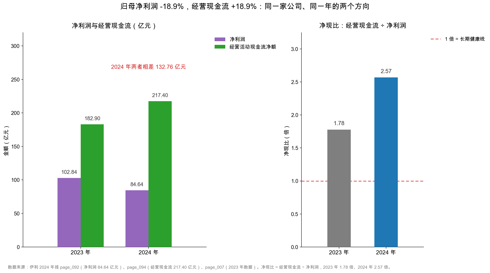

# 第 36 章：为什么利润不等于现金

> 本章你将：
> - 看懂伊利 2024 年最刺眼的一对数字：净利润 **84.64 亿元**、经营活动现金流净额 **217.40 亿元**，相差 **132.76 亿元**；
> - 弄懂"利润是算出来的、现金是收到的"这句话在报表上具体指什么；
> - 把 132.76 亿元的差额拆成三块：折旧摊销 46.12 亿、减值 52.31 亿、营运资本变动 50.21 亿，再扣掉 15.88 亿的非经营性损益；
> - 学会用"净现比"这个两秒钟就能算的指标，判断一家公司的利润有没有变成现金；
> - 知道净现比高不一定是好事、低也不一定是坏事，关键是看**为什么**。

第 7 周结束时，我们留下了一个悬念：伊利 2024 年扣非净利润同比 -40%，营业利润 -14.2%，可如果把多计提的 35.45 亿元减值加回去，经营性利润其实是 **+13.7%**。也就是说，账面上的"利润大降"，主要是会计估计造成的，不是生意变差了。

但那个结论有一个软肋：它完全建立在"减值不反映经营好坏"这个判断上。万一减值恰恰反映了真实的经济损失呢？万一主业真的在恶化，只是我们用"加回减值"这个动作把它美化了？

要检验这个判断，得请一个不参与会计估计的证人出场——**现金流量表**。它不认"应该收多少"，只认银行账户里进了多少、出了多少。

这个证人给出的证词是：伊利 2024 年经营活动现金流净额 **217.40 亿元**，比 2023 年的 182.90 亿元还多了 **18.86%**（伊利 2024 年报，page_094、page_007）。**利润在降，现金在增。** 如果主业真的在恶化，现金不可能逆势增长。

本章的任务，就是把这"一降一增"解释清楚。

---

## 36.1 一对刺眼的数字

先把两组数字并排放好，都来自伊利 2024 年报：

| 指标 | 2024 年 | 2023 年 | 同比 | 出处 |
|---|---|---|---|---|
| 净利润 | **84.64 亿元** | 102.84 亿元 | -17.7% | page_092 |
| 归母净利润 | 84.53 亿元 | 104.29 亿元 | -18.94% | page_092、page_007 |
| 扣非归母净利润 | 60.11 亿元 | 100.26 亿元 | -40.04% | page_008、page_007 |
| 经营活动现金流量净额 | **217.40 亿元** | 182.90 亿元 | **+18.86%** | page_094、page_007 |
| 两者差额 | **132.76 亿元** | 80.06 亿元 | — | 计算 |
| 净现比（经营现金流 ÷ 净利润） | **2.57 倍** | 1.78 倍 | +0.79 | 计算 |

<!-- src: 伊利股份2024年报/page_007.md 伊利股份2024年报/page_008.md 伊利股份2024年报/page_092.md 伊利股份2024年报/page_094.md -->

同一年、同一家公司、同一套账簿，两个数字差了 132.76 亿元，而且方向相反。

第一次看到这张图，人的本能反应通常有两种，都不对：

**反应一："利润表是假的，现金流才是真的。"** 这个判断太快了。伊利的年报由信永中和会计师事务所审计，出具的是标准无保留意见（page_083）。而且如果公司真想虚增利润，通常的做法是"提前确认收入、少提减值"，结果是**利润高、现金流差**。伊利是反过来的：利润低、现金流好。方向对不上。

**反应二："现金流 217 亿，说明公司特别健康。"** 也太快。217.40 亿元里，有相当一部分不是"今年赚来的"，而是"以前赚的现在收回来了"（收回旧应收、卖掉存货），以及"以后要还的现在先收了"（预收货款）。这种钱，明年不一定还有。

真相在中间，而且完全可以算清楚。**132.76 亿元的差额不是一笔糊涂账，它是一张可以逐项对上的清单。**

> 📌 **划重点：** 净利润和经营现金流不是"一个真一个假"的关系，它们是**同一家公司用两套规则算出来的两个数**。利润回答"这一年我赚了多少"，现金回答"这一年我收到了多少"。两个问题不同，答案当然不同。读财报该做的不是二选一，而是**把差额解释清楚**。

---

## 36.2 利润是"算"出来的，现金是"收"到的

要理解差异，先要理解"记账的时点"。

假设你开了一家奶茶店（**示意数字**），12 月 20 日给一家公司送了 200 杯奶茶，货款 4,000 元，约定 1 月 20 日付款。这笔生意算哪一年的？

**收付实现制（cash basis）：钱到手才算。** 12 月 20 日什么都不记；1 月 20 日收到 4,000 元，记一笔收入。→ 这笔生意记在了**明年**。

**权责发生制（accrual basis）：义务完成就算。** 12 月 20 日货送到、控制权转移，记"收入 4,000、应收账款 4,000"；1 月 20 日收到钱，记"货币资金 +4,000、应收账款 -4,000"。→ 收入记在**今年**，收钱记在**明年**。

会计准则选的是第二种。为什么？因为收付实现制会让利润被"付款时间"操纵：想今年利润好看，就催客户提前付款、拖供应商晚点付钱，利润立刻变了，可生意一点没变。这种账反映的是资金调度能力，不是盈利能力。

权责发生制的回答是：**收入在"货交了"时确认，成本在"货用了"时确认，跟钱什么时候进出无关。** 代价是——利润和现金从此必然分叉。

分叉的机制可以归成三类"时间差"，再加一类"永远不花现金的费用"：

| 类型 | 报表科目 | 对利润的影响 | 对现金的影响 | 伊利 2024 年的例子 |
|---|---|---|---|---|
| 先交货、后收钱 | 应收账款 | 当期就确认收入（利润 +） | 当期没收到（现金 0） | 应收账款 28.78 亿元（page_087） |
| 先收钱、后交货 | 合同负债 | 当期不确认收入（利润 0） | 当期就收到（现金 +） | 合同负债 120.73 亿元（page_088） |
| 先花钱、后受益 | 折旧、摊销 | 分摊到各年（利润 -） | 钱在买的时候一次性付掉 | 折旧摊销 46.12 亿元（page_217） |
| 只调账面、不动现金 | 计提减值 | 当期扣（利润 -） | 一分钱没出 | 减值 52.31 亿元（page_211） |

<!-- src: 伊利股份2024年报/page_087.md 伊利股份2024年报/page_088.md 伊利股份2024年报/page_211.md 伊利股份2024年报/page_217.md -->

这四类东西合起来，就解释了伊利那 132.76 亿元差额的绝大部分。

> 💡 **你可能会问：既然权责发生制这么麻烦，为什么不干脆用收付实现制？**
>
> 因为它会让"利润"变得没有意义。举一个极端例子：一家公司今年卖了 10 亿元的货，全部赊账、明年才收款，同时今年一分钱没花（供应商也让它赊）。按收付实现制，今年利润是 0；按权责发生制，今年利润可观。哪个更能反映"这一年生意做得好不好"？显然是后者。
>
> 而且权责发生制并没有丢掉现金信息——它把现金信息放进了**另一张表**。两张表配合着看，比一张表信息量更大。这就是年报必须同时披露三张表的原因。

---

## 36.3 132.76 亿元，拆成三块

现在做正事。

伊利 2024 年报 page_217~218 有一张表，标题是"**将净利润调节为经营活动现金流量**"，俗称"现金流量表补充资料"。这是官方给出的差额解释：从净利润出发，一项项加回或减去，最后落到经营现金流。

先看四个大块（单位：亿元）：

| 步骤 | 项目 | 金额 | 性质 |
|---|---|---|---|
| 起点 | 净利润 | 84.64 | 利润表最后一行 |
| + | 折旧与摊销 | 46.12 | 扣了利润、没付现金 |
| + | 计提减值 | 52.31 | 扣了利润、没付现金 |
| - | 财务费用、投资收益、递延所得税等 | 15.88 | 算在利润里，但现金归投资/筹资活动 |
| + | 营运资本变动（存货、应收、应付） | 50.21 | 收回旧账、释放存货、多收预收款 |
| = | 经营活动现金流量净额 | **217.40** | 现金流量表 |

验算：84.64 + 46.12 + 52.31 - 15.88 + 50.21 = 217.40。差 0.00。

<!-- src: 伊利股份2024年报/page_092.md 伊利股份2024年报/page_094.md 伊利股份2024年报/page_217.md 伊利股份2024年报/page_218.md -->

下面逐块看。第 37 章会把这张表拆到 17 项，本章只需要看清三块的性质。

### 第一块：折旧摊销 46.12 亿元——钱很多年前就付过了

page_217 的明细：

| 项目 | 金额（亿元） |
|---|---|
| 固定资产折旧、油气资产折耗、生产性生物资产折旧 | 40.56 |
| 使用权资产摊销 | 1.47 |
| 无形资产摊销 | 2.69 |
| 长期待摊费用摊销 | 1.41 |
| **合计** | **46.12** |

<!-- src: 伊利股份2024年报/page_217.md -->

这 46.12 亿元在利润表里被当成费用扣掉了，所以净利润里已经减过它。但**公司今年并没有为它付出一分钱**——买设备的钱是很多年前一次性付的，租办公室的钱是按合同分期付的（使用权资产摊销对应租金），买地买商标的钱也是过去付的。

用奶茶店举例（**示意数字**）：小满花 40 万元买设备，预计用 5 年，每年折旧 8 万元。
- 第 1 年：现金流出 40 万元（买设备），利润表只扣 8 万元折旧；
- 第 2~5 年：现金流出 0，利润表每年照样扣 8 万元。

所以第 2~5 年，**利润表每年扣 8 万元，但现金一分没出**。这 8 万元在"净利润 → 经营现金流"的桥上要**加回**。

伊利的 46.12 亿元是同一个道理，只是规模大了几万倍。而且要注意：折旧摊销是**最可持续**的一块加回项——只要公司还有设备、还有土地，每年都会有这个数。它不像减值那样一次性。

### 第二块：减值 52.31 亿元——会计判断，不是现金支出

| 项目 | 金额（亿元） |
|---|---|
| 资产减值准备 | 46.76 |
| 其中：商誉减值 | 30.75 |
| 其中：存货跌价 | 12.27 |
| 其中：固定资产减值 | 3.67 |
| 信用减值损失 | 5.55 |
| **合计** | **52.31** |

<!-- src: 伊利股份2024年报/page_211.md 伊利股份2024年报/page_217.md -->

减值是什么意思？简单说：**公司认为某项资产的账面价值已经不值那么多钱了，于是把差额一次性从利润里扣掉。**

以澳优乳业为例：这笔收购形成的商誉，2024 年公司判断它未来能赚的钱没有当初估计的那么多，于是一次计提 **30.37 亿元**减值（page_184）。全公司的商誉减值准备因此从 3.99 亿元涨到 34.76 亿元，商誉净额从 51.60 亿元降到 23.37 亿元（page_087）。这个动作在账上表现为"利润减少 30.37 亿元"，但**没有任何一笔钱付出去**——收购澳优的钱，2022 年就付完了。

这就是第 7 周反复强调的那句话：**减值是会计估计，不是现金支出。**

存货跌价 12.27 亿元也一样：仓库里的奶粉、原奶不值原价了，账面要减记，但今年并没有因此多花一分钱（真正花钱是在当初采购的时候）。

### 第三块：营运资本变动 +50.21 亿元——把过去垫的钱收回来

page_218 的三行：

| 项目 | 金额（亿元） | 含义 |
|---|---|---|
| 存货的减少 | +5.85 | 存货从 125.12 亿元降到 107.45 亿元，卖掉存货收回现金 |
| 经营性应收项目的减少 | +18.25 | 应收账款、应收票据等收回，现金回流 |
| 经营性应付项目的增加 | +26.11 | 多占了供应商的款、多收了经销商的预付款 |
| **合计** | **+50.21** | 营运资本净释放 |

<!-- src: 伊利股份2024年报/page_218.md 伊利股份2024年报/page_087.md -->

这一块和前面两块的性质完全不同。

折旧摊销和减值，是"利润表扣了，但现金本来就没动"——它们不产生现金，只是把利润和现金的差距拉开。营运资本变动，则是**真的有一笔现金进出**：卖掉存货真的收到了钱，收回应收账款真的进了账户，多收预付款真的多了现金。

打个比方：折旧摊销是"账上记了一笔开销，但钱包没动"；营运资本变动是"把去年借给朋友的钱要回来了，钱包真的鼓了"。

**这两类钱的可重复性天差地别。** 折旧摊销明年还会有 46 亿元左右；营运资本释放 50.21 亿元，明年未必有，甚至可能反过来（存货增加、应收增加，就要占用现金）。

### 第四块：-15.88 亿元——不是经营赚的钱，要剔出去

剩下一个负数：-15.88 亿元。它由好几项组成，主要是：

| 项目 | 金额（亿元） | 为什么在经营现金流里要反向调整 |
|---|---|---|
| 财务费用 | +10.26 | 利息支出属于筹资活动，不在经营现金流里 |
| 投资收益 | -24.17 | 投资收益的现金在投资活动里（收到投资收益 1.86 亿元） |
| 递延所得税 | -3.63 | 不涉及当期现金的所得税 |
| 处置与报废损失、公允价值变动、其他 | +1.67 | 非经营性损益，逐项剔除 |
| **合计** | **-15.88** | |

<!-- src: 伊利股份2024年报/page_218.md 伊利股份2024年报/page_210.md -->

最需要留意的是投资收益 -24.17 亿元。伊利 2024 年转让了控股子公司昌吉盛新的股权，确认了 25.80 亿元投资收益（page_210）。这笔钱让净利润增加了 25.80 亿元，但收到的现金记在**投资活动**里，不在经营活动里。所以做间接法时，要把它从净利润里减掉——否则经营现金流就被"卖子公司"虚增了。

> ⚠️ **易踩坑：** 很多人看到"投资收益"就以为它一定是现金。不一定。权益法核算的联营企业收益、公允价值变动收益，都只是账面数字，一分钱没收到。伊利的 24.17 亿元投资收益里，真正收到现金的只有 1.86 亿元（page_095 的"取得投资收益收到的现金"）。**投资收益 $\neq$ 收到的现金**，这是利润表最常见的错觉之一。

---

## 36.4 净现比：一把两秒钟的尺子

三块拆完，我们可以提炼一个极简指标。

**净现比（operating cash flow to net profit）= 经营活动现金流量净额 ÷ 净利润。**

伊利 2024 年：217.40 ÷ 84.64 = **2.57 倍**。2023 年：182.90 ÷ 102.84 = **1.78 倍**。

这个指标怎么用？记住三句话：

**第一句：长期看，净现比应该不低于 1。**
一家公司十年赚了 100 亿元利润，如果十年经营现金流合计只有 60 亿元，那 40 亿元利润去哪了？只可能去三个地方：变成应收账款（赊账）、变成存货（压在仓库）、变成收不回来的坏账。这三个地方待久了，早晚要出问题。

**第二句：短期可以大于 1，甚至远大于 1。**
原因就是我们刚拆的三块：折旧摊销、减值、营运资本释放。伊利 2.57 倍的净现比，就是这么来的。重资产行业（电力、钢铁、水泥）的净现比常年大于 1，因为它们折旧巨大；而轻资产的服务业，净现比通常贴近 1。

**第三句：长期低于 1，一定要警惕。**
注意"长期"两个字。单年低于 1 有很多正常解释：今年扩张备货、大客户账期延后、年底集中发货。但**连续三年以上低于 1，且应收账款增速持续高于收入增速**，那就不是节奏问题，是质量问题。

一张对照表：

| 净现比 | 常见解释 | 该做什么 |
|---|---|---|
| 长期大于 1.5 | 重资产（折旧大）、或有大额非现金费用（减值） | 拆开看是哪一块，别把一次性当永久 |
| 长期 1.0~1.5 | 健康。利润基本都变成了现金 | 正常持有，继续跟踪 |
| 长期 0.7~1.0 | 有应收或存货在积累 | 看应收增速与收入增速的差 |
| 长期低于 0.7 | 收入质量存疑，或商业模式就是垫资 | 查应收账龄、坏账计提、关联方 |

**伊利属于第一行，但原因是良性的**：46.12 亿元折旧摊销（重资产）+ 52.31 亿元减值（一次性）。把减值这块一次性因素剔掉，用"净利润 + 折旧摊销 = 84.64 + 46.12 = 130.76 亿元"作为"可持续经营现金流"的粗略估计，净现比就变成 130.76 ÷ 84.64 = 1.54 倍——依然健康，但没那么夸张。

> 🔍 **翻到年报：** 打开 page_094，找到"经营活动产生的现金流量净额"这一行，2024 年是 21,739,740,393.38 元。再翻到 page_092，找到"五、净利润"，是 8,463,710,355.65 元。两个数一除，2.5686。你可以在任何一家公司的年报上重复这个动作，两秒钟。

---

## 36.5 三类现金流，各回答一个问题

现金流量表把现金进出分成三类，这不是会计的分类癖，而是三个不同的问题：

| 类型 | 回答的问题 | 伊利 2024 年 | 健康状态 |
|---|---|---|---|
| 经营活动 | 做生意本身能不能产生现金？ | **+217.40 亿元** | 正数，且同比 +18.86% |
| 投资活动 | 在为未来花钱，还是在变卖家当？ | **-327.09 亿元** | 负数，但主要是买存单（第 38 章） |
| 筹资活动 | 在向股东和债主要钱，还是在还钱？ | **-72.78 亿元** | 负数，还债 + 分红 |
| 汇率影响 | 外币现金折算的差异 | -0.18 亿元 | 可忽略 |
| 合计 | 现金净变动 | **-182.66 亿元** | 期初 428.12 → 期末 245.47 亿元 |

<!-- src: 伊利股份2024年报/page_094.md 伊利股份2024年报/page_095.md -->

读这三类的顺序有讲究：

1. **先看经营**：正不正？跟净利润比是多少？趋势是升还是降？
2. **再看投资**：负数是"投资未来"还是"入不敷出"？资本开支和折旧比是多少？
3. **最后看筹资**：在净借入还是净偿还？分红是不是靠借钱发的？

三家不同的公司，三种典型画像：

| 画像 | 经营 | 投资 | 筹资 | 含义 |
|---|---|---|---|---|
| 成长期 | + | -（大额 capex） | +（融资） | 赚钱但不够花，靠外部输血扩张 |
| 成熟期 | + | -（维持性 capex） | -（分红还债） | 现金奶牛，伊利 2024 年接近这一型 |
| 衰退期 | +（萎缩） | +（卖资产） | -（还债） | 在收缩，靠变卖家当维持 |
| 危险型 | - | - | + | 做生意亏现金，还要投资，只能靠借钱 |

伊利 2024 年属于"成熟期偏一点成长期"：经营现金流强劲，投资支出主要是买大额存单（不是建厂），筹资是净流出（还债 + 分红）。

> 📌 **划重点：** 三类现金流里，**只有经营现金流是"生意本身"产生的**。投资和筹资都是"钱怎么配置"的问题。所以判断一家公司能不能自己活下去，只看一个数：经营现金流是不是持续为正、是否覆盖资本开支。

---

## 36.6 别把"净现比高"直接当好消息

最后提醒一件事：**净现比 2.57 倍不是"利润被低估了 2.57 倍"的意思。**

它只说明：这一年公司收到的现金，比按权责发生制算出来的利润多 132.76 亿元。而这 132.76 亿元里：

- 98.43 亿元（折旧摊销 46.12 + 减值 52.31）**本来就不产生现金**，只是把利润压低了；
- 50.21 亿元是营运资本释放，**是过去垫的钱收回来了**；
- -15.88 亿元是非经营性损益的剔除。

换句话说，如果伊利明年不再计提大额减值、营运资本也不再释放，那么它的经营现金流大概会回落到"净利润 + 折旧摊销"的水平，也就是 130 亿元上下。**217.40 亿元不是"新常态"，它是"特殊年份的一次性高点"。**

这不是说伊利不好。相反，这一年它在营运资本上做了三件事：

| 科目 | 2024 年末 | 2023 年末 | 变动 | 对现金的影响 |
|---|---|---|---|---|
| 存货 | 107.45 亿元 | 125.12 亿元 | -14.1% | 释放（卖掉存货收回钱） |
| 应收账款 | 28.78 亿元 | 30.85 亿元 | -6.7% | 释放（收回旧账） |
| 合同负债 | 120.73 亿元 | 86.96 亿元 | +33.77 亿元 | 释放（经销商提前打款） |
| 应付账款 | 123.13 亿元 | 137.99 亿元 | **-14.86 亿元** | **占用**（公司加快付钱给供应商） |

<!-- src: 伊利股份2024年报/page_087.md 伊利股份2024年报/page_088.md -->

在收入下滑 8.24% 的年份，能把存货和应收都降下来、还多收了预收款，说明渠道和供应链管理是有效的。但最后一行要留意：**应付账款是减少的**，公司在加快给供应商付款——这是"占用现金"的动作，方向和前三行相反。

而且"合同负债 +33.77 亿元"这个数字本身有个陷阱：2023 年资产负债表上同时有"合同负债 86.96 亿元"和"预收款项 26.47 亿元"，2024 年预收款项归零、全部并入合同负债。扣掉这 26.47 亿元的重分类，**真实的预收增长只有约 7.30 亿元**。第 37 章会把这个坑挖开讲透。

但作为分析者，你必须知道：**读财报最重要的能力，不是算出数字，而是知道这个数字明年还在不在。**

第 37 章，我们把这 132.76 亿元拆到 17 项，教你亲手走一遍间接法。第 39 章，我们会把它进一步收敛成"自由现金流"，那才是能拿去估值的数字。

---

## ✍️ 想一想

### 问 1：净现比 2.57 倍，能不能直接拿去估值

假设你要给伊利估值，做法是"经营现金流 $\times$ 10 倍"。手上有 2024 年经营现金流 217.40 亿元。请回答：① 直接用 217.40 $\times$ 10 = 2,174 亿元，问题在哪？② 如果要用这个思路，你会怎么调整？③ 调整后大概是多少？

**解题思路：**
回到 36.3 节的三块拆解。217.40 亿元里，哪一块是"生意每年都会产生的"，哪一块是"今年一次性变现的"？折旧摊销年年都有；减值和营运资本释放不是。所以"可持续经营现金流"要从净利润出发，只加回可持续的部分。

**参考答案：**

① **问题在于把一次性的钱当成了永续的钱。** 217.40 亿元里，52.31 亿元来自减值加回、50.21 亿元来自营运资本释放，合计 102.52 亿元。减值明年不会重复（商誉已经砍掉大半，从 51.60 亿元降到 23.37 亿元）；营运资本也不可能年年释放（存货已经从 125.12 亿元降到 107.45 亿元，再降空间有限）。拿一个含一次性收益的现金流去乘 10 倍，会系统性高估。

② 调整方法：只保留可持续部分。

$$\text{可持续经营现金流} \approx \text{净利润} + \text{折旧摊销} = 84.64 + 46.12 = 130.76 \text{ 亿元}$$

更保守一点，用扣非净利润打底：60.11 + 46.12 = 106.23 亿元。

③ 按 130.76 $\times$ 10 = **1,307.6 亿元**；按 106.23 $\times$ 10 = **1,062.3 亿元**。与直接用 217.40 算出的 2,174 亿元相比，低了 40%~51%。

（说明：这里的"10 倍"只是示意倍数，不是估值结论，真正的估值方法在第 49、50 章；而且严谨的做法是用自由现金流而不是经营现金流，第 39 章会讲。）

**易错点：**
① 直接用 217.40 亿元不调整——这是最常见也最贵的错误；
② 把减值加回也当成可持续的。商誉减值是一次性的，砍完就没了；
③ 把"净利润 + 折旧 + 减值 + 营运资本"四项全加，得到 233 亿元，等于假设"每年都大额减值、每年都释放营运资本"，这不可能；
④ 忘了扣非。归母净利润 84.53 亿元里含 24.42 亿元非经常性损益，用扣非口径更保守。

### 问 2：一家公司连续三年净现比 0.4，你怎么判断

假设有一家公司（**示意数字**），连续三年：净利润 10 亿元、经营现金流 4 亿元，净现比 0.4。同期营业收入每年增长 20%，应收账款每年增长 45%。请回答：① 最可能出了什么问题？② 你会再看哪三个数字确认？③ 如果公司说"我们在高速扩张，现金流暂时不好"，你信不信？

**解题思路：**
净现比长期低于 1，说明"赚的钱没变成现金"。再看应收增速（45%）远高于收入增速（20%），说明"收入是靠赊账换来的"。两个信号叠加，指向同一个方向。然后用"扩张能不能解释"这个标准去检验公司的说法。

**参考答案：**

① **最可能的问题是：收入质量在恶化，甚至可能是虚增。** 机制是：为了做出 20% 的增长，公司放宽了信用政策（账期从 60 天放到 120 天，或者对信用差的客户也发货）。收入上去了，钱收不回来，应收增速 45% 远超收入增速 20%。利润表好看了，现金没进来，净现比掉到 0.4。**连续三年**是关键——单年可以解释为"年末集中发货"，连续三年说明这是系统性模式。

② 我会看这三个：

| 看什么 | 如果是虚增，会看到 | 在哪看 |
|---|---|---|
| 应收账款周转天数 | 持续上升（账期越来越长） | 附注"应收账款"账龄，或自己用平均余额算 |
| 坏账准备计提比例 | 计提不足（为了撑利润少提） | 附注"应收账款"的坏账政策与账龄组合 |
| 收现比（销售收现 ÷ 营业收入） | 持续低于 1 且逐年下降 | 现金流量表"销售商品、提供劳务收到的现金" |

补充两个：**前五大客户占比**（突然升高可能是关联方）、**审计意见类型**（是否从标准无保留变成带强调事项段）。

③ **不完全信，但也不会一口否定。** 判断标准是：扩张期的现金流恶化应该是"暂时的、有边界的"。
- 扩张期应收会增加，但**增速应该和收入增速接近**，不该是收入的两倍多；
- 净现比可以低，但**不该连续三年都在 0.4**。真在扩张，第三年应该有现金回补；
- 更关键：**扩张要有资本开支支撑**。如果资本开支没增加，只有应收在涨，那不叫扩张，叫"赊账换收入"。

伊利 2024 年正好是反例：收入 -8.24%，应收 -6.7%（30.85 → 28.78 亿元），存货 -14.1%（125.12 → 107.45 亿元），经营现金流 +18.86%。**收入降、应收降、存货降、现金增**——这是"收缩但收钱"的形态，和上面那个案例方向相反。

**易错点：**
① 只看"净现比低"就断定造假。工程建设、专用设备等行业垫资是惯例，净现比天然低；
② 相信"我们在扩张"但不去验证资本开支。真扩张一定有 capex；
③ 只看绝对值不看趋势。净现比从 0.8 掉到 0.4 和常年 0.4，含义完全不同；
④ 忽略收现比。净现比是"利润 vs 现金"，收现比是"收入 vs 收到的现金"，后者更贴近"卖货有没有收到钱"。

### 问 3：为什么"折旧"要加回，"付给职工的工资"不用加回

在"净利润 → 经营现金流"的桥上，折旧 40.56 亿元被加回了，但"支付给职工以及为职工支付的现金" 13.86 亿元没有被加回。请解释这两者的区别，并说明"加回"这个动作到底在做什么。

**解题思路：**
问两个问题：这笔钱今年有没有真的从银行账户出去？它进没进利润表？两个答案组合起来，就能判断该不该加回。

**参考答案：**

| 项目 | 今年有现金流出吗 | 进了利润表吗 | 该加回吗 |
|---|---|---|---|
| 折旧 40.56 亿元 | **没有**（买设备的钱是过去付的） | 进了（作为费用扣掉） | **要加回** |
| 职工薪酬 13.86 亿元 | **有**（今年实际支付） | 进了（作为费用扣掉） | **不加回** |

**"加回"的本质是一次还原**：把利润表里那些"扣了但没花钱"的项目还原回去，让"利润"逐步逼近"现金"。

- 折旧：扣了利润，现金没出 → 加回，利润向现金靠近一步；
- 减值：扣了利润，现金没出 → 加回；
- 工资：扣了利润，现金也出了 → **不能加回**，加了就是重复计算。

换个说法：**桥上的每一个加回，都是在纠正权责发生制与收付实现制之间的时间差。** 折旧的时间差是"钱早付了、费晚扣了"；工资没有时间差（当年付、当年扣）。

**易错点：**
① 认为"折旧是费用，所以应该减"。在**利润表**里它确实是减项；在**桥上**因为现金没动，要加回。同一个项目，两处方向相反，这是最容易绕晕的地方；
② 把"支付给职工的现金"也加回，理由是"人工也是一种投入"。这会导致重复计算——工资已经在经营活动现金流出里扣过一次；
③ 混淆"加回"和"资本化"。加回是把非现金费用从利润里剔除（标准动作），资本化是把支出记成资产（可能被用来操纵利润），两件事完全不同。

---

## 📎 数据出处

- 伊利股份 2024 年报：`page_007.md`（营业收入 115,393,310,976.69 元、归母净利润 8,452,859,993.18 元、经营现金流 21,739,740,393.38 元、同比 -8.24% / -18.94% / +18.86%）
- 伊利股份 2024 年报：`page_008.md`（扣非归母净利润 6,011,274,945.92 元、非经常性损益 2,441,585,047.26 元）
- 伊利股份 2024 年报：`page_083.md`（审计报告，信永中和，标准无保留意见）
- 伊利股份 2024 年报：`page_087.md` / `page_088.md`（应收账款 2,878,402,047.44 元、存货 10,744,674,420.37 元、合同负债 12,072,785,359.81 元）
- 伊利股份 2024 年报：`page_092.md`（净利润 8,463,710,355.65 元）
- 伊利股份 2024 年报：`page_094.md`（经营活动现金流量净额 21,739,740,393.38 元、销售商品收到现金 130,651,821,490.28 元）
- 伊利股份 2024 年报：`page_095.md`（投资活动净额 -32,709,427,280.73 元、筹资活动净额 -7,277,915,908.33 元、现金净减少 18,265,559,844.13 元、期末现金 24,546,520,007.54 元）
- 伊利股份 2024 年报：`page_184.md`（澳优乳业商誉减值 3,037,222,489.82 元）
- 伊利股份 2024 年报：`page_210.md`（处置昌吉盛新投资收益 2,579,548,077.92 元）
- 伊利股份 2024 年报：`page_211.md`（资产减值 4,675,845,573.44 元、信用减值 555,019,707.28 元、商誉减值 3,075,378,837.63 元、存货跌价 1,227,261,714.62 元）
- 伊利股份 2024 年报：`page_217.md` / `page_218.md`（现金流量表补充资料：折旧摊销、减值、财务费用、投资收益、递延所得税、营运资本三项）
- 数据汇总：`data/yili2024.json` 的 `income`、`cashflow`、`notes`、`ratios`（净现比 2.5686）、`core_earnings` 段
- 本章 36.2 节奶茶店 4,000 元货款、36.3 节设备折旧 40 万元为**示意数字**

下一章：[第 37 章：经营活动现金流——间接法怎么倒推](37-经营活动现金流-间接法怎么倒推.md)
