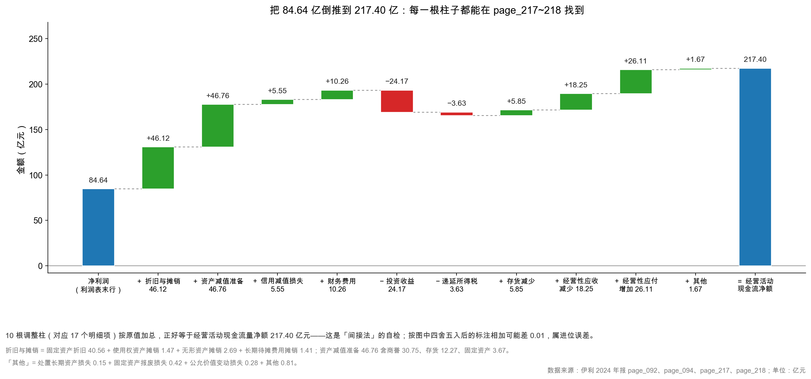
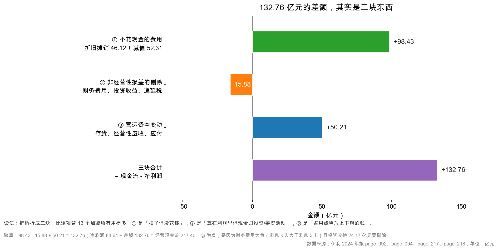

# 第 37 章：经营活动现金流——间接法怎么倒推

> 本章你将：
> - 分清"直接法"和"间接法"：一张表告诉你钱从哪来，另一张表告诉你利润怎么变成钱；
> - 把伊利 2024 年的净利润 84.64 亿元，用 page_217~218 的 17 个加减项，一步步倒推到 217.40 亿元；
> - 弄懂为什么折旧、摊销、减值要"加回"，而工资、货款不用加回；
> - 学会本周最重要的一个方法：**把桥拆成三块**（不花现金的费用、非经营性损益、营运资本变动），一分钟判断现金流质量；
> - 知道间接法最容易读错的三个地方，包括"财务费用"这一项的口径陷阱。

上一章我们确认了一件事：伊利 2024 年净利润 84.64 亿元，经营现金流 217.40 亿元，差 132.76 亿元，而这个差额可以拆成三块。

但"可以拆"和"会拆"是两回事。这一章要把差额拆到 17 项，一项不多、一项不少，加总必须正好等于 217.40 亿元。

这不是为了炫技。**间接法是全书最有用的一张"体检表"**——它把一家公司的利润，一层层剥到现金。剥完之后你会看到：哪些利润是"纸面"的，哪些现金是"借来"的，哪些是"真赚的"。

---

## 37.1 两张翻译稿：直接法在说什么

现金流量表有两条编制路径，讲的是同一件事，角度不同。

**直接法（direct method）：按"收现/付现"逐项列。** 就是我们在 page_094 看到的那张主表：

| 项目 | 金额（亿元） |
|---|---|
| 销售商品、提供劳务收到的现金 | 1,306.52 |
| 收到的税费返还 | 7.14 |
| 收到其他与经营活动有关的现金 | 37.21 |
| 经营活动现金流入小计 | **1,352.77** |
| 购买商品、接受劳务支付的现金 | 912.54 |
| 支付给职工以及为职工支付的现金 | 138.62 |
| 支付的各项税费 | 67.30 |
| 支付其他与经营活动有关的现金 | 16.93 |
| 经营活动现金流出小计 | **1,135.37** |
| 经营活动产生的现金流量净额 | **217.40** |

<!-- src: 伊利股份2024年报/page_094.md -->

直接法回答的问题是：**"钱从哪些口子进来，从哪些口子出去？"** 它的优点是直观——你能一眼看到 96.6% 的流入是卖货收的钱，80.4% 的流出是买原料付的钱。

**间接法（indirect method）：从净利润出发，倒推。** 就是 page_217~218 的"现金流量表补充资料"：

> 1. 将净利润调节为经营活动现金流量：净利润 … 加：资产减值准备 … 加：固定资产折旧 … 减：投资收益 … 加：经营性应付项目的增加 … = 经营活动产生的现金流量净额

间接法回答的问题是：**"利润和现金差在哪？"** 它的优点是能定位——你能看到 84.64 亿元的利润，被哪些项目推到了 217.40 亿元。

一个类比：

- 直接法像**银行流水**：3 月 5 日进账 5 万，3 月 8 日出账 2 万……一笔一笔。
- 间接法像**对账单**：账面应该有 10 万，为什么实际只有 4 万？因为①有 3 万是客户欠着没付；②有 1 万是设备折旧（账上扣了但没付钱）；③有 2 万是预付了明年的房租……

A 股上市公司的主表用直接法，**附注里必须披露间接法**（这是准则要求）。港股也类似。所以任何一家 A 股公司，你都能找到这张"补充资料"。

> 📌 **划重点：** 直接法告诉你"钱怎么流动"，间接法告诉你"利润怎么失真"。看财报时两张都要看：先用直接法确认现金是真的进来了（不是卖资产、不是借钱），再用间接法确认这些现金是"赚来的"还是"收回来的"。

---

## 37.2 从 84.64 到 217.40：17 项桥

下面是伊利 2024 年完整的桥。为了让你看出"哪些是常态、哪些是异常"，我把 2023 年同期的数也并排放上（page_217~218 的"上期金额"列）：

| # | 项目 | 2024 年 | 2023 年 | 性质 |
|---|---|---|---|---|
| — | **净利润** | **84.64** | **102.84** | 起点 |
| 1 | 加：资产减值准备 | +46.76 | +15.26 | 不花现金 |
| 2 | 加：信用减值损失 | +5.55 | +1.60 | 不花现金 |
| 3 | 加：固定资产折旧等 | +40.56 | +39.00 | 不花现金 |
| 4 | 加：使用权资产摊销 | +1.47 | +1.52 | 不花现金 |
| 5 | 加：无形资产摊销 | +2.69 | +2.35 | 不花现金 |
| 6 | 加：长期待摊费用摊销 | +1.41 | +1.44 | 不花现金 |
| 7 | 加：处置长期资产损失 | +0.15 | +0.61 | 非经营性 |
| 8 | 加：固定资产报废损失 | +0.42 | +0.23 | 非经营性 |
| 9 | 加：公允价值变动损失 | +0.28 | -2.78 | 非经营性 |
| 10 | 加：财务费用 | +10.26 | +22.25 | 归筹资活动 |
| 11 | 减：投资收益 | -24.17 | +0.31 | 归投资活动 |
| 12 | 减：递延所得税资产减少 | -3.89 | -2.09 | 不涉及现金 |
| 13 | 加：递延所得税负债增加 | +0.26 | +1.25 | 不涉及现金 |
| 14 | 加：存货的减少 | +5.85 | +17.89 | 营运资本 |
| 15 | 加：经营性应收项目的减少 | +18.25 | -2.61 | 营运资本 |
| 16 | 加：经营性应付项目的增加 | +26.11 | -17.51 | 营运资本 |
| 17 | 加：其他 | +0.81 | +1.32 | 杂项 |
| — | **经营活动现金流量净额** | **217.40** | **182.90** | 终点 |

<!-- src: 伊利股份2024年报/page_217.md 伊利股份2024年报/page_218.md -->

18 行按原值相加，2024 年得 217.3974 亿元，2023 年得 182.9036 亿元，与现金流量表主表完全一致。**这就是间接法的自检**：如果加总对不上主表，不是你算错了，就是年报印错了（后者极少）。

小提示：如果你把上表**四舍五入后的数字**直接相加，2024 年会得到 217.41 而不是 217.40——这是进位误差，不是错。做验算时用原值，做展示时用两位小数，两者不要混。

> 🔍 **翻到年报：** page_217 的下半页开始是"80、现金流量表补充资料"的"(1) 现金流量表补充资料"，表头写着"将净利润调节为经营活动现金流量"。page_218 是接着的几行，最后一行是"经营活动产生的现金流量净额 21,739,740,393.38"。原表的数字带空格（PDF 转文本造成的），比如 `8, 463, 710, 355. 65`，去掉空格就是 8,463,710,355.65。

读这张图有三个要点：

**第一，柱子的方向不是"好坏"，是"加减"。** 绿色的柱子往上，红色的往下。加得多不代表公司变好了，只代表"利润表扣了但现金没动"的项目多。

**第二，最大的两根柱子是减值和折旧。** 46.76 亿元的资产减值准备、40.56 亿元的固定资产折旧，两根加起来 87.32 亿元，占了整个差额的 2/3。这两项恰好都是"不花现金"的费用。

**第三，营运资本三项全是加项（+5.85、+18.25、+26.11）。** 这说明 2024 年伊利在**释放**营运资本：存货降了、应收收回来了、应付和预收多占了。这在收入下滑的年份是好事（现金回流），但也意味着这种"释放"不可持续——存货不可能一直降。

---

## 37.3 为什么这几类要"加回"

间接法的加回规则，其实只有一条：**利润表扣了它，但今年没有为它付现金 → 加回。**

把这条规则套到具体的项目上：

### 折旧、摊销：钱在"过去"付过了

固定资产折旧 40.56 亿元。伊利有 346.19 亿元的固定资产（page_087），包括生产线、厂房、冷库、运输设备。这些资产是过去十几年陆续买的，钱在当时就付出去了，记在了"购建固定资产支付的现金"里（也就是资本开支）。

买完之后，会计要把这笔支出分摊到它能用的那些年，于是每年扣一笔"折旧"。所以：

- **现金**：买的那一年一次性流出；
- **利润**：之后每一年分摊扣一点。

到 2024 年，伊利为这 40.56 亿元折旧付出的现金是 **0**。所以要在桥上把它加回。

使用权资产摊销 1.47 亿元是同一个逻辑的变体：租来的房子、仓库按合同要付租金，会计准则要求把"未来要付的租金"折成一项资产（使用权资产），然后每年摊销。现金是按合同分期付的，摊销是账面分摊，两者时间不完全一致，所以也要调整。

无形资产摊销 2.69 亿元（土地、商标、软件）、长期待摊费用摊销 1.41 亿元（装修、改良支出），都是同一类。

### 减值：一分钱都没付

资产减值准备 46.76 亿元、信用减值损失 5.55 亿元。这两个数字背后没有任何现金流动。

以商誉减值为例：伊利收购澳优乳业时，付出价里超过"可辨认净资产公允价值"的那一部分，记成了"商誉"。2024 年公司判断澳优未来能赚的钱不如当初估计的多，就把这块商誉的账面价值砍掉 30.37 亿元（page_184）。这个动作只改了两张表的账面数字：

- 利润表：多了 30.37 亿元"资产减值损失"，净利润减少；
- 资产负债表：全公司商誉净额从 51.60 亿元降到 23.37 亿元，减值准备从 3.99 亿元涨到 34.76 亿元（page_087）。

**银行账户一分没动。** 所以在桥上要加回 30.37 亿元。

信用减值损失 5.55 亿元也是同理：公司判断有些应收账款收不回来了，先提一笔坏账准备。提准备不动现金——真正收不回来的时候，现金早就没收到了（收入确认在更早的年份）。

> ⚠️ **易踩坑：** "加回减值"经常被误解成"减值不存在"。不是的。减值是真损失——它意味着公司过去花出去的钱（收购价、存货成本）有一部分打了水漂。加回只是说"这笔损失不是今年用现金支付的"。**减值是"过去的错误在今年确认"，不是"今年没损失"。** 这就是为什么第 7 周说"减值是会计估计"，但也不能说"减值可以忽略"。

### 财务费用：这笔现金归"筹资活动"

这一项最容易看错。

伊利 2024 年利润表的财务费用是 **-5.92 亿元**（负数，说明利息收入大于利息支出）。但补充资料里的"财务费用"是 **+10.26 亿元**。

为什么差这么多？因为两个"财务费用"口径不同：

- **利润表的财务费用** = 利息支出 18.20 亿元 - 利息收入 24.55 亿元 + 汇兑损益等 $\approx$ -5.92 亿元（page_091）；
- **补充资料的财务费用**：这是按"经营活动现金流"口径重算过的金额。它关心的问题是"利润里扣了多少属于筹资活动的财务费用，而经营现金里并没有扣"，所以既不等于利润表的净额，也不等于利息支出总额。

换句话说，补充资料里的 10.26 亿元，**既不是利润表的 -5.92 亿元，也不是利息支出 18.20 亿元**。

这个差别重要吗？重要。因为如果你看到"财务费用加回 10.26 亿元"，就以为"公司今年付了 10.26 亿元利息"，那就错了——实际支付的利息在筹资活动的"分配股利、利润或偿付利息支付的现金 90.92 亿元"里（page_095）。

> 💡 **你可能会问：为什么利息支出要从经营现金流里剔出去，放进筹资活动？**
>
> 这是准则的选择题。国际上两种做法都有：一种认为"借钱是经营的一部分"（尤其对金融企业），利息就该算经营；另一种认为"借钱是融资决策"，利息属于筹资。中国会计准则（CAS 31）和国际准则（IAS 7）都允许把利息放在筹资活动，A 股公司普遍这么做。
>
> 后果是：**经营现金流被"美化"了**——因为利息支出没有从经营现金流里扣。所以跨公司比较时要注意口径：如果一家公司把利息放在经营、另一家放在筹资，两家的经营现金流不可直接比。伊利属于后者。
>
> 一个补救办法：算"扣除利息后的经营现金流"，第 39 章讲 FCF 的第二种算法时会用到。

### 投资收益：这笔现金归"投资活动"

伊利 2024 年投资收益 24.17 亿元。拆开看：处置子公司昌吉盛新的股权贡献了 **25.80 亿元**（page_210），而对联营、合营企业的投资损益是 **-2.15 亿元**（亏损），两项相抵，再加上理财收益等，才凑成 24.17 亿元（page_091）。

注意这里有个容易看花眼的地方：**单项（25.80 亿元）比合计（24.17 亿元）还大。** 这不是印错，是「大额收益 + 小额亏损」相抵的结果。

卖股权收到的现金记在**投资活动**（"处置子公司及其他营业单位收到的现金净额"）。但投资收益进了利润表，也就进了净利润。如果不剔除，经营现金流就被"卖子公司"这件事虚增了 24.17 亿元。

所以桥上要**减去** 24.17 亿元。

顺带说：这一项在 2023 年是 **+0.31 亿元**（是投资损失，所以要加回），2024 年变成 **-24.17 亿元**（是投资收益，所以要减去）。一年的摆动就是 24.48 亿元。这种"符号翻转"是读间接法时要特别留意的——它往往对应一笔大额的非经常性交易。

### 营运资本三项：这是真的现金进出

存货减少 5.85 亿元、经营性应收减少 18.25 亿元、经营性应付增加 26.11 亿元。

这三项和前面几项的性质完全不同：**它们背后有真实的现金流动。**

- 存货从 125.12 亿元降到 107.45 亿元（page_087），卖掉存货收到现金——这不是"账面调整"，是真的有钱进来；
- 应收账款从 30.85 亿元降到 28.78 亿元，收回旧账，钱进了账户；
- 应付项目增加 26.11 亿元，意味着公司多占了上下游的钱（多收预收款、晚付供应商），相当于"无息贷款"。

所以在桥上，营运资本**减少**（占用变少）是加项，营运资本**增加**（占用变多）是减项。

**记住这个方向就够了**：存货/应收增加 = 现金被占用 = 减项；应付/预收增加 = 占用别人的钱 = 加项。

---

## 37.4 三块拆解法：一分钟判断现金流质量

17 项太多，记不住。把它们按性质归成三块，就够用了。

| 块 | 包含项目 | 2024 年 | 2023 年 | 说明 |
|---|---|---|---|---|
| ① 不花现金的费用 | 折旧（3~6 项）+ 减值（1~2 项） | **+98.43** | +61.17 | 最稳定的一块，逐年都有 |
| ② 非经营性损益的剔除 | 处置/报废/公允/财务费用/投资收益/递延税/其他 | **-15.88** | +21.10 | 符号会翻转，看具体交易 |
| ③ 营运资本变动 | 存货 + 应收 + 应付 | **+50.21** | -2.22 | 一年正一年负，不可持续 |
| 合计 | | **132.76** | 80.06 | = 经营现金流 - 净利润 |

验算：98.43 - 15.88 + 50.21 = 132.76；84.64 + 132.76 = 217.40。
2023 年：61.17 + 21.10 - 2.22 $\approx$ 80.06（三块各自四舍五入，合计与 182.90 - 102.84 = 80.06 一致）；102.84 + 80.06 = 182.90。

两年一对比，能看出三件有意思的事：

**第一，① 从 61.17 亿元涨到 98.43 亿元，涨了 37.26 亿元，几乎全部来自减值（15.26 → 52.31 亿元）。** 折旧摊销两年基本没变（46.12 对 44.31 亿元）。这说明 2024 年现金流变好，很大程度是"多计提了减值"这个会计动作带来的——**减值越多，利润越低，但现金流不变，所以净现比越高**。

这就是全书那条洞见的现金流版本：**减值不花现金，所以它压低利润、抬高净现比。**

**第二，② 从 +21.10 亿元翻转到 -15.88 亿元，摆动 36.98 亿元。** 主要原因是财务费用（22.25 → 10.26 亿元，少了 11.99 亿元，因为利息支出下降、利息收入上升）和投资收益（+0.31 → -24.17 亿元，因为卖了子公司）。这两项都跟"主业经营"无关。

**第三，③ 从 -2.22 亿元变成 +50.21 亿元，摆动 52.43 亿元。** 这是 2024 年现金流增长的最大单一来源。2023 年公司在**占用**营运资本（应付减少 17.51 亿元，说明在还供应商的钱；存货减少 17.89 亿元是唯一的大加项），2024 年则在**释放**营运资本。

**所以 217.40 亿元是怎么来的？一句话：减值多提了 37 亿元、营运资本多释放了 52 亿元、非经营性损益反向拉了 37 亿元。** 三件事叠加，把 84.64 亿元推到了 217.40 亿元。

> 📌 **划重点：** 三块拆解法只需要问三个问题：
> ① 不花现金的费用有多大？（越大，净现比越高，但这是"会计红利"，不是"经营改善"）
> ② 非经营性损益是正是负？（负得多，说明今年有一次性收益被剔除，利润里水分多）
> ③ 营运资本是释放还是占用？（释放是一次性的，占用是扩张或恶化的信号）
> 三问答完，你就知道这家公司的现金流"含金量"在哪一层。

---

## 37.5 三个最容易读错的地方

### 错法一：把"加回"当成"多赚了"

看到"加：资产减值准备 46.76 亿元"，很多人的第一反应是"哦，公司多赚了 46.76 亿元"。完全不是。

加回只是把"非现金费用"从利润里剔除，让利润向现金靠拢。它不创造任何价值。一家公司如果每年都靠"大额减值加回"来撑经营现金流，说明它的资产在持续贬值——这是坏消息，不是好消息。

判断标准很简单：**看①这一块里，折旧和减值各占多少。** 折旧占比高（伊利 46.12 / 98.43 = 47%），说明是重资产模式的正常现象；减值占比高（伊利 52.31 / 98.43 = 53%），说明有一次性因素，明年可能消失。

### 错法二：以为"经营性应付项目的增加"全是占供应商的便宜

page_218 的"经营性应付项目的增加 26.11 亿元"，看起来像"公司多占了上下游 26 亿元"。但如果你去翻资产负债表，会发现一个陷阱：

| 科目 | 2024 年 | 2023 年 | 变动 |
|---|---|---|---|
| 应付账款 | 123.13 亿元 | 137.99 亿元 | **-14.86** |
| 合同负债 | 120.73 亿元 | 86.96 亿元 | +33.77 |
| 预收款项 | 0 | 26.47 亿元 | -26.47 |
| 应付职工薪酬 | 37.77 亿元 | 40.06 亿元 | -2.29 |
| 应交税费 | 8.50 亿元 | 6.54 亿元 | +1.96 |

<!-- src: 伊利股份2024年报/page_088.md -->

两个发现：

**第一，应付账款其实减少了 14.86 亿元**——公司在加快付钱给供应商，不是在拖欠。这对供应商是好事，对现金流是减项。

**第二，"合同负债 +33.77 亿元"里有 26.47 亿元是会计重分类，不是新增预收。** 2023 年资产负债表上同时有"合同负债 86.96 亿元"和"预收款项 26.47 亿元"，2024 年预收款项变成 0，全部并入了合同负债。所以真实的预收增长是：120.73 - (86.96 + 26.47) = **+7.30 亿元**，不是 33.77 亿元。

这个细节很能说明问题：**同样的 +33.77 亿元，一个粗心的读者会得出"渠道打款积极、需求旺盛"，一个仔细的读者会得出"预收只多了 7 亿元，跟收入下滑 8.24% 是匹配的"。** 结论完全不同。

### 错法三：忽略"其他"这一行

page_218 最后有一行"其他 0.81 亿元"。金额不大，但它是一个信号：间接法里有无法归类的项目时，会计会把它塞进"其他"。如果某家公司这一行突然变得很大（比如几十亿元），你就要去附注里找解释——它可能藏着关联交易、一次性损益，或者分类错误。

伊利的 0.81 亿元很小，可以忽略。

---

## 37.6 四步法：拿到任何一家公司的补充资料

最后给你一套可以复用的动作。打开任何一家 A 股公司的年报，找到"现金流量表补充资料"，按这四步走：

**第一步：抄下起点和终点。**
净利润（利润表末行）、经营活动现金流量净额（现金流量表）。两者相减得到差额，先记住这个数。

**第二步：把加回项分成"折旧摊销"和"减值"两堆。**
折旧摊销 = 固定资产折旧 + 使用权资产摊销 + 无形资产摊销 + 长期待摊费用摊销。减值 = 资产减值准备 + 信用减值损失。
这一块通常占差额的 60%~80%。如果超过 100%，说明其他项在反向拉。

**第三步：找出符号翻转的大项。**
投资收益、公允价值变动、处置损失这几项，符号会随交易翻转。看它们的绝对值：超过净利润 5% 的，都要去附注里找原因。伊利 2024 年的投资收益 -24.17 亿元就是典型（卖子公司）。

**第四步：算营运资本三项的合计，和收入增速对照。**

| 情形 | 含义 |
|---|---|
| 收入增长 + 营运资本释放 | 罕见，通常是收缩期的现金回收（伊利 2024 年就是） |
| 收入增长 + 营运资本占用 | 正常扩张，现金流暂时差，可接受 |
| 收入下滑 + 营运资本占用 | 危险：卖不动还在压货 |
| 收入下滑 + 营运资本释放 | 主动去库存、收账，短期现金好，但不可持续 |

伊利 2024 年是第四种：收入 -8.24%、营运资本释放 +50.21 亿元。这是"主动收缩、回收现金"的姿态，短期健康，但要看 2025 年能不能恢复增长。

> 📌 **划重点：** 间接法不是用来"算"经营现金流的（主表已经给你了），是用来"解释"的。它的价值在于：把"利润"和"现金"的差距，变成一张可以追问的清单。每一个加项减项，都是一个可以向管理层提问的地方。

---

## ✍️ 想一想

### 问 1：如果一家公司的减值每年都很大，净现比一直很高，是好是坏

假设一家公司（**示意数字**）连续五年：净利润 10 亿元、减值 8 亿元、折旧 5 亿元、营运资本变动 0，经营现金流 = 10 + 8 + 5 = 23 亿元，净现比 2.3 倍。请回答：① 这个 2.3 倍说明什么？② 你会担心什么？③ 如果减值集中在某一项资产上，你会怎么判断？

**解题思路：**
净现比高本身是中性的，它只说明"非现金费用大"。关键是问：这些非现金费用是**正常的**（折旧）还是**异常的**（减值）？如果减值连续五年都很大，那它就不是"一次性"了，而是"每年都在损失"。

**参考答案：**

① 说明这家公司的利润被大量非现金费用压低，而现金没有相应流出。**2.3 倍不代表公司赚了 2.3 倍的现金，只代表它的利润表比现金"保守"了 13 亿元。**

② 我会担心三件事：

| 担心 | 为什么 |
|---|---|
| 减值是不是"每年都在损失" | 连续五年 8 亿元，累计 40 亿元。这不是一次性，是持续性的资产贬值。可能是收购的子公司一直不达预期，也可能是存货一直跌价 |
| 资产是不是在"缩水" | 减值会减少资产账面价值。五年减 40 亿元，如果总资产只有 100 亿元，等于缩水 40% |
| 是不是在"洗大澡" | 有些公司故意每年提一点，把利润做低，为未来留空间。要对比"减值计提比例"和同业 |

③ 如果减值集中在某一项资产（比如商誉），我会看三件事：
- **这项资产的初始金额有多大**：商誉原值 50 亿元，每年减 8 亿元，六年就减完了；
- **被收购方的实际业绩**：去看附注里的"业绩承诺完成情况"；
- **减值测试的关键假设**：折现率、增长率假设是不是每年都在放宽（放宽假设 = 少提减值 = 撑利润）。

判断口诀：**减值看"是否为一次性"，折旧看"是否为重资产"。** 一次性的减值加回，是"今年的现金流虚高"；重资产的折旧加回，是"这门生意的常态"。

**易错点：**
① 看到净现比 2.3 就认为公司很健康。高净现比可能只是"减值多"；
② 认为"减值不影响现金，所以不用管"。减值不影响当期现金，但它影响未来的资产和盈利能力；
③ 把"减值加回"和"资产变好"混为一谈。加回是会计动作，资产该贬值还是贬值。

### 问 2：为什么"财务费用"加回 10.26 亿元，而利润表的财务费用是 -5.92 亿元

伊利 2024 年利润表财务费用 -5.92 亿元（负数，利息收入大于利息支出），但补充资料里"财务费用"是 +10.26 亿元。请解释这两个数的关系，并说明如果你要算"扣除利息后的经营现金流"，该怎么调整。

**解题思路：**
先看利润表财务费用的构成（利息支出 18.20 亿元、利息收入 24.55 亿元），再看补充资料想干什么（把属于筹资活动的现金从经营里剔出去）。两个口径服务两个目的，不是同一个数。

**参考答案：**

两个数的关系：

| 口径 | 数值 | 包含什么 | 为什么 |
|---|---|---|---|
| 利润表财务费用 | -5.92 亿元 | 利息支出 18.20 - 利息收入 24.55 + 汇兑等 | 会计上"净额"列示，反映对利润的净影响 |
| 补充资料财务费用 | +10.26 亿元 | 按现金流量表口径重算的财务费用（不是利润表那一行） | 目的是把"属于筹资活动支付的利息"从经营现金流里剔除，所以不能直接引用利润表数字 |

所以 10.26 亿元既不是 -5.92 亿元，也不是 18.20 亿元。它是"按经营活动现金流口径应该加回的利息支出"。

要算"扣除利息后的经营现金流"，最干净的做法是：

$$\text{扣息后经营现金流} = \text{经营活动现金流} - \text{实际支付的利息}$$

伊利实际支付的利息包含在"分配股利、利润或偿付利息支付的现金 90.92 亿元"里（page_095），这一行没有拆分利息和股利。所以只能估算：用利润表的利息支出 18.20 亿元近似（实际支付可能略多或略少，因为还有资本化利息和应付利息的变动）。

$$\text{扣息后经营现金流} \approx 217.40 - 18.20 = 199.20 \text{ 亿元}$$

这个数比 217.40 亿元保守，用它可以避免"把利息支出藏进筹资活动"带来的高估。

**易错点：**
① 把补充资料的"财务费用"当成利润表的财务费用，直接引用；
② 把"分配股利、利润或偿付利息支付的现金"全当成利息（其实大部分是股利）；
③ 忘了利息可能被资本化（记进在建工程），那部分不在利润表的财务费用里，也不在"偿付利息"里。

### 问 3：营运资本释放 50.21 亿元，明年还会有吗

伊利 2024 年营运资本三项合计 +50.21 亿元（存货 +5.85、应收 +18.25、应付 +26.11）。请回答：① 这三项为什么会释放现金？② 哪一项最可持续、哪一项最不可持续？③ 如果要预测 2025 年的经营现金流，你会怎么处理这 50.21 亿元？

**解题思路：**
回到资产负债表看这三项的实际变动：存货从 125.12 降到 107.45，应收从 30.85 降到 28.78，应付账款从 137.99 降到 123.13（减少，是占用现金）。再想：这些变动能不能重复？

**参考答案：**

① 释放现金的机制：
- **存货减少 17.67 亿元**：卖掉的存货比新采购的多，现金回流。但要注意，存货减少也可能是"减少生产、降低产能利用率"，长期会推高单位成本；
- **应收减少 2.07 亿元**：收回旧账。金额不大，但方向对；
- **应付项目净增加 26.11 亿元**：主要是合同负债（预收）增加。但如 37.5 节所说，其中 26.47 亿元是"预收款项并入合同负债"的重分类，真实新增预收只有约 7.30 亿元。**应付账款本身是减少的（-14.86 亿元），说明公司在加快付款。**

② 可持续性排序：

| 项目 | 可持续性 | 原因 |
|---|---|---|
| 存货减少 | 低 | 存货不可能一直降。降到安全库存就必须补货，明年可能反过来占用现金 |
| 应收减少 | 中 | 如果信用政策不变、收入恢复增长，应收会跟着收入涨回去 |
| 应付（预收）增加 | 低~中 | 预收取决于渠道打款意愿；应付账款已经在减少，不能指望继续拖 |

**结论：50.21 亿元基本是一次性的。** 真正可持续的是"每年 40~46 亿元的折旧摊销"。

③ 预测 2025 年经营现金流时，我会这样处理：

$$\text{可持续经营现金流} \approx \text{净利润} + \text{折旧摊销} = 84.64 + 46.12 = 130.76 \text{ 亿元}$$

然后在这个基础上做情景假设：
- 乐观（收入恢复增长、营运资本小幅释放）：130.76 + 20 = 150 亿元；
- 中性（收入持平、营运资本不变）：130.76 亿元；
- 悲观（收入继续下滑、营运资本被占用）：130.76 - 30 = 100 亿元。

而不是直接拿 217.40 亿元去外推。**这是现金流分析里最容易犯的错：把最好的一年当成常态。**

**易错点：**
① 直接假设 2025 年还有 50 亿元营运资本释放；
② 把"合同负债 +33.77 亿元"当成渠道打款积极（其中 26.47 亿元是重分类）；
③ 忽略应付账款在减少这个反向信号；
④ 用 217.40 亿元 $\times$ 增长率来预测，而不是从"净利润 + 折旧摊销"这个基本盘出发。

---

## 📎 数据出处

- 伊利股份 2024 年报：`page_091.md`（财务费用 -591,649,416.42 元、利息费用 1,819,520,437.71 元、利息收入 2,455,067,393.23 元、投资收益 2,417,330,849.26 元）
- 伊利股份 2024 年报：`page_092.md`（净利润 8,463,710,355.65 元）
- 伊利股份 2024 年报：`page_094.md`（经营活动现金流入小计 135,277,219,092.78 元、流出小计 113,537,478,699.40 元、净额 21,739,740,393.38 元、销售商品收到现金 130,651,821,490.28 元）
- 伊利股份 2024 年报：`page_095.md`（分配股利、利润或偿付利息支付的现金 9,092,304,004.54 元、取得投资收益收到的现金 185,661,424.82 元）
- 伊利股份 2024 年报：`page_087.md`（存货 10,744,674,420.37 元、应收账款 2,878,402,047.44 元）
- 伊利股份 2024 年报：`page_088.md`（应付账款 12,312,877,232.19 元、合同负债 12,072,785,359.81 元、预收款项 2023 年 2,647,400,000.00 元、应付职工薪酬 3,777,081,923.53 元、应交税费 850,324,130.47 元）
- 伊利股份 2024 年报：`page_184.md`（澳优乳业商誉减值 3,037,222,489.82 元）
- 伊利股份 2024 年报：`page_210.md`（处置昌吉盛新投资收益 2,579,548,077.92 元）
- 伊利股份 2024 年报：`page_217.md`（补充资料：资产减值准备、信用减值损失、固定资产折旧、使用权资产摊销、无形资产摊销、长期待摊费用摊销、处置损失、报废损失）
- 伊利股份 2024 年报：`page_218.md`（补充资料续：公允价值变动、财务费用、投资损失、递延所得税、存货减少、经营性应收减少、经营性应付增加、其他）
- 数据汇总：`data/yili2024.json` 的 `cashflow`、`income`、`notes`、`balance`、`compare_2023` 段
- 本章 37.3 节奶茶店与设备折旧、37.6 节四步法中的示例均为**示意数字**（伊利真实数字除外）

下一章：[第 38 章：投资与筹资——钱从哪来、到哪去](38-投资与筹资-钱从哪来到哪去.md)
