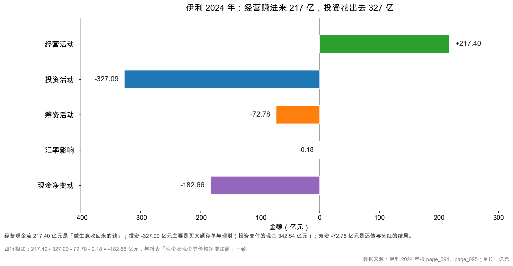
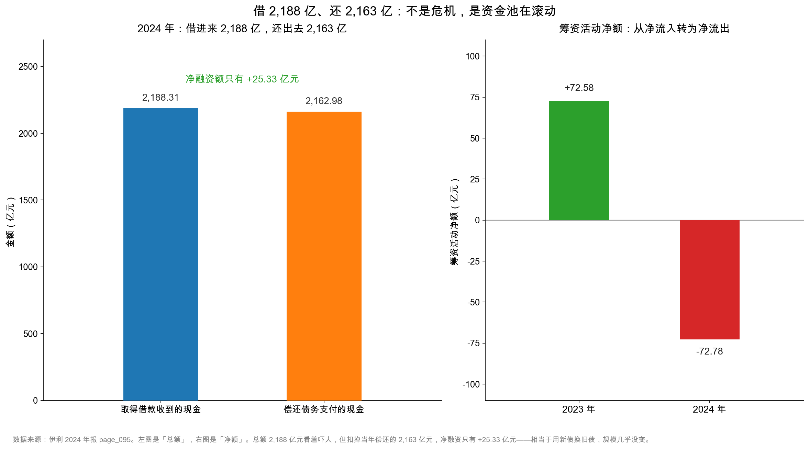

# 第 38 章：投资与筹资——钱从哪来、到哪去

> 本章你将：
> - 看懂投资活动净流出 327.09 亿元里，真正的资本开支只有 39.78 亿元，其余 342.54 亿元是买大额存单和理财；
> - 弄明白"投资支付的现金 342.54 亿元"为什么不是真投资，以及它和第 12 章"钱搬家"是同一件事；
> - 看懂筹资活动：一年借 2,188.31 亿元、还 2,162.98 亿元，净融资只有 +25.33 亿元，这不是危机；
> - 学会区分"总额"和"净额"，知道什么时候该看哪个；
> - 把三类现金流连起来读：现金净减少 182.66 亿元，钱到底去哪了。

第 37 章我们把经营活动拆完了。217.40 亿元经营现金流，是伊利 2024 年"做生意"的全部成绩。

但一家公司不会把赚来的钱放在账上不动。它会花钱（建厂、买设备、买理财）、会借钱、会还钱、会给股东分红。这些动作，分别记在**投资活动**和**筹资活动**里。

这两类现金流最容易被误读。因为它们的绝对金额往往比经营现金流大一个量级——伊利 2024 年投资活动流出 384.37 亿元、筹资活动流入 2,190.77 亿元。第一次看的人会以为"这家公司在疯狂投资、疯狂借钱"。

真相是：**这两张表里绝大部分是"钱在自己的口袋里换了个位置"，不是真的花掉了或借来了。**

---

## 38.1 三类现金流，是一张"钱的行程表"

先把三类的角色分清：

| 类型 | 回答的问题 | 典型项目 | 伊利 2024 年 |
|---|---|---|---|
| 经营活动 | 做生意本身能不能产生现金？ | 卖货收现、买料付现、发工资、交税 | **+217.40 亿元** |
| 投资活动 | 在为未来花钱，还是在变卖家当？ | 建厂买设备、买/卖理财、收购子公司 | **-327.09 亿元** |
| 筹资活动 | 在向股东和债主要钱，还是在还钱？ | 借款、还款、分红、付息、增发 | **-72.78 亿元** |
| 汇率影响 | 外币现金折算差异 | — | -0.18 亿元 |
| 合计 | 现金净变动 | — | **-182.66 亿元** |

<!-- src: 伊利股份2024年报/page_094.md 伊利股份2024年报/page_095.md -->

这张图最反直觉的地方是：**经营赚了 217 亿元，账上的现金却少了 183 亿元。**

钱去哪了？两个方向：

- **投资活动净流出 327.09 亿元**（主要不是建厂，是买存单，本章 38.2 节）；
- **筹资活动净流出 72.78 亿元**（还债 + 分红，本章 38.3、38.4 节）。

217.40 - 327.09 - 72.78 - 0.18 = -182.66。一分不差。

所以"现金减少"本身不是坏消息。一家公司现金减少，可能是"把钱换成了能生息的存单"（资产没少，只是换了个科目），也可能是"分红还债"（把钱还给股东和债主）。真正要警惕的是：**经营现金流为负、同时还在大额投资**——那才是失血。

---

## 38.2 投资活动：327 亿里只有 39.78 亿是真投资

先看投资活动的全貌（page_095）：

| 项目 | 2024 年 | 2023 年 | 性质 |
|---|---|---|---|
| 收回投资收到的现金 | 54.06 | 56.90 | 存单/理财到期 |
| 取得投资收益收到的现金 | 1.86 | 1.55 | 利息、股利 |
| 处置固定资产等收回的现金净额 | 1.37 | 0.63 | 卖旧设备 |
| **投资活动现金流入小计** | **57.28** | 59.33 | |
| 购建固定资产、无形资产等支付的现金 | **39.78** | 69.56 | **真正的资本开支** |
| 投资支付的现金 | **342.54** | 149.82 | **买存单/理财** |
| 取得子公司支付的现金净额 | 1.65 | 0.39 | 收购 |
| 支付其他与投资活动有关的现金 | 0.39 | 0.00 | — |
| **投资活动现金流出小计** | **384.37** | 219.77 | |
| **投资活动现金流量净额** | **-327.09** | -160.44 | |

<!-- src: 伊利股份2024年报/page_095.md -->

看出问题了吗？

**327.09 亿元的净流出里，真正的"投资"只有 39.78 亿元。** 剩下 342.54 亿元的"投资支付的现金"，绝大部分是买大额存单、定期存款和银行理财。

这不是猜测。看资产端的三处变化：

| 科目 | 2024 年末 | 2023 年末 | 增加 |
|---|---|---|---|
| 其他流动资产——大额存单及定期存款 | 118.26 | 0 | +118.26 |
| 其他非流动资产——大额存单及定期存款 | 279.77 | 176.30 | +103.47 |
| 一年内到期的非流动资产（主要为一年内到期的大额存单） | 89.07 | 19.52 | +69.55 |
| **合计增加** | | | **+291.28** |

<!-- src: 伊利股份2024年报/page_166.md 伊利股份2024年报/page_188.md 伊利股份2024年报/page_087.md -->

三处合计增加 291.28 亿元，与"投资支付 342.54 亿元 - 收回投资 54.06 亿元 = 净买 288.48 亿元"基本对得上（差 2.8 亿元，是计提利息和汇率的影响）。

**所以"投资活动净流出 327 亿元"，本质是"把 288 亿元活期存款换成了利息更高的大额存单"。** 资产总额没有减少，只是从"货币资金"搬到了"其他流动资产/其他非流动资产"。

这正是第 12 章讲过的"钱搬家"：伊利 2024 年货币资金从 433.72 亿元降到 254.04 亿元（page_087），看起来"现金少了一半"，但同期大额存单增加了 291 亿元。**活期变定期，钱没少，只是利息高了。**

> ⚠️ **易踩坑：** 看到"投资活动净流出 327 亿元"，不要立刻下"公司在疯狂扩张"的结论。先看两个数：
> ① **购建长期资产支付的现金（capex）**——这才是真投资，伊利只有 39.78 亿元；
> ② **投资支付的现金**——这个科目里混着理财、存单、结构性存款，甚至可能是关联方资金拆借。
> 两者相差 8.6 倍，含义天差地别。判断标准：capex 会变成固定资产/在建工程（看资产负债表有没有对应增加）；买理财只会变成"其他流动资产"。

### 真正的资本开支：39.78 亿元，只够"修修补补"

伊利 2024 年 capex 39.78 亿元，比 2023 年的 69.56 亿元下降了 42.8%。而当年的折旧摊销是 46.12 亿元。

capex ÷ 折旧摊销 = 39.78 ÷ 46.12 = **86%**。

这个比例低于 100%，意味着：**公司当年新增的长期资产，还不够补偿当年消耗掉的。** 换句话说，产能在"自然磨损"，没有净扩张。

对一家成熟期的乳业龙头，这不奇怪：2023 年在建工程还有 43.37 亿元，2024 年降到 29.55 亿元（page_087），说明前期开工的项目已经陆续转固，新开工的少了，进入"维护性投入"阶段。

这个判断很重要，因为它是第 39 章自由现金流能高达 177.61 亿元的直接原因：**capex 少，FCF 就多。**

但也要留个心眼：capex 长期低于折旧，意味着未来产能会慢慢萎缩。如果一家公司连续五年 capex 只有折旧的 60%，那它是在"吃老本"，不是在经营。伊利 86% 这个数还算健康，但趋势（69.56 → 39.78）值得跟踪。

顺便看一眼投资活动里的另外两个小项，它们能帮你建立"科目直觉"：

| 项目 | 2024 年 | 2023 年 | 读法 |
|---|---|---|---|
| 收回投资收到的现金 | 54.06 亿元 | 56.90 亿元 | 两年都在 55 亿元上下，说明在做"存单阶梯"——每年有一批到期，到期后又续买 |
| 取得子公司支付的现金净额 | 1.65 亿元 | 0.39 亿元 | 小额并购。真正的大额收购（如 2022 年澳优）会让这一行突然跳到几十亿元，同时商誉增加（第 19 章） |

<!-- src: 伊利股份2024年报/page_095.md -->

"收回投资"稳定在 55 亿元左右，是判断"这家公司在做理财、不是在变卖家当"的一个小技巧：**如果是被迫变卖，金额会忽大忽小、且往往伴随投资损失；如果是存单到期，金额会很有规律。**

> 🔍 **翻到年报：** page_095 的"购建固定资产、无形资产和其他长期资产支付的现金"这一行，2024 年是 3,978,318,320.96 元。再翻 page_087 看"在建工程"：2024 年 29.55 亿元、2023 年 43.37 亿元。在建工程下降 + capex 下降，两个信号互相印证"扩张期结束"。

---

## 38.3 筹资活动：借 2,188 亿、还 2,163 亿，净融资只有 25 亿

筹资活动这张表，第一次看会吓一跳：

| 项目 | 2024 年 | 2023 年 |
|---|---|---|
| 取得借款收到的现金 | **2,188.31** | 2,853.54 |
| 收到其他与筹资活动有关的现金 | 2.46 | 0.72 |
| **筹资活动现金流入小计** | **2,190.77** | 2,855.87 |
| 偿还债务支付的现金 | **2,162.98** | 2,688.68 |
| 分配股利、利润或偿付利息支付的现金 | 90.92 | 84.16 |
| 支付其他与筹资活动有关的现金 | 9.65 | 10.45 |
| **筹资活动现金流出小计** | **2,263.55** | 2,783.29 |
| **筹资活动现金流量净额** | **-72.78** | +72.58 |

<!-- src: 伊利股份2024年报/page_095.md -->

一年借 2,188 亿元、还 2,163 亿元。这两个数字放在一起，第一反应是"这家公司资金链很紧张吧？"

恰恰相反。**这是大企业集团资金池的日常滚动。**

看净额：2,188.31 - 2,162.98 = **+25.33 亿元**。也就是说，借了 2,188 亿元，其中 2,163 亿元是用来还旧债的，真正新增的净负债只有 25 亿元。

### 2,188 亿元借的是什么？

page_217 开头有一张"有息负债变动表"，把短期借款、短期应付债券、长期借款等的期初余额、本期增加（现金/非现金）、本期减少、期末余额拆得清清楚楚。从这张表能看出 2,188 亿元的构成：

| 借款类型 | 本期现金流入（亿元） | 说明 |
|---|---|---|
| 短期借款 | 812.56 | 银行短期流贷 |
| 短期应付债券（超短融） | 1,374.97 | 一年内到期的超短期融资券，滚动发行 |
| 长期借款及一年内到期部分 | 0.79 | 很少 |
| **合计** | **约 2,188.32** | 与"取得借款收到的现金"一致 |

<!-- src: 伊利股份2024年报/page_217.md -->

关键在第二行：**1,374.97 亿元记在"短期应付债券"里，而伊利这个科目装的几乎全是超短期融资券（超短融）。**

这不是推测。page_080~081 的"报告期内债券付息兑付情况"列了一张长表，从"2024 年度第一期超短期融资券"一直排到"第二十一期"，每一期都在 2024 年内完成本息兑付，期限从几个月到 270 天不等（page_080）。**一年发 21 期、还 21 期，平均每 17 天滚动一次。**

超短融的利率通常比银行流贷低，大企业拿它当"短期资金池"：到期了发新的一期还旧的，账面余额保持在某个水平上。所以看到"短期应付债券 100.24 亿元"这个余额，不能理解成"只借了 100 亿元"——它是"滚动了一年、期末还剩 100 亿元"。

所以"一年借 2,188 亿元"的真相是：**其中 1,375 亿元是超短融在滚动续发（21 期），813 亿元是银行短期流贷在周转。** 这不是"突然缺钱"，是"日常的资金调度"。

> 🔍 **翻到年报：** page_080 的"报告期内债券付息兑付情况"，从第一期数到第二十一期；再翻 page_217 的有息负债变动表，看"短期应付债券"那一行：期初余额为空（0），本期现金流入 137,496,502,083.32 元，本期现金流出 128,014,615,183.77 元，期末余额 10,024,230,136.98 元。流入远大于期末余额，正是"滚动"的痕迹。

<!-- src: 伊利股份2024年报/page_080.md 伊利股份2024年报/page_081.md 伊利股份2024年报/page_217.md -->

### 该看净额还是总额？

两个都要看，但用途不同：

| 看什么 | 回答什么问题 | 伊利 2024 年 |
|---|---|---|
| 借款总额（2,188.31 亿元） | 公司的融资规模有多大？对利率敏感吗？ | 规模很大，说明依赖短期资金市场 |
| 偿还总额（2,162.98 亿元） | 到期债务能不能顺利滚下去？ | 能，全年滚了 2,163 亿元，没出问题 |
| **净融资额（+25.33 亿元）** | **公司是在加杠杆还是去杠杆？** | **基本持平，略微加了一点** |
| 筹资活动净额（-72.78 亿元） | 借钱 + 分红付息的净结果 | 净流出，因为在分红还债 |

**结论：伊利 2024 年在"去杠杆"的边缘——净融资 +25 亿元，但分红付息花了 90.92 亿元，所以筹资活动整体净流出 72.78 亿元。**

对比 2023 年：净融资 +164.86 亿元，筹资活动净流入 72.58 亿元。2023 年在加杠杆，2024 年转向了。这是一个重要的变化信号。

> 💡 **你可能会问：一年滚 2,000 多亿元的短期债务，万一某天滚不动了怎么办？**
>
> 这就是"短债长投"和"流动性风险"的来源。要看三个安全垫：
> ① **类现金储备**：伊利 2024 年货币资金 254.04 亿元 + 大额存单 398.03 亿元 = 652.07 亿元（data 里的 `cash_and_deposits`），足以覆盖一年内到期的有息负债（短期借款 363.55 + 短期应付债券 100.24 + 一年内到期非流动负债 92.30 = 556.09 亿元）；
> ② **未使用的银行授信**：年报"或有事项"或"其他重要事项"里通常会披露，伊利未在正文显著披露具体额度；
> ③ **经营现金流**：217.40 亿元/年，是最硬的安全垫。
>
> 三个加起来，短期滚动风险不大。但如果一家公司的类现金 < 短期有息负债，同时经营现金流为负，那就真的危险了。第 25 章（偿债体检）讲过这套判断，可以回头对照。

---

## 38.4 分红与付息：90.92 亿元，其中大部分是股利

筹资活动的第三行是"分配股利、利润或偿付利息支付的现金 90.92 亿元"（page_095）。这一行把**股利**和**利息**合在一起，需要拆开看。

先看股利。伊利的分红是"每年一次，次年实施"：

| 年度 | 方案 | 金额 | 实施时间 |
|---|---|---|---|
| 2023 年度 | 每股 1.20 元（含税） | 76.39 亿元 | 2024 年 5 月实施（page_045） |
| 2024 年度 | 每股 1.22 元（含税） | 77.26 亿元 | 2025 年实施（page_002） |

<!-- src: 伊利股份2024年报/page_002.md 伊利股份2024年报/page_045.md -->

所以 2024 年现金流量表里的"分配股利、利润或偿付利息支付的现金 90.92 亿元"，主要对应的是 **2023 年度分红的实际支付 76.39 亿元**，再加上利息支出、少数股东股利（0.60 亿元）等。

用 90.92 - 76.39 - 0.60 = 13.93 亿元，大致就是当年支付的利息及相关费用。这个数与利润表的利息支出 18.20 亿元有差距，原因是：部分利息被资本化（记进在建工程）、部分利息尚未支付（挂在"应付利息"里）、以及利息收入在财务费用里做了抵扣。

**2024 年度的分红方案值得单独看一眼：77.26 亿元，占归母净利润 84.53 亿元的 91.40%（page_002）。**

90% 以上的分红率，在 A 股属于很高的一档。它传递两个信息：

- **好消息**：公司认为自己进入成熟期，不需要留太多钱扩张，愿意把利润还给股东；
- **要留意的地方**：分红率这么高，未来的再投资空间就小。如果哪天主业需要大额投入（比如并购、产能重建），分红可能被迫下调——那对股价是个负面信号。

用自由现金流检验一下分红是否"可持续"：177.61 ÷ 77.26 = **2.30 倍**。也就是说，公司自己赚出来的自由现金，是分红的 2.3 倍——**分红是"自己赚的"，不是"借来发的"。** 这是判断分红质量最硬的一条标准（第 39 章展开）。

> 📌 **划重点：** "分配股利、利润或偿付利息支付的现金"是一个混合科目，包含股利 + 利息 + 少数股东分红。想单独看分红，去"重要事项"里的"利润分配方案"，或"股本变动"附注；想单独看利息，用利润表的"利息费用"近似（注意资本化部分）。

---

## 38.5 现金净减少 182.66 亿元，为什么不是坏事

把三类现金流加起来：

| 项目 | 金额（亿元） |
|---|---|
| 期初现金及现金等价物 | 428.12 |
| 经营活动净额 | +217.40 |
| 投资活动净额 | -327.09 |
| 筹资活动净额 | -72.78 |
| 汇率影响 | -0.18 |
| 现金净增加额 | **-182.66** |
| 期末现金及现金等价物 | **245.47** |

<!-- src: 伊利股份2024年报/page_095.md -->

"期末现金 245.47 亿元"，比期初少了 183 亿元。这个数字单看有点吓人——一家账上现金少了 43% 的公司。

但把三件事放在一起看，就完全合理了：

**第一，钱变成了存单。** 投资支付的现金 342.54 亿元，主要买了大额存单。这些存单不在"货币资金"里，在"其他流动资产/其他非流动资产"里。所以"现金减少"的同时，"类现金"（货币资金 + 大额存单）其实从 610.02 亿元增加到 652.07 亿元（page_087、page_166、page_188）。**多了 42 亿元，不是少了 183 亿元。**

**第二，钱还给了债主和股东。** 筹资活动净流出 72.78 亿元：还债净 25.33 亿元（借 2,188.31 - 还 2,162.98 是净借入，但筹资流出里还有分红付息 90.92 亿元和其他 9.65 亿元），分红 77 亿元左右。这些钱离开公司是**应该的**——股东投资的目的就是拿到回报。

**第三，经营现金流覆盖了大部分支出。** 217.40 亿元经营现金流，覆盖了 capex 39.78 亿元 + 分红付息 90.92 亿元 = 130.70 亿元，还剩 86.70 亿元。这剩下的钱，一部分买了存单，一部分还了债。

所以正确的读法是：**这家公司今年"自己赚的钱"足够覆盖"维持生意 + 回报股东"，剩下的钱做了理财。** 现金余额下降只是"钱换了科目"，不是"钱烧掉了"。

> ⚠️ **易踩坑：** "货币资金减少"和"现金减少"不是一回事，要和"其他流动资产/其他非流动资产里的大额存单"一起看。反过来，如果一家公司"货币资金减少"但存单没增加、投资活动也没大额流出，那就要问：钱去哪了？——这才是真问题（第 12 章讲过几种可能：受限资金、大股东占用、还债）。

---

## 38.6 四种组合，四张画像

把三类现金流的正负组合列出来，能快速给一家公司"画像"：

| 组合 | 经营 | 投资 | 筹资 | 画像 | 典型状态 |
|---|---|---|---|---|---|
| A | + | - | - | 现金奶牛 | 成熟期，赚的钱够投资够分红（伊利 2024 年接近这一型） |
| B | + | - | + | 成长期 | 赚的钱不够花，靠融资扩张 |
| C | + | + | - | 收缩期 | 卖资产 + 还债，主动或被动瘦身 |
| D | - | - | + | 危险型 | 经营失血还要投资，只能靠借钱 |
| E | - | + | + | 变卖求生 | 卖资产换现金，同时借钱 |
| F | + | + | + | 囤钱 | 一边赚钱一边卖资产一边融资，现金堆在账上（可能是准备大并购） |

伊利 2024 年是 A 型（经营 +、投资 -、筹资 -），这是最健康的一类。但要加两个注脚：

- 投资流出里，真投资（capex）只有 39.78 亿元，其余是买存单——所以它更像"准 A 型"，扩张意愿不强；
- 筹资流出里，分红占了大部分——说明公司在"回报股东"而不是"还债求生"。

**读三类现金流的顺序：先经营（能不能自己活），再投资（在为未来花钱还是变卖家当），最后筹资（在要钱还是在还钱）。** 顺序不能乱，因为经营现金流是唯一"可持续"的来源，另外两个都是它的"用途"或"补充"。

第 39 章，我们把经营现金流和 capex 相减，得到自由现金流——那才是真正能拿来分红、回购、还债、估值的钱。

---

## ✍️ 想一想

### 问 1：投资活动净流出 327 亿元，是不是"疯狂扩张"

伊利 2024 年投资活动现金流量净额 -327.09 亿元。请回答：① 这 327 亿元主要花在哪？② 为什么说它"不是真投资"？③ 如果要判断一家公司是不是在真扩张，你会看哪三个数？

**解题思路：**
把投资活动的流出拆开：384.37 亿元里，购建长期资产 39.78 亿元、投资支付 342.54 亿元、取得子公司 1.65 亿元、其他 0.39 亿元。再对照资产负债表：固定资产、在建工程有没有增加？"其他流动资产/其他非流动资产"有没有增加？

**参考答案：**

① 主要花在"投资支付的现金 342.54 亿元"上，占流出的 89.1%。这笔钱的去向，从资产端能看出来：其他流动资产里的大额存单增加 118.26 亿元、其他非流动资产里的大额存单增加 103.47 亿元、一年内到期的非流动资产增加 69.55 亿元，合计 291.28 亿元，与"净买存单 288.48 亿元"基本对上。

② 因为它没有形成"生产能力"。真正的投资（capex 39.78 亿元）会变成固定资产、在建工程、无形资产，未来能产生收入；买存单只是"把活期存款换成利息更高的定期"，资产总额不变，只是科目变了。用一句话概括：**真投资改变"公司能做什么"，买理财只改变"钱放在哪个账户"。**

③ 我会看这三个：

| 看什么 | 真扩张的表现 | 伊利 2024 年 |
|---|---|---|
| 购建长期资产支付的现金（capex） | 持续大于折旧，且在上升 | 39.78 亿元，低于折旧 46.12 亿元，且在下降 |
| 在建工程余额 | 上升（在建）或转固后固定资产上升 | 29.55 亿元，比 2023 年 43.37 亿元下降 |
| 收入与产能的匹配 | 产能扩张后 2~3 年收入应上升 | 收入 -8.24%，没有扩张迹象 |

三个都指向"不扩张"。所以 327 亿元的净流出，是"理财 + 少量维护性投入"，不是"疯狂扩张"。

**易错点：**
① 把"投资活动流出"等同于"资本开支"。两者差了 8.6 倍；
② 只看现金流量表，不看资产负债表对应科目。买理财会在"其他流动资产"留下痕迹；
③ 认为"投资流出大 = 公司在成长"。有些公司的"投资支付"其实是给关联方拆借资金。

### 问 2：借 2,188 亿元、还 2,163 亿元，怎么判断有没有风险

伊利 2024 年取得借款 2,188.31 亿元、偿还债务 2,162.98 亿元，净融资 +25.33 亿元。请回答：① 这两个总额说明什么？② 净额 +25.33 亿元说明什么？③ 如果明年短期融资市场收紧、超短融发不出去，伊利会怎样？

**解题思路：**
总额看"融资规模和滚动能力"，净额看"杠杆方向"。风险要看"到期债务 vs 可用现金 vs 经营现金流"三者的大小关系。

**参考答案：**

① 总额说明两件事：
- **融资规模很大**：2,188 亿元相当于营业收入的 1.9 倍，说明公司高度依赖短期资金市场（银行流贷 + 超短融）；
- **滚动能力正常**：一年内借了又还了 2,163 亿元，没有出现"借不到新债还旧债"的迹象。如果滚动出问题，会表现为"偿还债务"远大于"取得借款"，或者筹资活动净额大幅为负。

② 净额 +25.33 亿元说明：**公司基本没有加杠杆，只是维持存量债务规模。** 对比 2023 年净融资 +164.86 亿元，2024 年明显收敛。结合"分红 77 亿元 + 净借 25 亿元"，可以看出公司的策略是"用经营现金流分红，少量借新还旧"。

③ 如果超短融发不出去，压力会出现在"短期应付债券 100.24 亿元"和"短期借款 363.55 亿元"的续发上。但伊利有三层缓冲：

| 缓冲 | 金额 | 覆盖什么 |
|---|---|---|
| 类现金（货币资金 + 大额存单） | 652.07 亿元 | 覆盖短期有息负债 556.09 亿元的 1.17 倍 |
| 一年经营现金流 | 217.40 亿元 | 覆盖利息支出 18.20 亿元的 12 倍 |
| 自由现金流 | 177.61 亿元 | 覆盖分红 77.26 亿元的 2.3 倍 |

所以短期滚动风险不大。真正的风险点是**长期**：如果连续几年经营现金流下滑、同时分红率维持在 90%，那就要靠借债分红——那才是危险的信号。

**易错点：**
① 看到"借 2,188 亿元"就判断"债务危机"。总额大不等于风险大，要看净额和期限结构；
② 只看净额，忽略总额。总额反映对短期市场的依赖度，市场收紧时这个依赖度就是风险敞口；
③ 忘了分红也是筹资流出。有人看到"筹资净流出 72.78 亿元"以为是"还债 72.78 亿元"，其实里面 90.92 亿元是分红付息。

### 问 3：现金少了 183 亿元，为什么说"钱没少"

伊利 2024 年货币资金从 433.72 亿元降到 254.04 亿元，现金及现金等价物净减少 182.66 亿元。请回答：① 钱去哪了？② 为什么说"公司的钱其实没少"？③ 什么情况下"货币资金减少"才是真的危险信号？

**解题思路：**
把"货币资金"和"类现金"分开看：货币资金只是"活期 + 现金"，大额存单、定期存款记在"其他流动资产/其他非流动资产"里。再看投资活动的"投资支付的现金"和筹资活动的"分红付息"。

**参考答案：**

① 两个去向：
- **买存单**：投资支付的现金 342.54 亿元，主要买大额存单。资产端对应"其他流动资产——大额存单"增加 118.26 亿元、"其他非流动资产——大额存单"增加 103.47 亿元、"一年内到期的非流动资产"增加 69.55 亿元；
- **分红还债**：筹资活动净流出 72.78 亿元，其中分配股利、利润或偿付利息 90.92 亿元（主要是 2023 年度分红 76.39 亿元在 2024 年支付）。

② 因为"类现金"是增加的：2023 年货币资金 433.72 + 其他非流动资产里的大额存单 176.30 = 610.02 亿元；2024 年货币资金 254.04 + 大额存单 118.26 + 279.77 = 652.07 亿元。**多了 42.05 亿元。** 钱没有消失，只是从"活期"搬到了"定期"，利息还更高。

③ 三种情况要警惕：

| 情况 | 为什么危险 |
|---|---|
| 货币资金减少，但存单没增加、投资活动也没大额流出 | 钱可能被大股东占用、或有未披露的受限资金 |
| 货币资金很多，但利息收入很低 | 可能存在"存贷双高"：账上有很多钱，却还在大量借高息债 |
| 货币资金减少，同时短期借款大幅增加 | 经营现金流可能已经撑不住了，靠借债维持账面现金 |

伊利不属于任何一种：它的利息收入 24.55 亿元、利息支出 18.20 亿元，利息收入大于支出，说明账上的钱是真在生息；短期借款从 397.55 亿元降到 363.55 亿元，在减少。**"存贷双高"的嫌疑不成立。**

**易错点：**
① 把"货币资金"等同于"公司的钱"。大额存单、定期存款不在这个科目里；
② 只看货币资金的增减，不看"类现金"合计；
③ 忘了分红也是"钱出去"的正常途径。分红导致现金减少，是好事不是坏事。

---

## 📎 数据出处

- 伊利股份 2024 年报：`page_002.md`（2024 年度利润分配预案：每股派发现金红利 1.22 元，合计 7,726,310,439.68 元，占归母净利润 91.40%）
- 伊利股份 2024 年报：`page_045.md`（2023 年度分红：每股 1.20 元，共计 7,639,318,446.00 元，2024 年 5 月实施）
- 伊利股份 2024 年报：`page_087.md`（货币资金 25,404,255,558.60 元、2023 年 43,371,541,992.39 元；在建工程 2,955,164,840.95 元；一年内到期的非流动资产 8,907,290,807.83 元）
- 伊利股份 2024 年报：`page_088.md`（短期借款 36,354,630,548.02 元、短期应付债券 10,024,230,136.98 元、一年内到期的非流动负债 9,229,548,555.95 元）
- 伊利股份 2024 年报：`page_091.md`（利息费用 1,819,520,437.71 元、利息收入 2,455,067,393.23 元）
- 伊利股份 2024 年报：`page_094.md`（经营活动现金流量净额 21,739,740,393.38 元）
- 伊利股份 2024 年报：`page_095.md`（投资活动：收回投资 5,405,862,963.21 元、投资支付 34,254,300,197.12 元、购建长期资产 3,978,318,320.96 元、净额 -32,709,427,280.73 元；筹资活动：借款 218,831,002,594.60 元、偿还 216,297,870,811.45 元、分配股利利润或偿付利息 9,092,304,004.54 元、净额 -7,277,915,908.33 元；现金净减少 18,265,559,844.13 元）
- 伊利股份 2024 年报：`page_166.md`（其他流动资产——大额存单及定期存款 11,826,346,397.86 元；一年内到期的大额存单增加说明）
- 伊利股份 2024 年报：`page_188.md`（其他非流动资产——大额存单及定期存款 27,976,779,910.00 元、2023 年 17,630,148,346.08 元）
- 伊利股份 2024 年报：`page_217.md`（筹资活动相关负债变动表：短期借款现金流入 81,255,984,329.65 元、短期应付债券现金流入 137,496,502,083.32 元、长期借款现金流入 78,516,181.63 元）
- 数据汇总：`data/yili2024.json` 的 `cashflow`、`ratios`（cash_and_deposits 652.07 亿元、net_interest_bearing_debt -46.50 亿元）、`notes`（大额存单明细）、`compare_2023.cashflow` 段
- 本章 38.6 节六种现金流组合画像为**示意框架**，伊利真实数字除外

下一章：[第 39 章：自由现金流——公司真正能自由支配的钱](39-自由现金流.md)
