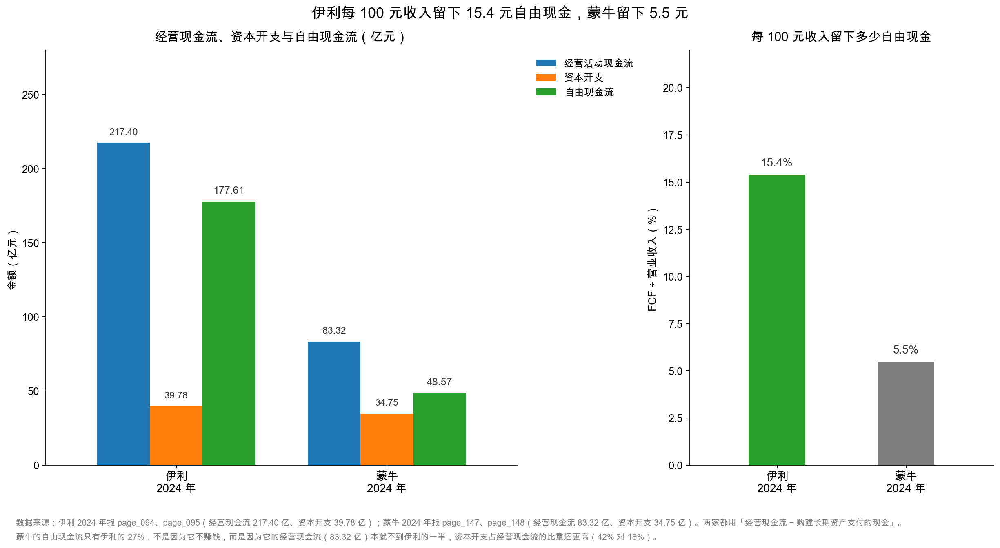

# 第 39 章：自由现金流——公司真正能自由支配的钱

> 本章你将：
> - 弄懂自由现金流（free cash flow，FCF）到底"自由"在哪，为什么它比净利润和经营现金流都更接近"公司真正赚到的钱"；
> - 学会两种算法：FCF = 经营现金流 - 资本开支；以及更保守的 FCF = 经营现金流 - 资本开支 - 利息；
> - 亲手算出伊利 2024 年的 177.61 亿元，并解释它为什么比 2023 年的 113.34 亿元多了 56.7%；
> - 看懂这笔钱的去向：分红 77.26 亿元、付息、还债，以及为什么"FCF 覆盖分红 2.3 倍"是个硬指标；
> - 知道 FCF 为负的三种情形，以及哪一种才是真正的危险；
> - 用蒙牛做对照，理解"FCF 占收入比重"为什么比 FCF 绝对值更能说明生意质地。

第 38 章结束时，我们确认了一件事：伊利 2024 年经营现金流 217.40 亿元，真正的资本开支只有 39.78 亿元，其余 342.54 亿元是买存单。

现在把这两个数相减：**217.40 - 39.78 = 177.61 亿元。**

这个数字，就是本章的主角。它有一个很有分量的名字——**自由现金流**。

---

## 39.1 什么叫"自由"

先讲一个每个人都懂的类比。

小满月薪 2 万元（**示意数字**）。听起来不错。但她每个月要还房贷 8,000 元、通勤 1,000 元、吃饭 3,000 元。剩下 8,000 元。

这 8,000 元，才是她"真正能自由支配的钱"——可以存起来、可以旅游、可以买基金、也可以什么都不做。

如果只看"月薪 2 万"，你会高估她的财务弹性；如果只看"到手 2 万"，还是会高估。**必须减掉"维持现有生活必须花的钱"，剩下的才是自由。**

公司也一样：

| 个人 | 公司 | 伊利 2024 年 |
|---|---|---|
| 月薪（税前收入） | 营业收入 | 1,153.93 亿元 |
| 到手工资（扣五险一金和税） | 净利润 | 84.64 亿元 |
| 工资 + 报销（实际进银行卡的现金） | 经营活动现金流 | 217.40 亿元 |
| 房贷、通勤、吃饭（维持生活的硬支出） | 资本开支（capex） | 39.78 亿元 |
| **剩下的可自由支配的钱** | **自由现金流（FCF）** | **177.61 亿元** |

<!-- src: 伊利股份2024年报/page_091.md 伊利股份2024年报/page_092.md 伊利股份2024年报/page_094.md 伊利股份2024年报/page_095.md -->

为什么减的是"资本开支"而不是别的？

因为资本开支是"维持生意必须花的钱"。厂房会旧、设备会坏、冷库要修、土地要续——这些钱不花，明年的收入就没了。所以它和个人的"房贷、通勤、吃饭"是同一类：**不是可选项，是维持现状的底线。**

减掉它，剩下的钱才真的"自由"：可以用来分红、回购股票、还债、并购，或者干脆存着。

> 📌 **划重点：** 自由现金流回答的问题是：**"这家公司在维持现有生意的前提下，还能剩下多少现金？"** 它是分红的上限、还债的来源、估值的分母。净利润可以被会计估计调节，经营现金流可以被营运资本波动干扰，只有 FCF 最接近"这门生意每年能掏出多少真金白银"。

---

## 39.2 两种算法，一张口径表

FCF 没有唯一的官方定义（会计准则不强制披露），但主流的算法有两种。

**算法一（最常用）：**

$$\text{FCF} = \text{经营活动现金流量净额} - \text{资本开支}$$

伊利 2024 年：217.40 - 39.78 = **177.61 亿元**。

**算法二（更保守）：**

$$\text{FCF} = \text{经营活动现金流量净额} - \text{资本开支} - \text{利息支出}$$

伊利 2024 年：217.40 - 39.78 - 18.20 = **159.42 亿元**（利息支出用利润表的 18.20 亿元近似）。

为什么要减利息？因为第 37 章讲过，伊利把利息支出放在了**筹资活动**里，所以经营现金流是"没扣利息"的。但利息是真实付出的钱，而且优先级高于股东——债主先拿，剩下的才是股东的。所以对**股东**而言，更保守的口径是先扣利息。

两种算法的差别：

| 口径 | 公式 | 伊利 2024 年 | 适合用在哪 |
|---|---|---|---|
| 企业口径（FCFF 近似） | OCF - capex | 177.61 亿元 | 给整个公司估值（含债权人） |
| 股东口径（FCFE 近似） | OCF - capex - 利息 | 159.42 亿元 | 给股东估值、判断分红能力 |
| 最保守 | OCF - capex - 利息 - 还债净额 | 159.42 - 25.33 = 134.09 亿元 | 判断"能不能持续分红不借新债" |

三个数差 43 亿元，差了 27%。这再次说明第 9 章那句话：**任何一个估值数字，如果不告诉你口径，就等于没告诉你。**

本书统一用**算法一**（OCF - capex），因为它是 `data/yili2024.json` 里 `ratios.free_cash_flow` 的定义，也是市场上最通用的口径。但在做分红判断时，我会同时给出算法二作为交叉验证。

> 💡 **你可能会问：为什么不用"净利润 + 折旧摊销 - capex"来算 FCF？**
>
> 也可以，而且这在教科书里很常见。但它有个缺陷：它假设"营运资本不变"。如果一家公司今年靠收回旧账释放了 50 亿元现金，这个算法会漏掉这 50 亿元，得出一个偏低的 FCF。
>
> 反过来，用"经营现金流 - capex"会把营运资本的波动全部吃进来，导致 FCF 一年高一年低。
>
> 所以实务上的做法是：**用 OCF - capex 算当年的 FCF，但做预测时用"净利润 + 折旧摊销 - 维持性 capex"作为长期中枢。** 前者看当下，后者看常态。第 40 章会用这个思路做收束。

---

## 39.3 伊利的 177.61 亿元

先看两年的对比：

| 项目 | 2024 年 | 2023 年 | 变化 |
|---|---|---|---|
| 经营活动现金流量净额 | 217.40 亿元 | 182.90 亿元 | +18.86% |
| 资本开支（购建长期资产） | 39.78 亿元 | 69.56 亿元 | -42.8% |
| **自由现金流** | **177.61 亿元** | **113.34 亿元** | **+56.7%** |
| 营业收入 | 1,153.93 亿元 | 1,257.58 亿元 | -8.24% |
| FCF ÷ 营业收入 | **15.4%** | 9.0% | +6.4 个百分点 |

<!-- src: 伊利股份2024年报/page_094.md 伊利股份2024年报/page_095.md 伊利股份2024年报/page_007.md -->

一个必须先说清的小问题：217.40 - 39.78 用四舍五入后的数算是 177.62，但精确值是 217.3974 - 39.7832 = 177.6142，四舍五入是 **177.61**。`data/yili2024.json` 里的 `free_cash_flow` 是 17,761,422,072.42 元，也就是 177.61 亿元。

这就是 `data/README.md` 里那条规矩的由来：**中间计算不要提前四舍五入，最后一步再 round。** 差 0.01 亿元（100 万元）看着不起眼，但如果是在做估值模型，这种误差会被放大。本书统一用 177.61 亿元。

### 为什么涨了 56.7%？两个原因，各占一半

**原因一：经营现金流 +34.50 亿元（182.90 → 217.40）。** 这部分第 37 章已经拆过：减值多提了 37 亿元、营运资本多释放了 52 亿元、非经营性损益反向拉了 37 亿元。

**原因二：资本开支 -29.78 亿元（69.56 → 39.78）。** 这是更"干净"的一个原因——公司少花了 30 亿元建厂买设备，这 30 亿元直接变成了自由现金流。

两个原因加起来：34.50 + 29.78 = 64.28 亿元，正好是 FCF 的增加额（177.61 - 113.34 = 64.27，差 0.01 是进位）。

这里有一个判断上的分岔，值得停下来想：

- 如果 FCF 的增长主要来自"经营现金流变好"，那要看这个"好"是可持续的（收入增长、毛利提升）还是一次性的（减值、营运资本释放）；
- 如果 FCF 的增长主要来自"capex 减少"，那要看这是"扩张结束、进入收获期"（好事）还是"没钱投资、被迫收缩"（坏事）。

伊利 2024 年是**两者各占一半**：经营现金流 +34.50 亿元（其中大部分是一次性的减值和营运资本），capex -29.78 亿元（扩张结束）。

所以我的判断是：**177.61 亿元是一个"好年份"的数字，不能直接当成常态。** 常态大概在 130~150 亿元之间（净利润 + 折旧摊销 $\approx$ 130.76 亿元，加上正常的营运资本波动）。这个判断在第 40 章还会用到。

> ⚠️ **易踩坑：** 很多人算 FCF 时，把"投资活动现金流出小计 384.37 亿元"当成 capex，得出 FCF = 217.40 - 384.37 = **-166.97 亿元**，然后惊呼"伊利自由现金流是负的"。
>
> 这是错的。FCF 里减的 capex，只包括"购建固定资产、无形资产和其他长期资产支付的现金"（39.78 亿元），不包括"投资支付的现金"（342.54 亿元，那是买理财）。买理财是"钱换了个地方"，不是"钱花掉了"。
>
> 判断标准：**capex 会变成资产负债表上的固定资产/在建工程/无形资产；买理财只会变成"其他流动资产"。** 前者是"花掉"，后者是"搬家"。

### capex 只有折旧的 86%，意味着什么

39.78 ÷ 46.12 = 86%。

capex 低于折旧，说明公司当年新增的长期资产不够补偿消耗掉的。短期看是好事（FCF 高），长期看要留意（产能会慢慢萎缩）。

对伊利这样的成熟期龙头，86% 是合理的：它不需要每年重建工厂，只需要维护 + 少量升级。但如果这个比例连续多年低于 70%，就要问：**公司是不是在吃老本？** 五年、十年之后，它的生产线还能不能打？

反过来，如果 capex 长期是折旧的 2 倍以上（比如 200%），说明公司在快速扩张。这时候 FCF 会很低甚至为负，但你不能说它"不赚钱"——它在用今天的现金换明天的产能。**判断标准不是"FCF 高不高"，而是"capex 花得值不值"。**

> 🔍 **翻到年报：** page_095 的"购建固定资产、无形资产和其他长期资产支付的现金"3,978,318,320.96 元，减去 page_095 的"处置固定资产、无形资产和其他长期资产收回的现金净额"136,517,188.55 元，可以得到"净资本开支" 38.42 亿元。有些人喜欢用净额算 FCF（更宽松），本书用总额（更保守）。两种都可以，但要说清用的是哪种。

---

## 39.4 这笔钱能去哪

177.61 亿元自由现金流，可能的去向只有四个：

| 去向 | 伊利 2024 年 | 说明 |
|---|---|---|
| 分红 | 77.26 亿元（2024 年度预案） | 每股 1.22 元，占归母净利润 91.40%（page_002） |
| 付息 | 约 13~18 亿元 | 含在"分配股利、利润或偿付利息支付的现金 90.92 亿元"里 |
| 还债 | 净借入 25.33 亿元（不是还，是借） | 借 2,188.31 - 还 2,162.98 |
| 存起来/买理财 | 差额 | 大额存单增加 291.28 亿元（第 38 章） |

<!-- src: 伊利股份2024年报/page_002.md 伊利股份2024年报/page_095.md -->

先算最重要的一条：**FCF 覆盖分红的能力。**

$$\text{FCF 分红覆盖倍数} = \frac{177.61}{77.26} = 2.30 \text{ 倍}$$

2.3 倍意味着：公司自己赚出来的自由现金，是分红的 2.3 倍。**分红是"自己赚的"，不是"借来发的"。**

这条标准为什么重要？因为分红是最容易被"借钱维持"的东西。一家公司如果经营现金流只有 10 亿元、分红却要 20 亿元，它只能靠借债或卖资产来发——这种分红不可持续，一旦融资环境收紧就会断掉。

用三个档次来判断：

| FCF ÷ 分红 | 含义 | 该做什么 |
|---|---|---|
| 大于 1.5 | 分红安全，还有余力做别的 | 正常 |
| 1.0~1.5 | 分红基本靠自己的现金，但余量不多 | 关注 capex 和营运资本变化 |
| 小于 1.0 | 分红可能靠借债或存量现金 | 查有息负债是否在上升 |
| 小于 0（FCF 为负） | 分红一定来自融资或卖资产 | 高度警惕 |

伊利 2.30 倍，属于第一档，而且余量不小。

### 分红之外，还有一条路：回购

把自由现金还给股东，不止分红一种方式。**回购（share buyback）**是另一种：公司用现金从市场上买回自己的股票，然后注销或留作库存股。效果是把股本变小，每股收益变高，留下来的股东占的份额变大。

伊利 2024 年报里能看到回购的痕迹：分红方案的基数不是总股本 63.66 亿股，而是"总股本扣除回购专户股份 32,859,361 股"后的 63.33 亿股（page_002）；资产负债表上"库存股"7.58 亿元（page_088）。

| 方式 | 现金流去向 | 对股东的影响 | 税务 |
|---|---|---|---|
| 分红 | 筹资活动——分配股利 | 直接拿到现金 | 现金红利税（持股期限不同税率不同） |
| 回购 | 筹资活动——支付其他与筹资活动有关的现金 | 每股价值提升，但不直接拿到现金 | 卖出时才涉及资本利得税 |

两种方式都消耗 FCF，区别在"给现金"还是"给份额"。对长期股东，回购在税务上往往更有效率；对需要现金的股东，分红更直接。

**关键判断还是一样：钱必须来自 FCF，不能来自借债。** 一家公司如果一边大额回购、一边有息负债快速上升，那这个回购是"借钱托股价"，不可持续。

但要注意一件事：**FCF 不是"股东独享"的钱。**

FCF 是"整个公司"的自由现金，它属于**所有资本提供者**——债权人先拿利息和本金，剩下的才轮到股东。伊利的 177.61 亿元里，有一部分要留给：
- 到期债务的偿还（2024 年净借入 25 亿元，但 2025 年可能有集中到期）；
- 维护性 capex 的持续投入（每年 40 亿元左右）；
- 营运资本的正常波动（明年可能反过来占用几十亿元）；
- 少数股东（伊利少数股东损益只有 0.11 亿元，影响很小，但并表子公司的现金不能全算给母公司股东）。

所以真正"能给股东"的钱，比 177.61 亿元少。用算法二的 159.42 亿元更接近，再扣掉"维持性 capex 的安全垫"，大概在 120~140 亿元。

**这也解释了为什么伊利的分红率是 91.40% 而不是 100% 以上**：它知道 FCF 有波动，要留一点安全垫。

> 📌 **划重点：** FCF 的三个用途排序是：**先还债付息（合同义务），再维持 capex（经营必需），最后才是分红回购（股东回报）。** 顺序不能反。一家公司如果"借钱分红"，说明它把顺序搞反了——短期股价可能好看，长期一定出问题。

---

## 39.5 FCF 为负：三种情形，三种结论

FCF 为负不一定是坏事。要看**为什么负**。

假设三家公司（**示意数字**），2024 年经营现金流都是 10 亿元，FCF 都是 -15 亿元（capex 25 亿元）：

| 公司 | 情形 | 该给什么结论 |
|---|---|---|
| A 公司 | 在建新工厂，产能翻倍，订单已排到明年 | **可以接受**。这是"主动扩张"，用今天的现金换明天的产能。要看 capex 的项目回报率 |
| B 公司 | 没有新项目，capex 全是"修修补补"，但每年都要修 25 亿元 | **危险**。这说明现有资产在快速老化，维持现状就要吃掉全部现金流 |
| C 公司 | capex 只有 5 亿元，但经营现金流是 -20 亿元（应收暴涨） | **更危险**。不是投资问题，是经营失血 |

三种情形的判断方法：

**第一，看 capex 的构成。** 是"新建"（在建工程增加）还是"维护"（固定资产原值不变、只是更新）？新建可以接受，维护性 capex 吃掉全部现金流就是问题。

**第二，看 capex 有没有对应的收入增长。** 真扩张会在 1~3 年后带来收入增长；如果 capex 花了三年，收入还在跌，那这个 capex 就是无效的。

**第三，看经营现金流本身。** FCF 为负有两种可能：capex 太大（分子问题），或经营现金流太差（分母问题）。后者更严重——因为 capex 可以砍，经营现金流很难一夜之间变好。

伊利 2024 年正好是反例：FCF 177.61 亿元、capex 只有 39.78 亿元、经营现金流 +18.86%。三个数都是健康的。

**FCF 为负的公司怎么活？** 三条路：

1. **融资**（借钱、增发）：能撑一时，但会推高负债或稀释股权；
2. **卖资产**：卖一次少一次，不可持续；
3. **压缩 capex**：短期能改善 FCF，但长期会削弱竞争力。

所以看到"FCF 连续为负"的公司，第一件事是查它的**融资活动现金流**：如果筹资活动持续大额净流入，说明它在靠外部输血活着；如果筹资活动也是净流出，那它只能靠消耗账面现金——这就是"现金烧完就死"的模式。

> ⚠️ **易踩坑：** 有些公司 FCF 为负，但市场照样给高估值，理由是"它在高速扩张"。这句话有时候对（亚马逊早期就是这样），有时候是借口。分辨方法：**看 capex 投向了哪里、投产后的实际回报率是多少。** 如果 capex 主要投向"在建工程"且项目能说清回报，可以给时间；如果 capex 主要投向"其他非流动资产"（说不清是什么），那就要警惕资金被挪用。

---

## 39.6 同业对照：伊利 177.61 亿，蒙牛 48.57 亿

最后做一个横向对照。用同一套口径（经营现金流 - 购建长期资产支付的现金）：

| 项目 | 伊利 2024 年 | 蒙牛 2024 年 |
|---|---|---|
| 营业收入 | 1,153.93 亿元 | 886.75 亿元 |
| 经营活动现金流净额 | 217.40 亿元 | 83.32 亿元 |
| 资本开支 | 39.78 亿元 | 34.75 亿元 |
| **自由现金流** | **177.61 亿元** | **48.57 亿元** |
| FCF ÷ 营业收入 | **15.4%** | **5.5%** |
| capex ÷ 经营现金流 | 18.3% | 41.7% |

<!-- src: 伊利股份2024年报/page_094.md 伊利股份2024年报/page_095.md 蒙牛乳业2024年报/page_147.md 蒙牛乳业2024年报/page_148.md -->

三个发现：

**第一，伊利的 FCF 是蒙牛的 3.7 倍。** 但收入只差 30%（1,153.93 对 886.75 亿元）。差距不在规模，在质量。

**第二，差距来自两头。** 伊利的经营现金流是蒙牛的 2.6 倍（217.40 对 83.32 亿元），而 capex 只多 14%（39.78 对 34.75 亿元）。也就是说，伊利"赚现金的能力"强得多，但"花钱的力度"差不多。

**第三，capex 占经营现金流的比重，蒙牛是伊利的 2.3 倍。** 蒙牛把 41.7% 的经营现金拿去建厂买设备，伊利只用了 18.3%。这不是说蒙牛在乱花钱——它可能在补产能、做技改；但它留给股东的余地就小了。

**FCF ÷ 营业收入**这个指标，比 FCF 绝对值更能说明生意质地：

| FCF ÷ 收入 | 含义 | 例子 |
|---|---|---|
| 大于 15% | 现金创造能力极强 | 伊利 15.4%（高端白酒、软件公司常年在 25% 以上） |
| 8%~15% | 健康 | 大多数成熟消费公司 |
| 3%~8% | 偏弱，需要持续投入 | 蒙牛 5.5% |
| 小于 3% | 赚的是"账面利润"，不是现金 | 重资产扩张期、工程建设类 |

蒙牛 5.5% 不代表它"不好"。它 2024 年计提了贝拉米相关减值合计影响 39.81 亿元（蒙牛 page_045），净利润只剩 1.05 亿元，但经营现金流仍有 83.32 亿元——说明它的生意本身还在产生现金，只是被减值压住了利润。这一点和伊利 2024 年的处境非常像。

**两家公司讲的是同一个故事：减值压低了利润，但压不住现金。** 这就是本周要传递的核心判断。

---

## ✍️ 想一想

### 问 1：FCF 177.61 亿元，能不能全部分给股东

伊利 2024 年自由现金流 177.61 亿元，2024 年度分红预案 77.26 亿元。请回答：① 为什么不分 177.61 亿元？② 剩下的 100 亿元去哪了？③ 如果一家公司真的把 FCF 全分了，会有什么后果？

**解题思路：**
FCF 是"整个公司"的自由现金，不是"股东独享"。要扣掉：还债、付息、维持性 capex 的安全垫、营运资本波动、少数股东分成。再看伊利实际把钱花在哪了。

**参考答案：**

① 三个原因：
- **FCF 有波动**：2024 年的 177.61 亿元里，约 50 亿元来自营运资本释放（一次性）、约 52 亿元来自减值加回（明年可能大幅减少）。常态 FCF 大概 130~150 亿元，按 177.61 亿元分红会把"好年份"当成"常态"；
- **要还债付息**：短期有息负债 556.09 亿元要滚动，利息每年 18 亿元左右。这些是合同义务，优先级高于股东；
- **要留安全垫**：capex 每年 40 亿元左右，营运资本可能反过来占用几十亿元。如果全分了，明年遇到波动就要借钱分红。

② 剩下的约 100 亿元，实际去向是：还债净额（2024 年是净借入 25.33 亿元）、买大额存单（净增 291.28 亿元）、以及留在账上（货币资金 254.04 亿元）。注意：买存单不是"花掉"，是"存起来"，所以这笔钱还在公司里，只是换了科目。

③ 如果真把 FCF 全分了，后果是：
- **现金流紧绷**：一旦某年 FCF 下滑（比如营运资本反向占用 50 亿元），分红就得靠借债；
- **capex 被迫压缩**：维护性投入不足，三五年后产能老化；
- **抗风险能力下降**：遇到行业下行或突发支出（如并购、诉讼），没有缓冲。

所以成熟公司的分红率通常在 50%~80%，伊利 91.40% 已经偏高。**高分红的另一面是"低再投资"，这既是优点（现金回报实在）也是缺点（成长性受限）。**

**易错点：**
① 用 177.61 亿元直接除以股数，算出"每股能分 2.79 元"——这是错的，FCF 不是可分配利润；
② 忘了 FCF 里含一次性因素；
③ 认为"分红率越高越好"。90% 以上的分红率，在成熟期是优点，在成长期是危险信号。

### 问 2：一家公司 FCF 连续三年为负，但收入和利润都在增长，怎么判断

假设一家公司（**示意数字**）连续三年：收入增长 25%、净利润增长 20%、经营现金流 5 亿元、capex 30 亿元、FCF -25 亿元；同时有息负债从 20 亿元涨到 80 亿元。请回答：① 它在干什么？② 这种模式能持续多久？③ 你会看哪三个数来判断它是不是"好的负 FCF"？

**解题思路：**
先分清"主动扩张导致的负 FCF"和"经营失血导致的负 FCF"。这家公司收入利润都在涨、经营现金流是正的，说明生意本身没问题，负 FCF 来自 capex。但负债从 20 亿涨到 80 亿，说明扩张是靠借钱做的。关键问题变成：这些 capex 能不能赚回来？

**参考答案：**

① 它在"借钱扩张"：用 30 亿元/年的 capex 换 25% 的收入增长，钱来自借款（有息负债三年增加 60 亿元）。这是典型的成长期模式，和亚马逊早期、京东当年一样。

② 能持续多久，取决于两个变量：
- **capex 的回报率**：如果新增产能的投入资本回报率（ROIC）高于借款利率，这个模式能持续很久；如果低于，越扩张越亏；
- **融资环境**：一旦借不到新债，扩张就得停。所以要看"有息负债/EBITDA"和"利息保障倍数"。

粗略估算：三年累计 capex 90 亿元，如果这些产能每年能多赚 12 亿元（税前），按 5% 的借款利率算，利息成本约 4 亿元，净赚 8 亿元——那这个扩张是值得的。如果每年只多赚 3 亿元，那就覆盖不了利息，是在"烧钱换规模"。

③ 我会看这三个：

| 看什么 | 好的负 FCF | 坏的负 FCF |
|---|---|---|
| capex 去向 | 在建工程、固定资产增加（有实实在在的产能） | "其他非流动资产"猛增（说不清是什么） |
| 收入增长的"含金量" | 收现比大于 1，经营现金流同步增长 | 收现比小于 1，应收增速远超收入 |
| 有息负债的用途 | 借来的钱变成了能生钱的资产 | 借来的钱填了营运资本的窟窿 |

再加一个：**看它有没有"停下来"的能力。** 好的扩张可以随时踩刹车（砍 capex，FCF 立刻转正）；坏的扩张停不下来（停了收入就掉）。

**易错点：**
① 看到 FCF 为负就直接否定。成长期公司负 FCF 是常态；
② 只看利润增长，不看 capex 回报率；
③ 忽略负债结构。用短期借款做长期投资（短债长投），是最危险的一种扩张。

### 问 3：为什么"FCF ÷ 收入"比"FCF 绝对值"更能说明问题

伊利 FCF 177.61 亿元、蒙牛 48.57 亿元；但伊利收入 1,153.93 亿元、蒙牛 886.75 亿元。请回答：① 直接比绝对值有什么问题？② 用"FCF ÷ 收入"比较，得出什么结论？③ 还有什么比率可以补充？

**解题思路：**
绝对值受规模影响，比率才能跨公司比较。但比率也有局限——它不反映资本结构（负债多少）、不反映成长性。所以要几个指标一起看。

**参考答案：**

① 直接比绝对值的两个问题：
- **规模偏差**：大公司天然 FCF 绝对值大。伊利收入是蒙牛的 1.3 倍，FCF 是 3.7 倍——绝对值放大了差距，但没说清"为什么"；
- **不可比行业**：重资产行业 FCF 天然低（capex 大），轻资产行业天然高。跨行业比绝对值毫无意义。

② 用 FCF ÷ 收入：伊利 15.4%、蒙牛 5.5%。结论是：**伊利每做 100 元收入，能留下 15.4 元自由现金；蒙牛只能留下 5.5 元。** 差距来自两头——伊利的经营现金流率更高（18.8% 对 9.4%），capex 占收入比更低（3.4% 对 3.9%）。

（计算：伊利 217.40/1,153.93 = 18.8%、39.78/1,153.93 = 3.4%；蒙牛 83.32/886.75 = 9.4%、34.75/886.75 = 3.9%。）

③ 可以补充三个：
- **FCF ÷ 净利润**：反映"利润里有多少变成了自由现金"。伊利 177.61/84.64 = 2.10 倍；蒙牛 48.57/1.05 = 46 倍（因为蒙牛净利润被减值压到极低，这个比率失真，说明"比率要看分母是否正常"）；
- **FCF ÷ 有息负债**：反映"还债能力"。伊利 177.61/605.58 = 29.3%，约 3.4 年能还清全部有息负债；
- **FCF ÷ 分红**：反映"分红可持续性"。伊利 2.30 倍。

**易错点：**
① 只用绝对值比较不同规模的公司；
② 用"FCF ÷ 净利润"时不看净利润是否被一次性因素扭曲（蒙牛就是典型）；
③ 忘了 FCF 的口径差异（是否扣利息、capex 用总额还是净额），跨公司比较前要统一。

---

## 📎 数据出处

- 伊利股份 2024 年报：`page_002.md`（2024 年度利润分配预案：每股 1.22 元，合计 7,726,310,439.68 元，占归母净利润 91.40%）
- 伊利股份 2024 年报：`page_007.md`（营业收入 115,393,310,976.69 元、经营现金流同比 +18.86%）
- 伊利股份 2024 年报：`page_091.md`（营业收入、利息费用 1,819,520,437.71 元）
- 伊利股份 2024 年报：`page_092.md`（净利润 8,463,710,355.65 元）
- 伊利股份 2024 年报：`page_094.md`（经营活动现金流量净额 21,739,740,393.38 元）
- 伊利股份 2024 年报：`page_095.md`（购建长期资产支付的现金 3,978,318,320.96 元、处置长期资产收回的现金净额 136,517,188.55 元、分配股利利润或偿付利息 9,092,304,004.54 元、借款 218,831,002,594.60 元、偿还 216,297,870,811.45 元）
- 伊利股份 2024 年报：`page_087.md`（在建工程 2,955,164,840.95 元）
- 蒙牛乳业 2024 年报：`page_147.md` / `page_148.md`（经营活动现金净额 8,332,256,000 元、资本开支 3,475,129,000 元）
- 蒙牛乳业 2024 年报：`page_045.md`（贝拉米相关减值合计影响 3,981,400,000 元）
- 数据汇总：`data/yili2024.json` 的 `cashflow`、`ratios`（free_cash_flow 17,761,422,072.42 元）、`income`、`compare_2023.cashflow` 段；`data/mengniu2024.json` 的 `cashflow`、`ratios`（free_cash_flow 4,857,127,000 元）段
- 本章 39.1 节月薪示例、39.5 节三家公司示例、39.6 节 FCF 占收入分档均为**示意数字/示意框架**，伊利与蒙牛数字为真实数据

下一章：[第 40 章：实战——伊利 217 亿经营现金流从哪来](40-实战-217亿经营现金流从哪来.md)
