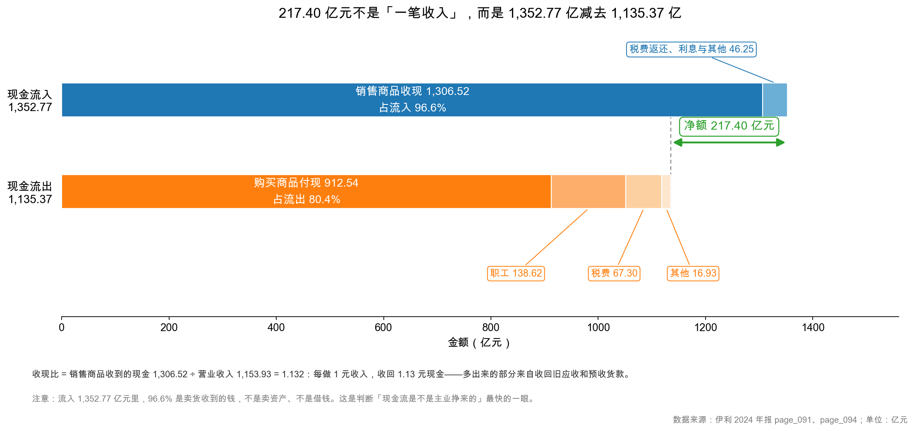
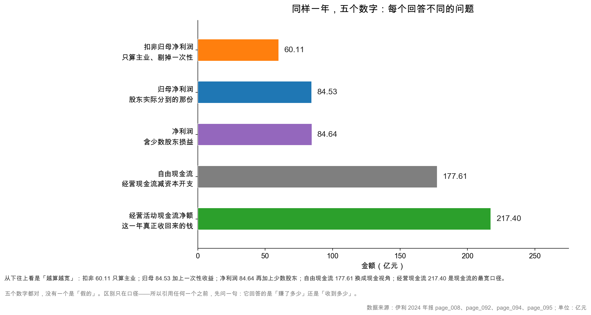

# 第 40 章：实战——伊利 217 亿经营现金流从哪来

> 本章你将：
> - 把 217.40 亿元拆成"流入 1,352.77 亿 - 流出 1,135.37 亿"，看清这笔钱是从哪些口子进来的；
> - 学会算收现比，并且知道它为什么天然大于 1（这里有一个几乎所有人都踩过的坑）；
> - 用"现金流质量三问"给任何一家公司的经营现金流打分；
> - 把本周的现金流证据，和第 6 周的毛利率、第 7 周的减值证据拼在一起，完成全书最重要那条洞见的第三条证据链；
> - 用一张"五个数字"的对照表，彻底分清归母、扣非、净利润、经营现金流、自由现金流各回答什么问题。

两周前（第 6 周）我们开始逐行拆利润表，上周（第 7 周）一路拆到"84.5 亿元里有多少水分"，并开始怀疑：这些水分是不是把一家好公司说坏了？

这一章是本周的收束，也是全书那条最重要洞见的**最后一次举证**。我们要回答一个具体的问题：

**伊利 2024 年的 217.40 亿元经营现金流，到底是从哪来的？它是"主业挣的"，还是"挤出来的"？**

---

## 40.1 217.40 亿元不是一笔收入，是一道减法

先看现金流量表主表的骨架（page_094）：

| 项目 | 金额（亿元） | 占流入/流出 |
|---|---|---|
| 销售商品、提供劳务收到的现金 | 1,306.52 | 96.6% |
| 收到的税费返还 | 7.14 | 0.5% |
| 收取利息、手续费及佣金的现金 | 1.90 | 0.1% |
| 收到其他与经营活动有关的现金 | 37.21 | 2.8% |
| **经营活动现金流入小计** | **1,352.77** | 100% |
| 购买商品、接受劳务支付的现金 | 912.54 | 80.4% |
| 支付给职工以及为职工支付的现金 | 138.62 | 12.2% |
| 支付的各项税费 | 67.30 | 5.9% |
| 支付其他与经营活动有关的现金 | 16.93 | 1.5% |
| **经营活动现金流出小计** | **1,135.37** | 100% |
| **经营活动产生的现金流量净额** | **217.40** | |

<!-- src: 伊利股份2024年报/page_094.md -->

这张图讲了三件事：

**第一，流入几乎全是卖货收的钱。** 1,306.52 ÷ 1,352.77 = 96.6%。没有卖资产、没有借钱、没有政府大额补贴。这是判断"现金流是不是主业挣来的"最快的一眼——**如果一家公司的经营流入里，"收到其他与经营活动有关的现金"占比很高，就要去附注里查那是什么。**

**第二，流出几乎全是买原料付的钱。** 912.54 ÷ 1,135.37 = 80.4%。乳业是典型的"原料成本主导"生意：原奶、包装、糖、运费。这也解释了为什么 2024 年原奶价格下行，伊利的毛利率能逆势提升 1.30 个百分点（第 28 章）。

**第三，净额是两条之差，不是"某一笔大收入"。** 217.40 亿元 = 1,352.77 - 1,135.37。它是一家公司一年做了上千亿生意之后，留在手里的零头——利润率只有 16% 左右。

这个"零头"的意义在于：**它是唯一可以持续的钱。** 卖资产的钱只能收一次，借钱的钱要还，只有这 217 亿元，是生意本身一年年产生出来的。

### 那 2.8% 的"其他流入"是什么

"收到其他与经营活动有关的现金 37.21 亿元"占了流入的 2.8%。金额不大，但值得翻一页附注，因为它能告诉你"这笔经营现金流有多纯"。

page_214 附注七(79)1 给了明细：

| 项目 | 2024 年 | 占 37.21 亿元 |
|---|---|---|
| 利息收入 | 19.20 亿元 | 51.6% |
| 政府补助 | 13.89 亿元 | 37.3% |
| 押金、保证金 | 1.49 亿元 | 4.0% |
| 其他 | 2.63 亿元 | 7.1% |
| **合计** | **37.21 亿元** | 100% |

<!-- src: 伊利股份2024年报/page_214.md -->

两个发现：

**第一，这 37.21 亿元里，一半以上是利息收入，近四成是政府补助。** 也就是说，217.40 亿元经营现金流里，有约 33.09 亿元（19.20 + 13.89）不是"卖货挣的"，而是"钱生钱"和"政府给的"。

**第二，这解释了为什么"收现比"要用"销售商品收到的现金"做分子。** 如果分子用"经营活动现金流入小计 1,352.77 亿元"，算出来的收现比是 1.172，会把利息和补助也算成"卖货收的钱"，虚高。**口径越窄，指标越干净。**

做一次最严格的调整：

$$\text{纯主业经营现金流} \approx 217.40 - 19.20 - 13.89 = 184.30 \text{ 亿元}$$

184.30 亿元依然是个好数字（净现比 2.18 倍），但它比 217.40 亿元更接近"卖货挣来的现金"。这个调整不是必须做的，但它能训练一个习惯：**看到"其他"两个字，就去翻附注。**

> 🔍 **翻到年报：** page_214 的"79、现金流量表项目"→"(1) 与经营活动有关的现金"。这张表很小，只有四行，但它是"经营现金流入"的注释。任何一家公司的年报都有类似的一张表，位置在"现金流量表项目"的附注里。

page_094 的表头写着"单位:元 币种:人民币"，第一行是"一、经营活动产生的现金流量："。往下数第 5 行是"经营活动现金流入小计 135,277,219,092.78"，第 12 行是"经营活动现金流出小计 113,537,478,699.40"，第 13 行是"经营活动产生的现金流量净额 21,739,740,393.38"。三个数一减，一分不差。

---

## 40.2 收现比：卖货到底收回了多少钱

第一个质量指标：**收现比（cash collected to revenue）。**

$$\text{收现比} = \frac{\text{销售商品、提供劳务收到的现金}}{\text{营业收入}}$$

伊利 2024 年：1,306.52 ÷ 1,153.93 = **1.132**。2023 年：1,372.39 ÷ 1,257.58 = **1.091**。

两年都大于 1，而且 2024 年还上升了 0.041。这个方向是好的：收入虽然降了 8.24%，但**回款效率提高了**。

### 但等一下：收现比大于 1，真的说明"多收了钱"吗

这里有一个几乎所有人都踩过的坑，必须讲清楚。

**"销售商品、提供劳务收到的现金"是含增值税的，而"营业收入"是不含增值税的。**

假设一家公司今年卖货 100 元（不含税），全部现款现货，增值税率 13%。那么：
- 利润表的营业收入 = 100 元；
- 现金流量表的销售收现 = 113 元；
- 收现比 = 113 ÷ 100 = **1.13**。

**它一分钱应收都没有，收现比也是 1.13。** 所以收现比大于 1 的第一个原因，不是"多收了钱"，而是"口径里含了税"。

正确读法是：**把分母换成含税收入。**

按 13% 的税率粗算（乳制品适用税率，具体以公司披露为准）：

| 年份 | 营业收入 | 含税收入（估算） | 销售收现 | 收现比 | 含税口径回款率 |
|---|---|---|---|---|---|
| 2024 年 | 1,153.93 | 1,303.94 | 1,306.52 | 1.132 | **100.2%** |
| 2023 年 | 1,257.58 | 1,421.07 | 1,372.39 | 1.091 | **96.6%** |

<!-- src: 伊利股份2024年报/page_091.md 伊利股份2024年报/page_094.md -->

换成含税口径，故事就清楚了：

- 2024 年回款率 **100.2%**，说明"当年卖出的货，钱基本都收回来了，还稍微多收了一点（收回旧账、收了预付款）"；
- 2023 年回款率 **96.6%**，说明"有 3.4% 的货款没收回，挂在应收上"；
- 两年对比，回款率提高了 3.6 个百分点。**这才是"收现比从 1.091 升到 1.132"的真实含义。**

> ⚠️ **易踩坑：** 直接把"收现比大于 1"解读成"公司多收了钱、议价能力强"，是最常见的误读。
>
> 正确的判断顺序是：
> ① 先算含税口径的回款率（收现比 ÷ (1 + 增值税率)）；
> ② 回款率接近 100%，说明"正常回款"；
> ③ 回款率明显高于 100%（比如 110%），才是"收回旧账 + 预收增加"；
> ④ 回款率明显低于 100%（比如 85%），说明"应收在积累"，要去查账龄。
>
> 不同行业的增值税率不同（13%、9%、6%），跨行业比较前一定要统一口径。这也是为什么"收现比"这个指标不能跨行业硬比。

### 那 100.2% 是怎么来的

回到第 37 章的营运资本三项：存货减少 5.85 亿元、经营性应收减少 18.25 亿元、经营性应付增加 26.11 亿元。

- **经营性应收减少 18.25 亿元**：收回旧账，所以销售收现比"当期收入"多；
- **合同负债（预收）增加**：经销商提前打款，也算进了销售收现。

两个因素加起来，让回款率从 96.6% 升到 100.2%。**幅度不大，但方向很好**——在收入下滑的年份，能把回款率提上来，说明公司在主动收紧信用、加快现金回收。

---

## 40.3 净现比 2.57 与"现金流质量三问"

第二个质量指标：**净现比（operating cash flow to net profit）。**

$$\text{净现比} = \frac{\text{经营活动现金流量净额}}{\text{净利润}} = \frac{217.40}{84.64} = 2.57$$

第 36 章讲过这个指标的三条用法：长期不低于 1、短期可以大于 1、长期低于 1 要警惕。伊利的 2.57 倍属于"短期大于 1"，原因是折旧摊销 46.12 亿元和减值 52.31 亿元。

但只看两个指标还不够。我把本周的方法收成一个清单——**现金流质量三问**：

### 第一问：收现比是否大于 1 且稳定

| 年份 | 收现比 | 含税口径回款率 | 判断 |
|---|---|---|---|
| 2024 年 | 1.132 | 100.2% | 正常，略优 |
| 2023 年 | 1.091 | 96.6% | 正常 |

两年都大于 1、且稳中有升。**通过。**

如果一家公司收现比常年在 0.9 以下，说明"卖出去的货收不回钱"，利润是纸面的。如果忽高忽低（比如 1.3、0.8、1.4），说明在"年末压货/次年退货"之间做文章，要看季度数据。

### 第二问：净现比长期是否不低于 1

| 年份 | 净现比 | 判断 |
|---|---|---|
| 2024 年 | 2.57 | 远大于 1（含一次性因素） |
| 2023 年 | 1.78 | 大于 1 |

两年都大于 1。**通过。**

但要加一个注脚：2.57 倍里含 52.31 亿元减值加回。剔除减值后，"净利润 + 折旧摊销 = 130.76 亿元"对应的净现比是 1.54 倍——依然健康，但没那么夸张。

### 第三问：经营现金流是不是靠"占用上下游"堆出来的

这一问最关键，也最容易被忽略。

看营运资本变动：+50.21 亿元，占经营现金流的 23.1%。拆开看：

| 项目 | 金额 | 真实性检查 |
|---|---|---|
| 存货减少 | +5.85 亿元 | 存货从 125.12 降到 107.45 亿元，真的降了 14.1% |
| 经营性应收减少 | +18.25 亿元 | 应收账款从 30.85 降到 28.78 亿元，真的降了 6.7% |
| 经营性应付增加 | +26.11 亿元 | **要小心**：应付账款实际减少 14.86 亿元，合同负债增加 33.77 亿元但其中 26.47 亿元是"预收款项并入"的重分类 |

<!-- src: 伊利股份2024年报/page_087.md 伊利股份2024年报/page_088.md 伊利股份2024年报/page_218.md -->

第三行的细节，第 37 章已经拆过：**真实的预收新增只有约 7.30 亿元**（120.73 - 86.96 - 26.47），不是 33.77 亿元。而应付账款是**减少**的——公司在加快付钱给供应商，不是在拖欠。

所以第三问的答案是：**部分是。** 营运资本释放了 50.21 亿元，但其中：
- 存货和应收的下降是真实的（30.85 → 28.78、125.12 → 107.45），说明是"主动去库存、加快收账"；
- 应付项目的增加里，有一部分是会计重分类，不是真的多占了供应商的钱。

**结论：这 50.21 亿元是"收缩期回收"，不是"扩张期占用"。** 短期健康，但不可持续（存货不可能一直降）。

三问全过。但三问的答案要连起来读：

> 📌 **划重点：** 伊利 217.40 亿元现金流的"质量"是：**主业挣的（96.6% 来自卖货）+ 回款正常（含税回款率 100.2%）+ 含一次性因素（减值 52.31 亿元、营运资本释放 50.21 亿元）。** 前两项可持续，第三项不可持续。所以 217.40 亿元不能当常态，常态在 130~150 亿元。

---

## 40.4 与第 7 周联动：-40% 和 +18.86% 为什么不矛盾

现在把三周的证据摆在一起。

第 7 周结束时，我们面对的是一个刺眼的数字：**扣非净利润同比 -40.04%**（100.26 → 60.11 亿元）。同期归母净利润 -18.94%，营业利润 -14.2%。

如果只看这三个数，结论是"公司不行了"。

但把现金流放进来，画面完全变了：

| 指标 | 2024 年 | 2023 年 | 变化 | 出处 |
|---|---|---|---|---|
| 营业利润 | 101.82 亿元 | 118.73 亿元 | -14.2% | page_091 |
| 加回：资产减值 + 信用减值 | 52.31 亿元 | 16.86 亿元 | +35.45 亿元 | page_211 |
| **剔除减值后的经营性利润** | **154.13 亿元** | **135.59 亿元** | **+13.7%** | 计算 |
| 毛利率 | 33.88% | 32.58% | +1.30 个百分点 | page_091 |
| 收现比 | 1.132 | 1.091 | +0.041 | page_094 |
| **经营活动现金流净额** | **217.40 亿元** | **182.90 亿元** | **+18.86%** | page_094 |
| 自由现金流 | 177.61 亿元 | 113.34 亿元 | +56.7% | 计算 |

<!-- src: 伊利股份2024年报/page_091.md 伊利股份2024年报/page_094.md 伊利股份2024年报/page_211.md 伊利股份2024年报/page_007.md -->

三条独立的证据，指向同一个结论：

**证据一（第 6 周）：毛利率逆势上升 1.30 个百分点。** 收入降了 8.24%，毛利率却升了。这说明收入下滑不是"降价换量"的价格战，而是"原奶成本下降 + 产品结构改善"。如果是价格战，毛利率应该降。

**证据二（第 7 周）：剔除减值后，经营性利润 +13.7%。** 营业利润 -14.2% 里，有 35.45 亿元是"多计提的减值"。减值是会计判断，不代表当年经营恶化。剔掉它，主业在增长。

**证据三（本周）：经营现金流 +18.86%，收现比升到 1.132。** 这是最硬的一条——现金流不认会计估计。如果主业真的在恶化，现金不可能逆势增长 18.86%；如果收入是虚的，回款率不可能从 96.6% 升到 100.2%。

**三条证据互相独立，却指向同一个方向。** 这就是"证据链"的意义：单一证据可以被质疑（毛利率可能是成本暂时下行、减值可能是真的损失），但三条独立的证据同时指向一个结论，可信度就高得多。

用一句话概括：

> **伊利 2024 年的报表写的是"利润大降"，真相是"主业在变好，账面上的利润下滑主要是会计估计（减值）造成的"。**

这就是全书那条最重要的洞见。第 6 周我们看到了它的第一半（毛利率），第 7 周看到了第二半（减值），本周看到了第三半（现金流）。三半拼起来，才是一个完整的判断。

**为什么这件事重要？** 因为市场上大多数人是"只看利润表"的：看到 -18.94% 就卖出。会看附注和现金流的人看到的是"主业 +13.7%、现金流 +18.9%、分红 91.40%"，会得出相反的结论。

**两种人买的是同一只股票，判断完全相反。** 差别不在信息，在**读法**。

> 💡 **你可能会问：那减值到底是不是"真的损失"？如果澳优真的不值那么多钱，减值不就是真实的经济损失吗？**
>
> 是真实损失，但它发生在**过去**（2022 年收购时付的钱太多），不是发生在**2024 年**。2024 年的经营并没有因为这次减值而变差——工厂还在生产、渠道还在卖货、现金还在回流。
>
> 会计上把这次"过去的错误"记在 2024 年，是因为今年做了减值测试。所以：
> - 对**利润表**：2024 年很难看（这是会计的"一次性清算"）；
> - 对**现金流**：2024 年没影响（一分钱没付）；
> - 对**未来**：2025 年的利润会"轻装上阵"（商誉从 51.60 亿元降到 23.37 亿元，未来摊销/减值的压力小了）。
>
> 这就是"洗大澡"（big bath）的会计逻辑：把坏消息集中在一年，让以后的年份好看。区别在于：伊利的减值有真实的业务依据（澳优业绩不达预期），不是无中生有。**判断"洗大澡"和"真实减值"的分界线，是看减值测试的假设是否合理、以及次年业绩是否真的改善。**

---

## 40.5 五个数字，五个问题

最后，把伊利 2024 年最容易被混用的五个数字放在一张表里。

| 数字 | 金额 | 怎么算出来的 | 回答什么问题 | 什么时候用 |
|---|---|---|---|---|
| 扣非归母净利润 | **60.11 亿元** | 归母净利润 - 非经常性损益 24.42 亿元 | **主业这一年赚了多少** | 判断经营能力、算核心 PE |
| 归母净利润 | **84.53 亿元** | 净利润 - 少数股东损益 0.11 亿元 | **股东名义上分到多少** | 算 EPS、分红率的分母 |
| 净利润 | **84.64 亿元** | 利润总额 101.27 - 所得税 16.63 | **整个公司（含少数股东）赚了多少** | 算净利率、净现比的分母 |
| 自由现金流 | **177.61 亿元** | 经营现金流 217.40 - capex 39.78 | **维持生意后还能自由支配多少** | 估值（第 49 章 DCF）、判断分红能力 |
| 经营活动现金流净额 | **217.40 亿元** | 流入 1,352.77 - 流出 1,135.37 | **这一年实际收回多少现金** | 判断利润含金量、算净现比 |

<!-- src: 伊利股份2024年报/page_008.md 伊利股份2024年报/page_092.md 伊利股份2024年报/page_094.md 伊利股份2024年报/page_095.md -->

五个数字都是真的，没有一个是"假的"。它们的差别只在**口径**：

- 从 60.11 到 84.53：加上 24.42 亿元非经常性损益（主要是处置子公司收益 25.80 亿元、政府补助 3.94 亿元，扣掉所得税和少数股东影响）；
- 从 84.53 到 84.64：加上 0.11 亿元少数股东损益；
- 从 84.64 到 177.61：换成现金视角，减掉 capex；
- 从 177.61 到 217.40：不减 capex，只看经营。

**记住一句话：引用任何一个财务数字之前，先问一句"它回答的是哪个问题"。** 说"伊利 2024 年赚了 84.5 亿元"没错，但如果紧接着说"所以它的市盈率是 XX 倍"，就要确认你用的是归母还是扣非——两个数差 40%，PE 也差 40%。

> ⚠️ **易踩坑：** 五个数字里最容易混的是"归母 84.53"和"净利润 84.64"。差 0.11 亿元看着无所谓，但在算"分红率"时很关键：伊利 2024 年分红 77.26 亿元 ÷ 归母 84.53 亿元 = 91.40%（年报口径）；如果误用净利润 84.64 亿元做分母，会算成 91.28%，差 0.12 个百分点。数字小，但说明"口径"这件事必须严谨。

---

## 40.6 收束：三张表，一句话

十周课程走到第八周，我们已经把三张表各自拆了一遍。现在可以把它们合成一句话：

> **利润表告诉你"这门生意理论上能赚多少"，资产负债表告诉你"为了赚这些钱，押了多少家底"，现金流量表告诉你"最后真正收到了多少"。**

三张表合起来，才能回答"这家公司好不好"。任何一张单独看，都会骗你：

- 只看利润表：会把"多计提减值"当成"经营恶化"（这正是市场对伊利 2024 年的误读）；
- 只看资产负债表：会把"货币资金减少 183 亿元"当成"现金流失"（其实是买了存单）；
- 只看现金流量表：会把"217.40 亿元"当成"每年都能赚这么多"（其实含大量一次性因素）。

本周的方法，可以浓缩成一个动作：**每次看到一个利润数字，就去现金流量表里找它的"现金版本"，然后解释差额。** 差额解释得清，利润就可信；解释不清，就要警惕。

下周（第 9 周）我们要做三件事：① 三张表的勾稽（用真实数字验证"资产 = 负债 + 权益"、"期初现金 + 净变动 = 期末现金"）；② 杜邦分解（把 ROE 拆成净利率、周转率、权益乘数）；③ 红旗清单（20 条识别财务造假的信号）。本周的现金流分析，是那三件事的地基——**勾稽错了，说明数字有假；现金流差，说明利润有假；两者都不差，才轮得到估值。**

---

## ✍️ 想一想

### 问 1：收现比 1.132，能说明伊利"议价能力强"吗

伊利 2024 年收现比 1.132（销售收现 1,306.52 亿元 ÷ 营业收入 1,153.93 亿元）。请回答：① 这个数字里有多少是"增值税"贡献的？② 扣掉增值税后，真实的回款情况如何？③ 如果一家公司收现比是 1.35，你会怎么判断？

**解题思路：**
销售收现是含税的，营业收入是不含税的。先按增值税率把分母调成含税口径，再看回款率。然后讨论"高于 100%"的部分来自哪里（收回旧账、预收）。

**参考答案：**

① 按 13% 的增值税率粗算，含税收入 = 1,153.93 $\times$ 1.13 = 1,303.94 亿元。销售收现 1,306.52 亿元 ÷ 1,303.94 亿元 = **100.2%**。也就是说，1.132 这个数里，约 0.13 是增值税贡献的，只有 0.002 是"多收的钱"。

② 真实回款率 100.2%，意思是：当年卖出的货，钱基本都收回来了，还略微多收了一点。多收的部分来自"经营性应收减少 18.25 亿元"（收回旧账）和"合同负债增加"（经销商预付款）。对比 2023 年的 96.6%，回款效率提高了 3.6 个百分点。**这是"回款正常偏优"，不是"议价能力极强"。**

③ 收现比 1.35，含税口径回款率 = 1.35 ÷ 1.13 = 119.5%。这意味着"当年收的钱比当年卖的货多 19.5%"。可能的原因有三个：

| 原因 | 怎么验证 | 判断 |
|---|---|---|
| 收回大量旧应收 | 应收账款余额大幅下降 | 一次性，不可持续 |
| 预收款大幅增加 | 合同负债余额大幅上升 | 渠道打款积极，但也可能是压货 |
| 收入确认政策保守（先收款后确认） | 看收入确认时点、退货政策 | 会计政策，中性 |

要警惕的是第三种情况的极端版本：**"收现比很高，但收入在下降"**——这可能是公司在"停止发货、只收钱"，也就是业务在收缩。

**易错点：**
① 直接用 1.132 说"公司多收了 13.2% 的钱"；
② 忘了不同行业增值税率不同（13%/9%/6%），跨行业比较失真；
③ 把"收现比高"等同于"竞争力强"。收现比高只说明"钱收得回来"，不说明"能卖高价"——后者要看毛利率。

### 问 2：217.40 亿元里，哪一部分明年还会有

请把 217.40 亿元拆成"可持续"和"不可持续"两部分，并给出你的估算。然后回答：如果 2025 年收入持平、减值回归正常水平（比如 20 亿元）、营运资本不再释放，经营现金流大概是多少？

**解题思路：**
用第 37 章的三块拆解法：① 不花现金的费用（折旧摊销 46.12 + 减值 52.31）；② 非经营性损益（-15.88）；③ 营运资本（+50.21）。可持续的是折旧摊销；不可持续的是减值和营运资本释放。

**参考答案：**

拆解：

| 组成 | 金额 | 可持续性 | 理由 |
|---|---|---|---|
| 净利润 | 84.64 | 部分可持续 | 含 24.42 亿元非经常性损益，剔除后 60.11 亿元更接近常态 |
| + 折旧摊销 | 46.12 | **可持续** | 只要还有设备，每年都有 |
| + 减值 | 52.31 | **不可持续** | 商誉已从 51.60 降到 23.37 亿元，明年大幅减值的空间小了 |
| - 非经营性损益 | -15.88 | 不可持续 | 卖子公司是一次性的 |
| + 营运资本释放 | 50.21 | **不可持续** | 存货已降到 107.45 亿元，再降空间有限 |

"可持续经营现金流" $\approx$ 净利润 + 折旧摊销 = 84.64 + 46.12 = **130.76 亿元**。如果用扣非打底：60.11 + 46.12 = **106.23 亿元**。

2025 年情景估算（收入持平、减值 20 亿元、营运资本不变）：

$$\text{经营现金流} \approx 84.64 + 46.12 + (20 - 15.26) \approx 135.5 \text{ 亿元}$$

（说明：20 亿元是假设的"正常减值水平"，15.26 亿元是 2023 年实际减值，这里只是示意算法，不是预测。）

所以我的区间是 **110~140 亿元**，中枢 130 亿元左右。**远低于 217.40 亿元。**

这就是为什么不能拿 217.40 亿元去外推。**现金流分析最容易犯的错，就是把最好的一年当成常态。**

**易错点：**
① 直接用 217.40 亿元乘增长率；
② 把减值加回当成可持续（"每年都有 50 亿元减值"显然不成立）；
③ 忘了营运资本会反向（2025 年如果收入恢复增长，存货和应收会重新占用现金，经营现金流可能低于 130 亿元）；
④ 用扣非还是归母不统一，导致基数差 24 亿元。

### 问 3：如果只看一个数字判断伊利 2024 年，你选哪个

本章给了五个数字：扣非 60.11、归母 84.53、净利润 84.64、FCF 177.61、经营现金流 217.40。请回答：① 只能选一个，你选哪个？为什么？② 选它有什么盲区？③ 你会补看哪两个数字来弥补？

**解题思路：**
没有"唯一正确"的答案，关键是说清"这个数字回答什么问题、漏掉什么"。可以从"抗操纵性"和"与股东回报的相关性"两个维度考虑。

**参考答案：**

① 我会选**自由现金流 177.61 亿元**。理由：
- 它比净利润更难操纵（不认会计估计）；
- 它比经营现金流更接近"可分配的钱"（已经扣掉了维持生意必需的 capex）；
- 它直接决定了分红、回购、还债的能力，与股东回报的相关性最高。

② 盲区有三个：
- **含一次性因素**：177.61 亿元里含营运资本释放 50.21 亿元、减值加回 52.31 亿元，常态只有 130 亿元左右；
- **不反映成长性**：FCF 高可能是"不投资"的结果（伊利 capex 只有折旧的 86%），不代表未来能增长；
- **不反映资本结构**：FCF 是整个公司的，债权人优先，股东拿到的更少。

③ 我会补看两个：
- **扣非净利润 60.11 亿元**：看主业本身赚多少，剔除一次性；
- **收现比 1.132（含税回款率 100.2%）**：看这些现金是不是真的从客户那里收来的，而不是"卖资产、收旧账"。

三个数一起看：FCF 177.61（有多少自由现金）+ 扣非 60.11（主业赚多少）+ 收现比 1.132（钱收得回来吗）。**一个看"量"，一个看"质"，一个看"真"。**

**易错点：**
① 选"净利润"，因为它最直观——但它最容易被会计估计调节；
② 选"经营现金流"，理由"现金不会骗人"——但经营现金流里混着营运资本的一次性释放；
③ 不做交叉验证，只报一个数。**任何单一指标都可以被操纵，组合起来才可靠。**

---

## 📎 数据出处

- 伊利股份 2024 年报：`page_007.md`（营业收入同比 -8.24%、归母净利润同比 -18.94%、扣非同比 -40.04%、经营现金流同比 +18.86%）
- 伊利股份 2024 年报：`page_008.md`（扣非归母净利润 6,011,274,945.92 元、非经常性损益 2,441,585,047.26 元）
- 伊利股份 2024 年报：`page_087.md`（存货 10,744,674,420.37 元、2023 年 12,511,775,911.77 元；应收账款 2,878,402,047.44 元、2023 年 3,084,668,398.14 元）
- 伊利股份 2024 年报：`page_088.md`（合同负债 12,072,785,359.81 元、2023 年 8,695,772,664.08 元；预收款项 2023 年 2,647,400,000.00 元；应付账款 12,312,877,232.19 元、2023 年 13,798,869,047.01 元）
- 伊利股份 2024 年报：`page_091.md`（营业收入 115,393,310,976.69 元、营业利润 10,181,768,860.25 元）
- 伊利股份 2024 年报：`page_092.md`（净利润 8,463,710,355.65 元、归母 8,452,859,993.18 元、少数股东损益 10,850,362.47 元）
- 伊利股份 2024 年报：`page_094.md`（销售商品收到现金 130,651,821,490.28 元、流入小计 135,277,219,092.78 元、流出小计 113,537,478,699.40 元、净额 21,739,740,393.38 元）
- 伊利股份 2024 年报：`page_095.md`（购建长期资产 3,978,318,320.96 元）
- 伊利股份 2024 年报：`page_211.md`（资产减值 4,675,845,573.44 元、信用减值 555,019,707.28 元；2023 年资产减值 1,525,699,477.87 元、信用减值 160,477,312.83 元）
- 伊利股份 2024 年报：`page_218.md`（存货减少 585,324,717.44 元、经营性应收减少 1,824,572,724.85 元、经营性应付增加 2,611,147,936.03 元）
- 数据汇总：`data/yili2024.json` 的 `income`、`cashflow`、`nonrecurring`、`notes`、`ratios`（cash_to_revenue 1.1322、ocf_to_net_profit 2.5686、free_cash_flow 177.61 亿元）、`core_earnings`（core_growth_pct 13.67、cash_to_revenue_2023 1.0913）段
- 本章 40.2 节的增值税率 13% 为**估算假设**（用于说明含税口径，具体税率以公司披露为准）；40.5 节的"2025 年情景估算"为**示意算法**，不是预测

下一章：[第 41 章：三张表怎么咬合——一笔交易走三张表](../week09/41-三张表怎么咬合.md)
