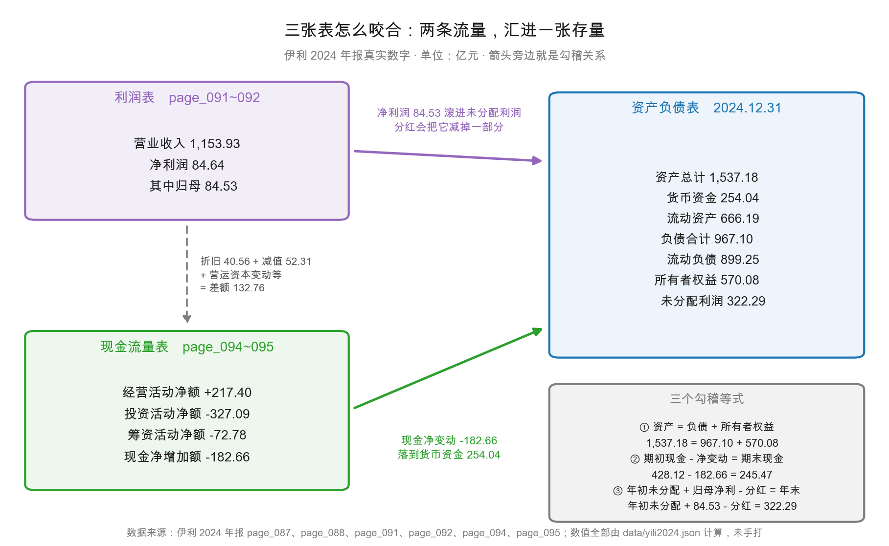

# 第 41 章：三张表怎么咬合——一笔交易走三张表

> 本章你将：
> - 用伊利 2024 年的真实数字，把三个勾稽等式再验一遍，并且第一次把「差额」拆开；
> - 看懂为什么未分配利润涨了 8.14 亿元，归母权益反而少了 3.59 亿元；
> - 跟着一笔真实交易（处置昌吉盛新）走完利润表、资产负债表、现金流量表；
> - 学会在三种「不平」里分辨：是抄错了、口径不同，还是真有问题；
> - 拿到一张可以打印出来、以后每家公司都能套用的勾稽清单。

第 10 章我们讲过三张表怎么连成一台机器：两条流量汇进一张存量，三个等式把三张表钉在一起。那时候的目标是「看懂」——知道箭头从哪指到哪。

这一章要往前走一步，目标是「会用」：给你一家从没见过的公司，你能在半小时内判断它的三张表是不是同一套账。第 10 章讲「表与表之间该有什么关系」，这一章讲「一笔交易怎么同时改三张表」。前者是骨架，后者是血液。

---

## 41.1 三个等式为什么必须再验一遍

你可能会想：上一章不是已经验过了吗，差 0.00，一次就够了吧？

不够。有两个理由。

**理由一：勾稽不是「验一次」，是「每年验」。** 只看一年，你什么都没证明——任何编出来的报表都能让三个等式在一年里平掉。

**理由二更重要：上一章验「等式本身」，这一章验「等式里每个数从哪来」。** 第 10 章说，未分配利润变化 = 归母净利润 - 分红，伊利是 $314.15 + 84.53 - 76.39 + 0.001 = 322.29$，差 0.00。这个验算没错，但它藏了一个问题：**那个 0.001 是什么？** 如果它其实是 5 亿元，等式照样平——只要塞进「其他调整」这一格。等式平了，账却错了。

所以这一章的验法不一样：**每一格都要有名有姓，不能留「其他」这个筐。**

先看全景图。

图和第 10 章那张像，但多了两样东西：右下角把三个等式直接写出来；中间那条灰色虚线标的是净利润 84.64 亿元与经营现金流 217.40 亿元之间那 132.76 亿元的差额。

---

## 41.2 等式一和等式二：先确认「外壳」是完整的

等式一是会计恒等式，它检查的是整张资产负债表的加法对不对。

$$\text{资产总计} = \text{负债合计} + \text{所有者权益合计}$$

$$1{,}537.18 = 967.10 + 570.08 \quad \text{（差 0.00）}$$

拆开看，右边还能再分一层：

| 项目 | 金额（亿元） | 出处 |
|---|---|---|
| 流动资产 / 非流动资产 | 666.19 / 870.99 | page_087 |
| **资产总计** | **1,537.18** | page_087 |
| 流动负债 / 非流动负债 | 899.25 / 67.86 | page_088 |
| **负债合计** | **967.10** | page_088 |
| 归母所有者权益 / 少数股东权益 | 531.80 / 38.28 | page_088 |
| **所有者权益合计** | **570.08** | page_088 |

<!-- src: 伊利股份2024年报/page_087.md 伊利股份2024年报/page_088.md -->

停一下看个细节：**流动负债 899.25 亿元，比流动资产 666.19 亿元还多 233 亿元**，这就是第 25 章算过的流动比率 0.74。这不代表伊利要出事（第 23 章算过，类现金 652.07 亿元多于有息负债 605.58 亿元），但它说明：**左右两边相等，不代表左右两边匹配。** 恒等式只管加法，不管结构。

等式二检查现金流量表内部闭不闭合。

$$\text{期初现金} + \text{现金净增加额} = \text{期末现金}$$

$$428.12 + (-182.66) = 245.47 \quad \text{（差 0.00）}$$

<!-- src: 伊利股份2024年报/page_095.md -->

这个等式几乎不可能不平：现金流量表是「流水账」，所有流入减所有流出本来就等于净额。它唯一会出错的地方是你抄错了某一类活动的净额，所以它的作用不是「验证」，是「防止手滑」。

真正有信息量的是它下面的三层拆解：

| 活动 | 2024 年（亿元） | 一句话解释 |
|---|---|---|
| 经营活动净额 | +217.40 | 卖货收的钱，减掉付给供应商和员工的钱 |
| 投资活动净额 | -327.09 | 主要是买大额存单和定期存款（不是建厂） |
| 筹资活动净额 | -72.78 | 借新还旧之后，净还了 72.78 亿元 |
| 汇率变动影响 | -0.18 | 外币折算，金额很小 |
| **现金净增加额** | **-182.66** | 三类相加 |

<!-- src: 伊利股份2024年报/page_095.md -->

**注意这个符号组合：经营 +217.40、投资 -327.09、筹资 -72.78。** 这是一家「主业在造钱、把钱搬去存起来、同时还在还债」的公司。只看到「现金少了 182.66 亿元」就紧张，会错过全部信息——钱没消失，是从货币资金搬到了大额存单（其他流动资产 118.26 亿元）和定期存款（其他非流动资产 279.77 亿元）里（第 12 章）。

> 📌 **划重点：** 等式一和等式二都在单张表内部，它们能保证「这张表自己没算错」，但保证不了「跨表对得上」。真正有杀伤力的是等式三。

---

## 41.3 等式三：把「其他调整」一格一格拆开

等式三是唯一跨表的：它把利润表和资产负债表钉在一起。

$$\text{年末未分配利润} = \text{年初未分配利润} + \text{归母净利润} - \text{本年实际分红} \pm \text{其他调整}$$

伊利 2024 年：

| 步骤 | 项目 | 金额（亿元） | 出处 |
|---|---|---|---|
| 起点 | 年初未分配利润 | 314.15 | page_088 |
| 加 | 归属于母公司股东的净利润 | 84.53 | page_092 |
| 减 | 已派发的 2023 年度现金红利 | 76.39 | page_045 |
| 加 | 股权激励对象离职收回的已分配股利 | 0.001 | page_002 |
| 等于 | 年末未分配利润 | **322.29** | page_088 |

<!-- src: 伊利股份2024年报/page_088.md 伊利股份2024年报/page_092.md 伊利股份2024年报/page_045.md 伊利股份2024年报/page_002.md -->

验算：$314.15 + 84.53 - 76.39 + 0.001 = 322.29$，差 0.00。

净增加 8.14 亿元——一家年收入 1,153.93 亿元的公司，一年只给自己留下 8 亿。记住这个数，下面这段是本章第一个「进阶」。

### 一个涨，一个跌，中间差了 11.73 亿元

8.14 亿元是**未分配利润**的增加。但如果你去看归母所有者权益的合计，会发现它是**减少**的：

$$\text{归母权益：} 535.39 \rightarrow 531.80 \quad \text{（减少 3.59 亿元）}$$

<!-- src: 伊利股份2024年报/page_088.md -->

一个涨了 8.14 亿元，一个跌了 3.59 亿元，**中间差了 11.73 亿元。** 这 11.73 亿元去哪了？

这就是「其他调整」这个筐里装的东西。我们一格一格倒出来：

| 权益科目 | 2023 年末 | 2024 年末 | 变化 | 这一年发生了什么 |
|---|---|---|---|---|
| 股本 | 63.66 | 63.66 | -0.002 | 回购注销了 19.8 万股，几乎没动 |
| 资本公积 | 133.80 | 132.11 | -1.69 | 回购注销冲减、股权激励分摊的净影响 |
| 减：库存股 | 3.50 | 7.58 | +4.08 | **年内回购 4.08 亿元，还没注销** |
| 其他综合收益 | -4.72 | -10.69 | -5.97 | 外币报表折算 -4.11 亿、现金流套期 -1.46 亿 |
| 盈余公积 | 32.00 | 32.00 | 0.00 | 本期没有提取 |
| 未分配利润 | 314.15 | 322.29 | +8.14 | 净利 84.53 减分红 76.39 |
| **归母权益合计** | **535.39** | **531.80** | **-3.59** | 以上六项相加 |

<!-- src: 伊利股份2024年报/page_088.md 伊利股份2024年报/page_204.md -->

把「变化」这一列加起来：$-0.002 - 1.69 - 4.08 - 5.97 + 0 + 8.14 = -3.60$，和 -3.59 差 0.01，是四舍五入。

**这就是本章第一个进阶点。** 第 10 章说「未分配利润 = 年初 + 净利 - 分红」，那是单行道。但权益是六个格子的抽屉，净利润只往其中一个放钱，另外五个格子的进出跟利润表毫无关系：

- **回购 4.08 亿元。** 拿现金买自己的股票，钱付出去了、股票还没注销，记在「库存股」这个减项里。它减少权益，但**不经过利润表**——回购不是费用。
- **其他综合收益 -5.97 亿元。** 主要是海外子公司（澳优、Westland 等）的报表折算成人民币时的差额，直接进权益。page_204 写得很清楚：「其他综合收益减少主要原因：本期外币报表折算差额减少所致」。
- **资本公积 -1.69 亿元。** 回购注销、股权激励摊销的净影响，同样绕过利润表。

> 💡 **你可能会问：这些不进利润表的东西，为什么要关心？**
>
> 因为它们会改变「每股净资产」，进而改变 PB（第 48 章要用）。伊利 2024 年每股净资产 8.35 元，比 2023 年的 8.41 元还低——明明赚了 84.53 亿元，原因是这三项合计拖走了 11.73 亿元。
>
> 更实际的是：**只盯「未分配利润」这一个格子算分红能力会高估。** 被回购和其他综合收益吃掉的部分是真金白银的减少，虽然不影响当年利润。

> ⚠️ **易踩坑：** 很多人做勾稽时只验「未分配利润」那一行，平了就算完。
> 这是不够的。**正确的做法是把权益的每一格都列出来，六格相加，看合计对不对。**
> 因为造假者最容易动手脚的地方，恰恰是那些「不经过利润表」的格子——
> 把费用藏进其他综合收益、把回购做成「其他应付款」、把亏损塞进资本公积，
> 都能让未分配利润那一行看起来很干净。

> 🔍 **翻到年报：** 打开 `page_088.md`，从「所有者权益（或股东权益）」这一行往下看，
> 一共六行：实收资本、资本公积、减库存股、其他综合收益、盈余公积、未分配利润。
> 把这六个数抄下来加总，应该等于「归属于母公司所有者权益合计 53,179,935,140.80 元」。
> 再翻 `page_204.md`，看「其他综合收益」那张表的期末余额 -1,068,879,741.22 元，
> 和 page_088 上的数字一字不差。**这两页能对上，说明附注没有和主表脱节。**

---

## 41.4 一笔交易走三张表：26.47 亿元的处置款

前面三节验的都是「余额」。现在换个角度：**看一笔交易怎么在一年之内穿过三张表。**

案例是伊利 2024 年最赚钱的一笔交易：转让控股子公司昌吉盛新实业有限责任公司的全部股权。先看原始数字。

| 项目 | 金额 | 出处 |
|---|---|---|
| 丧失控制权时点 | 2024 年 1 月 | page_227 |
| 处置比例 | 100% | page_227 |
| 处置价款 | 26.47 亿元（264,740.00 万元） | page_227 |
| 处置价款与享有净资产份额的差额 | 25.62 亿元（256,229.18 万元） | page_227 |
| 计入利润表的「处置长期股权投资投资收益」 | 25.80 亿元 | page_210 |

<!-- src: 伊利股份2024年报/page_227.md 伊利股份2024年报/page_210.md -->

三个数字之间有一道小小的算术题，先把它做掉：

$$\text{处置价款 } 26.47 - \text{处置收益 } 25.62 = 0.85 \text{ 亿元}$$

0.85 亿元就是伊利在这家子公司里「享有的净资产份额」。人话版：这家公司账面净资产约值 0.85 亿元，卖了 26.47 亿元，多卖的 25.62 亿元就是处置收益。

**为什么账面只值 0.85 亿元，却能卖 26.47 亿元？** 年报没解释。可能它有土地、牌照、产能配额，这些账面价值很低但市场价值很高，会计上完全正常。你不需要知道原因，但必须知道：这 25.62 亿元是**一次性的**。

> ⚠️ **易踩坑：** 附注 page_210 上的「处置长期股权投资产生的投资收益」是 **25.80 亿元**，
> 而 page_227 上的「差额」是 **25.62 亿元**，两个数不一样。
> 它们不是同一个东西：前者是利润表科目（还可能含其他处置事项），后者是这张表专门算的「价款减净资产份额」。
> 差 0.18 亿元。看到这种小差额，正确反应是「口径不同，记下来」，不是「公司做假账」。

### 三张表上的三个脚印

**脚印一：利润表。** 投资收益从 2023 年的 -0.31 亿元变成 2024 年的 +24.17 亿元，其中 25.80 亿元来自处置。page_210 的「其他说明」写得很直白：「投资收益增加主要原因：本期转让控股子公司昌吉盛新实业有限责任公司股权，处置收益增加所致」。这 24.17 亿元一路加到营业利润 101.82 亿元里，占了近四分之一。

**脚印二：资产负债表。** **长期股权投资**从 44.08 亿元降到 39.92 亿元，减少 4.16 亿元，其中处置带走 0.85 亿元、权益法确认投资损失 2.15 亿元（page_210 第一行），再加上当期增减。**货币资金**理论上该增加 26.47 亿元，实际却从 433.72 亿元降到 254.04 亿元，反而少了 179.68 亿元——钱被搬去买大额存单和定期存款了（第 12 章）。

**脚印三：现金流量表。这里出现了一个意味深长的空白。**

打开 page_095，「投资活动产生的现金流量」下面有一行叫「处置子公司及其他营业单位收到的现金净额」。2024 年这一行是**空的**，2023 年也是空的。

可这笔交易明明收了 26.47 亿元现金。它去哪了？

### 一个精确到元的巧合

回头看 2023 年的资产负债表。page_088 的「预收款项」这一行，2023 年末是 **2,647,400,000.00 元**，2024 年末是 **0**。

而处置价款是 **264,740.00 万元**，也就是 **2,647,400,000 元**。

**两个数字一模一样，精确到元。**

这不是巧合。最合理的解释是：**这笔交易的价款在 2023 年就已经收到了**，当时还没完成交割，所以记在「预收款项」里（欠对方一个「交付股权」的义务）；2024 年 1 月交割完成，预收款项转出，同时确认 25.62 亿元处置收益。

如果这个解释成立，这笔交易的时间线是这样的：

| 时点 | 利润表 | 资产负债表 | 现金流量表 |
|---|---|---|---|
| 2023 年（收到钱） | 不动 | 货币资金 +26.47，预收款项 +26.47 | 2023 年投资活动流入 +26.47 |
| 2024 年 1 月（交割） | 投资收益 +25.62 | 预收款项 -26.47，长期股权投资 -0.85，差额进未分配利润 | 不动 |

**这就是本章最值钱的一个认知：一笔交易的三张表脚印，可能不在同一年。** 利润表在 2024 年确认收益，现金流量表在 2023 年收到钱，资产负债表在两年之间过渡。只翻 2024 年报表，你会看到「有 25.62 亿元投资收益却没对应现金流入」，然后误判成「收益是假的」。

必须诚实说明：**这条时间线是推断，年报没有逐项解释。** 证据是两个数字精确到元地相等、2024 年现金流量表那一行确实为空。但「推断」就是「推断」。

> 📌 **划重点：** 做勾稽时，遇到「利润表有、现金流量表没有」的情况，先别喊造假。
> 有三种完全正常的解释：① 钱在去年或明年收（跨期）；② 钱是「非现金对价」（对方用股权、债权、资产抵）；
> ③ 钱并进了别的科目（比如「收回投资收到的现金」54.06 亿元里）。
> **先把这三种排除，再谈造假。**

<!-- src: 伊利股份2024年报/page_095.md 伊利股份2024年报/page_088.md -->

### 交叉验证：非经常性损益表也在说同一件事

还有一个地方能验证这 25.62 亿元的「一次性」。翻开 page_008 到 page_009 的非经常性损益表，第一项是「非流动资产处置损益」，金额 **25.64 亿元**。

25.64 和 25.62 差 0.02 亿元。这点差可以用两道加法解释清楚：

$$25.80 \text{（处置股权）} + (-0.15) \text{（资产处置损失）} = 25.65 \approx 25.64$$

**三个地方（page_210 附注、page_227 处置表、page_008 非经常性损益表）说的是同一件事。** 这就是「咬合」的真正含义——不是三个等式平了，而是**同一笔交易在不同报表、不同附注里能互相印证**。反过来，投资收益 25.80 亿元却在非经常性损益表里找不到对应项，那才该警惕。

---

## 41.5 勾稽不平，只有三种可能

现在讲实操。你自己动手算的时候，一定会遇到对不上的情况。第 10 章列了四种（抄错年度列、用错口径、漏调整项、四舍五入）。这一章把它压成三种，因为前两种其实是同一类。

### 第一种：抄错数

最常见，占九成以上。三种表现：**抄错年度列**（A 股两列并排，2024 在左、2023 在右，症状是「差额刚好等于同比变化」）；**抄错单位**（港股是「人民币千元」，忘了乘 1000）；**抄错小数点**（raw 里 `115, 393, 310, 976, 69` 这种被空格切碎的数，最后一段两位数要当小数）。

### 第二种：口径不同

这一类最容易被误判成「造假」，其实完全是正常现象。四种典型：

| 口径冲突 | 表现 | 伊利的例子 |
|---|---|---|
| 合并 vs 母公司 | 同一科目两个数，差得不多但都对不上 | 合并营业收入 1,153.93 亿元，母公司报表是另一个数 |
| 归母 vs 全部 | 差一个「少数股东损益」 | 净利润 84.64 亿元 vs 归母 84.53 亿元，差 0.11 亿元 |
| 货币资金 vs 现金及现金等价物 | 差「受限资金」 | 254.04 亿元 vs 245.47 亿元，差 8.58 亿元 |
| 营业总收入 vs 营业收入 | 差「利息收入」等 | 1,157.80 亿元 vs 1,153.93 亿元，差 3.86 亿元 |

<!-- src: 伊利股份2024年报/page_087.md 伊利股份2024年报/page_091.md 伊利股份2024年报/page_092.md 伊利股份2024年报/page_095.md -->

**特别强调「合并 vs 母公司」。** 前面所有数字都是合并报表。年报里还有一套母公司报表（在合并表后面几页），只记伊利这个法人主体自己的投资和往来，不合并子公司。两套表都合法、都经审计，但用途不同：合并表看「整个集团做生意怎么样」，母公司表看「这个法人主体自己收多少分红」。做勾稽必须用同一套，否则一定不平。教程从头到尾只用合并报表。

> ⚠️ **易踩坑：** 从炒股软件或财经网站复制数据时，最容易踩这个坑。
> 有些网站抓的是母公司报表的「营业收入」，有些抓的是合并的；
> 有些用「营业总收入」，有些用「营业收入」。混着用，勾稽永远不平，然后你会怀疑一家好公司造假。

### 第三种：真有问题

三种情况要区别对待：

1. **会计政策变更的追溯调整。** 换了折旧年限、改了收入确认时点，要重述以前年度，「年初数」因此变了。合法，看附注「重要会计政策变更」。
2. **同一控制下企业合并的追溯重述。** 从母公司手里买子公司，按准则要视同一直合并，重述比较期。合法，看附注「同一控制下企业合并」。伊利 2024 年这一项是「不适用」（page_226）。
3. **真的有问题。** 收入跨期、费用少计、负债隐瞒。

**但请注意一个反直觉的事实：真正的造假，几乎不会表现为「资产负债表不平」。** 编表软件会自动校验「资产 = 负债 + 权益」，造假者也不会蠢到让加法出错。真正的造假表现为**另一种不平**：

- 利润表说赚了 10 亿元，现金流量表连续三年经营现金流是负的；
- 收入涨 30%，应收账款涨 80%；
- 毛利率 60%，同行都是 25%，公司说「我们品牌好」；
- 附注里的应收账款账龄，和资产负债表上的余额对不上。

**这四类「不平」，才是第 44 章那 20 条红旗要抓的。** 三表勾稽只负责「排除低级错误」。

> 💡 **你可能会问：那三个等式还有什么用？**
>
> 有三个用处，都是地基级别的。
>
> 第一，它能在 10 分钟内告诉你「这份年报的数字是不是同一套账」。连加法都不平，后面的分析全部作废，直接换一家公司。
>
> 第二，它是你理解业务的入口。当你能熟练地推出「未分配利润该涨多少」，你就会开始注意到「咦，这家公司赚了 10 亿元，怎么货币资金一点没动」——**这种「咦」就是分析的起点。**
>
> 第三，它让你有底气说「这里对不上，我标为未披露」。第 10 章那个 0.16 亿元的差额，我们没编理由去凑，而是老实写「年报没有说明」。**这种诚实，比看起来很懂重要得多。**

---

## 41.6 一张可以打印出来的勾稽清单

最后给你一张表。以后拿到任何一家公司的年报，按这个顺序走一遍，20 分钟能完成。

| 序 | 验什么 | 伊利 2024 的算式（亿元） | 常见差额原因 | 严重程度 |
|---|---|---|---|---|
| 1 | 资产 = 负债 + 权益 | 1,537.18 = 967.10 + 570.08 | 抄错、单位错 | 高（加法都错，别看了） |
| 2 | 期初现金 + 净变动 = 期末现金 | 428.12 - 182.66 = 245.47 | 抄错行 | 中 |
| 3 | 年初未分配 + 净利 - 分红 = 年末 | 314.15 + 84.53 - 76.39 + 0.001 = 322.29 | 漏盈余公积、回购、其他调整 | 高 |
| 4 | 权益六格相加 = 归母权益合计 | 见 41.3 节表格 | 漏格子 | 高 |
| 5 | 归母净利 + 少数股东损益 = 净利润 | 84.53 + 0.11 = 84.64 | 抄错 | 中 |
| 6 | 利润表逐项加减 = 营业利润 | 从营业收入减到营业利润 | 漏投资收益、其他收益 | 中 |
| 7 | 期末现金 与 货币资金 | 245.47 与 254.04 差 8.58 | 受限资金、非现金等价物 | 低（口径差，正常） |
| 8 | 附注金额 = 主表金额 | page_204 = page_088 其他综合收益 | 附注与主表脱节 | **最高（是真问题）** |

<!-- src: 伊利股份2024年报/page_087.md 伊利股份2024年报/page_088.md 伊利股份2024年报/page_092.md 伊利股份2024年报/page_095.md 伊利股份2024年报/page_204.md -->

**八条里第 8 条最重要，也最容易被跳过。** 前七条验「表内加法」，第 8 条验「主表和附注是不是一套账」——附注是审计师花时间最多的地方，也是造假者最难同时改两处的地方：主表说商誉 23.37 亿元、附注明细加起来 25 亿元，那一定有问题，而且不是「抄错」能解释的。

伊利 2024 年这一条是平的：page_088 的其他综合收益 -10.69 亿元，与 page_204 的期末余额一致；page_087 的商誉 23.37 亿元，与 page_184 的「原值 58.13 - 减值 34.76 = 23.37」也对得上（第 19 章拆过）。

---

三张表咬合，说白了就一句话：**它们是同一批交易的三次投影。** 投影之间该有什么关系，就是这一章讲的八条清单。

但清单只能证明「账是通的」，证明不了「生意是好的」。下一章换一个视角：不再问「数字对不对」，而问「这家公司赚钱的效率高不高」。那个工具叫杜邦分解——它把 ROE 拆成三块，让你一眼看出伊利是靠「卖得贵」「转得快」还是「借得多」在赚钱。

## ✍️ 想一想

### 问 1：为什么赚了 84.53 亿元，归母权益反而少了 3.59 亿元

用 41.3 节的六格表回答：

① 请写出归母权益变化的完整算式，并说明每一项的经济含义。
② 如果一家公司连续三年「净利润为正、归母权益逐年下降」，你会怎么判断？
③ 有人说「回购是好事，因为减少了股本、提高了每股收益」。这句话在什么条件下成立，什么条件下不成立？

**解题思路：**
第 ① 问是纯计算，把六格的变化加起来，验证等于 -3.59。重点是每一项「为什么不经过利润表」。
第 ② 问要把「权益下降」拆成两类：主动的（分红、回购）和被动的（其他综合收益、会计调整）。前者是股东拿走了钱，后者是资产缩水了。
第 ③ 问的关键是：回购要花钱，钱从哪来。用自有现金回购和借钱回购，含义完全相反。

**参考答案：**

① 完整算式（单位：亿元）：

$$-0.002 - 1.69 - 4.08 - 5.97 + 0 + 8.14 = -3.60 \approx -3.59$$

每一项的经济含义：

| 项 | 含义 | 是否经过利润表 |
|---|---|---|
| 股本 -0.002 | 回购注销 19.8 万股 | 否 |
| 资本公积 -1.69 | 回购注销冲减、股权激励摊销 | 否 |
| 库存股 +4.08 | 花 4.08 亿元回购股票，还没注销 | 否（回购不是费用） |
| 其他综合收益 -5.97 | 外币报表折算 -4.11、现金流套期 -1.46 | 否（直接进权益） |
| 盈余公积 0 | 本期未提取 | —— |
| 未分配利润 +8.14 | 净利 84.53 减分红 76.39 | **是** |

**一句话总结：净利润只往六个格子里的一个放钱，另外五个格子的进出跟利润表无关。**

② 先分类，再判断。

- **主要是分红和回购**：这是「把钱还给股东」，不是坏事，成熟企业常这样。标准是「分红和回购有没有自由现金流支撑」——伊利 2024 年自由现金流 177.61 亿元，分红加回购约 80 亿元，撑得住。
- **主要是其他综合收益为负**：要看是什么。外币折算差额是汇率波动，不是经营问题；但「其他权益工具投资公允价值变动」大幅为负，说明它持有的股权在跌价，那是真亏。
- **是会计政策变更或差错更正**：翻附注，分「追溯调整」还是「前期差错」。后者是危险信号。

③ 这句话**只在「用自有现金回购、且回购价低于内在价值」时成立**。回购的本质是用 1 元钱买回值 1.2 元的股票，剩下的股东每股就变值钱。所以有三个条件：**钱是自己的**（借钱回购会同时加负债、减权益，杠杆飙升）；**回购价便宜**（高价回购等于用 1.2 元买 1 元的股票）；**股票真的注销**（而不是无限期挂在库存股上）。

伊利 2024 年回购 4.08 亿元，方案写明「依法全部予以注销并减少公司注册资本」（page_076），用途干净。但 4.08 亿元相对 531.80 亿元归母权益只有 0.8%，影响很小。

**易错点：**
① 把「库存股增加」当成权益增加。库存股是**减项**，它增加意味着权益减少；
② 忘记「其他综合收益」也属于权益。看到权益变动和净利润对不上，第一反应应该是去找它；
③ 认为「回购一定利好股价」。回购只是资本配置的一种方式，用错地方（高价回购、借钱回购）是减分项。

### 问 2：26.47 亿元现金为什么在 2024 年现金流量表上找不到

用 41.4 节的材料回答：

① 列出三种「利润表有收益、现金流量表没现金」的正常解释，并各举一个例子。
② 本章给的推断（价款在 2023 年预收）依据是什么？这个推断有什么不确定的地方？
③ 如果两年后你回看伊利 2026 年年报，发现「处置子公司收到的现金净额」这一行突然出现 30 亿元，你会怎么理解？

**解题思路：**
第 ① 问要区分「时间差」和「形态差」：跨期是时间差，非现金对价是形态差，科目归并是记账位置差。
第 ② 问的关键是「证据强度」——数字精确相等是很强的证据，但年报没解释就是没解释，不能升格为事实。
第 ③ 问考的是「现金流量表按收付实现制」这个基本点。

**参考答案：**

① 三种正常解释：

| 解释 | 机制 | 例子 |
|---|---|---|
| **跨期** | 钱在去年或明年收，收益今年确认 | 昌吉盛新：2023 年预收 26.47 亿元，2024 年交割确认 |
| **非现金对价** | 对方用股权、债权、资产抵 | 以股换股、债转股、资产置换 |
| **科目归并** | 钱进了别的科目 | 并进「收回投资收到的现金」54.06 亿元里 |

② 推断的依据有三条，都很硬：

- **数字精确相等。** 2023 年末预收款项 2,647,400,000.00 元，处置价款 264,740.00 万元 = 2,647,400,000 元。精确到元，不可能是巧合。
- **时点吻合。** 交割时点是 2024 年 1 月，2023 年末挂预收、2024 年初转出，逻辑自洽。
- **旁证。** 2024 年「处置子公司及其他营业单位收到的现金净额」这一行确实为空。

不确定的地方也要说清楚：年报**没有**披露这笔预收款的对方是谁、什么时候收的钱；2023 年现金流量表上也没有单独列出这 26.47 亿元（这一行同样为空），所以「钱在 2023 年收到」严格说是**推断中的推断**；预收款项也可能对应其他交易，只是金额恰好相同。

所以正确的写法是：**「最可能的解释是……，依据是……，但年报未逐项说明。」** 而不是「这笔钱在 2023 年收到了」。

③ 如果那时这一行出现 30 亿元，我会依次问：**是不是同一个处置协议的尾款**（分期付款很常见，现金对应的是更早年份确认的收益）；**是不是新处置了资产**（翻当年的处置附注和投资收益附注对金额）；**会不会是分类操纵**（把经营活动的钱记到投资活动，那就看经营流入有没有异常下降）。

**关键认知：现金流量表按「收付实现制」记账，只认钱什么时候到，不认收益什么时候确认。** 两者天生可能错开，错开一两年不是问题。

**易错点：**
① 一看到「有收益没现金」就喊造假。先把跨期、非现金对价、科目归并三种可能排除；
② 把推断写成事实。本章那条时间线是推断，必须标明；
③ 忽略「处置子公司收到的现金净额」里的「净」字——它要扣除被处置子公司账上的现金。如果子公司本身有几亿元现金，这一行就会比价款小很多，甚至为负。

### 问 3：八条勾稽清单，哪一条最能抓住造假

假设你只有 20 分钟看一家陌生公司的年报，只能做清单里的一条。你选哪一条？为什么？另外七条在这个场景下为什么可以被跳过？

**解题思路：**
这道题没有唯一答案，但有一个「最优解」。判断标准是：哪一条**最难被同时篡改**。改一处容易，改两处、三处并且互相对得上，难度指数级上升。所以最优解应该是「跨文档比对」而不是「表内加法」。

**参考答案：**

我选**第 8 条：附注金额 = 主表金额**，因为它最难被同时篡改。

一家公司要虚增 10 亿元收入，至少要动三个地方：利润表的收入、资产负债表的应收账款、附注里应收账款的账龄和坏账准备。前两个是「表」，编表软件和审计师都会盯；第三个是「附注」，几十页明细，还要和客户函证对上。

**要让造假成功，它必须让三个地方互相咬合。改一处容易，改三处且逻辑自洽，很难。**

而其他七条为什么可以跳过：

| 条目 | 为什么可以跳过 |
|---|---|
| 1~2（加法） | 编表软件自动校验，错了也不是造假，是抄错 |
| 3~6（跨表勾稽、利润表加减） | 造假者早算好了，一定平。第 10 章「虚构收入 + 虚构应收」那例，三个等式全平 |
| 7（现金 vs 货币资金） | 差 8.58 亿元是口径问题，不是问题 |

**换句话说：前七条验的是「算术」，第八条验的是「逻辑」。** 算术错了是手滑，逻辑错了才是造假。如果还有 10 分钟，我会加做一条清单外的事：**把最近三年的「经营现金流 / 净利润」算出来看趋势**——这个比值长期低于 0.8，比任何勾稽都更能说明问题（第 44 章展开）。

**易错点：**
① 认为「勾稽平了就没问题」。这是最危险的错觉，也是造假者最喜欢利用的心理；
② 只做第 1 条（资产 = 负债 + 权益）就收工。那是最没信息量的一条；
③ 把「附注对不上」当成「附注写错了」。附注和主表对不上，几乎一定是有一方错了，而且不是笔误级别的错。

## 📎 数据出处

- 伊利股份 2024 年报：`page_087.md`（资产总计 153,718,003,927.97 元、货币资金、流动资产、非流动资产、长期股权投资 3,992,032,262.04 元、商誉 2,336,555,144.44 元）
- 伊利股份 2024 年报：`page_088.md`（负债合计 96,710,353,251.06 元、六项权益科目、库存股 757,655,618.19 元、其他综合收益 -1,068,879,741.22 元、未分配利润 32,229,030,347.49 元、2023 年预收款项 2,647,400,000.00 元）
- 伊利股份 2024 年报：`page_091.md`（营业收入 115,393,310,976.69 元、资产处置收益 -15,203,668.87 元）
- 伊利股份 2024 年报：`page_092.md`（净利润 8,463,710,355.65 元、归母净利润 8,452,859,993.18 元、少数股东损益 10,850,362.47 元）
- 伊利股份 2024 年报：`page_094.md`（经营活动现金流量净额 21,739,740,393.38 元）
- 伊利股份 2024 年报：`page_095.md`（三类活动净额、现金净增加额 -18,265,559,844.13 元、期初 42,812,079,851.67 元、期末 24,546,520,007.54 元、「处置子公司及其他营业单位收到的现金净额」为空、「收回投资收到的现金」5,405,862,963.21 元）
- 伊利股份 2024 年报：`page_204.md`（其他综合收益明细：期末余额 -1,068,879,741.22 元，外币报表折算差额 -714,551,503.13 元）
- 伊利股份 2024 年报：`page_210.md`（投资收益 2,417,330,849.26 元、处置长期股权投资 2,579,548,077.92 元、权益法 -214,892,030.81 元）
- 伊利股份 2024 年报：`page_227.md`（处置昌吉盛新：处置价款 264,740.00 万元、差额 256,229.18 万元、时点 2024 年 1 月、比例 100%）
- 伊利股份 2024 年报：`page_076.md`（回购方案「依法全部予以注销并减少公司注册资本」）
- 伊利股份 2024 年报：`page_045.md`（2023 年度现金红利 7,639,318,446.00 元）
- 伊利股份 2024 年报：`page_002.md`（收回已分配股利 956,340.00 元）
- 伊利股份 2024 年报：`page_226.md`（同一控制下企业合并：不适用）
- 伊利股份 2024 年报：`page_008.md`、`page_009.md`（非经常性损益：非流动资产处置损益 2,564,344,409.05 元）
- 数据汇总：`data/yili2024.json` 的 `balance`、`income`、`cashflow`、`compare_2023`、`notes`、`nonrecurring` 段

下一章：[第 42 章：ROE 杜邦分解——赚钱能力拆成三块](42-ROE杜邦分解.md)
