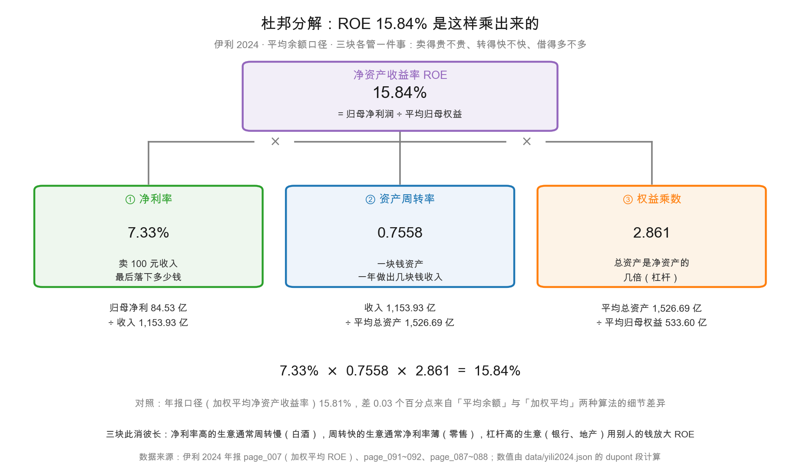
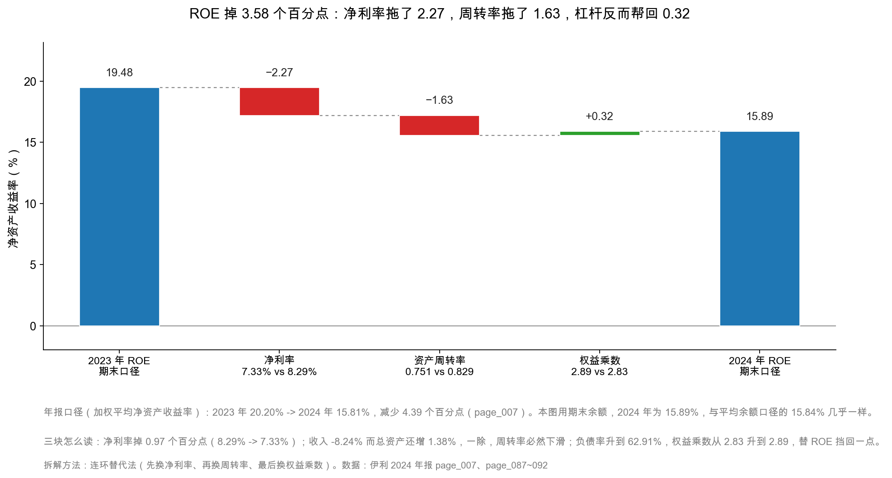

# 第 42 章：ROE 杜邦分解——赚钱能力拆成三块

> 本章你将：
> - 用一个指标（ROE 15.84%）判断一家公司值不值得看下去；
> - 把它拆成「净利率 $\times$ 资产周转率 $\times$ 权益乘数」，看伊利靠哪一块赚钱；
> - 看懂伊利的 ROE 为什么从 20.20% 掉到 15.81%，三块各贡献了多少；
> - 认识三种商业模式：高毛利低周转、低毛利高周转、高杠杆；
> - 知道「借来的 ROE」有多危险，以及怎么一眼认出来。

上一章我们验完了三张表，确认伊利的账是通的。但「账通」不等于「生意好」——一个人的体检报告没有算错，不代表他身体健康。

这一章开始，我们换一批指标。这批指标不再问「数对不对」，而是问「这家公司赚钱的效率高不高」。

第一个指标就是 ROE。它是所有财务指标里最常被引用、也最容易被误用的一个。

---

## 42.1 ROE：股东最该关心的那个数

先讲个直觉。

你和朋友各开一家奶茶店，都投了 100 万元。一年后，你的店净赚 15 万元，他的店净赚 8 万元。你的店更值得投——这个判断不需要会计知识。

**ROE（Return on Equity，净资产收益率）就是把这件事变成一个比率：**

$$\text{ROE} = \frac{\text{归母净利润}}{\text{归母净资产}}$$

伊利 2024 年，归母净利润 84.53 亿元，年末归母净资产 531.80 亿元：

$$\frac{84.53}{531.80} = 15.89\%$$

注意这里是「年末净资产」。如果按「（年初 + 年末）÷ 2」算平均净资产，得到 **15.84%**，这是本章主用口径。年报第 007 页披露的「加权平均净资产收益率」是 **15.81%**，第三种算法。

<!-- src: 伊利股份2024年报/page_007.md 伊利股份2024年报/page_088.md 伊利股份2024年报/page_092.md -->

**三个数字：15.89%、15.84%、15.81%。** 同一家公司、同一年，三个 ROE。

> ⚠️ **易踩坑：** 这是新手最容易困惑的第一件事——为什么同一个指标有三个数？
>
> 因为分母不同。年报的「加权平均净资产收益率」按监管公式算，
> 要考虑年内增发、回购、分红的时间权重，算法最复杂也最权威；
> 「平均余额」是（期初 + 期末）÷ 2，简单直观，做趋势分析最常用；
> 「期末余额」最简单，但会被年末的异常波动带偏。
>
> **规则只有一条：比较两家公司、或者比较两年时，必须用同一种算法。** 混着比，你比的是算法，不是公司。

那 15.84% 算好还是不好？

先给一个粗略的锚：**长期看，一家公司的 ROE 如果能稳定在 15% 以上，通常说明它有某种别人抢不走的东西**（品牌、渠道、成本优势、牌照）。A 股全部上市公司过去十年的 ROE 中位数大约在 8%~10% 之间，所以 15% 已经是中上水平。

伊利过去三年的 ROE 是：2022 年 19.23%、2023 年 20.20%、2024 年 15.81%。**前两年很优秀，2024 年掉下来了。**

掉了多少？20.20% - 15.81% = **4.39 个百分点**。这个数字页面上直接写着「减少 4.39 个百分点」（page_007），不用自己算。

**但「掉了 4.39 个百分点」只是症状，不是病因。** 要找到病因，得把 ROE 拆开。这就是杜邦分解。

---

## 42.2 杜邦分解：一个分数拆成三个分数

杜邦分解（DuPont analysis）的名字来自美国杜邦公司，1912 年由他们的财务人员提出——那时候没有计算器，一个能把 ROE 拆成「可归因的三块」的工具，价值极高。

它的做法很简单：**给 ROE 的分子分母同时乘上两个东西（营业收入、总资产），然后重新组合。**

$$\text{ROE} = \frac{\text{净利润}}{\text{净资产}} = \frac{\text{净利润}}{\text{营业收入}} \times \frac{\text{营业收入}}{\text{总资产}} \times \frac{\text{总资产}}{\text{净资产}}$$

三个分数各自有名字，各自回答一个问题：

| 因子 | 公式 | 回答的问题 | 伊利 2024 |
|---|---|---|---|
| 净利率 | 净利润 ÷ 营业收入 | 卖 100 元收入，最后落下多少钱 | **7.33%** |
| 资产周转率 | 营业收入 ÷ 总资产 | 一块钱资产，一年做出几块钱收入 | **0.7558** |
| 权益乘数 | 总资产 ÷ 净资产 | 总资产是净资产的几倍（杠杆） | **2.861** |

三个一乘：$7.33\% \times 0.7558 \times 2.861 = 15.84\%$。

<!-- src: 伊利股份2024年报/page_091.md 伊利股份2024年报/page_087.md 伊利股份2024年报/page_088.md -->

看图从上往下读：最上面是结果（15.84%），中间是三块，下面一层是每一块的分子分母。这张图值得你抄在笔记本上——以后看任何一家公司，先画这棵树，你对它的理解会比看十页文字多。

### 每一块在说什么

**净利率 7.33%：卖 100 元牛奶，最后落下 7.33 元。**

这个数字不高。乳业是薄利生意：原奶、包装、物流都是硬成本，渠道和广告又要吃掉一大块。伊利 2024 年毛利率 33.88%，但销售费用率 19.05%、管理费用率 3.87%，一层层减下来，净利率只剩 7.33%。

**资产周转率 0.7558：一块钱资产，一年做出 0.76 元收入。**

这个数字也不高——不到 1。意思是伊利要动用 1 元资产，才能做出 0.76 元收入。这听起来效率不高，但它是**重资产 + 大量现金**的结果：固定资产 346.19 亿元、类现金 652.07 亿元，这两块加起来就占了总资产的 65%。钱趴在账上不生收入，周转率自然被拉低。

**权益乘数 2.861：总资产是净资产的 2.86 倍。**

这个数字说明伊利有杠杆。资产 1,537.18 亿元，净资产 570.08 亿元，$1{,}537.18 \div 570.08 = 2.70$（期末口径）；用平均余额算是 2.861。换句话说，伊利每 1 元自有资金，撬动了 2.86 元资产，剩下的 1.86 元是借来的和占用的。

> 📌 **划重点：** 杜邦分解的价值不在「算出三个数」，而在「知道该盯哪一个」。
> 净利率高说明产品有定价权；周转率高说明运营效率高；权益乘数高说明敢借钱。
> 三块此消彼长——一家公司很难三块都高，那是印钞机。

> 💡 **你可能会问：为什么伊利的权益乘数是 2.861，而不是用期末数算的 2.70？**
>
> 因为 `dupont` 段用的是平均余额：平均总资产 1,526.69 亿元 ÷ 平均归母权益 533.60 亿元 = 2.861。
> 期末口径 1,537.18 ÷ 531.80 = 2.89（对**归母**权益），或者 1,537.18 ÷ 570.08 = 2.70（对**全部**权益，含少数股东）。
>
> 注意最后这个差别：**分母用归母权益还是全部权益，会差很多。** 杜邦分解的分子是归母净利润，所以分母必须用归母权益，否则口径不匹配。
> 上面那个 2.70 是错的口径——它把少数股东的 38.28 亿元也算成了「股东的钱」，但分子里并没有少数股东那部分的利润。

---

## 42.3 三种商业模式：为什么不能只看 ROE 高低

在拆伊利之前，先把视野拉开。同样 15% 的 ROE，可能是三种完全不同的生意。

### 第一种：高毛利、低周转（白酒、创新药、软件）

一瓶白酒的毛利率能到 80% 以上，但它的资产周转率很低——基酒要存三五年，窖池占着大量资金。

假设一家白酒公司：净利率 35%、周转率 0.45、权益乘数 1.3。

$$35\% \times 0.45 \times 1.3 = 20.5\%$$

ROE 之所以高，全靠**第一块**（净利率）。这种生意的护城河是「品牌」和「时间」——别人想复制，得先存五年酒。

### 第二种：低毛利、高周转（零售、快消、电商）

超市卖一瓶水赚几毛钱，净利率可能只有 2%，但货一周就转一圈，一年转 50 次。

$$2\% \times 3.0 \times 2.0 = 12\%$$

这种生意的护城河是「规模」和「效率」——谁的供应链更短、库存更薄、门店坪效更高，谁就赢。沃尔玛、Costco 都是这个模型。

### 第三种：高杠杆（银行、地产、券商）

银行放贷的本金大部分是储户的钱，净资产只占总资产 7%~8%，权益乘数能到 12 倍以上。

$$1\% \times 0.03 \times 13 = 3.9\%$$

注意：净利率只有 1%、周转率只有 0.03，但乘上 13 倍杠杆，ROE 也能到两位数。这种生意的护城河是「牌照」和「信用」——但它的风险也最高，因为杠杆是双向的：赚的时候放大 13 倍，亏的时候也放大 13 倍。

### 伊利是哪一种？

| 因子 | 伊利 2024 | 更像哪一类 |
|---|---|---|
| 净利率 7.33% | 中等（白酒 35%，零售 2%） | 介于中间 |
| 周转率 0.7558 | 中等偏高（白酒 0.45，零售 3.0） | 偏快消 |
| 权益乘数 2.861 | 中等（银行 13，白酒 1.3） | 中等杠杆 |

**伊利是「中等毛利 + 较高周转 + 中等杠杆」的消费品模型。** 它不像白酒那样靠定价权吃利润，也不像超市那样靠周转吃效率，而是三块都要一点。

这也解释了为什么乳业的价格战特别惨烈：**当三块都没有绝对优势时，任何一块被侵蚀，ROE 都会立刻掉下来。** 2024 年伊利就是净利率和周转率同时下滑。

> 🔍 **翻到年报：** 打开 `page_007.md`，找「主要财务指标」那张表。
> 「加权平均净资产收益率(%)」这一行，2024 年 15.81、2023 年 20.20、2022 年 19.23，
> 右边一列写着「减少 4.39 个百分点」。**这就是本章要解释的那个数。**

<!-- src: 伊利股份2024年报/page_007.md -->

---

## 42.4 拆解 4.39 个百分点：谁拖的，谁帮的

现在做本章的核心动作：把 ROE 的下滑拆到三个因子上。

方法叫**连环替代法**（也叫杜邦归因）。思路很朴素：**一次只换一个因子，看 ROE 变化多少。**

第一步，算出两年的三个因子。为了让两年完全可比，这里统一用**期末余额**：

| 因子 | 2023 年 | 2024 年 | 变化 |
|---|---|---|---|
| 净利率 | 8.29% | 7.33% | -0.97 个百分点 |
| 资产周转率 | 0.829 | 0.751 | -0.078 |
| 权益乘数 | 2.83 | 2.89 | +0.06 |
| **ROE（期末口径）** | **19.48%** | **15.89%** | **-3.58 个百分点** |

<!-- src: 伊利股份2024年报/page_007.md 伊利股份2024年报/page_087.md 伊利股份2024年报/page_088.md 伊利股份2024年报/page_092.md -->

第二步，按顺序替换：

$$\text{净利率的贡献} = (7.33\% - 8.29\%) \times 0.829 \times 2.83 = -2.27 \text{ 个百分点}$$

$$\text{周转率的贡献} = 7.33\% \times (0.751 - 0.829) \times 2.83 = -1.63 \text{ 个百分点}$$

$$\text{权益乘数的贡献} = 7.33\% \times 0.751 \times (2.89 - 2.83) = +0.32 \text{ 个百分点}$$

三个加起来：$-2.27 - 1.63 + 0.32 = -3.58$ 个百分点。

这张图的读法：先从 19.48% 起步，每根柱子代表一个因子的贡献，红色往下、绿色往上，最后一根是终点 15.89%。

**结论很清楚：ROE 掉 3.58 个百分点，净利率贡献了 -2.27（约 63%），周转率贡献了 -1.63（约 46%），权益乘数还帮回了 +0.32。**

注意：这里用的是期末口径（-3.58），年报口径是 -4.39。差 0.81 个百分点，来自「加权平均净资产」和「期末净资产」两种算法。**方向完全一致，结论不变。**

### 净利率为什么掉 0.97 个百分点

这里要小心，别得出错误结论。

2024 年伊利的毛利率是**上升**的：33.88%，比 2023 年的 32.58% 高了 1.30 个百分点（第 28 章讲过这是原奶成本下降 + 产品结构改善的结果）。

毛利率上升，净利率却下降，说明**费用或减值吃掉了毛利的好处**。拆开看：

| 项目 | 2023 年 | 2024 年 | 变化 |
|---|---|---|---|
| 毛利率 | 32.58% | 33.88% | +1.30 个百分点 |
| 销售费用率 | 17.95% | 19.05% | +1.10 个百分点 |
| 管理费用率 | 4.10% | 3.87% | -0.23 个百分点 |
| 资产 + 信用减值（亿元） | 16.86 | 52.31 | +35.45 |

<!-- src: 伊利股份2024年报/page_091.md 伊利股份2024年报/page_211.md -->

**毛利率赚回来的 1.30 个百分点，被销售费用率吃掉了 1.10 个，剩下的又被 35.45 亿元的额外减值吃光了。**

这就是第 6 周到第 8 周那条主线的算术版本：**伊利的经营在变好（毛利率涨、现金流涨），但账面利润被减值砸下来了。**

所以你在这里要做一个区分：

- **如果 ROE 下滑是因为净利率下滑，而净利率下滑是因为减值**——那要看减值是不是一次性的。是一次性的，明年 ROE 会修复。
- **如果净利率下滑是因为毛利率下滑或费用率失控**——那是真的竞争力在下降。

伊利是前者。**这个判断，比 ROE 从 20.20% 掉到 15.81% 这个事实本身重要得多。**

### 周转率为什么掉 0.078

周转率 = 收入 ÷ 总资产。2024 年分子降了 8.24%（收入从 1,257.58 亿元降到 1,153.93 亿元），分母反而涨了 1.38%（总资产从 1,516.20 亿元涨到 1,537.18 亿元）。

**一个减、一个加，除出来的结果必然大跌。**

为什么会这样？收入降是行业性的（原奶过剩、需求疲软、渠道去库存）；总资产涨，主要是因为类现金从 492 亿元增加到 652 亿元——**公司把钱存起来了，资产变大了，但不产生收入。**

这就是「周转率下降」的真相：**不是卖不动导致资产闲置，而是赚钱的机会变少，公司选择把钱存起来。** 这两种情况的含义完全不同。

### 权益乘数为什么帮了 0.32

权益乘数从 2.83 升到 2.89，是因为分母（归母权益）从 535.39 亿元降到 531.80 亿元——分红 76.39 亿元、回购 4.08 亿元、其他综合收益 -5.97 亿元，三项加起来超过了当年赚的 84.53 亿元。

**换句话说：伊利把赚的钱几乎全分掉了，净资产没怎么长，杠杆比例就上去了。** 这是「被动加杠杆」，不是主动借钱扩张——和第 23 章讲的「有息负债」是两回事。

> 📌 **划重点：** 权益乘数上升有两种，含义完全相反。
> **被动上升**：净资产因为分红、回购而减少，杠杆比例被动抬高——这是「把钱还给股东」，不是风险。
> **主动上升**：主动借钱扩张，负债增加——这才要看借的钱投到哪、回报够不够。
> 伊利的 2.83 → 2.89 是前者。

---

## 42.5 「借来的 ROE」有多危险

这一节讲一个必须讲透的陷阱。

假设有两家公司，ROE 都是 20%：

| | A 公司 | B 公司 |
|---|---|---|
| 净利率 | 20% | 4% |
| 周转率 | 1.0 | 1.0 |
| 权益乘数 | 1.0 | 5.0 |
| ROE | 20% | 20% |

两家 ROE 一模一样，但它们是两种完全不同的生物。

**A 公司**：不借钱，靠卖得贵赚钱。经济不好的时候，它可以降价保量，ROE 从 20% 掉到 12%，还活着。

**B 公司**：借了 4 倍杠杆。经济不好的时候，收入降 20%，净利率从 4% 变成 0%，ROE 直接归零；如果收入再降一点，净利率变负，**杠杆会把亏损放大 5 倍**，ROE 变成 -20%。更糟的是，债要还本付息，还不上就破产。

**这就是「借来的 ROE」的危险：它的上限被杠杆放大，下限也被杠杆放大。** 而人是线性思维的动物，看到连续三年 20% 的 ROE，会默认「明年也是 20%」，忘了这个 20% 是靠 5 倍杠杆撑起来的。

### 怎么一眼认出「借来的 ROE」

三个动作：

**动作一：看权益乘数的绝对值和趋势。** 权益乘数超过 4，就要小心；超过 6，基本是金融或地产模型。伊利 2.86，安全。

**动作二：看有息负债 / 净资产。** 这个比权益乘数更锋利，因为权益乘数里包含了「占用供应商的钱」这种免费杠杆。伊利的有息负债 605.58 亿元，归母权益 531.80 亿元，比值 1.14——**借的钱比自己有的还多一点点**，但因为类现金有 652.07 亿元，净有息负债是 -46.50 亿元（现金比债多），所以风险不大。

**动作三：看 ROE 的波动率。** 高杠杆公司的 ROE 通常大起大落。把过去五年的 ROE 排一排，如果是从 25% 到 -10% 的过山车，那不管当年多高，都不能给它高估值。

<!-- src: 伊利股份2024年报/page_087.md 伊利股份2024年报/page_088.md -->

> ⚠️ **易踩坑：** 很多人看到「ROE 连续五年 20%」就当成品格优秀的证据。
> 但你要问一句：**这 20% 里，有多少是借来的？**
> 一家权益乘数 8 倍、ROE 20% 的公司，如果杠杆降到 2 倍，ROE 只有 5%。
> 它的「优秀」不是来自生意，是来自资产负债表右边的结构。
>
> 反过来，一家权益乘数 1.5 倍、ROE 15% 的公司，含金量高得多——
> 它几乎全靠净利率和周转率赚出来的。

### 一个反例：为什么高 ROE 有时是坏事

再讲一个更隐蔽的情况：**ROE 突然变高，可能是因为净资产变小了。**

假设一家公司连续亏损，净资产从 100 亿元亏到 20 亿元，某一年终于赚了 4 亿元。它的 ROE 是 $4 \div 20 = 20\%$——看起来很漂亮。但这家公司其实是「瘦身后的回光返照」，不是「变强了」。

同理，大额回购、大比例分红、大额减值，都会让净资产变小，从而**机械地推高 ROE**。

**所以看 ROE 的时候，永远要同时看一眼分母（净资产）发生了什么。** 这是本章最后一个、也是最重要的提醒。

---

## 42.6 把杜邦分解变成一张检查表

最后，把这一章变成一个可以复用的流程。以后分析任何一家公司，按这个顺序走：

| 步 | 做什么 | 伊利的答案 | 异常时该问什么 |
|---|---|---|---|
| 1 | 查 ROE，和同行、和自己的历史比 | 15.81%，比 2023 年降 4.39 点 | 是趋势还是单年？ |
| 2 | 拆三块，看哪块在变 | 净利率 -0.97 点、周转率 -0.078、杠杆 +0.06 | 哪块贡献最大？ |
| 3 | 拆净利率：毛利率、费用率、减值 | 毛利率 +1.30、销售费用率 +1.10、减值 +35.45 亿 | 是一次性还是持续性？ |
| 4 | 拆周转率：分子（收入）和分母（资产） | 收入 -8.24%、总资产 +1.38% | 是卖不动还是钱多了？ |
| 5 | 拆杠杆：被动还是主动 | 被动（分红 + 回购 + 其他综合收益） | 有没有主动加债？ |
| 6 | 判断可持续性 | 减值是一次性的，2025 年 ROE 有望修复 | 修复的前提是什么？ |

<!-- src: 伊利股份2024年报/page_007.md 伊利股份2024年报/page_091.md 伊利股份2024年报/page_211.md -->

**这张表的关键不在前五步，在第六步。** 前五步是算术，第六步是判断。而判断的依据，是你对这家公司业务的理解——杜邦分解只是把「该看哪里」告诉你，它不会替你做结论。

现在回到全书那条主线：伊利 2024 年报表上写的是「利润大降」，但真相是「主业在变好」。

杜邦分解给了这条主线一个新的证据：**ROE 下滑的 63% 来自净利率，而净利率下滑的主因是 35.45 亿元的额外减值，不是毛利率恶化——毛利率反而涨了 1.30 个百分点。**

一个只读 ROE 的人看到「15.81%，跌了 4.39 点」，会得出「公司变差了」；一个会拆杜邦的人看到「毛利率涨、减值砸、现金流涨」，会得出「公司在洗大澡」。**两种人买的是同一只股票，判断完全相反。**

下一章我们继续拆：杜邦里的「资产周转率」这一块，还可以再往下拆成存货、应收、应付三个周转天数。拆完你会看到伊利一个惊人的数字——现金转换周期只有 2.6 天。

## ✍️ 想一想

### 问 1：两家 ROE 都是 18% 的公司，你选哪家

假设你在两家公司之间选（**示意数字，非真实公司**）：

| | 甲公司 | 乙公司 |
|---|---|---|
| ROE | 18% | 18% |
| 净利率 | 22% | 3% |
| 资产周转率 | 0.55 | 2.4 |
| 权益乘数 | 1.49 | 2.5 |
| 有息负债 / 归母权益 | 0.1 | 1.9 |
| 过去五年 ROE | 17%~19% | 6%~24% |

① 请分别说出两家公司的商业模式特征。
② 如果明年行业需求下滑 15%，你估计哪家的 ROE 跌得更狠？为什么？
③ 除了表里的数字，你还会去看什么？

**解题思路：**
第 ① 问看三块的组合。甲是「高毛利低周转」，乙是「低毛利高周转 + 中杠杆」。
第 ② 问要做敏感性分析：收入降 15%，对高毛利公司是「少赚」，对低毛利高杠杆公司可能是「亏钱」。
第 ③ 问问的是「数字之外的东西」——护城河、现金流、资本开支需求。

**参考答案：**

① **甲公司**：净利率 22% 说明产品有定价权（可能是品牌消费品、专利药、软件）。周转率 0.55 说明资产很重或周期很长（存货久、应收账款长、固定资产多）。杠杆 1.49 基本不借钱。这是「靠卖得贵赚钱」的模型。

**乙公司**：净利率 3% 说明是薄利生意（零售、代工、大宗贸易）。周转率 2.4 说明货转得很快。杠杆 2.5、有息负债是净资产的 1.9 倍，说明它靠借钱撑规模。这是「靠转得快 + 借钱赚钱」的模型。

② **乙公司跌得更狠**，而且是数量级的差别。

做个粗算（假设成本结构不变，收入降 15%，成本也降 15%）：

- **甲公司**：收入降 15%，毛利降 15%。如果费用是刚性的，净利率可能从 22% 降到 18% 左右，ROE 从 18% 降到约 14.7%。
- **乙公司**：净利率只有 3%。收入降 15%，毛利降 15%，但房租、人工、利息这些费用降不了。粗算净利率可能变成 -1%，**ROE 直接从 18% 变成负数。**

**关键机制：净利率越薄，收入的波动对利润的放大倍数越大。** 3% 的净利率意味着「收入降 3% 就吃掉了全部利润」；22% 的净利率意味着「收入要降 22% 才吃掉全部利润」。

再加上乙公司有 1.9 倍净资产的有息负债，利息是刚性的，亏损会被杠杆再放大一次。

③ 我还会看四样东西：

1. **经营现金流。** 利润可以记，现金很难编。乙公司如果净利率 3% 但经营现金流长期为负，说明它的扩张是「烧钱换规模」，很脆弱。
2. **资本开支需求。** 高周转的公司往往需要不断开门店、建仓、买设备。如果资本开支吃掉大部分经营现金流，那它的「高周转」是靠持续投入维持的，自由现金流可能是负的。
3. **护城河的具体形态。** 甲公司的 22% 净利率是靠品牌、专利还是渠道？能不能维持五年？乙公司的 2.4 次周转是靠供应链效率还是靠低价？前者可持续，后者会被模仿。
4. **过去五年 ROE 波动的具体年份。** 乙公司 6%~24% 的区间里，最低那一年发生了什么？是行业周期、还是一次性事故？这决定了它的「正常水平」到底是多少。

**易错点：**
① 只看 ROE 数字选公司。18% 对 18%，看起来一样，风险差好几倍；
② 忘了「净利率越薄，经营杠杆越高」这个机制。这是杜邦分解最实用的一条推论；
③ 把「过去五年 ROE 波动大」简单理解成「周期股」。有些波动是周期，有些是经营失控，要看具体年份。

### 问 2：伊利的 ROE 明年会修复吗

用本章的材料回答：

① 如果 2025 年减值回到 2023 年的水平（16.86 亿元），其他条件不变，伊利的 ROE 大概会是多少？请写出计算过程。
② 「其他条件不变」这个假设现实吗？哪几个条件最可能变？
③ 如果你要在报告里写一句「伊利 2025 年 ROE 有望修复到 18%」，你需要补哪些证据才敢写？

**解题思路：**
第 ① 问是「反事实计算」：把 2024 年的减值换成 2023 年的，看利润怎么变，再算 ROE。
第 ② 问考的是「哪些假设最脆弱」。
第 ③ 问考的是「结论需要什么级别的证据」。

**参考答案：**

① 计算分三步。

**第一步：算减值少提多少。** 2024 年资产减值 46.76 亿元 + 信用减值 5.55 亿元 = 52.31 亿元；2023 年是 15.26 + 1.60 = 16.86 亿元。差额 35.45 亿元。

**第二步：算税后影响。** 减值在税前扣除，按 2024 年有效税率约 16.4%（所得税 16.63 亿元 ÷ 利润总额 101.27 亿元）计算，税后影响是 $35.45 \times (1 - 16.4\%) = 29.64$ 亿元。

**第三步：算新 ROE。**

$$\text{新归母净利} = 84.53 + 29.64 = 114.17 \text{ 亿元}$$

$$\text{新 ROE} = \frac{114.17}{531.80} = 21.47\%$$

用平均余额口径算也差不多：$114.17 \div 533.60 = 21.40\%$。

**所以答案约是 21.4%~21.5%。** 比 2023 年的 20.20% 还高一点——因为 2024 年的毛利率比 2023 年高了 1.30 个百分点，这部分好处在减值掩盖下没体现出来。

② **不现实。** 至少有三个条件会变：

- **收入。** 2024 年收入降了 8.24%，2025 年可能继续降，也可能回升。收入每变动 1%，净利变动约 1.4%（因为费用有刚性）。
- **毛利率。** 2024 年 33.88% 是原奶价格低迷 + 产品结构改善的结果。原奶价格如果回升，毛利率会回落。
- **减值会不会再提。** 商誉还剩 23.37 亿元（其中澳优 21.55 亿元），如果 2025 年澳优业绩不达标，还会再提。**这是最大的不确定性。**

所以「其他条件不变」在这个案例里是一个很强的假设，只能用来做「敏感性参考」，不能当成预测。

③ 我需要补四类证据：

1. **减值是不是真的见底了。** 要看 2024 年报附注里商誉减值测试的关键假设（增长率、折现率），以及澳优 2024 年的实际经营数据。如果测试假设已经很保守，说明见底的概率大。
2. **2025 年一季报的收入和毛利率。** 这是最早的验证点。如果一季度收入还在降、毛利率也在降，那「修复」就是空话。
3. **原奶价格的走势。** 乳业的毛利率和原奶价格高度负相关。要查农业农村部的原奶价格数据（这是公开数据，不在年报里）。
4. **销售费用率会不会继续升。** 2024 年已经升了 1.10 个百分点，如果 2025 年为了保份额继续投费用，净利率还是上不去。

**如果这四条都支持，我才会写「有望修复到 18%」；如果只有一两条支持，正确写法是「若减值不再扩大，ROE 有修复空间，但收入端仍有压力」。**

**易错点：**
① 忘记算税。减值是税前项目，少提减值要多交税，不能把 35.45 亿元全额加到净利上；
② 用「净利润」而不是「归母净利润」算 ROE。伊利的少数股东损益只有 0.11 亿元，影响很小，但在少数股东占比高的公司里会差很多；
③ 把「反事实计算」当成「预测」。前者是「如果 A 则 B」，后者是「我認為 A 会发生」——两句话的可信度完全不同。

### 问 3：为什么「权益乘数上升」不一定是坏事

本章说伊利的权益乘数从 2.83 升到 2.89，是「被动加杠杆」，不是风险。请回答：

① 用伊利的数字说明，这个上升是怎么发生的。
② 举一个「主动加杠杆」的例子，并说明它和被动加杠杆的区别。
③ 如果你看到一家公司的权益乘数三年内从 2 升到 5，你会按什么顺序排查？

**解题思路：**
第 ① 问要从「分母变小」这个角度解释，而不是「分子变大」。
第 ② 问要找一个「借钱去投资」的场景，并对比现金流的方向。
第 ③ 问考的是排查顺序：先看是分子还是分母在动，再看钱去了哪，最后看回报够不够。

**参考答案：**

① 权益乘数 = 总资产 ÷ 归母权益。伊利 2024 年：

- 分子（总资产）从 1,516.20 亿元涨到 1,537.18 亿元，只涨 1.38%；
- 分母（归母权益）从 535.39 亿元降到 531.80 亿元，降 0.67%。

**分母变小是主因。** 归母权益为什么降？因为当年赚了 84.53 亿元，但分红 76.39 亿元、回购 4.08 亿元、其他综合收益 -5.97 亿元，三项合计流出 86.44 亿元，**比赚的还多**。

所以这个杠杆上升，本质是「公司把赚的钱几乎全还给股东了，净资产没长，比例自然上去」。**它不是借钱借出来的，是分红分出来的。**

② **主动加杠杆的例子**：一家公司发行 50 亿元债券，去建一条新生产线。

对比：

| | 被动加杠杆（伊利） | 主动加杠杆 |
|---|---|---|
| 负债有没有增加 | 没有明显增加 | **增加 50 亿元** |
| 总资产有没有增加 | 几乎不变 | 增加 50 亿元（在建工程） |
| 钱去了哪 | 还给股东 | 变成产能 |
| 未来要付什么 | 不用付息 | **每年付利息** |
| 风险在哪 | 净资产薄了一点 | 产能建成了卖不出去，利息还得付 |

**一句话区别：被动加杠杆是「分母缩水」，主动加杠杆是「分子膨胀 + 负债增加」。** 前者不产生新的偿付义务，后者产生。

③ 我会按这个顺序排查：

**第一步：看是分子还是分母在动。** 调出三年的总资产和归母权益，看哪个涨得快。如果总资产涨得远快于权益，是主动加杠杆；如果总资产没怎么动、权益在缩，是被动。

**第二步：看负债结构。** 有息负债增加了多少？经营性负债（应付账款、合同负债）增加了多少？前者要付息，后者不用。**如果是经营性负债在大幅增加，那可能是「拖欠供应商」，这在第 44 章是一条红旗。**

**第三步：看钱去了哪。** 翻现金流量表的投资活动：是购建固定资产（扩产）、还是取得子公司（并购）、还是买理财（不产生回报）？三种去向，风险完全不同。

**第四步：看回报够不够。** 新投的资产有没有带来新增收入？算出「新增收入 ÷ 新增资产」，和原来的资产周转率比。如果新资产的效率明显低于老资产，那这笔杠杆是失败的。

**第五步：看利息覆盖倍数。** 用「息税前利润 ÷ 利息支出」。低于 3 倍就要警惕，低于 1.5 倍是危险区。伊利 2024 年利息支出 18.20 亿元，利润总额 101.27 亿元，覆盖 5.6 倍，安全。

**易错点：**
① 只看权益乘数的变化，不看它是分子还是分母造成的；
② 把「经营性负债增加」当成「加杠杆」。占用供应商的钱是免费杠杆，性质和借钱完全不同；
③ 忘记看利息覆盖倍数。杠杆本身不是问题，「还不起利息」才是问题。

## 📎 数据出处

- 伊利股份 2024 年报：`page_007.md`（加权平均净资产收益率 15.81%、2023 年 20.20%、2022 年 19.23%，「减少 4.39 个百分点」；扣非加权平均 ROE 11.24%）
- 伊利股份 2024 年报：`page_087.md`（资产总计 153,718,003,927.97 元、固定资产 34,618,503,875.86 元）
- 伊利股份 2024 年报：`page_088.md`（负债合计、归母权益 53,179,935,140.80 元、少数股东权益、未分配利润）
- 伊利股份 2024 年报：`page_091.md`（营业收入 115,393,310,976.69 元、营业成本、销售费用 21,982,305,923.27 元、管理费用、财务费用 -591,649,416.42 元、利息支出 1,819,520,437.71 元、资产减值 -4,675,845,573.44 元、信用减值 -555,019,707.28 元）
- 伊利股份 2024 年报：`page_092.md`（净利润 8,463,710,355.65 元、归母净利润 8,452,859,993.18 元、利润总额、所得税）
- 伊利股份 2024 年报：`page_211.md`（资产减值明细：商誉 30.75 亿元、存货 12.27 亿元、固定资产 3.67 亿元）
- 数据汇总：`data/yili2024.json` 的 `dupont` 段（平均总资产 152,669,128,292.975 元、平均归母权益 53,359,633,276.98 元、净利率 0.07325、周转率 0.75584、权益乘数 2.86114、ROE 0.15841）、`income`、`balance`、`compare_2023`、`core_earnings`、`ratios` 段
- 本章问 1 的两家公司为**示意数字**，非真实公司；问 2 的 2025 年推演为**假设情景**，不是预测

下一章：[第 43 章：周转率与现金转换周期](43-周转率与现金转换周期.md)
