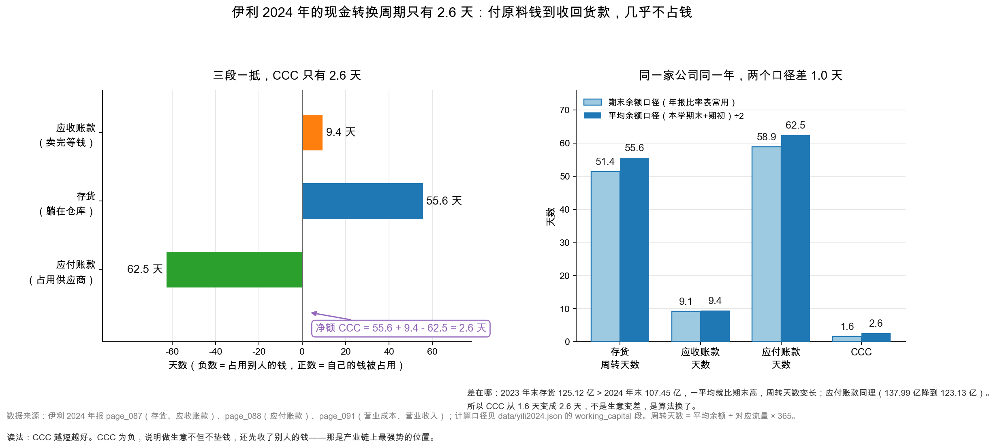

# 第 43 章：周转率与现金转换周期

> 本章你将：
> - 学会算三个周转天数：存货、应收账款、应付账款，各用哪个分子分母；
> - 把它们拼成一个数——现金转换周期（CCC），伊利 2024 年只有 **2.6 天**；
> - 看懂 CCC 为负意味着什么，以及为什么那是最强势的生意位置；
> - 明白「期末余额」和「平均余额」两个口径为什么会差 1 天，两个数都要会看；
> - 用 CCC 判断：一家公司的增长，需不需要靠融资来撑。

上一章拆了杜邦三块，其中「资产周转率 0.7558」这一块我们只是提了一句。这一章把它拆到底。

资产周转率是个很粗的指标：它把所有资产（固定资产、现金、存货、应收）混在一起，除以收入。但真正决定一家公司「要不要垫钱做生意」的，只有三样东西：存货、应收账款、应付账款。

这三样东西各有各的节奏，拼起来就是这一章的主角：现金转换周期。

---

## 43.1 三个周转天数：钱在哪一段被卡住

先讲一个生活场景。

你开一家水果店。进货的时候要付现金（或者赊 30 天），货拉到店里要摆几天才卖掉，卖给老客户还可能让对方月底结账。

**你的钱在三段时间里被「卡住」了：**

1. **货在店里摆着的那几天**——钱变成了水果，还没变回钱。这叫**存货周转天数**；
2. **卖出去之后等客户付款的那几天**——钱变成了应收账款。这叫**应收账款周转天数**；
3. **你欠供应商的那几天**——这三天不但没卡住你的钱，反而是**供应商在替你垫钱**。这叫**应付账款周转天数**。

前两段是「钱被占用」，第三段是「占用别人的钱」。三段一抵，就是你要自己垫多少天的钱。

### 公式：为什么分子是「成本」而不是「收入」

先把定义写清楚，因为这里有个新手最容易搞错的地方。

| 指标 | 公式 | 分子用成本还是收入 |
|---|---|---|
| 存货周转天数 | 平均存货 ÷ 营业成本 $\times$ 365 | **成本** |
| 应收账款周转天数 | 平均应收账款 ÷ 营业收入 $\times$ 365 | **收入** |
| 应付账款周转天数 | 平均应付账款 ÷ 营业成本 $\times$ 365 | **成本** |

**为什么存货和应付用成本，应收用收入？**

因为存货是按成本记在账上的。一批成本 100 元的货，卖 150 元，账上存货减 100（不是 150）。所以「存货 ÷ 成本」算出来才是「这批货要卖多少天」；如果用收入做分母，会低估周转天数。

应收账款是按售价记的（客户欠你 150 元，不是 100 元），所以要用收入做分母。

应付账款是你欠供应商的货款，按采购成本记，所以也用成本。

**这条规则的记忆法：跟着「这个科目是按什么金额入账的」走。** 按成本入账的（存货、应付），分母用成本；按售价入账的（应收），分母用收入。

> ⚠️ **易踩坑：** 很多财经网站算存货周转天数时用「营业收入」做分母，
> 算出来的数字比真实值小 30% 左右（因为收入 > 成本）。
> 这不一定是网站错了——有些行业惯例确实这么算——但你**不能拿一个用收入算的数，去和一个用成本算的数比**。
> 看到别人的周转天数，第一件事是问：你的分母是什么？

### 伊利 2024 年的三个数

用平均余额口径（期初 + 期末）÷ 2：

| 指标 | 平均余额（亿元） | 分母（亿元） | 周转天数 |
|---|---|---|---|
| 存货 | 116.28 | 营业成本 762.99 | **55.6 天** |
| 应收账款 | 29.82 | 营业收入 1,153.93 | **9.4 天** |
| 应付账款 | 130.56 | 营业成本 762.99 | **62.5 天** |

存货周转次数 = $762.99 \div 116.28 = 6.56$ 次，对应 $365 \div 6.56 = 55.6$ 天。

<!-- src: 伊利股份2024年报/page_087.md 伊利股份2024年报/page_088.md 伊利股份2024年报/page_091.md -->

三个数字，三种含义：

**存货 55.6 天。** 伊利的一批货（原奶、成品、包装物）从进厂到卖出去，平均要 55.6 天。乳制品有保质期，这个数字不能太长——常温奶保质期 6 个月，如果库存压 90 天就有临期风险。

**应收账款 9.4 天。** 这个数字**极短**。伊利主要做经销商生意，行业惯例是「先款后货」或「短账期」，所以卖出去 9 天就收到钱。对比一下：工程机械、光伏组件公司的应收账款周转天数常在 100 天以上。

**应付账款 62.5 天。** 伊利欠供应商的钱，平均 62.5 天才付。**这个数字比存货周转天数还长**——意味着伊利卖完货、收到钱之后，才慢慢付供应商的款。

### 为什么必须看三段，不能只看两段

有人会问：存货和应收是「被占用」，应付是「占用别人」，为什么不能直接看「存货 + 应收」？

因为**应付账款是这三段里唯一能主动调节的**。

存货和应收，公司只能尽量压低（压太低会断货、会丢客户）。但应付账款的账期，是公司和供应商谈出来的——它可以是 30 天，也可以是 120 天。

**所以 CCC 的改善有两条路：**

1. **真本事**：把存货周转加快、把应收账期缩短。这需要供应链和渠道的效率提升，很难，但可持续；
2. **借来的**：把应付账期拉长。这只需要跟供应商说「下个月再付」，很容易，但会把压力转嫁给上游。

**财报分析里最危险的一种「改善」，就是把第 2 条当成第 1 条。** 一家公司 CCC 从 60 天变成 10 天，你要先问：是存货和应收变好了，还是应付拖长了？

伊利 2024 年两项都做了：存货天数降了 2.5 天（真本事），应付天数还降了 0.5 天（没有转嫁压力）。**这是最干净的一种改善。**

### 三段一拼：CCC = 2.6 天

$$\text{CCC} = \text{存货天数} + \text{应收天数} - \text{应付天数}$$

$$55.6 + 9.4 - 62.5 = 2.6 \text{ 天}$$

**2.6 天是什么概念？**

意思是：伊利从「付原料钱」到「收回货款」，中间只需要自己垫 2.6 天的钱。

再翻译一层：假设伊利一年做 1,153.93 亿元的生意，按 365 天摊，平均每天 3.16 亿元。CCC 2.6 天，意味着它只需要约 **8.2 亿元的营运资金**就能撑起这门生意。

**8.2 亿元，对一家总资产 1,537 亿元的公司来说，几乎等于零。**

> 📌 **划重点：** CCC 是衡量「生意要不要垫钱」的唯一指标。
> CCC 越短越好；CCC 为负，说明做生意不但不垫钱，还先收了别人的钱——
> 那是产业链上最强势的位置（超市、白酒、部分互联网平台）。
> CCC 长达 120 天以上，说明每做一笔生意都要垫一大笔钱，增长必须靠融资。

> 💡 **你可能会问：2.6 天这么短，是不是算错了？**
>
> 没算错。这是快消品 + 强势渠道的典型特征。
>
> 拆开看：存货 55.6 天不算短（乳业有生产周期和铺货需求），应收 9.4 天极短（经销商先款后货），应付 62.5 天偏长（伊利对上游原奶供应商有议价权）。
>
> **三个数刚好抵消。** 这不是巧合，是商业模式的结果：伊利把「存货占用」和「应收占用」几乎全部转嫁给了上游供应商和下游经销商。

---

## 43.2 两个口径：为什么同一家公司能算出 1.6 天和 2.6 天

现在讲这一章的技术核心，也是很多人会被绕晕的地方。

伊利 2024 年的 CCC，用**期末余额**算是 **1.6 天**，用**平均余额**算是 **2.6 天**。差 1 天。

`data/yili2024.json` 里两个数都给了：`ratios.cash_conversion_cycle_days = 1.6`，`working_capital.cash_conversion_cycle_days = 2.601`。

**为什么差？看分母（余额）怎么取。**

| 指标 | 期末余额口径 | 平均余额口径 | 差异原因 |
|---|---|---|---|
| 存货天数 | 51.4 天 | 55.6 天 | 2023 年末存货 125.12 亿元 > 2024 年末 107.45 亿元，平均值 116.28 亿元更高 |
| 应收天数 | 9.1 天 | 9.4 天 | 2023 年末应收 30.85 亿元 > 2024 年末 28.78 亿元 |
| 应付天数 | 58.9 天 | 62.5 天 | 2023 年末应付 137.99 亿元 > 2024 年末 123.13 亿元 |
| **CCC** | **1.6 天** | **2.6 天** | 三个差异叠加 |

<!-- src: 伊利股份2024年报/page_087.md 伊利股份2024年报/page_088.md -->

**看懂这张表的关键：2024 年伊利的存货、应收、应付三项余额都在下降。**

- 存货从 125.12 亿元降到 107.45 亿元（-14.1%）；
- 应收账款从 30.85 亿元降到 28.78 亿元（-6.7%）；
- 应付账款从 137.99 亿元降到 123.13 亿元（-10.8%）。

三个都在降，所以「（期初 + 期末）÷ 2」的平均值**必然高于期末值**。平均值高，周转天数就长。

**这不是生意变差，是算法换了。** 期末余额口径看到的是「年底这一天的状态」，平均余额口径看到的是「全年的一般水平」。

### 该用哪个？

两个都要会，用途不同：

| 口径 | 什么时候用 | 优点 | 缺点 |
|---|---|---|---|
| 期末余额 | 快速估算、和财经网站对数据 | 简单，只用一个数 | 会被年末异常波动带偏（比如年底突击压库存） |
| 平均余额 | 做趋势分析、和同行比 | 反映全年真实水平 | 需要两年的资产负债表 |

**本教程统一用平均余额**，理由有三个：

1. **它更接近真实。** 一家公司如果年底突击发货、把库存降到最低，期末口径的周转天数会好看得不真实；
2. **它更适合比较。** 两家公司如果年末时点不同（比如一家 12 月 31 日结账、一家 3 月 31 日），期末口径没法比；
3. **它是杜邦分解的配套。** 上一章的周转率 0.7558 就是用平均总资产算的，CCC 也该用平均余额，保持一致。

> 🔍 **翻到年报：** 打开 `page_087.md`，找「存货 10,744,674,420.37」这一行，右边一列是
> 「12,511,775,911.77」——那就是 2023 年末的存货。两个数一平均，就是 116.28 亿元。
> 再打开 `page_088.md`，找「应付账款 12,312,877,232.19」，右边是「13,798,869,047.01」。
> **A 股年报的两列，左边永远是本年、右边永远是上年。这个顺序记牢，能省掉一半的抄错。**

<!-- src: 伊利股份2024年报/page_087.md 伊利股份2024年报/page_088.md -->

### 伊利在变快还是变慢

一个数没有意义，趋势才有。把伊利两年的三个周转天数并排看：

| 指标 | 2023 年（期末口径） | 2024 年（期末口径） | 2024 年（平均口径） |
|---|---|---|---|
| 存货天数 | 53.9 天 | 51.4 天 | 55.6 天 |
| 应收天数 | 8.9 天 | 9.1 天 | 9.4 天 |
| 应付天数 | 59.4 天 | 58.9 天 | 62.5 天 |
| **CCC** | **3.4 天** | **1.6 天** | **2.6 天** |

（2023 年那一列由本教程按「期末余额 ÷ 当年流量 $	imes$ 365」算出，供对照；年报本身不披露周转天数。）

<!-- src: 伊利股份2024年报/page_087.md 伊利股份2024年报/page_088.md 伊利股份2024年报/page_091.md -->

用同一口径（期末）比，CCC 从 3.4 天降到 1.6 天，**变短了 1.8 天**。短在哪？

- 存货天数从 53.9 天降到 51.4 天，**贡献了 -2.5 天**（去库存见效）；
- 应收天数从 8.9 天升到 9.1 天，贡献了 +0.2 天（基本没动）；
- 应付天数从 59.4 天降到 58.9 天，贡献了 +0.5 天（付款快了一点，对 CCC 不利）。

**这三个数字合起来讲了一个故事：伊利 2024 年主动降库存，把存货天数压了 2.5 天；同时没放松对经销商的账期，也没拖欠供应商。** 这是「靠管理提效」而不是「靠占款粉饰」，是健康的。

对比一种不健康的做法：把应付账款从 59 天拖到 90 天，CCC 立刻变成 -30 天，看起来很漂亮。**但那是把压力转嫁给上游奶农，不可持续，而且第 44 章会把它列为一条红旗。**

### 一个必须提的细节：天数用 365 还是 360

有的教材用 360 天，有的用 365 天。

- **365 天**：对应自然年，算出来是「真实天数」，本教程用这个；
- **360 天**：来自银行惯例（一年 12 个月、每月 30 天），算出来会略小。

差异不大（约 1.4%），但同样不能混用。伊利存货 55.6 天（365 天口径）换成 360 天口径是 54.8 天。

---

## 43.3 CCC 为负：用别人的钱做生意

2.6 天已经够短了。但世界上还有一类生意，CCC 是**负数**。

CCC 为负是什么意思？**你卖货收钱的时间，比你付供应商钱的时间还早。** 也就是说，生意还没开始，钱已经到账了。

### 三个负 CCC 的模型

**模型一：超市。** 顾客当场付现金，供应商的账期 60~90 天。存货周转 30 天，应收 0 天（现金零售），应付 75 天。CCC = $30 + 0 - 75 = -45$ 天。

这意味着：超市每卖一批货，账上就多一笔现金，而这笔钱要 75 天后才付给供应商。**它可以用这笔钱去开新店、买理财，甚至放贷。**

**模型二：白酒。** 经销商先打款后提货（合同负债），存货周转很慢（基酒要存几年），但应付账款也不短。一家典型白酒公司的 CCC 可能是 -100 天到 -300 天。

**模型三：付费会员制零售。** 会员先交年费，这笔钱在会计上是「合同负债」，但现金已经到账。CCC 可能低到 -60 天。

### 负 CCC 的经济含义

用一个公式说清楚：

$$\text{营运资金需求} = \text{年收入} \div 365 \times \text{CCC}$$

- CCC = 2.6 天，年收入 1,153.93 亿元 → 需要 8.2 亿元营运资金；
- CCC = 120 天，同样收入 → 需要 379 亿元营运资金；
- CCC = -45 天，同样收入 → **不需要营运资金，反而多出 142 亿元可用现金。**

**最后这一行是最关键的：负 CCC 的公司，增长不但不烧钱，还「生钱」。** 它每多做一笔生意，账上就多一笔无息资金。这种公司扩张的速度可以非常快，而且不需要融资。

反过来，**CCC 120 天的公司，每增长 10%，就要多垫 38 亿元。** 这 38 亿元从哪来？要么借钱（付利息），要么增发（摊薄股东）。**所以这类公司的增长，质量天然低于负 CCC 的公司。**

### 对照：一个 120 天的生意长什么样

本书的对照公司里没有工程机械，但我们可以在脑子里搭一个（**示意数字，不是任何一家真实公司**）：

| 项目 | 天数 |
|---|---|
| 存货（设备在产、在库、在途） | 90 |
| 应收账款（客户分期付款） | 120 |
| 应付账款（对零部件供应商） | 90 |
| **CCC** | **120** |

这家公司年收入 100 亿元时，需要营运资金 $100 \div 365 \times 120 = 32.9$ 亿元。

如果它想把收入做到 200 亿元，就需要再垫 32.9 亿元。这 32.9 亿元如果全借钱，按 4% 利率算，一年利息 1.3 亿元——**这会直接吃掉落利润。** 所以这类公司的增长，往往伴随着负债率上升和 ROE 下滑。

**这就是为什么「看增长」之前要先看「CCC」：同样是收入涨 20%，负 CCC 的公司是纯赚，正 CCC 的公司要先掏钱。**

### 一个思维实验：CCC 决定「增长的天花板」

把上面两段合起来，能推出一个很有用的结论。

假设两家公司年收入都是 100 亿元、净利率都是 8%、都能借到年息 4% 的钱。唯一差别是 CCC：A 公司 -30 天，B 公司 +120 天。

| 项目 | A 公司（CCC -30 天） | B 公司（CCC +120 天） |
|---|---|---|
| 营运资金 | 多出 8.2 亿元可用现金 | 需垫 32.9 亿元 |
| 收入涨到 200 亿元时 | 多出 16.4 亿元现金 | 需再垫 32.9 亿元 |
| 这 32.9 亿元的成本 | 0（反而是收入） | 利息 1.32 亿元/年 |
| 新增 100 亿元收入的净利 | 8 亿元 | 8 - 1.32 = 6.68 亿元（税前） |

**同样把收入翻一倍，A 公司多赚 8 亿元，B 公司只多赚 6.68 亿元（税前）。** 而且 B 公司还要先掏出 32.9 亿元现金——如果它掏不出来，增长就到此为止。

**这就是 CCC 的「天花板效应」：它不是影响利润率高低的因素，它影响的是「你能长多大」。** 这也解释了一个现象：为什么零售、快消行业容易出现巨头（CCC 短，扩张不烧钱），而工程机械、光伏组件行业容易出现周期性的资金链危机（CCC 长，扩张必须借钱，一旦需求下滑，钱就压在存货和应收里出不来）。

---

## 43.4 三个天数的异常信号

CCC 是个总数，但异常往往藏在某一段里。下面三张「体检表」，以后看任何公司都能套。

### 存货天数突然拉长

| 可能原因 | 怎么验证 | 严重程度 |
|---|---|---|
| 需求下滑，货卖不动 | 看收入增速是否同步下滑 | 高 |
| 提前备货（预期涨价、旺季） | 看下一季收入是否兑现 | 低（如果兑现） |
| 为了降低单位成本而超产 | 看毛利率是否上升、存货跌价准备是否增加 | 中 |
| 存货跌价准备提得不够 | 看「存货跌价准备 ÷ 存货原值」的比例 | **高（利润虚增）** |

伊利 2024 年存货天数从 53.9 天升到 55.6 天（期末口径从 51.4 天降），同时存货余额降了 14.1%、存货跌价损失 12.27 亿元。**这是「主动去库存 + 提足跌价」的组合，是健康的。**

### 应收账款天数突然拉长

这是最经典的红旗之一，第 44 章会展开。核心判断：

$$\text{应收账款增速} \gg \text{收入增速} \Rightarrow \text{可能在靠赊账冲收入}$$

伊利 2024 年应收账款降 6.7%，收入降 8.24%——**应收降得比收入慢一点点，但没有异常。**

### 应付账款天数突然拉长

这一条容易被忽略，但它很危险。

应付账款天数拉长，表面上「占用供应商的钱」，看起来是好事。但如果是**因为没钱付**而拖延，那是现金流紧张的铁证。

区分方法：**看应付账款的增速和「经营活动现金流出」的关系。**

- 如果是**主动**延长账期（议价能力提升），经营现金流会同步变好；
- 如果是**被动**拖欠（没钱付），经营现金流会变差，同时应付账款异常增长。

伊利 2024 年应付账款降 10.8%，经营现金流涨 18.86%——**是主动付款，不是拖欠。**

<!-- src: 伊利股份2024年报/page_088.md 伊利股份2024年报/page_094.md -->

> ⚠️ **易踩坑：** 看到「应付账款周转天数从 45 天涨到 90 天」，很多人的第一反应是
> 「这家公司议价能力变强了」。**先别急着夸。**
> 去看它的经营现金流：如果现金流同时恶化，那不是议价能力，是付不出钱。
> 这类公司在供应链上会先失去信任，然后失去供货，最后停产。

---

## 43.5 把 CCC 放进杜邦分解

现在把这一章和上一章接起来。

杜邦分解的第二块是「资产周转率 = 收入 ÷ 总资产」。CCC 影响的是「总资产里的营运资金部分」。

**两者怎么连？**

$$\text{营运资金} \approx \text{收入} \div 365 \times \text{CCC}$$

$$\text{资产周转率} = \frac{\text{收入}}{\text{固定资产} + \text{类现金} + \text{营运资金} + \text{其他}}$$

CCC 越短，营运资金越小，分母越小，周转率越高。

**伊利就是一个例子。** CCC 只有 2.6 天，营运资金约 8.2 亿元，占总资产 1,537.18 亿元的 0.5%，几乎可以忽略。所以伊利的资产周转率 0.7558 主要由**固定资产 346.19 亿元**和**类现金 652.07 亿元**决定，而不是营运资金。

**这意味着伊利想提高周转率，靠「加快存货周转」已经没有空间了**（本来就 2.6 天），只能靠「提高固定资产的产出」或「减少闲置现金」。反过来，一家 CCC 120 天的公司，营运资金可能占总资产 40%，它的周转率提升空间很大——只要把存货和应收管好，周转率能上一大截。

**这也是一个诊断技巧：当一家公司的周转率出问题时，先看它的 CCC 还有多少水分。** CCC 已经很短的公司，周转率下滑只能从固定资产和现金里找原因；CCC 很长的公司，先管好存货和应收。

> 📌 **划重点：** CCC 决定了一家公司的「增长是否需要融资」。
> CCC 为负或接近零：增长几乎不占钱，扩张速度快，自由现金流好。
> CCC 很长：增长必须垫钱，扩张速度受融资能力限制，自由现金流差。
> **看一家公司能不能高速增长，先看它的 CCC。**

### 一个完整的例子：为什么快消品能开疆拓土

伊利 2024 年收入降了 8.24%，但经营现金流还有 217.40 亿元、自由现金流 177.61 亿元。

为什么收入降了现金流还这么好？两个原因：

1. **CCC 只有 2.6 天**——营运资金几乎不占钱，所以收入下滑不会「释放」大量营运资金，但也从来不占用；
2. **折旧 40.56 亿元、减值 52.31 亿元不用付现**——这两项加起来 92.87 亿元，直接从净利润加回到现金流。

第 8 周讲过这个逻辑。这一章补上第一块：**CCC 短，意味着伊利从来不需要为「多卖货」去借钱。** 这是它能保持 62.91% 负债率、却只有 605.58 亿元有息负债的原因之一。

还有一个反向的作用：**当收入下滑时，短 CCC 的公司不会「释放」出大量营运资金。** 存货从 125.12 亿元降到 107.45 亿元，只释放了 17.67 亿元——相对 217.40 亿元的全年经营现金流，占比很小。

对比一家 CCC 120 天的公司：收入降 20%，存货和应收会同步缩减，一次性释放出几十亿元现金，经营现金流会「好看得反常」。**这种好看是假的**，因为它是「生意缩小」带来的，明年不会再有。第 8 周讲「营运资本释放是一次性的」，说的就是这个。

**所以看经营现金流，要同时看 CCC：**

| CCC | 收入变化 | 经营现金流的变化 | 怎么读 |
|---|---|---|---|
| 短（如 2.6 天） | 下降 | 主要由利润和折旧决定 | 干净，能反映真实经营 |
| 长（如 120 天） | 下降 | 有大量营运资金释放 | 要扣掉这块，看「可持续的经营现金流」 |
| 长 | 上升 | 有大量营运资金占用 | 现金流可能远低于利润，别只看利润 |

---

## 43.6 一张周转率检查表

把这一章收成一张表。以后看任何一家公司，按这个顺序填：

| 序 | 算什么 | 用什么数 | 伊利的答案 | 异常阈值 |
|---|---|---|---|---|
| 1 | 存货周转天数 | 平均存货 ÷ 营业成本 $\times$ 365 | 55.6 天 | 同比变化超过 20% |
| 2 | 应收账款天数 | 平均应收 ÷ 营业收入 $\times$ 365 | 9.4 天 | 同比变化超过 30%，或远超收入增速 |
| 3 | 应付账款天数 | 平均应付 ÷ 营业成本 $\times$ 365 | 62.5 天 | 突然拉长 50% 以上 |
| 4 | CCC | ① + ② - ③ | 2.6 天 | 由负转正、或快速拉长 |
| 5 | 营运资金需求 | 收入 ÷ 365 $\times$ CCC | 约 8.2 亿元 | 超过总资产 30% |
| 6 | 和同行比 | 同口径、同年份 | —— | 差异超过 50% 且无法解释 |

<!-- src: 伊利股份2024年报/page_087.md 伊利股份2024年报/page_088.md 伊利股份2024年报/page_091.md -->

**六个步骤，20 分钟能做完。做完你会得到两个结论：这门生意要不要垫钱，以及它的钱被卡在哪一段。**

第 6 步「和同行比」需要一家对照公司。下一章我们先讲造假和红旗，第 45 章会把伊利和蒙牛的六个指标并排放。

不过在讲造假之前，先记住这一章最重要的一句话：**CCC 短的公司，报表造假的动机更低。** 因为它不需要靠「虚构收入 + 虚构应收」来撑增长——它的增长本来就不缺钱。反过来，一家 CCC 长达 150 天、又在高速增长的公司，你就要格外小心它的应收账款。

## ✍️ 想一想

### 问 1：为什么存货用成本、应收用收入

① 请用一句话说清「分母该用成本还是收入」的判断规则。
② 如果一家公司毛利率是 50%，有人用「营业收入」做分母算存货周转天数，算出来的数会比正确值小多少？请算一个具体例子。
③ 应付账款为什么用成本做分母，而不是用「采购额」？

**解题思路：**
第 ① 问的关键是「这个科目按什么金额入账」。
第 ② 问用毛利率建立成本和收入的关系，做一个数值例子。
第 ③ 问涉及到「采购额」这个数据在年报里拿不到——这是一个实务上的妥协。

**参考答案：**

① **规则：分母要跟分子的「计价基础」一致。** 科目按成本入账的（存货、应付账款、固定资产），分母用成本类流量；科目按售价入账的（应收账款），分母用收入。

② 设营业收入 100 元，毛利率 50%，则营业成本 50 元。假设平均存货 25 元。

- **正确算法**（分母用成本）：$25 \div 50 \times 365 = 182.5$ 天；
- **错误算法**（分母用收入）：$25 \div 100 \times 365 = 91.3$ 天。

错误值只有正确值的 50%——**刚好等于「成本率」（1 - 毛利率）**。

推广一下：错误值 = 正确值 $\times$ (1 - 毛利率)。毛利率越高，错得越离谱。毛利率 80% 的白酒公司，用收入算出来的存货天数只有真实值的 20%。

**这就是为什么不能拿不同来源的周转天数直接比。** 你比的可能只是毛利率。

③ 严格说，应付账款周转天数的正确分母是「**采购额**」（本年一共采购了多少），因为应付账款是「欠供应商的采购款」。

但采购额在年报里**拿不到**——年报只披露营业成本，不披露采购额。所以实务上用一个近似：

$$\text{采购额} \approx \text{营业成本} + \text{存货增加额}$$

伊利 2024 年：营业成本 762.99 亿元，存货减少 17.67 亿元，所以采购额约 $762.99 - 17.67 = 745.32$ 亿元。

用这个更准的分母算，应付天数 = $130.56 \div 745.32 \times 365 = 63.9$ 天，比用营业成本算的 62.5 天多 1.4 天。

**结论：用营业成本做分母是一个可接受的近似，误差在 1~3 天。** 但如果一家公司的存货在剧烈变化（比如一年增了 50%），这个近似就会失真，那时要手动调整。

**易错点：**
① 记住「存货用成本」但忘了「应付也用成本」，用收入算应付账款天数；
② 以为用收入算只是「习惯不同」。它不是习惯问题，是**系统性偏差**，偏差大小等于成本率；
③ 忘记「采购额」这个更准的口径，在存货剧烈变化时直接套公式。

### 问 2：CCC 从 2.6 天变成 60 天，会发生什么

假设伊利因为竞争加剧，被迫给经销商放账（应收账款天数从 9.4 天涨到 70 天），其他条件不变。

① 请算出新的 CCC，以及需要新增多少营运资金。
② 这笔钱如果全用短期借款补，按年报披露的利率水平估算，一年要多付多少利息？
③ 这件事会怎么影响 ROE 的三个因子？

**解题思路：**
第 ① 问是直接代公式：新应收天数 - 原应收天数 = CCC 增量，再乘日均收入。
第 ② 问要找年报里的利率信息，或者用「利息支出 ÷ 有息负债」估算平均利率。
第 ③ 问要分别看净利率（利息吃利润）、周转率（营运资金变大）、权益乘数（借款增加）。

**参考答案：**

① 新 CCC：

$$55.6 + 70 - 62.5 = 63.1 \text{ 天}$$

比原来的 2.6 天多了 60.5 天。

新增营运资金：

$$1{,}153.93 \div 365 \times 60.5 = 191.3 \text{ 亿元}$$

**也就是说，光是「给经销商多放 60 天账」，就要多垫 191 亿元。** 这个数字相当于伊利归母权益 531.80 亿元的 36%。

② 先估平均利率。伊利 2024 年利息支出 18.20 亿元，有息负债 605.58 亿元，平均利率约 $18.20 \div 605.58 = 3.01\%$。

用这个利率估：$191.3 \times 3.01\% = 5.76$ 亿元/年。

**这 5.76 亿元是纯利息，直接从利润里扣。** 税后影响约 $5.76 \times (1 - 16.4\%) = 4.82$ 亿元，相当于 2024 年归母净利润 84.53 亿元的 5.7%。

③ 三个因子都会受影响：

- **净利率**：利息多付 5.76 亿元，净利润少约 4.82 亿元，净利率从 7.33% 降到约 6.9%；
- **资产周转率**：营运资金多 191 亿元，总资产从 1,537.18 亿元涨到约 1,728 亿元，周转率从 0.751 降到约 0.668（降 11%）；
- **权益乘数**：借了 191 亿元，总资产和负债同时增加，权益不变，乘数从 2.89 升到约 3.25。

粗算新 ROE：

$$6.9\% \times 0.668 \times 3.25 \approx 15.0\%$$

**比原来的 15.89% 低约 0.9 个百分点。** 看起来不多，但请注意：这只是一次性调整后的稳态。如果应收账款还在持续增长（每年多放 10 天账），影响会累积。

**更重要的不是这 0.9 个百分点，是「增长模式变了」**：从「不占钱的增长」变成「每增长 10% 就要多垫 20 亿元的增长」。这种转变，往往是一家公司从「好生意」滑向「苦生意」的开始。

**易错点：**
① 用「营业收入」而不是「日均收入 $\times$ 天数」算营运资金。两者等价，但前者容易漏掉「除以 365」；
② 忘记算税。利息是税前扣除的，税后影响要乘 (1 - 税率)；
③ 只算净利率的影响，忘了周转率和杠杆也会变。CCC 拉长是「三块同时恶化」，这是它最凶的地方。

### 问 3：负 CCC 的公司一定更好吗

本章说「CCC 为负说明用别人的钱做生意，是最强势的位置」。请回答：

① 举一个「CCC 很负但生意很差」的例子（可以用你熟悉的行业，不要求真实数字）。
② 负 CCC 有什么风险？
③ 如果两家公司 CCC 分别是 -45 天和 +2.6 天，你会只凭这个指标选前者吗？

**解题思路：**
第 ① 问要想「什么样的生意能收预收款，但其实不赚钱」。
第 ② 问的关键是「这笔钱不是自己的」——它是负债，迟早要还（交货）。
第 ③ 问考的是「单一指标不能定生死」。

**参考答案：**

① **预付卡模式的健身房、教培机构、部分长租公寓**（**示意，非具体公司数据**）。

它们的商业模式是：客户先交一年的钱，公司按月提供服务。会计上这笔钱是「合同负债」，现金已经到账，所以 CCC 非常负。

但如果这家公司**把预收的钱拿去扩张新店**，而不是留着履约，那么一旦新店开不出来、或者客户集中退费，它就会资金链断裂。**这类公司的 CCC 越负，风险可能越大**——因为负 CCC 意味着它收了更多「还没交付的义务」。

② 负 CCC 有三个风险：

- **履约风险。** 负 CCC 的本质是「欠客户货或服务」。收了钱不交货，是要还的（甚至要赔）。如果公司把预收款当自有资金花掉，就是挪用。
- **退费挤兑。** 一旦口碑出问题，客户集中退费，公司要在短时间内拿出一大笔现金，而钱已经花出去了。
- **掩盖低效。** 负 CCC 会让「资产周转率」看起来很高（因为营运资金是负的，分母变小），从而掩盖固定资产的低效。有些公司 CCC 很负，但 ROE 并不高——因为它的钱被乱花了。

③ **不会只凭 CCC 选前者。** 我会做三件事：

**第一，看负 CCC 的来源。** 是「预收客户的钱」（如茅台、健身房），还是「拖欠供应商的钱」（如某些零售商）？前者是客户信任，后者是供应链挤压，性质不同。**后者如果拖得太久，供应商会断供。**

**第二，看这笔钱去了哪。** 翻现金流量表：负 CCC 带来的现金，是被拿去建产能、并购、还是买理财？如果是买理财，说明主业没有好的投资机会；如果是盲目扩张，风险更大。

**第三，看 CCC 的稳定性。** 一家 CCC 连续五年在 -45 天左右的公司，说明它的商业模式稳定；一家 CCC 从 +30 天变成 -45 天的公司，可能是突然改变了结算方式（比如从赊销改成预收），要看这个改变可不可持续。

**最后还是要回到 ROE。** CCC 是「过程指标」，ROE 是「结果指标」。CCC 好的公司，如果净利率很差、或者把钱乱花，ROE 一样不高。**指标之间要互相验证，不能单点定生死。**

**易错点：**
① 把「负 CCC」等同于「好公司」。它只说明「不占钱」，不说明「赚钱」；
② 忽略负 CCC 背后的履约义务。合同负债是负债，不是收入；
③ 只看一年的 CCC。要看三到五年的趋势，才知道这是商业模式还是临时安排。

## 📎 数据出处

- 伊利股份 2024 年报：`page_087.md`（存货 10,744,674,420.37 元、2023 年 12,511,775,911.77 元；应收账款 2,878,402,047.44 元、2023 年 3,084,668,398.14 元；总资产 153,718,003,927.97 元）
- 伊利股份 2024 年报：`page_088.md`（应付账款 12,312,877,232.19 元、2023 年 13,798,869,047.01 元）
- 伊利股份 2024 年报：`page_091.md`（营业收入 115,393,310,976.69 元、营业成本 76,298,833,033.93 元）
- 伊利股份 2024 年报：`page_094.md`（经营活动现金流量净额 21,739,740,393.38 元）
- 伊利股份 2024 年报：`page_211.md`（存货跌价损失 1,227,261,714.62 元）
- 数据汇总：`data/yili2024.json` 的 `working_capital` 段（平均存货 11,628,225,166.07 元、平均应收 2,981,535,222.79 元、平均应付 13,055,873,139.60 元、存货周转 6.56 次 / 55.6 天、应收 9.4 天、应付 62.5 天、CCC 2.601 天）、`ratios` 段（期末口径：存货周转 7.1011 次、应收 9.1 天、CCC 1.6 天）、`income`、`balance`、`compare_2023` 段
- 本章 43.3 节「120 天的工程机械生意」为**示意数字**，不对应任何一家真实公司；问 1 的毛利率例子、问 2 的情景推演、问 3 的预付卡例子均为**示意**

下一章：[第 44 章：财务造假的三条路径与 20 条红旗](44-财务造假的三条路径与20条红旗.md)
