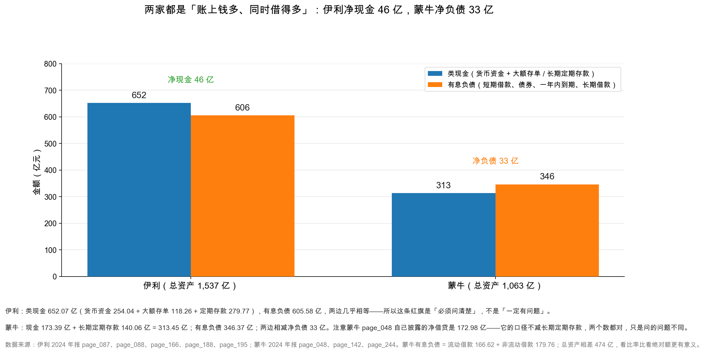

# 第 44 章：财务造假的三条路径与 20 条红旗

> 本章你将：
> - 看懂财务造假只有三条路径：虚增收入、虚增资产、隐瞒负债；
> - 每条路径都学会「报表上长什么样」和「去哪里验证」；
> - 拿到 20 条红旗清单，逐条知道去哪一页找、什么算命中；
> - 用 20 条逐条扫描伊利 2024，看到它命中 5 条、每条都能解释；
> - 学会判断「大存大贷」是资金管理还是存贷双高造假。

前三章我们一直在算「这家公司赚得好不好」。这一章换一个更冷的问题：**这些数字，是真的吗？**

前提必须先说清：**绝大多数上市公司的财报是真的。** 造假是小概率事件，大部分案子事后看都留下了明显痕迹。学这一章不是为了变成到处怀疑的人，而是为了在两件事上不吃亏：看到异常时知道该翻哪一页验证；看到「看起来很好」的报表时知道该问什么。

结构：三条路径（造假只能这么造）→ 20 条红旗（怎么发现）→ 逐条扫伊利（练手）。

---

## 44.1 三条路径：造假只能这么造

会计是一门「有借必有贷」的学问。这个约束很厉害：**你想改一个数字，必须同时改另一个数字，否则报表不平。**

所以造假者的选择其实很有限。他只能从三个方向入手：

| 路径 | 想让什么变好看 | 必须同时做什么 | 最难藏的地方 |
|---|---|---|---|
| ① 虚增收入 | 利润表 | 虚增一笔资产（应收、货币资金）或减少一笔负债 | 应收账款、现金流 |
| ② 虚增资产 | 资产负债表 | 虚增利润，或少提减值/费用 | 减值测试、资产的真实性 |
| ③ 隐瞒负债 | 资产负债表 | 不确认费用，或少记负债 | 表外担保、明股实债、并表范围 |

**共同点：造假一定会留下「另一个格子」的痕迹。你的任务就是找到那个格子。**

### 路径一：虚增收入

**手法 A：提前确认收入。** 货还没发、风险还没转移就记收入；或把「发货给经销商」当成「已经卖给消费者」。
**手法 B：关联方走单。** 找一家自己控制的公司签真合同、开真发票、走真货款，但货没卖给真实消费者——形式上收入是真的，经济实质是空的。
**手法 C：循环交易。** A 卖给 B、B 卖给 C、C 卖给 A，三家都确认收入，都没有终端销售。贸易、大宗商品行业最常见。

**在报表上长什么样：** 收入增速远高于同行但经营现金流没跟上（净现比长期低于 0.8）；应收账款增速远超收入增速；毛利率显著高于同行且无法用品牌、技术解释；收入有明显「年底冲量」特征（Q4 占比异常高）。

**怎么验证：** ① 算「收现比」，长期低于 1 说明收入有水分（伊利 2024 年是 1.13）；② 算「应收增速 - 收入增速」，差额超过 20 个百分点要警惕；③ 翻应收账龄和前五大客户占比；④ 翻关联交易附注，看关联销售占收入比例。

### 路径二：虚增资产

**手法 A：虚构应收账款。** 收入是假的，对应的应收也是假的。麻烦在于应收迟早要「收回」，收回就得有真现金进来，很难圆。
**手法 B：少提减值。** 商誉该减不减、存货该跌不跌。这一招最隐蔽，因为减值测试的假设（增长率、折现率）是公司自己定的。
**手法 C：把费用资本化。** 本该进当期费用的支出（研发、广告、维修）记成资产，未来慢慢摊销——当期利润好看了，资产里却埋了雷。

**在报表上长什么样：** 商誉占净资产过高且被收购标的业绩不达预期；研发资本化率突然升高（从 10% 跳到 50%）；在建工程长期不转固（不转固就不提折旧）；长期待摊费用异常增长。

**怎么验证：** ① 算商誉 ÷ 归母净资产，超过 30% 就看减值测试假设；② 翻研发支出表，看资本化比例的历史变化；③ 看在建工程账龄与转固节奏——建五年还不转固，要么烂尾要么在躲折旧；④ 算「（固定资产 + 在建工程）÷ 收入」。

### 路径三：隐瞒负债

**手法 A：表外担保。** 给关联方或子公司担保，不进资产负债表，只在或有事项里披露。被担保方还不上钱，担保方要代偿。
**手法 B：明股实债。** 引入「战略投资者」，名义上是股权投资（记权益），实际签了回购协议或固定收益条款（实质是负债）。房地产、基建常见。
**手法 C：不并表。** 把实际控制的子公司做成「联营企业」，用权益法核算，这样子公司的负债就不进合并报表。

**在报表上长什么样：** 资产负债率显著低于同行，但有大量「少数股东权益」或「永续债」；对外担保金额巨大；有大量性质不明的「其他应付款」「长期应付款」；联营企业投资很大但投资收益很少。

**怎么验证：** ① 翻或有事项附注，看担保总额占净资产比例；② 比「少数股东权益占比」和「少数股东损益占比」——前者 30%、后者只 5%，这部分「股权」可能就是明股实债；③ 看其他应付款明细；④ 算「（有息负债 + 担保余额）÷ 净资产」。

> 📌 **划重点：** 三条路径本质是同一件事——**把「不是利润的东西」做成利润。** 虚增收入是把「没有的销售」做成利润；虚增资产是把「费用」藏进资产；隐瞒负债是把「成本」藏到表外。
> 所以识别造假的核心问题永远是同一个：**这个利润，对应的是真实的现金流入吗？**

---

## 44.2 20 条红旗：一份提问清单

下面这 20 条，是实战中最常用的异常信号。**它们的定位是「提问清单」，不是「定罪清单」。**

| # | 红旗信号 | 去哪看 | 判定标准 | 伊利 2024 |
|---|---|---|---|---|
| ① | 经营现金流长期显著低于净利润 | 现金流量表、利润表 | 净现比连续 3 年 < 0.8 | 2.57 倍，未命中 |
| ② | 应收账款增速远超收入增速 | 两张表对照 | 差额 > 20 个百分点 | -6.7% vs -8.24%，未命中 |
| ③ | 存货增速远超收入增速 | 两张表对照 | 差额 > 20 个百分点 | -14.1% vs -8.24%，未命中 |
| ④ | 毛利率显著高于同行且无法解释 | 利润表、同业年报 | 高出 10 个点以上 | 33.88% 低于蒙牛，未命中 |
| ⑤ | 商誉占净资产比例过高 | 商誉附注 | > 30% | 4.4%，**命中** |
| ⑥ | 频繁并购 | 商誉原值变动、投资现金流 | 每年都有大额并购支出 | 原值仅 +1.86 亿，未命中 |
| ⑦ | 大存大贷 | 资产负债表、财务费用 | 类现金与有息负债同时很高 | 652 亿 / 606 亿，**命中** |
| ⑧ | 其他应收款异常大 | 其他应收款附注 | 占总资产 > 5% | 1.26 亿 / 0.08%，未命中 |
| ⑨ | 预付账款异常大 | 预付款附注 | 占总资产 > 5% 或激增 | 11.76 亿 / 0.77%，未命中 |
| ⑩ | 在建工程长期不转固 | 在建工程附注 | 同一项目挂账 3 年以上 | 43.37 亿降到 29.55 亿，未命中 |
| ⑪ | 研发资本化率突然升高 | 研发支出附注 | 一年提升 20 个点以上 | 8.70 亿全部费用化，未命中 |
| ⑫ | 非经常性损益占利润比重高 | 非经常性损益表 | > 30% | 28.9%，**命中** |
| ⑬ | 第四季度利润异常 | 分季度主要财务数据 | Q4 亏损或占比畸高 | Q4 归母 -24.16 亿，**命中** |
| ⑭ | 审计意见非标或更换审计师 | 审计报告 | 非「标准无保留」 | 标准无保留，未命中 |
| ⑮ | 关联交易占比高 | 关联交易附注 | 关联采购占成本 > 15% | 约 19.8%，**命中** |
| ⑯ | 控股股东高比例质押 | 股东情况、公司治理 | 质押占其持股 > 70% | 无控股股东，未命中 |
| ⑰ | 频繁更换财务总监 | 董监高变动 | 3 年换 2 次以上 | 赵成霞在任，未命中 |
| ⑱ | 应付账款周转天数异常拉长 | 应付账款、现金流量表 | 同比拉长 50% 以上 | 62.5 天，变化小，未命中 |
| ⑲ | 递延所得税资产异常增长 | 递延所得税附注 | 增速远超收入且无解释 | 20.74 亿 / 1.3%，未命中 |
| ⑳ | 报表勾稽不平 | 三张表 | 第 41 章八条清单有不平 | 三个等式差 0.00，未命中 |

<!-- src: 伊利股份2024年报/page_007.md 伊利股份2024年报/page_008.md 伊利股份2024年报/page_083.md 伊利股份2024年报/page_087.md 伊利股份2024年报/page_091.md 伊利股份2024年报/page_094.md 伊利股份2024年报/page_184.md 伊利股份2024年报/page_243.md -->

**20 条对应三个路径：** ①②③④⑫⑬⑮ 指向**虚增收入**；⑤⑥⑧⑨⑩⑪⑲ 指向**虚增资产**；⑦⑯⑱ 指向**隐瞒负债**；⑭⑰⑳ 是**治理与合规信号**。

> 💡 **你可能会问：20 条要一条条查，太多了吧？**
>
> 实战里不用全查。顺序是：
>
> **第一步（3 分钟）**：查 ①（净现比）、⑤（商誉）、⑭（审计意见）、⑳（勾稽）。这四条是「一票否决级」的，任何一条出大问题，直接放弃。
>
> **第二步（15 分钟）**：查 ②③⑦⑫⑬，这五条能覆盖大多数造假案。
>
> **第三步（按需）**：剩下的 11 条，起疑时再查。
>
> **不要因为「查不完 20 条」就不查。查 4 条也比不查强。**

---

## 44.3 逐条扫描伊利 2024

现在把 20 条逐条套在伊利 2024 年报上。

这张图是结论，下面是推导过程。

### 命中的五条

**⑤ 商誉占净资产比例：命中，但不高**

伊利 2024 年商誉 23.37 亿元，占归母权益 531.80 亿元的 **4.4%**，远低于 30% 的阈值。为什么还标「命中」？因为**它 2024 年刚计提了 30.75 亿元商誉减值**，其中澳优一家占 30.37 亿元；商誉从 51.60 亿元降到 23.37 亿元，累计减值准备 34.76 亿元——**这已经是「爆过一次」的雷了。**

正确读法是：**风险释放了大半，但剩下的 23.37 亿元里澳优还占 21.55 亿元，每年仍要做减值测试。** 这不是「有问题」，是「要盯着」。

<!-- src: 伊利股份2024年报/page_087.md 伊利股份2024年报/page_184.md 伊利股份2024年报/page_211.md -->

**⑦ 大存大贷：命中。** 伊利 2024 年类现金 652.07 亿元（货币资金 254.04 + 大额存单 118.26 + 定期存款 279.77），有息负债 605.58 亿元（短期借款 363.55 + 短期应付债券 100.24 + 一年内到期 92.30 + 长期借款 46.87 + 租赁负债 2.63）。**两边几乎相等，净有息负债 -46.50 亿元。**

这就是「存贷双高」的典型形态：账上 652 亿元，同时借了 605 亿元。利息支出 18.20 亿元、利息收入 24.55 亿元，**净利息收入 6.35 亿元**——存款利率高于借款利率，本身就反常。**这正是这条红旗的价值：它逼你去问「为什么」。** 判断方法见 44.4 节。

<!-- src: 伊利股份2024年报/page_087.md 伊利股份2024年报/page_088.md 伊利股份2024年报/page_166.md 伊利股份2024年报/page_188.md -->

**⑫ 非经常性损益占利润比重：命中**

非经常性损益 24.42 亿元，占归母净利润 84.53 亿元的 **28.9%**；扣非归母净利润只有 60.11 亿元。主要构成是「非流动资产处置损益」25.64 亿元——就是第 41 章拆过的昌吉盛新那笔。

**这是「真命中」**：利润里近三成来自卖资产，不可持续。所以看伊利 2024 年的盈利能力，**应该用扣非净利 60.11 亿元，而不是 84.53 亿元。**

<!-- src: 伊利股份2024年报/page_008.md 伊利股份2024年报/page_009.md -->

**⑬ 第四季度利润异常：命中，但已解释**

伊利 2024 年分季度归母净利润：Q1 59.23 亿元、Q2 16.08 亿元、Q3 33.37 亿元、**Q4 -24.16 亿元**。

Q4 单季亏 24.16 亿元，把全年拉低了。原因清楚：**减值集中在第四季度计提。** A 股减值测试通常在年末做，Q4 因此是「洗大澡」的固定时点——公司倾向在一年快结束时把减值一次提足，为下一年「轻装上阵」。

**所以这条要配合「减值是不是一次性的」判断。** 2025 年 Q4 不再有大额减值，那 2024 年 Q4 的亏损就是一次性的；年年 Q4 都亏，那是「习惯性洗大澡」。

<!-- src: 伊利股份2024年报/page_008.md -->

> 🔍 **翻到年报：** 打开 `page_242.md` 和 `page_243.md`，先看「采购商品/接受劳务情况表」，
> 把 China Youran Dairy 那几行的「本期发生额」加起来（单位是万元），再除以 `page_091.md` 的营业成本 762.99 亿元。
> 除出来的比例就是 19.8%。**这个动作你可以对任何一家公司做——关联交易表就在附注「十四、关联方及关联交易」里。**

**⑮ 关联交易占比：命中，这是本章新发现的一条**

翻附注 page_242~243 的关联交易表，最大一笔是向 China Youran Dairy Group Limited（优然牧业）采购原材料 **144.76 亿元**。加上宁夏利垦 3.85 亿元、Dairy Protein 0.80 亿元、Farmel 0.70 亿元、Amalthea 0.55 亿元、CCIC 0.56 亿元等，关联采购合计约 **151.23 亿元**，占营业成本 762.99 亿元的 **19.8%**，超过 15% 的阈值。

怎么理解？优然牧业是伊利的主要原奶供应商，伊利持有其股份，因此构成关联方。**这是乳业常态**——上游原奶需要稳定销路，下游需要稳定奶源，双方互相持股是行业惯例。

但「常态」不等于「不用管」。要看三件事：**价格公允吗**（关联采购价与市场价比，高了还是低了，这决定利润有没有被转移）；**占比稳定吗**（从 10% 涨到 20% 要看是不是在「扶持」关联方）；**有没有关联销售**（伊利向优然销售商品 0.48 亿元、提供服务 0.15 亿元，金额很小，方向是「伊利卖给它」而不是「它卖给伊利冲收入」，所以不构成关联方走单）。

**结论：命中，但可解释，属于「要盯着价格公允性」的级别。**

<!-- src: 伊利股份2024年报/page_242.md 伊利股份2024年报/page_243.md -->

### 未命中的十条（挑几条讲）

**① 净现比：** 经营现金流 217.40 ÷ 净利润 84.64 = **2.57 倍**，远高于 1（第 36 章拆过：折旧 40.56 亿元、减值 52.31 亿元不用付现）。**②③ 应收与存货：** 应收 -6.7% 与收入 -8.24% 几乎同步；存货 -14.1% 降得比收入还快——**都指向「主动收缩、不靠赊账冲量」**。**④ 毛利率：** 伊利 33.88% 低于蒙牛 39.57%，这条抓的是「显著高于同行」，不适用。

**⑩⑪ 在建工程与研发：** 在建工程从 43.37 亿元降到 29.55 亿元，是**转固**不是长期挂账；研发费用 8.70 亿元**全部费用化**（page_091 只有「研发费用」，没有「开发支出」）——**两条都是保守会计的加分项**。

**⑭⑰⑳ 治理与勾稽：** 信永中和标准无保留、唯一 KAM 是「收入确认」；赵成霞 2023 年 5 月起任财务负责人、2024 年在任；第 41 章八条清单全平。

**⑯ 质押单独说一句。** 伊利**没有控股股东**（最大股东呼和浩特投资持股 8.46%）。它质押 2.20 亿股（占其持股 40.8%），潘刚质押 1.99 亿股（占其持股 69.3%）——**潘刚比例不低，但不是控股股东**，page_076 也明确「控股股东质押达 80% 以上」为「不适用」。按定义未命中，但值得记一笔。

**⑥⑧⑨⑱⑲ 都属「量级很小」：** 并购支出 1.65 亿元；其他应收 1.26 亿元（0.08%）；预付 11.76 亿元（0.77%）；应付天数与上年接近；递延所得税资产 20.74 亿元（1.3%），主要来自减值准备形成的可抵扣差异，属**正常伴生现象**。

<!-- src: 伊利股份2024年报/page_083.md 伊利股份2024年报/page_091.md 伊利股份2024年报/page_094.md 伊利股份2024年报/page_184.md -->

### 小结

**15 条未命中、5 条命中，5 条都能解释——这就是一份「没有明显造假迹象」的报表。**

---

## 44.4 大存大贷：最值得追问的那一条

20 条里，⑦「大存大贷」最需要专门讲，因为它是**唯一一条「必须靠推理、不能靠数字」**的红旗。

### 什么叫「大存大贷」

**存**：账上有大量货币资金（以及大额存单、定期存款这类「类现金」）；**贷**：同时有大量有息负债。

矛盾在哪？**账上有钱，为什么还要借高息的钱？** 存款利率通常低于贷款利率，这样做等于白送利息给银行。

### 两种解释：一种是管理，一种是造假

**解释一：资金管理（正常）。** 四个原因：**资金归集**（各地账户的钱不能随便调）；**利率套利**（大额存单利率可能高于短期借款利率）；**备付需求**（随时要收原奶、应对旺季）；**受限资金**（保证金、准备金不能动）。伊利 2024 年利息收入 24.55 亿元 > 利息支出 18.20 亿元，净赚 6.35 亿元，**它确实在赚这个利差**。

**解释二：存贷双高造假（异常）。** 这是最经典的一种：**账上的「钱」是假的。** 逻辑是：公司虚增收入，对应虚增资产；为了让资产看起来像「现金」（而不是一堆收不回的应收），把虚增部分记成「货币资金」。但货币资金要和银行对账、审计师会发函证，所以它必须真的有一笔钱——**借。** 借来的钱放账上像「自有现金」，负债端多一笔借款，两边都平，「现金充裕」的假象也有了。

**特征是：存款和贷款同时高，而且存款的利息收入明显低于正常水平**（因为那笔「存款」本来就不存在，或被质押、被占用）。

### 怎么判断是哪种

五个动作，按顺序做：

**动作一：算利息率。** 存款收益率明显低于市场（比如只有 0.5%，正常是 2%），说明「存款」可能是假的。

伊利 2024 年：存款 $24.55 \div 652 = 3.77\%$，贷款 $18.20 \div 606 = 3.01\%$。两个都正常，而且存款利率高于贷款利率——**符合「大额存单利率高 + 公司信用好能拿到低息贷款」的解释。**

**动作二：看可用性。** 受限资金约 8.42 亿元（page_150），占货币资金 254.04 亿元的 3.3%——**绝大部分可动用。**

**动作三：看期限匹配。** 短期借款 363.55 + 短期应付债券 100.24 + 一年内到期 92.30 = **556.09 亿元短期硬债**；而类现金里 279.77 亿元是「长期」定期存款。**把长期存款配上短期硬债，期限有错配**，是第 23 章讲过的「短债长投」的变种。

**动作四：看钱有没有在动。** 货币资金从 433.72 亿元降到 254.04 亿元，是「搬家」（搬到大额存单和定期存款），现金流量表有明确解释（投资活动流出 327.09 亿元）。**钱是活的。**

**动作五：看审计师。** 伊利 2024 年 KAM 只有「收入确认」（page_083），**没有把货币资金列为 KAM**——审计师不认为这里有重大风险。

### 结论：是资金管理，不是存贷双高造假

四条理由：① 利息收支都正常且净额为正（赚利差），符合真实存贷款特征；② 受限资金只有 8.42 亿元，绝大部分可动用；③ 资金有明确流动轨迹，现金流量表能解释；④ 审计师没把它列为关键审计事项。

但**「期限错配」是真实存在的**，值得放进观察清单：279.77 亿元长期定期存款配上 556 亿元短期硬债，如果遇到银行集中抽贷，会有流动性压力。这不是造假，是**资金管理策略的激进程度**问题。

> ⚠️ **易踩坑：** 看到「存贷双高」就喊造假，是最常见的误判。康得新、康美药业的案子确实都是存贷双高，但**它只是「症状」，不是「病因」**。判断关键是：**利息收入对不对得上、钱能不能动、有没有流动轨迹、审计师怎么说。** 四条都对得上就是资金管理；有一条对不上才要继续追。

---

## 44.5 红旗是提问清单，不是定罪清单

这一章最重要的一句话，放在最后说。

**伊利命中 5 条，但没有一条能证明它造假。** 每一条都有解释：

| 命中的红旗 | 解释 | 可信度 |
|---|---|---|
| ⑤ 商誉 4.4% | 已计提 30.75 亿元减值，风险释放大半 | 高（附注支撑） |
| ⑦ 大存大贷 | 赚利差 + 资金归集 + 备付需求 | 中高（利息数据支撑，但期限错配是真的） |
| ⑫ 非经常 28.9% | 卖子公司的一次性收益 | 高（处置公告支撑） |
| ⑬ Q4 亏损 | 减值集中在年末计提 | 高（减值明细支撑） |
| ⑮ 关联采购 19.8% | 上游原奶供应商互相持股，行业惯例 | 中（价格公允性无法从年报验证） |

**这就是读财报的正确姿势：发现异常 → 去附注找解释 → 判断解释是否站得住 → 站不住才升级为「问题」。** 反过来，一家公司命中 8 条、其中 5 条解释不清，那才该认真考虑「是不是有问题」。

### 一个反面教材

假设有一家公司（**示意**）：净现比连续三年 0.4；应收三年涨 4 倍、收入只涨 60%；毛利率 55%、同行 28%；商誉占净资产 45% 且连续两年不达标却一分没提；Q4 收入占全年 45%；审计师从「四大」换成小所。

**它命中 6 条，每条都解释不清。** 这种情况下不需要等「证实造假」——**「解释不清」本身就是足够的理由不投。**

> 📌 **划重点：** 投资决策不需要「证明对方造假」，只需要「判断自己是否看得懂」。
> 一家公司让你看不懂它的现金、它的应收、它的商誉，那就不投。
> **你不需要赢过造假者，你只需要不参与。**

---

## 44.6 带走一句话

**八个数字，10 分钟能算完：** 净现比（伊利 2.57）、应收增速差（-1.5 个点）、商誉占比（4.4%）、非经常占比（28.9%）、存贷双高（42% / 39%）、关联采购占比（19.8%）、审计意见（标准无保留）、勾稽（全平）。

**四个通过、三个警告。** 警告不等于否决，它只告诉你接下来该翻哪几页附注——伊利这三条警告翻完附注后都能解释，这就是「读得懂」。

## ✍️ 想一想

### 问 1：为什么造假只有三条路径

① 用「有借必有贷」解释：为什么造假者不能只改利润表？
② 想虚增 10 亿元收入，最少要改几个格子？
③ 三条路径里，哪一条最难被发现？

**解题思路：** 第 ① 问回到复式记账（第 8 章）；第 ② 问要把「收入 +10」的另一边找出来，并比较几种选择的难度；第 ③ 问比较三条路径留下的「可验证痕迹」。

**参考答案：**

① 因为复式记账要求每笔交易至少动两个格子，并保持「资产 = 负债 + 权益」。「收入」最终会通过未分配利润进所有者权益，所以「收入 +10 亿元」时，资产负债表必须有一边也 +10 亿元——要么资产 +10（应收、现金），要么负债 -10。**只改利润表，资产负债表就不平，编表软件直接报错。**

② 最少**两个**，实际通常三到四个：

| 方案 | 改哪两个格子 | 难度 | 会被什么抓住 |
|---|---|---|---|
| A | 收入 +10、应收账款 +10 | 低 | 应收增速远超收入；坏账准备；账龄 |
| B | 收入 +10、货币资金 +10 | 中（要伪造银行流水） | 银行函证；利息收入对不上 |
| C | 收入 +10、负债 -10 | 高（要伪造还款） | 债权人确认；现金流 |

**方案 A 最容易做，也最容易抓**——应收账款是个「会说话」的科目：迟早要收回，收不回要计提坏账，账龄、客户集中度、与收入的匹配关系都能交叉验证。**方案 B 最难做**，因为货币资金要和银行对账、审计师会发函证；这也是「存贷双高」会成为经典手法的原因——它必须先借一笔真钱，才能让「假现金」看起来像真的。

③ **第三条（隐瞒负债）最难被发现**，因为「可验证痕迹」最少：虚增收入留下应收账款（可查账龄、客户、回款）；虚增资产留下商誉、在建工程、开发支出（可查减值测试、转固节奏）；**隐瞒负债什么都不留**——表外担保只在「或有事项」里一行字，明股实债藏在「少数股东权益」里，不并表的子公司藏在「长期股权投资」里。

**它可怕在于不违反「资产 = 负债 + 权益」**：负债没进表，等式照样平，利润表也不难看。所以往往等到「爆雷」那天才被发现：担保被代偿、明股实债被要求回购。**这也是为什么 20 条里有 ⑯（质押）和 ⑱（应付拉长）——都是负债端信号，而大部分人只看利润表。**

**易错点：** ① 以为造假可以「只改一个数」——复式记账不允许；② 以为「货币资金最可靠所以不用查」——存贷双高造假的核心就是货币资金；③ 只盯利润表——三条路径里有两条主要在资产负债表上。

### 问 2：大存大贷，怎么判断是管理还是造假

① 列出判断「存贷双高」的五个动作。
② 假设一家公司（**示意数字**）：货币资金 200 亿元、有息负债 190 亿元、利息收入 0.8 亿元、利息支出 7.6 亿元。算出两个利率，并判断这组数字是否异常。
③ 如果这家公司的审计师把「货币资金的存在性」列为关键审计事项，你的判断会怎么变？

**解题思路：** 第 ① 问是记忆题，按「利息 → 可用性 → 期限 → 流动轨迹 → 审计师」的顺序；第 ② 问算两个比率并与市场水平对比；第 ③ 问考的是「审计师信号」的权重。

**参考答案：**

① 五个动作：**算利息率**（利息收入 ÷ 平均类现金，低于 1% 异常）；**看可用性**（受限资金 ÷ 货币资金，超过 30% 异常）；**看期限匹配**（短借长存且规模大）；**看流动轨迹**（货币资金常年不动，或无解释的变动）；**看审计师**（关键审计事项里有没有货币资金）。

② 计算：存款收益率 $= 0.8 \div 200 = 0.4\%$；贷款利率 $= 7.6 \div 190 = 4.0\%$。

**这组数字明显异常**，有三个理由：**0.4% 太低了**——正常大额存单、定期存款利率在 2%~3.5%，0.4% 只相当于活期，如果账上真有 200 亿元，公司没有任何理由让它躺在活期里；**存贷利差 3.6 个百分点，一年白付 6.8 亿元利息**；**0.4% 恰恰是「假存款」的典型特征**——如果那 200 亿元根本不存在（或被质押、被大股东占用），公司当然收不到正常利息，只能编一个很小的利息收入来平账。这组组合几乎就是存贷双高造假的教科书画像。

③ 判断会**显著加重怀疑**。关键审计事项（KAM）是审计师主动披露的「本次审计中最重要的事项」。把「货币资金的存在性」列为 KAM，说明他认定这里有**重大错报风险**，为此做了额外程序（函证、走访银行、检查流水）。**正常公司里货币资金很少被列为 KAM**——它是最容易验证的科目（发个函证给银行就行）。一旦被列为 KAM，通常意味着审计师发现了异常。所以：**数字异常 + 审计师警示 = 高度警惕**，判断从「需要追问」升级为「倾向于不投」。

**易错点：** ① 只算绝对额不算利息率——利息率异常才是硬证据；② 忘记「受限资金」这一层，有些公司货币资金里一半是保证金；③ 把「列为 KAM」当成「一定有问题」——KAM 是「重点关注」，不是「发现问题」，但它确实提高了警惕级别。

### 问 3：伊利命中 5 条，为什么还说它「没有明显造假迹象」

① 逐条说明这 5 条的解释，并指出哪一条的解释最弱。
② 「解释得通」和「没有问题」是一回事吗？
③ 如果伊利 2025 年又计提 20 亿元商誉减值，你会改变判断吗？

**解题思路：** 第 ① 问是复述 + 判断，重点是「哪一条最弱」；第 ② 问考「证据强度」；第 ③ 问考「连续减值」意味着什么。

**参考答案：**

① 五条的解释：

| 红旗 | 解释 | 证据 | 强度 |
|---|---|---|---|
| ⑤ 商誉 4.4% | 已计提 30.75 亿元，风险释放 | page_184 商誉明细、page_211 减值明细 | 强 |
| ⑦ 大存大贷 | 赚利差、资金归集、备付 | page_091 利息收支、page_150 受限资金 | 中强 |
| ⑫ 非经常 28.9% | 卖昌吉盛新的一次性收益 | page_227 处置表、page_210 投资收益 | 强 |
| ⑬ Q4 亏损 | 减值集中在年末计提 | page_008 分季度、page_211 减值 | 强 |
| ⑮ 关联采购 19.8% | 上游原奶供应商互相持股 | page_242~243 关联交易表 | **弱** |

**最弱的是 ⑮（关联采购）。** 年报只披露了金额，**没有披露定价依据、也没有和市场价格对比**，所以「价格公允」这个最关键的问题无法从年报验证。而且量级不小：151.23 亿元关联采购，如果价格比市场高 5%，就是 7.6 亿元利润转移，相当于归母净利润的 9%。**这条应该进「观察清单」，而不是「已解释」。**

② **不是一回事。** 「解释得通」只说明「存在一种合理的解释」，不说明「这个解释是真的」。区别在**证据的独立性**：解释来自**公司自己的披露**（附注、公告）→ 可信度取决于公司诚信度；来自**独立第三方**（审计师、银行、客户）→ 可信度高得多；来自**可交叉验证的数据**（利息收入能与存款规模对上）→ 最高。

伊利的五条里，⑤⑫⑬ 都有交叉验证（商誉明细、处置公告、减值明细都对得上），⑦ 有部分（利息数据），⑮ 几乎没有。**所以正确表述是：「伊利 2024 年没有发现明显的造假迹象，但有一两条需要持续观察。」** 而不是「伊利肯定没造假」。

③ **会改变，但要分情况。** **情况一：又提 20 亿元，且澳优业绩继续下滑。** 说明 2024 年那 30.37 亿元「提得不够」，当时假设过于乐观，管理层在「挤牙膏式」地提减值——每年提一点，每年都说「明年就好了」。这是典型的「拖延型减值」，会持续侵蚀利润，也损害管理层可信度。**情况二：提 20 亿元，但澳优业绩已企稳。** 可能是减值测试假设变保守了（比如折现率上调），属于「一次性出清」，对长期价值影响不大。

**怎么区分？** 看减值测试的关键假设（附注里披露：收入增长率、毛利率、折现率）。假设变保守了，是情况二；假设没变但减值增加，说明实际业绩低于预期，是情况一。**关键认知：连续减值本身不是问题，「减值假设和实际业绩持续背离」才是问题。**

**易错点：** ① 把「命中红旗」等同于「造假」——20 条里大部分是常见现象；② 把「解释得通」等同于「没问题」——要区分解释的证据强度；③ 看到连续减值就说「财务洗澡」——要区分「一次性出清」和「挤牙膏」。

## 📎 数据出处

- 伊利股份 2024 年报：`page_007.md`（营业收入、归母净利润、加权平均 ROE）
- 伊利股份 2024 年报：`page_008.md`、`page_009.md`（分季度归母净利：Q1 5,922,814,507.71、Q2 1,608,319,620.91、Q3 3,337,346,216.72、Q4 -2,415,620,352.16 元；非经常性损益合计 2,441,585,047.26 元；扣非归母净利 6,011,274,945.92 元）
- 伊利股份 2024 年报：`page_038.md`（赵成霞，财务负责人，2023-05-18 起）
- 伊利股份 2024 年报：`page_073.md`、`page_076.md`（质押：呼和浩特投资 219,964,400 股、潘刚 198,860,900 股；「控股股东质押达 80% 以上」不适用）
- 伊利股份 2024 年报：`page_083.md`（审计报告：信永中和、标准无保留、KAM 为收入确认）
- 伊利股份 2024 年报：`page_087.md`（商誉、应收、存货、在建工程、递延所得税资产、货币资金）
- 伊利股份 2024 年报：`page_088.md`（有息负债各科目、应付账款）
- 伊利股份 2024 年报：`page_091.md`（营业成本、研发费用 869,976,531.80 元、利息支出 1,819,520,437.71 元、利息收入 2,455,067,393.23 元）
- 伊利股份 2024 年报：`page_094.md`（经营活动现金流量净额 21,739,740,393.38 元）
- 伊利股份 2024 年报：`page_150.md`（货币资金构成、受限资金约 8.42 亿元）
- 伊利股份 2024 年报：`page_166.md`、`page_188.md`（大额存单 11,826,346,397.86 元、定期存款 27,976,779,910.00 元）
- 伊利股份 2024 年报：`page_184.md`（商誉原值 5,812,957,835.40 元、减值准备 3,476,402,690.96 元）
- 伊利股份 2024 年报：`page_210.md`（投资收益 2,417,330,849.26 元、处置长期股权投资 2,579,548,077.92 元）
- 伊利股份 2024 年报：`page_211.md`（商誉减值 3,075,378,837.63 元、资产减值合计 4,675,845,573.44 元）
- 伊利股份 2024 年报：`page_227.md`（处置昌吉盛新：价款 264,740.00 万元、差额 256,229.18 万元）
- 伊利股份 2024 年报：`page_242.md`、`page_243.md`（关联采购：优然牧业 1,447,569.72 万元等）
- 蒙牛乳业 2024 年报：`page_045.md`~`page_047.md`（贝拉米减值合计影响 3,981,400 千元）、`page_048.md`（净借贷 172.98 亿元）、`page_131.md`（标准无保留）、`page_140.md`（收入与净利）
- 数据汇总：`data/yili2024.json`（`ratios`、`nonrecurring`、`quarterly_2024`、`goodwill_detail`、`notes` 段）；`data/mengniu2024.json`（`balance`、`income`、`ratios`、`goodwill_detail` 段）
- 本章 44.5 节「反面教材」为**示意，非真实公司**；问 2 第 ② 问的数字为**示意**

下一章：[第 45 章：实战——伊利 vs 蒙牛的仪表盘与红旗扫描](45-实战-伊利vs蒙牛仪表盘.md)
