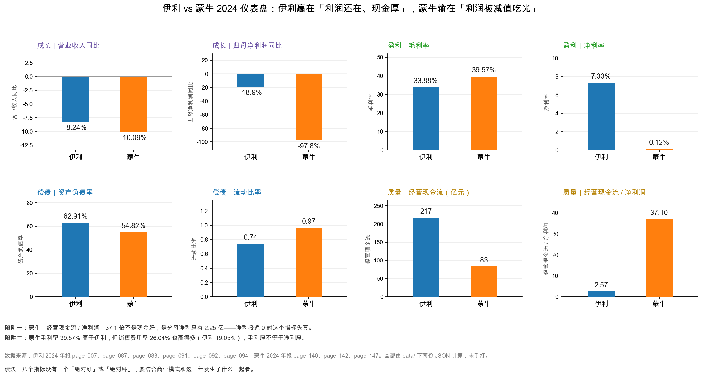
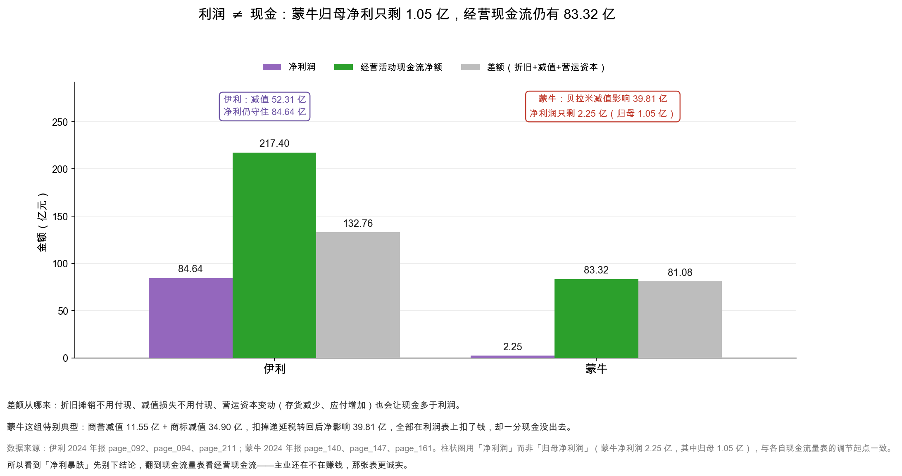
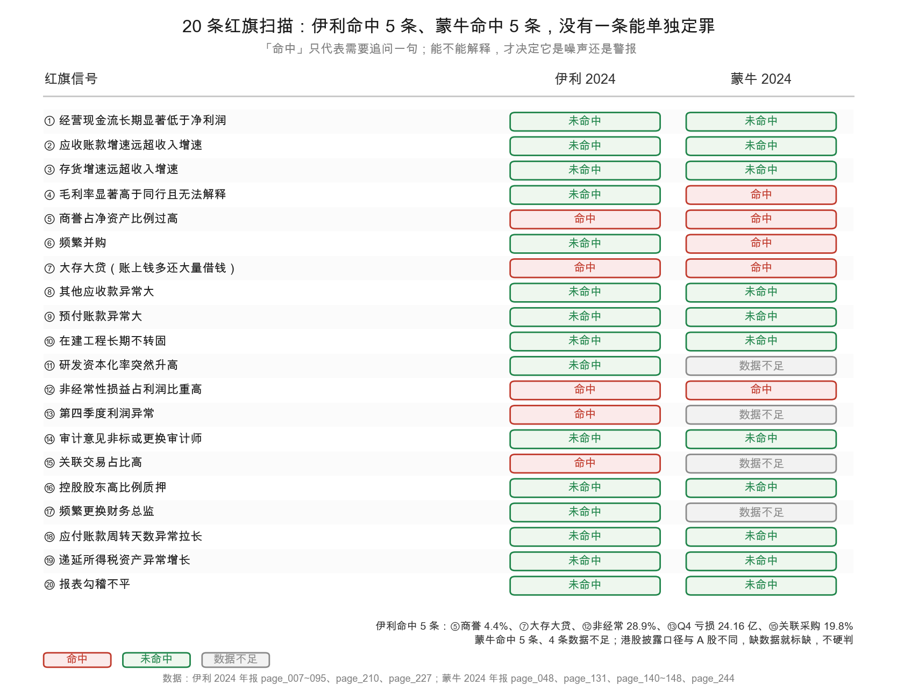

# 第 45 章：实战——伊利 vs 蒙牛的仪表盘与红旗扫描

> 本章你将：
> - 用一张四维仪表盘（成长、盈利、偿债、质量）把伊利和蒙牛并排看完；
> - 看懂「蒙牛毛利率更高，净利率却几乎是零」这道反差是怎么来的；
> - 理解为什么「经营现金流 / 净利润 = 37 倍」是一个失真的指标；
> - 用第 44 章的 20 条红旗在两家公司上同时扫一遍，看结论怎么分叉；
> - 学会同业对比的正确姿势：比什么、不比什么、口径怎么对齐。

这是第 9 周最后一章，也是全书第三次「实战对照」。

第 41 到 44 章，我们建好了四件工具：勾稽清单、杜邦分解、周转率与 CCC、20 条红旗。这四件工具单独用都有价值，但它们的真正威力在于**并排用**——把同一套工具套在两家公司身上，差异会自己跳出来。

对照公司是蒙牛乳业（2319.HK）。它和伊利是同一个行业、同一个市场、同一批消费者，但 2024 年交出了一份完全不同的财报。

---

## 45.1 先看两家公司的「身材」

对比之前，先确认两家公司的体量，否则容易拿苹果比橘子。

| 项目 | 伊利股份 | 蒙牛乳业 | 差异 |
|---|---|---|---|
| 上市地 | 上交所（A 股） | 港交所（H 股，开曼注册） | 会计准则不同 |
| 2024 年营业收入 | 1,153.93 亿元 | 886.75 亿元 | 伊利大 30% |
| 2024 年归母净利润 | 84.53 亿元 | 1.05 亿元 | **伊利是蒙牛的 80 倍** |
| 2024 年末总资产 | 1,537.18 亿元 | 1,062.93 亿元 | 伊利大 45% |
| 2024 年末归母权益 | 531.80 亿元 | 415.62 亿元 | 伊利大 28% |
| 基本每股收益 | 1.33 元 | 0.027 元 | 差 49 倍 |

<!-- src: 伊利股份2024年报/page_007.md 伊利股份2024年报/page_092.md 伊利股份2024年报/page_087.md 蒙牛乳业2024年报/page_140.md 蒙牛乳业2024年报/page_142.md -->

**这张表最刺眼的是第二行和第三行的对比：收入只差 30%，利润差 80 倍。**

如果只看这一个数，结论会是「蒙牛完了」。但先别急——第 7 周我们学过，利润是会计算出来的，不是现金收来的。真相要看完整张仪表盘。

> ⚠️ **易踩坑：** 港股和 A 股的报表不能直接对比，必须先对齐三件事：
> ① **会计准则**：蒙牛用 IFRS，伊利用中国企业会计准则。大部分科目一致，但「其他费用」「其他收入及收益」这类科目的归类习惯不同；
> ② **单位**：蒙牛年报是「人民币千元」，`data/mengniu2024.json` 已经乘 1000 换算成元；
> ③ **科目名称**：蒙牛的「销售及经销费用」对应伊利的「销售费用」，「贸易应收款项」对应「应收账款」。
>
> 本教程的对照，全部用 `data/` 下两份已换算、已对齐的 JSON，不直接抄年报原文。

---

## 45.2 四维仪表盘：八个指标并排看

现在把两家公司放进同一张仪表盘。

八个面板，四个维度。下面一个一个读。

### 维度一：成长——两家都在缩，伊利缩得少

| 指标 | 伊利 | 蒙牛 |
|---|---|---|
| 营业收入同比 | **-8.24%** | **-10.09%** |
| 归母净利润同比 | **-18.94%** | **-97.83%** |

<!-- src: 伊利股份2024年报/page_007.md 蒙牛乳业2024年报/page_140.md -->

**收入端：两家都在下滑，蒙牛跌得更多一点。** 这不是两家公司的问题，是行业性的——2024 年原奶过剩、需求疲软、渠道去库存，整个乳业都在收缩。伊利 -8.24%、蒙牛 -10.09%，差距不大。

**利润端：差距就大了。** 伊利 -18.94%，蒙牛 -97.83%。蒙牛的归母净利润从 2023 年的 48.09 亿元掉到 1.05 亿元，**几乎归零**。

这个「-97.83%」是本章第一个要解释的数字。它是怎么来的？答案在质量维度。

### 维度二：盈利——毛利率蒙牛更高，净利率伊利完胜

| 指标 | 伊利 | 蒙牛 |
|---|---|---|
| 毛利率 | 33.88% | **39.57%** |
| 销售费用率 | **19.05%** | 26.04% |
| 管理费用率 | **3.87%** | 4.77% |
| 净利率 | **7.33%** | 0.12% |

<!-- src: 伊利股份2024年报/page_091.md 蒙牛乳业2024年报/page_140.md -->

**这是本章最有教学价值的一组数字。**

蒙牛的毛利率比伊利高 **5.69 个百分点**（39.57% vs 33.88%）。为什么？两个原因：

1. **产品结构。** 蒙牛的高毛利产品（特仑苏、纯甄、奶酪）占比更高，伊利的液体乳占比更大（液体乳是乳业里毛利率较低的品类）；
2. **原奶自给。** 蒙牛通过现代牧业、圣牧等联营公司掌控了一部分上游奶源，理论上能降低原料成本。

**但毛利率高不等于赚钱。** 往下看：

- 蒙牛的销售费用率 **26.04%**，比伊利高 6.99 个百分点；
- 管理费用率高 0.90 个百分点。

**两个费用率一加，蒙牛比伊利多花了 7.89 个百分点的收入在费用上。** 这比它毛利率领先的 5.69 个百分点还多 2.2 个百分点——**毛利率的优势，在费用端全部吐回去了，还倒贴。**

再往下，还有两刀：

- **「其他费用」64.53 亿元**（2023 年是 12.96 亿元，暴增近 4 倍），这里面装的就是贝拉米商誉减值 11.55 亿元 + 商标减值 34.90 亿元等；
- **应占联营公司业绩 -8.72 亿元**（2023 年是 +0.92 亿元），主要是现代牧业的亏损。

**所以：毛利率 +5.69 个点 → 费用率 -7.89 个点 → 再加减值 -39.81 亿 → 净利率 0.12%。**

这就是「毛利率高」和「赚钱」之间的距离。**毛利率只说明「卖得贵或成本低」，不说明「最后能剩下」**——第 28 章讲过这个道理，蒙牛 2024 年是它最生动的反面教材。

> 📌 **划重点：** 看毛利率必须同时看费用率。**毛利率 - 销售费用率 - 管理费用率**，才是「这家公司的生意经不经得起自己花」。
> 伊利：$33.88\% - 19.05\% - 3.87\% = 10.96\%$；
> 蒙牛：$39.57\% - 26.04\% - 4.77\% = 8.76\%$。
> **毛利率落后 5.69 个点的伊利，扣完费用反而领先 2.20 个点。**

### 维度三：偿债——蒙牛负债率更低，但两家都偏紧

| 指标 | 伊利 | 蒙牛 |
|---|---|---|
| 资产负债率 | 62.91% | **54.82%** |
| 流动比率 | 0.74 | **0.97** |
| 有息负债 | 605.58 亿元 | 346.37 亿元 |
| 类现金 | **652.07 亿元** | 313.45 亿元 |
| 净有息负债 | **-46.50 亿元**（净现金） | +32.92 亿元（净负债） |

<!-- src: 伊利股份2024年报/page_087.md 伊利股份2024年报/page_088.md 蒙牛乳业2024年报/page_142.md 蒙牛乳业2024年报/page_244.md -->

**表面上蒙牛更稳：负债率低 8 个百分点，流动比率高 0.23。**

但看第三、四行就反过来了：

- 伊利的类现金 652.07 亿元，比有息负债 605.58 亿元还多，**净有息负债 -46.50 亿元**；
- 蒙牛的类现金 313.45 亿元（现金 173.39 + 长期定期存款 140.06），有息负债 346.37 亿元，**净负债约 33 亿元**。

**这两家的资产负债表，其实是两种不同的「紧」：**

- **伊利是「负债率高，但现金比债多」**——它的负债里有一大块是经营性占款（合同负债 120.73 亿元、应付账款 123.13 亿元），这些不用付息；
- **蒙牛是「负债率低，但净负债为正」**——它的类现金不够覆盖有息负债。

所以「谁的偿债能力更强」这个问题，没有单一答案：**看负债率，蒙牛更安全；看净现金，伊利更宽裕。**

**这就是同业对比的正确姿势：同一个问题，用两个指标看，如果结论相反，说明你问的问题本身需要更精确。** 「偿债能力」太笼统了，应该拆成「短期流动性」「净负债水平」「负债结构」三个问题，分别回答。

### 维度四：质量——这里才是真正的分水岭

| 指标 | 伊利 | 蒙牛 |
|---|---|---|
| 经营活动现金流 | **217.40 亿元** | 83.32 亿元 |
| 自由现金流 | **177.61 亿元** | 48.57 亿元 |
| 经营现金流 / 净利润 | 2.57 倍 | **37.10 倍** |
| 经营现金流 / 归母净利润 | 2.57 倍 | **79.73 倍** |

<!-- src: 伊利股份2024年报/page_094.md 蒙牛乳业2024年报/page_147.md 蒙牛乳业2024年报/page_148.md -->

**伊利的经营现金流是蒙牛的 2.6 倍，自由现金流是 3.7 倍。** 这个差距比收入差距（1.3 倍）大得多，说明伊利的「赚钱效率」确实更高。

**但「经营现金流 / 净利润 = 37.10 倍」这个数，必须打个叉。**

为什么？因为**分母太小了**。蒙牛的净利润只有 2.25 亿元，用 83.32 亿元除以 2.25 亿元，自然得到 37 倍。这个数字不说明「蒙牛的现金特别好」，只说明「蒙牛的利润特别低」。

**这是一个典型的「比率失真」：当分母接近零时，任何比值都失去意义。**

> 💡 **你可能会问：那这个指标什么时候能用？**
>
> 用它要满足一个前提：**分母是「正常水平」的。**
>
> 经验法则：净利润 / 营业收入 > 3% 时，净现比可以参考；低于 1% 时，直接看现金流的绝对值。
>
> 蒙牛 2024 年净利率 0.12%，远低于 1%——所以这个指标在蒙牛身上**无意义**。
>
> **正确做法：直接比较经营现金流绝对值（伊利 217.40 亿 vs 蒙牛 83.32 亿），或者比「经营现金流 / 营业收入」（伊利 18.84% vs 蒙牛 9.40%）。**

---

## 45.3 点破「利润与现金不是一回事」：蒙牛这一年发生了什么

现在讲本章的核心故事。

这张图上一章已经见过（第 36 章讲过机制）。这一章要看的是它在**蒙牛**身上的具体形态。

### 一条时间线

| 项目 | 金额（亿元） |
|---|---|
| 税前利润 | 9.99 |
| 减：所得税 | 7.75 |
| **净利润** | **2.25** |
| 其中：归母 | 1.05 |
| 其中：少数股东 | 1.20 |
| 经营活动现金流净额 | **83.32** |

<!-- src: 蒙牛乳业2024年报/page_140.md 蒙牛乳业2024年报/page_147.md -->

**注意两个反常：**

1. **所得税 7.75 亿元 > 税前利润 9.99 亿元的 77%。** 正常公司所得税率在 15%~25%，蒙牛 2024 年是 77.5%。原因是递延所得税转回——贝拉米减值时，之前确认的递延所得税资产要转回，这部分不进利润表，但增加了所得税费用；
2. **净利润 2.25 亿元里，归母只有 1.05 亿元，少数股东拿了 1.20 亿元。** 少数股东损益比归母还多——这在正常公司里很少见，说明有盈利的子公司里有大比例少数股东（比如妙可蓝多、现代牧业相关的实体）。

### 83.32 亿元的现金流从哪来

蒙牛的经营活动现金流 83.32 亿元，比净利润 2.25 亿元多 81.07 亿元。差额主要来自三块：

| 加回项 | 金额（亿元） | 说明 |
|---|---|---|
| 折旧与摊销 | 34.04 | 物业厂房设备 29.53 + 使用权 3.35 + 无形 1.17 |
| 商誉减值 | 11.55 | 贝拉米 |
| 商标（其他无形）减值 | 34.90 | 贝拉米 |
| 存货撇减 | 9.11 | 存货跌价 |
| 应占联营公司亏损 | 8.72 | 现代牧业等 |
| 营运资本变动 | 约 -17.25 | 存货减少 +8.60、应付减少 -8.52 等 |
| **合计差额** | **约 81.07** | |

<!-- src: 蒙牛乳业2024年报/page_147.md -->

**这张表就是「利润和现金不是一回事」的完整证据：**

- 折旧 34.04 亿元：设备在磨损，但没有现金流出；
- 减值合计 55.56 亿元（商誉 11.55 + 商标 34.90 + 存货 9.11）：账面价值调低，但没有现金流出；
- 应占联营亏损 8.72 亿元：蒙牛按权益法确认的亏损，也没有现金流出（现代牧业亏的钱不经过蒙牛的银行账户）。

**三块加起来 98.32 亿元，减去营运资本变动等其他项，净差额 81.07 亿元。**

**所以：蒙牛 2024 年的主业还在赚钱，只是账面利润被 55.56 亿元的减值吃掉了。**

### 这和伊利的逻辑一模一样

第 7 周讲伊利的时候，我们说过同一句话：**「营业利润 -14.2%，但剔除减值后的经营性利润 +13.7%」**。

两家公司，同一个机制：

| | 伊利 2024 | 蒙牛 2024 |
|---|---|---|
| 减值合计 | 52.31 亿元 | 55.56 亿元 |
| 减值 / 净利润 | 61.8% | **2469%** |
| 剔除减值后的「经营性利润」 | 154.13 亿元 | 约 57.81 亿元 |
| 经营现金流 | 217.40 亿元 | 83.32 亿元 |
| 结论 | 洗大澡，主业在变好 | 洗大澡，主业还在赚钱 |

<!-- src: 伊利股份2024年报/page_211.md 蒙牛乳业2024年报/page_161.md -->

**差别在「缓冲垫」的厚度：**

- 伊利的净利润 84.64 亿元，扛住了 52.31 亿元的减值，还剩 32 亿元；
- 蒙牛的净利润 2.25 亿元，扛不住 55.56 亿元的减值，直接被打穿到接近零。

**同一个动作（计提减值），在两家公司身上的杀伤力完全不同——因为它们的「基础利润」厚度不同。** 这就是为什么同样「洗大澡」，伊利只是「难看」，蒙牛是「崩塌」。

> 🔍 **翻到年报：** 打开蒙牛 2024 年报 `page_147.md`，从「税前利润 999,177」开始往下看。
> 你会看到一长串「就下列各项调整」：利息收入、融资成本、折旧、摊销、减值……
> 这一串加起来，就把 9.99 亿元的税前利润「调」成了 83.32 亿元的现金流入。
> **这就是间接法现金流量表的全部秘密：它把「不花现金的损失」一项项加回来。**

<!-- src: 蒙牛乳业2024年报/page_147.md -->

---

## 45.4 20 条红旗，两家公司同时扫

现在把第 44 章的 20 条红旗，在两家公司上同时扫一遍。

**结果：伊利命中 5 条、蒙牛命中 5 条、4 条数据不足。** 但**同样是 5 条，性质完全不同**。

### 两家都命中的四条

| 红旗 | 伊利 | 蒙牛 | 差异 |
|---|---|---|---|
| ⑤ 商誉 | 23.37 亿元，占净资产 4.4% | 76.78 亿元，占净资产 **18.5%** | 蒙牛高 4 倍 |
| ⑦ 大存大贷 | 类现金 652 亿 / 有息 606 亿，净现金 46 亿 | 类现金 313 亿 / 有息 346 亿，净负债 33 亿 | 伊利靠利息赚钱，蒙牛在付净利息 |
| ⑫ 非经常损益占比 | 28.9%（卖子公司） | 减值 39.81 亿元 vs 净利 1.05 亿元 | 蒙牛靠减值「洗」，性质更差 |
| ⑬ Q4 利润 | Q4 亏 24.16 亿（减值） | 港股不披露分季度 | 数据不足 |

**这四条里，蒙牛每一条都比伊利更严重：**

- **商誉：** 蒙牛 76.78 亿元，占净资产 18.5%——虽然低于 30% 的阈值，但绝对值是伊利的 3.3 倍，而且 2024 年刚提了 11.55 亿元减值。更麻烦的是，贝拉米的商标（34.90 亿元）也是一次性减值，说明这笔 2019 年 71.4 亿元的收购基本「打水漂」了；
- **大存大贷：** 伊利是**净现金**（存款比债多 46 亿元），利息净收入 6.35 亿元；蒙牛是**净负债**（债比存款多 33 亿元），利息净支出约 0.57 亿元（利息收入 14.12 亿元 - 融资成本 14.68 亿元）。性质完全不同；
- **非经常：** 伊利的 28.9% 是「卖资产赚的钱」，是**正向**的一次性收益（虽然不可持续，但至少是真金白银）；蒙牛的减值 39.81 亿元是**负向**的一次性损失。两者的含义完全相反，却都触发同一条红旗——**这说明红旗清单需要人工判断，不能机械套用**。

### 只有蒙牛命中的一条

**④ 毛利率显著高于同行且无法解释。** 蒙牛毛利率 39.57%，比伊利高 5.69 个百分点。这条红旗对蒙牛「命中」，但对伊利「不适用」。

**但这里要打个问号**：蒙牛毛利率高，可以用产品结构（特仑苏、奶酪占比高）解释，不算「无法解释」。所以这一条更像是「需要追问」，而不是「异常」。

**这正好说明红旗清单的用法：它负责「提醒你去看」，不负责「下结论」。**

### 只有伊利命中的一条

**⑮ 关联交易占比 19.8%。** 伊利向优然牧业采购原奶 144.76 亿元，占营业成本 19.8%。

蒙牛这一条是「数据不足」——港股年报没有单独披露关联采购占成本的比例，只披露了关联交易的绝对金额。

**这就是跨市场对比的一个真实困难：不是所有指标都能对齐。** 遇到这种情况，正确做法是标「数据不足」，而不是硬凑一个数字。

### 四条数据不足

蒙牛的 ⑪（研发资本化）、⑬（分季度）、⑮（关联采购占比）、⑰（财务总监变更）都是「数据不足」——港股的年报披露颗粒度比 A 股粗，很多 A 股强制披露的细节，港股没有。

**「数据不足」不是「未命中」。** 这个区别很重要：前者是「我不知道」，后者是「我查过，没问题」。把「不知道」当成「没问题」，是分析里最常见的错误之一。

---

## 45.5 结论：伊利更稳，但两家都有各自的问题

现在给结论。分三层。

### 第一层：谁的报表更「干净」

**伊利。**

理由：利润 84.53 亿元、经营现金流 217.40 亿元、自由现金流 177.61 亿元，三个数都是正的、而且互相支撑。扣非净利 60.11 亿元虽然比归母低 28.9%，但绝对额仍然可观。商誉占比 4.4%，风险已经释放大半。

**蒙牛的报表「不干净」，但不是因为造假，是因为「被打穿了」。** 净利 1.05 亿元、经营现金流 83.32 亿元——两个数差了 79 倍。这不是「利润造假」，是「减值把利润吃光了」。

### 第二层：谁的生意更好

**这个问题没有单一答案，取决于你问哪一面。**

| 问题 | 答案 | 依据 |
|---|---|---|
| 谁的毛利率高？ | 蒙牛（39.57% vs 33.88%） | 产品结构 + 上游布局 |
| 谁的费用控制好？ | 伊利（费用率低 7.89 个点） | 规模效应 + 渠道效率 |
| 谁的净利率高？ | 伊利（7.33% vs 0.12%） | 费用 + 减值双重因素 |
| 谁的资产周转快？ | 伊利（0.751 vs 0.605） | 收入更大、资产更轻 |
| 谁的现金流好？ | 伊利（217 亿 vs 83 亿） | 利润厚 + 折旧减值加回 |
| 谁的负债率低？ | 蒙牛（54.82% vs 62.91%） | 资本结构不同 |
| 谁的净现金多？ | 伊利（净现金 46 亿 vs 净负债 33 亿） | 类现金规模不同 |

<!-- src: 伊利股份2024年报/page_087.md 伊利股份2024年报/page_094.md 蒙牛乳业2024年报/page_142.md 蒙牛乳业2024年报/page_147.md -->

**七个问题，伊利赢五个、蒙牛赢两个。** 但请注意：**蒙牛赢的那两个（毛利率、负债率）都不是「结果指标」，而是「过程指标」。**

毛利率是「卖得贵不贵」，负债率是「借得多不多」——它们本身不构成「好生意」的证明。真正的结果指标是 ROE、净利率、自由现金流，这三个伊利都赢。

### 第三层：如果要选一家，选谁

**如果只能选一家，选伊利。** 理由不是「伊利更好」，而是「伊利的报表更容易看懂」。

- 它的减值已经集中释放（52.31 亿元，其中商誉 30.75 亿元），2025 年的基数低；
- 它的现金流能自圆其说（CCC 2.6 天、净现比 2.57）；
- 它的红旗都能解释（5 条里 4 条证据充分）。

**蒙牛不是「不好」，是「不确定」。** 贝拉米减值之后，商誉还剩 76.78 亿元、商标还剩 88.29 亿元（其他无形资产）——**这两块加起来 165 亿元，占净资产的 40%。** 如果贝拉米业绩继续不达预期，还会有第二轮减值。这个风险，从年报里看不出来，只能等。

**投资里有一句话：「不确定性也是一种成本。」** 蒙牛 2024 年的报表，不确定性明显高于伊利。

> ⚠️ **易踩坑：** 不要因为「蒙牛净利只有 1.05 亿」就认为它「快倒闭了」。
> 它的经营现金流 83.32 亿元、自由现金流 48.57 亿元、货币资金 173.39 亿元，
> 短期偿债和经营都没有问题。**利润被打穿和公司要倒闭，是两件事。**
>
> 反过来，也不要因为「伊利净利 84.53 亿」就认为它「很安全」——
> 它的流动比率只有 0.74，短期硬债 556 亿元，靠的是「借新还旧」的滚动能力。
> **两家的报表都有需要盯着的地方。**

---

## 45.6 同业对比的五条纪律

最后，把这一章的方法收成五条纪律。以后做任何同业对比，都可以套。

| # | 纪律 | 为什么 | 反例 |
|---|---|---|---|
| 1 | **先对齐口径** | 会计准则、单位、科目名称不同，直接比会得出错误结论 | A 股「营业总收入」含利息收入，港股「收入」不含 |
| 2 | **比比率，不比绝对额** | 两家体量不同，绝对额没有可比性 | 伊利资产 1,537 亿 vs 蒙牛 1,063 亿，不能直接说「伊利更强」 |
| 3 | **同一年、同一算法** | 跨年比会被行业周期干扰 | 拿伊利 2024 比蒙牛 2023 |
| 4 | **分母接近零时，比值作废** | 净利率 0.12% 时，净现比 37 倍毫无意义 | 本章的 37.10 倍 |
| 5 | **「数据不足」要如实标注** | 把「不知道」当「没问题」是最常见的错误 | 蒙牛的 ⑬⑮⑰ |

**这五条里，第 4 条最容易被忽略，也最容易误导人。**

一个比率只有在「分子分母都正常」的时候才有意义。当分母趋近于零，任何比值都会爆炸——这时候它不是「信号」，是「噪声」。

**所以看到任何「几十倍」「上百倍」的比率，第一反应应该是：分母是不是太小了？**

---

三周前（第 41 章）我们开始收口三张表，那时候的目标是「确认账是通的」。现在回头看这一周：

- **第 41 章**确认了「账通」；
- **第 42 章**把 ROE 拆成三块，看清了「伊利靠什么赚钱」；
- **第 43 章**算出 CCC 只有 2.6 天，看清了「这门生意要不要垫钱」；
- **第 44 章**给了 20 条提问清单，看清了「哪里可能有问题」；
- **第 45 章**把四件工具并排用，看清了「伊利和蒙牛的差别在哪」。

这五章合起来，是一套完整的「体检流程」。下一周开始，我们进入最后一段：给公司标价。

估值的前提，是你已经看懂了这家公司——这正是这九周在做的事。

## ✍️ 想一想

### 问 1：蒙牛毛利率更高，为什么净利率几乎为零

① 用本章的数字，把「毛利率 39.57%」到「净利率 0.12%」之间的每一步写出来。
② 如果蒙牛把销售费用率从 26.04% 降到伊利的 19.05%，净利率会变成多少？请估算。
③ 「毛利率高」这件事，在什么情况下是优势，什么情况下是陷阱？

**解题思路：**
第 ① 问是一个「漏斗」：收入 → 毛利 → 减费用 → 减减值/联营亏损 → 税前 → 税后。
第 ② 问要做敏感性估算，注意费用节省的税后效应。
第 ③ 问要区分「高毛利来自定价权」和「高毛利来自高投入」。

**参考答案：**

① 漏斗（单位：亿元，除比率外）：

| 步骤 | 金额 | 占收入 |
|---|---|---|
| 营业收入 | 886.75 | 100% |
| 减：销售成本 | 535.84 | 60.43% |
| **毛利** | **350.90** | **39.57%** |
| 减：销售及经销费用 | 230.93 | 26.04% |
| 减：行政费用 | 42.29 | 4.77% |
| 加：其他收入及收益 | 10.32 | 1.16% |
| 减：金融资产减值 | 3.72 | 0.42% |
| 减：终止确认亏损 | 0.49 | 0.06% |
| 减：其他费用 | **64.53** | **7.28%** |
| 加：利息收入 | 14.12 | 1.59% |
| 减：融资成本 | 14.68 | 1.66% |
| 减：应占联营亏损 | **8.72** | **0.98%** |
| **税前利润** | **9.99** | **1.13%** |
| 减：所得税 | 7.75 | 0.87% |
| **净利润** | **2.25** | **0.25%** |
| **归母净利润** | **1.05** | **0.12%** |

<!-- src: 蒙牛乳业2024年报/page_140.md -->

**三个「杀手」按影响排序：**

1. **其他费用 64.53 亿元（7.28%）**——主要是贝拉米减值 39.81 亿元；
2. **销售费用 230.93 亿元（26.04%）**——比伊利高 6.99 个百分点，折合 62 亿元；
3. **应占联营亏损 8.72 亿元（0.98%）**——现代牧业等。

② 粗算：

销售费用率从 26.04% 降到 19.05%，节省 $886.75 \times (26.04\% - 19.05\%) = 61.99$ 亿元。

税后影响：$61.99 \times (1 - 77.5\%) = 13.95$ 亿元（用蒙牛 2024 年 77.5% 的实际税率）——但这个税率是被递延税转回扭曲过的，用正常税率 25% 更合理：$61.99 \times 0.75 = 46.49$ 亿元。

新净利润 = $2.25 + 46.49 = 48.74$ 亿元，新净利率 = $48.74 \div 886.75 = 5.50\%$，新归母净利率约 5.4%。

**也就是说：光是把销售费用率降到伊利的水平，蒙牛的净利率就能从 0.12% 变成 5.5%。** 这说明它的「薄利」主要不是毛利率问题，是费用问题（叠加一次性减值）。

（注意：这个估算是**示意性的**，假设「降费用不影响收入」。现实中大幅砍费用通常会伤收入，所以真实改善幅度会小于这个数。）

③ **毛利率高是优势，当它来自「定价权」时。**

比如茅台，毛利率 90% 以上，靠的是品牌溢价——它可以卖得贵，而且不用花大钱推广。这种高毛利是「护城河」的直接体现。

**毛利率高是陷阱，当它来自「高投入」时。**

比如某些化妆品、保健品公司，毛利率 70%，但销售费用率 50%——它的高毛利是靠巨额广告砸出来的。**这种模式的问题是：一旦停止投放，收入立刻掉。** 高毛利没有转化为利润，只是「过手」了一遍。

**判断方法：看「毛利率 - 销售费用率」这个差。**

- 茅台：$90\% - 3\% = 87\%$（极高，真护城河）；
- 伊利：$33.88\% - 19.05\% = 14.83\%$；
- 蒙牛：$39.57\% - 26.04\% = 13.53\%$。

**蒙牛的毛利率比伊利高 5.69 个点，但扣掉销售费用后只高 1.30 个点。** 这就是「高毛利陷阱」的量化表现——它的高毛利，有 77% 被销售费用吃掉了。

**易错点：**
① 只看毛利率排名，不看费用率。毛利率是「上半场」，费用率是「下半场」；
② 忽略「其他费用」这个科目。蒙牛 64.53 亿元的其他费用里藏着 39.81 亿元减值，很多人只看到「销售费用高」，漏了更大的那一刀；
③ 用被扭曲的税率做估算。蒙牛 2024 年 77.5% 的所得税率是递延税转回造成的，不能用来做长期估算。

### 问 2：为什么「经营现金流 / 净利润 = 37 倍」不能信

① 请用蒙牛的数字说明，这个 37 倍是怎么算出来的。
② 什么情况下净现比会「虚高」？举两种情形。
③ 如果要比较两家公司的现金流质量，你会用哪三个指标？为什么？

**解题思路：**
第 ① 问是除法。
第 ② 问要从「分母变小」和「分子变大」两个方向想。
第 ③ 问要选「分母稳定」的指标。

**参考答案：**

① $83.32 \div 2.25 = 37.03$。用归母净利算更夸张：$83.32 \div 1.05 = 79.36$。

**这个数字的荒谬之处在于：它说「蒙牛每赚 1 元利润就有 37 元现金」，这在经济上是不可能的。** 现金流的来源是「利润 + 折旧 + 减值 + 营运资本变动」，其中利润只占很小一部分——因为利润被减值吃光了。

② 净现比虚高有两种情形：

**情形一：分母（净利润）异常小。** 这就是蒙牛的情况。大额减值、一次性损失、或者行业低谷，都会让净利润接近零，此时净现比会爆炸。

**情形二：分子（经营现金流）异常大。** 常见于：
- **营运资本大幅释放**（存货、应收大幅减少），这是一次性的；
- **一次性预收**（合同负债暴增），比如年底突击收款；
- **拖欠供应商**（应付账款暴增），这是「借」来的现金流。

**这两种「虚高」性质不同：** 前者是「利润太低」，后者是「现金太高但不可持续」。**看到净现比异常，要先判断是哪一种。**

③ 我会用这三个：

| 指标 | 公式 | 为什么选它 |
|---|---|---|
| **经营现金流 / 营业收入** | OCF ÷ 收入 | 分母是收入，不会接近零，跨公司可比 |
| **自由现金流 / 营业收入** | FCF ÷ 收入 | 扣掉资本开支，看「真能自由支配的钱」 |
| **经营现金流三年趋势** | 看绝对值的变化 | 避免单年被营运资本扰动 |

用这三个算：

| 指标 | 伊利 | 蒙牛 |
|---|---|---|
| 经营现金流 / 营业收入 | **18.84%** | 9.40% |
| 自由现金流 / 营业收入 | **15.39%** | 5.48% |
| 经营现金流（亿元） | 217.40 | 83.32 |

**结论很清楚：伊利的现金流质量更高——不是「高 37 倍」，而是「高 1 倍」。** 这个「1 倍」才是真实的差距。

**易错点：**
① 机械地算净现比，不看分母大小。净利接近零时，这个指标必须弃用；
② 认为「净现比越高越好」。2 倍左右是健康的，10 倍以上要怀疑「是不是利润太低」或「是不是营运资本一次性释放」；
③ 只比一年。现金流有大小年，至少看三年趋势。

### 问 3：如果蒙牛 2025 年再提 20 亿元商誉减值，你怎么判断

① 蒙牛现在的商誉和无形资产还剩多少？减值空间有多大？
② 如果再提 20 亿元，对它的净资产、负债率、ROE 会有什么影响？
③ 你会因此改变对蒙牛的看法吗？

**解题思路：**
第 ① 问要查资产负债表。
第 ② 问要做三笔计算（净资产、负债率、ROE）。
第 ③ 问要区分「一次性出清」和「持续恶化」。

**参考答案：**

① 蒙牛 2024 年末：

- 商誉 76.78 亿元（2023 年 89.52 亿元，已减 11.55 亿元 + 汇率影响）；
- 其他无形资产 88.29 亿元（2023 年 126.18 亿元，已减 34.90 亿元商标减值）。

**两块加起来 165.07 亿元，占归母权益 415.62 亿元的 39.7%。**

减值空间有多大？取决于贝拉米的实际经营。2019 年收购价 71.4 亿元人民币，现在商誉 76.78 亿元是**整个集团**的商誉（还包括妙可蓝多等），贝拉米只是其中一部分。**从 2024 年一次性计提 39.81 亿元来看，剩余的风险主要在「商标」这一块——商标还有 88.29 亿元，如果贝拉米的销售继续下滑，商标还要减值。**

② 假设再提 20 亿元商誉减值（税前），三笔计算：

**净资产：** 减少 20 亿元（税后约 15 亿元，假设无递延税影响），从 415.62 亿元降到约 400.62 亿元。

**负债率：** 总资产同时减少 20 亿元，从 1,062.93 亿元降到 1,042.93 亿元；负债不变 582.67 亿元。新负债率 = $582.67 \div 1,042.93 = 55.87\%$，比原来的 54.82% 升 1.05 个百分点。

**ROE：** 净利润再减 20 亿元，如果原本预计 2025 年赚 30 亿元，就变成 10 亿元；ROE 从 $30 \div 415.62 = 7.2\%$ 降到 $10 \div 400.62 = 2.5\%$。

**注意一个反直觉的地方：减值会让负债率上升。** 因为资产减少了，负债没变。很多人以为「减值不影响负债率」，那是错的。

③ **会改变，但要区分两种情况。**

**情况一：一次性出清。** 如果蒙牛在 2025 年把贝拉米的商誉和商标一次性减完（比如再提 40~50 亿元），那 2025 年的报表会非常难看，但 2026 年之后就没有包袱了。**这种情况下，2025 年的巨亏反而是「买点」**——因为包袱卸掉了，未来的利润会恢复正常。

**情况二：持续恶化。** 如果每年提 10~20 亿元，连续提三年，说明贝拉米的业务在持续萎缩，管理层的收购决策是失败的。**这种情况下，减值不是「出清」，是「慢性病」。**

**怎么区分？** 看两个东西：

1. **减值测试的假设。** 如果假设（增长率、折现率）一次比一次保守，说明在「挤牙膏」；如果一次性调到很低，说明在「出清」；
2. **贝拉米的实际经营数据。** 年报里会披露婴幼儿配方奶粉分部的收入。如果收入还在下滑，那减值没完；如果企稳了，那减值接近尾声。

**我的判断框架：** 对蒙牛这种「一次性事故型」的公司，关键不是「今年亏多少」，而是「明年能不能恢复正常利润」。如果 2025 年计提完、2026 年净利回到 30 亿元以上，那这家公司的价值就还在；如果 2026 年还在提减值，那就要重新评估它的并购能力。

**易错点：**
① 以为「减值不影响负债率」。资产减少、负债不变，负债率必然上升；
② 把「一次性大额减值」和「持续小额减值」混为一谈。前者可能是买点，后者是慢性病；
③ 只看商誉，忘了无形资产（商标）。蒙牛的商标减值 34.90 亿元，比商誉减值 11.55 亿元还大。

## 📎 数据出处

- 伊利股份 2024 年报：`page_007.md`（营业收入 115,393,310,976.69 元、同比 -8.24%；归母净利润 8,452,859,993.18 元、同比 -18.94%；总资产、归母净资产、加权平均 ROE 15.81%）
- 伊利股份 2024 年报：`page_087.md`（总资产 153,718,003,927.97 元、货币资金、商誉、流动资产、流动负债相关科目）
- 伊利股份 2024 年报：`page_088.md`（负债合计 96,710,353,251.06 元、归母权益 53,179,935,140.80 元、短期借款、应付账款、合同负债）
- 伊利股份 2024 年报：`page_091.md`（营业收入、营业成本 76,298,833,033.93 元、销售费用 21,982,305,923.27 元、管理费用 4,465,110,012.57 元）
- 伊利股份 2024 年报：`page_092.md`（净利润 8,463,710,355.65 元、归母净利润、少数股东损益）
- 伊利股份 2024 年报：`page_094.md`（经营活动现金流量净额 21,739,740,393.38 元）
- 伊利股份 2024 年报：`page_095.md`（购建长期资产支付的现金 3,978,318,320.96 元）
- 伊利股份 2024 年报：`page_211.md`（资产减值 4,675,845,573.44 元、信用减值 555,019,707.28 元，合计 52.31 亿元）
- 蒙牛乳业 2024 年报：`page_140.md`（收入 88,674,774 千元、销售成本 53,584,334 千元、毛利 35,090,440 千元、销售及经销费用 23,092,601 千元、行政费用 4,228,995 千元、其他费用 6,453,014 千元、应占联营 -871,728 千元、税前利润 999,177 千元、所得税 774,572 千元、净利润 224,605 千元、归母 104,507 千元）
- 蒙牛乳业 2024 年报：`page_142.md`（总资产 106,292,792 千元、商誉 7,677,836 千元、其他无形资产 8,829,053 千元、现金 17,339,157 千元、借款）
- 蒙牛乳业 2024 年报：`page_143.md`（贸易应付 8,647,226 千元、总流动负债 37,006,560 千元）
- 蒙牛乳业 2024 年报：`page_147.md`（经营活动现金流净额 8,332,256 千元；折旧 2,953,109 千元 + 使用权 335,239 千元；商誉减值 1,154,728 千元；无形减值 3,490,098 千元；存货撇减 911,092 千元；应占联营 871,728 千元）
- 蒙牛乳业 2024 年报：`page_148.md`（购置物业厂房设备等 3,475,129 千元）
- 蒙牛乳业 2024 年报：`page_161.md`（减值附注）
- 蒙牛乳业 2024 年报：`page_244.md`（长期定期存款 14,006,079 千元）
- 数据汇总：`data/yili2024.json` 与 `data/mengniu2024.json` 的 `income`、`balance`、`cashflow`、`ratios`、`goodwill_detail`、`core_earnings` 段；蒙牛类现金 = 现金及银行结存 + 长期定期存款
- 本章问 1 第 ② 问、问 3 第 ② 问的估算为**假设情景**，不是预测

下一章：[第 46 章：价格与价值——市场先生与安全边际](../week10/46-价格与价值.md)
