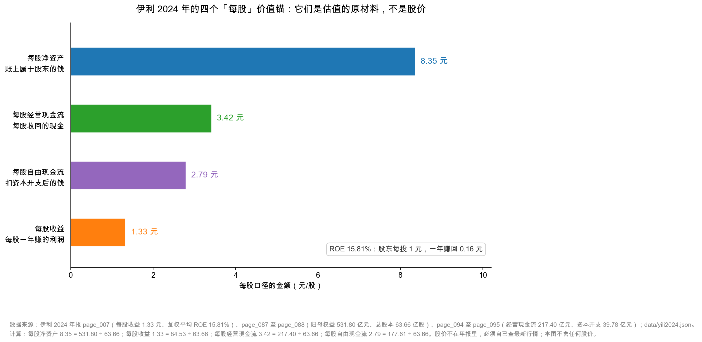
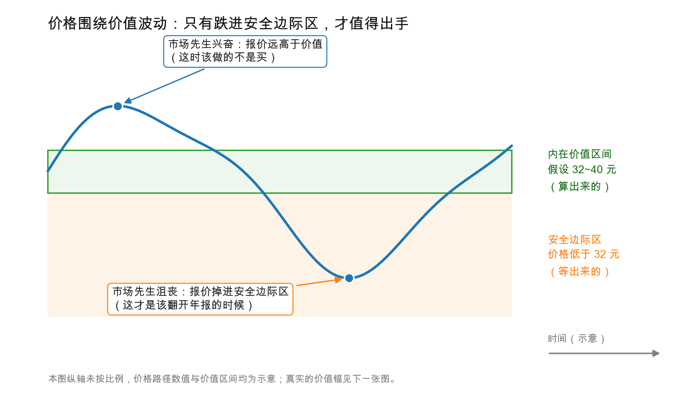

# 第 46 章：价格与价值——市场先生与安全边际

> 本章你将：
> - 分清"价格"和"价值"这两件常被混为一谈的事，并知道它们各自由什么决定；
> - 认识那位每天来敲门的"市场先生"，学会不被他的情绪带着走；
> - 说清财报能告诉你什么、不能告诉你什么——这是全书的收口，也是估值的起点；
> - 用伊利 2024 年报的真实数字，搭起四个"价值锚"：每股净资产 8.35 元、每股收益 1.33 元、每股自由现金流 2.79 元、ROE 15.81%；
> - 学会用"安全边际"给自己留退路，而不是靠"算得更准"来壮胆。

九周下来，你手上已经有了一整套工具：会翻年报、会读三表、会拆资产与负债、会看利润含水量、会验证现金流、会算比率、会扫红旗。上一章我们把伊利和蒙牛放进同一张仪表盘（[第 45 章](../week09/45-实战-伊利vs蒙牛仪表盘.md)）——**你现在能回答的是："这家公司过去一年干得怎么样？"**

从这一周开始，我们要回答另一个问题："**它值多少钱？**"

这两个问题之间，隔着一道很多人一辈子没跨过去的坎——**过去的事实，不能直接换算成未来的价格**。本章要做的，就是把这道坎说清楚。

---

## 46.1 同一双鞋，为什么有两个价

先从一个跟股票无关的场景说起。

你想买一双限量款球鞋。鞋盒上印着官方发售价 1,299 元，这是**厂商定的价**。你打开二手平台，发现同一双鞋，有人挂 4,800 元，有人挂 2,100 元，还有人急着出手挂 1,500 元。

三个数字，哪一个是真的？

**三个都是真的。** 它们是同一天、同一双鞋、在同一个平台上的真实挂牌价。但它们没有一个是这双鞋的"价值"。

那这双鞋的价值是多少？这个问题没法用眼睛回答，只能这样逼近：这双鞋的皮料、做工、产量、有多少人真的想穿它、五年后还有人要吗、如果放到明年卖会不会更值钱。**价值是你对"它未来能带来什么"的判断，价格是此刻有人愿意成交的数字。**

股票是同一回事，只是更极端：

- 一家公司有 63.66 亿股，每股票面 1 元，但它在交易所的报价可能是 8 元、28 元、60 元；
- 这个报价每几秒钟变一次，而公司的工厂、品牌、渠道、配方、经销商关系，一天之内几乎不变；
- **价格每秒都在说话，价值一年才更新一次**（多数时候要等下一份年报）。

于是产生了一个非常朴素、但极少有人真正执行的结论：

> **价格是你付出的，价值是你得到的。** 你无法控制价格，但你可以选择在什么价格上出手。

这句话说起来像鸡汤。要让它变成可操作的方法，得先认识一个人。

## 46.2 市场先生：一个情绪不稳的报价机器

这个比喻来自本杰明·格雷厄姆（Benjamin Graham），后来被沃伦·巴菲特（Warren Buffett）反复引用。

设想你有一位合伙人，叫"市场先生"（Mr. Market）。他每天准时出现，报给你一个价格：要么他把你的股份买走，要么你把他的股份买走，你俩必须有一方成交。

**这位合伙人有一个特点：他的情绪极不稳定。**

- 听到一条好消息，他就兴奋得睡不着，第二天报一个高得离谱的价；
- 看到一份难看的季报，他就沮丧到想清仓，报一个低得离谱的价；
- 大多数时候，他报的价介于两者之间，没什么参考价值。

关键在于：**你可以选择不跟他交易。** 他每天来报价，但没有人强迫你成交。你唯一要做的判断是——他这个报价，跟我自己算出来的价值比，是贵还是便宜。

绝大多数人亏钱，不是因为算错了价值，而是因为**把市场先生的报价当成了价值本身**：

- 股价涨了，就觉得公司变好了（其实是市场先生今天心情好）；
- 股价跌了，就觉得公司出事了（其实是市场先生今天心情差）；
- 于是"追涨杀跌"——在报价最高的时候最想买，在报价最低的时候最想卖。

> 💡 **你可能会问：** 那市场先生的报价完全没有信息吗？

不是。市场先生的报价里，**包含了他知道而你不知道的东西**。比如某天股价突然大跌，可能是因为一份你没看到的行业数据、一个你没想到的监管变化。**所以正确的态度是：不盲从，但要倾听。** 报价异常时，先去查"他为什么这么想"，再判断"他想得对不对"。

这里有一个很实用的习惯：**把"价格变动"和"价值变动"分开记录。** 你可以准备一张纸，左边写"今天股价跌了 3%"，右边写"今天公司的生意发生了什么变化"。你会发现，右边那一栏绝大多数日子是空的。**空的那一栏，就是你不该动手的理由。**

<!-- src: 伊利股份2024年报/page_007.md -->

> 📌 **划重点：** 市场先生的存在，不是为了告诉你价值，而是为了**给你提供交易机会**。他越情绪化，机会越大——前提是你自己心里有一个不随他波动的价值锚。

## 46.3 财报能告诉你什么，不能告诉你什么

这是全书画了九周、最后必须说透的一件事。很多人学完财报，会产生一种错觉："我会看财报了，所以我会估值了。"这两件事之间，还差着一整个"未来"。

先把边界划清楚：

| 财报能告诉你的（过去的事实） | 财报不能告诉你的（未来的假设） |
|---|---|
| 2024 年卖了 1,153.93 亿元 | 2025 年能卖多少 |
| 毛利率 33.88%，比去年升了 1.30 个百分点 | 明年原奶价格会涨还是跌 |
| 账上有 254.04 亿元货币资金 | 这笔钱明年会不会被拿去买一家公司 |
| 商誉还剩 23.37 亿元 | 这 23.37 亿元明年会不会再减值 |
| 经营现金流 217.40 亿元 | 明年的现金流还能不能维持 |
| 分红预案每股 1.22 元 | 这个分红比例能不能持续十年 |
| 有息负债 605.58 亿元、净有息负债为负 | 利率变了、渠道变了，这个结构还安全吗 |

左边一栏，是**审计过的、可以逐页翻到的、不会变的**。右边一栏，是**你必须自己假设的**。

**估值这件事，本质上就是把左栏的事实，加上右栏的假设，推出一个数字。** 所以：

- 左栏做得好不好，决定你的估值**有没有地基**（这正是前九周的训练）；
- 右栏假设得合不合理，决定你的估值**离真相有多远**（这是本周的训练）。

一个只学右栏、不学左栏的人，会算出精确到小数点后两位的错答案；一个只学左栏、不学右栏的人，会抱着一堆正确的事实，永远不知道该在什么价格出手。

再往下追一层，财报还有三个"天然局限"，你必须知道，否则会把"没写"当成"没有"：

**局限一：历史成本。** 资产负债表上的固定资产 346.19 亿元，记的是"当年买它花了多少钱减去折旧"，不是"今天把它卖掉能换多少钱"。一块十年前买的地、一条五年前建的产线，账面价值和市场价值可能差出一倍。**所以账面净资产只是一个记账结果，不是清算价。**

**局限二：会计估计。** 折旧年限定 10 年还是 15 年、存货跌价提 12% 还是 5%、商誉减值提 30 亿元还是 0 元——这些都在准则允许的范围内由公司判断。伊利 2024 年一次性计提 30.75 亿元商誉减值，就是一个典型：**同一家公司、同一年，换一个会计判断，利润可以差出几十亿元**（第 32、35 章拆过这笔账）。

**局限三：表外的东西。** 品牌、渠道、配方、经销商关系、员工能力，这些真正决定乳业公司能走多远的东西，绝大部分不在资产负债表上（会计准则只允许在并购时确认一部分"无形资产"）。**所以你会看到一个悖论：一家公司最值钱的东西，往往在报表上找不到。**

这三条局限合起来，就是一句话：**财报是"过去的事实"最可靠的记录，但它既不是"现在的价值"，更不是"未来的答案"。**

> ⚠️ **易踩坑：** 最常见的错误，是把"财报数字"当成"价值"。比如看到每股净资产 8.35 元，就说"这公司至少值 8.35 元"。**错。** 每股净资产是"账面上记着多少钱"，它既可能是被高估的（商誉、收不回的应收），也可能是被低估的（品牌、渠道、配方这些没进资产负债表的东西）。**账面价值是估值的起点之一，不是结论。**

## 46.4 伊利 2024 的四个价值锚

现在把工具落到伊利身上。九周里我们反复算过一些"每股"口径的数字，它们加起来构成四个锚。**锚的作用不是告诉你"值多少"，而是让你在股价剧烈波动时，有一个不动的参照物。**

四个锚，逐个说清楚它们各是什么、能用来干什么：

**锚一：每股净资产 8.35 元。** 归母权益 531.80 亿元 ÷ 总股本 63.66 亿股 = 8.35 元。它的意思是："如果公司今天按账面价值清算，理论上每股能分到 8.35 元。"注意"理论上"三个字——商誉 23.37 亿元、存货 107.45 亿元这些资产，真清算时未必卖得掉账面价。**这是"家底"的锚，用来判断"下限大概在哪"。**

**锚二：每股收益 1.33 元。** 归母净利润 84.53 亿元 ÷ 63.66 亿股 = 1.33 元，和年报第 7 页披露的基本每股收益一致。**这是"赚钱能力"的锚，也是下一章市盈率的分母。**

**锚三：每股自由现金流 2.79 元。** 自由现金流 177.61 亿元 ÷ 63.66 亿股 = 2.79 元。它比每股收益高出一倍多，原因是折旧 40.56 亿元、减值 52.31 亿元这些"不花钱的费用"被加回来了。**这是"真金白银"的锚，第 49 章的 DCF 就从它出发。**

**锚四：ROE 15.81%。** 加权平均净资产收益率，年报第 7 页直接披露。它的意思是："股东每投入 1 元，公司一年能赚回 0.1581 元。"**这是"资本效率"的锚，第 48 章的 PB 要和它配对看。**

再加一个"分配"的锚：**2024 年度分红预案为每股 1.22 元，合计 77.26 亿元，占归母净利润的 91.40%**（page_002）。这个比例很高，说明公司愿意把赚到的钱分给股东；但它同时也是下一章要留意的点——**分红率高，意味着留给公司自己发展的钱少，增长要靠借债或自有现金。**

<!-- src: 伊利股份2024年报/page_002.md 伊利股份2024年报/page_007.md 伊利股份2024年报/page_088.md 伊利股份2024年报/page_094.md 伊利股份2024年报/page_095.md -->

> 🔍 **翻到年报：** 打开 `page_007.md`，找到"主要财务指标"那张表。你会看到四行：基本每股收益 1.33 元、扣非后基本每股收益 0.95 元、加权平均净资产收益率 15.81%、扣非后加权平均净资产收益率 11.24%。**这四行就是本章四个锚里两个的官方出处**，也是你以后查任何一家公司"每股"数据的第一站——不用自己算，先看公司披露的口径，再自己复核。

四个锚摆在一起，你会发现一件有意思的事：**用不同的锚，会得到完全不同的"价值感"。**

- 用每股净资产 8.35 元做锚，28 元的假设价是账面的 3.35 倍，看起来"贵"；
- 用每股收益 1.33 元做锚，28 元对应 21 倍 PE，看起来"不算离谱"；
- 用每股自由现金流 2.79 元做锚，28 元对应 10 倍市现率，看起来"挺便宜"。

**同一个价格，三个锚给出三种感受。** 这不是锚错了，而是它们衡量的是不同的东西：家底、利润、现金。**估值的艺术，就在于知道什么时候该用哪个锚，以及三个锚打架时该信谁。**

还要记住一件事：**锚是会动的。** 把三年的数字并排放，你会看到它们并不稳定：

| 指标 | 2022 年 | 2023 年 | 2024 年 | 说明 |
|---|---|---|---|---|
| 基本每股收益 | 1.48 元 | 1.64 元 | **1.33 元** | 三年里最高和最低差 23% |
| 扣非基本每股收益 | 1.34 元 | 1.57 元 | **0.95 元** | 跌幅更大，因为一次性收益托住了归母 |
| 加权平均 ROE | 19.23% | 20.20% | **15.81%** | 三年里下降了 3.42 个百分点 |
| 每股分红 | — | 1.20 元（2023 年度） | 1.22 元（2024 年度预案） | 分红基本稳住，没有跟着利润跌 |

<!-- src: 伊利股份2024年报/page_002.md 伊利股份2024年报/page_007.md -->

这张表藏着一个非常实用的判断：**如果一家公司的"锚"在三年里大幅波动，那么任何基于单一年份的估值，都不可靠。** 伊利的每股收益从 1.64 元掉到 1.33 元，你可以说"今年不行了"，也可以说"去年有一次性收益、今年有一次性减值，中间的 1.48 元左右才是常态"。**两种读法对应两个完全不同的估值倍数**——这正是下一章要展开的内容。

## 46.5 安全边际：为什么"算得准"不如"留得宽"

假设你花了一个周末，用第 49 章要学的方法，算出伊利的每股价值是 36 元。现在市场报价 28 元，你买不买？

先别急着回答。问自己一个问题：**你这个 36 元，误差有多大？**

如果你诚实，答案大概是："正负 30%。"因为它是用"未来 5 年增速 3%、折现率 10%"这类假设推出来的，而这两个数字，你换一换，结果就从 26 元变到 54 元（第 49 章会算给你看）。

于是问题变成：**在一个"我可能算错 30%"的世界里，我该怎么用我的计算结果？**

答案是格雷厄姆那句被引用了一万遍、但极少被真正执行的话：

> **安全边际（margin of safety）：只在价格显著低于你估算的价值时才买入，把"算错"的空间提前留出来。**

用数字说清楚。假设你估的价值区间是 32 元到 40 元：

| 假设股价 | 相对价值下沿 32 元 | 相对价值上沿 40 元 | 该怎么做 |
|---|---|---|---|
| 45 元 | 溢价 40.6% | 溢价 12.5% | 明显贵，不碰 |
| 36 元 | 溢价 12.5% | 折价 10.0% | 落在区间中部，没有安全边际 |
| 32 元 | 持平 | 折价 20.0% | 刚到区间下沿，可以开始研究 |
| 28 元 | 折价 12.5% | 折价 30.0% | 有安全边际，但要先确认假设没错 |
| 24 元 | 折价 25.0% | 折价 40.0% | 安全边际较厚，值得认真看 |

这张图想说的只有三件事：

**第一，价值是一个带，不是一个点。** 中间那条绿色带（图里标的是假设 32~40 元），是你算出来的区间。它的宽度，就是你对自己判断的不确定程度。**区间越宽，说明你越诚实。**

**第二，价格会穿过这个带。** 蓝色的曲线是价格路径，它上上下下，有时冲到带上方（市场先生兴奋），有时跌到带下方（市场先生沮丧）。**它穿过带的次数，比你想象的多。**

**第三，只有带下方那一片橙色区域，才是"该动手"的地方。** 那一片叫安全边际区。它不是一个精确的价格，而是一个"我愿意开始认真研究"的区域。

> 💡 **你可能会问：** 那如果我估错了，价值其实是 20 元，我在 28 元买入，不还是亏了？

会亏。这正是安全边际要解决的问题——**它不能保证你算对，只能保证你"算错的时候亏得少"。** 如果你估 32 元、在 24 元买，即使真实价值只有 26 元，你也没亏；如果你估 32 元、在 32 元买，真实价值 26 元，你就亏了 19%。**同样的判断能力，买价决定了结果。**

这里还有一个反直觉的推论：**安全边际的大小，和你对公司的了解程度成反比。** 你越看不懂这家公司（比如业务复杂、关联交易多、商誉巨大），你要求的折扣就应该越大。巴菲特早年买伯克希尔纺织厂时要求很大的折扣，后来买可口可乐时几乎按合理价买入——因为前者他看不透，后者他看得透。

"要求多大折扣"这件事，实务上有三种常见做法，你可以选一种，但必须**事先写下来**：

**做法一：按区间下沿打折。** 你估的价值区间是 32~40 元，那就把 32 元再打八折，得到 25.6 元，作为"我愿意出价的上限"。这是最保守、也最容易执行的算法，缺点是可能永远等不到。

**做法二：要求固定的最低回报。** 你要求"至少 15% 的年化回报"，那么按你估的 36 元中枢，最多只愿意付 36 ÷ 1.15 = 31.3 元。这个做法把"安全边际"换算成了"预期收益率"，好处是可以和别的机会直接比较。

**做法三：分档买入。** 不追求"一次买在最低点"，而是每跌一档买一部分：32 元买三成、28 元买三成、24 元买四成。缺点是操作繁琐、且需要事先想清楚"如果它跌到 15 元我还敢不敢买"。

三种做法没有优劣，**唯一的共同点是：折扣必须在买入之前定好，而不是买入之后找理由。** 人在持有股票之后，会本能地给自己找支持理由——这是心理学上被反复验证的倾向。**把规则写在纸上，是对抗这种倾向最便宜的办法。**

## 46.6 把"假设价"三个字刻在脑门上

这一节很短，但它是本周的铁律。

**年报里没有股价。** 你翻遍伊利的 270 页，找不到"今日收盘价"这一栏，因为年报披露的是公司的事实，不是市场的报价。所以本书里出现的每一个股价、市值、PE、PB 的绝对水平，都是**假设值**，只用于演示计算方法。

你在本书里会反复看到这样的写法：

> 假设股价 28 元（**仅为演示，非真实报价**）。

这句话不是客套。它意味着：

1. **你不能拿本书算出的 PE 去判断"伊利现在贵不贵"**，因为那个 PE 是"假设价 28 元"下的 PE。真实的 PE，要你自己去查最新股价，再除以 EPS 1.33 元。
2. **本书的所有估值结论，都是"在假设价 28 元这个坐标系里"的结论**。如果真实股价是 20 元或 40 元，结论会完全不同——但方法一模一样。
3. **教你方法，不给你答案。** 这是本书和"荐股"最大的区别：荐股给你一个数字，本书给你一套算法，让你自己能算。

> ⚠️ **易踩坑：** 有些人会把书里的"假设价 28 元"抄进笔记，过几个月再看，以为是当时的真实股价，然后据此判断"这本书说得准不准"。**这是把演示数字当成事实。** 正确做法：每次看到股价，先问一句"这是假设还是行情"；自己动手时，去交易所网站或行情软件查最新价，把日期一起记下来。

顺便把一个常用的衍生指标算给你看：**股息率 = 每股分红 ÷ 股价。** 伊利 2024 年度每股分红 1.22 元，在假设股价 28 元下，股息率是 1.22 ÷ 28 = **4.36%**（假设价下的计算结果，非真实股息率）。这个数字可以和国债收益率、银行理财比一比——**它是"拿着不动也能拿到多少"的粗略参照**，也是下一章讲 PE 时要一起看的东西。

<!-- src: 伊利股份2024年报/page_002.md -->

> 📌 **划重点：** 价格是别人给的，价值是你算的，安全边际是你留的。三件事各归各，混在一起就全乱了。**财报负责让你"算得有理"，安全边际负责让你"错得不惨"。**

## ✍️ 想一想

### 问 1：假设你算出某公司的每股价值是 30 元，现在市场报价 27 元。按理说"有 10% 的安全边际"，但你仍然决定不买。请给出至少两个合理的理由。

**解题思路：** 安全边际只是"买"的必要条件之一，不是充分条件。要把"价格便宜"和"这笔投资能不能做"分开想。可以从三个方向找理由：价值估算本身不可靠、价格便宜有便宜的原因、以及"能力圈"之外。

**参考答案：** 理由一：**我的 30 元本身不可靠。** 如果这个估值是用"未来 5 年增长 8%"算出来的，而这家公司过去三年收入增速是 -5%，那么 30 元可能只是"乐观假设的产物"，真实的区间可能是 18 元到 30 元。这时候 27 元并不是折价 10%，而是"接近区间上沿"。理由二：**便宜可能有原因，而这个原因我还没排除。** 比如公司商誉占净资产 30%，明年可能减值；或者大股东在持续减持；或者行业正在被替代。价格低到"反常"时，第一反应应该是"我漏了什么"，而不是"我捡到了"。理由三：**这家公司我看不懂。** 如果它的收入有一半来自关联交易，或者主要利润来自金融资产公允价值变动，那么无论价格多便宜，都不该买——看不懂的东西，安全边际再厚也可能被一个你没想到的风险吃掉。

**易错点：** 把"折价 10%"当成"一定赚钱"。安全边际的作用是"提高胜率、降低亏损幅度"，不是"消除风险"。另一个易错点是把安全边际算成"相对区间中值的折价"——用哪个基准（下沿、中值、上沿）算，结果差别很大，必须写清楚。

### 问 2：伊利 2024 年的每股收益是 1.33 元，每股自由现金流是 2.79 元，后者是前者的两倍多。如果你只能选一个作为估值基础，你选哪个？为什么？

**解题思路：** 先想清楚两个数字分别在衡量什么，再想"哪个更适合做估值的输入"。提示：估值的本质是"未来能拿回多少现金"。

**参考答案：** 从"估值理论"上选 **每股自由现金流 2.79 元**，因为股东最终拿到的是现金，不是会计利润；DCF 的输入本来就是现金流。但从"实务"上，两个都不能单独用，必须配对看：每股收益 1.33 元告诉我们"账面赚了多少"，每股自由现金流 2.79 元告诉我们"实际收回多少"。两者差 1.46 元，主要来自折旧 40.56 亿元和减值 52.31 亿元这些不花钱的费用被加回。**这个差额本身就是信息**：差额大，说明公司是重资产、且当年计提了大额减值；如果差额是靠"营运资本释放"（收回旧账、卖存货）堆出来的，那这部分现金流明年不一定还有。所以正确做法是：**用自由现金流做 DCF 的起点，但先用利润表和现金流量表解释清楚这 1.46 元的差额是从哪来的。**

**易错点：** 直接说"现金流比利润真实，所以永远用现金流"。这句话在伊利 2024 年基本成立，但换成一家"经营现金流靠拖欠供应商堆出来"的公司就不成立了。判断标准不是"哪个数大用哪个"，而是"这个数明年的可持续性如何"。

### 问 3：请用你自己的话，向一个从没学过金融的朋友解释："为什么年报里没有股价？"

**解题思路：** 这道题考的是"事实"与"报价"的区分。要把"公司披露的信息"和"市场形成的价格"这两套系统讲清楚，并举一个生活中的例子。

**参考答案：** 可以这样说：年报是公司写给股东的"年度体检报告"，它记录的是过去一年公司自己做了什么——卖了多少货、花了多少钱、账上还剩多少。这些东西是公司能控制的，也必须接受审计。而股价是市场上几百万个买家卖家在同一秒钟互相报价、撮合成交的结果，它取决于大家的情绪、资金松紧、对未来的想象，公司自己既不能决定、也不能保证。**就像一家餐厅的菜单上写着菜的成本和用料（年报），但菜单不会写"今天中午 12 点这盘菜在二手转让平台上能卖多少钱"（股价）——后者每分每秒都在变，而且取决于当时有多少人想吃。** 所以想看股价，要去行情软件；想看公司，才翻年报。两者都要看，但不能混着看。

**易错点：** 说"因为股价天天变，年报一年才出一次"。这只是表面原因。真正的区分是：**年报披露的是"事实"（可审计、可追溯），股价反映的是"预期"（不可审计、随时变化）。** 即使年报每天更新，它也不会写股价。

## 📎 数据出处

- 伊利股份 2024 年报：`page_002.md`（2024 年度利润分配预案：每股 1.22 元、合计 77.26 亿元、占归母净利润 91.40%）、`page_007.md`（基本每股收益 1.33 元、扣非每股收益 0.95 元、加权平均 ROE 15.81%、扣非 ROE 11.24%、总股本 63.66 亿股）、`page_025.md`（合同负债 120.73 亿元，同比 +38.84%）、`page_087.md`~`page_088.md`（归母权益 531.80 亿元、商誉 23.37 亿元、存货 107.45 亿元、有息负债相关科目）、`page_091.md`~`page_092.md`（营业收入 1,153.93 亿元、毛利率相关科目、归母净利润 84.53 亿元）、`page_094.md`~`page_095.md`（经营现金流 217.40 亿元、资本开支 39.78 亿元）
- 数据汇总：`data/yili2024.json` 的 `ratios`（book_value_per_share、free_cash_flow、roe_weighted_reported）、`balance`、`income`、`cashflow`、`nonrecurring` 段
- 本周配图脚本：`figures/gen_w10d46_value_anchors.py`、`figures/gen_w10d46_price_value_band.py`

下一章：[第 47 章：市盈率 PE——最流行也最危险的尺子](47-市盈率PE.md)
