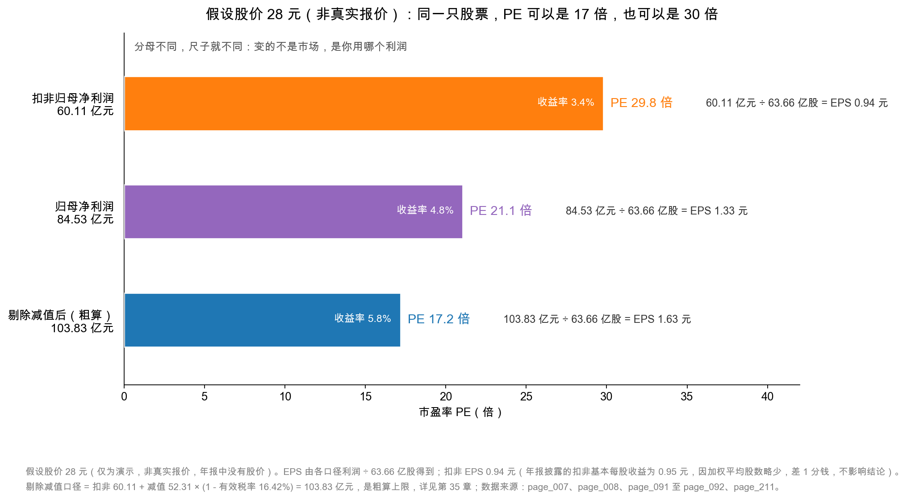

# 第 47 章：市盈率 PE——最流行也最危险的尺子

> 本章你将：
> - 用"买一间小店几年回本"的直觉，彻底搞懂市盈率（PE）是什么；
> - 分清静态、滚动（TTM）、预期三种口径，知道它们各自的分母是哪一年的利润；
> - 亲手算一遍：同一只股票、同一天，PE 可以是 17.2 倍，也可以是 29.8 倍；
> - 看穿 PE 的三个经典陷阱：周期股、一次性损益、成长股的 PEG；
> - 知道 PE 什么时候能用、什么时候必须放下，并用它给伊利算一张"假设价—PE"对照表。

上一章我们立了四个价值锚，其中最好用的一个是每股收益 1.33 元。这一章就从这个数字出发，讲那把最流行的尺子——**市盈率**。

它流行到什么程度？你打开任何一个行情软件，第一眼看到的就是它；你和朋友聊股票，第一句问的常常是"这票多少倍"；很多"估值"文章，从头到尾只用了这一个指标。

它也危险到什么程度？**因为它的分母可以换。** 换一个分母，同一只股票、同一天，PE 能从 17 倍变成 30 倍。而绝大多数人不知道自己在看哪一个。

---

## 47.1 先讲一间小店：几年回本

假设你家楼下有一间奶茶店要转让，老板开价 200 万元。你翻了它的账，过去一年净赚 10 万元。

你心里马上会冒出一个数：**200 ÷ 10 = 20 年。**

意思是：如果这店每年都稳稳赚 10 万元，你要 20 年才能把 200 万元赚回来。这个"20"，就是这间店的市盈率。

**市盈率（Price-to-Earnings Ratio，简称 PE）＝ 你付出的价格 ÷ 每年能赚到的利润。**

换成股票的说法：

$$\text{PE} = \frac{\text{股价}}{\text{每股收益（EPS）}} = \frac{\text{总市值}}{\text{净利润}}$$

两个式子完全等价，因为"股价 $\times$ 总股本 = 总市值"，"每股收益 $\times$ 总股本 = 净利润"。你手上有哪个就用哪个。

PE 的倒数还有一层含义，很多人不知道：**1 ÷ PE 就是"收益率"**（英文叫 earnings yield）。20 倍 PE，对应 5% 的收益率——意思是"如果利润不变、且全部分给你，你每年能拿回本金的 5%"。

这个视角非常有用，因为它让 PE 可以和别的东西直接比：

| PE | 对应的收益率 | 和什么比 |
|---|---|---|
| 10 倍 | 10.0% | 比大多数理财高，但要承担经营风险 |
| 20 倍 | 5.0% | 和长期国债收益率接近，需要增长来补偿风险 |
| 30 倍 | 3.3% | 已经低于国债，必须有高增长才说得过去 |
| 50 倍 | 2.0% | 你买的不是现在的利润，是"未来的想象" |

所以"PE 高好还是低好"这个问题，本身问错了。正确的问法是：**这个 PE，对应多高的收益率？这个收益率，够不够补偿我承担的风险？**

顺着这个思路，你就能理解"为什么市场愿意给不同公司不同的 PE"。三件事决定了一个 PE 的合理性：

**第一是增长。** 一家每年增长 20% 的公司，今年的 1 元利润，五年后可能变成 2.5 元；一家不增长的公司，五年后还是 1 元。**同样的 1 元利润，含"未来的增量"越多，市场愿意付的价格越高。** 这就是成长股 PE 高的根本原因，也是 PEG 那个补丁想解决的问题。

**第二是确定性。** 两家公司都增长 10%，一家靠长期合同（比如物业费、订阅费），一家靠每年重新抢订单。**前者利润可预测，后者利润靠运气**，市场给前者的 PE 会明显更高。这就是"确定性溢价"。

**第三是利率。** 这是最容易被忽略的一条。PE 的倒数是收益率，而收益率要和"无风险利率"比。**当国债收益率从 4% 降到 2%，同样一笔 5% 的收益率（20 倍 PE）就从"没吸引力"变成了"很划算"**，市场会集体抬高估值——这不是公司变好了，是尺子的刻度变了。所以你会看到"降息周期里股市普涨"，那不是幻觉，是分母（折现率）在变。

> 📌 **划重点：** PE 的本质是"回本年数"，它的倒数是"收益率"。**PE 高低本身没有意义，只有和"增长""风险""利率"放在一起，才有意义。**

## 47.2 三种口径：分母到底是哪一年的利润

PE 的分子（股价）只有一个，分母（利润）却有好几种。这就是混乱的来源。

**口径一：静态 PE（static PE）。** 分母用**上一个完整会计年度**的利润。对伊利来说，就是用 2024 年的归母净利润 84.53 亿元，EPS 1.33 元。它的优点是**有年报背书、可以复核**；缺点是**过时**——如果现在是 2025 年 10 月，你用的还是 2024 年的利润，中间已经过了三个季度。

**口径二：滚动 PE（trailing twelve months，简称 TTM）。** 分母用**最近四个季度**的利润之和。伊利 2024 年四个季度的归母净利润分别是 59.23 亿元、16.08 亿元、33.37 亿元、-24.16 亿元（page_008），加起来正好是 84.53 亿元。到 2025 年一季报出来之后，TTM 就变成"2024 年 Q2 到 2025 年 Q1"这四个季度，比静态 PE 新。**优点是新，缺点是季度数据没审计、且容易被季节性扭曲。**

**口径三：预期 PE（forward PE）。** 分母用**分析师或你自己预测的下一年利润**。它最新，但也最不可靠——因为它是"假设"，不是"事实"。市面上很多"这只股票才 15 倍"的说法，用的就是预期 PE，而那个"预期"可能来自一个乐观的卖方报告。

三种口径的差别有多大？用伊利 2024 年的数据做个演示（假设 2025 年利润与 2024 年持平，仅为说明口径差异）：

| 口径 | 分母（归母净利润） | EPS | 数据来源 | 可靠性 |
|---|---|---|---|---|
| 静态 PE | 84.53 亿元（2024 年） | 1.33 元 | 已审计年报 | 高，但旧 |
| 滚动 PE（TTM） | 84.53 亿元（2024Q1~Q4） | 1.33 元 | 四个季度报告 | 较新，未审计 |
| 预期 PE | 假设 84.53 亿元（2025 年） | 1.33 元 | 预测 | 低，是假设 |

在这个"利润持平"的假设下，三种口径算出来的 PE 是一样的。**但只要利润在变，三者就会分叉**：如果 2025 年利润涨到 100 亿元，预期 PE 会比静态 PE 低 15%；如果跌到 70 亿元，预期 PE 会比静态 PE 高 21%。**所以看到任何 PE，第一句话要问："这是哪个口径？"**

顺手把"股价 ÷ EPS"和"市值 ÷ 净利润"的等价关系验一遍。假设股价 28 元（仅为演示，非真实报价），总股本 63.66 亿股：

$$28 \times 63.66 = 1{,}782.5 \text{ 亿元（总市值）}$$

$$1{,}782.5 \div 84.53 = 21.1 \text{ 倍}$$

两条路算出来都是 21.1 倍。**这个验算值得每个人做一遍**，因为券商报告里经常混用两种写法：一会说"市值 1,780 亿元"，一会说"股价 28 元"，你如果只看其中一半，很容易把"总市值"和"流通市值"搞混——A 股有些公司股份没有全流通，流通市值可能只有总市值的六七成，**用流通市值去除以全部净利润，会算出一个偏低的 PE。**

> ⚠️ **易踩坑：** 行情软件默认显示的 PE，各家的口径并不统一：有的用静态、有的用 TTM、有的用"扣非后 TTM"。**同一个屏幕上的两个 PE，可能根本不是一回事。** 养成习惯：看到 PE，先找它的定义（多数软件点进去能看到"市盈率（静）""市盈率（TTM）"两个字段），再拿来比较。

## 47.3 同一只股票，PE 从 17 到 30

现在进入本章的核心。我们把分子固定住——**假设股价 28 元（仅为演示，非真实报价）**，然后换三个不同的分母。

三个分母，都来自伊利 2024 年报，都是"真实利润"，只是口径不同：

**第一种：用扣非归母净利润 60.11 亿元。** 这是"监管口径的主业利润"，把卖子公司、政府补助这些一次性项目剔掉了。EPS = 60.11 ÷ 63.66 = 0.94 元。PE = 28 ÷ 0.94 = **29.8 倍**。

**第二种：用归母净利润 84.53 亿元。** 这是报表上最显眼的那一行。EPS = 84.53 ÷ 63.66 = 1.33 元。PE = 28 ÷ 1.33 = **21.1 倍**。

**第三种：用"剔除减值后的经营性归母利润"约 103.83 亿元。** 这是第 35 章算出来的口径：把 52.31 亿元减值按 16.42% 的有效税率还原成税后 43.72 亿元，加回扣非利润。EPS = 103.83 ÷ 63.66 = 1.63 元。PE = 28 ÷ 1.63 = **17.2 倍**。

<!-- src: 伊利股份2024年报/page_007.md 伊利股份2024年报/page_008.md 伊利股份2024年报/page_091.md 伊利股份2024年报/page_092.md 伊利股份2024年报/page_211.md -->

把三个结果并排：

| 分母 | 金额 | EPS | 假设价 28 元下的 PE | 隐含的"回本年数" |
|---|---|---|---|---|
| 扣非归母净利润 | 60.11 亿元 | 0.94 元 | **29.8 倍** | 约 30 年 |
| 归母净利润 | 84.53 亿元 | 1.33 元 | **21.1 倍** | 约 21 年 |
| 剔除减值后（粗算） | 103.83 亿元 | 1.63 元 | **17.2 倍** | 约 17 年 |

**同一只股票、同一天、同一个股价，PE 可以是 17 倍，也可以是 30 倍。** 差的那 12.6 倍，不是市场在变，是你在换分母。

那问题来了：**市场用的是哪一个？**

答案是：**市场用的是"它认为可持续的那个利润"。**

- 如果市场认为"减值是一次性的、明年不会再有"，它就会用接近 103.83 亿元的口径，PE 看起来只有 17 倍，显得便宜；
- 如果市场认为"减值还会再来、主业就是这个水平"，它就会用接近 60.11 亿元的口径，PE 看起来 30 倍，显得贵；
- 而大多数人（包括很多软件）用的是 84.53 亿元，得到 21 倍——**这个数字最"中性"，也最容易被误读成"客观"。**

**这就是市盈率最危险的地方：它看起来是一个客观的数学结果，实际上藏着一个主观的判断——你认为哪个利润代表这家公司。**

还有一层容易被忽略的波动：**即使分母不变，PE 也会自己动。** 因为分子（股价）每天都在变。用固定的 EPS 1.33 元算，假设股价在 20 元到 35 元之间摆动，PE 就会这样跳：

| 假设股价（非真实报价） | PE（用 EPS 1.33 元） | 隐含收益率 |
|---|---|---|
| 20 元 | 15.0 倍 | 6.6% |
| 24 元 | 18.0 倍 | 5.5% |
| 28 元 | 21.1 倍 | 4.8% |
| 32 元 | 24.1 倍 | 4.2% |
| 35 元 | 26.3 倍 | 3.8% |

**一家公司的生意在一年里几乎没变，PE 却能从 15 倍走到 26 倍。** 这中间没有一分钱是新赚的，全是"市场先生"的情绪和资金在起作用。**所以"PE 多少倍算贵"这个问题，必须配上"什么时候"才有意义。**

> 💡 **你可能会问：** 那我到底该用哪个？

分场合：

- **做保守判断时，用扣非。** 因为扣非是"最不容易被美化"的口径，它假设一次性收益不会重演、减值会继续发生。用扣非算出来的 PE 最高，也就最不容易让你高估。
- **做中性判断时，用归母。** 它和市场上大多数人看到的是同一个数字，便于横向比较。
- **做乐观判断时，才用"剔除减值"。** 但你必须同时回答："凭什么认为减值不会再来？"——伊利商誉减完之后还剩 23.37 亿元（page_184），这个问题并没有被彻底回答。

**最专业的做法是：三个都算，然后把区间写出来。** 就像第 35 章做的那样，给结论配一个范围，而不是一个点。

> 🔍 **翻到年报：** 打开 `page_007.md`，在"主要财务指标"里找到两行：**基本每股收益 1.33 元** 和 **扣除非经常性损益后的基本每股收益 0.95 元**。这两个数就是公司自己披露的两个分母。注意：0.95 元和我上面算的 0.94 元差 1 分钱，原因是公司用**加权平均股数**（年中股数有变化），我用的是**期末总股本 63.66 亿股**。**做估值时用哪个都可以，但要前后一致，不能一会儿用 0.94、一会儿用 0.95。**

## 47.4 PE 的三个经典陷阱

PE 之所以"最危险"，不只是因为分母可以换，还因为它在一整类公司身上会系统性地给出错误信号。

### 陷阱一：周期股——盈利高点 PE 最低

假设有一家航运公司，船价随运价暴涨暴跌。它的利润是"三年暴赚、三年亏损"：

| 年份 | 净利润 | 假设股价不变 | PE | 看起来 |
|---|---|---|---|---|
| 景气顶点 | 100 亿元 | 500 亿元市值 | **5 倍** | "好便宜！" |
| 常态 | 30 亿元 | 500 亿元市值 | 16.7 倍 | 一般 |
| 低谷 | 2 亿元 | 500 亿元市值 | **250 倍** | "太贵了！" |

**如果你按 PE 买周期股，你会在最危险的时候（景气顶点、利润最高、PE 最低）买入，在最有机会的时候（低谷、利润最低、PE 最高）卖出。** 这正好反了。

周期股的 PE 陷阱，本质是"分母在周期里剧烈波动，而分子（市值）反映的是市场对长期常态的预期"。**对周期股，更合适的尺子是 PB（第 48 章）或者"周期中位利润"**——用过去 5~10 年的平均利润做分母，而不是用今年的利润。

伊利算周期股吗？**不完全算，但有周期成分。** 原奶价格有 3~4 年的涨跌周期，它直接影响毛利率：原奶便宜时毛利率升，原奶贵时毛利率降。伊利 2024 年毛利率逆势上升 1.30 个百分点，部分原因就是原奶价格下行（第 28 章）。**所以看伊利的时候，要意识到"今年的毛利率有周期成分"，不要把周期高点当成常态。**

更麻烦的是，乳业的周期不只体现在价格上，还体现在"渠道库存"上。行业景气时，经销商愿意多囤货，公司的出货量就好看；景气转弱时，经销商先消化库存、减少进货，公司的收入就会突然掉一截——**而这个变化，会先出现在合同负债和应收账款的变动里，而不是利润表上。** 伊利 2024 年合同负债 120.73 亿元，比 2023 年的 86.96 亿元增长 38.84%（page_025），这个数字既可以解读为"渠道信心恢复、提前打款"，也可以解读为"公司为了冲收入，让经销商提前打款"。**同一个数字，两种解读，对应两种完全不同的 PE。** 这就是为什么单看 PE 不够，必须回到报表里找证据。

### 陷阱二：一次性损益——PE 会被单向扭曲

伊利 2024 年就是活教材，而且是"双向扭曲"：

- **往上托的**：非经常性损益 24.42 亿元，其中 25.64 亿元是处置非流动资产（主要是卖掉昌吉盛新赚的 25.80 亿元）。这笔钱让归母净利润多了 24.42 亿元，**把 PE 压低了**（分母变大，PE 变小），显得便宜。
- **往下压的**：资产减值 46.76 亿元 + 信用减值 5.55 亿元，合计 52.31 亿元。这笔钱让归母净利润少了 43.72 亿元（税后），**把 PE 抬高了**（分母变小，PE 变大），显得贵。

**两股力量同时作用，最后落在 84.53 亿元。** 如果你只看这个数字算 PE，你既不知道它被托高了多少，也不知道它被压低了多少。**这就是为什么第 33、35 章要花整整两周去拆利润的含水量——不拆，PE 就是一个被污染的分子。**

### 陷阱三：成长股的 PEG——一个容易被滥用的公式

有人发明了一个补丁：既然高增长的公司 PE 高是合理的，那就把 PE 除以增长率，得到 PEG（Price/Earnings-to-Growth）：

$$\text{PEG} = \frac{\text{PE}}{\text{净利润增速（\%)}}$$

经验法则是"PEG 小于 1 算便宜，大于 2 算贵"。比如 PE 30 倍、增速 30%，PEG = 1，看起来"合理"。

这个公式有它的用处，但**陷阱非常深**：

1. **增速是预测值，不是事实。** 你用"未来三年增速 30%"算出 PEG = 1，可如果实际增速只有 10%，PEG 就变成 3。**PEG 把"预测的风险"藏起来了。**
2. **高增速不可持续。** 一家公司从 10 亿元利润涨到 20 亿元，增速 100%；从 20 亿元再翻倍到 40 亿元，难度大得多。**同样的 30% 增速，在基数不同时含义完全不同。**
3. **负增长时公式失效。** 增速为负，PEG 变成负数，"小于 1 就是便宜"的规则立刻失灵。

对伊利这种"成熟、低速增长"的公司，PEG 基本用不上——它 2024 年收入 -8.24%、归母净利润 -18.94%，增速是负的。**PEG 是给成长股用的补丁，不是通用尺子。**

## 47.5 PE 的适用边界：什么时候必须放下这把尺子

PE 很好用，但它有明确的失效区。遇到下面几种情况，请换尺子：

| 情况 | 为什么 PE 失效 | 该用什么 |
|---|---|---|
| 公司亏损（净利润为负） | 分母为负，PE 没有意义 | PB、PS（市销率）、现金流 |
| 利润在正负之间跳动 | PE 从 20 倍跳到 -50 倍再跳回来 | 周期中位利润、PB |
| 利润里一次性项目占比很高 | 分母被污染，见上一节 | 扣非 PE、EV/EBITDA |
| 折旧政策差异很大 | 重资产公司折旧高、利润低，PE 显得贵 | EV/EBITDA、PB |
| 高杠杆的金融类公司 | 利润被杠杆放大，PE 无法反映风险 | PB + ROE |
| 早期高增长公司 | 利润被增长投入压低，PE 极高 | PS、用户数、单位经济模型 |

**一句话总结边界：PE 适合同行业、同阶段、利润稳定的公司之间横向比较；不适合跨行业、跨周期、利润不稳定的公司。**

伊利属于哪一种？**它是"利润大体稳定、但有减值扰动"的成熟消费公司。** 所以：

- **可以用 PE**，但要和同业（比如蒙牛）比，不要和科技股比；
- **必须同时看扣非 PE**，因为归母被一次性项目污染了；
- **必须同时看现金流**，因为 PE 完全不看现金。

## 47.6 用 PE 给伊利算一张对照表

最后，把 PE 变成一个可以用的工具：**反推价格**。

公式很简单：**股价 = EPS $\times$ PE。** 你只要决定"我愿意给多少倍"，就能算出"我愿意出多少价"。

下面这张表，横轴是假设的 PE 倍数（15、20、25、30 倍），纵轴是两种 EPS 口径。**所有价格都是假设情景下的计算结果，不是真实股价、不是目标价。**

| 假设 PE | 扣非 EPS 0.94 元 → 对应股价 | 归母 EPS 1.33 元 → 对应股价 |
|---|---|---|
| 15 倍 | 14.1 元 | 20.0 元 |
| 20 倍 | 18.8 元 | 26.6 元 |
| 25 倍 | 23.5 元 | 33.3 元 |
| 30 倍 | 28.2 元 | 39.9 元 |

**这张表最该看的是"同一行、两列的差距"：** 20 倍 PE 下，用扣非算是 18.8 元，用归母算是 26.6 元，差 7.8 元（41%）。**这就是"分母选择"的价格——你选哪个利润，直接决定你愿意付多少钱。**

反过来，你也可以用它做"体检"：假设股价 28 元（仅为演示，非真实报价），那么——

- 如果市场用扣非 EPS 0.94 元，28 元对应 29.8 倍，**说明市场对伊利的要求很高**（要么相信减值不会再来、要么相信收入会恢复）；
- 如果市场用归母 EPS 1.33 元，28 元对应 21.1 倍，**这是一个"成熟消费股的中性水平"**；
- 如果市场用调整后 EPS 1.63 元，28 元对应 17.2 倍，**说明市场已经认定"减值是一次性的"**。

**三种解读，对应三种完全不同的市场情绪。** 你不需要判断哪种对，你只需要知道：**当有人说"伊利才 17 倍，很便宜"时，他很可能用的是最乐观的那个分母。**

再用一个交叉检验收尾。PE 的倒数是收益率，而伊利 2024 年度分红 1.22 元/股，在假设股价 28 元（仅为演示，非真实报价）下，股息率是：

$$1.22 \div 28 = 4.36\%$$

这个数字可以和 PE 互相印证：如果市场给 21 倍 PE，说明它要求的收益率约 4.8%，而公司实际分给你 4.36%——**两者很接近，说明"分红"是这只股票回报的主要来源，而不是"增长"。** 反过来说，如果你买它的时候 PE 是 30 倍（收益率 3.3%），而分红只有 4.36%，那么你付的价格里，**已经预支了"未来增长"**：公司必须真的把利润做上去，你才不亏。**这就是"高 PE 买入"的真实风险——你不是在为现在的分红付钱，你是在为"未来的增长"付钱，而那个增长可能不来。**

> 📌 **划重点：** 用 PE 的正确姿势是三句话：**第一，说清口径（静/TTM/预期、归母/扣非）；第二，和同行业、同阶段的公司比，不要跨行业比；第三，永远配一张"PE $\times$ EPS"的对照表，把"倍数"翻译成"价格"。**

## ✍️ 想一想

### 问 1：A 公司 PE 8 倍，B 公司 PE 40 倍。能不能直接说"A 比 B 便宜"？请给出至少三个反例。

**解题思路：** 从"分母是否可信""分子是否可比""倍数是否反映风险"三个角度拆。每一个反例都要说清"为什么这个 PE 不可比"。

**参考答案：** 不能。反例一：**A 是周期股，8 倍 PE 出现在景气顶点。** 今年利润 100 亿元是历史最高，明年可能只有 10 亿元，那时的 PE 会变成 80 倍。**低 PE 恰恰是危险的信号。** 反例二：**A 的利润里有一笔卖楼收益。** 比如 8 倍 PE 是用"含 20 亿元一次性收益"的利润算的，剔掉之后 PE 其实是 15 倍；而 B 的 40 倍是纯主业利润算的，两者根本不在一个口径上。反例三：**A 和 B 不在同一个行业、不在同一个成长阶段。** A 是银行（利润稳定、增长 3%），B 是还在扩张期的消费公司（增长 25%），用同一个 PE 标准去比，就像用"每平米单价"去比学区房和远郊房。**PE 只能在"同行业、同阶段、同口径"的三同条件下比较。**

**易错点：** 只回答"因为行业不同"。行业不同只是原因之一，更根本的是"分母的口径不同"和"利润的可持续性不同"。另外，别忘了风险：低 PE 有时是市场在给"未来会变差"定价，而不是在送钱。

### 问 2：伊利 2024 年归母净利润 84.53 亿元，其中包含 24.42 亿元非经常性损益，同时压着 52.31 亿元减值。假设股价 28 元（仅为演示，非真实报价），请分别用归母、扣非、剔除减值三种口径算 PE，并说明哪一个最能反映"市场对伊利的真实预期"。

**解题思路：** 三步：算三个 EPS（除以 63.66 亿股）、算三个 PE、再讨论"哪个口径最接近市场共识"。第三问没有标准答案，但要有理由。

**参考答案：** 三个 EPS：归母 84.53 ÷ 63.66 = 1.33 元；扣非 60.11 ÷ 63.66 = 0.94 元；剔除减值 103.83 ÷ 63.66 = 1.63 元。三个 PE（假设价 28 元）：28 ÷ 1.33 = **21.1 倍**；28 ÷ 0.94 = **29.8 倍**；28 ÷ 1.63 = **17.2 倍**。至于哪个最能反映市场预期：**我认为是"归母口径的 21 倍"最接近市场共识**，原因是：市场定价时用的是"它认为可持续的利润"，而这个数往往介于扣非和调整后之间——市场既不会完全相信"减值一次性"（否则会给 17 倍），也不会完全按"减值会年年发生"定价（否则会给 30 倍）。21 倍正好落在中间，说明市场给了一个"部分相信"的折中。但要注意：**这只是对市场共识的推测，不是对价值的判断。** 如果我认为减值还会再来，我就该用扣非口径，那么 28 元对我来说就是 30 倍，偏贵。

**易错点：** 只算一个 PE 就下结论。这道题的重点不是算术，而是"三个口径并存"这件事本身。另一个易错点是忘记除以 63.66 亿股，直接用"亿元"和"元"相除，量纲就错了。

### 问 3：有人说"PE 低于 15 倍就是便宜，高于 30 倍就是贵"。请指出这句话的两个错误，并给出一个更合理的表述。

**解题思路：** 一个是"绝对阈值"的错误（不同行业、不同利率环境，合理 PE 不同），一个是"忽略增长与风险"的错误。合理的表述要包含"跟谁比、比什么"。

**参考答案：** 错误一：**把 PE 的合理区间当成固定常数。** 在利率 5% 的环境里，20 倍 PE（收益率 5%）可能算合理；在利率 1% 的环境里，同样的 20 倍就显得便宜。**合理 PE 是"利率 + 风险溢价 + 增长"的函数，不是一条固定的线。** 错误二：**完全忽略增长和利润质量。** 一家增速 25%、现金流优秀的公司，30 倍 PE 可能比一家增速 0、利润靠一次性收益的公司 12 倍 PE 更便宜。**只看倍数不看分母的质量，等于只看温度计不看体温。** 更合理的表述是："在同一个行业、同一个增长阶段、同一套会计口径下，如果 A 的 PE 明显低于 B，且 A 的利润质量和现金流不差于 B，那么 A 相对便宜；但这是相对判断，不是绝对判断。"

**易错点：** 把"更合理的表述"写成"PE 没有用"。PE 是有用的，只是要带着条件用。另一种易错点是给出一个新的绝对阈值（比如"20 倍以下都便宜"），那只是把错误换了个数字。

## 📎 数据出处

- 伊利股份 2024 年报：`page_007.md`（基本每股收益 1.33 元、扣非基本每股收益 0.95 元、2022~2024 三年 EPS 与 ROE、总股本 63.66 亿股）、`page_008.md`（分季度归母净利润：59.23 / 16.08 / 33.37 / -24.16 亿元）、`page_009.md`（非经常性损益明细）、`page_091.md`~`page_092.md`（营业收入 1,153.93 亿元、归母净利润 84.53 亿元）、`page_184.md`（商誉减值后余额 23.37 亿元）、`page_211.md`（资产减值 46.76 亿元、信用减值 5.55 亿元）
- 数据汇总：`data/yili2024.json` 的 `income`、`nonrecurring`、`quarterly_2024`、`core_earnings`、`goodwill_detail` 段
- 本周配图脚本：`figures/gen_w10d47_pe_three_eps.py`

下一章：[第 48 章：市净率 PB 与 ROE——便宜还是贵](48-市净率PB与ROE.md)
