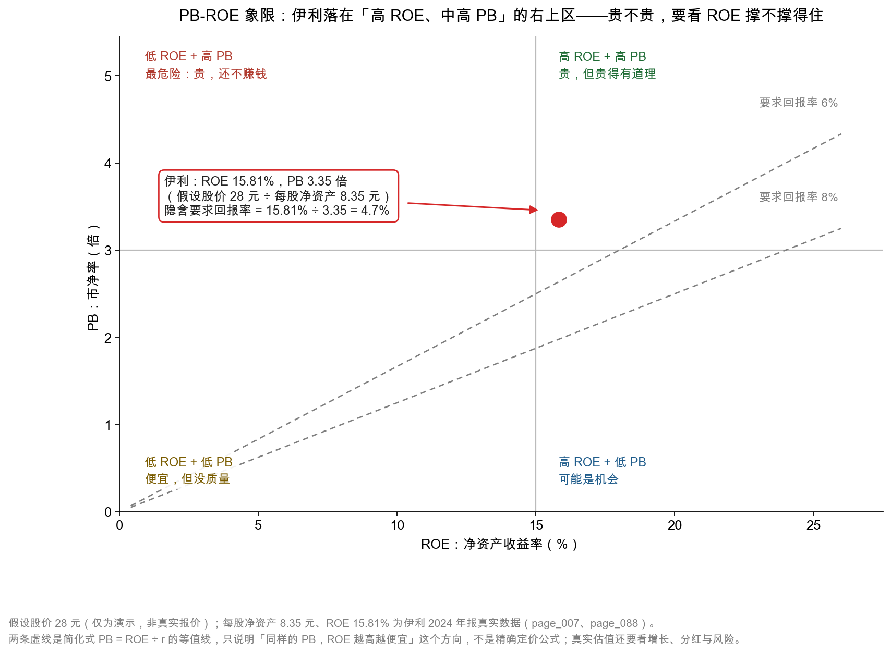

# 第 48 章：市净率 PB 与 ROE——便宜还是贵

> 本章你将：
> - 用"买二手房"的直觉搞懂市净率（PB）：你愿意为"账面 1 元"付几元钱；
> - 亲手算出伊利的 PB：假设股价 28 元（演示价，非真实报价）÷ 每股净资产 8.35 元 = 3.35 倍；
> - 搞懂 PB 和 ROE 的关系，并学会用"隐含要求回报率"这个反推指标判断贵不贵；
> - 知道"破净"（PB 小于 1）到底意味着什么，以及它为什么既可能是机会、也可能是陷阱；
> - 看懂一张 PB-ROE 象限图，并知道 PB 这把尺子适合什么行业、不适合什么行业。

上一章的 PE，分母是"利润"，它假设利润能代表一家公司的赚钱能力。但有些公司利润忽高忽低，甚至亏损，PE 就没法用了。这时候需要第二把尺子——**市净率（Price-to-Book Ratio，简称 PB）**，它的分母是"净资产"，也就是账面上属于股东的那部分家底。

净资产比利润稳得多：一家公司今年可能亏损，但净资产不会一年就归零。所以 PB 在"利润不稳定"的场合特别有用。代价是，它衡量的是"家底"，不是"赚钱能力"——**所以要配一个衡量赚钱能力的指标一起看，那就是 ROE。**

---

## 48.1 从买二手房说起

你要买一套二手房。中介告诉你：这套房 90 平方米，同小区同户型的成交价大约每平方米 5 万元，所以"市场评估价"是 450 万元。现在房东开价 540 万元。

你马上会算：**540 ÷ 450 = 1.2 倍。**

意思是：你愿意为这套房子的"评估价"多付 20%。这个"1.2 倍"，就是房子的市净率。

**市净率（PB）＝ 你付出的价格 ÷ 账面净资产。**

换成股票：

$$\text{PB} = \frac{\text{股价}}{\text{每股净资产}} = \frac{\text{总市值}}{\text{归母净资产}}$$

伊利 2024 年末归母净资产 531.80 亿元，总股本 63.66 亿股，所以：

$$\text{每股净资产} = 531.80 \div 63.66 = 8.35 \text{ 元}$$

在**假设股价 28 元（仅为演示，非真实报价）**下：

$$\text{PB} = 28 \div 8.35 = 3.35 \text{ 倍}$$

**3.35 倍的意思是：账面上每 1 元属于股东的钱，市场愿意付 3.35 元去买。**

这句话值得停下来想一秒。账面 1 元，你付 3.35 元——**你多付的 2.35 元买的是什么？**

买的是"这家公司能用这 1 元赚出更多钱"的预期。伊利 2024 年的 ROE 是 15.81%，意思是账面上每 1 元净资产，一年能赚回 0.1581 元。**如果这个赚钱能力能持续，那么为 1 元账面付 3.35 元，其实是"用 3.35 元买一台每年产出 0.1581 元的机器"，年化回报约 4.7%。**

顺便说一个容易混淆的地方：**PB 的分母是"归母净资产"，不是"总资产"。** 总资产 1,537.18 亿元里，有 967.10 亿元是负债、38.28 亿元是少数股东的权益，真正属于伊利股东的只有 531.80 亿元。**用总资产去除市值，会得到一个完全不同的数（这个数叫"市资率"，很少有人用），和 PB 不是一回事。** 同样，分母也不能用"总权益"（含少数股东），否则你的分子（总市值）和分母（含少数股东的权益）就不匹配了。

再看一层类比：房子除了"评估价"，还有"租金"。如果这套 450 万元的房子每年能收租 18 万元，租售比就是 4%。**PB 和 ROE 的关系，就是"房价"和"租金回报"的关系**：PB 是你要付几倍评估价，ROE 是这套房一年能生多少钱。**只问"几倍"不问"能生多少"，就像只问房价不问租金——你可能买到了一套"看起来很便宜、其实租不出去"的房子。**

<!-- src: 伊利股份2024年报/page_007.md 伊利股份2024年报/page_088.md -->

> 📌 **划重点：** PB 回答的问题是"我为账面家底付了几倍价"，ROE 回答的问题是"这份家底一年能生出多少钱"。**只看 PB 不看 ROE，就像只看房价不看租金——你不知道贵不贵，只知道数字大小。**

## 48.2 PB 与 ROE：一个极简的关系式

先做一个思想实验。

假设有一家公司，账面上有 100 元净资产，它每年能赚 15 元（ROE = 15%），并且**把赚到的钱全部留在公司里继续经营**，所以净资产每年增长 15%。你要求的最低年化回报率是 10%。

这家公司值多少钱？

如果它永远这样增长下去，用上一章"回本"的直觉不好算，但可以用一个更简单的逻辑：**你付的价格 P，对应的是"第一年你能拿到的回报" P $\times$ r（r 是你要求的回报率）；而公司第一年能赚 E = 100 $\times$ ROE。当两者相等时，价格就是"合理价"：**

$$P \times r = 100 \times \text{ROE}$$

$$P = 100 \times \frac{\text{ROE}}{r}$$

因为账面净资产 B = 100，所以：

$$\text{PB} = \frac{P}{B} = \frac{\text{ROE}}{r}$$

代进去：PB = 15% ÷ 10% = **1.5 倍**。

这个式子非常有用，因为它一句话说清了估值的核心逻辑：

> **一家公司的合理 PB，等于它的 ROE 除以你要求的回报率。**

它解释了三个日常现象：

- **ROE 高的公司，PB 也高。** 因为同样的账面 1 元，它能生出更多钱。
- **利率上升时，所有股票的 PB 都会下降。** 因为 r 变大，ROE ÷ r 变小。
- **ROE 只有 5% 的公司，PB 不该超过 0.5 倍（如果 r = 10%）。** 这就是"破净"的理论来源之一。

现在反过来用。伊利在假设股价 28 元下的 PB 是 3.35 倍，ROE 是 15.81%，那么：

$$r = \frac{\text{ROE}}{\text{PB}} = \frac{15.81\%}{3.35} = 4.72\%$$

**这个 4.72%，叫"隐含要求回报率"。** 它的意思是：如果你在 28 元买入，并且伊利真的能永远保持 15.81% 的 ROE、把利润全部留存再投资，那么你的年化回报大约是 4.72%。

4.72% 是高还是低？和十年期国债收益率比一比就知道了。**如果国债收益率是 2.5%，那么 4.72% 意味着你多拿了 2.2 个百分点的"风险补偿"；如果国债是 4%，那这个补偿只有 0.7 个百分点，明显不够。** 这就是为什么"同样的 PB，在不同的利率环境里，含义完全不同"。

> 💡 **你可能会问：** 这个公式这么简洁，是不是可以直接拿来定价？

**不能。** 它是一个"极简模型"，建立在五个很强的假设上：

1. 公司把**全部利润**留存再投资，不分红（伊利 2024 年分红占归母净利润 91.40%，几乎全分掉了）；
2. 新增的每一元投入，都能获得**和现在一样的 ROE**（现实中边际回报通常递减）；
3. ROE **永远不变**（伊利三年里从 20.20% 降到 15.81%）；
4. 增长率 g 恰好等于 ROE $\times$ 留存率（这是戈登模型的内生增长假设）；
5. 你要求的回报率 r 是**常数**（现实中它会随利率、风险偏好变化）。

**五个假设里，伊利至少违反了三个。** 所以这个公式的正确用法不是"算出目标价"，而是"**判断方向**"：ROE 越高、PB 越低，越可能便宜；ROE 在下降、PB 还在上升，就要警惕。

再补一句"为什么这个公式长这样"，因为它其实是一个更熟知的模型的"瘦身版"。如果一家公司每年分红、分红比例固定、利润按 g 增长，那么它的价值可以用"戈登增长模型"写出来：

$$P = \frac{D_1}{r - g}$$

其中 D1 是明年的每股分红。把 D1 换成"每股收益 $\times$ 分红率"，再两边除以每股净资产，就得到：

$$\text{PB} = \frac{\text{ROE} \times \text{分红率}}{r - g}$$

**这个式子比 PB = ROE ÷ r 更接近现实**，因为它把"分红"和"增长"都放进去了。当分红率 = 100%、g = 0 时，它退化成本章开头那个极简式；当分红率 = 91.40%（伊利 2024 年的实际水平）、g = 2% 时，代入 ROE 15.81%、r = 10%，得到 PB = 0.1581 $\times$ 0.9140 ÷ (0.10 - 0.02) = **1.81 倍**——**远低于 3.35 倍。**

这说明什么？说明**在"r = 10%、g = 2%"这组假设下，3.35 倍 PB 是偏贵的**。但如果你把假设改成"g = 5%"（相信伊利能恢复增长），PB 就变成 0.1581 $\times$ 0.9140 ÷ 0.05 = **2.89 倍**，接近了；再把 r 降到 9%，就是 3.21 倍。**三个假设各自动一点点，结论就从"很贵"变成"合理"。** 这个练习的价值不在于算出哪个数对，而在于让你看清：**估值结论对假设有多敏感。** 这也是第 49 章要用 DCF 再讲一遍同一件事的原因。

## 48.3 用一张表看清"贵不贵"

把公式改一改，做成一张表，就能快速判断任何一个 PB 对应的"隐含回报"。

以伊利的每股净资产 8.35 元和 ROE 15.81% 为基准（**假设价均为演示，非真实报价**）：

| 假设 PB | 对应股价 | 隐含要求回报率（ROE ÷ PB） | 与 4% 国债比 | 判断 |
|---|---|---|---|---|
| 2.0 倍 | 16.7 元 | 7.9% | 高 3.9 个百分点 | 便宜，但要问"为什么这么便宜" |
| 2.5 倍 | 20.9 元 | 6.3% | 高 2.3 个百分点 | 偏便宜 |
| 3.0 倍 | 25.1 元 | 5.3% | 高 1.3 个百分点 | 中性 |
| 3.35 倍 | 28.0 元 | 4.7% | 高 0.7 个百分点 | 略贵，安全边际不足 |
| 4.0 倍 | 33.4 元 | 4.0% | 持平 | 贵，靠增长才说得过去 |
| 5.0 倍 | 41.8 元 | 3.2% | 低 0.8 个百分点 | 很贵，需要高增长支撑 |

这张表最有用的一行是 3.35 倍那一行：**隐含回报 4.7%，只比国债高 0.7 个百分点。** 这意味着，在假设价 28 元上，你承担的"公司经营风险"换来的额外回报很薄——**除非你相信伊利的 ROE 会回升、或者利润会增长。**

这里插一个必须讲清的概念：**那 0.7 个百分点，叫"股权风险溢价"（equity risk premium）。** 它的含义是"我买股票而不是买国债，多拿的那点补偿"。成熟市场的研究一般认为，这个溢价长期应该在 3 到 5 个百分点左右——因为股票要承担经营风险、要承受波动、可能被套好几年。**0.7 个百分点明显偏低。** 当然，这个"3 到 5 个百分点"的经验值本身也有争议，而且会随利率环境变化；但它的方向是清楚的：**当隐含回报只比国债高一点点时，你是在用"承担全部经营风险"的代价，换"几乎和国债一样"的回报，这笔买卖不划算。**

而这恰好是第 50 章要回答的问题：伊利 2024 年的 ROE 从 20.20% 掉到 15.81%，是"一次性减值造成的坑"，还是"赚钱能力真的在下台阶"？**如果是前者，ROE 会回到 18% 以上，3.35 倍 PB 就不算贵；如果是后者，15% 可能就是新常态，3.35 倍 PB 就偏贵了。**

> ⚠️ **易踩坑：** 用这个公式时，最容易犯的错是"拿 ROE 最高的那一年去算"。比如用 2023 年的 20.20% 去算，隐含回报就变成 6.0%，看起来便宜多了。**但 2023 年的高 ROE 里，有"没有计提商誉减值"的成分。** 正确做法是：用**最近三年平均 ROE**，或者用**扣非 ROE**（伊利 2024 年扣非加权 ROE 是 11.24%，比 15.81% 低 4.57 个百分点）。用 11.24% 算，28 元对应的隐含回报只有 3.4%，比国债还低——**这才是"保守口径"下的真相。**

<!-- src: 伊利股份2024年报/page_007.md 伊利股份2024年报/page_088.md -->

> 🔍 **翻到年报：** 打开 `page_007.md` 的"主要财务指标"表，找到两行 ROE：**加权平均净资产收益率 15.81%** 和 **扣除非经常性损益后的加权平均净资产收益率 11.24%**。这两个数的差距（4.57 个百分点）就是"非经常性损益 + 减值口径差异"对 ROE 的影响。**做 PB 估值时，用哪个 ROE，会直接决定你认为"贵不贵"** ——这正是本章最需要你亲手算一遍的地方。

## 48.4 破净：PB 小于 1 意味着什么

"破净"是指 PB 小于 1，也就是**股价低于每股净资产**——市场对这家公司的报价，比它账面上的家底还便宜。

听起来像是"白捡钱"，但现实中破净的股票一大堆，原因通常有三种：

**原因一：市场认为净资产是虚的。** 账面上有一栋楼记着 10 亿元，但那个地段已经没人要了，真卖只能卖 4 亿元；账面上有 20 亿元商誉，明年可能减值一半。**当市场认为"账面 1 元其实只值 0.6 元"时，PB 0.7 倍就不算便宜，而是"贵了 17%"。** 这是银行股长期破净的核心原因之一：市场担心坏账，认为贷款资产的质量没有账面那么好。

**原因二：市场认为 ROE 太低，永远赚不回来。** 用公式看：PB = ROE ÷ r。如果一家公司的 ROE 只有 4%，而 r = 8%，那么合理 PB 就是 0.5 倍。**它破净不是因为"资产假"，而是因为"资产不赚钱"。** 这种情况下，破净是合理的定价，不是错杀。

**原因三：市场极度悲观，或者股票被"抛弃"了。** 有些公司基本面还行，但行业被看衰、市值太小、流动性差，机构不愿意买，价格就长期低迷。**这种破净才可能是机会**，但需要你有能力判断"悲观是过度的"。

所以看到破净，正确的反应不是"便宜，买"，而是连问三个问题：

| 问题 | 要查什么 | 在伊利身上怎么用 |
|---|---|---|
| 净资产是真的吗？ | 商誉占比、应收账龄、存货跌价、固定资产成新率 | 伊利商誉 23.37 亿元，占归母净资产 4.4%，比例不高 |
| 资产能赚钱吗？ | ROE、扣非 ROE、ROIC | 伊利 ROE 15.81%，远高于"破净线" |
| 为什么市场这么定价？ | 行业趋势、政策、竞争格局 | 乳业需求疲软、人口结构变化 |

**伊利目前不是破净股**（假设价 28 元下 PB 3.35 倍，远高于 1）。但这一节的知识在用得着的时候很关键：**当你在市场上看到一只 PB 0.6 倍的股票时，你要能判断它属于上面三种原因里的哪一种。** 分不清，就不要碰。

举一个具体的例子说明"破净不等于便宜"有多真实。假设一家公司净资产 100 亿元，其中 30 亿元是商誉、20 亿元是应收账款。现在市值 60 亿元，PB 0.6 倍，看起来"四折买净资产"。但如果你按最保守的方式重估：商誉全部减值为 0、应收按 50% 计提坏账，那么重估后的净资产只有 100 - 30 - 10 = 60 亿元——**PB 正好变成 1.0 倍，"四折"消失了。** 这就是为什么专业投资者看破净股，第一件事不是算 PB，而是**把资产一项一项重估一遍**。这个动作和你在第 3、4 周学过的"资产体检"是同一件事——**九周前练的功夫，在这里兑现。**

## 48.5 PB-ROE 象限图怎么读

把 PB 放在纵轴、ROE 放在横轴，就得到一张四象限图。这是做"质量 vs 价格"判断最直观的工具。

图怎么读？分三步。

**第一步：看它在哪个象限。**

| 象限 | 特征 | 含义 | 该做什么 |
|---|---|---|---|
| 右上（高 ROE + 高 PB） | 好公司，但不便宜 | 市场已经认可它的质量 | 等回调，或者接受较低回报 |
| 左上（低 ROE + 高 PB） | 最危险 | 贵，还不赚钱，靠故事支撑 | 远离 |
| 左下（低 ROE + 低 PB） | 便宜，但没质量 | 可能是"价值陷阱" | 除非有明确的改善逻辑，否则不碰 |
| 右下（高 ROE + 低 PB） | 可能是机会 | 赚钱能力强，但市场不认可 | 重点研究"为什么不认可" |

伊利落在**右上区**：ROE 15.81%，PB 3.35 倍。这个位置的含义是："市场认可它是一家好公司，所以给了溢价；但溢价已经反映了这份认可，所以未来的回报主要靠'公司继续变好'，而不是靠'估值修复'。"

**第二步：看它相对虚线的位置。** 图里两条虚线是"要求回报率 6%"和"8%"的等值线（PB = ROE ÷ r）。**一家公司落在某条线下方，说明在对应回报率下它算便宜；落在上方，说明算贵。** 伊利在 3.35 倍 PB、15.81% ROE 的位置上，落在两条线之间偏上的地方——对应隐含回报约 4.7%，低于 6%，也低于 8%。**所以从"要求回报率"的角度，28 元的假设价并不便宜。**

**第三步：看它的移动方向。** 这是最容易被忽略、也最重要的一步。**象限图是静态的，但公司是动态的。** 伊利 2023 年的 ROE 是 20.20%，2024 年是 15.81%——**它在图上是从右边往左边移动的**（ROE 下降）。如果 2025 年 ROE 继续降到 13%，即使股价不变，PB 会因为净资产增厚而略降，但 ROE 的位置会更靠左，**估值中枢会整体下移**。

反过来，如果 2025 年减值出清、ROE 回到 18%，那么在同样的 PB 下，隐含回报会从 4.7% 升到 5.4%，**这只股票就"变便宜"了——注意，不是股价跌了，是质量变好了。**

**第四步（进阶）：把"绝对水平"换成"历史分位"。** 象限图告诉你"现在在哪"，但没说"这个位置算高还是算低"。要回答后者，得把这家公司过去五年、十年的 PB 画成一条线，看现在的 3.35 倍处在什么分位。**如果历史上它的 PB 在 2.5 倍到 5 倍之间波动，那 3.35 倍就是"中位数附近"；如果历史区间是 4 倍到 8 倍，那 3.35 倍就是"历史低位"。** 这个方法有个前提：**公司的 ROE 中枢没有发生结构性变化。** 如果 ROE 从 20% 掉到 15%，那么"历史 PB 分位"就失去了参考意义——**因为尺子的刻度变了。** 这是"历史分位法"最常被误用的地方。

> 💡 **你可能会问：** 那"高 ROE + 低 PB"的右下象限，是不是最好的买点？

理论上是，但现实中要非常小心，因为**右下象限的股票，往往有一个"市场已经看到、你还没看到"的问题**。比如一家公司 ROE 18%、PB 0.8 倍，看起来完美——但可能是因为它所在的行业正在被替代，市场预期它三年后 ROE 会掉到 5%。**这时候你看到的"高 ROE"是后视镜，市场看的是前挡风玻璃。** 正确做法是：在右下象限找到标的后，先去翻它的年报，找出"市场在担心什么"，再判断这个担心是否成立。

## 48.6 PB 的适用边界：什么时候该用它

PB 不是万能的。它适用的前提是"净资产能代表公司的价值"，而这个前提在很多行业里不成立。

| 行业类型 | PB 适用度 | 原因 |
|---|---|---|
| 银行、保险 | **很适合** | 资产主要是金融资产，账面价值接近市场价值；ROE 稳定 |
| 房地产、公用事业 | 较适合 | 重资产，净资产是主要的价值载体 |
| 周期性制造业（钢铁、化工、航运） | 较适合 | 利润波动大，PE 失真，PB 更稳 |
| 品牌消费品（乳业、白酒） | **只能辅助** | 品牌、渠道不在账上，PB 会系统性偏高 |
| 轻资产服务业（软件、咨询） | 不适合 | 最值钱的资产是人，不进资产负债表 |
| 高商誉的并购型公司 | 慎用 | 净资产里含大量商誉，随时可能减值 |

伊利属于哪一类？**它是"品牌消费品 + 重资产产能"的混合体。** 一方面，它有 346.19 亿元固定资产、107.45 亿元存货，这些是实打实的产能；另一方面，它的品牌、渠道、配方这些最值钱的东西，几乎没有进资产负债表。**所以伊利的 PB 天然会偏高（3 倍以上很正常），你不能拿它和银行股的 0.6 倍去比。**

对伊利来说，PB 的正确用法是**辅助验证**，而不是主要依据：

1. **和同业比**（比如蒙牛），看谁更贵、贵得有没有道理；
2. **和自己的历史比**，看现在的 PB 处在过去五年的什么位置；
3. **配合 ROE 一起看**，判断"这个 PB 是不是被 ROE 支撑得住"。

第 1 条有个坑必须提醒：**同业比较之前，要先把 ROE 的差异"调平"。** 假设 A 公司 PB 4 倍、ROE 20%，B 公司 PB 2 倍、ROE 8%，你不能因为"B 的 PB 更低"就说 B 便宜——用公式算，A 的隐含回报是 5.0%，B 只有 4.0%，**A 反而更便宜。** 正确的同业比较是两步：先比 ROE（谁更会赚钱），再比"PB ÷ ROE"（谁为同样的赚钱能力付得更少）。伊利 ROE 15.81%，如果有一家同业 ROE 12%、PB 2.5 倍，那么伊利的"PB ÷ ROE"是 0.212，同业是 0.208——**两者几乎一样，谁也不比谁便宜。** 这个时候，判断就要交给"增长"和"风险"，而不是估值倍数。

最后，把 PB 也做成一张"反推价格"的表。公式是：**股价 = 每股净资产 $\times$ PB。**

| 假设 PB | 对应股价（每股净资产 8.35 元） | 隐含要求回报率（ROE 15.81%） |
|---|---|---|
| 2.0 倍 | 16.7 元 | 7.9% |
| 2.5 倍 | 20.9 元 | 6.3% |
| 3.0 倍 | 25.1 元 | 5.3% |
| 3.35 倍 | 28.0 元 | 4.7% |
| 4.0 倍 | 33.4 元 | 4.0% |

**这张表和上一章那张 PE 表，会在第 50 章被放在一起，做交叉验证。** 到那时你会看到：两种方法给出的区间并不完全重合，而**重合的那一小段，才是"多个角度都说得通"的价格。**

> 📌 **划重点：** PB 是"价格 ÷ 家底"，ROE 是"家底生钱的效率"。**单独看 PB，你只知道贵不贵；配上 ROE，你才知道"贵得有没有道理"。** 而那个"ROE ÷ PB"的隐含回报率，是把两者粘起来的那把胶水。

## ✍️ 想一想

### 问 1：A 公司 PB 0.5 倍、ROE 3%；B 公司 PB 3 倍、ROE 18%。哪一家更"便宜"？请用本章的公式算一遍再回答。

**解题思路：** 用隐含要求回报率 r = ROE ÷ PB 算，而不是看 PB 的绝对高低。算完还要补一句"这个结论的边界在哪"。

**参考答案：** A 的隐含回报 = 3% ÷ 0.5 = **6.0%**；B 的隐含回报 = 18% ÷ 3 = **6.0%**。**两者一样。** 这个结果很有意思：一家"半价卖资产但不赚钱"的公司，和一家"三倍价卖资产但很赚钱"的公司，在同一套极简模型下，给出的隐含回报完全相同。所以"哪家更便宜"这个问题，光靠 PB 和 ROE 回答不了，还要看两件事：**第一，A 的 3% ROE 会不会改善、B 的 18% 会不会下滑**（方向比水平重要）；**第二，A 的净资产是不是真的**（0.5 倍 PB 可能是因为资产要减值）。如果 A 的资产要减值 30%，那它的真实 PB 是 0.7 倍，隐含回报只有 4.3%，比 B 差。

**易错点：** 直接说"PB 0.5 倍更便宜"。这是把"价格低"当成"价值高"。另一个易错点是忘记这个公式的假设（利润全留存、ROE 不变），把它当成精确结论。**它只能用来排序和判断方向，不能用来定价。**

### 问 2：伊利 2024 年加权平均 ROE 是 15.81%，扣非后是 11.24%。假设股价 28 元（仅为演示，非真实报价），请分别用这两个 ROE 算隐含要求回报率，并说明哪一个更适合用来做"保守估值"。

**解题思路：** 先算 PB（28 ÷ 8.35 = 3.35），再用两个 ROE 分别除以 PB，最后讨论"保守"该用哪个。

**参考答案：** PB = 28 ÷ 8.35 = 3.35 倍。用 15.81%：隐含回报 = 15.81% ÷ 3.35 = **4.72%**。用 11.24%：隐含回报 = 11.24% ÷ 3.35 = **3.35%**。**保守估值应该用 11.24%**，理由是：扣非 ROE 剔除了"卖子公司赚的 25.80 亿元"这类一次性收益，反映的是"主业本身"的资本回报率；而 15.81% 里含着这笔一次性收益，明年不会重演。用 11.24% 算出的 3.35%，已经低于很多国家的国债收益率——**这说明在假设价 28 元上，如果你只用主业赚钱能力来衡量，这笔投资的回报还不如买国债。** 这个结论比"4.72% 略高于国债"要严厉得多，但它更接近真相。

**易错点：** 用"三年平均 ROE"却不说明理由；或者用 2023 年的 20.20%（那一年的高 ROE 有"没提商誉减值"的成分）。另外，别忘了 PB 的分母是"归母净资产"，所以 ROE 也要用"归母口径"，不能用"净利润 ÷ 总资产"之类的错配口径。

### 问 3：有人说"PB 小于 1 就是安全边际"。请举出两个反例，并说明破净股真正该查什么。

**解题思路：** 反例要说明"净资产本身不可靠"或"净资产不赚钱"。然后给出一个可执行的检查清单。

**参考答案：** 反例一：**一家银行 PB 0.6 倍，但它的贷款里有 15% 是可能收不回的。** 如果这 15% 最终要核销，净资产要打 15% 的折扣，真实 PB 就变成 0.6 ÷ 0.85 = 0.71 倍，"安全边际"大幅缩水。反例二：**一家钢铁厂 PB 0.7 倍，但 ROE 只有 2%。** 用公式算，合理 PB = 2% ÷ 8% = 0.25 倍，也就是说 0.7 倍其实是"贵了两倍"。**破净不等于便宜，它可能只是"资产不值钱"或"资产不赚钱"的定价结果。** 破净股真正该查三件事：① 商誉和应收占净资产的比例（判断资产是否虚）；② 扣非 ROE 和过去三年的趋势（判断资产是否赚钱）；③ 行业需求是不是在长期萎缩（判断"便宜"会不会更便宜）。

**易错点：** 把"破净"当成"清算价值"的同义词。清算时资产要打大折扣卖，还要先还债、付遣散费，股东能拿到的往往远低于账面净资产。

## 📎 数据出处

- 伊利股份 2024 年报：`page_007.md`（加权平均 ROE 15.81%、扣非加权 ROE 11.24%、2022~2024 三年 ROE 19.23% / 20.20% / 15.81%）、`page_002.md`（2024 年度分红每股 1.22 元、占归母净利润 91.40%）、`page_087.md`~`page_088.md`（归母净资产 531.80 亿元、总股本 63.66 亿股、商誉 23.37 亿元、固定资产 346.19 亿元、存货 107.45 亿元）、`page_091.md`~`page_092.md`（归母净利润 84.53 亿元）、`page_184.md`（商誉减值明细）
- 数据汇总：`data/yili2024.json` 的 `ratios`（book_value_per_share、roe_weighted_reported）、`balance`、`income`、`nonrecurring` 段
- 本周配图脚本：`figures/gen_w10d48_pb_roe_quadrant.py`

下一章：[第 49 章：DCF 入门——复利、贴现与自由现金流](49-DCF入门-复利贴现与自由现金流.md)
