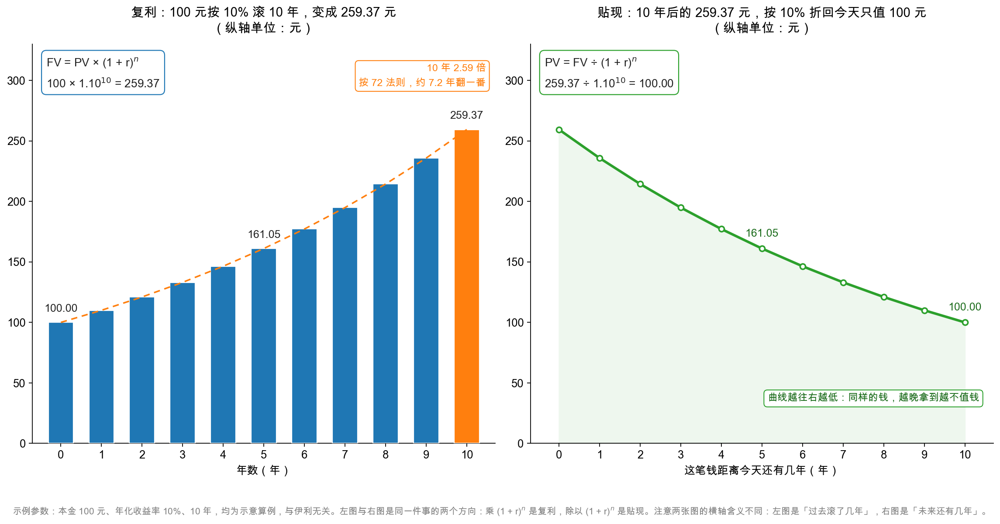
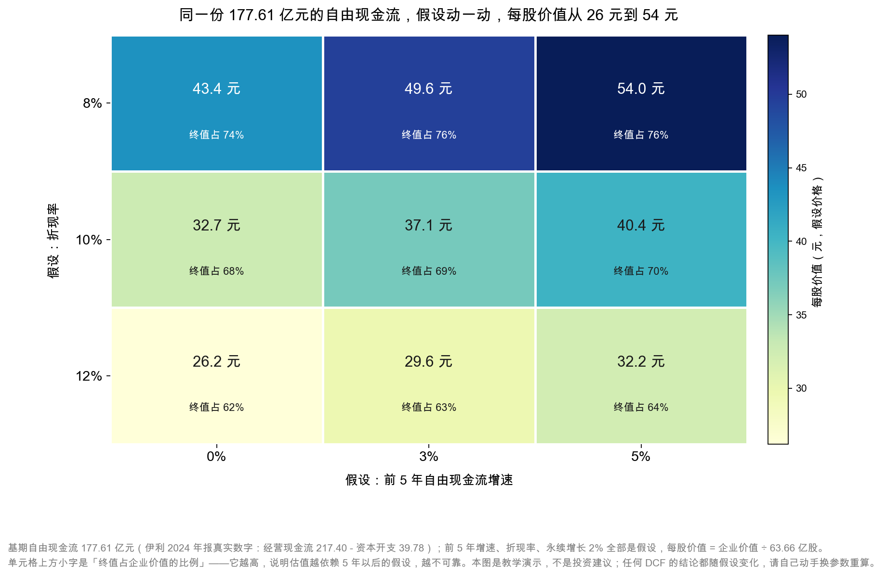

# 第 49 章：DCF 入门——复利、贴现与自由现金流

> 本章你将：
> - 从零学会复利：100 元、年化 10%、10 年，为什么变成 259.37 元而不是 200 元；
> - 学会 72 法则，两秒钟算出"多少钱几年翻一番"；
> - 学会贴现：把 10 年后的 259.37 元折回今天，为什么只值 100 元；
> - 掌握 DCF 的三步：预测自由现金流、算终值、折现加总，并亲手算一遍伊利的例子；
> - 看懂一张"折现率 $\times$ 增速"的敏感性表，并接受一个事实：**DCF 的输出是区间，不是点。**

前面三章，我们讲了两把"相对"的尺子：PE 看利润，PB 看家底。它们的共同点是——**都是拿别人（同业、历史）的价格做参照**。

这一章讲第三把尺子，也是唯一一把"绝对"的尺子：**现金流折现（DCF）**。它不问"别人卖多少钱"，只问一个问题：

> **这家公司未来能给我带来多少现金？把这些现金按一个合理的回报率折回今天，值多少钱？**

听起来很简单，但它需要两个你可能还没学过的数学工具：**复利**和**贴现**。本章会用最慢的速度把它们讲清楚，再用伊利做一次完整示范。

---

## 49.1 复利：利息也能生利息

先把两个词分清楚。

**单利**：只有本金生利息，利息不再生利息。100 元、年化 10%、10 年，每年拿 10 元利息，10 年共 100 元，最后是 200 元。

**复利**：利息也进入本金，下一年连利息一起生利息。同样是 100 元、10%、10 年，结果不是 200 元，而是 **259.37 元**。

为什么多了 59.37 元？因为从第二年开始，你赚利息的"本金"变大了：

| 年 | 年初本金 | 当年利息（10%） | 年末金额 |
|---|---|---|---|
| 1 | 100.00 | 10.00 | 110.00 |
| 10 | 235.79 | 23.58 | **259.37** |

注意第 10 年：你拿到的利息是 23.58 元，是第 1 年（10 元）的 2.36 倍。**同样 10% 的收益率，越到后面，每年赚的绝对金额越大。** 这就是复利最反直觉的地方——**它不是"每年加一样多"，而是"每年加得越来越多"。**

写成公式：

**$FV = PV \times (1 + r)^n$**

四个字母，逐个说清：

- **PV**（Present Value）：现在的钱，也就是"本金"，这里是 100 元；
- **r**：每期的收益率，这里是 10%，写成小数 0.10；
- **n**：期数，这里是 10 年；
- **FV**（Future Value）：未来的钱，也就是"终值"。

代入：$100 \times (1 + 0.10)^{10} = 100 \times 2.5937 = 259.37$ 元。

**这个式子必须自己按一遍计算器。** 不是因为它难，而是因为很多人对"指数"没有体感——他们会下意识地以为 10 年 10% 就是"翻一倍"，实际上是 2.59 倍。**这个"体感误差"，会让所有估值计算失真。**

还有一个更反直觉的现象：**复利的"加速度"在后期才显现。** 前 5 年从 100 元涨到 161.05 元，涨了 61.05 元；后 5 年从 161.05 元涨到 259.37 元，涨了 98.32 元。**同样长的时间，后 5 年多涨了 61%。** 而你在这两个 5 年里，付出的本金都是 100 元、承受的收益率都是 10%。**唯一变化的是"本金变大了"。** 这就是复利为什么"越到后期越猛"，也是为什么"长期持有"在数学上有意义——**不是因为长期一定涨，而是因为时间的指数效应只在长周期里才显现。**

这个观察对估值有一个直接的应用：**当你用 DCF 给一家公司估值时，越远期的现金流，权重看起来越小（因为折现因子在衰减），但它的"绝对金额"却越大（因为复利在增长）。** 两个效应互相拉扯，最终的结果是——**第 5 年到第 10 年这一段，往往是"折现损失"和"增长收益"最接近平衡的地方。** 这也是为什么多数 DCF 把"明确预测期"定在 5 到 10 年，而不是 3 年或 20 年。

### 72 法则：两秒钟算翻倍

复利公式要按计算器，但有一个心算的近似法，叫 **72 法则**：

$$\text{翻倍所需年数} \approx \frac{72}{\text{年化收益率（\%)}}$$

年化 10%，72 ÷ 10 = **7.2 年**翻一番；十年下来大约是两点六倍，不是两倍。年化 8%，9 年。年化 5%，14.4 年。年化 3%，24 年。**记住它，你就有了不靠计算器的长期直觉。**

验证一下：$1.10^{7.2} \approx 1.99$，确实接近 2。误差很小，够用了。

| 年化收益率 | 72 法则算出的翻倍年数 | 精确值 | 30 年后的倍数 |
|---|---|---|---|
| 3% | 24.0 年 | 23.4 年 | 2.43 倍 |
| 8% | 9.0 年 | 9.0 年 | 10.06 倍 |
| 10% | 7.2 年 | 7.3 年 | 17.45 倍 |

这张表最该看的是最后一列：**同样是 30 年，3% 和 15% 的差距是 27 倍。** 年化收益率差几个百分点，三十年后就是「几倍」与「几十倍」的差别——那一点点会被时间放大成鸿沟。 这就是为什么"长期收益率差几个百分点"在投资里是生死攸关的事——**它不是线性的差距，是指数的差距。**

> 💡 **你可能会问：** 那复利对估值有什么用？

用处在于：**它解释了"为什么未来的钱不值现在的钱"。** 如果今天的 100 元，按 10% 能滚成 10 年后的 259.37 元，那么反过来说——**10 年后的 259.37 元，只等于今天的 100 元。** 这就是下一节的贴现。

> 📌 **划重点：** 复利公式只有四个字母，但它决定了三件事：你的钱怎么长大、未来的钱怎么折回今天、以及为什么"早开始"比"多投入"更重要。**72 法则用来心算，精确公式用来验算。**

## 49.2 贴现：把未来的钱折回今天

贴现（discounting）就是复利的逆运算。

复利问："今天的 100 元，10 年后变成多少？"答案是 259.37 元。
贴现问："10 年后的 259.37 元，今天值多少？"答案是 100 元。

公式就是把复利公式反过来除：

**$PV = \dfrac{FV}{(1 + r)^n}$**

代入：$259.37 \div (1 + 0.10)^{10} = 259.37 \div 2.5937 = 100.00$ 元。

**注意"除以"和"乘以"的区别**——这是本章最容易搞混的地方：

- 从今天往未来走，**乘以** $(1+r)^n$，钱变大（复利）；
- 从未来往今天走，**除以** $(1+r)^n$，钱变小（贴现）。

一个记忆办法：**未来永远比今天"远"，所以未来的钱永远比今天的同额钱"小"。** 你现在拿到 100 元，比十年后拿到 100 元更值钱，因为现在这 100 元可以立刻去投资、去吃顿好的、去应急。

### 为什么未来的钱不值钱：三个理由

**理由一：通货膨胀。** 今天的 100 元能买 20 杯咖啡，十年后的 100 元可能只能买 13 杯。**钱的购买力在缩水。**

**理由二：机会成本。** 今天的 100 元可以拿去投资，十年后变成 259 元。**你放弃的这 159 元，就是"等待"的代价。**

**理由三：不确定性。** 十年后那 259 元，可能拿得到，也可能拿不到（公司破产了、项目黄了）。**不确定的东西，要打折。**

这三个理由合起来，就是"折现率"（discount rate）的经济含义：**它是你把未来的钱换算成今天的钱时，要求的最低补偿。** 折现率越高，未来的钱越不值钱。

用几个数看折现率的威力——同样是"10 年后的 100 元"，折现率 5% 时今天值 61.4 元，8% 时 46.3 元，10% 时 38.6 元，12% 时只剩 32.2 元。
**折现率从 5% 提到 12%，"10 年后的 100 元"的今天价值从 61.4 元掉到 32.2 元，几乎腰斩。** 这就是为什么"利率上升会杀估值"——**不是公司变差了，是折现率变大了，未来的钱被折得更狠了。**

再换一个角度感受"时间"的威力。同样是 100 元、同样是 10% 折现率：5 年后拿到只值 62.09 元，10 年后 38.55 元，20 年后 14.86 元，**30 年后只剩 5.73 元。** 这不是说"未来的钱不重要"，而是说：**在 DCF 里，超过 20 年的现金流，对今天的估值几乎没有贡献。** 所以那些"这家公司能活一百年，所以很值钱"的说法，在严格折现的框架里站不住——**能活一百年很好，但第一百年的现金流折回今天，几乎等于零。** 真正决定估值的，是未来 10 到 20 年的现金流，以及那段时期之后"打包成一个终值"的部分。

> ⚠️ **易踩坑：** 很多人把"折现率"和"增长率"搞混。**增长率 g 是公司未来现金流的增速（往未来推），折现率 r 是把未来折回今天的比率（往今天拉）。** 在 DCF 里，g 出现在分子（现金流在长），r 出现在分母（折现）。**两个都变大，估值可能一涨一跌；两个都变小，可能一跌一涨。** 这是第 49.5 节要重点讲的"剪刀差"。

## 49.3 DCF 三步：把一家公司拆成一串现金流

现在可以讲 DCF 了。它的逻辑非常朴素：

> **一家公司的价值 = 它未来能产生的所有自由现金流，折回今天的总和。**

自由现金流（FCF）你在第 39 章学过：**经营现金流减去资本开支**，是公司真正能自由支配的钱。伊利 2024 年是 177.61 亿元。

但"未来所有"是无限的，没法一年一年算到永远。所以 DCF 把未来切成两段：

**第一段：可预测的 5~10 年。** 逐年预测现金流，逐年折现。**第二段：之后的"永远"。** 用一个公式打包成"终值"（Terminal Value，TV），再折现。

三步走：

为什么要分两段？"永远"没法逐年算：算到第 50 年，第 40 年的现金流折回今天只剩几毛钱；只算 5 年，又丢掉了"第 6 年以后还在赚钱"这一大块。**分两段是折中：近处算细账，远处打包成终值。** 代价是——**终值假设最粗，却往往占估值的大头**（伊利例子里占近七成）。

**第一步：预测前 5 年的自由现金流。** 需要一个假设的增速 g。第 t 年的 FCF = 基期 FCF $\times (1+g)^t$。

**第二步：算终值。** 用"永续增长模型"（也叫戈登增长模型）：

$$TV = \frac{FCF_{n+1}}{r - g_{\infty}} = \frac{FCF_n \times (1 + g_{\infty})}{r - g_{\infty}}$$

其中 $g_{\infty}$ 是"永续增长率"，也就是第 5 年之后，公司现金流永远按这个速度增长。**这个数字通常取得很小（1%~3%），因为没有任何公司能永远高速增长。**

**第三步：全部折现加总。**

把两段折现值相加，就是企业价值；再除以股本，得到每股价值。

### 亲手算一遍：伊利，增速 3%、折现率 10%

用一组具体的假设走一遍全过程。**基期自由现金流 177.61 亿元（真实数字）**，前 5 年增速 3%、折现率 10%、永续增长 2%（**这三个都是假设**）。

**第一步：预测前 5 年 FCF，并逐年折现。**

| 年 | FCF（亿元） | 折现因子 $1/(1.10)^t$ | 折现值（亿元） |
|---|---|---|---|
| 第 1 年 | 182.94 | 0.9091 | 166.31 |
| 第 2 年 | 188.43 | 0.8264 | 155.73 |
| 第 3 年 | 194.08 | 0.7513 | 145.82 |
| 第 4 年 | 199.91 | 0.6830 | 136.54 |
| 第 5 年 | 205.90 | 0.6209 | 127.85 |
| 前 5 年合计 | — | — | **732.25** |

**第二步：算终值。** 第 6 年的 FCF = 205.90 $\times$ 1.02 = 210.02 亿元。

$$TV = \frac{210.02}{0.10 - 0.02} = 2{,}625.3 \text{ 亿元}$$

**第三步：把终值折回今天，再加总。**

$$PV(TV) = \frac{2{,}625.3}{1.10^{5}} = 1{,}630.1 \text{ 亿元}$$

$$\text{企业价值} = 732.25 + 1{,}630.1 = 2{,}362.4 \text{ 亿元}$$

$$\text{每股价值} = 2{,}362.4 \div 63.66 = 37.1 \text{ 元}$$

**所以，在"增速 3%、折现率 10%、永续 2%"这组假设下，伊利的每股价值约为 37.1 元。**

**这个 37.1 元里，有多少来自"前 5 年"？** 732.25 ÷ 2,362.4 = 31%。**有多少来自"第 5 年之后的永远"？** 1,630.1 ÷ 2,362.4 = **69%**。

记住这个 69%。它是 DCF 最脆弱的地方——**你的估值有七成，取决于一个你根本无法验证的假设（第 5 年之后永远怎么走）。**

## 49.4 三档增速 $\times$ 三档折现率：九种可能

上面那组假设（3%、10%）只是九种组合里的一种。现在把假设打开。

**为什么选 0%、3%、5% 这三档增速？** 因为它们对应三种对伊利未来的判断：

- **0%：收入继续下滑，但毛利率和现金流守住。** 2024 年营业收入 -8.24%，如果 2025~2029 年继续小幅下滑，FCF 靠"毛利率改善 + 资本开支下降"维持零增长，是可能的。
- **3%：收入企稳、份额守住。** 这是"中性情景"——乳业需求不再恶化，公司靠产品结构升级（高端白奶、奶酪、奶粉）实现略高于通胀的增长。
- **5%：恢复增长。** 这需要"收入重回增长 + 利润率修复"，是偏乐观的情景。

**为什么选 8%、10%、12% 这三档折现率？** 它们对应三种"要求回报"：

- **8%：低利率环境下的要求回报。** 适合"确定性很高、负债很低"的公司。
- **10%：中性假设。** 大致等于"长期国债 3% + 股权风险溢价 7%"，是很多机构的基准。
- **12%：保守假设。** 适合"收入在下滑、商誉还有风险"的公司。

把九种组合都算出来：

| 前 5 年增速 | 折现率 8% | 折现率 10% | 折现率 12% |
|---|---|---|---|
| **0%** | 43.4 元 | 32.7 元 | 26.2 元 |
| **3%** | 49.6 元 | 37.1 元 | 29.6 元 |
| **5%** | 54.0 元 | 40.4 元 | 32.2 元 |

九个数，最低 26.2 元，最高 54.0 元，**相差一倍多**。而它们用的是**同一个基期现金流、同一家公司、同一年报**。

**DCF 的真相：它不给"正确的价格"，只给一张"假设—结果"的地图。** 你在地图上选一个点，等于宣布"我相信这组假设"。**所以 DCF 的真正用途，不是算出 37.1 元然后照着买，而是想清楚："我愿意为哪一组假设付钱？这组假设成立的概率有多大？"**

图里还标了每个格子的"终值占比"，从 62% 到 76%。**折现率越低、增速越高，终值占比越高**——因为远期越值钱。这也意味着：**越乐观的假设，越依赖"遥远的未来"，越不可靠。**

<!-- src: 伊利股份2024年报/page_094.md 伊利股份2024年报/page_095.md 伊利股份2024年报/page_092.md 伊利股份2024年报/page_217.md 伊利股份2024年报/page_088.md -->

> 🔍 **翻到年报：** 这张表里唯一来自年报的数字是基期自由现金流 177.61 亿元。它不是一个科目，而是两个科目相减：`page_094.md` 的"经营活动产生的现金流量净额"217.40 亿元，减去 `page_095.md` 的"购建固定资产、无形资产和其他长期资产支付的现金"39.78 亿元。**你可以自己翻这两页验算一遍**——这是全章唯一需要"事实"的地方，其余全是假设。

## 49.5 为什么 DCF 只能给区间

现在回答本章最重要的问题：**为什么不能把 37.1 元当成"伊利值 37.1 元"？**

三个原因。

**原因一：终值占了七成，而终值几乎无法验证。**

37.1 元里有 69% 来自"第 5 年之后的永远"。而"永远"这个词，建立在两个假设上：永续增长率 2%、折现率 10%。**这两个数各动 1 个百分点，结果会怎样？**

- 永续增长从 2% 提到 3%（其他不变）：终值从 2,625.3 亿元变成 2,959.6 亿元，每股价值从 37.1 元升到 41.1 元；
- 折现率从 10% 提到 11%（其他不变）：每股价值从 37.1 元降到 33.0 元。

**一个百分点的假设，能带来 10%~11% 的价值变化。** 而你根本无法验证"永续增长到底是 2% 还是 3%"——**这是 DCF 的内在缺陷，不是你的能力问题。**

**原因二：增速和折现率会"剪刀差"。**

看那张 3 $\times$ 3 表：增速从 0% 到 5%，每股价值从 43.4 元升到 54.0 元（在 r = 8% 时），**升了 24%**；折现率从 8% 到 12%（在 g = 0% 时），每股价值从 43.4 元降到 26.2 元，**降了 40%**。

**折现率的影响比增速更大。** 这意味着：**当你判断一家公司"便宜"时，先问自己"是不是我对折现率的假设太低了"。** 很多"看起来很便宜"的 DCF 结论，都是因为用了 8% 的折现率——而 8% 在利率上行周期里，可能过于乐观。

**原因三：基期现金流本身可能是"一次性的"。**

伊利 2024 年 177.61 亿元的自由现金流，是"经营现金流 217.40 亿元 - 资本开支 39.78 亿元"。但 217.40 亿元里，有 52.31 亿元是"减值加回"（不花钱的费用）、有 50.21 亿元是"营运资本释放"（收回旧账、卖掉存货）。**这两块加起来 102.52 亿元，都不是"每年都有"的。** 如果你用 177.61 亿元做基期，等于假设"明年还能收回这么多旧账"。

**更保守的做法：用"可持续自由现金流"做基期。** 一个粗略的算法是：净利润 84.64 亿元 + 折旧摊销 46.12 亿元 - 资本开支 39.78 亿元 = **90.98 亿元**。用这个数替换 177.61 亿元，其他假设不变（g = 3%、r = 10%），每股价值会从 37.1 元降到约 **19.0 元**。

**同一家公司，基期从 177.61 亿元换成 90.98 亿元，估值从 37.1 元掉到 19.0 元。** 这个差距，比"增速从 0% 调到 5%"大得多。

**所以 DCF 的正确输出形式，是一个区间加上一组明确的假设：**

> "在基期自由现金流 177.61 亿元、前 5 年增速 0%~5%、折现率 8%~12%、永续增长 2% 的假设下，伊利的每股价值在 26~54 元之间；如果把基期换成更保守的可持续现金流 90.98 亿元，同一张表的区间会整体下移到 14~28 元。"

**这句话不干脆，但它是诚实的。** "37.1 元"很干脆，但它骗人。

### 一个技术细节：净负债要调整

上面的计算里，我用"企业价值 ÷ 股数"直接得到每股价值。严格来说，还差一步：**企业价值（EV）是"整个公司"的价值，包括债权人的部分；股东拿到的是"企业价值 - 净有息负债"。**

伊利有息负债 605.58 亿元、类现金 652.07 亿元，**净有息负债为 -46.50 亿元**（"净现金"）。所以：

**股东价值 = 2,362.4 + 46.50 = 2,408.9 亿元；每股价值 = 2,408.9 ÷ 63.66 = 37.8 元。**

**多了 0.7 元。** 金额不大，但这个动作必须做——**如果净负债是正的 500 亿元而你忘了减，估值就会高估一大截。** 伊利是净现金公司，调整后略微变贵；负债高的公司则相反。

> 💡 **你可能会问：** 那"假设股价 28 元"对应的是哪一组假设？

用那张表反查：28 元最接近"增速 3%、折现率 12%"，对应 29.6 元。也就是说，**如果你认为 28 元是合理的，你实际上是在说："我相信伊利未来 5 年现金流年均增长 3%，但我要求 12% 的回报。"** 这是一个"中性偏保守"的组合。

反过来说：**如果你相信增速能到 5%、折现率只要 10%，那你算出来的价值是 40.4 元，28 元就是"七折"。** 两个人都看着同一个 28 元，一个觉得"合理"，一个觉得"便宜三成"——**差别全在假设里，不在价格里。**

## 49.6 DCF 的五个常见错误

DCF 的公式只有三行，但用错的方式有无数种。五个最常见的，每一个都能让估值差出一倍。

**错误一：用净利润代替自由现金流。** 净利润扣了折旧（不花钱）、加了应收（没收到钱），不等于"能自由支配的现金"。伊利净利润 84.64 亿元、自由现金流 177.61 亿元，差 93 亿元——**用净利润做基期，会系统性低估重资产公司。**

**错误二：永续增长率 g 大于或等于折现率 r。** 看 $TV = FCF \div (r-g)$：g 接近 r 时分母趋近 0，终值趋近无穷大。**这在数学上是"除以零"，在经济上是"这家公司永远比整个经济长得快"——不可能。** g 通常不高于长期 GDP 增速（2%~3%）。

**错误三：忘了资本开支。** 有些简化版 DCF 直接拿经营现金流做基期。对伊利来说，这会高估 39.78 亿元（22%）。**对重资产行业，这个错误是致命的。**

**错误四：把一次性现金流当成常态。** 177.61 亿元里含 52.31 亿元减值加回、50.21 亿元营运资本释放，**这两块明年不一定还有**；用 90.98 亿元的可持续现金流做基期，估值会低一半——**这不是悲观，是保守。**

**错误五：忘记少数股东和净负债。** 伊利少数股东损益只占净利润 0.13%，影响很小；但如果一家公司的少数股东损益占 30%，你用"企业价值 ÷ 总股数"就会高估股东价值。**正确做法：先减净负债，再按归母比例调整。**

再补一句"什么时候该用 DCF"。它最适合三种公司：**现金流稳定可预测的（公用事业、必需消费）、资本开支已经稳定的（扩张期结束）、负债结构简单的。** 它最不适合三种公司：**早期高增长（现金流为负，无从预测）、强周期（基期选哪一年决定一切）、金融类（"现金流"这个概念本身就要重定义）。** 伊利属于第一类里偏"稳定"的那种，所以 DCF 可用，但必须做敏感性分析——**这也是为什么本章花了整整一节去讲"为什么只能给区间"。**

> 📌 **划重点：** DCF 的价值不在"算出那个数"，而在"逼你把假设写下来"。**诚实的 DCF 输出一张表加一段话；骗人的 DCF 输出一个精确到小数点后两位的数字。**

## ✍️ 想一想

### 问 1：100 元、年化 8%、20 年，复利终值是多少？用 72 法则估算"翻几倍"，再用精确公式验算，两者差多少？

**解题思路：** 先用 72 法则算翻倍年数（72 ÷ 8 = 9 年），20 年约翻 2.2 次（20 ÷ 9），即约 4.6 倍；再用 $1.08^{20}$ 精确算。

**参考答案：** 72 法则：翻倍需要 9 年，20 年里有 2.22 个"9 年"，所以大约翻 2.22 次，倍数约 $2^{2.22} \approx 4.65$ 倍，终值约 465 元。精确计算：$1.08^{20} = 4.661$，终值 **466.1 元**。两者相差不到 1 元，误差 0.2%。**结论：72 法则在 8% 这个量级上非常准，可以放心用于心算。** 但收益率越高，72 法则误差越大（20% 时算 3.6 年，精确 3.8 年）。

**易错点：** 把"翻 2.22 次"算成"翻 2.22 倍"（少了一次方）；别把 20 年当成"20 个 9 年"。

### 问 2：在第 49.3 节的算例里，前 5 年现金流的折现值合计 732.25 亿元，终值折现 1,630.1 亿元。如果我把折现率从 10% 提高到 12%，其他假设不变，每股价值会变成多少？这个变化说明了什么？

**解题思路：** 直接用第 49.4 节的敏感性表查（增速 3%、折现率 12% 那一格），再解释"为什么折现率的影响这么大"。

**参考答案：** 查表得 **29.6 元**（从 37.1 元降下来，降幅 20.2%）。说明两点：**第一，折现率是 DCF 里最敏感的假设之一。** 因为折现率同时出现在两个地方——它既是每年的折现因子，又是终值公式的分母（r - g），所以它对结果的影响是"双倍"的。**第二，"要求回报率"的选择，本质上是"风险判断"。** 从 10% 提到 12%，等于说"我认为这家公司的风险比我原先想的更高，所以我要更高的补偿"。这个判断不需要改变任何经营假设，就能让估值降两成——**这就是为什么"同一家公司，不同的人估出不同的价"是常态，而不是谁算错了。**

**易错点：** 只算前 5 年的折现、忘了终值也要按新折现率折回（终值折现因子从 $1.10^5$ 变成 $1.12^5$）。另外，别把"降 20%"算成"降 2%"——折现率变动 2 个百分点，对估值的影响是十几个百分点。

### 问 3：有人说"伊利 2024 年自由现金流 177.61 亿元，按 3% 永续增长、10% 折现，值 37 元，所以现在（假设价 28 元）很便宜"。请指出这个推理里至少两个问题。

**解题思路：** 一是"基期现金流是否可持续"，二是"单一情景是否可靠"，三是"便宜与否要和假设比，而不是和价值比"。

**参考答案：** 问题一：**177.61 亿元不是一个"可持续"的基期。** 它包含 52.31 亿元减值加回、50.21 亿元营运资本释放，这两块都不一定年年有。用"净利润 + 折旧摊销 - 资本开支"算出的可持续现金流约 90.98 亿元，用它做基期，估值会从 37 元降到 19 元左右。问题二：**只给一个情景（3%、10%）是不够的。** DCF 的输出应该是区间：0%~5% 增速、8%~12% 折现率的九种组合，结果是 26~54 元（保守基期下整体下移到 14~28 元）。只说"37 元"等于把区间压缩成一个点，掩盖了不确定性。问题三：**"28 元便宜"这个结论，只在"37 元"这个假设下成立。** 如果按保守基期算，价值是 19.0 元，28 元就是"贵了 47%"。**同样的价格，结论完全相反——所以"便宜"这个词，必须跟着"在什么假设下"一起说。**

**易错点：** 只说"折现率可能不对"，不检查基期。基期错了，后面全错，而且错得比折现率更狠。另一个易错点是忘记"净负债调整"，虽然对伊利影响只有 0.7 元，但习惯要养成。

## 📎 数据出处

- 伊利股份 2024 年报：`page_094.md`（经营现金流 217.40 亿元）、`page_095.md`（资本开支 39.78 亿元）、`page_092.md`（净利润 84.64 亿元）、`page_217.md`（折旧摊销 46.12 亿元、减值 46.76 与 5.55 亿元）、`page_088.md`（总股本 63.66 亿股）、`page_195.md`（有息负债明细）、`page_166.md` 与 `page_188.md`（大额存单与定期存款）
- 数据汇总：`data/yili2024.json` 的 `ratios`（free_cash_flow 177.61 亿元、interest_bearing_debt 605.58 亿元、cash_and_deposits 652.07 亿元、net_interest_bearing_debt -46.50 亿元）、`cashflow`、`balance`、`income` 段
- 本章所有增速、折现率、永续增长率均为**假设**；复利与贴现算例（100 元、10%、10 年）为示意数字
- 本周配图脚本：`figures/gen_w10d49_compounding_discounting.py`、`figures/gen_w10d49_dcf_sensitivity.py`

下一章：[第 50 章：大结业——给伊利估一个区间，写你的第一份分析报告](50-大结业-给伊利估一个区间.md)
