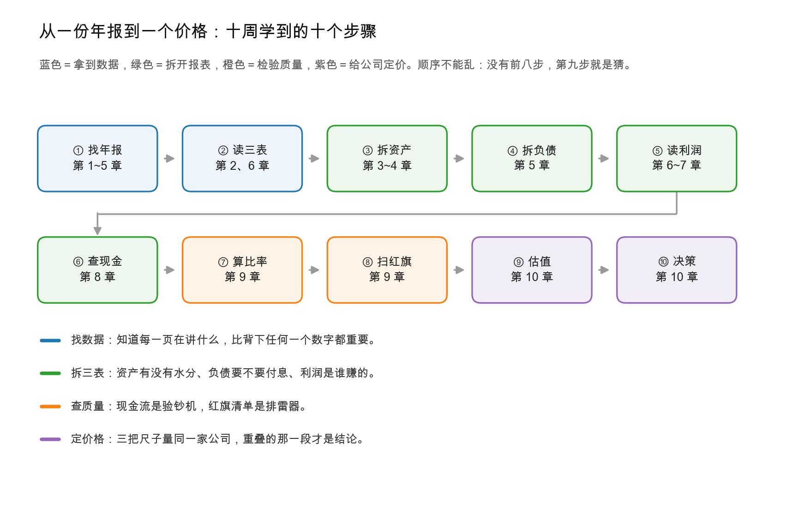
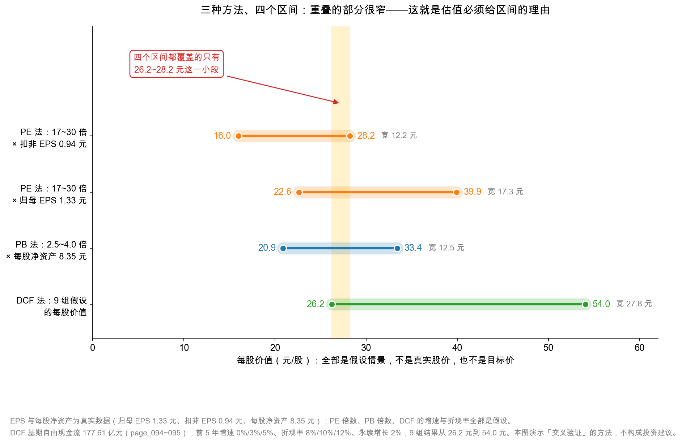
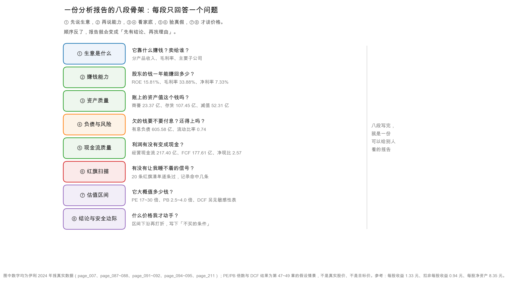

# 第 50 章：大结业——给伊利估一个区间，写你的第一份分析报告

> 本章你将：
> - 把十周学过的十个动作装配成一条完整的流水线，知道每一步为什么不能跳；
> - 用 PE、PB、DCF 三把尺子给伊利各算一个区间，再把它们叠在一起做交叉验证；
> - 拿到一份可以直接套用的分析报告八段骨架，以及每段该填什么数字；
> - 读懂全书那条最重要的洞见在估值上兑现成什么：**利润下滑、主业改善、估值的关键变量是"减值是否出清"和"收入能否恢复"**；
> - 带走一张常见错误清单，和一份"下一份年报看什么"的清单。

十周前，你打开一份 270 页的年报，不知道从哪一页看起。今天，你能把这家公司拆开、量一遍、再装回去——**这一章就是最后一道工序：给它标一个价。**

标价之前先说一句必须说的话：**本章所有的股价、PE、PB 都是假设情景，不是真实报价，也不是目标价。** 年报里没有股价，任何人告诉你的"伊利值多少钱"，都必须配上"在什么假设下"。**你学的不是答案，是算法。**

---

## 50.1 十周总装：从一份年报到一纸结论

先把这十周的动作排成一条线。**这条线的顺序不能乱，因为后一步的输入，是前一步的输出。**

十个步骤，分四段：

**第一段：拿到数据（第 1~2 章）。** 找到年报、翻到三张表、知道附注在哪。这一步看起来最简单，但它决定了后面所有数字的出处。**很多分析出错，不是算错，是抄错了列或搞错了口径。**

**第二段：拆开报表（第 3~8 章）。** 资产有没有水分（商誉、存货、应收）、负债要不要付息（有息负债占比）、利润是谁赚的（主业还是杂项）、现金是不是真的（经营现金流对不对得上）。**这一段是全书的重量所在，也是你和"只看 PE 的人"拉开差距的地方。**

**第三段：检验质量（第 9 章）。** 三表勾稽、杜邦分解、周转率、红旗清单。**这一段的作用是"排雷"**：在给一家公司定价之前，先确认它的账没有明显问题。

**第四段：定价与决策（第 10 章）。** 三把尺子量一遍，交叉验证，得出区间，再和安全边际比。

把这条线落到伊利身上，每一步的产出是这样的：

| 步骤 | 学会了什么 | 在伊利身上得到了什么 |
|---|---|---|
| ① 找年报 | 年报骨架、页码地图 | 三张表在 page_087~095，附注在 page_166~217 |
| ② 读三表 | 恒等式、权责发生制 | 资产 1,537.18 亿 = 负债 967.10 亿 + 权益 570.08 亿 |
| ③ 拆资产 | 资产质量五问 | 商誉从 51.60 亿减到 23.37 亿；存货 107.45 亿 |
| ④ 拆负债 | 有息 vs 经营、期限结构 | 有息负债 605.58 亿，但类现金 652.07 亿，净有息负债为 -46.50 亿 |
| ⑤ 读利润 | 毛利率、费用率、含水量 | 毛利率 33.88%（+1.30 个百分点）；扣非 60.11 亿 |
| ⑥ 查现金 | 间接法、自由现金流 | 经营现金流 217.40 亿（+18.86%）；FCF 177.61 亿 |
| ⑦ 算比率 | 杜邦、周转、现金转换周期 | ROE 15.81%；三类周转都快（第 43 章） |
| ⑧ 扫红旗 | 三条造假路径、20 条清单 | 主要疑点在"减值是否出清"，不在"收入造假" |
| ⑨ 估值 | PE、PB、DCF | 三个区间（下一节） |
| ⑩ 决策 | 安全边际、能力圈 | 一个"什么价格才动手"的规则 |

<!-- src: 伊利股份2024年报/page_007.md 伊利股份2024年报/page_011.md 伊利股份2024年报/page_014.md 伊利股份2024年报/page_087.md 伊利股份2024年报/page_088.md 伊利股份2024年报/page_091.md 伊利股份2024年报/page_094.md 伊利股份2024年报/page_211.md -->

> 🔍 **翻到年报：** 如果你只翻一页来回顾这十周，翻 `page_007.md`。那一页有营业收入、归母净利润、扣非净利润、经营现金流、归母净资产、总资产、EPS、ROE——**十周里最关键的八个数字，一页全在。** 这就是"主要会计数据"这张表存在的意义：它是整份年报的"摘要卡"。

## 50.2 三把尺子，三个区间

现在把第 47、48、49 章的结果摆在一起。**这一步叫"交叉验证"：如果三种完全不同的方法给出大致重叠的区间，那个重叠处才值得信任。**

### 第一把尺子：PE 法

用假设 PE 17~30 倍，乘两个 EPS 口径（**假设价，非真实报价**）：

| 口径 | EPS | 17 倍 | 30 倍 | 区间 |
|---|---|---|---|---|
| 扣非 EPS | 0.94 元 | 16.0 元 | 28.2 元 | **16.0~28.2 元** |
| 归母 EPS | 1.33 元 | 22.6 元 | 39.9 元 | **22.6~39.9 元** |

为什么上限取 30 倍、下限取 17 倍？**因为这是市场对"成熟消费龙头"常见的估值带**：低于 17 倍，通常意味着市场在担心"增长停滞"或"治理问题"；高于 30 倍，则需要"明确的增长故事"支撑。**这个 17~30 不是真理，是一段观察到的经验区间**——你可以换成 15~25 或 20~35，结论会跟着变，这正是"假设"的含义。

### 第二把尺子：PB 法

用假设 PB 2.5~4.0 倍，乘每股净资产 8.35 元：

| 口径 | 每股净资产 | 2.5 倍 | 4.0 倍 | 区间 |
|---|---|---|---|---|
| 归母净资产 | 8.35 元 | 20.9 元 | 33.4 元 | **20.9~33.4 元** |

为什么是 2.5~4.0 倍？伊利的 ROE 是 15.81%，如果要求回报率在 4%~6.3% 之间，PB 就落在 2.5~4.0 倍（$15.81\% \div 6.3\% = 2.5$，$15.81\% \div 4.0\% = 3.95$）。**换句话说，这个区间等价于"要求回报率 4%~6.3%"，你可以直接用它和国债收益率对比。**

### 第三把尺子：DCF 法

第 49 章那张 3 $\times$ 3 敏感性表，九个结果从 **26.2 元到 54.0 元**。如果换成更保守的基期（可持续自由现金流 90.98 亿元），区间整体下移到 **14~28 元**。

**注意：DCF 的区间比其他两个宽得多。** 这不是 DCF 更"差"，而是它更诚实地暴露了不确定性——PE 和 PB 的区间窄，是因为它们"借用了市场的定价习惯"，而市场的定价习惯本身已经把不确定性压缩过了。

### 把三个区间叠起来

四个区间（PE 两段、PB 一段、DCF 一段）叠在一起，**共同覆盖的只有 26.2~28.2 元这一小段**。

这个结果很有意思，也很有教育意义：

**第一，重叠区很窄，说明"三种方法都同意的价格"很少。** 这解释了为什么市场上永远有人在买、有人在卖——**不是谁傻，是各自用的假设不同。**

**第二，重叠区的下限 26.2 元，恰好是 DCF 在最保守假设下的结果；上限 28.2 元，恰好是 PE 30 倍配扣非 EPS 的结果。** 两个"最保守"的边界碰在了一起，这不是巧合——**它说明：如果你既要求高回报（折现率 12%）、又用最保守的利润口径（扣非），那么你能接受的价格上限就在 28 元左右。**

**第三，如果你的假设更乐观（增速 5%、折现率 8%、用归母 EPS），你会得到 40~54 元的区间，那时 28 元看起来就是"七折"。** 同一个价格，两种判断，差别全在假设里。

> ⚠️ **易踩坑：** 把"重叠区"当成"真实价值"。重叠区只说明"在目前这几组假设下，多个方法都说得通"，**它不保证正确**。如果所有方法都用了一个错误的基期（比如都用了不可持续的自由现金流），它们会"一致地错"。**交叉验证能减少"单一方法的偏误"，但不能消除"共同的假设错误"。**

## 50.3 兑现全书那条最重要的洞见

第 7 周结束时，我们写下了全书最重要的一条洞见：

> 伊利 2024 年的**报表利润**确实变差了（归母净利润 -18.94%），但**主业能力**在变好：毛利率逆势上升 1.30 个百分点，收现比从 1.091 升到 1.132，经营现金流增长 18.86%。利润下滑的主因是**一次性减值**（多提 35.45 亿元）和**一次性收益的消失**，而不是"卖不动牛奶了"。

**这条洞见，在估值上兑现成什么呢？**

兑现成一句话：**估值的分母该用哪个，取决于你信不信"减值出清"。**

| 你的判断 | 该用的分母 | 假设价 28 元下的 PE | 结论 |
|---|---|---|---|
| 减值是一次性的，明年不会再有 | 调整后 103.83 亿元 | 17.2 倍 | 便宜 |
| 减值部分常态化，商誉还剩 23.37 亿 | 归母 84.53 亿元 | 21.1 倍 | 中性 |
| 减值还会再来，主业就是这个水平 | 扣非 60.11 亿元 | 29.8 倍 | 偏贵 |

**同一家公司、同一个价格、三个 PE，从"便宜"到"偏贵"。** 而这三个判断的分歧点，不在财务技巧，在**两个可以验证的事实**：

**事实一：减值是否出清。** 商誉净额从 51.60 亿元减到 23.37 亿元（其中本期计提 30.75 亿元，另有 1.86 亿元新增与汇率变动），剩余部分里澳优占约 21.55 亿元（page_184）。**如果 2025 年澳优继续不达预期，这 21.55 亿元还可能再减。** 这是"减值没出清"的最硬证据。

**事实二：收入能否恢复。** 2024 年营业收入 1,153.93 亿元，同比 -8.24%（page_007）。合同负债 120.73 亿元，同比 +38.84%（page_025）——**这个数字是"渠道信心"的先行指标**：如果经销商愿意提前打款，说明他们对动销有信心；如果合同负债在 2025 年一季度兑现成收入，收入就可能企稳。

**所以伊利的估值，可以简化成一道二元题：**

$$\text{每股价值} = f(\text{减值是否出清},\ \text{收入能否恢复})$$

四个组合，四种结论：

| 减值 | 收入 | 对应情景 | DCF 参考区间（假设） |
|---|---|---|---|
| 出清 | 恢复 | 最好的情形：轻装上阵 + 增长重启 | 40~54 元 |
| 出清 | 不恢复 | 中性偏好：利润修复，但成长性有限 | 32~40 元 |
| 未出清 | 恢复 | 中性偏弱：增长被减值抵消 | 26~37 元 |
| 未出清 | 不恢复 | 最差的情形：戴维斯双杀 | 14~26 元 |

**这张表就是本章的结论。** 它没有告诉你"伊利值多少钱"，它告诉你"**在什么情况下值多少**"——而这，恰恰是专业分析和"喊单"的区别。

> 💡 **你可能会问：** 那我怎么知道 2025 年是哪种情形？

你不知道，**也不需要"知道"**。你需要的是：**给每种情形定一个概率，然后算期望值**；或者更简单——**只在最差情形下也不亏的价格买入**。后者就是安全边际的思想：如果最差情形对应 14~26 元，那你只在 20 元以下买，就给自己留了余地。**这就是为什么第 46 章要先讲安全边际，再讲估值方法——顺序反了，方法就会变成"精确地犯错"的工具。**

## 50.4 一份分析报告的八段骨架

现在把十周的东西写成一份报告。**下面是骨架，你可以直接套用到任何一家公司。**

**① 生意是什么。** 一句话说清"它靠什么赚钱、卖给谁、在行业里排第几"。伊利：中国乳业龙头之一，靠液态奶（2024 年收入 750.03 亿元）、奶粉、冷饮三条线赚钱，液态奶与冷饮的零售额市场份额均居行业第一，2024 年营收 1,153.93 亿元（page_014、page_011）。**这一段不超过 300 字，写不清说明你还没看懂。**

**② 赚钱能力。** 三个数：ROE 15.81%、毛利率 33.88%、净利率 7.33%。**关键不是绝对值，是趋势**：毛利率升 1.30 个百分点、ROE 降 4.39 个百分点，一升一降，说明"经营在改善、但被减值拖累"。

**③ 资产质量。** 重点看三个"可能虚"的科目：商誉 23.37 亿元（已减 30.75 亿元）、存货 107.45 亿元（跌价准备 12.27 亿元）、应收账款 28.78 亿元（周转 9.1 天，很健康）。**结论：资产质量总体可以，唯一没出清的是商誉。**

**④ 负债与风险。** 资产负债率 62.91%、流动比率 0.74、有息负债 605.58 亿元。**这三个数看起来吓人，但要看结构**：类现金 652.07 亿元，净有息负债 -46.50 亿元，短期偿债没问题；流动比率低于 1 是快消行业的常态（存货和应收周转快）。

**⑤ 现金流质量。** 经营现金流 217.40 亿元（+18.86%）、自由现金流 177.61 亿元、净现比 2.57、收现比 1.132。**四个数全部指向"利润有现金支撑"，这是全书最重要的一条独立证据。**

**⑥ 红旗扫描。** 逐条过 20 条清单，记录命中几条。伊利的命中项主要是：减值集中计提（第 32 章）、商誉未出清（第 19 章）、非经常性损益占比 28.9%（第 33 章）。**没有命中"收入造假""关联交易""审计意见异常"这类致命项。**

**⑦ 估值区间。** 三把尺子各算一遍，交叉验证，写成区间。**必须写清每一条假设**，否则这一段等于没写。

**⑧ 结论与安全边际。** 一段话说清"我的判断是什么、我可能错在哪、什么价格我才动手"。**这一段最重要的不是结论，是"我可能错在哪"。**

八段写完，一份 3,000 字的报告就有了。**注意顺序：先说生意，再说能力，然后看家底、验真假，最后才谈价格。** 顺序反了，报告就会变成"先有结论、再找理由"——那是研报最常见的病。

## 50.5 常见错误清单：十条最容易犯的错

这一节是全书的"错题本"。十条，每条都能让一份报告作废。

| 错误 | 为什么错 | 正确做法 |
|---|---|---|
| 只看 PE 不看现金流 | 利润可以被会计估计调节，现金不会 | PE 和 FCF 一起看，差异要能解释 |
| 把一次性收益当常态 | 卖资产、政府补助不会年年有 | 用扣非，并列出非经常性损益明细 |
| 用假设价当真实价 | 本书的 28 元是演示，不是行情 | 自己查最新价，记下日期 |
| 忘了少数股东 | 净利润含少数股东，归母才是你的 | 一律用归母口径 |
| 忽略减值 | 减值不花现金，但吃利润、吃净资产 | 单独列一行，判断是否常态化 |
| 用单一年份做估值 | 单年数据可能被周期或一次性项目扭曲 | 用三年平均，或至少看两年趋势 |
| 忘记净负债 | 企业价值不等于股东价值 | 企业价值先减净有息负债 |
| 折现率取得太低 | 8% 在利率上行期偏乐观 | 用 8%/10%/12% 三档做敏感性 |
| 只给一个数字 | 掩盖了不确定性 | 给区间 + 假设 |
| 把"便宜"当成"会涨" | 便宜可以更便宜 | 加上"催化剂"和"不买的条件" |

**如果只能记住一条，记住第一条：只看 PE 不看现金流。** 因为 PE 的分母（利润）是会计算出来的，而现金流是银行账户里真实发生的。**伊利 2024 年就是最好的例子：利润 -18.94%，现金流 +18.86%，两个方向相反。** 只看 PE 的人会得出"公司变差了"，看现金流的人会得出"主业在变好"。

## 50.6 结业陈词：你现在会做什么了

十周前，你问的问题是"这只股票能不能买"。
十周后，你应该问的问题是：

1. **这家公司靠什么赚钱？**（生意）
2. **它赚钱的效率有多高、在变好还是变差？**（ROE、毛利率、周转）
3. **它的资产是真的吗？**（商誉、存货、应收）
4. **它的负债要不要付息、还得上吗？**（有息负债、流动比率）
5. **它的利润有现金支撑吗？**（净现比、收现比、FCF）
6. **它的账有没有明显的雷？**（红旗清单）
7. **在什么假设下、它值多少钱？**（PE、PB、DCF 三把尺子）
8. **什么价格我才动手、什么情况下我认错？**（安全边际）

**这八个问题，就是"独立分析一家公司"的全部。** 你不需要预测大盘，不需要打听消息，不需要看懂每一条附注——**你只需要把这八个问题，一个一个用数字回答出来。**

最后说一句关于"能力圈"的话。十周的训练，让你**有能力**分析一家公司，但不等于**每家公司都该由你分析**。银行业、创新药、半导体，这些行业的报表逻辑和乳业完全不同（第 48 章讲过 PB 对银行的意义、对消费品只是辅助）。**看不懂的行业，最好的策略是不碰——这不是保守，这是对自己钱的尊重。**

> 📌 **划重点：** 财报分析给你的是"事实的地基"，估值给你的是"假设的上层建筑"。**地基要扎实（前九周），上层要诚实（这一周）。** 两者都做到了，你就有资格说一句："我知道我在做什么。"

---

## ✍️ 想一想

### 问 1：用本章的三把尺子，给伊利算一个你自己的估值区间。要求：写出每一把尺子的假设，并说明你为什么选这组假设。

**解题思路：** 不要照抄书里的 17~30 倍、2.5~4.0 倍、0~5% 增速。选一组你认为合理的，然后**为每个数字给一个理由**。最后看三个区间是否重叠。

**参考答案（示例，不是标准答案）：** PE 法：我认为"成熟乳业龙头"的合理 PE 是 18~25 倍（比书里的 17~30 更窄，因为我认为行业增速低、应该给折价），用扣非 EPS 0.94 元，得到 16.9~23.5 元；用归母 EPS 1.33 元，得到 23.9~33.3 元。PB 法：我认为 ROE 会维持在 14%~16%，要求回报率 5.5%~7%，所以合理 PB 是 2.0~2.9 倍，乘 8.35 元，得到 16.7~24.2 元。DCF 法：我用可持续自由现金流 90.98 亿元做基期（不用 177.61 亿元，因为它含一次性项目），假设增速 2%、折现率 11%、永续 2%，算出来约 17 元；若增速 4%、折现率 9%，约 24 元。三个区间叠起来，**共同覆盖约 17~24 元**。**这个区间的含义是：在"我认为合理"的假设下，我只在 24 元以下才考虑买入，并且要求安全边际，实际出价上限可能在 20 元左右。**

**易错点：** 三把尺子用三套互相矛盾的假设（比如 PE 用乐观口径、DCF 用悲观基期），然后说"区间很宽"。**三把尺子的假设可以不一样，但你必须能解释"为什么不一样"**，否则交叉验证就变成了"用三种方法证明我想要的结论"。

### 问 2：假设 2025 年年报显示：营业收入同比 +2%、商誉没有再减值、经营现金流 160 亿元、合同负债下降到 90 亿元。请判断：这四组数字分别支持本章"四种情景"里的哪一种？

**解题思路：** 把四个数字分别对应到"减值""收入""现金流""渠道"四个维度，再综合判断。

**参考答案：** ① 营业收入 +2%：**支持"收入恢复"**（虽然只是弱恢复）。② 商誉没有再减值：**支持"减值出清"**（至少 2025 年没再提）。③ 经营现金流 160 亿元：比 2024 年的 217.40 亿元下降 26%，但考虑到 2024 年含 102.52 亿元的一次性因素，160 亿元其实还算健康——**它支持"现金流可持续"，但削弱"现金流强劲"的说法**。④ 合同负债从 120.73 亿元降到 90 亿元：这是一个**负面信号**，说明经销商在减少提前打款，可能是动销转弱，也可能是公司放松了压货——**需要结合一季度收入一起看**。**综合判断：最接近"减值出清 + 收入弱恢复"这一档，对应 DCF 参考区间 32~40 元，但因为现金流和合同负债偏弱，应该往区间下沿靠。**

**易错点：** 只挑好消息（收入 +2%、商誉没减值），忽略合同负债下降。**四个数字里只要有一个是负面的，就应该在结论里体现出来**——这是"诚实"的具体含义。

### 问 3：如果有人对你说"伊利现在 28 元，PE 才 17 倍，很便宜"，请用本章的知识，指出他这句话可能漏掉了什么。

**解题思路：** 从"17 倍是怎么来的""28 元是什么""便宜是相对什么"三个角度拆。

**参考答案：** 第一，**17 倍用的是哪个分母？** 如果用扣非 EPS 0.94 元算，28 元对应 29.8 倍，一点也不便宜；只有用"剔除减值后"的 1.63 元，才得到 17.2 倍。**而他很可能没有告诉你，这个口径把 52.31 亿元减值全部当成了"一次性"。** 第二，**28 元是真实股价还是假设？** 如果他没有标日期，你根本不知道这是哪天的价格；本书里的 28 元是演示数字，不能拿来当行情。第三，**"便宜"是相对什么？** 相对自身历史、相对同业、还是相对 DCF？三种比较可能得出三个结论。**更重要的是：便宜不等于会涨。** 一只股票可以便宜三年，直到某个催化剂出现。**所以正确的回应是："17 倍是用哪个利润算的？如果是扣非，其实是 30 倍；另外，你有没有算过它的自由现金流和商誉风险？"**

**易错点：** 直接反驳"你不懂估值"，却不指出具体错在哪。**好的反驳是"把你的分母拿出来看"，而不是"你错了"。**

## 📎 数据出处

- 伊利股份 2024 年报：`page_002.md`（2024 年度分红预案：每股 1.22 元、合计 77.26 亿元、占归母净利润 91.40%）、`page_007.md`（营业收入 1,153.93 亿元、归母净利润 84.53 亿元、扣非 60.11 亿元、经营现金流 217.40 亿元、EPS 1.33 元、ROE 15.81%、扣非 ROE 11.24%、总股本 63.66 亿股）、`page_008.md`~`page_009.md`（非经常性损益 24.42 亿元）、`page_025.md`（合同负债 120.73 亿元，同比 +38.84%）、`page_087.md`~`page_088.md`（总资产 1,537.18 亿元、负债 967.10 亿元、归母权益 531.80 亿元、商誉 23.37 亿元、存货 107.45 亿元、应收 28.78 亿元）、`page_091.md`~`page_092.md`（毛利率 33.88%、净利率 7.33%、归母净利润）、`page_094.md`~`page_095.md`（经营现金流 217.40 亿元、资本开支 39.78 亿元）、`page_184.md`（商誉减值 30.75 亿元、澳优相关减值 30.37 亿元、商誉余额 23.37 亿元）、`page_211.md`（资产减值 46.76 亿元、信用减值 5.55 亿元）、`page_217.md`（折旧摊销 46.12 亿元、减值加回、营运资本变动）
- 数据汇总：`data/yili2024.json` 全部段落（`income`、`balance`、`cashflow`、`nonrecurring`、`ratios`、`core_earnings`、`dupont`、`quarterly_2024`、`goodwill_detail`、`compare_2023`）
- 本章所有股价、PE、PB、DCF 结果均为**假设情景**（假设股价 28 元仅为演示，非真实报价），不构成投资建议
- 本周配图脚本：`figures/gen_w10d50_flow_overview.py`、`figures/gen_w10d50_valuation_bands.py`、`figures/gen_w10d50_report_skeleton.py`

下一章：[附录 B：术语总表](../appendix-术语总表.md)

## 后记：从这份年报到下一份年报

书写完了，但分析没有结束。**你现在手上的这份报告，会在 2025 年年报出来时，接受一次考试。**

下面是我会带进下一次阅读的清单。**它不是"预测"，是"检查项"**——每一条都能用数字回答"是"或"否"。

**第一，合同负债能不能兑现成收入。** 2024 年末合同负债 120.73 亿元，同比 +38.84%（page_025）。这个数字是"经销商提前打款"的结果，它会在 2025 年变成收入——**如果 2025 年一季度收入没有相应增长，说明渠道在压货，那 120.73 亿元就是个警号。** 看两个数：一季度营业收入同比、合同负债环比。

**第二，商誉剩下的 23.37 亿元会不会继续减值。** 其中澳优相关约 21.55 亿元（page_184）。2024 年已经计提 30.37 亿元，**如果 2025 年再提，说明"一次洗澡"的说法不成立，而是"问题在持续暴露"。** 看一个数：资产减值损失里的商誉减值金额。

**第三，现金流能不能维持。** 2024 年经营现金流 217.40 亿元，其中含 52.31 亿元减值加回、50.21 亿元营运资本释放（page_217）。**这两块都不是"每年都有"的。** 如果 2025 年经营现金流掉到 150 亿元以下，那"主业在变好"的结论就要打折扣。看两个数：经营现金流净额、净现比。

**第四，毛利率能不能守住。** 2024 年 33.88%，是逆势上升的（原奶价格下行 + 产品结构改善）。**如果 2025 年原奶价格反弹，毛利率可能回落。** 看一个数：毛利率同比变动。

**第五，分红能不能持续。** 2024 年度每股 1.22 元、合计 77.26 亿元、占归母净利润 91.40%（page_002）。**91.40% 是很高的比例，它意味着"公司没有更好的再投资机会"，也意味着"如果利润下滑，分红会被动下降"。** 看两个数：分红比例、股息率。

**第六，也是最重要的：把这份 2024 年的报告，和 2025 年的报告并排放在一起，看你的假设错了几个。** 这才是真正的学习——**不是"我猜对了没有"，而是"我错在哪一步、为什么错"。**

最后，把全书的方法压缩成一句话，送给你：

> **读财报，是为了把"感觉这家公司不错"变成"我知道它哪里不错、哪里可能出问题、以及我愿意为它付多少钱"。**

十周前你觉得这句话很抽象，现在你应该觉得它很具体——具体到 1,153.93 亿元、33.88%、217.40 亿元、15.81%、23.37 亿元这些数字上。

**下一份年报出来的时候，你会是那个先翻附注、先看现金流、先算扣非的人。**

这本书到这里就写完了。接下来该做的，不是再读一章，而是**把这十周用过的词收进自己的词典**（[附录 B：术语总表](../appendix-术语总表.md) 就是干这个的），然后打开一份新的年报——那个下午，才是这套方法真正的考场。
